公众号懒人搜索，懒人专属群分享

一个月十万佣金，抖音最新情感口播自然流玩法实战分享

260706 副业SC 精华

整理：公众号懒人搜索，懒人专属群精选

懒人微信：lazyhelper1

大家好，我是金成，不善言辞的小透明，80后个人居家创业者，一线实战派，6年圈友。

上次我在给大家分享抖音AI女装的玩法（抖音AI服装玩法——AI女装1.0实战分享）的时候，也说过我在做实拍口播。今天我就把最新的抖音情感口播的纯自然流实战玩法，做一个完整的实操分享。

这个玩法是普通人，都能实现轻松月入过万的玩法，上手难度不高，唯一的门槛就是敢于出镜勇敢的表达。能实现月入1万就是0-1已经跑通，再到10万，没有太大难度。

### 前言

老规矩，我还是按照“是什么，怎么做，常见答疑”三部分，没有弯弯绕，直观方便的让大家更好的理解和实操。

分享之前，还是先看看我自己的实战数据，这是6月1号——26号的线上结算数据，部分线下结算数据。本月累计已经超过10万佣金。

所以今天的实战分享，可以让能出镜的圈友们，直接抄作业，也一定能直接拿到结果。

去年十月，我写过这篇文章《抖音十月口播自然流带货实战玩法分享》，当时是因为部分身份证可以实名两个抖音。其实这个双实名，当时应该是平台出现了小BUG，被我当成了机会，结果我踩了一个小坑。我用我父亲的身份实名了两个抖音，结果导致不能直接开橱窗，还好不影响我带货（可以在简介挂上别的号，或者直播连麦到别的号成交）。

我相信如果那时候就开始，一直在做口播并坚持到现在的圈友，一定能收获满满。

闲话少叙，直奔主题，先讲什么是情感口播玩法。

## 情感口播玩法是什么？

### 定义

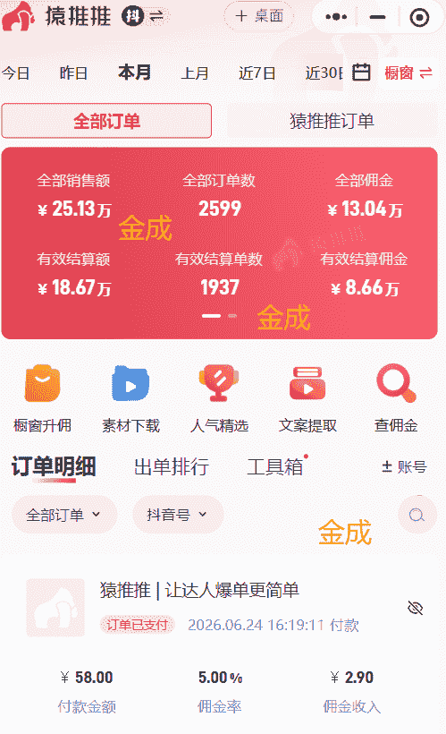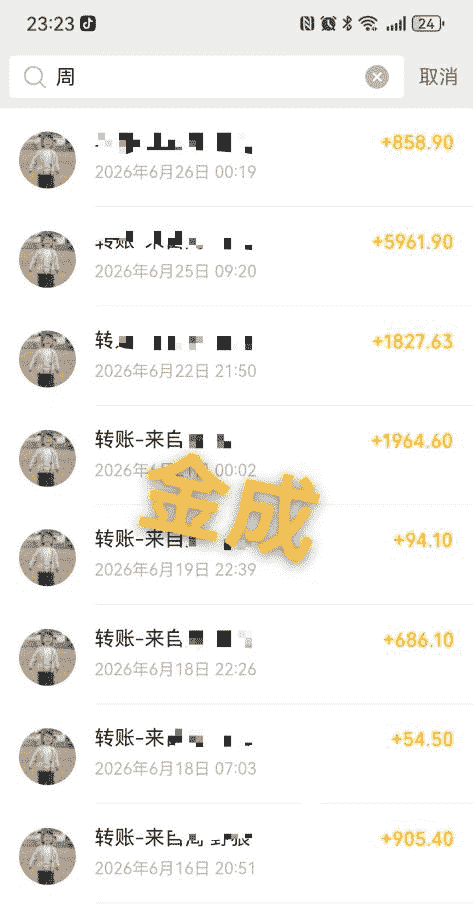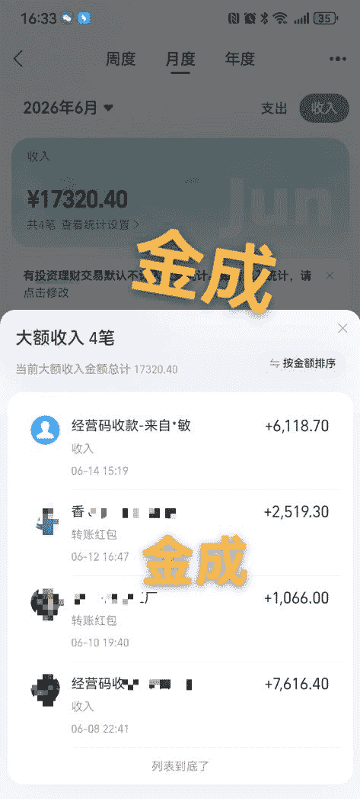

用一段正能量的情感故事 + 人设植入 + 产品植入 + 引导购买 = 最后成交。这就是一个完整的结构。

后面会有案例展示。用情感故事圈定目标人群（银发为主），并拉动流量，合理的人设植入增加信任，合理的产品植入埋下购买伏笔，最后引导购买，直接到橱窗或者直播间完成成交。

正能量的情感故事：孝顺故事、见义勇为、助人为乐、爱心奉献、舍己为人、婆媳关系、邻里关系等等。

人设植入：孝顺的孩子、见义勇为的路人、帮助老年人的普通人、爱心奉献的老师、医生、舍己为人的普通人。

产品植入：见义勇为的路人，一身正气助人为乐，但是因为救人的过程中呛水，后续身体欠佳，然后经过医院治疗还是身体不好，长期精神不佳，晚上睡不好。后来用到了“助眠香膏”这款产品之后，慢慢能够睡得很香。

引导购买：如果也有经常晚上睡不好的朋友，也可以带回去试试，我放在名字下方的橱窗里面。也可以进入直播间成交。

### 案例

这几个视频感兴趣的可以好好感受一下，都是爆款案例。不光是流量爆，更是带货出单杠杠滴。这一类的视频，是我们正常情况下一定刷不到的内容，平台都是根据观看兴趣标签做推送，这些内容都是给“50岁以上银发群体”看的，所以很多圈友根本刷不到，自然会陌生。

## 情感口播——普通人怎么入手？

情感类的口播有个优点，万物皆可带。只要你的目标人群是老年群体，都可以选用情感口播的方式来带货。

带的品都是高佣，50%以上的佣金，高的可以达到70%的佣金。最低SKU单价在29.9-99，甚至更高。

老人需要的便宜护肤类，例如黄芪霜；美食调料类，例如调料汁；百货类，爆氧粉；养生类，韭菜枸杞子、青盐炮附子刷牙粉、黄芪党参豆浆粉、黄精五黑粉等等。

下面直接开始上实操。

### 准备工作

- 拍摄手机，建议苹果，我用的是苹果12Pro，跟了我4年的老设备。
- 拍摄支架，淘宝30左右随便买，便携伸缩手持，室内、户外、车里都没有问题。
- 剪映开会员使用提词器，我是用剪映直接完成拍摄，把文件用电脑剪辑，再数据线导入手机发布。

以上准备好了之后，就可以开始着手拍摄自己的第一条视频。

### 起号（拍摄/文案）

起号非常简单，把准备好的文案念出来剪辑发布就行了。这里第一步是找到文案。

文案选择：正能量的情感文案，婆媳的、孝顺的、邻里关系、助人为乐、善良热心，都可以。抖音直接搜对应的关键词，选一个月之内点赞超过1w的，直接用他们的文案起号。

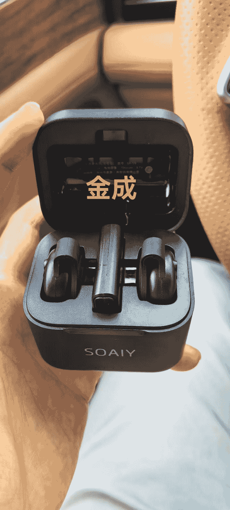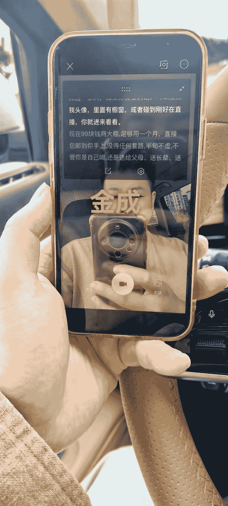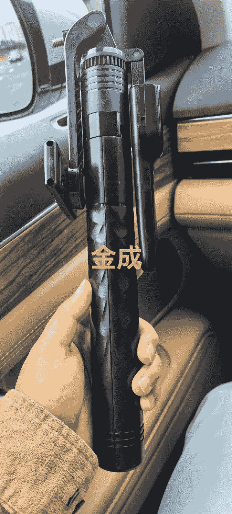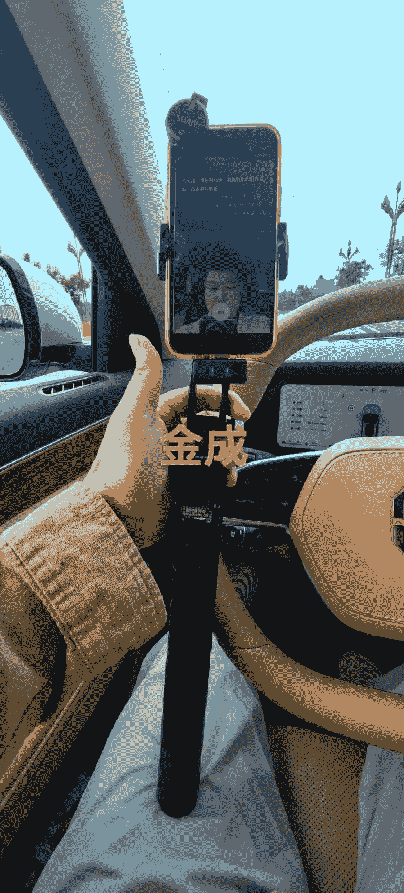

经过测试，只要表现力不是太差，最多10条作品必爆。

这里的必爆是点赞超过1w，播放在40万以上，那就直接开始带货。

我给新人朋友推荐一个账号，他里面全部都是情感流量文案，不带广告的，你们自己提取之后直接拍。抖音号：小亮牙不齐。

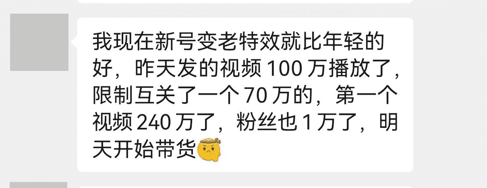

### 拍摄

拍摄其实很简单，你所看到所有拿起手机讲内容的形式都是属于口播，所以口播是最简单的拍摄形式。不管是走着拍、坐着拍、站着拍、躺着拍都不是问题，不完美的开始更重要。

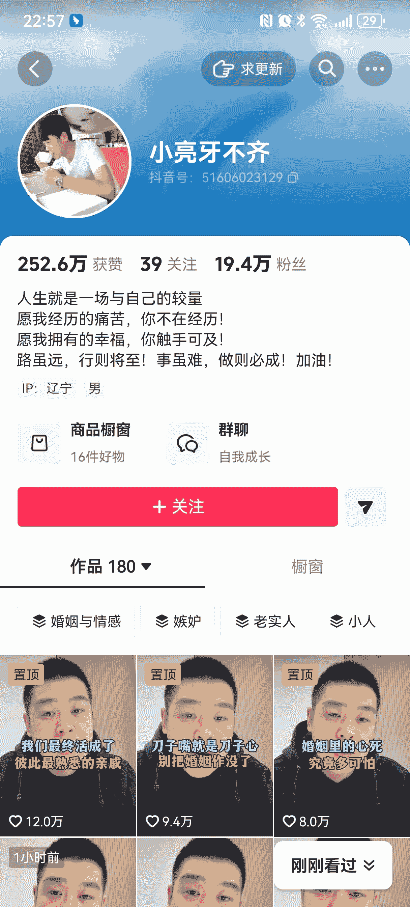

拍摄角度：可以正面镜头，可以斜45度，时不时看下镜头讲述。镜头也可以平视，也可以对齐下巴上方，有点俯视交流，这个角度会有一种对视的感觉，更能通过眼睛传达情绪。这个需要自己多练习，找到很自然的感觉那就差不多了。以及背景都要尽量真实，这些都是小细节。

### 带货

当我们有一条流量作品跑出40万，基本上粉丝也到2000左右甚至更高，我们就可以直接开启带货。

先选定最近比较火的品，比如说黄精五黑粉。

那现在我们要做的就是，先到抖音去搜这个商品名字，就能看到很多关于这个商品的一些同行的爆款视频文案，或者是正在直播的直播间，也能找到对应的账号。

找一个最近的一个星期以内的，最好能刷到两三天的爆款更好。

复制链接后，用小程序把文案提取下来。小程序我推荐用共营助手，直接开个会员省时省力。这个很重要，需要逐字修改成自己的方言版的新文案，然后拍摄剪辑发布。也注意要把这个品要挂上去，开通达人资格，挂到橱窗。

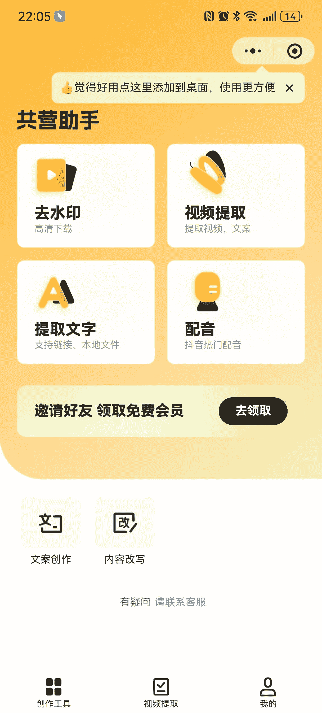

这一步其实不复杂，和我们最开始起号的流程操作方式是一样的，找到对应的文案。这里一定要注意，要改成方言版，现在方言版最容易起量。然后去拍摄发布就可以了。带货这个步骤就完成了。

因为在文案当中引导他到橱窗购买，当你起量的时候，他就直接会到橱窗去完成成交。你可以绑定抖老板或者猿推推，出单你也会收到提示。

这里有个小细节，做好评论区的引导，有人会问怎么买呀？那你要及时地去回复。如果有人做负向的评论，那你要及时地给他删除，不然会影响成交。

关于发布频率，一天至少保证一条更新。如果说数据不好，放24小时数据都不好，比如说不到一千，那就再放24小时（我遇到好几次放了3-5天的文案慢慢跑起来，最终止步于百万播放）。如果还是上不去，那这条作品这个文案你可以尝试再拍一遍，还是如此，那就换个文案吧。

同期爆款的，黄金五黑粉这个品的爆款文案起码不下10套，你可以随意地更换，选自己觉得合适的就去拍去测，直到出单。

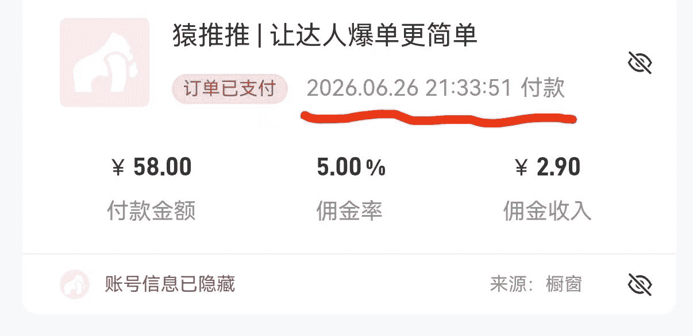

### 出单

出单以后我们如何承接流量？

如果流量不是很好，只是在缓慢增长但又在出单，那就做好评论区的引导，让他橱窗自然出单就好了。

如果流量来得很猛，那就直接开启直播，这样子转化会高一些。但是直播间一定不能说涉及医疗效果的词汇，要不然会违规。

没有样品怎么办呢？黄精五黑粉，它冲出来是黑色的，那么就可以拿个杯子兑点儿黑芝麻糊，然后把产品打印图片贴在墙上，进行一个样品的展示。同时，找商家申请样品。

如果流量不是很快又想开播，也可以选择挂播。一般这种情况下是样品到了之后需要一个转盘，把样品放在上面，用一张纸写上一些关键词，引导他自己去购买。注意直播间一定要放音乐，这就叫挂播。也可以参考下图，也可以参考同行的挂播直播间如何去布置。

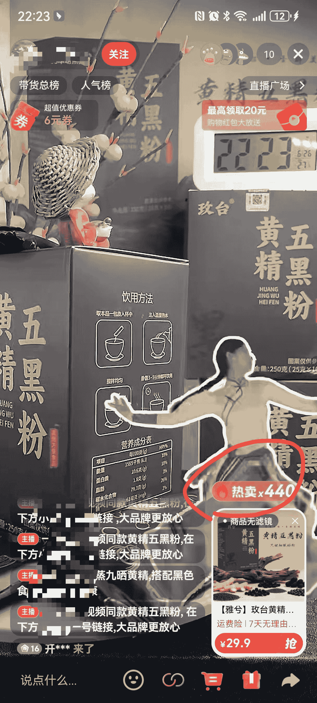

结算分为两部分：一种叫线上结算，一种叫线下结算。线上结算毋庸置疑，就是平台到了结算期自动打到你的账户，你自己再提现。

线下结算，有了固定的商家长期合作以后，他可以提前把佣金的一部分结算给你，常见的是隔天结算95%到你的微信或者支付宝，剩下的一部分线上结算。两种方式都可以，在于自己如何选择。往往线下结算佣金会稍微低一些，根据自己的情况各取所需就可以了。

走到这一步，你的基本流程就已经完全跑通了，从拍摄到剪辑到出单到直播到转化，整个流程已经完全跑通。那如何去提效增加收益呢？就在于运营上面。

### 运营（用我的实战数据做案例给大家演示）

如果你时间足够多，那你可以多做账号，这也是一种常规思维，适量地去矩阵，放大收益。

我们一个人可以用变老特效做一个账号，也可以用自己本来的年轻形象做一个账号。那如果还有余力加账号怎么办？不管是变老还是年轻，都可以再加一组账号。

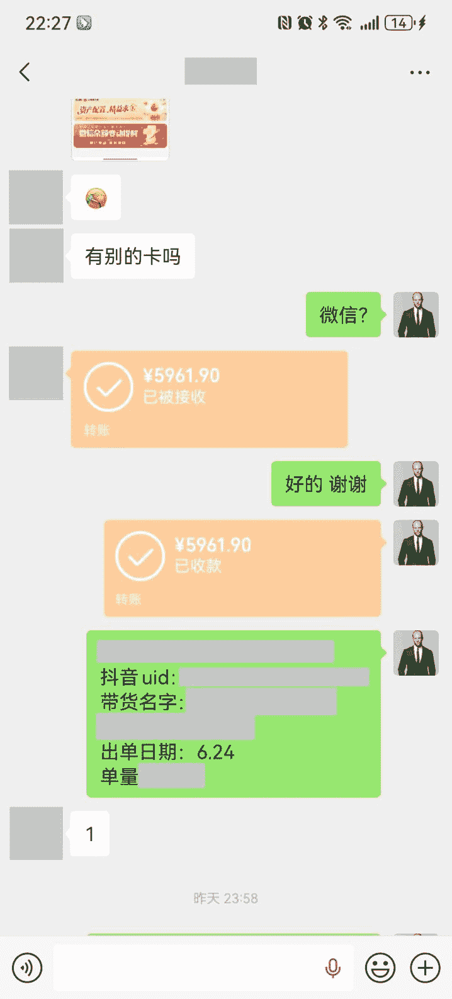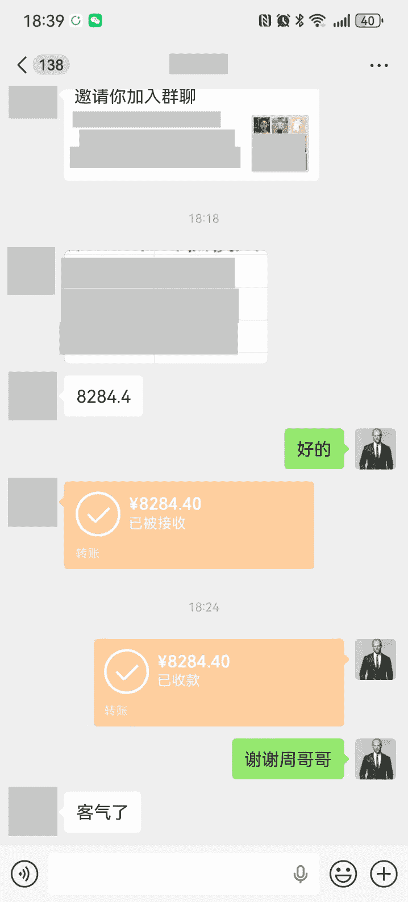

有个小坑要注意，同样的一套文案，自己同一个形象，不要到两个账号上面去发布，不然很容易出现同质化，要不然辛辛苦苦培育的账号就白费了。

多账号运营还有一个好处：我们爆单是概率，违规它也是概率。如果说一个账号出现违规的时候，它有可能限流，有可能扣健康分，甚至有可能罚款。那如果你只有一个账号的话，就会影响你的收益。你有时间，尽可能最少做两个账号，可以让你的收入更加稳定。

以我为例，十万佣金分别来自两个账号。下面是最新的数据。

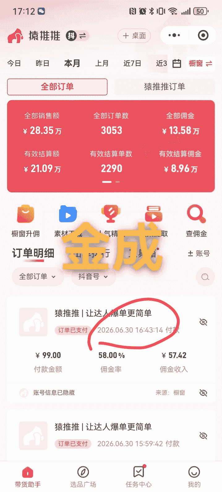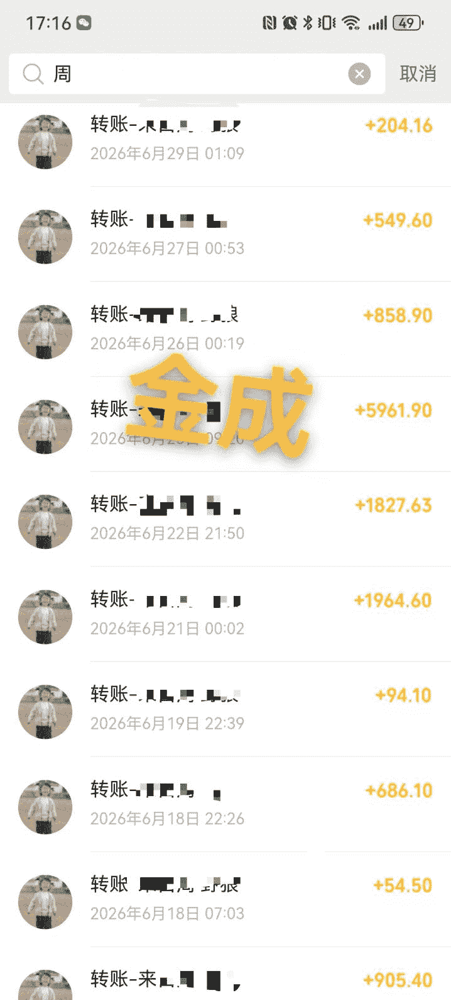

两个号打了不同的品，具体什么品我就不细说。先说第一个号，爆的作品只有一条。是个老号，平时流量几千，但是一直坚持更新，累计更新超过150条。这条接近300万播放的作品，累计卖了5万GMV，佣金58%。

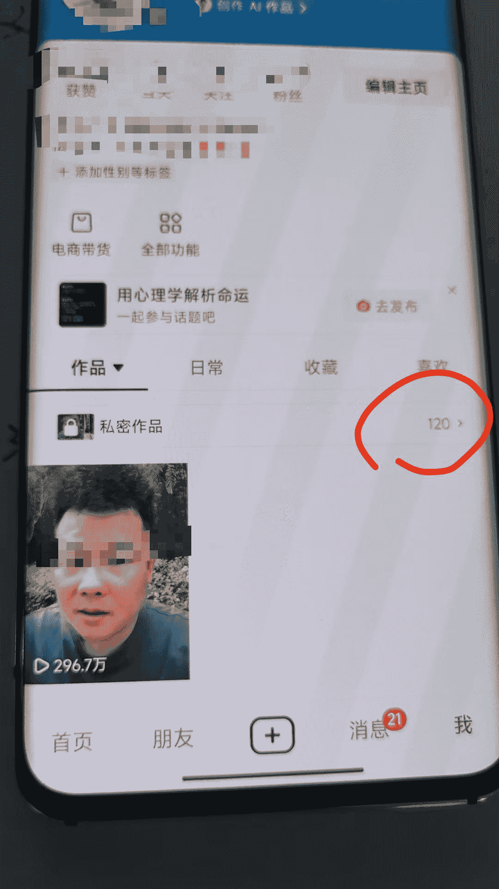

我一般会把超过三天不动的、不到万播的作品直接隐藏，这个算不上什么小技巧，只是个人喜好而已。其他的博主也会隐藏一些作品，一般不会像我把不涨都隐藏，会把数据好的作品留在主页面。（这个动作没有指导意义，在于个人喜好）

所以你只能看到一条作品，或者少量作品。不要以为他运气很好，他很牛逼，一拍就爆。看不到我们背后拍了多少作品，其实都是坚持的结果，运气来了你就爆了而已。应该先具备喝汤的能力。

第二个号带的另外一个品，也只带一个品，这其实是单品打爆的概念。也是用的这样的方法，隐藏条数也超过100条。剩下的GMV基本上都是出自这个号。今天下午发的作品就是最新的一条，现在才1000播放，晚上能到4K，明天会继续涨。

明天继续发的作品也是如此。一条作品起来就是猛猛出单，一天上百单，那单天可以拿到几千甚至上万。如果没有高播放出现，那就一天十几二十单，够温饱。

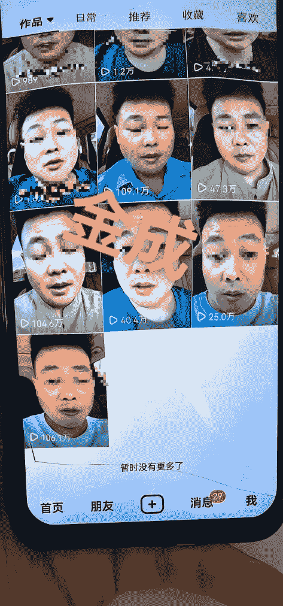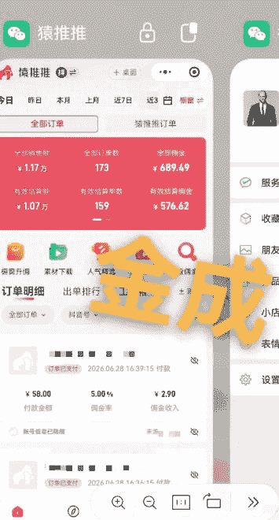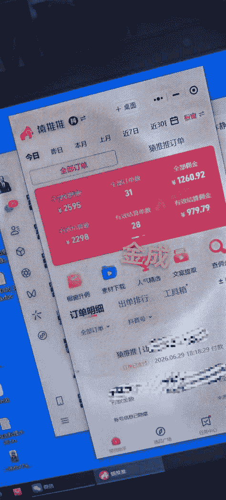

其实这个玩法现阶段运营的本质，就是稳定输出，把每天的作品拍好。只要账号每条作品能过千，那就是好账号。剩下就是坚持，等风来。

这个玩法整体来说它是不难的，我们如何去把这个文案拍成爆款？

其实传达的就是情绪。你能把5分钟的视频拍好，那15分钟的视频也不在话下。

剩下的就是坚持。能拍出基本质量保证的作品，这是一种能力，加上坚持就等于爆单。这就是一个池子，早晚都会轮到你。

**基本能力 + 坚持 = 爆单**

### 拓展玩法

有人用数字人形象直接做成口播视频，这样可以适当放量，但是相对真人来说容易违规一些，适合小工作室运作。可以直接矩阵之后，一个账号开播，所有的账号都连麦引流到这个账号成交。

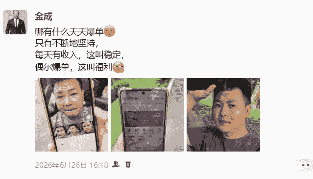

### 常见答疑

**1. 什么人适合做口播？**

能正常出镜的，说话没有障碍的，不论男女都适合。

如果非要在年龄上加限制，我更建议有一定社会阅历的80后、70后来做，因为经历过人情的冷暖，更能体会文案当中的各种情绪，能共情，才能更好地表达。我团队里面也有00后在做，数据非常好，他只选年轻的文案来跑。

**2. 会违规吗？项目能做多久？（新手容易踩坑1）**

会违规，但都是概率，最近的违规率还是比较低的。

有些同学不敢用自己的声音，选择软件配音，那就很容易同质化，也更容易违规。所以我更建议大家用自己的原声，最好是带有方言的配音。

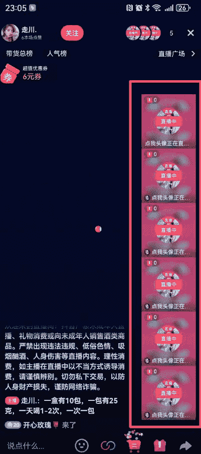

另外，带货的时候，高佣首选养生类的品。可能会用一定的中药的功效去引导他们下单，这个涉及医疗，还有可能涉及夸大，那就有可能会违规，这就要注意规避。

至于项目能做多久，我想说的是：平台不倒，口播永存。能够出镜自然地拍视频其实是一种能力，很多人面对镜头是恐惧的，他不敢出镜。而我们普通人能够利用镜头进行表达，是一种最低成本的创业方式。可能以后这个玩法没有了，但一定还会有其他的玩法出现，但口播的方式，一定是不会变的。

到时候直接切换就可以。每一个具体的玩法都会有红利期，但是口播这个大类目，会一直跟随着平台的存在而存在。

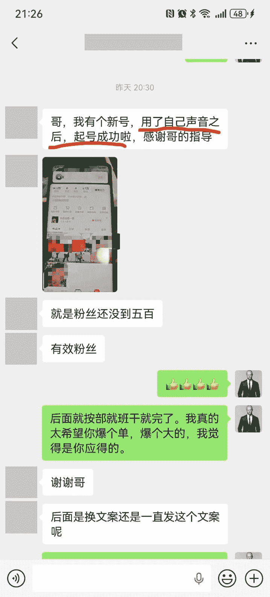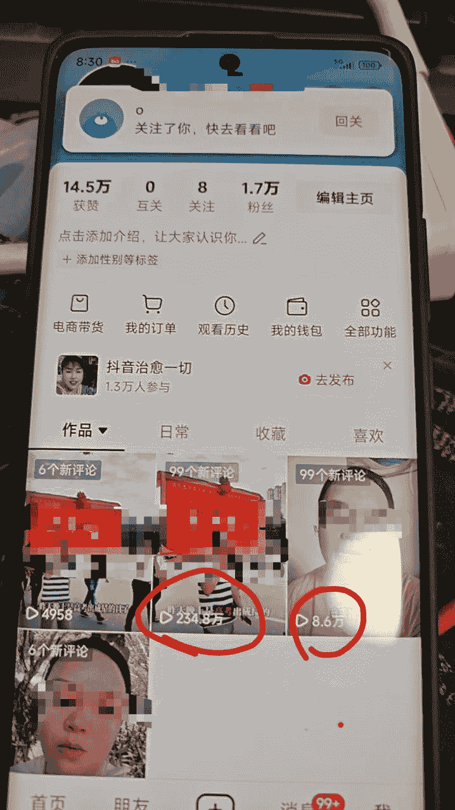

**3. 总是不起量怎么办？（新手踩坑2）**

每个人理解的起量标准不一样。我理解的不起量是无论你怎么发，它都只有500以下。如果是这种情况，我们先检查一下自己的视频质量，达到了基本的水准没有。如果达到基本水准以后还是500以下，那你就直接换号吧。如果基础流量都有两三千，甚至偶尔四五千，那就没得说，你就尽管按照现在的风格继续去拍摄，交给时间，坚持干就完了。

如果说优化，那可以在自己的拍摄角度、光线、画面、文字状态、情绪这些点上进行优化。同行永远是最好的老师。

经常爆的那个人，你就把他盯紧了：他在拍什么文案？他是怎么拍的？我和他还有什么差距？

就以他为对标。我们达到他的拍摄水准，剩下的就是运气+坚持，干就完了。

**4. 带货之后流量好像降低了？（新手踩坑3）**

这是很容易出现错觉的地方。如果以单条40万播放为标准起号，加上带货文案之后只有几千播放，很多同学会有心理落差。

这是正常的。你只需要记住，不管是你流量文案还是带货文案，只要24小时播放过千，那都是正常账号。你只要做的就是坚持每天更新，每天稳定更新。

**5. 新手拍摄/剪辑中，容易出现的问题（新手踩坑4）**

公众号懒人搜索，懒人专属群分享

1. 这种视频拍摄是很简单的，可谓“一镜到底”。拍摄的时候因为停顿比较多，所以黄金一秒必须剪辑好，做到打开就有声音，把最前面的停顿必须剪掉。

2. 拍摄中的时候难免口误出错，没有关系。心里默数 1-2-3-4-5，停顿五秒，方便剪辑的时候直接找到。这样可以大幅提升剪辑效率。

3. 剪映提词器一次最多 5 千字。如果超过，那就分成两段文案，拍摄两段视频，剪辑到一起，720P 导出足够了。要不然你的电脑会炸的，长的视频文案有超过半个小时的。

### 6. 供应链的问题

这些常见的品一定会有稳定的供应链的，就是那么几个商家，他们在做，你直接去联系他就好了。很多都可以做线下结算，如果你实在找不到，也可以找我帮你联系。

### 7. 账号实名的问题，账号如何解决？

抖音现在一个人只能实名一个账号，那找亲戚、找朋友，他们每个人都可以帮你实名一个，但是提现会到他的银行卡。所以这种情况呢，我们往往就会用线下的供应链，把绝大部分的资金都结算到微信或者支付宝，少部分的资金到他们的银行卡，也方便处理。

毕竟人心这个东西有时候不太好把控，尽量去规避，减少一些麻烦。赚钱自己知道就好了，别让别人知道你赚了多少，尤其是赚大钱的时候。

### 8. 可以多平台同步吗？

可以的，不过这个玩法是以抖音为主，视频号很容易违规。它查文案比抖音还要严格，有可能你能跑出来，但是 2、3 个小时就给你干掉了。能吃一波流量你就吃，它的转化往往比抖音还要高、还要快，爆发性非常强，但是干得也快，动不动就 7 天、30 天。

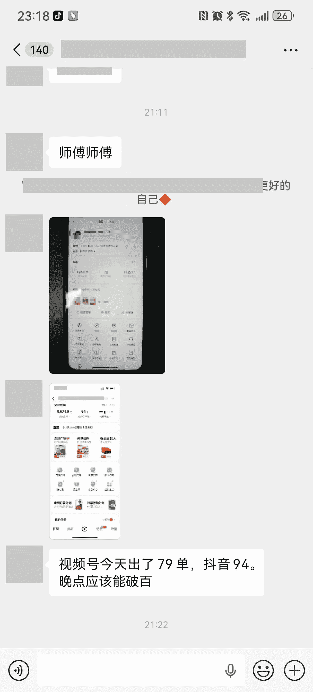

所以说只做同步，能捡就捡。有账号的可以打，没有账号就同步一下就行了，或者说也可以不用管它。关于快手也可以做同步，但是快手有很多假流量。你看它跑了大几千播放，但是点赞只有一两个，两三个评论都是歪的，和我们的视频一点关系没有，这就是假流量。

你只做同步，它能出单就让它出单，该挂的品你也给它挂上，不做要求。

主要还是以抖音为主。说到这里有个问题要说一下，因为我们的作品时间很长，十几分钟甚至达到二十几分钟，甚至有三十几分钟的视频素材比较大，上传时间比较费。所以，你不一定有时间同步到快手或者视频号。没有也就算了，我也没有做同步，因为之前同步过数据不好，要不就是账号不够。

### 9. 一定用方言

最近的方言爆得很凶，最好不要用普通话。四川话、河南话、粤语，最近变现非常猛。很多方言其实全国都能听得懂，一是不容易违规，二是首发地域优势，再往外扩散，转化会很高。

## 新人镜头恐惧感

这个点我想了两天，我觉得必须详细地写出来，因为这是我的来时路。大家可以慢慢看下，能多帮一个圈友突破也是一份福报。

我是 80 后，农村长大的，小时候拍照都会眼睛看向别处，说话都不敢看别人的眼睛。一个稍微好看点的姑娘盯着我，我都会脸红不好意思。自己身边有一些特别爱“出头”的小伙伴，让我是既羡慕又嫉妒，甚至“厌恶”。羡慕他能洒脱自然，也“厌恶”他比自己“风光”。

即使现在快 40 了，我始终都还是一个社恐。在人多的场合都会把自己藏在角落里，怕被人发现。每次线下会，都是不自觉地坐后排，从来没有一次大胆地坐到前三排。给孩子开家长会也是如此。

这不怪我，也不是错。是我从小到大的环境给我带来的，是这么多年习惯了谨小慎微，或者说是胆小恐惧。我不是不会说话，也不是不会表达，只是没有熟悉之前，我就是不愿意站到聚光灯之下，潜意识里会逃避、会躲闪、会恐惧。

24 年我第一次拍口播，第一次尝试出镜。第一条视频拍完，我看着镜头里面的自己，感觉蚂蚁在身上爬，觉得各种不自在，眼神乱飘、表情不自然，怎么看怎么别扭，怎么看怎么尴尬。

但是我还是直接把作品发布了，虽然没有爆，但是有正常的流量。评论区、点赞、收藏、播放，都是正常的，我才知道，我的各种感受都是来自于我的主观，而不是来自观众视角。我们看别人亦如别人看我们。说白了，根本就不在意我们内心在意的那些细节。

从此过后，我就慢慢放开了，就是那句话——只要自己不尴尬，尴尬的就是别人。一直坚持到现在，累计拍摄口播视频已经超过我也不知道多少了，嘿嘿~没有具体数过。反正已经达到了说拍就拍，无所谓。

我想给各位圈友说的是，如果想出镜，第一动机是为赚钱，那第二动机就是突破自己。

不试试，你肯定不知道，原来自己没有想象中的那么重要，根本就没有人在意镜头里面的你，数据会给你答案。

不试试，你一定不知道，原来自己也可以像别人视频里面那样侃侃而谈，真诚地表达，数据会给你答案。

第一次出镜或许不会给你太大的冲击和感受，但这是一次勇敢的突破。各大平台出镜口播的太多，不仅仅是带货，更多的反馈会给未来的你一份满意的答卷。

亦仁说：表达者红利。很多年前我就听进去了，所以这些年我一直在尝试多表达。每一次输出都能是对自己的一次系统梳理，虽然还不够优秀，但是回望 5 年前的自己，我已经超过太多。

这么多年一直呆在生财有术，觉得很值得也很温暖，有种发自内心的归属感。也许是到了中登的年纪，现在经常思考得比较多，比较关注自己内心的真实感受。我总在想，有幸在生财，我何以回报知遇之恩？那就做项目真诚的分享吧。毕竟其他的东西我也不会了。如果因为我的一些分享，能帮助、启发到后来者，那也算是功德一件。

最重要一点我必须要说：心态！！！！

真人出镜口播带货是我们普通人最低成本的赚钱方法。

暂时不起量，那是在打磨作品、累积数据。

暂时没爆单，那也有一份稳定的收入。哪怕每天只用 2 小时拍、剪一条，每天蹦十单八单，那也几百佣金到手，积水成渊。

一旦爆单，那就当作生活对我们的奖励。互联网最大的魅力，就是不确定性。只要你坚持，一定不会让你饿死。但是爆单一天出几百单甚至上千单，一次可以让你赚到几个月甚至半年的钱。

用这样的心态来做这件事情，结果一定会远远超过你的预期。

我现在每天雷打不动地至少更新三条作品。坚持不下桌，早晚轮到你。这就是我做短视频这么多年以来，最值钱的经验。

### 结语

上面很多收益图，没有诱惑的意思，只做最真实的数据分享。还请不要误解。

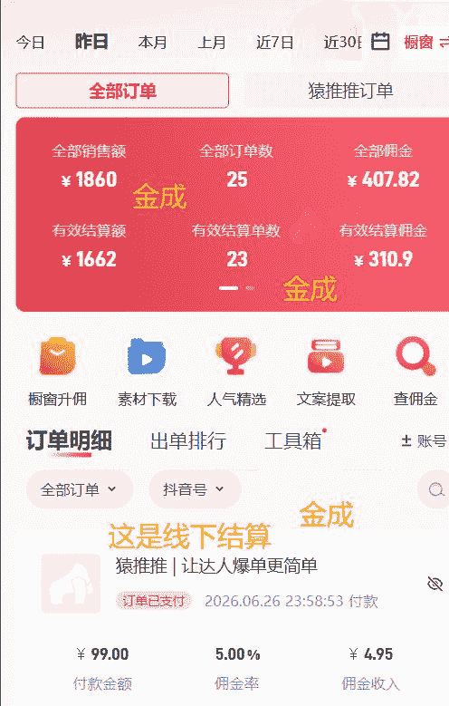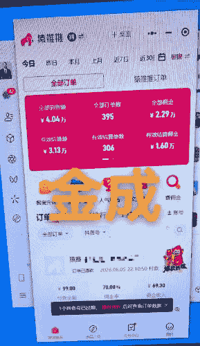

AI 盛行的年代，千万不要忽略真人口播。

各种大 IP 都是口播，金枪大叔、江湖说等等……平台一直在，只要你张嘴就行。

离我们普通人最近的，就是出镜口播带货。能出镜的圈友，一定要尝试出镜，坚持下去，会让你不虚此行。

————分割线————

看完这篇 SOP，你觉得你懂了。但 90% 的人一到实操就会卡在第一步。

工具和教程只是最低级的壁垒，真正的壁垒是“立刻动手”和“圈层信息差”。

如果你想看全网最新的变现玩法，并且和一群执行力极强的极客一起下场拿结果，欢迎围观我的核心私域：【懒人专属群】。

我们不聊虚的，只做商业闭环的拆解与 AI 效率的压榨。系统内已沉淀 1000+ 跑通的套利实战局。

👉 查阅圈子完整数字资产与上车门槛：

https://lazyso.com/insider/

认同价值、准备好下场干活的，扫码加我微信（lazyhelper1）。

备注：【实操上车】，不闲聊

