# 从 **YouTube** 小白到单条视频 **1** 亿播放，也曾两次失去 **YPP**：我做 **AI** 视频这一年的复盘

260706 副业SC 精华

整理：公众号懒人搜索，懒人专属群精选

懒人微信：lazyhelper1

大家好，我是浅夏，今年 4 月加入的生财。

6 月 6 日，受组局官杨哥@多米杨 邀请，我在大连线下聚会上做了一场 YouTube 运营实战分享。

过去一年，我从一个 YouTube 小白，先后两次从 0 到 1 开通 YPP。运营的两个频道总订阅超过 10 万，总播放量超过 2 亿，其中一条 AI 短视频跑到了 1 亿播放。

但这段经历的另一面是：两个靠短视频开通的 YPP，后来都被取消了。第一次因为儿童问题，第二次因为同质化内容。

我跑出过 **1** 亿播放，也两次失去 **YPP**。这次线下分享，我把一年里的起号过程、运营心得和踩坑教训，整理成了近 100 页 PPT。

这不是一份"如何快速在 YouTube 赚到钱"的成功学教程，而是一份真实的项目案例：我是怎么开通 YPP 的，1 亿播放是怎么跑出来的，两个 YPP 又为什么没能保住。如果今天重新开始，哪些方法我还会继续用，哪些错误我一定不会再犯。

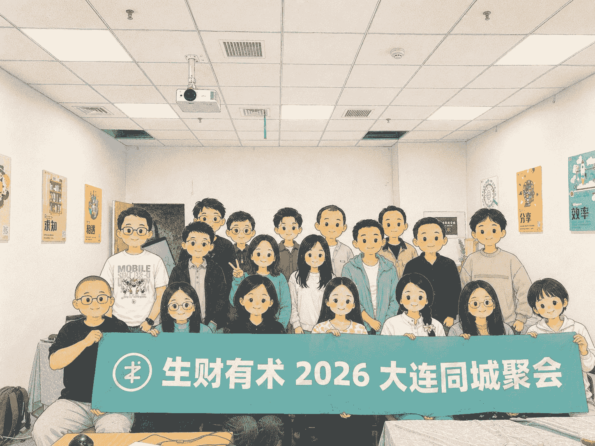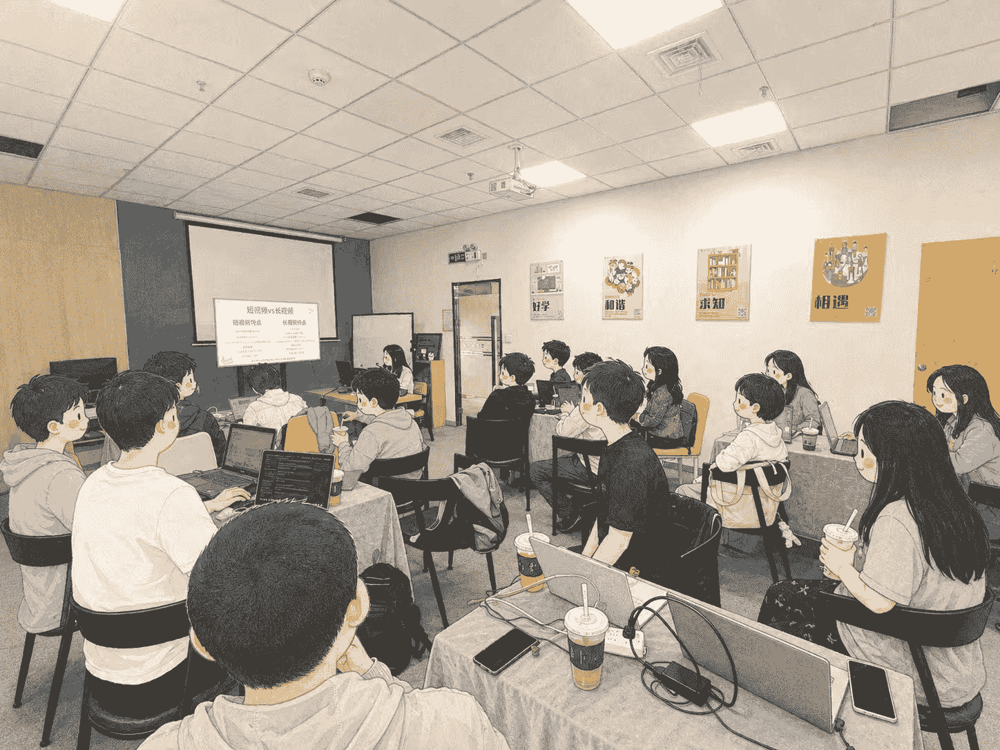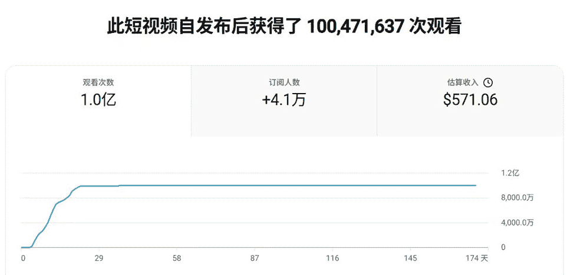

## 1、1 亿播放和两次失去 YPP，都是这一年的真实经历

### 1.1 答应分享之前，我其实很忐忑

杨哥邀请我做分享时，我的第一反应不是兴奋，而是忐忑。

一方面，我的经验只代表过去，之前靠短视频开通的两个 YPP 都被取消了，现在正尝试转向长视频，还处在起步阶段，并没有一套可以保证成功的方法；另一方面，生财里面优秀的人很多，和真正的大佬相比，我的这点成绩并不算什么。

但杨哥对我说，一个项目只要真正做过、拿到过结果，就一定有经验可以帮助别人。并且分享本身，也可能带来资源的链接。

这句话最终说服了我。

后来我慢慢意识到：复盘的价值，不在于证明自己有多成功，而在于把结果背后的动作、判断和代价讲清楚。成功的经验可以提供参考，失败的经历则可以帮助后来的人避坑。尤其是 YouTube AI 短视频这类变化快、门槛低、不确定性高的项目，后者可能更有价值。

### 1.2 这场分享的核心价值

这场分享的核心价值，不只是教大家"如何生成一条 AI 视频"，而是完整复盘一个 YouTube 新手如何利用 AI 工具和对标拆解方法，从 0 开始运营 YouTube Shorts，获得流量、开通 YPP，再到遭遇限流和失去创收资格的全过程。

AI 视频的基础操作并不难。按照步骤，大多数人都能完成图片生成、视频制作、剪辑和发布。

真正困难的，是工具之外的判断：

- 什么样的赛道还有机会？
- 什么样的对标值得参考？
- 找到对标后，应该重点拆解哪些内容？
- 短视频和长视频应该怎么选？
- 视频数据不好，问题出在账号、赛道还是内容？
- 为什么视频能正常发布，YPP 还是会被取消？
- 平台政策变化后，过去有效的方法还能不能继续使用？

所以，我想分享的不只是一套 AI 视频制作流程，更是一个真实项目从起号、爆发到踩坑、调整的完整过程。

这里既有 69 天开通 YPP、单条视频 1 亿播放的结果，也有流量暴跌、两次失去 YPP 的代价；既讲哪些动作帮助我跑出结果，也讲哪些错误让我重新开始。

工具解决的是"怎么把视频做出来"，真正决定项目能走多远的，是赛道判断、数据复盘和风险控制。

### 1.3 先说几个核心结论

如果你没有时间读完整篇文章，可以先记住下面五点。

第一，**YouTube AI** 短视频依然有机会，但已经不是无脑复刻的阶段。过去有效的直接复刻、重复提示词和批量生产，如今都可能成为同质化风险。AI 可以提高效率，但内容需要改编和差异化。

第二，**YPP** 不是终点，真正难的是持续合规、持续获得收入。开通 YPP，只代表你暂时拿到了广告变现资格，不代表账号从此安全。YPP 不是护身符。视频能发布，不代表它合规；对标能爆，也不代表你能安全发布。

第三，短视频用来进场，长视频用来立足。短视频反馈快、涨粉快，适合新手入门，但同时 RPM 低、同质化风险高；长视频 RPM 高、长尾更强，却经常出现 0 播，起号时间也更长。

第四，爆款有运气，但不是纯运气。爆款可能刚好踩中了热点、算法和观众情绪，但选题、对标、内容改编、发布频率和前三秒节奏，都在提高"踩中"的概率。运气不能复制，但提高中奖概率的方法可以复制。

第五，新手可以从 **Shorts** 入门，但要从第一天开始重视合规。版权、儿童安全、暴力、动物伤害和同质化，不应该等到申请 YPP 前才检查。

真正稳妥的顺序应该是：先理解规则，再生产内容；先排除风险，再放大流量。

## 2、从 69 天开通 YPP 到 1 亿播放：我的四个阶段复盘

回头看这一年，我并不是找到一个赛道，然后一路做到了 1 亿播放。

真实的过程更像是不断循环：找到方向、获得流量、遇到问题、切换赛道，再重新理解平台。

下面我按照背景、结果、关键动作、踩坑和复盘五个方面，重新梳理这四个阶段。

### 2.1 阶段一：69 天开通第一个 YPP，微创新比复刻更重要

#### 2.1.1 背景：从达人秀 AI 短视频开始

2025 年 6 月 11 日，我正式开始发布 YouTube 视频。

在这之前，我是一个 YouTube 小白，AI 视频也才学了大概两周时间。

当时选择的是达人秀赛道，视频时长在 15-20 秒，每天更新 1 条为主。

刚开始做视频时，因为对制作流程不熟悉，加上 AI 模型能力限制，一条视频经常需要两三个小时甚至更久。

图片抽不到满意的效果，我就继续抽卡；提示词不够准确，我就反复修改。

相比盲目增加数量，当时的我更愿意把时间花在提高质量上。

#### 2.1.2 结果：69 天开通第一个 YPP，一条视频跑到 3600 万播放

从发布第一条视频到开通高级 YPP，我一共用了 69 天，跑通了从内容制作、账号运营到流量变现的完整闭环。

这个频道早期日播放量基本稳定在 5 万到 10 万，单条视频大多能获得 2 万到 3 万播放，表现较好的可以达到 10 万左右。

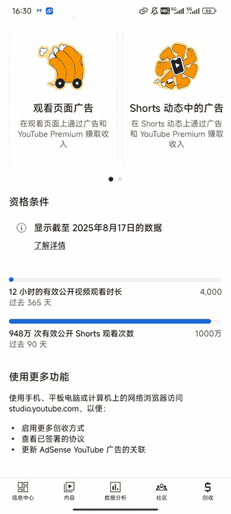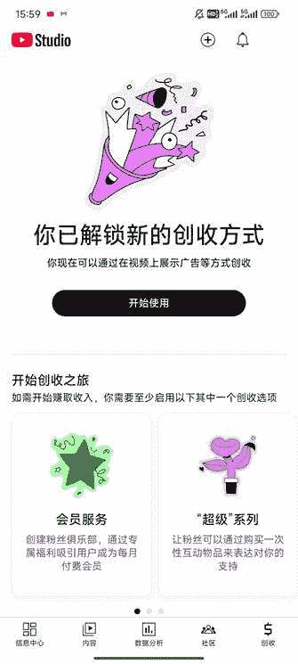

最终帮助账号跨过 YPP 门槛的，是一条千万级爆款视频。

这条视频最初只有 100 多万播放，发布一个多月后获得新一轮推流，最终跑到 3600 万播放。更重要的是，它并不是短暂爆发后就彻底停止增长。接近一年后，这条视频仍然能获得长尾流量。

开通 YPP 后，频道每天产生几美元收入，RPM 约为 0.03。金额并不多，却是我第一次真正验证：一条已经发布的视频，可以在不继续投入制作时间的情况下持续带来收入。

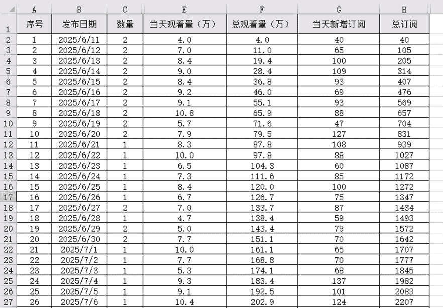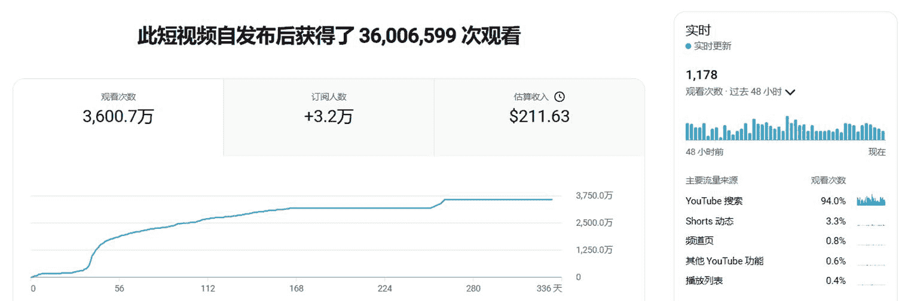

这次结果给我的信心，不只是"我开通了 YPP"，而是我第一次完整验证了这条路径：AI 制作内容、YouTube 分发流量、YPP 完成变现，这套模式确实可以由普通人跑通。

#### 2.1.3 关键动作：不是完全复刻，而是加入自己的想法

复盘帮我开通 YPP 的那条视频，我发现它与其他作品最大的区别是：我没有完全照搬对标。

视频一共使用了 4 张关键帧图片，其中 2 张是根据我自己的想法重新设计的。

当时我并没有系统总结出"差异化"这套方法，只是觉得对标的内容可以调整。但恰恰是这点微创新，让视频既保留了已经被市场验证的内容内核，又没有完全重复原视频。

对标解决的是方向问题，微创新解决的是内容为什么值得再看一次。

#### 2.1.4 踩坑：把"能发布"误认为"没问题"

开通 YPP 后，达人秀赛道的流量逐渐下降，我又尝试了印度故事、耶稣视频等新方向。

这些内容有的也跑出了百万甚至千万播放，但我没有充分意识到，其中涉及的儿童形象和危险情节，可能触碰 YouTube 的创收政策。

10 月 23 日，我打开收益后台，发现 YPP 被终止了，原因是"鼓动对未成年人的不受欢迎的关注"。

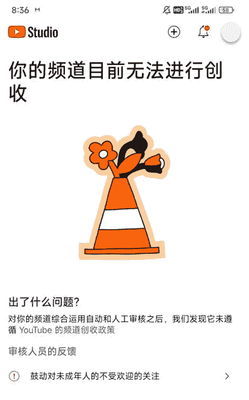

那一刻，我才发现自己一直存在一个错误认知：我以为视频能够正常发布，就代表内容没有问题；我也以为别人做过、并且拿到过高播放，就代表自己可以安全对标。

事实并非如此。没有立即收到处罚，不代表内容长期合规，只是风险还没有暴露。

#### 2.1.5 复盘：如果重来一次，我会把合规放在流量之前

如果重新做第一个频道，我会从第一天开始建立合规检查：

- 发布前检查儿童、暴力、动物伤害和版权风险；
- 不因为对标视频数据好，就默认内容安全；
- 定期排查已经发布的视频；
- 对拿不准的内容，宁愿不发，也不抱侥幸心理。

第一次失去 YPP 让我明白，合规不是申请创收之前才做的准备，而是内容生产流程的一部分。

这一阶段最大的教训是：爆款不是复刻出来的，而是在复刻基础上做微创新跑出来的；收益也不是开通 **YPP** 后持续稳拿的，而是建立在长期合规之上。

### 2.2 阶段二：14 天开通第二个 YPP，单条视频 1 亿播放

#### 2.2.1 背景：黑猩猩热点 + Sora2 工具红利

第一次失去 YPP 后，我调整了大约一个月。

2025 年 11 月中旬，我开始重新寻找赛道。当时正好看到有人使用 Sora2 制作视频，并在一个月内开通 YPP，我决定试一试。

通过关键词搜索，我找到了黑猩猩相关赛道。

这类视频通常只有 10 秒左右。得益于 Sora2 强大的文生视频能力，只需根据对标视频反推提示词，就能生成效果不错的视频，制作效率也因此大幅提升。

当时每天发布 5-6 条视频，单日投入时间大约为 1-1.5 小时。

#### 2.2.2 结果：14 天达到 YPP 门槛，单条视频突破 1 亿播放

第二个频道的增长速度远远超过第一个频道。

频道运营到第 14 天，总观看量达到 2900 万，并满足高级 YPP 门槛。

频道开通收益后，连续 8 天的单日收入超过 80 美元，相比第一个频道每天几美元的收入，这次结果让我第一次看到 AI 短视频在短期内放大收益的可能性。

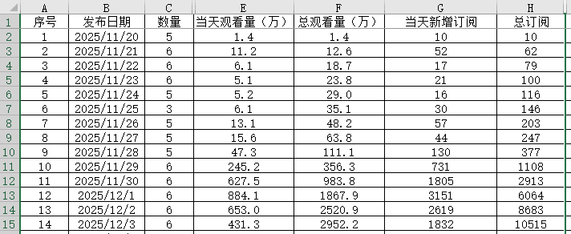

其中表现最好的一条视频，在 20 天左右突破 1 亿播放。1 亿播放看起来是一个遥不可及的数字，但它真的发生在了一个制作流程并不复杂、每天投入约 1 至 1.5 小时的频道上。

不过，1 亿播放量的实际收入远低于我的预期。

这条视频前面的 6000 万播放发生在 YPP 开通前，没有产生广告收益；开通 YPP 后的约 4000 万播放，RPM 0.02，带来了 571 美元的收入。

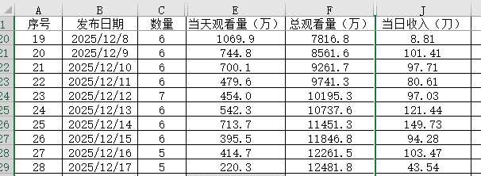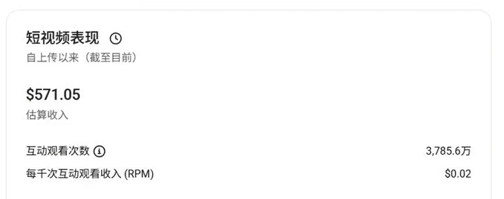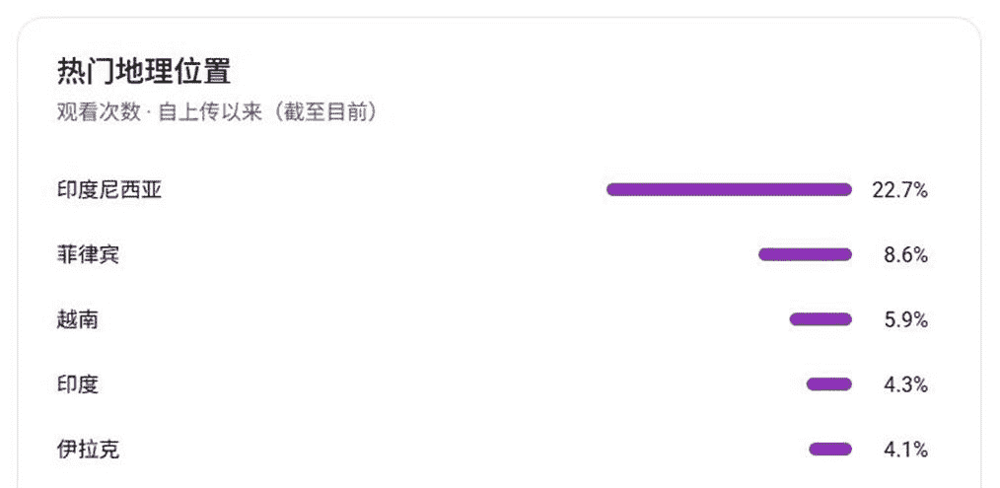

这组数据让我同时看到了 Shorts 的流量上限和收益局限：Shorts 可以用极短的时间获得极大的播放，但播放量只是流量结果，不代表最终收入。

#### 2.2.3 关键动作：热点、工具红利和高频测试同时发生

这一阶段能够快速跑出来，并不是因为我突然掌握了某个爆款公式。

真正起作用的是几个因素叠加：

- 黑猩猩内容跨语言理解成本低；
- 动物拟人和夸张反差适合 AI 视频表达；
- Sora2 降低了视频生产成本；
- 每天发布 5-6 条，增加了算法测试内容的机会；
- 赛道正处于热点阶段，观众需求和平台流量同时存在。

高频发布不是为了制造更多重复内容，而是为了获得更多测试样本。只有样本足够多，我才能判断究竟是选题不对、画面不对、开头不够吸引人，还是账号本身没有获得推流。

#### 2.2.4 踩坑：平台规则变了，我却仍想继续使用旧方法

12 月 18 日，因 YouTube 算法调整，开通 YPP 仅仅 10 天后，我的频道流量突然暴跌。

此前每天还有约 200 万播放，调整后只剩 1 万左右。这次限流持续了 9 天。

与此同时，越来越多的频道因为同质化被取消 YPP。我的频道暂时没有受到处罚，这反而让我产生了侥幸心理。

我知道直接反推爆款、重复使用提示词的方式已经存在风险，却舍不得删除已经跑起来的视频，也不愿意轻易放弃这个高效的内容模式。

之后，即使我尝试通过 AI 工具对脚本进行二次改编，流量仍然很不稳定。

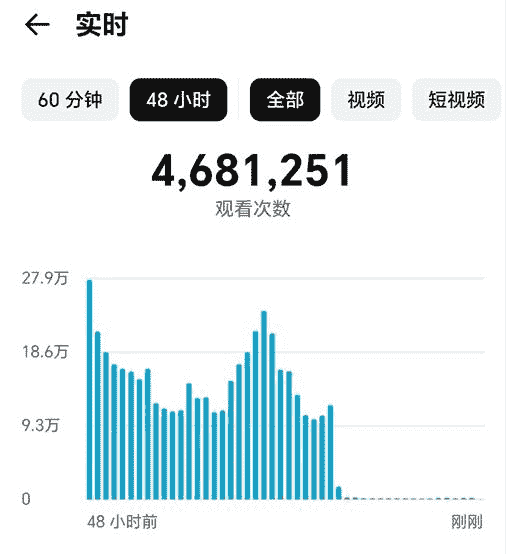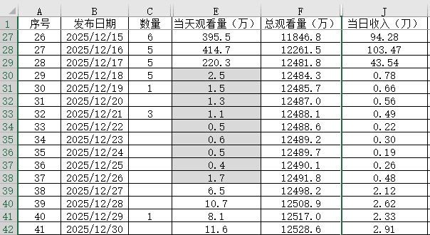

以前一条视频达到 3 万播放很容易，后来很多视频只能获得几千播放。频道每隔一段时间就会出现一次流量腰斩，收益也从每天几十美元降到几美元。

2026 年 2 月 24 日，第二个 YPP 被取消，原因是同质化内容。

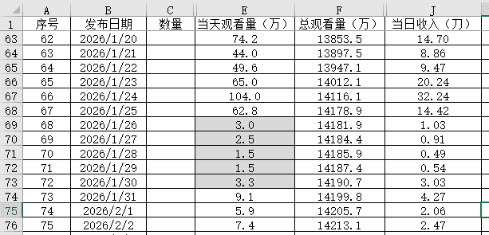

相比第一次，我的心情反而平静了很多，甚至有一种如释重负的感觉。因为在收到通知之前，我已经很长时间处在"账号什么时候会出问题"的焦虑中。

#### 2.2.5 复盘：如果重来一次，我不会拿账号安全赌流量

如果重新经历这一阶段，我仍然会抓热点、使用新工具，也会保持较高的更新频率。

但我不会继续直接复用提示词，更不会因为某种方法暂时有效，就把它当成长期能力。

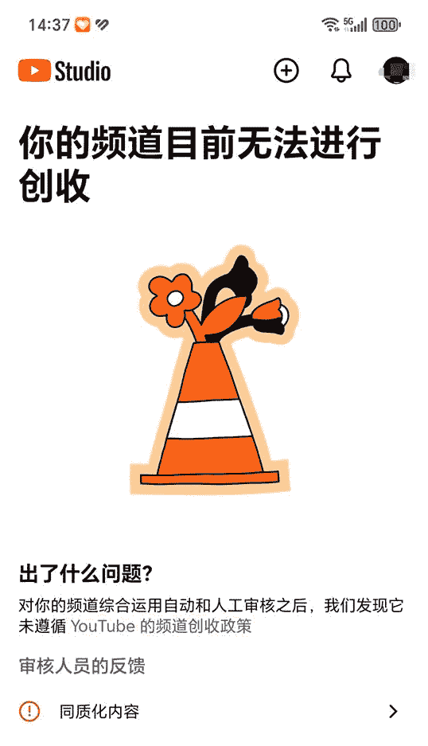

在 12 月 18 日第一次出现异常限流时，我应该立刻完成三件事：

1. 停止继续生产高度相似的内容；
2. 排查并删除风险最高的视频；
3. 重新设计脚本、角色、情节和镜头表达。

当平台政策已经变化时，继续维护旧方法，不是坚持，而是在累积风险。

这一阶段最大的教训是：热点、工具红利和高频发布可以迅速放大结果，但只有及时适应平台规则，才能让流量转化为长期收益。

### 2.3 阶段三：2600 万播放摆在眼前，但我不敢再申请 YPP

#### 2.3.1 背景：重新做 K-pop 赛道，并建立角色 IP

2026 年 2 月起，Seedance2.0 带动了一新一轮 AI 视频热度，于是从 3 月开始，我用第一个掉了 YPP 的频道重新尝试 K-pop 赛道。

视频时长为 10-30 秒，主要分为两类：

- 已被验证过的形式爆款；
- 在爆款视频基础上重新改编的故事内容。

制作流程也比早期更简化：先用 Google AI Studio 拆解对标并改编脚本，再通过香蕉、即梦等工具生成角色图和首帧图，最后即梦生成视频并完成剪辑。

这一次，我没有只追求复刻，而是设计了自己的角色 IP，希望提高频道内容的一致性和辨识度。

更新频率保持在每天 1 条。

#### 2.3.2 结果：24 条视频达到 1100 万播放，停更后又冲到 2600 万

一个月内，我一共发布了 24 条视频，总播放量达到 1100 万。

然而，就在这个阶段，YouTube 开始严厉打击 K-pop 赛道，大量频道因同质化被取消 YPP。考虑到风险问题，我最终选择暂停更新。

停更大约两周后，我再次打开后台，意外地发现其中一条视频已经跑到 1500 万播放，频道总播放量达到 2600 万，再次满足申请 YPP 的条件。

这一次，考虑到同质化风险，我没有申请 YPP。

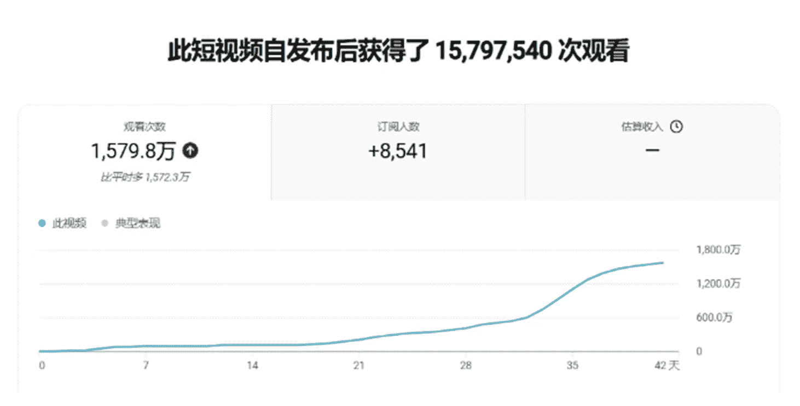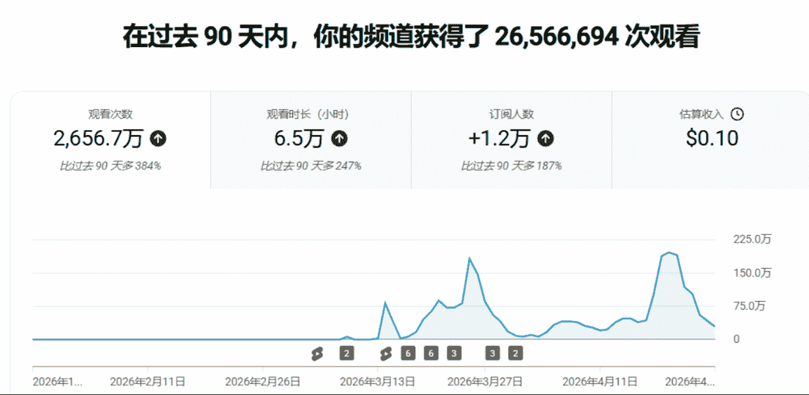

 

#### 2.3.3 关键动作：从复刻爆款，转向改编内容和建立角色

这一阶段，我开始有意识地改变内容生产方式。

不再只是替换画面，而是尝试改变脚本、人物关系和情绪走向；不再每条视频使用不同角色，而是通过固定角色IP建立频道识别度。

这说明我已经开始从“找到爆款就复制”，转向“理解爆款为什么成立，再重新表达”。

#### 2.3.4 踩坑：只看到赛道流量，没有提前判断政策风险

K-pop赛道的优势非常明显：

有成熟IP，有大量粉丝，也有持续更新的热点。

但它的风险同样明显：

版权边界模糊，角色和内容高度集中，同类创作者又大量涌入，很容易出现同质化。

我最初看到的是播放上限，却没有把赛道的长期安全性放在同等重要的位置。

有流量的赛道，不一定是值得长期投入的赛道。

#### 2.3.5 复盘：如果重来一次，我会把风险纳入赛道选择

如果重新选择，我不会只看近期是否有千万播放，还会同步判断：

- 赛道是否依赖受版权保护的IP；
- 同类内容是否已经高度模板化；
- 频道能否建立真正独立的角色和内容风格；
- 即使达到YPP门槛，内容能否通过长期审核。

这一阶段最大的教训是：不是所有达标都值得申请。账号能不能长期安全，比一时开通**YPP**更重要。

### 2.4 阶段四：转向长视频后，我才发现0播是常态

#### 2.4.1 背景：从追求快速反馈，转向尝试长期内容资产

经历两次YPP被取消后，我开始认真考虑长视频。

短视频反馈快、涨粉快，但RPM低，对热点和发布频率依赖更强，也更容易陷入同质化。

长视频起号更慢，却拥有更高的RPM和更强的长尾价值。从长期来看，它更接近一份可以持续积累的内容资产。

从2026年4月开始，我把主要精力转向长视频。

#### 2.4.2 结果：过去28天只有900次观看

到分享时，我的长视频还没有拿到明显结果。

单条视频大多只有几十到一百的播放，距离4000小时的高级YPP门槛仍然任重而道远。

但长短视频本来就不是同一套数量级。

短视频大多三天内完成推流，长视频往往需要一周甚至更长时间；短视频万播很常见，长视频万播已经可以算一条表现不错的内容。

#### 2.4.3 关键动作：接受慢反馈，用测试代替死磕

这一阶段，我开始采用更耐心的测试方式：

- 多个账号同时测试，每个账号先发布2-3条视频；
- 至少观察一周，不因前几天0播立刻放弃；
- 每两三天更新一次，把时间留给选题、脚本和包装；
- 重点观察封面点击率、平均观看时长和流量来源；
- 保留有数据反馈的方向，暂停长期没有反馈的内容。

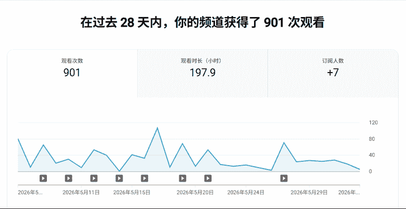

长视频不能只靠提高发布数量解决问题。

标题、封面和开头决定观众是否愿意点进来，脚本和内容质量决定观众愿意留下多久。

#### 2.4.4 踩坑：用短视频的反馈速度要求长视频

做惯了短视频后，我很容易把短视频的判断标准带到长视频中。

视频发布后几天没有播放，就怀疑频道有问题；单条视频只有几十播放，就觉得内容没有机会。

但长视频推流更慢，测试周期更长，内容包装对结果的影响也更大。

用短视频的耐心做长视频，最容易得到的结果不是爆款，而是提前放弃。

#### 2.4.5 复盘：如果重来一次，我会提前接受长视频的慢

如果重新开始，我会准备多个内容方向，用多种视频风格进行测试，而不是根据一条视频决定频道生死。

我也会把更多时间投入三个环节：

1. 选题是否存在明确需求；
2. 封面和标题能否产生点击；
3. 开头是否能让观众继续观看。

长视频还没有让我获得值得展示的成绩，但它正在迫使我重新学习内容本身。

这一阶段最大的教训是：短视频考验测试速度，长视频考验内容耐心；短视频靠数量提高爆款概率，长视频靠时间沉淀内容价值。

## 3、1亿播放不是玄学：我为什么能跑出来

做出1亿播放之后，我最大的变化，不是觉得自己掌握了爆款密码，而是开始对爆款祛魅。

过去看到别人做出千万、上亿播放的视频，我总觉得对方一定掌握了某种特殊技巧。

真正轮到自己后，我才发现，爆款既有偶然性，也有可以分析的前提。

那条视频能够跑到1亿播放，确实有运气成分。

它可能刚好踩中了热点、算法和观众情绪。换一个发布时间、换一个账号，甚至换一批最初看到它的观众，结果都可能完全不同。

复盘之后，我发现这次结果并不是由某一个动作单独决定的，而是对标选择、热点特征、AI适配、工具效率和发布策略共同作用的结果。

这些因素不能保证下一条视频继续破亿，却能帮助我们减少盲目试错，提高跑出爆款的概率。

### 3.1 原因一：找到了14天内发布、播放量破亿的对标

当时，我通过关键词搜索寻找赛道和对标，发现了一条发布不到14天、播放量已经突破1亿的视频。

更值得注意的是，这条视频来自一个粉丝量并不算高的频道（3万粉以下）。相比频道里的其他视频（几万-几十万播放），这条的播放量差距悬殊，属于典型的频道异常值。

这条视频同时释放了三个重要信号。

#### 3.1.1 热点还在增长期

Shorts的热点具有很强的时效性。

一条几年前的1亿播放视频，只能说明这个题材曾经受欢迎，不能证明现在继续做还有机会。

但一条发布不到14天就突破1亿播放的视频，说明观众需求仍然旺盛，平台也正在给这类内容分配大量流量。

老爆款验证过去，近期爆款验证现在。

#### 3.1.2 高播放主要来自内容，而不只是频道权重

找对标不能只看播放量，还要比较频道体量、日常播放和爆款数据。

大频道拥有大量粉丝、历史数据和账号权重。一条视频获得高播放，可能是频道影响力带来的结果，并不一定适合新账号参考。

真正值得新手研究的是低粉爆款：

频道订阅量不高，大部分视频播放相对普通，但某一条视频突然达到千万甚至上亿播放。

这种异常值说明，视频的增长更可能来自选题、内容和平台推荐，而不是原有粉丝。

找对标，不是找最成功的频道，而是找普通频道里最不普通的那条视频。

#### 3.1.3 这个方向已经完成市场验证

新手最容易犯的错误，是只凭自己的兴趣判断观众会不会喜欢。

选择这条对标，相当于先借助市场数据验证了几个问题：

- 这个题材确实有人看；
- 这种表达方式能够留住观众；
- 普通频道也有机会突破原有流量；
- 平台近期仍然愿意推荐这类内容。

这不代表直接复制就能获得相同结果，而是说明这个方向值得优先测试，不必从完全未知的题材开始摸索。

对标的真正价值，不是提供一个照抄对象，而是帮助我们缩小试错范围。

### 3.2 原因二：热点理解成本低，适合全球传播

我选择的是黑猩猩相关内容。

这类热点最突出的特点，不是信息量丰富，而是观众理解起来足够快。

观众不需要了解复杂背景，也不需要听懂完整对白。只要看到动物、人物、动作和情绪，基本就能理解视频发生了什么。

对短视频来说，这一点非常重要。

短视频留给创作者解释的时间很少。观众刷到视频后，不会耐心等待背景铺垫。如果前几秒还看不懂，他们很可能直接划走。

黑猩猩本身具有很强的视觉辨识度。当它进入人类生活场景，做出拟人化动作，或者与真人形成反差时，画面天然带有荒诞感和好奇心。

这类内容对语言的依赖也比较低。即使不使用复杂台词，不同国家的观众也能看懂画面中的冲突、反差和情绪。

适合短视频的热点，不仅要做到“有人看”，还要做到“不同国家的观众都能一眼看懂”。

### 3.3 原因三：这个热点适合用AI放大视觉效果

不是所有热点都适合用AI制作。

有些内容依赖真人表演，有些内容依赖新闻背景，还有些内容必须通过大量对白才能建立情绪。即使强行使用AI生成，也未必比真人素材更有优势。

黑猩猩相关内容则不同。

动物拟人、夸张动作、超现实场景和荒诞反转，本来就是AI视频擅长表达的内容。现实中很难拍摄、成本很高的画面，AI可以快速生成。

观众对这类视频的要求，也不是绝对真实。

它更重要的作用，是在几秒内提供足够强的视觉刺激，让观众产生“接下来还会发生什么”的好奇心。

AI在这里不是简单替代拍摄，而是在放大这个题材原本就具备的视觉优势。

真正适合AI的选题，不是“AI也能做”，而是“使用AI更有优势”。

### 3.4 原因四：Sora2的工具红利降低了测试成本

当时Sora2正处于热度较高的阶段。

早期制作一条AI视频，需要先生成关键帧，再进行图生视频，反复调整角色、动作和场景。任何一个环节不理想，都可能导致整条视频无法使用。

使用Sora2后，制作流程明显缩短。

我先让Google AI Studio分析对标视频，反推提示词，再使用Sora2直接生成画面，最后经过简单剪辑后发布。每天投入大约1至1.5小时，就能制作5-6条视频。

工具效率提高后，我不再需要把所有希望押在一条视频上。

以前一天只能验证1个想法，现在可以验证5个。即使其中4条表现普通，只要有1条获得更好的反馈，我就可以继续沿着这个方向迭代。

工具红利真正有价值的地方，不只是提高制作速度，而是降低试错成本。

但这种红利不会长期存在。

当越来越多人使用相同工具、相同提示词和相同对标方式时，效率优势很快就会变成同质化风险。

工具可以暂时拉开生产效率，却不能长期替代内容差异。

### 3.5 原因五：持续更新让我等到了概率发生

第二个频道并不是从开始就顺利。

最初发布的四五条视频只有个位数播放，有的甚至是0播。

后面我在同一个gmail邮箱下重新创建频道后，播放量才恢复正常。

第一天获得1.4万播放，第二天涨到11万，随后几天又出现回落。

如果只看前几天的数据，我很可能会判断这个账号没有机会。

但我没有因为几条视频表现不好就停止，而是继续发布和测试。第7天，数据开始回升；第10天起，频道日播放量进入百万级别；第14天，总观看量达到2900万。

持续更新不能保证爆款，但停止更新就等于彻底切断了爆款的可能性。

爆款也不是平台对努力的奖励。发布得多、制作得辛苦，并不代表算法一定会提供流量。

持续更新的意义，是不断增加踩中选题、算法和观众偏好的机会。

爆款不是奖励努力，而是奖励“刚好踩中”。持续更新，是让自己拥有更多次“刚好踩中”的机会。

### 3.6 从1亿播放中，我提炼出的6个可复制动作

#### 3.6.1 优先寻找近期爆款

优先对标最近1-2周发布、播放量仍在快速增长的视频。

老爆款只能证明过去，近期爆款才能说明赛道现在仍然有流量。

#### 3.6.2 重点寻找低粉爆款和频道异常值

同时比较订阅量、频道日常播放量和爆款播放量。

频道越普通、单条视频的数据越异常，这条视频越值得拆解。

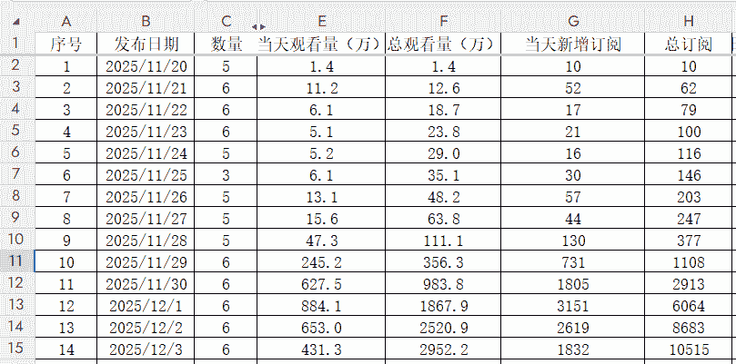

#### 3.6.3 选择低理解成本的热点

优先考虑不依赖复杂背景和长对白、能够通过画面直接表达冲突和情绪的内容。

#### 3.6.4 判断热点是否适合AI放大

AI应该帮助完成现实中难拍、成本高或者视觉表现更强的内容，而不是为了使用AI而强行套用AI。

#### 3.6.5 保留内容内核，重新设计表达

可以借鉴对标的核心冲突和情绪，但人物、场景、动作、镜头和结局都应该重新设计。

#### 3.6.6 用高频发布获得样本，用数据决定下一步

数据好的方向继续改编，长期没有反馈的方向及时调整。

发布不是完成任务，而是在进行测试。

这6个动作仍然不能保证下一条视频一定爆发。

它们能做的，是帮助我们减少盲目试错，把一次偶然结果转化成可以重复执行的增长方法。

运气不能复制，但提高中奖概率的方法可以复制。

## 4、YouTube运营的核心要点：从赛道、对标到数据复盘

做YouTube这一年，我越来越觉得，AI视频制作只是整个项目中的一个环节。

工具解决的是“怎么把视频做出来”，运营解决的却是另外几个问题：

做什么内容、参考谁、数据怎么看、什么时候继续、什么时候换方向，以及怎样完成变现。

一条更完整的YouTube运营路径应该是：

选择赛道→寻找对标→拆解内容→发布测试→分析数据→放大有效方向→排查风险→申请YPP。

### 4.1 为什么选择YouTube：一份时间可以出售多次

我选择YouTube，一个重要原因是它的广告收益主要来自流量。

不需要直播，也不一定要带货。只要视频持续获得播放，就可能继续产生收益。对于不擅长实时表达的i人来说，这种模式相对友好。

另外，YouTube平台具有如下优势：流量大且稳定、变现渠道多样、算法推荐成熟、内容形式灵活。

李笑来老师在《财富自由之路》中提到三种个人商业模式：

- 一份时间出售一次，比如上班、打零工等；
- 一份时间出售多次，比如出书、做课程等；
- 购买他人的时间，再将其出售，例如创业、投资等。

做YouTube属于第二种：一份时间出售多次。

我第一个频道中那条3600万播放的视频，发布接近一年后仍然有长尾流量。

这意味着，视频不只是一次性的内容制作，更可能成为一项持续产生价值的长期资产。

当然，长尾收益并不等于稳定收益。

账号可能限流，YPP可能被取消，平台政策也会变化。

**YouTube**让一份时间有机会出售多次，但能否长期出售，取决于内容质量和平台合规。

### 4.2 怎么找赛道：热点、兴趣和投产比缺一不可

选赛道不能只看自己喜欢什么，也不能只看别人播放量有多高。

我判断一个赛道，主要看三个因素。

#### 4.2.1 热点决定流量是否存在

先看这个赛道近期有没有持续出现百万、千万播放的视频。

以前爆过，不代表现在还能爆。对Shorts来说，三个月前的爆款可能已经失去参考价值，最近1-2周的数据更重要。

#### 4.2.2 兴趣决定能否持续更新

兴趣不一定是“特别热爱”，至少应该是自己愿意长期观察、拆解和制作。

如果每做一条视频都觉得痛苦，即使赛道有流量，也很难保持更新。

#### 4.2.3 投产比决定项目能否继续

不仅要看播放上限，还要计算制作成本。

我尝试过30-40秒的印度故事视频，部分作品能达到百万播放，但一条视频需要制作15-20个分镜，耗时太长。即使有流量，投产比也不理想。

有流量、有能力制作、还能持续更新，才是适合自己的赛道。

### 4.3 怎么找对标：刷视频、搜关键词、看工具数据

确定Shorts赛道后，下一步不是立刻制作，而是建立自己的对标库。

#### 4.3.1 刷视频找对标

在YouTube持续观看目标赛道的视频，对感兴趣的视频点赞、订阅频道。随着行为积累，平台会推荐更多相似内容。这种方法适合培养内容感觉，但需要主动记录，不能只是刷完就忘。

#### 4.3.2 用关键词找对标

搜索赛道关键词或标签，再筛选近期发布的视频。

关键词搜索的优势是目标明确，也更容易发现刚出现的新内容和小频道。

#### 4.3.3 用数据工具辅助判断

Viewstats可以查看热门频道和视频，SocialBlade可以查看频道收益数据，Google Trends可以比较关键词热度。

这些工具不能代替判断，但可以帮我们快速缩小范围。

### 4.4 什么样的对标最值得拆：近期低粉爆款、频道播放量异常值

不是所有爆款Shorts都适合新手参考。

我主要寻找三种特征同时出现的视频。

#### 4.4.1 发布时间足够近

优先参考最近1-2周发布的千万播放的视频。发布时间越近，越能说明当前观众对这个方向感兴趣。

#### 4.4.2 频道粉丝量不高

10万粉丝以上的频道权重很高，它的高播放不一定能被新账号复现，5万粉丝以下的中小频道更接近普通人的起点。爆款短视频的播放量与粉丝数的比值越高，就越符合“低粉爆款”的特征，也就越值得对标。

#### 4.4.3 播放量是频道异常值

如果一个频道大部分视频只有几万到几十万播放，某一条却突然达到千万甚至上亿，这条视频就值得重点拆解。

需要拆的不是表面画面，而是它为什么能够突破频道原有流量：

- 选中了什么题材；
- 前三秒用了什么冲突；
- 观众为什么愿意看完；
- 情绪是怎样递进的；
- 哪个画面形成了反差；
- 哪些部分可以重新改编。

找对标，不是找最厉害的大号，而是找普通频道里最不普通的那条视频。

### 4.5 短视频和长视频应该怎么选

短视频和长视频不是谁更好的问题，而是分别适合不同阶段和目标。

\[内嵌电子表格 - 无法获取表格信息\] 对新手来说，建议先从短视频开始，积累选题、对标、视频制作和账号运营的经验。跑通流程后，再根据自己的能力和目标尝试长视频。

短视频帮你快速入场，长视频让你长期留在场上。

### 4.6 数据怎么看：不要只盯着播放量

播放量只能告诉我们结果，不能直接告诉我们原因。

真正有效的数据复盘，是根据不同指标判断问题发生在哪个环节。

#### 4.6.1 通用数据：观众从哪里来、看完后做了什么

无论长视频还是短视频，都需要观察流量来源、互动情况、观众画像、收入和RPM。

**（1）流量来源和互动情况**

**（2）观众画像**

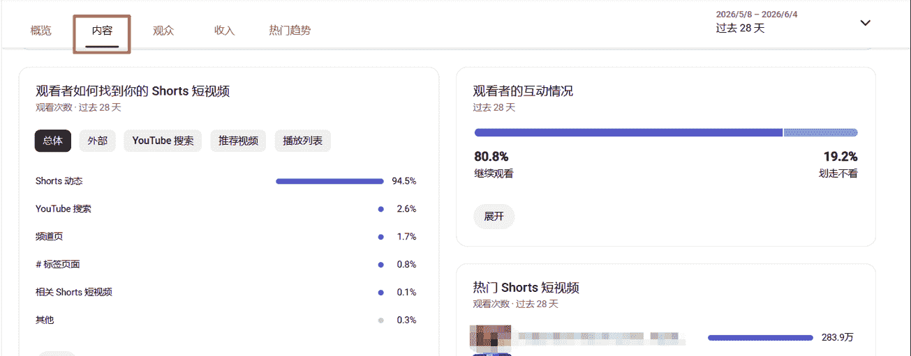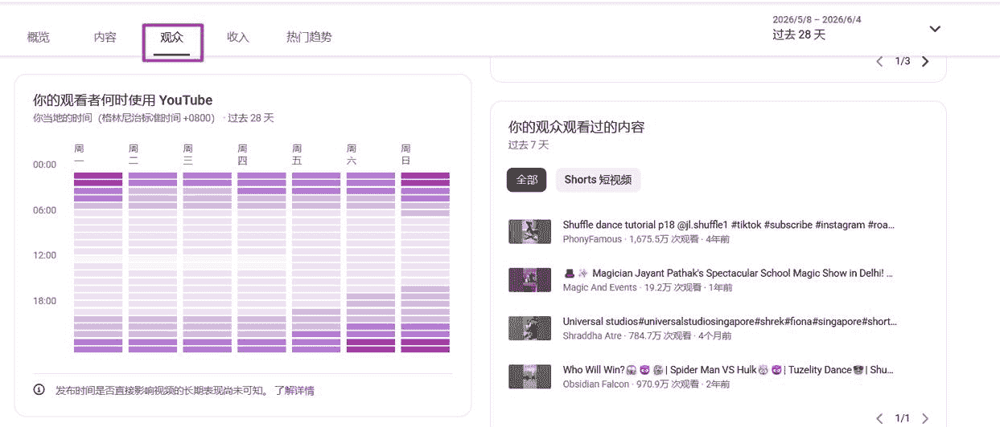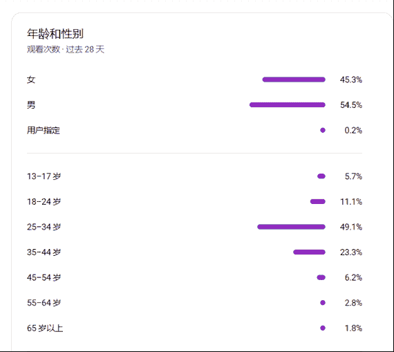

**（3）收入和RPM**

这些数据可以帮助判断：平台把视频推荐给了谁，这些人是否喜欢，以及这类观众的商业价值如何。

#### 4.6.2 短视频重点看观看时长百分比

短视频首先要解决“观众有没有划走”，其次才是“观众看了多久”。我会重点观察平均观看时长百分比，这反映了观众愿意看多久，有多少观众能看完。如果视频开头节奏过慢，就需要剪切、提速，来提高三秒完播率。

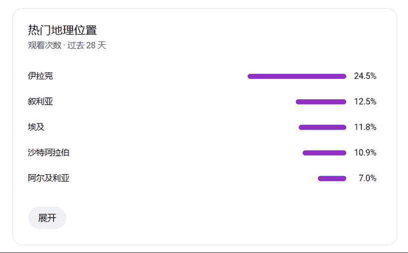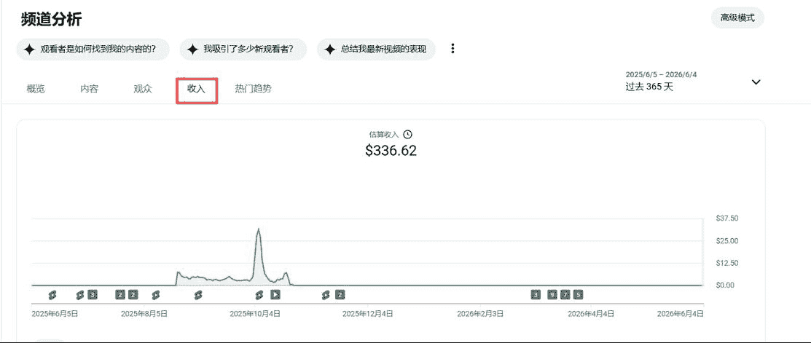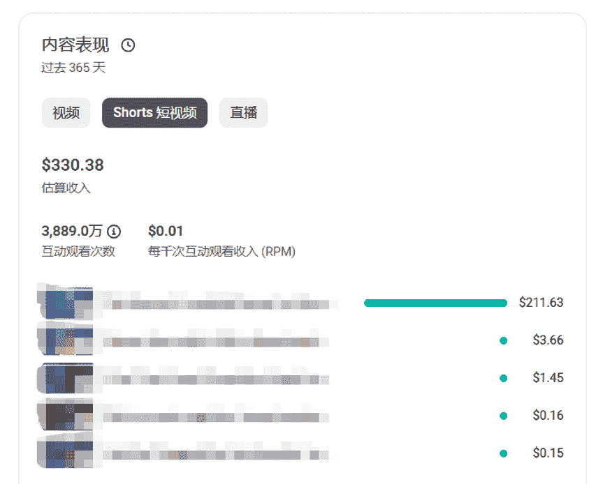

#### 4.6.3 长视频重点看点击和留存

长视频第一关是观众是否愿意点击，因此要看封面点击率。点击之后，则要观察平均观看时长、平均观看百分比（和短视频相同）和流量来源。如果曝光很多但点击少，问题通常在标题或封面；如果点击率不错但观看时间短，问题更可能在开头或内容。

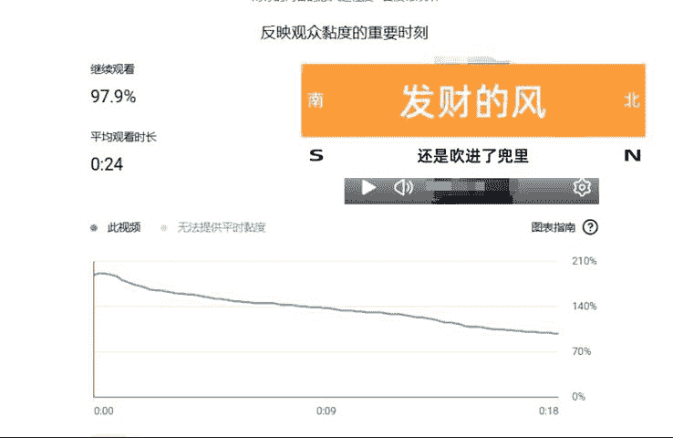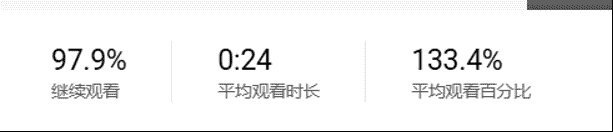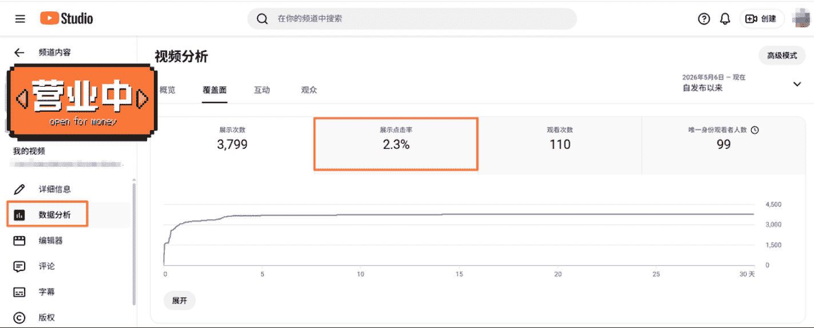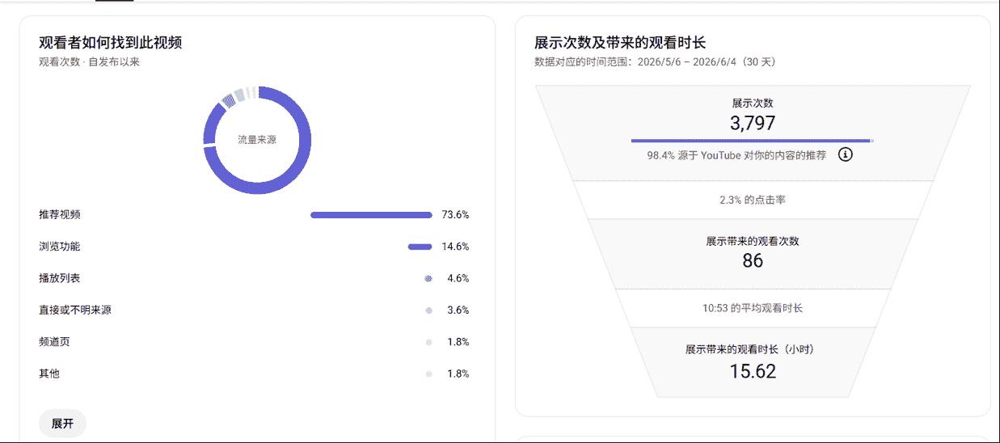

数据的价值，不是给视频打分，而是用来定位下一条视频应该优化哪里。

### 4.7 YPP怎么开：达到数据门槛，只是有了变现的资格

#### 4.7.1 YPP开通门槛

YPP分为初级YPP和高级YPP，短视频和长视频满足其中一项即可。

#### 4.7.2 YPP开通流程

YouTube YPP的开通流程如下：

#### 4.7.3 注意事项

- 达到高级YPP门槛后，记得在YouTube Studio中接受相关创收条款并开启广告功能，否则视频不会产生收益。
- 数据接近门槛时，可以在淘宝上买平信，提前确认收件地址是否能够正常接收，防止收不到pin码邮件。
- 填写收款地址时，建议在后面补充联系电话，方便邮政投递人员联系。
- pin码通常21天左右会收到，如果长时间没有收到，可以先联系当地邮政网点查询，再按AdSense页面提示申请补寄。
- 绑定银行卡前，建议向开户网点确认是否支持接收境外汇款，推荐使用招商银行卡。
- 同一收款人只能有一个AdSense账户。注意区分AdSense和Ads：前者用于接收广告收益，后者用于广告主投放广告。

另外，需要注意的是，开通YPP只是拿到了变现资格，并不代表频道从此可以高枕无忧。YouTube会持续检查频道内容，一旦违反创收政策，已经获得的变现资格仍可能被取消。这也是我两次失去YPP后才真正理解的一件事：播放量决定你能否获得变现资格，内容合规决定你能持续变现多久。

## 5、这次实操用到的工具：从找对标到发布的完整工具链

线下分享前，我把要用到的网站、提示词和操作流程整理到了一份飞书文档中。6.6-youtube AI视频实操和工具分享。为了减少现场等待，我还提前把即梦、千问和Google AI Studio等工具发到群里，让大家提前完成注册和登录。因为真正开始制作后，新手最容易卡住的往往不是创意，而是工具链：账号登录失败、视频无法解析、提示词触发敏感词、画面比例不对、人物形象不一致，任何一个环节都可能让制作流程中断。所以，这次实操的目标不是介绍尽可能多的工具，而是让大家先跑通一条最基础的生产链路：找对标→拆解视频→改编脚本→生成图片→生成视频→剪辑优化→发布测试。

### 5.1 找赛道和对标：YouTube、Viewstats、SocialBlade、Google Trends

工具不是从生成视频开始使用的。在真正制作之前，首先需要判断做什么赛道、参考什么内容。这个阶段主要使用四类工具。

#### 5.1.1 YouTube：寻找最新的真实市场反馈

- 网址：youtube.com

YouTube本身就是最重要的对标数据库，可以通过首页推荐持续刷目标赛道，也可以搜索关键词和标签，再筛选近期发布的视频。

#### 5.1.2 Viewstats：快速发现热门视频和频道

- 网址：https://www.viewstats.com/

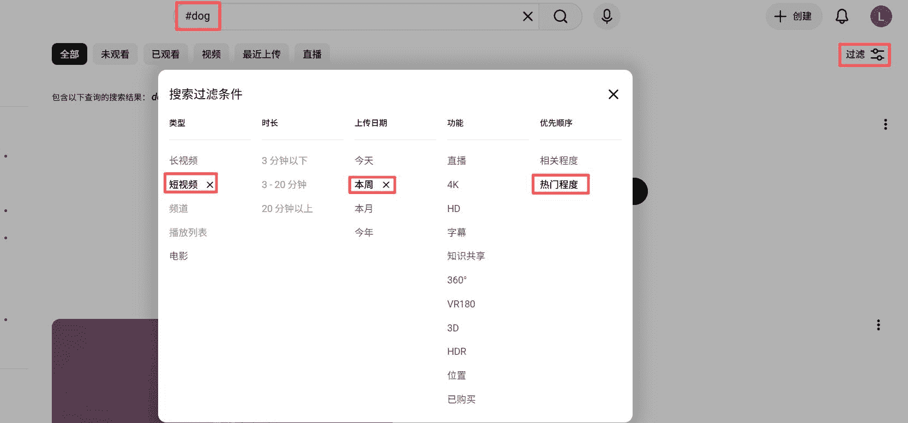

#### 5.1.3 SocialBlade：查看频道收益数据

- 网址：https://socialblade.com/

#### 5.1.4 Google Trends：比较关键词热度

- 网址：https://trends.google.com/trends/

工具可以帮我们更快找到线索，最终决定是否值得做的，仍然是近期真实的播放数据。

### 5.2 对标视频下载：Yt1ss、硬核去水印小程序

找到对标后，需要把视频保存下来，方便拆解分析和剪辑时的参考。

#### 5.2.1 Yt1ss：网页端下载

- 网址：https://yt1ss.pro/zh-cn199/

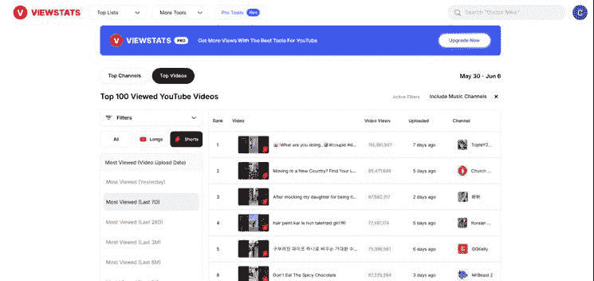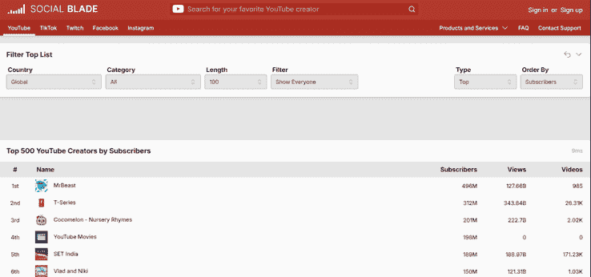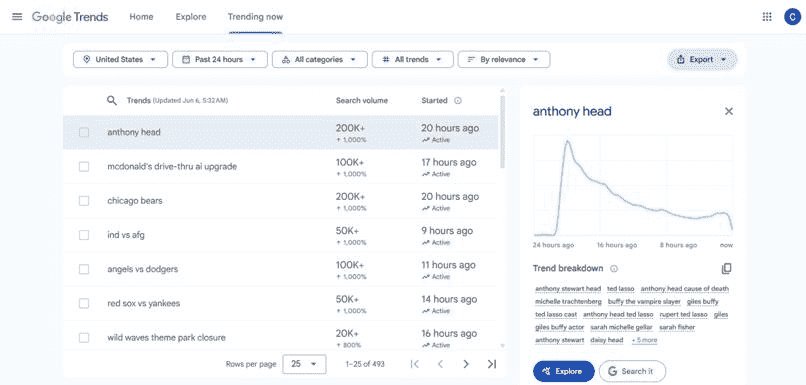

- 优点：免费使用、可选择下载清晰度、短视频和长视频都能下载、可单独下载音频、下载好的视频以标题命名。

#### 5.2.2 硬核去水印小程序：手机端下载

- 微信中搜索即可使用

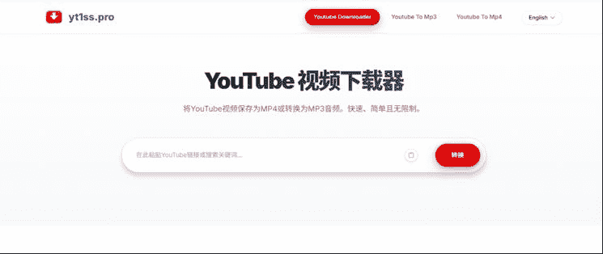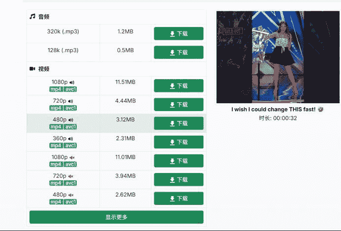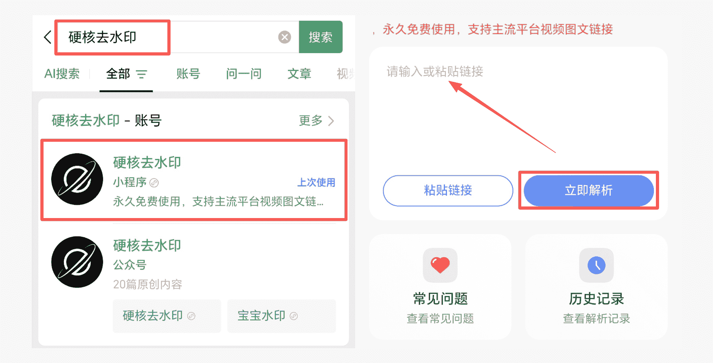

- 优点：手机国内网络即可下载，免费使用。

需要特别说明的是：下载对标的目的，是研究选题、脚本、镜头和节奏，不是把别人的视频去掉水印后重新发布。YouTube对版权和重复内容都比较严格，直接搬运不仅可能收到版权主张，也可能影响整个频道。对标可以拆，素材不能搬；内核可以借鉴，成片不能复制。

### 5.3 脚本拆解和改编：Google AI Studio、DeepSeek

脚本拆解是整个制作流程中最重要的环节之一。工具可以生成画面，但视频是否成立，主要取决于冲突、情绪和故事结构。

#### 5.3.1 Google AI Studio：直接理解YouTube视频

- 网址：https://aistudio.google.com

这次现场实操主要使用Google AI Studio。它可以直接读取YouTube视频链接，帮助完成：

- 总结视频内容；
- 拆解故事结构；

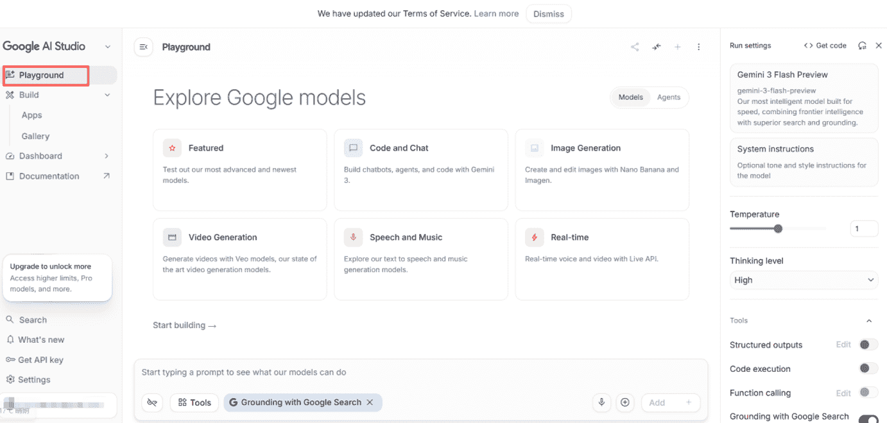

- 提取核心冲突；
- 分析人物和动作；
- 生成分镜脚本；
- 提供改编方向；

如果视频时间较长，链接解析失败，也可以将视频下载，作为附件上传分析。使用Google AI Studio时，不要只说“帮我拆解这个视频”。更有效的方法是分多轮完成：

- 第一轮，先拆解原视频；
- 第二轮，提取最核心的情绪和冲突；
- 第三轮，确定人物、场景和结局的改编方向；
- 第四轮，生成新的分镜和提示词；
- 第五轮，检查内容是否存在敏感或违规风险。

#### 5.3.2 DeepSeek：作为备选改编工具

- 网址：https://www.deepseek.com/

现场有些圈友无法正常使用Google AI Studio，我也准备了替代方案。

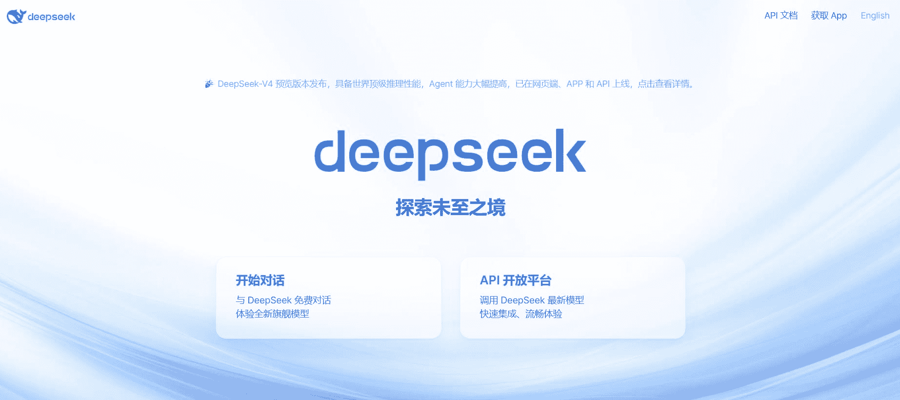

我直接提供对标拆解后的提示词，让大家通过DeepSeek等国内工具完成脚本改编，再生成图片和视频提示词。无论使用哪种模型，关键都不是让AI“换几个词”，而是改变内容表达：

- 换人物关系；
- 换故事场景；
- 换冲突来源；
- 换情绪节奏；
- 换动作设计；
- 换故事结局。

### 5.4 图片生成：即梦

- 网址：https://jimeng.jianying.com/

需要固定人物和场景时，可以先生成图片，再通过图生视频提高可控性。图片提示词可以让Google AI Studio帮忙给出，然后再调整优化。这一阶段主要生成两类图片。

#### 5.4.1 角色图：保持人物形象统一

如果要做系列内容或角色IP，可以先确定人物的发型、服装、年龄、表情和画面风格。角色图越稳定，后续视频之间的一致性越好，也更容易形成频道辨识度。但要注意的是，为避免同质化，同一个频道最好使用多个不同的角色IP。

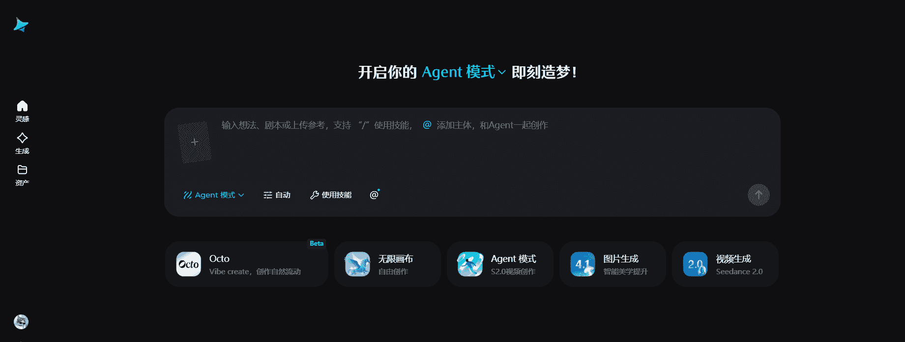

#### 5.4.2 首帧图：控制视频场景和风格

首帧决定观众刷到视频时最先看到什么。制作首帧时，需要优先考虑：

- 主体是否足够明显；
- 画面是否存在冲突；
- 风格是否适合内容表达；
- 情绪是否一眼能看懂；
- 能否给观众留下悬念。

首帧不是单纯追求好看，而是控制场景和风格，承担留住观众的任务。

### 5.5 视频生成：即梦、千问

- 即梦：https://jimeng.jianying.com/
- 千问：https://www.qianwen.com/

#### 5.5.1 文生视频：适合快速测试创意

文生视频不需要提前准备图片，输入提示词即可生成画面。它适合测试动作、情节和视觉概念，制作速度较快，但角色和场景的一致性可能较弱。

#### 5.5.2 图生视频：适合控制人物和首帧

图生视频先确定角色图和首帧图，再生成动作。它的流程更长，但人物、服装和场景相对可控，更适合系列内容和固定角色IP。

#### 5.5.3 工具选择重点看四个维度

线下实操主要使用即梦，考虑到现场可能出现排队或积分不足，我也准备了有免费额度、生成速度较快的千问作为备选。选工具不只看谁生成得最好，还要看谁能稳定地完成下一条视频。

### 5.6 剪辑优化：剪映

- 剪映6.0免安装版：
- 链接:https://pan.baidu.com/s/1WViTa99yj-gXruodcrpjLw?pwd=7ek2 提取码：7ek2

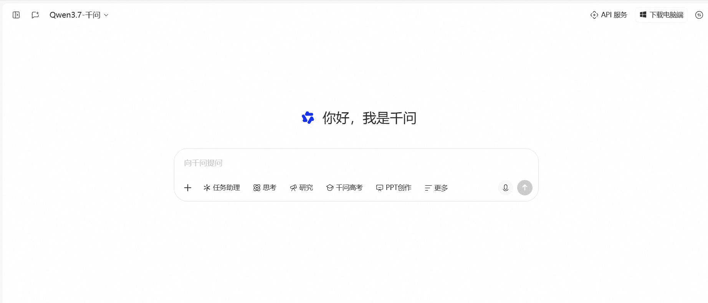

AI生成的视频通常不能直接发布，还需要经过基础剪辑。剪辑的目标不是增加复杂特效，而是解决几个明确问题。

#### 5.6.1 加快开头节奏

删除无效停顿，把最有冲突、最有视觉吸引力的画面提前。Shorts前三秒非常重要。如果开头进入主题太慢，后面的内容再精彩，也可能没有机会被看到。

#### 5.6.2 删除明显瑕疵

AI视频容易出现人物变形、动作错误、画面跳变等问题。可以通过裁剪、缩短镜头或替换片段，减少这些瑕疵对观看体验的影响。

#### 5.6.3 提升画面质量

如果原始视频清晰度不足，可以用剪映提升分辨率至1080P。但清晰度只能改善观感，无法弥补内容本身缺乏吸引力。

#### 5.6.4 添加音乐、音效和字幕

是否添加音乐、音效和字幕，需要参考对标内容形式。没有对白的视频，可以通过音乐和音效加强节奏；有对白或信息较多的视频，字幕可以帮助观众理解。对于音乐和音效，短视频60秒以内可以随意选用，长视频需要格外注意版权问题。

#### 5.6.5 把封面放在视频第一帧

YouTube Shorts的封面通常需要在手机端选取。我通常提前把封面画面放在视频第一帧，可以降低选择难度，也能让封面更加可控。

剪辑的目的，不是给AI视频增加装饰，而是优化一切影响观众继续观看的内容。

### 5.7 频道创建与视频发布：YouTube

现场实操的最后一步，是完成YouTube频道创建和视频发布。

#### 5.7.1 登录并创建账号

进入YouTube官网（https://www.youtube.com/），用Google账号登录。如果还没有Google账号，可以按照系统提示填写姓名、出生日期、性别、密码和手机号，完成验证码验证并设置Gmail地址。

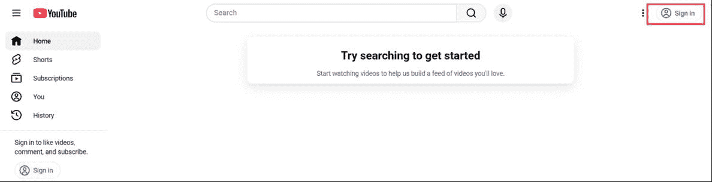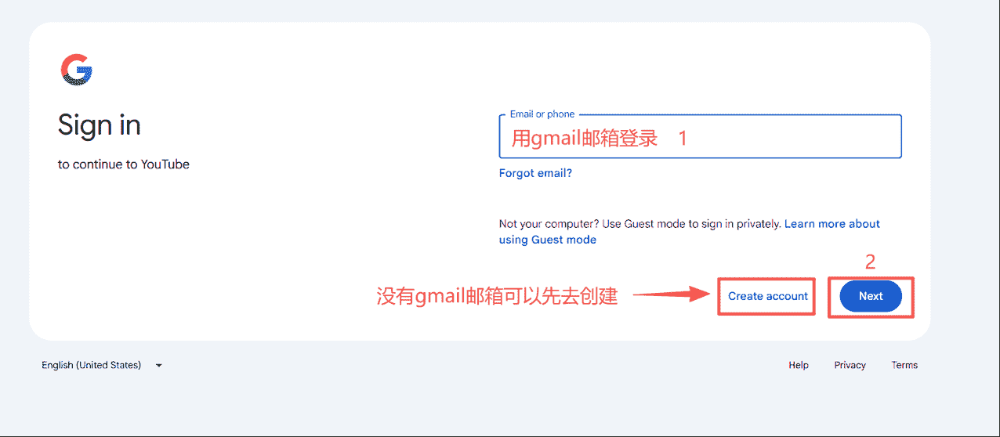

#### 5.7.2 创建并装修频道

点击右上角头像，填写频道名称和标识名。创建完成后，设置频道头像、背景图和简介。频道名称和简介可以参考对标账号，让AI辅助生成。

【用AI生成频道名提示词示例】

你是一个资深YouTube运营专家，我现在要创建一个关于【达人秀变身】赛道的频道，需要你帮我想10个简洁、好记的英文频道名字，以下是一些名字的参考:【xxx,xxx,xxx,……】（将模板中的【】替换为你的赛道和对标频道名参考）

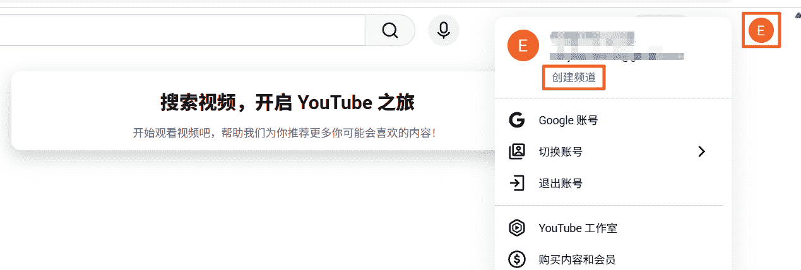

#### 5.7.3 完成基础设置

进入YouTube Studio，在频道设置中调整所在国家与地区，改为美国，并在高级设置中选择“非面向儿童”。同一个Google账号也可以通过“高级设置——管理YouTube账号—创建新频道”添加多个频道。

#### 5.7.4 上传并发布视频

上传视频后，填写标题和话题。标题可以参考对标视频，也可以让AI辅助生成；话题优先选择与内容相关、使用人数较多的热门话题。最后完成视频详情和发布时间等设置，确认无误后发布。

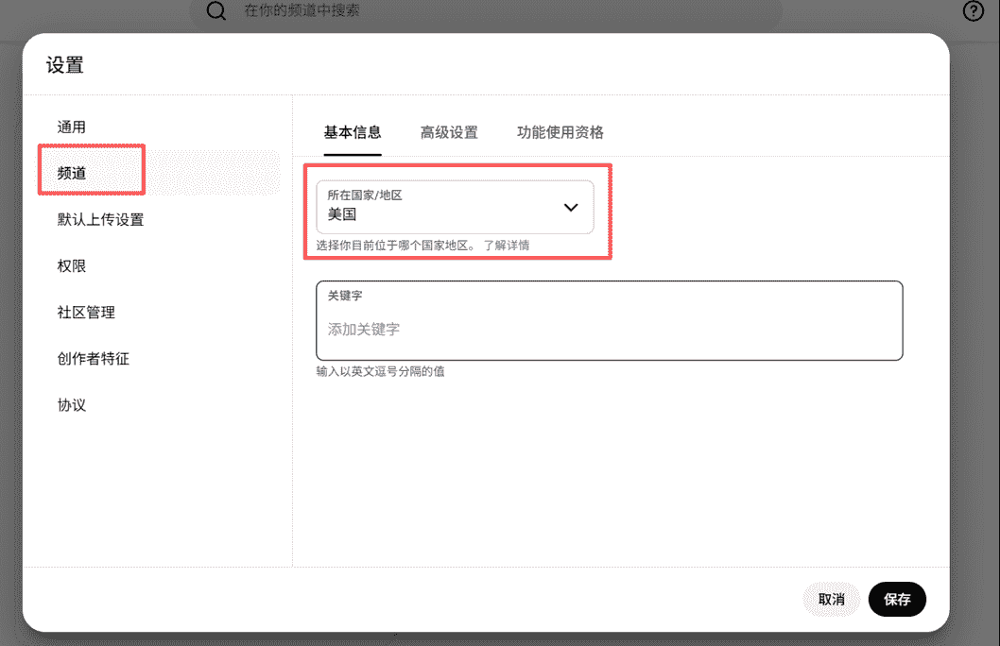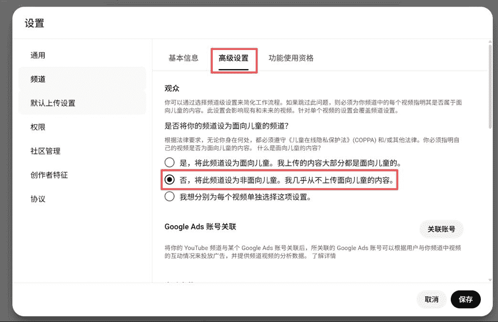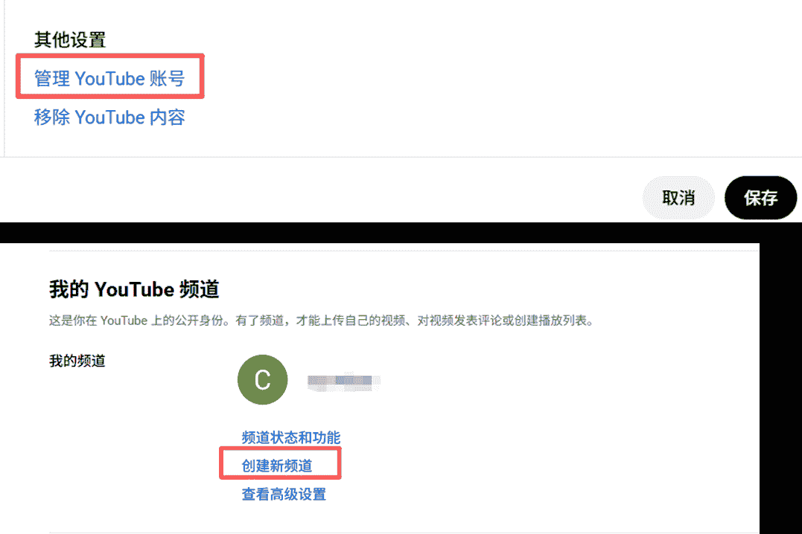

## 6、如果现在带一个新手重新开始，我会让他这样做

如果让我重新开始做youtube短视频，我不会一上来准备很多账号，也不会同时测试多个完全不同的赛道。新手真正需要的，不是一套看起来完整、实际执行不了的复杂系统，而是一条能够尽快跑通的最短路径：找赛道→找对标→拆解脚本→改编脱敏→生成图片→生成视频→剪辑发布→数据复盘→合规排查。先完成一次闭环，再根据数据决定是否开多个频道。

### 6.1 第一步：先选1个赛道，不要同时做太多

刚开始时，最容易出现的问题不是没有方向，而是方向太多。今天看到动物视频爆了，就想做动物；明天看到某个IP火了，又想做IP；后天出现

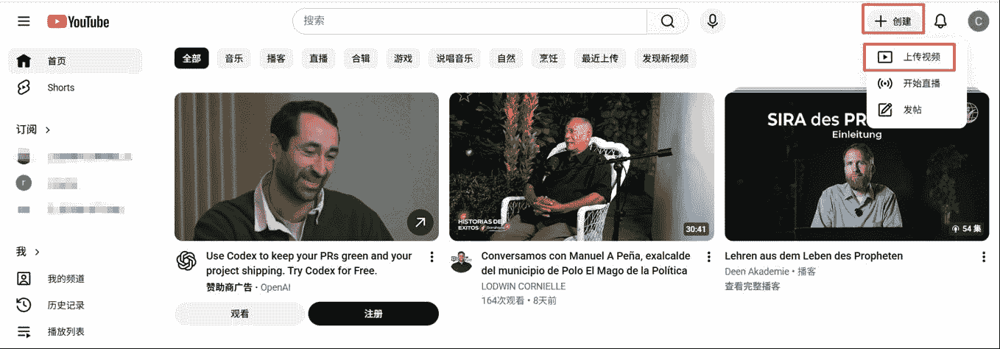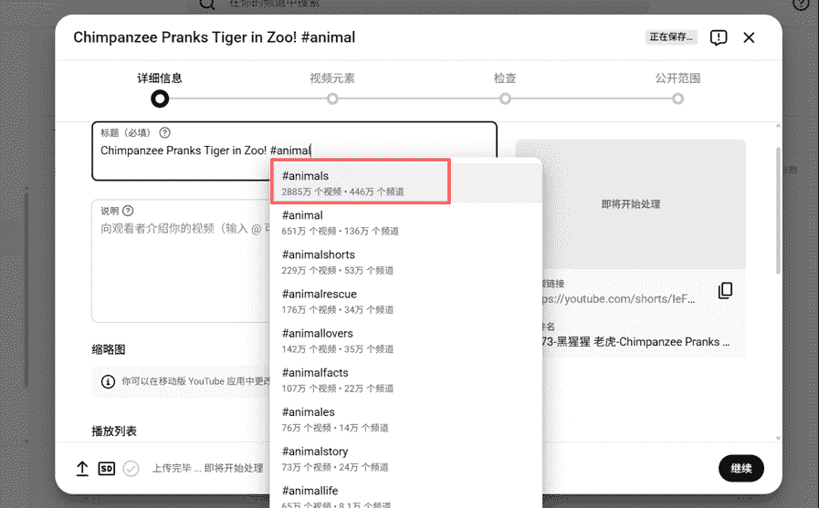

新的 AI 工具，再重新研究另外一种内容。

结果通常是，每个方向都做了几条，却没有一个赛道积累到足够的数据。

新手选择赛道，可以先回答四个问题：

1. 最近 1—2 周，这个赛道是否仍有千万播放视频？
2. 除了头部大号，普通频道是否也能跑出百万播放？
3. 自己能否稳定完成这类视频？
4. 单条视频的时间和工具成本是否能够承受？

前 14 天只测试一个赛道。

这样做不是因为这个赛道一定正确，而是只有变量相对稳定，数据才具有比较价值。

新手最怕的不是选错，而是还没有获得有效数据，就不断换方向。

### 6.2 第二步：找到 10 个低粉爆款频道

确定赛道后，不要只收藏几条播放量最高的视频。

先建立一个包含 10 个频道的对标库，重点寻找：

- 粉丝量不高（3 万以下），但近 14 天内有千万播放视频的频道；
- 频道日常播放普通（几万到十几万），近期却突然出现千万级异常值的频道；
- 最近 1—2 周仍在持续更新，并且新视频还能获得流量的频道；
- 内容形式适合自己当前熟悉的 AI 工具和制作能力的频道。

记录时，至少保留以下信息：

[内嵌电子表格——无法获取表格信息]

以上信息的记录是为了训练自己识别异常值的能力。看得多了以后，你会逐渐发现：哪些只是大频道的正常数据，哪些才是真正值得新手研究的低粉爆款。

### 6.3 第三步：拆解 20 条最近 1—2 周的爆款视频

找到频道后，再从中选择 20 条近期爆款进行拆解。

拆解不是概括“这是一条搞笑视频”，而是回答更具体的问题：

- 前 1—3 秒出现了什么？
- 观众为什么没有立刻划走？
- 视频的核心冲突是什么？
- 人物、动物或者物体之间是什么关系？
- 情绪如何发生变化？
- 哪个画面形成了最大反差？
- 结尾是否有反转、满足感或悬念？
- 哪些部分可以改编，哪些部分不能直接照搬？

可以使用 Google AI Studio 辅助拆解，但不要完全接受 AI 的结论。

AI 能帮助我们描述内容，真正需要判断的是：这条视频为什么能让人继续看。

拆完 20 条后，再把内容按照共同特征分类。

例如：

- 动物拟人；
- 危机救援；
- 身份反差；
- 弱者反击；
- 荒诞行为；
- 意外反转；
- 强视觉奇观。

这样才能从单条爆款中提取出可重复测试的内容模式。

拆解的目的不是学会复制一条视频，而是看懂一类视频为什么成立。

### 6.4 第四步：每天做 1—3 条 Shorts，连续发布 14 天

完成基础拆解后，就要尽快进入发布阶段。

新手很容易把大量时间花在准备上：研究工具、优化提示词、设计账号、修改头像，却迟迟没有发布第一条视频。

但没有真实数据，再完善的准备也只是猜测。

我建议新手在前 14 天每天发布 1—3 条 Shorts。

如果时间有限，每天至少完成 1 条；如果工具链已经跑通，可以提高到 2—3 条，但不要为了数量牺牲基本质量。

14 天的目标不是马上开通 YPP，而是获得第一批可比较的数据。

测试时可以一次只调整一个主要变量：

- 开头画面；
- 人物或角色；
- 冲突类型；
- 视频时长；
- 情绪走向；
- 故事结局。

如果每条视频的题材、风格和制作方式都完全不同，即使某条数据变好，也很难判断究竟是什么因素起了作用。

前 14 天不是爆款冲刺期，而是数据采样期。

### 6.5 第五步：给每条视频建立数据记录

发布之后，不要只反复刷新播放量。

播放量只是最终结果，真正需要记录的是视频从发布到获得反馈的整个过程。

可以建立一张简单的数据表：

[内嵌电子表格——无法获取表格信息]

不要因为一条视频刚发布几小时没有流量，就立刻删除或判断失败。

Shorts 通常反馈较快（1—3 天推流），但平台也可能在一周、一个月后重新推流。长视频则需要至少一周甚至更长的观察周期。

定期复盘时，重点寻找规律：

- 哪些开头更容易获得播放？
- 哪些视频的观看百分比更高？
- 哪些内容容易涨粉？
- 哪些方向连续发布后依然没有反馈？

数据记录不是为了证明自己努力过，而是为了让下一次调整有依据。

### 6.6 第六步：跑出数据后拆解内核，微调迭代

当某条视频表现明显高于其他内容时，可以立刻拆解这条爆款视频真正有效的内核。

例如，它的核心可能是：

- 一个一眼能懂的危险场景；
- 动物和人类身份之间的反差；
- 弱者突然反击；
- 开头直接展示结果；
- 结尾提供情绪满足。

保留这些经过数据验证的内容内核，再改变具体表达：

- 改人物；
- 改角色关系；
- 改故事场景；
- 改动作和镜头；
- 改冲突发生的原因；
- 改情绪递进；
- 改故事结局。

需要注意的是，同一个脚本在同一个频道最好只出现一次，否则有同质化的风险，但可以改编后发到其他账号上。

微创新的意义在于，让视频在保留有效机制的同时，依然提供新的观看体验。

真正应该复制的是爆款背后的结构，不是爆款表面的画面。

### 6.7 第七步：数据达标前，先排查风险再申请 YPP

这是我最希望新手提前做的一步。

很多人看到数据接近 YPP 门槛，第一反应是加大发布频率，尽快冲刺。

但数据越接近门槛，越应该停下来检查整个频道。

重点排查：

- 是否使用了有版权的视频、图片、音乐或字体；
- 是否包含儿童遇险、伤害或其他高风险情节；
- 是否出现暴力、动物伤害、色情、仇恨或虚假信息；
- 是否存在大量模板相同、情节相似的视频；
- 是否重复使用同一提示词或脚本；
- 是否有为了保留播放量而舍不得删除的风险视频。

可以让 AI 辅助筛查，但最终判断要以 YouTube 官方政策为准。

如果某条视频明显存在风险，不要因为它播放量高就保留。

宁可放弃一条高风险爆款，也不要赌上整个频道的变现资格。

### 6.8 前 90 天可以按照这四个阶段推进

为了降低执行难度，可以把前 90 天划分为以下四个阶段：

[内嵌电子表格——无法获取表格信息]

这里的时间只是参考，不是必须完成的硬性目标。

有人两周就能达到 YPP 门槛，也有人三个月仍处于赛道验证期。

真正需要关注的，不是别人用了多少天，而是自己的数据是否在持续提供正反馈。

## 7、我两次失去 YPP 后，整理出的避坑清单

两次失去 YPP 后，我最大的感受是：

开通 YPP 并不是最难的事，真正困难的是内容持续满足平台要求，让频道长期获得收入。

第一次，我的问题出在儿童安全；第二次，我的问题出在同质化。表面上看，这是两种不同的违规，背后却指向同一个原因：

我把“暂时没有被处罚”，误认为“这种做法没有风险”。

### 7.1 第一次失去 YPP：儿童问题，本质是合规意识不够

第一个频道开通 YPP 后，因为达人秀赛道流量持续走低，我尝试了印度故事、耶稣故事等新的方向。

部分视频中出现了儿童遇险、被人追赶或等待救援的情节。我的判断是：最后儿童没有真正受到伤害，故事也以救援成功结束，内容应该没有问题。

但 YouTube 判断儿童安全风险，并不只看故事结局。

如果内容让未成年人处于危险、恐惧或可能受伤的环境中，即使最后获救，也可能受到更严格的审核。

我当时存在两个错误认知：

#### 7.1.1 以为视频能正常发布，就代表内容安全

YouTube 允许视频上传，只能说明它暂时没有在上传环节的检查中被拦截，不能证明它一定符合社区准则和创收政策。

内容可能在后续审核、频道申请 YPP 或平台复查时被重新判断。

#### 7.1.2 以为对标账号能做，自己也可以安全复刻

对标视频获得高播放，也不代表它符合创收政策。

对方可能尚未申请 YPP，也可能没有被复查，甚至可能已经收到限制，只是外部观众看不到。

视频能发布，不代表它合规；对标能爆，不代表你能安全复刻。

如果重新开始，我会尽量避免把儿童置于危险、暴力、惊吓和救援类情节中。更稳妥的方法是，避免发布任何带有儿童形象（真人、拟人化动物幼崽等）的视频。

### 7.2 第二次失去 YPP：同质化问题，本质是过度依赖爆款复刻

第二个频道的制作流程很高效：

找到爆款对标，用 Google AI Studio 反推提示词，再通过 Sora 2 生成相似内容。

这套方法帮助我快速获得流量，却也留下了明显风险：

- 多条视频使用相似提示词；
- 人物、动作和故事结构变化有限；
- 内容可以按照同一模板批量生成；
- 创作价值主要来自复现热门形式，而不是重新设计内容。

YouTube 目前明确限制批量制作、重复性高、套用通用模板且视频间缺少实质差异的内容。政策针对的不是“是否使用 AI”，而是内容有没有原创价值，观众能否明显看出每条视频的核心差异。也就是说，AI 不是问题，机械化复制才是问题。

平台政策变化后，我虽然开始用 AI 二次改编脚本，但内容底层结构并没有发生足够大的改变。

这也是我第二次失去 YPP 的根本原因：

我修改了视频的表面，却没有真正改变内容的内核。

如果重新开始，我会保留对标视频已经验证过的情绪和冲突，但重新设计人物、关系、场景、动作、镜头和结局。同一个脚本不会在同一频道反复使用，也不会把“换角色、换背景”当成真正的原创。

### 7.3 两次失去 YPP 的共同原因：侥幸心理

第一次 YPP 被取消前，我没有意识到儿童内容的风险。

第二次却不同。

当时平台已经开始调整算法，很多同类频道因为同质化失去 YPP。

我的频道流量也从每天约 200 万下降到 1 万左右。

我知道风险已经出现，却仍然觉得：

- 其他频道被取消了，我的频道也许不会；
- 这些视频播放量很高，删掉太可惜；
- 只要再做一点改编，可能就能躲过去。

现在回头看，真正让我失去第二个 YPP 的，不只是平台政策变化，还有我舍不得放弃已经取得的播放。

播放量越高，越容易产生沉没成本。

但 YouTube 在审核频道时，可能重点查看播放最多、最新发布以及观看时长占比较高的视频。对创作者来说最舍不得删除的内容，也可能正是平台重点检查的内容。

账号最大的风险，不是看不到问题，而是发现问题后仍心存侥幸。

### 7.4 版权问题：版权主张和版权警示不是一回事

版权是 YouTube 运营中另一条不能碰运气的红线。

版权主张和版权警示的严重程度不同：

[内嵌电子表格——无法获取表格信息]

如果频道在 90 天内收到 3 次尚未解除的版权警示，账号和关联频道可能被终止。

需要注意的是，删除已经收到版权警示的视频，通常不能自动解除警示。

因此，不要把“先发了再说”当成版权策略。

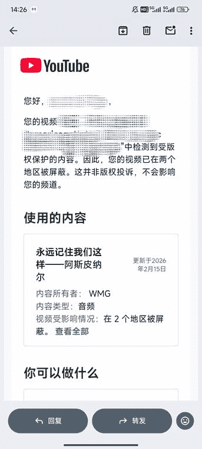

（上图为我因达人秀音乐问题收到的版权主张）

长视频尤其要检查四类素材：

- 视频片段；
- 图片素材；
- 音乐/音效；
- 字体。

其中最重要的是视频和音乐的版权问题。

影视剧、综艺、短剧和其他创作者的视频片段，即使经过简单剪辑，也不等于拥有使用和创收权利。

音乐方面，可以使用 YouTube 自带的免版税音频库，或者使用免版权音乐素材，避免版权风险。

下面是一些免版权素材网站：

| 类别 | 视频素材 | 图片素材 | 音乐/音效素材 | 字体素材 |
|---|---|---|---|---|
| 1 | Pexels pexels.com | Pexels pexels.com | Freepd freepd.com | 100font 100font.com |
| 2 | Pixabay pixabay.com | Pxhere pxhere.com | Freesound freesound.cn | 站长字体 font.chinaz.com |
| 3 | Mixkit https://mixkit.co/ | CC0 图片网 cc0.cn | 耳聆网 ear0.com | 自由字体 ziyouziti.com |
| 4 | 爱给网 aigei.com | Pixabay pixabay.com | 淘声网 tosound.com | 字体搬运工 font.sucai999.com |

其中大部分网站可以免费下载素材，爱给网、Freesound、耳聆网、淘声网每天有免费下载额度。

对于短视频来说，1 分钟以内的音乐风险较小，一般只会引发版权主张，常见的处理结果是在一些地区禁播，但不排除开通 YPP 之后收益会被版权方分走的情况。

版权看的不是素材从哪里下载，而是你是否有权使用。

### 7.5 违规警告问题：这些内容需要重点检查

除了版权、同质化和儿童问题，脚本及成片还要重点检查以下内容：

- 暴力或危险行为；
- 动物伤害；
- 色情或性暗示；
- 仇恨言论；
- 虚假信息；
- 危险挑战；
- 误导性标题和封面；
- 影视、音乐和人物肖像版权。

我曾经有一条视频因为涉及动物伤害收到违规警告，视频也被平台移除。因为是首次违规，我可以参加政策培训；完成培训后，如果三个月内没有再次违规，警告会被移除。

为了降低违规风险，可以这样做：

- 写完脚本后，可以先让 Google AI Studio 检查一下，看是否符合 YouTube 的创收政策；
- 参考怅惘教练的方法，把 YouTube 官方政策整理到 NotebookLM 中，拿不准的地方直接问 AI。

不过，AI 只能帮助筛查风险，不能代替官方政策，更不能保证视频一定合规。最终是否发布，仍然需要创作者自己判断。

合规不能等平台替你把关，而要在发布之前主动排雷。

### 7.6 0 播和限流：先判断原因，不要急着下结论

#### 7.6.1 Shorts 出现 0 播

我做第二个账号时，最初发布的四五条视频只有个位数播放，有的甚至是 0 播。

遇到这种情况，可以尝试在同一个 Gmail 账号下新建频道，再发布视频测试。我当时采用这个方法后，新频道的播放量恢复了正常。

#### 7.6.2 长视频出现 0 播

长视频 0 播比 Shorts 更常见，不必因为一两条视频没有播放，就马上判断账号有问题。

我的处理方法是：

- 在同一个 Gmail 账号下新建频道测试；
- 让 0 播频道冷却一周，再发布视频观察；
- 准备多个频道，用 2—3 条视频测试数据；
- 暂停长期没有反馈的频道，优先做有初始播放的频道。

#### 7.6.3 视频被限流

我在做达人秀赛道时，绝大多数视频的播放量都能过万，但也有两三条视频发布一两天后，播放量仍然只有一两百，与频道正常数据差距明显。

遇到这种情况，我尝试过删除后重新发布。部分视频重新发布后，播放量恢复正常。

但如果重新发布仍然没有效果，就要考虑内容本身是否存在问题，比如内容与频道原有观众不匹配、是否同质化严重，等等。

播放异常只是结果，账号、内容和受众匹配度，才是需要排查的原因。

### 7.7 两次失去 YPP 后，我真正记住的三句话

第一句：**YPP 不是护身符。** 开通创收，只代表频道当时通过了审核，不代表频道之后不会被复查，更不代表所有内容都符合创收政策。

第二句：**平台会复查，不要依赖侥幸。** 没有立刻被处罚，只能说明问题暂时没有发生，不能证明风险不存在。

第三句：**不要爱上你的账号。** 播放量和粉丝都是沉没成本。发现问题时，要及时整改，必要时及时调整方向。

真正让我两次失去 YPP 的，不只是儿童问题和同质化问题，更是对平台规则理解不足，以及明知存在风险时仍然抱有的侥幸心理。

## 8、线下实操：很多人做出了自己的第一条 AI 视频

这次分享不只讲 YouTube 运营，我还安排了现场实操。

因为对新手来说，听懂流程和亲手完成一次，是两种完全不同的体验。

一条 AI 视频的每个步骤看起来都不复杂，但真正操作时，任何一个小问题都可能让流程中断：Google AI Studio 打不开、提示词含有敏感内容、参考图无法识别、视频比例不对，甚至是不知道生成后该怎么剪辑和发布。

所以，实操部分最重要的目标不是做出多惊艳的视频，而是让大家亲手跑通一次完整流程。

第一条视频的价值，不在于数据有多好，而在于它把“我不会”变成了“我做过”。

### 8.1 为了让大家现场做出视频，我提前做了哪些准备

线下实操最怕把大量时间浪费在注册、登录和等待上。

为此，我提前做了几项准备。

#### 8.1.1 把操作资料整理成飞书文档

6.6 YouTube AI 视频实操和工具分享

我提前整理了：

- 对标视频；
- AI 视频制作流程；
- 视频拆解和改编提示词；

- 常用网站和工具；

这样大家操作到某个环节时，可以直接查看对应内容，不需要一边听、一边记录所有细节。

#### 8.1.2 提前让大家注册并登录工具

分享前一天，我把即梦、千问和 Google AI Studio 网址发到聚会群里，提醒大家提前完成注册和登录。

这样做虽然不能解决所有问题，但可以尽量减少现场验证账号、找回密码和排队等待的时间。

#### 8.1.3 为无法使用海外工具的人准备替代方案

现场拆解对标视频主要使用 Google AI Studio，但部分圈友可能因为账号或网络环境无法正常打开。

因此，我也准备了视频拆解后的分镜提示词。

无法使用 Google AI Studio 的人，可以直接把脚本交给 DeepSeek 等国内工具改编，再生成图片和视频提示词。

#### 8.1.4 为视频生成准备备用工具

现场主要使用即梦生成视频。

考虑到排队、积分不足或生成失败的问题，我又测试了其他平台，最后选择千问作为备用工具。

它有免费额度，生成速度也相对较快，更适合现场快速完成第一次尝试。

线下实操不是展示最强工具，而是提前为每个可能卡住的环节准备第二条路。

### 8.2 现场跑通了一条 AI 视频的完整制作流程

现场实操按照以下流程展开：

每个步骤看起来都不复杂，但只有亲手操作一次，才能发现真正的卡点。因此，这一部分没有继续讲更多理论，而是带着大家一步步完成制作，让每个人都能跑通从对标视频到 AI 成片的完整流程。

整个实操过程可以分成三个阶段：

把对标变成脚本，把脚本变成画面，再把画面变成成片。

### 8.3 现场最容易卡住的，不是创意，而是工具和操作细节

实操过程中，大家遇到的问题非常具体。

这些问题看起来很小，却足以让第一次接触 AI 视频的人停在原地。

#### 8.3.1 为什么 Google AI Studio 无法拆解视频

进入 Google AI Studio 后，需点击左上角的 Playground，再粘贴 YouTube 视频链接。

如果是较长的视频（1 小时以上），链接可能解析失败，这时可以将视频下载后作为附件上传分析。

#### 8.3.2 为什么提示词写了 9:16，生成结果还是 16:9

仅仅在提示词中写“竖屏”或“9:16”，不能改变视频生成比例。

以即梦为例，需要在提示词下面的参数中手动设置 9:16。

参数能解决的问题，不要交给提示词。

#### 8.3.3 为什么视频生成失败

常见原因是提示词中包含敏感词和危险行为。

可以手动删除和替换风险描述，也可以让 Google AI Studio 重新进行提示词脱敏。

#### 8.3.4 为什么需要使用四宫格参考图

即梦生成视频时，如果上传的图片含有真实的人脸，就会导致生成视频失败，四宫格图片可以规避这一点。

#### 8.3.5 怎样让视频中的人物开口说话

可以在提示词中明确人物、台词、语言、语气和说话顺序。

如果需要人物说英文，除了使用英文台词，也可以在提示词中明确要求“视频中的人物只能说英文，不能说中文”。

#### 8.3.6 为什么剪辑时把封面放在视频第一帧

YouTube Shorts 的封面需要在手机端设置。

提前把封面放在第一帧，可以让封面设置更方便、可控，避免反复拖动视频寻找合适画面。

### 8.4 很多圈友完成了自己的第一条 AI 视频

这次实操最让我有成就感的，是很多圈友真的跟着流程，做出了自己的第一条 AI 视频。

这些视频可能还不够精细：

人物动作可能不够自然，画面可能还有 AI 痕迹，剪辑节奏也有继续优化的空间。

但这些并不影响它们的意义。

对于从来没有系统接触过 AI 视频的人来说，第一次亲手完成对标拆解、脚本改编、图片生成和视频生成，意味着他已经越过了从 0 到 1 最难的那一步。

很多人不是没有能力，而是一直把“制作 AI 视频”想得过于复杂。

真正跑通后就会发现：任何一条视频，都是由一组可以拆开的步骤组成的。

当一件事可以被拆成步骤，它就不再只是少数人的能力。下面是一些圈友现场制作的 AI 视频：

### 8.5 大家的反馈，让我觉得这次认真准备没有白费

活动结束后，我陆续在线下聚会页面和群里看到了大家的反馈。有人分享自己的收获，也有人已经开始动手发布视频。看到这些内容，我觉得之前的熬夜准备都值得了。

#### 8.5.1 既讲清了思路，也带着大家完成了实操

有圈友这样总结：

“非常有料的分享，既给思路，又有实操，很有启发。”

还有圈友提到：

“内容条理清晰，逻辑结构严密，同时还有实操部分，这次实操基本掌握了 AI 视频制作的流程。”

这正是我设计这场分享时最想做到的：不只是告诉大家 AI 视频可以怎么做，还要让大家亲手跑通一次。

#### 8.5.2 第一次接触 YouTube，也能看懂完整路径

一位第一次接触 YouTube 运营的圈友写道：

“浅夏老师完整拆解整个制作视频的方法，细致复盘个人从初创、斩获第一笔收益，到统筹短视频与长视频的全链路发展思路。分享课程兼顾理论与落地实操，细分各个操作环节，干货密集，对新手格外友好。”

另一位圈友也说：

“之前没有系统性地接触 YouTube 视频，这一次从 0 到实际操作感觉还是学到了不少，自己也对 AI 视频的认识，也让零基础 AI 学习到了一项新的技能。”

看到这些反馈，我很开心。对于新手来说，最重要的不是一次记住所有细节，而是先对整个项目建立完整认识。

#### 8.5.3 手把手操作，让不会的问题可以当场解决

有圈友评价：

“分享嘉宾浅夏干货满满，真正的从 0-1 手把手教，不会的问题及时反馈都能得到帮助，第一次参加线下活动体验太好啦。”

这也是线下实操最直接的价值。

线上教程遇到问题时，很容易卡在某一步；线下可以马上提问、马上调整，再继续完成后面的流程。

#### 8.5.4 真实的经历，让卡住的人重新有了行动力

让我印象最深的是这段反馈：

“之前参加过 YouTube 航海，知道这个项目不是三步两步就能跑通的，曾经某个环节被卡住了，心力不足就搁置了。”

这次参加活动后，她又写道：

“真实地感知到浅夏老师在跑通之前也默默努力了很久，并看到了别人跑通的全过程以及心路历程，自己也没理由全力以赴之前就过早放弃。”

项目复盘的价值，不只是告诉别人应该怎么做，也要让别人看到：拿到结果之前，低谷、卡点和反复调整都是正常过程。

#### 8.5.5 线下氛围，让第一次参加的人也能融入

大家对现场氛围和活动组织也给出了很多肯定：

“活动前引导特别好，多米杨杨哥在群内发了很多信息帮助大家找到场地，嘉宾浅夏也非常认真地分享她的经验，大家整体交流的气氛很棒。”

“整体流程紧凑并且氛围很好，学习很多自己之前没了解的关于 YouTube Shorts 部分的内容，线下内容生动真实。”

还有圈友说：

“学习到很多的干货，嘉宾也倾囊相授，活动氛围也很好，有机会还会参加。”

这是我第二次参加生财线下聚会。大家互帮互助、积极回应，也让我这个第一次担任分享嘉宾的 i 人慢慢放松下来。

#### 8.5.6 分享结束后，有人真的开始发布视频

群里除了感谢，还有圈友晒出了视频发布后的数据：

“来自昨天视频的反馈～感谢浅夏。”

截图中，这位圈友发布了一条 YouTube 视频，收获了 1115 次观看和 15 位订阅者。

数据不算多，却比一句“学会了”更让我高兴。因为它意味着，有人已经把现场学到的方法真正用起来了。

#### 8.5.7 大家的认可，让所有准备都有了意义

为了完成这次分享，我整理了近 100 页 PPT，提前准备了工具、提示词、飞书文档和备用方案。

分享结束后，群里不断出现这样的消息：

“感谢浅夏老师的精彩经验分享和实战演练，收获满满。”

“感谢浅夏老师无私的分享。”

“没有随随便便的成功。”

看到这些反馈，我才真正觉得，之前的准备都没有白费。

一场分享最好的结果，不是听众记住了多少内容，而是有人听完之后，真正开始行动。

## 9、YouTube AI 视频不适合所有人，但值得当成一次内容能力训练

如果有人问我：“现在还适不适合做 YouTube AI 视频？”

我的答案不会是简单的“适合”或“不适合”。

机会确实存在。

我用 69 天开通第一个 YPP，又用 14 天开通第二个 YPP，还做出过单条 1 亿播放的视频。这些结果说明，普通人依然有机会借助 AI 工具，在 YouTube 获得流量。

但这件事的另一面同样真实：

两个 YPP 都被取消，流量可能一夜下跌，Shorts 播放量很高却未必有多少收入，长视频又经常面临 0 播、起号时间长等问题。

只看到机会，会高估收益；只看到风险，也会错过一次学习内容和平台运营的机会。

### 9.1 如果你想找稳定副业，它未必是最优选择

YouTube AI 短视频最大的特点，是反馈和收益都存在较大波动。

你可能连续发布很多视频都没有明显流量，也可能某一条突然进入百万甚至千万播放。

同样，一个频道可能很快达到 YPP 门槛，也可能在开通创收后，因为版权、儿童安全或同质化问题失去收益资格。

它不像上班一样，每投入一个小时，就能获得相对确定的回报。

如果你目前更需要稳定收入，无法接受几个月没有成果，也不愿意持续学习平台规则，那么 YouTube AI 视频未必适合作为主要副业。

它可能带来爆款，却很难承诺稳定。

### 9.2 它更适合愿意持续测试的人

做 YouTube 需要接受一个现实：

很多判断只有发布之后，才能获得答案。

你无法在制作前确定哪条视频一定会爆，也无法只靠看教程，就找到完全适合自己的赛道。

真正适合这件事的人，通常愿意反复完成几个动作：

- 寻找近期爆款；
- 拆解内容结构；
- 根据数据改编；
- 持续发布测试；
- 接受播放波动；
- 学习并遵守平台规则。

这里需要的未必是很强的技术能力，而是对不确定性的承受能力。

**YouTube** 奖励的不是一次准备充分，而是持续测试之后仍然愿意调整。

### 9.3 不要把开通 YPP 当成唯一目标

刚开始做 YouTube 时，我把开通 YPP 当成终点。

只要播放量和订阅达标，就觉得自己终于跑通了项目。

第一次开通后，我甚至以为后面可以持续获得睡后收入。

经历两次 YPP 被取消后，我才真正认识到：

开通 YPP，只是拿到了变现的资格；YPP 之后，才是频道长期运营的开始。

一个更长远的目标应该包括：

- 内容可以持续生产；
- 频道拥有明确定位；
- 视频之间存在实质差异；
- 收益不依赖单条爆款；
- 平台政策变化后能够及时调整。

开通 YPP 证明你曾经达到门槛，保住 YPP 才证明这套方法能够长期运行。

### 9.4 即使没有赚到钱，这套能力也不会浪费

如果只用收入衡量，这一年的过程并不算特别成功。

我获得过流量和收益，也经历了限流、YPP 被取消和重新开始。

但在这个过程中，我积累了很多可以迁移的能力：

#### 9.4.1 选题能力

通过近期数据判断什么内容有人看，而不是只凭自己的兴趣猜测。

#### 9.4.2 对标能力

从低粉爆款和频道异常值中，寻找更适合普通人参考的方向。

#### 9.4.3 脚本能力

把一条视频拆成冲突、情绪、人物、动作和结局，再重新设计表达。

#### 9.4.4 AI 视频制作能力

完成从图片、视频到剪辑发布的完整流程，并根据需求选择工具。

#### 9.4.5 数据复盘能力

通过点击、停留、观看时长和互动，判断问题出在哪个环节。

#### 9.4.6 平台规则意识

理解版权、儿童安全、同质化和创收政策，把风险控制加入生产流程。

这些能力并不只适用于 YouTube。

换到国内其他内容平台，选题、制作、测试和复盘的逻辑依然可以继续使用。

赚到钱是一次结果，形成能力才是长期资产。

### 9.5 不要只看 1 亿播放，也要看到背后的代价

1 亿播放是这一年最亮眼的数字。

但如果只留下这个数字，这篇复盘就没有讲完整。

它背后还有：

- 前期的 0 播和数据波动；
- 每天持续发布和反复测试；
- 视频效果不佳，反复调整提示词；
- 前 6000 万播放没有收益；
- 流量从每天 200 万跌到 1 万；
- 两次失去 YPP；
- 达到 2600 万播放后不敢再次申请 YPP；
- 转向长视频后面临 0 播。

这些经历并不是为了证明做 YouTube 有多难，而是想提醒大家：

任何看起来突然发生的结果，背后通常都有一段没有被展示的过程。

不要只羡慕别人跑出的数字，也要判断自己是否愿意承担数字背后的不确定性。

### 9.6 给想开始做 YouTube 的新人三个建议

如果你看完这篇文章，仍然想尝试 YouTube AI 视频，我建议先做到以下三点：

#### 9.6.1 先做 10 条视频，再判断自己适不适合

不要只看教程，也不要在工具选择上纠结太久。先跑通制作和发布流程，获得第一批真实数据。

#### 9.6.2 先把它当成训练，不要急着计算收益

前期重点训练选题、对标、制作和复盘。把所有期待寄托于快速开通 YPP 上，很容易因为数据波动放弃。

#### 9.6.3 从第一天开始重视平台规则

不要等播放量快达标时才检查版权和内容安全。合规不是最后一道审核，而应该贯穿整个制作过程。

### 9.7 写在最后

这一年，我既吃到了 YouTube 和 AI 视频带来的红利，也为自己对平台规则理解不足付出了代价。

我曾经以为，做出爆款、开通 YPP，就意味着项目已经跑通。

现在我更愿意把“跑通”理解为：

能够持续找到选题，持续做出内容，持续看懂数据，也能在规则变化时及时调整。

感谢组局官杨哥邀请我做这次分享，并对本篇复盘帖提出的宝贵修改建议，也感谢当天认真参与实操、积极交流的每一位圈友。

近 100 页 PPT 和近四个小时的分享和实操，无法提供一条保证成功的捷径。

但如果它能帮助一个准备入场的人看清机会和风险，帮助一个已经开始的人少踩一个坑，或者让一个中途卡住的人重新愿意尝试，那么这次分享就已经有了意义。

爆款会过去，账号会波动，政策会变化。真正留下来的，是持续做内容、看懂数据和敬畏规则的能力。**YouTube AI** 视频出海，短期拼执行，长期拼系统。最后，也希望大家多多参加生财大连的线下活动，一起生财有术！！！

————分割线————

看完这篇 SOP，你觉得你懂了。但 90% 的人一到实操就会卡在第一步。

工具和教程只是最低级的壁垒，真正的壁垒是“立刻动手”和“圈层信息差”。

如果你想看全网最新的变现玩法，并且和一群执行力极强的极客一起下场拿结果，欢迎围观我的核心私域：【懒人专属群】。

我们不聊虚的，只做商业闭环的拆解与 AI 效率的压榨。系统内已沉淀 1000+ 跑通的套利实战局。

👉 查阅圈子完整数字资产与上车门槛：

https://lazyso.com/insider/

认同价值、准备好下场干活的，扫码加我微信（lazyhelper1）

备注：【实操上车】，不闲聊

