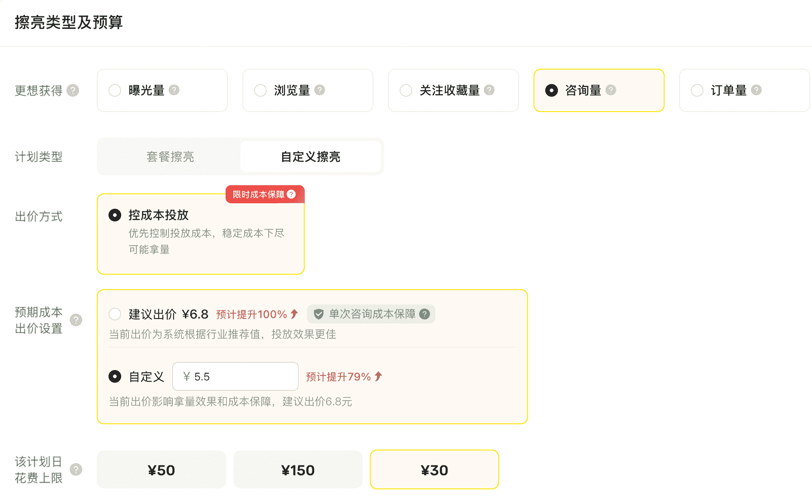
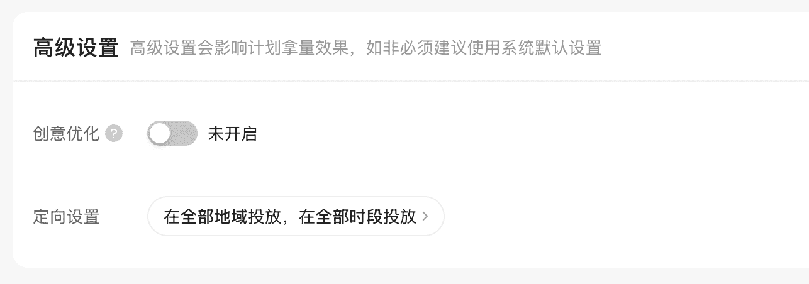
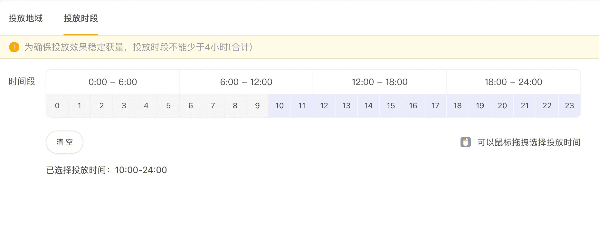
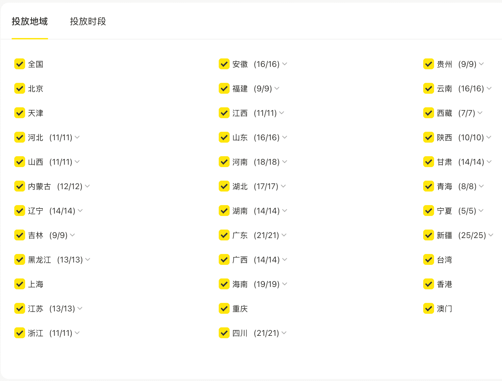
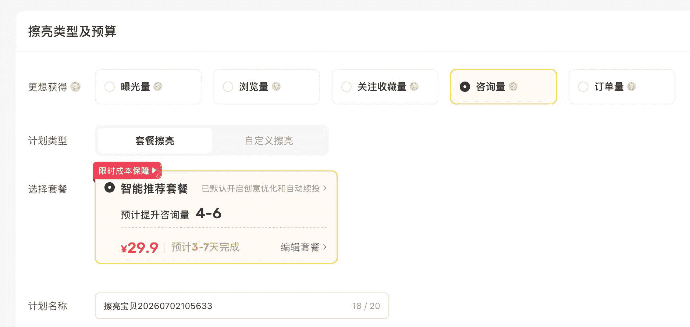
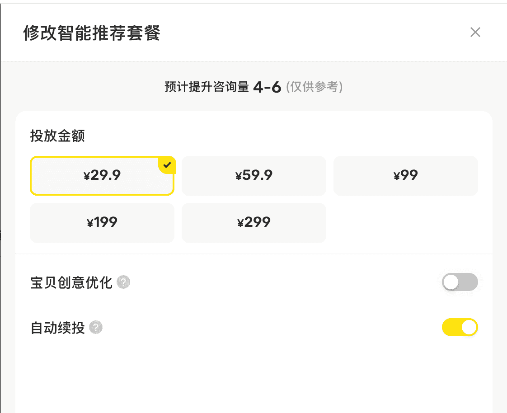
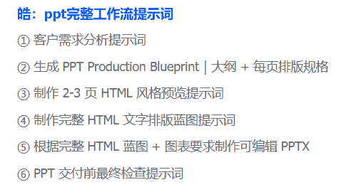
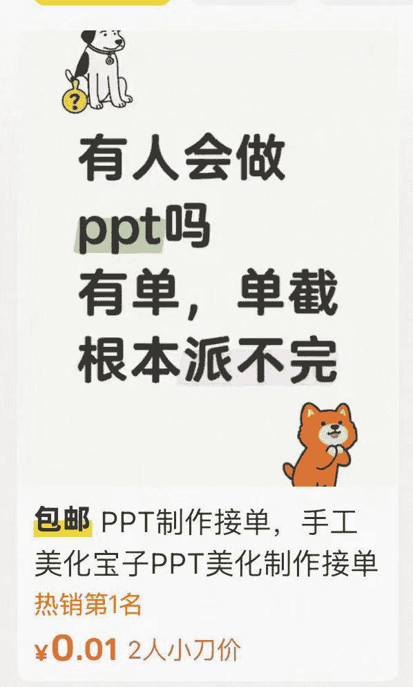
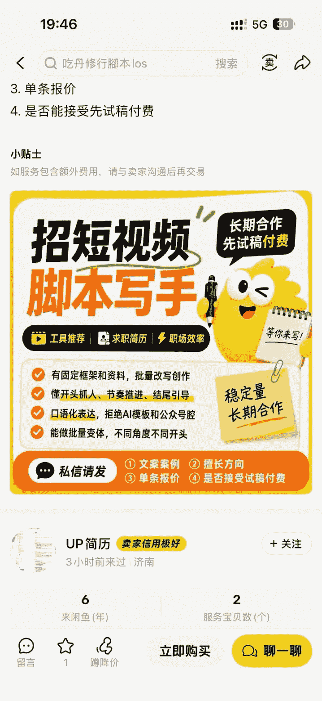

公众号懒人搜索，懒人专属群分享我是由月之暗面（Moonshot AI）研发的 kimi-k2.7-code 智能大模型。做闲鱼1个月，我是怎么从免费流到投流放大，做到2w利润的，附新手0-1上手实操SOP

260706 副业SC 精华

整理：公众号懒人搜索，懒人专属群精选

懒人微信：lazyhelper1

大家好，我是阿皓。

简单介绍一下自己：做了3年公域流量的00后选手，今年4月，我正式开始做闲鱼AI写作，目前在做学生人群赛道，比如PPT、作业等。

讲的是我过去3年做流量到现在做项目一些心态上的变化。

这篇就不聊太多心态了，直接把我这段时间做闲鱼的真实感受、起号流程、选品逻辑、免费流、投流、客服转化、写手交付都摊开讲一下。

先说在前面：我做闲鱼才2个多月，跟大佬没法比。这篇是我从0跑通到1以后，把自己踩过的坑和目前能跑通的动作整理出来，希望对刚想做闲鱼、但不知道从哪里下手的圈友有帮助。

废话不多说，这篇文章主要分为十二个部分：

- 先给大家看一下我一开始的投流数据

- 为什么我现在还是很看好闲鱼这个平台？
- 新手做闲鱼，到底应该做免费流还是投流？
- 选品的本质不是选品，而是选人群
- 新手从0起号，应该怎么铺链接？
- 一条链接到底怎么看好坏？
- 免费流跑出来以后，怎么做精细化补单和投流放大？
- 投流预算怎么设？500、1000、3000分别怎么玩？
- 顾客从咨询到成交，我自己的客服转化SOP
- 写手怎么找？交付怎么做？最后怎么沉淀成自己的资产？
- 我现在对闲鱼这个项目的几个真实判断
- 写在最后

# 一、先给大家看一下我4月份和近15天的投流数据

**4月的投流数据（含成交ROI）**

4月的ROI不是用成交金额除以投流成本，而是按净利润算的：

净利润ROI =（总成交金额 - 写手成本 - 投流成本）/ 投流成本

4月总数据：投流总花费3039.41，总成交20014，扣掉写手成本和投流成本以后，总净利润ROI是4.64。

单独看三个账号的话，有的账号ROI能跑到7.76，有的账号只有1.25，所以大家也能看到，同样是投流，不同账号、不同链接、不同品类，结果差距会很大。

**近15天的投流消耗**

下面我放一张漏斗模型图，大家不要被“模型”两个字吓到，其实它说的就是一件很简单的事：

闲鱼不是你发了链接、开了投流计划、充了钱，就一定能赚钱。

因为顾客从看到你的链接，到最后真的付钱，中间会经过很多步：

- 他先看到你，再决定要不要点进来。
- 点进来以后，再决定要不要咨询。
- 咨询以后，再决定要不要加微信。
- 加微信以后，再决定要不要成交。
- 成交以后，还要看你交付好不好，后面会不会复购。

这就是我说的漏斗，越往下，人一定越少。

所以做闲鱼不能只问“为什么没咨询，为什么没成交”，而是要先看：目前卡在哪一步了？接下来去做出调整。

任何一个环节接不住，ROI都会掉。

# 二、为什么我现在还是很看好闲鱼这个平台？

我最近在尝试一些新的品类，也一直在思考一个问题：学生品类进入淡季以后，我到底应该换项目，还是继续深挖闲鱼这个平台？

最后我的答案是：继续做闲鱼，只是多做几个品类过渡。

## 1. 闲鱼的流量成本对比其他平台真的很低

我最近测试了一些新的品类，比如jf，客资成本可以做到10出头，甚至5.6块钱一个，这个让我感到很惊讶，因为我在打小红书的时候，像jf这种粉，一个客资可能要20-50+。

但在闲鱼上，你如果品类选得好，链接做得好，流量成本确实可以很低。

当然我不是说所有品都能做到个位数成本一个客资，也不是说所有人都能一上来就跑出来。

我的意思是：闲鱼这个平台现在还有很多低成本流量，只是你要找到合适的赛道和玩法。

## 2. 闲鱼可以做的赛道品类太多了，我这篇文章说的是AI写作赛道

我一开始做的是学生相关品类，比如PPT、期末作业、pre这些，当时刚好是期末季，大家作业比较多，PPT、答辩需求都很多，所以那一波我靠投流直接跑出了2万左右利润。

但到了6月中旬以后，学生陆续放假了，咨询明显少了很多。

这个时候我就很纠结：到底是去做其他项目，还是继续在闲鱼里面换品类？

后来我想明白了，如果我每次遇到淡季就换项目，那我又回到以前那个状态了：看新项目、试新项目、又要重新跑通0-1，精力发散，最后什么都没有沉淀下来。

所以我现在下定决心深耕闲鱼平台，只是把学生品类当成一个季节品，同时去测试一些全年都有需求的品类，比如减肥、职场服务、ToB服务、AI工具等。

我觉得这个思路对新手也很重要：

不要一遇到一个品类淡季，就觉得整个平台不行了。有时候不是平台不行，是这个人群在这个季节需求少了。

## 3. 闲鱼链路很短，小白很快就能跑通0-1

闲鱼这个平台的好处就是链路很短，你不需要像小红书一样每天写很重的内容，闲鱼更像一个搜索+推荐+交易平台。

你把链接发出去，顾客搜关键词或者被系统推荐看到，点进来咨询，你把人转到微信，最后做成交和交付。

整个链路就是：

对普通人来说，这个链路足够简单，也足够快，但简单不等于无脑。

真正的关键在于：你能不能持续测试链接，能不能看懂数据，能不能把咨询转成成交，能不能把ROI打正。

# 三、新手做闲鱼，到底应该做免费流还是投流？

很多新手一上来就会问：我到底应该做免费流，还是直接投流？

我的建议很简单：

- 如果你预算不高，只是先拿来做副业，那就先做免费流。
- 如果你预算充足，而且你愿意每天算账、复盘、止损，那可以做投流。

但有一个前提：投流不是用来救烂链接的，投流是用来放大好链接的。

## 1. 预算低，就先用免费流赛马

如果你刚开始做，我建议先准备2-3个账号（一个人可以注册3个闲鱼号）。

每个账号先上到50条链接左右，不要想着上一条就爆一条，这个概率太低了。

闲鱼铺链接本质上也有点像账号矩阵。

你1个账号去打，和你20个账号、50条链接一起去打，概率完全不一样。

我自己当时一开始也尝试过免费流，就是不投流，疯狂铺链接。

在保证链接质量的前提下，用数量去提高跑出来的概率。

当时一天可能上十几二十条链接，放个两三天或者三四天，最后可能就只有一两条能跑出来。

我说的“跑出来”，不是说直接爆单，而是有咨询。

只要有咨询，就说明这个链接有一点潜力。

这个时候你再去维护它、补它、投它，而不是所有链接一视同仁。

## 2. 预算够，也不要一上来无脑投

如果你想做付费流，当然也可以。

但我建议你先用自然流或小额预算筛链接，筛出有潜力的链接以后，再去投咨询。

很多人亏钱，是因为一条链接曝光不行、点击不行、咨询也不行，然后还一直加预算，最后就变成给平台送钱。

我自己现在的感受是：投流一定要建立在算账的基础上。

你每天要知道自己花了多少钱，来了多少浏览，多少咨询，多少加微，多少成交，写手成本多少，最后净利润多少。

如果你连账都不算，那投流就会变成一种情绪动作：今天焦虑了加点钱，明天没咨询再加点钱，最后越投越慌。

# 四、选品的本质不是选品，而是选人群

很多人做闲鱼，第一反应是去找“什么品火”。

但我现在觉得，选品只是一个表面词，真正重要的是选人群。

你不是在卖一个PPT，也不是在卖一个文案，而是在服务某一类人群。

这类人有没有钱？有没有痛点？需求急不急？愿不愿意为省时间付费？后续有没有复购？交付重不重？这些才是选品的核心。

## 1. 有专业能力，就先从你的专业能力切

如果你本身有专业能力，我真的很建议你来试闲鱼。

假如你是程序员，你可以接AI小程序、Agent、网站搭建、自动化工具、脚本开发，甚至可以去服务ToB人群。

假如你是老师，你可以做课件、微课、教案、AI数字人课程、PPT课件美化。

假如你会写作，你可以接小红书文案、公众号文章、短视频脚本、口播稿。

假如你会运营，你可以接代运营、账号诊断、内容策划、私域搭建。

这些看起来很简单的东西，其实本质上就是把你的技能包装成一个服务，放到闲鱼上去测试需求。

## 2. 没有特别强的专业能力，就先选有钱的人群

像我自己一开始做PPT，其实不是因为我多会做PPT。

我真正看重的是背后的人群，我做的不是中文PPT，而是英文PPT。

为什么？

因为中文PPT背后的核心人群很多是国内学生，这类客户我接触过，预算普遍比较低，成交率也比较低。

如果你做投流，ROI很容易跑不正，但英文PPT背后的人群很多是留学生。

留学生这个人群，我会更看好一点，因为他们本身留学成本就很高，一年学费几万、十几万，甚至更高。

对他们来说，如果一个PPT很重要、很急、要求又复杂，那三位数到四位数的客单价是有机会成交的。

而且只要你交付好，他后续还有其他作业、presentation、论文润色、海报等需求，都有可能继续找你。

所以你看，表面上我是在选“英文PPT”这个品，实际上我是在选“留学生”这个人群。

## 3. 服务类赛道，优先思考ToB和高价值人群

如果你做服务类赛道，我建议你一定要想清楚两个问题：这个品类背后有没有ToB人群？有没有高价值人群？

同样是写文案，你可以服务一个学生，也可以服务一个老板。

同样是做网站，你可以服务一个个人博主，也可以服务一个公司。

同样是做脚本，你可以服务一个刚起号的小博主，也可以服务一个团队。

ToC不是不能做，但ToB的一单有时候真的能顶很多ToC的单子。

这也是我现在选品的一个底层标准：先选人群，再从这个人群身上拓展相关品类。

选品不要只盯着一个词，要盯着一类人的长期需求。

# 五、新手从0起号，应该怎么铺链接？

讲完选品，再讲具体怎么做。新手起号不要想太复杂，先把账号养起来，然后开始铺链接，用数据筛选。

## 1. 起号前先养2-3天

新号不要一上来就猛发链接，可以先养2-3天：每天打开闲鱼，正常浏览，搜索你要做的品类，看看同行链接，收藏几个，点几个想要，买一些虚拟小东西，保持账号活跃。

这不是玄学，本质上就是让你的账号更像一个正常用户，而不是一注册就来批量发广告的号。

## 2. 先找爆款链接，再二改

上链接之前，不要自己闭门造车，你先去闲鱼搜你想做的品类，看同行怎么发。

重点看三个东西：

- 想要数高不高
- 售出多不多
- 主图和标题有没有吸引到你

如果一个链接想要数超过50、100，甚至更多，同时售出也不错，那说明这个方向至少是有需求的。

## 3. 链接质量一定要先保证，再去铺数量

很多人听到我说铺链接，就理解成无脑铺，不是的，我说的是：在保证链接质量的前提下铺数量。

什么叫链接质量？至少包括四个东西：

- 标题有没有吸引力
- 主图有没有点击欲望
- 价格有没有吸引力
- 详情文案有没有打消顾客顾虑

如果你的标题、主图、文案都很烂，你铺100条也没用。很多链接为什么跑不出去？不是平台不给你机会，而是你拿到一点曝光以后，点击率太差、咨询率太差，系统自然就不会继续推。

附送我自己改写爆款文案的提示词：

你是一位闲鱼爆款文案改写专家，请严格按照以下规则对我提供的文案进行改写，输出3个版本。

【标题改写规则】

1. 核心服务词必须放在标题最前端，用【】框出。
2. 核心信息必须集中在标题前25个字内。
3. 标题关键词必须100%覆盖原文中搜索量最高的核心词根，不得删减。
4. 标题内只允许使用【】符号，不得出现｜、/、·、，、。等任何其他标点符号。
5. 标题关键词顺序可适当调整，但必须全部保留。

【正文改写规则】

1. 不大改：整体意思保持不变，只做近义词/同义词替换。
2. 格式严格镜像原文：换行位置、空行数量、缩进、符号、序号、板块顺序，必须与原文一一对应，不得新增或删减任何空行与换行。
3. 关键信息不动：所有数字、数据、专有名词、品牌词一律保持原样不改。
4. 逐段替换：每个板块的措辞做同义替换，保持语义相同、表达不同。
5. 语气自然：改写后读起来流畅，符合闲鱼买家浏览习惯。

【个人 人设强化规则】

1. 必须添加在每个版本文案的最末尾。
2. 内容须根据原文案的服务类型、语气、人设提炼生成，不得套用固定模板乱加。
3. 核心方向：体现“个人亲自接单、非中介机构”的真实感与信任感。
4. 每个版本的表达方式不同，语气与原文保持一致，自然融入不突兀。

【输出要求】

- 输出3个版本，分别标注【版本一】至【版本三】。
- 每版完整呈现（标题+正文），不省略任何板块。
- 版本之间措辞差异明显，不得雷同。

请严格按照以上规则改写，以下是我的原始文案：

\[在此粘贴您的原始文案\]

## 4. 做流量要接受概率性热门

我自己当时不是上一条链接就爆一条，我是一开始同品类上了二三十条链接，然后其中一条链接先跑出来，有咨询。

有咨询以后，我又做了精细化补单，咨询变更多，然后我再去投流，把这个链接放大，最后成交更多。

所以新手一定要接受一个事实：链接跑出来是概率事件，同一个链接，你换几个账号发，也不一定每个账号都能跑出去。

你能做的，就是提高每条链接的质量，同时用多个账号、多条链接去提高跑出来的概率。

# 六、怎么判断你的链接是不是好链接

怎么判断链接的好坏，我现在主要看四个数据：

曝光、浏览、点击率、咨询数。

## 1. 曝光

曝光就是平台把你这个链接推给了多少人。

如果一条链接上了两三天，曝光和浏览都在50以下，我一般会直接淘汰下架删掉。

因为这种链接基本说明系统不怎么给机会，或者这个标题、类目、账号权重本身就有问题。

## 2. 浏览/点击

浏览就是有多少人点击你的链接，点击率取决于你的标题、封面、价格。

比如一条链接曝光200，浏览10，这种我会觉得还可以，因为至少有人愿意点。

如果曝光很高，但浏览很低，那就说明你的主图、标题或者价格不吸引人。

这个时候不要急着投流，先优化主图和标题。

## 3. 咨询

咨询数就是点击链接以后，给你后台发消息。如果浏览还可以，但咨询很低，可能有几个原因：

- 详情页没有打消顾客顾虑
- 案例和好评不够
- 价格预期不对
- 咨询引导不明确
- 这个品类本身咨询意愿弱
- 投放时间不对，顾客活跃时间没踩准

这个就要你自己结合数据去判断。比如我打PPT的时候，投流随便来人，因为这个需求比较明确，顾客着急的时候会直接咨询。

但我打一些比较小众的品，哪怕有消耗、有浏览，也不一定有咨询。这个时候你就要设好心理预期：比如我给这个品200块预算，如果跑不出来，或者ROI特别低，那我就换品，不继续硬扛。

## 4. 我是如何筛选出好链接的

图里面的数据是7-10天的数据。

我做的这些品类上架2-3天不会有这么好的数据，但是如果前几天曝光都低于50的话，我就直接淘汰了。

以下4个动作你们可以根据自己遇到的情况做出调整：

- 如果曝光高、浏览低，用控制变量法，优化主图、标题、文案、价格。
- 如果浏览高、咨询低，优化详情、案例、信任材料和咨询钩子。
- 如果咨询高、成交低，去复盘客服话术。
- 如果咨询稳定，再考虑投流放大。

# 七、免费流跑出来以后，怎么做精细化补单和投流放大？

这块我直接讲我自己的做法。前面说了，我不是一上来就投所有链接，而是先铺链接，等某一条链接有咨询以后，再去重点维护。

## 1. 什么时候做精细化补单？

我一般会在一条链接已经有咨询以后，再去做补单，因为有咨询说明这个链接已经有一点潜力了。这个时候补一下，有机会让它拿到更多流量。如果一条链接完全没有曝光、没有浏览、没有咨询，你去补它，意义不大。

## 2. 什么叫精细化补单？

我这里说的补单，不是那种无脑拍下、秒付款、秒确认。现在闲鱼对这种动作查得很严，所以一定要尽量模拟真实用户路径。

比如你可以用家里人的账号，先去搜索你链接里的关键词，然后货比三家，点开几个同行链接看一下，停留一会儿，再点到你要补的链接里面。

进来以后不要马上下单，可以先咨询，聊一些业务相关的问题，比如页数、时间、要求、价格、怎么交付，聊完以后再拍下付款。

这个动作本质上是给链接做真实行为信号：搜索、浏览、对比、咨询、成交。

但这里我也提醒一下，这种动作本身肯定有平台风险，大家自己判断，有可能给你的账号限流。能用真实咨询和真实成交去跑，肯定是最稳的。

## 3. 免费流跑出来以后，再小预算投流

一条链接如果免费流有咨询，或者补完以后咨询变多，就可以尝试小预算投流，比如每天给这个链接30-50块钱预算。

你不要一上来就几百几百砸，先看它能不能跑正。如果这个链接本身点击率不错，

公众号懒人搜索，懒人专属群分享我是由月之暗面（Moonshot AI）研发的 kimi-k2.7-code 智能大模型。咨询质量不错、成交也能接住，那投流就是放大器。

如果这个链接本身就不行，那投流只会放大亏损。

# 八、新手怎么投流？预算500、1000、3000分别怎么玩？

在这之前我先教怎么建计划吧。

闲鱼PC端超级擦亮：

https://dayu.goofish.com

（身边如果有闲鱼代理商可以找他们绑定，有返点！没有的话可以找我。）

我的品类是需要顾客先咨询再到微信成交的，所以我投的是咨询量。

如果你们的品类是虚拟资料，比如卖资料库、电影票、会员充值等，可以选择投放曝光量+浏览量。

## 自定义计划投放👇

选择你们想要投放的链接1—5条（同品类），出价设置80%（2天消耗不出去可以加到100%）。

日预算设置30—50，时间段选择你们在线的时间，我是10点—24点。

城市选全国就好了，如果做本地生活或者旅游的可以固定几个城市。

创意优化的意思是，如果你的链接里面有3张图，系统推荐的时候会选择浏览最多的图展示，成为链接主图，我是不开的。

## 套餐包

直接选择你想要花多少钱的套餐包即可，可以先尝试投最便宜的，有些链接可能会有9.9的套餐包。

这时候可能会有人问：只有500块怎么玩？1000块怎么玩？3000块怎么玩？

说实话，这个没有标准答案。

不是说500有500的固定打法，1000有1000的固定打法。

核心还是要看你的心理预期和ROI能不能跑正。如果你的ROI能跑到1:3以上，那你就可以继续放大。

如果你只能跑到1:1或者1:2，那你就不要急着放大，先去优化链接、话术、品类。

如果你投了200块，一个有效咨询都没有，或者咨询质量特别差，那你就应该停下来复盘，而不是继续加钱。

## 1. 小预算怎么测？

如果你预算不多，可以这样测：

先筛出一条有潜力的链接，给这条链接100—200块总预算。

小步测试，每天预算30—50块，可以买套餐包，也可以选择投自定义擦亮，设置日预算上限30。

每天记录：

- 消耗多少
- 曝光多少
- 浏览多少
- 咨询多少
- 加微多少
- 成交多少
- 写手成本多少
- 最后净利润多少

跑完以后看ROI，如果ROI不行，不要骗自己说“再投一点可能就好了”。

要结合数据分析看看哪里出问题，再做出调整。

## 2. 中等预算怎么放？

如果你有1000—3000的预算，我也不建议你全部压在一条链接上。

你可以同时测几个品类、几个链接，但每个测试都要有止损线。比如一个品类，我愿意给它500块测试预算。

如果500块以内能跑出有效咨询，甚至有成交，那我继续放大。

如果500块花完以后，咨询少、加微少、成交差，那我就换品或者换人群。

## 3. 放量不要一下子翻倍

如果一条链接ROI跑出来了，也不要一下子从50块加到500块。

我更建议小步放大，比如每次加20%—30%，边加边看咨询成本、成交率、交付压力。

因为有些链接小预算能赚钱，大预算不一定还能赚钱。放量以后，你买到的人群可能变泛，客服接待压力也会上来，交付如果接不住，还容易退款和差评。所以投流一定要算账，一定要止损。

# 九、顾客从咨询到成交，我自己的转化SOP

我觉得很多新手做私域销售，最容易犯的一个错，就是顾客一上来问价格，你就马上报价。

一旦你一上来就报价，主动权就到顾客手里了。他会开始比价，会拿你的价格去问别人，会觉得你只是一个可以压价的供应商。

我自己的转化逻辑是：先挖需求，再放大痛点，再铺垫信任，最后报价。

## 1. 第一步：先让顾客发完整要求

以英文PPT为例，顾客来咨询，我一般不会直接说多少钱。我会先问：

你这个PPT是做什么主题？老师/学校有没有具体要求？需要多少页？截止时间是什么时候？

是从0做，还是已有内容需要美化？需要全英文吗？要不要speaker notes或演讲稿？

因为很多顾客会直接把资料丢过来，什么也不说。这个时候你不要急着报价，你要把需求问清楚。

因为需求没问清楚，你报低了，后面交付会亏；你报高了，顾客也不理解为什么这么贵，掉头就走。

## 2. 第二步：找到这个需求里的痛点

问完需求以后，你要判断这个单子的痛点在哪里，比如：

- 它是不是很急？今天晚上要、凌晨要、明天早上要。
- 它是不是很难？要求很多、主题很专业、全英文、还要演讲稿。
- 它是不是工作量大？页数多、材料乱、要从0梳理逻辑。
- 它是不是对顾客很重要？答辩、期末展示、小组汇报、影响成绩。

你只有找到痛点，后面的报价才有支撑。

## 3. 第三步：放大痛点，但不要吓人

比如顾客今天晚上就要，你可以说：

“你这个时间确实比较赶，而且还是全英文presentation，不只是排版，还要把逻辑和表达顺一下。正常这种我会先看要求，再看能不能安排老师加急做。”

这样说的目的不是吓顾客，而是让他知道：这个事情不是随便套个模板就能完成的。

你要先把工作量讲出来，后面报价才不会显得突兀。

## 4. 第四步：铺垫信任和案例

痛点讲清楚以后，就可以发案例。比如你可以说：

“这种presentation我们之前接过蛮多的，有的是课堂展示，有的是答辩，有的是小组作业。你这个要求我先帮你拆一下，看一下怎么做比较稳。”

然后发一些案例、好评、交付截图。

这里很重要的一点是，你要有信心。出门在外，身份都是自己给的。

如果你自己都畏畏缩缩，顾客会觉得你不专业。遇到不懂的专业名词也没关系，现在AI很好用。你把顾客的要求丢给AI，让它帮你解释名词、拆解任务、判断难度，再辅助你回复顾客。

## 5. 第五步：最后再报价

前面需求、痛点、信任都铺垫完以后，再报价。

为什么有的同行只敢报二三十一页，我敢报一两百一页？不是因为我比别人牛逼，而是因为我会先把顾客的需求、痛点、工作量拆出来。

你不能只卖“我帮你做PPT”，你要卖的是：帮他省时间、救急、解决不会做的问题、降低挂科/丢分/展示翻车的风险。

当然，敢报价不是乱报价，你要结合顾客人群、作业难度、截止时间、交付成本、写手成本去报。

如果顾客就是预算很低、一直压价、需求又很重，那这种单子不接也没关系。

## 6. 自用：可编辑的PPT完整工作流提示词

号：PPT完整工作流提示词

# 十、写手怎么找？交付怎么做？

闲鱼服务类项目能不能放大，最后一定会卡到交付。

你自己时间充裕，交付又不重，那可以自己做。

但如果你想把前端流量和客服转化做起来，交付最好慢慢外包给写手。

## 1. 写手去哪里找？

我自己找写手主要有两个渠道：

- 小红书私信同行。你去搜相关关键词，比如PPT、留学生作业、presentation、论文润色，看到有人做这个服务，就私信问他接不接单。

话术很简单：

“你好，我这边有一些英文PPT/presentation的单子，想问下你这边接不接长期合作？”

- 闲鱼自然吸引。当你的链接跑出来以后，会有一些老师、写手主动加你，问你需不需要老师。

这种老师质量还蛮高的，自己给单子筛选一下就好了。

也可以看看这种玩法，直接在闲鱼发布兼职链接，同理小红书也可以。

## 2. 怎么筛写手？

不要一上来就把大单给他，先让他发案例、简历、擅长方向，然后给他一些小单子试一下，看几个维度：

- 交付质量怎么样
- 交付时间稳不稳
- 能不能按要求修改
- 沟通效率高不高
- 价格能不能接受

写手不是越便宜越好。如果写手便宜但交付很差，最后客服、修改、售后全都压到你身上，会更累。

# 十一、我现在对闲鱼这个项目的几个真实判断

最后再说几个我现在阶段性的判断。

## 1. 免费流不是不用成本，而是用时间换预算

很多人觉得免费流就是0成本，其实不是。免费流要养号、铺链接、看数据、下架重发、补单、回复咨询，本质上是用时间换预算。

如果你时间多、预算少，免费流适合你。

如果你时间少、预算够，投流可能更适合你。

但不管免费流还是投流，最后都要回到同一个漏斗，最终的目的就是把ROI打正。

## 2. 投流不是万能的，它只会放大你的链接

好链接，投流能放大；烂链接，投流只会放大亏损。

所以新手不要把投流当成救命药。你要先把标题、主图、详情、价格、客服话术做好，再投。

## 3. 季节品要提前准备过渡品

学生品类很好，但它有淡旺季，期末季、毕业季、开学季，需求会更强。

但学生放假以后，如果你没有老顾客沉淀，没有其他全年品类过渡，就会很难受。

那些做了一两年的同行，淡季还能靠老顾客回购维持盈利；但像我这种4月才开始做的人，微信里沉淀的客户还不够多，所以必须去测试其他品类，这也是我现在越来越重视私域和复购的原因。

## 4. 不要只做现金流，要沉淀资产

这个也是我上一篇文章一直在反思的点。

如果一个项目做完，只留下“我赚过钱”，那其实很可惜。闲鱼这个项目，我现在已经沉淀的东西有几个：

- 选品SOP
- 发布链接SOP
- 投流SOP
- 客服话术库
- 写手筛选标准
- 交付验收流程
- 数据复盘表

这些东西写出来以后，后面就完全可以交给小白做了，不然项目永远长在自己脑子里，一停下来就断。

# 十二、写在最后

这篇文章是我一时兴起花了几个小时写的，可能很多地方写得不到位，大家谅解一下。

最后我想说，闲鱼这个平台，对普通人来说近两年来红利还非常大。它不需要你一上来就有多强的内容能力，也不需要你一开始就有团队。你可以先从一个账号、一个品类、一批链接开始。

先上链接，先拿咨询，先成交一单，先把交付跑顺，再去优化客服话术、优化投流、沉淀SOP、扩品类、做复购。

如果你是新手，我建议不要一上来就想着做很大。

先问自己几个问题：

1. 我想服务什么人群？
2. 这个人群有没有预算？
3. 他们有没有持续需求？
4. 我能不能找到交付资源？
5. 我能不能坚持每天看数据、复盘、优化？

很多东西不是想明白以后才开始做，而是你做了以后，数据会告诉你答案。数据永远都是最真实的，而你的想法是毫无意义的。

干中学，先完成，再完美！目前我自己还在测试新品类、新玩法，期待闲鱼的大佬给个合作机会。

上面的方法论是我花了很多金钱和时间迭代出来的最新玩法。

小白直接上手去做完全没有问题，去执行才有机会成功！一起加油！

————分割线————

看完这篇SOP，你觉得你懂了。但90%的人一到实操就会卡在第一步。

工具和教程只是最低级的壁垒，真正的壁垒是“立刻动手”和“圈层信息差”。

如果你想看全网最新的变现玩法，并且和一群执行力极强的极客一起下场拿结果，欢迎围观我的核心私域：【懒人专属群】。

我们不聊虚的，只做商业闭环的拆解与AI效率的压榨。系统内已沉淀1000+跑通的套利实战局。

👉 查阅圈子完整数字资产与上车门槛：

https://lazyso.com/insider/

认同价值、准备好下场干活的，扫码加我微信（lazyhelper1）。

备注：【实操上车】，不闲聊。

