# 大学四年，从 **0** 到稳定年利润七位数，我的毕业答辩

260706 副业SC 精华

整理：公众号懒人搜索，懒人专属群精选

懒人微信：lazyhelper1

一年没在生财发过贴，业务一直在上升期，表达欲大幅度萎缩，经常觉得想说点什么，打开写了点又退出去。

但是每年 418 还是要来交作业的，今年是生财的第十年，也是对我自己意义非凡的一年，是我的 22 岁，我的学业生涯的最后一年。

生财一年，让我实现十倍增长的 8 个关键节点

二十不惑——在生财的第二年，随便聊聊

在 AI 大会的会场，很多我的生财家属，戴总，小排老师，曹大，笑着看着我说我终于要毕业了。

初入大学的我曾经无数次幻想过今天会是什么样的。

可能会在为了考研成绩欢呼雀跃，弥补当初高考的遗憾；可能在一个美丽的城市当导演拍摄作品；可能在上海 CBD 拥有了一个自己打扮和布置的小工位。

也许这些想象在平行世界里已经实现了吧，但我更满意今天的自己。

接下来的内容是我的生财毕业答辩，可能没什么干货，像故事汇，够不上精华帖的标准，但是是我自己真正想讲的话。

### 一.**保持研究赚钱的习惯，保持对用户的理解**

过去一年我上了很多的线下课，我发现，无论什么业务，什么平台，本质上都在讲一件事：

你怎么把你的内容推到你的准客户面前。

为什么是准客户？

两层思考。一方面，在内容电商时代，用户的消费决策大概率并不是一开始就筹划好的理性决策。

比如你会不会经常刷抖音刷小红书就稀里糊涂买点东西，反正我会。我的抖音猜到我喜欢喝牛奶，给我推送了 20 种不同口味的牛奶，但是我从来不在淘宝主动下单牛奶，我都是被广告吸引在抖音下单的（为此我翻了一下我的订单，我怎么买过这么贵的奶……）。

另一方面，其实很多人的业务中公域都不咋合规，精准露头就秒，只能去做泛精准。

还是牛奶的例子，我从来没有在抖音或者淘宝搜过牛奶，但是抖音锁定了我的画像，20 岁出头的女生对生活有点品质追求，她就把这个产品推到我这个画像面前，只要内容 ok 我就会购买。

再举几个我自己刷小红书发现的例子。

案例 **1:** 拖鞋

拖鞋本身的卖点是很难做出差异化的，但是可以通过拓人群和拓场景的方式增加买点。

这个拖鞋在小红书上卖了 40w 单，原本链接我找不见了可能下架了，它投放的词是：青岛旅游，南意旅游，大连旅游，普吉岛旅游。

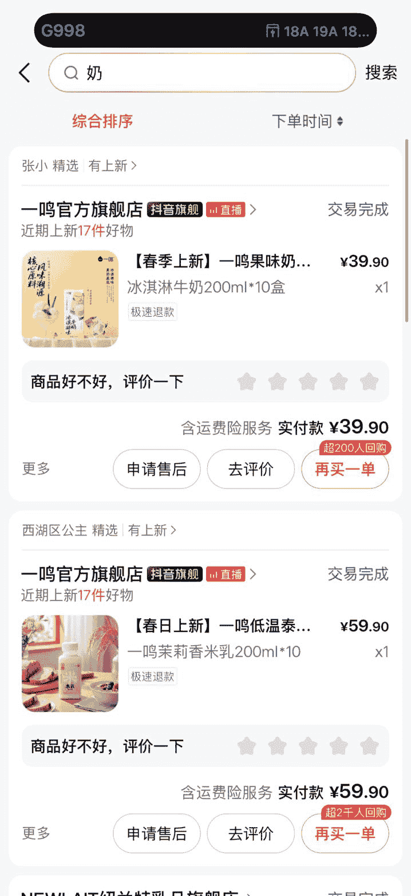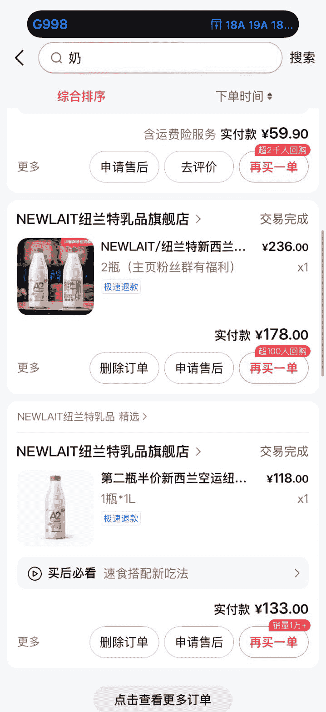

全世界每一个海岛城市，你搜旅游攻略，都能搜到这个踩屎感暴走不累的拖鞋。

别问我为什么知道，因为我是在搜青岛美食的情况下买了两双拖鞋…

案例 **2:** 玫瑰露

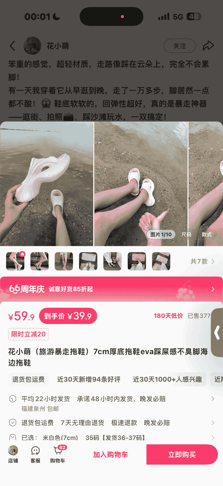

说实话我相信大部分朋友看到这个词都不知道是啥玩意儿。

这玩意儿一瓶快 300 块，不算外溢，光在小红书站内都成交了 500w。

它是怎么把一个大众完全没有认知的贵价产品卖这么好的，它打得词是：

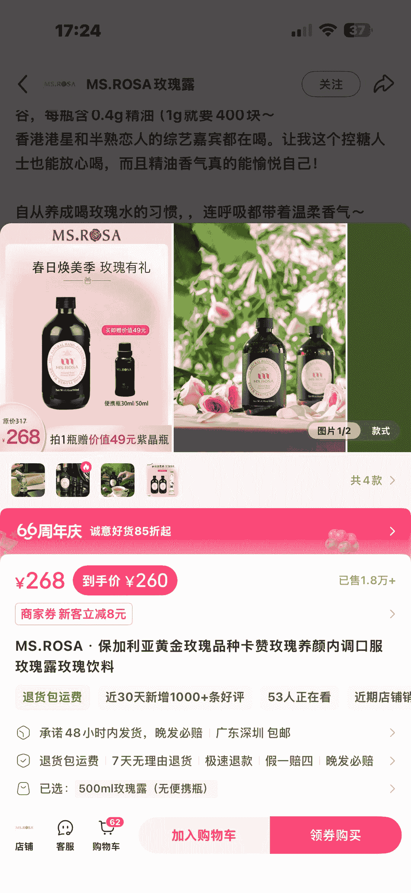

丽思卡尔顿，四季，安缦，w 酒店。

它卖的是一个很爱自己的贵妇，在五星级酒店喝高级的水的场景感。

它戳的是一个有点虚荣，向往精致生活的女生的内心的隐秘的渴望。

六千块的安缦咱住不起，300 块的同款水咱还不能喝上吗？

所以当今的商业，本质上比拼的其实就是对用户的理解层次，无论在引流还是在转化端。

这里首当其冲感谢富贵老师，她的情绪营销理论影响了我所有内容的底层框架，写这篇文章的时候我也刚好在从她的课回来的高铁上。

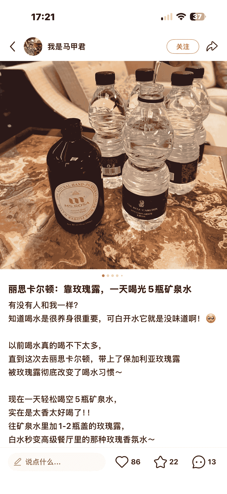

现在是个人都知道短视频前三秒要去戳痛点，但是很多人的痛点根本不是对着自己的用户讲的，是对着同行讲的。

你的一条内容只能集中一种用户的核心情绪。

她在几线城市，学历是普通大学还是 985211，消费观是什么样的，是不是恋爱脑，她原生家庭怎么样，是爸爸强势妈妈强势，她婚育状态怎么样，有几个孩子，处于哺乳期还是分娩期。

你的产品要卖给一个具体，有脸的人，甚至你都能想象到她的一举一动和一颦一笑。

这个时候可能有差生要举手了，老师，我不做电商怎么办？

老师也不做电商呀，但用户理解是做业务的底层能力。

例如，用户问你，他要给女朋友送礼物，想买个手串。

如果你做过用户分析，他大概率是个学生，希望能花小钱办大事，他真正在意的是体面和有档次的礼物。

你对这样的用户讲解款式和寓意就是鸡同鸭讲。

你该戳的点是：1. 我们包装上档次 2. 我们有手写贺卡 3. 客返，女朋友收到特别开心。

真正理解了用户微妙的人性与情绪，挣钱是一件很顺利的事情，因为你是在帮具体的人解决具体的问题，而不是强塞一个内容过去。

### 二.**信息差在认知差面前不值一提，认知差在资源差面前不值一提**

什么是认知差呢，比如我们同样认为 btc 是优质资产，于是我拿了资产的 3% 去浅尝辄止的尝试，但是 xx 拿了 50% 下重注。

一次上涨，我们同样挣到钱，深化了这个信念，于是表面上我们似乎都有了 btc 是优质资产这个认知。

但我的认知能让我在下跌 20% 的时候泰然自若，在腰斩到 50% 的时候就崩溃懊悔。

而 xx 的认知能让他无论晴初霜旦都扛住这个波动，直到拿到足够的结果。

其实投射到做业务上，业务和认知的关联性可能是滞后的，大部分人的第一桶金都是在混沌矇昧和莽撞里挣到的，并不需要什么都懂才能挣到钱。

生财里任何一个小项目都能让人挣到钱，但是同一个项目有人能一次就财富自由，有人挣了点小钱后回去规规矩矩上班了。

认知决定了不同人做同一个业务能走到的高度和深度，不同的认知差导致了不同的下注程度，从而走向不同的结局。

至于什么是资源差，这里非常非常感谢比高老师，26 年目前最大的收获就是听比高老师讲话。

他夜话里的一句话让我印象很深刻：

普通人想赚 **100w**，需要仔细的选项目，然后吭哧吭哧尝试跑通，再组团队放大。

亦仁想赚 **100w**，可能只需要一个想法 **+** 资源。

这个答案解决了我思考已久的，我通往 1000w 的路径问题。

我相信，哪怕亦仁老大失去了他当下的所有现金，他依然可以做到只靠想法和几个电话就能挣到 100w。

以此延伸，如果我要成为只靠资源就能挣钱的人，我该拥有什么？

我认为是：现金，私域用户，优质深层的关系网，团队和人才，渠道。

这些是能够让我不断的跨越周期的核心，所以我的注意力要不断的投入到这些里面。

赚钱的本质是有效的动作不断重复做，最难的事情是找到真正的有效的动作，什么样的业务现金流是健康的，怎么持续性拥有更多的私域用户。

这些都需要持续性的大量试错，行动带给你的反馈才能完成。

### 三.**项目死了以后我们怎么办**

我是高中的时候就在小红书上挣钱的，也就是 21-22 年，当时做小红书根本不需要懂内容，就是第一页放个微信号，评论区放个微信号，简介再放个微信号，加我，打钱。

放到今天讲是不敢想象的，你 26 年去做外卖 cps，知乎好物，再怎么努力也不可能赶得上 20 年随手一发。

像我们赖以为生的闲鱼，从 24 年到 26 年都发生了翻天覆地的变化，从乱发都有流量，到慢慢限制引流，到限制的违禁词越来越多，从野生黑市到有了超级擦亮，其实就是平台在商业化的进程中优化的一个小周期。

所有平台的周期都是从缺内容，对创作者卖家激励拉满，到内容饱和期开始缩窄流量，到最后把自己的流量商业化变现掉。

因此，挣钱的时候千万不要把平台释放的红利当成自己的个人能力，能挣钱的时候就 allin，能打到多少流量到私域打多少，不要小富即安。

少买包，多收号，一个香奈儿 **22bag** 放两年亏 **1w**，**4w** 块钱买 **400** 个高价值粉放两年起码挣 **10w**。

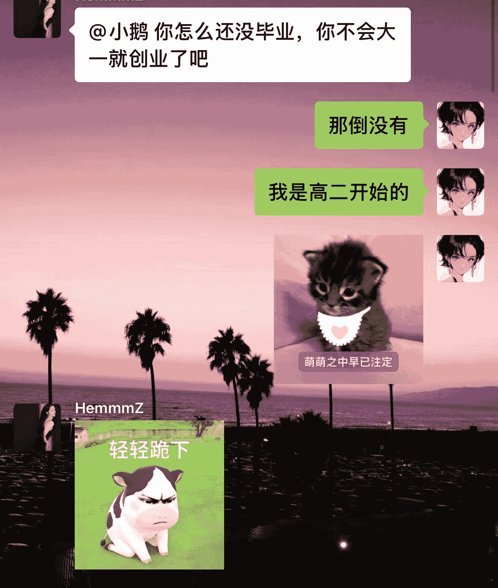

晴天补屋顶永远好过亡羊补牢。

与此同时，其实关注到我们到底有什么东西是能够真正的穿越周期的。

好像其实一切都是脆弱的，账号是脆弱的，反正都会被封，团队是脆弱的，人员总会来又复去，甚至私域都是脆弱的，一次规则的变动都可能发生翻天覆地的变化。

这个答案是我看航海家云蔓老师的分享稿找到的。

唯一不变的，是你自己。

去年我一直有个很大的困惑，当我脱离生存焦虑后，我挣钱的动力和意义是什么呢？

更大的房子，更贵的车，对我的体验提升都是有限的。

我一直在找这件事的答案，我发现航海家大部分人在已经拥有了巨额财富之后依然在持续的折腾和学习，依然在一线事必躬亲的去抠业务的细节。

我问他们为什么，他们的答案对我来说有点大，有人会说是使命和愿景，有人会说他们觉得挣得还不够。

书虫给了我一个我能理解的答案。

他说我不是喜欢打鹅鸭杀嘛，他觉得他做业务的愿力跟鹅鸭杀是一样的。

鹅鸭杀的爽感来自于靠分析抽丝剥茧找出狼，创业的爽感来自于你不断的解决问题，把不可能变成可能。

我一下就听懂了。

钱当然重要，它是最诚实的计分板。

但是当生存问题被解决以后，真正让人上瘾的，是自己的判断被市场验证，是昨天还觉得不可能的事情，今天被自己一点点做成了，去拆它的流量从哪里来，用户为什么买单，哪个环节卡住了；是发现一个问题之后，不断调整、测试、复盘，最后亲手把它跑通。

如果把创业看成一场无限游戏，平台、账号、团队和具体项目，都只是每一局里暂时拿到的身份牌。

它逼着我理解真实世界，逼着我对自己的决策负责，也逼着我不断承认自己原来的判断和理解可能是错的。

而这种不断发现问题、解决问题、把不可能变成可能的能力，才是我在一轮又一轮周期里，真正能够带走的东西。

### 四.**从怎么让 ai 做项目到怎么做 ai native 的项目**

本文标题引用文献：albert

从广州航海家线下课回来以后我每天两眼一睁就是在 codex。

第一步是把我过去几年沉淀的所有数字资产都变成本地知识库，ip 资产，项目资产，课程资产，变成的这一步是让 codex 自己去我的各种软件复制过来。

我会把关键结果和目标告诉他，他每天给我在苹果日历布置任务督促我干活。

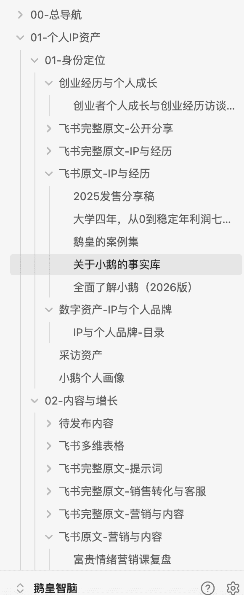

然后他根据我的理论体系，每天自己写选题，每天自己出文案，自己归档到飞书多维表格里，自己给素材归类。

以上所有，包括建表，数据搜集，归档，全部是它自己干的。

那我起到了一个什么作用呢？

我没什么作用……我唯一能做的就是在它忙的时候在旁边刷抖音不干扰他工作。

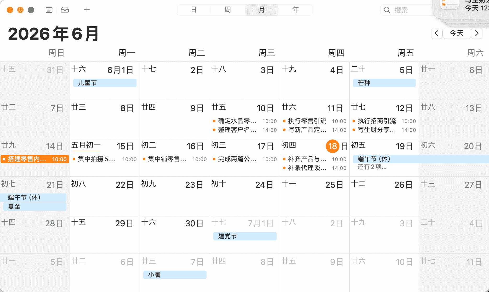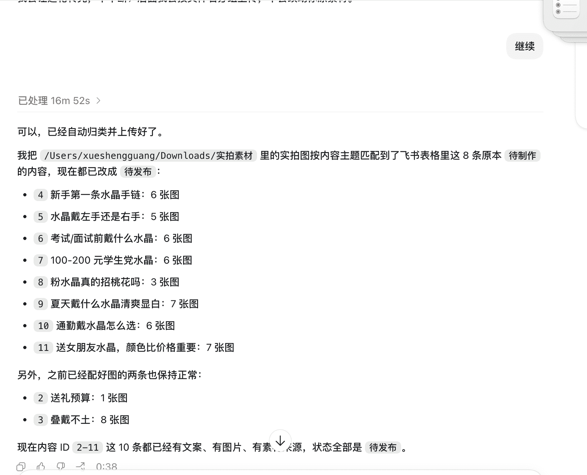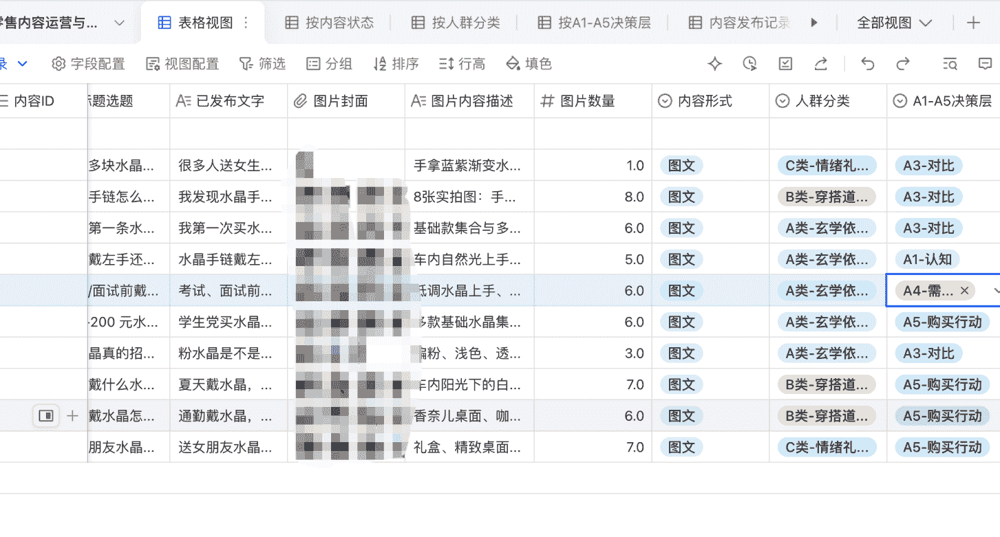

我会把自己写公众号和朋友圈的方法蒸馏成 skills，再把喜欢的博主也蒸馏成 skills，然后所有的内容都 obsidian 和飞书同步沉淀一遍。

我最喜欢的一篇科幻小说，叫《带上她的眼睛》。

本质上，我们现在和 AI 的协作方式也很像。

我们是 **AI** 的眼睛。

我们替它去真实世界里生活，见用户，做业务，观察人的表情和情绪，搜集那些它暂时无法亲自获得的信息。

而它像待在地心里的智脑，记住我看过的一切，帮我分析、连接、推演，再把答案传回来。

albert 的分享跟我印象很深的一句就是，Ai native 的含义是，不是思考 ai 怎么去帮我提效。

而是如果整个业务都用 ai 重做一遍，该怎么做？

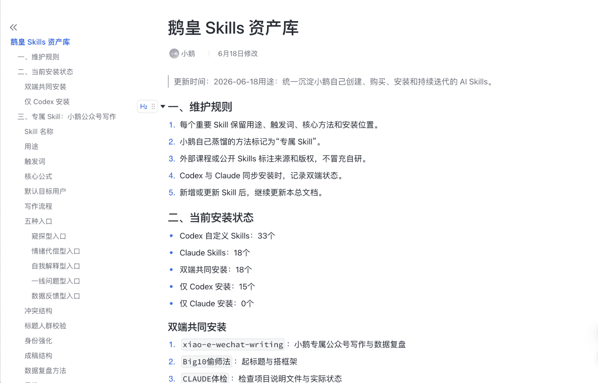

所以 AI 时代唯一重要的事情，其实是判断力。

因为执行正在变得越来越便宜。

写一篇文案、建一个表格、整理一堆资料、拆几十个选题，这些过去要消耗大量时间的事情，现在都可以交给 AI。

但问题是，AI 不知道什么是对的。

所以人最重要的价值，不再是“我能不能做完”，而是“我知不知道什么值得做”。

判断什么是好选题，判断什么是真需求，判断什么是有效内容，判断一个项目该不该继续，判断一条路是不是在消耗自己。

稀缺的是你见过多少真实用户，做过多少真实业务，踩过多少坑，能不能在一堆看起来都正确的答案里，选出那个真正有用的答案。

### 五.**复利是世界第八大奇迹**

个人认为钱本身是没有跨越周期的能力的，如果一个人只有钱没有优质资产，他的抗风险能力是很弱的。

我非常恐惧系统性风险，比如一次小事件就导致全盘崩塌的情况，所以我希望给自己搭建足够健康的资产结构。

具体什么是优质资产，这块总是公说公有理婆说婆有理，比如段永平说你要看懂一个公司，那看懂这个词就很微妙，如何定义看懂，市面上给了大量的解读和思考。

与此同时，你也会面临大量的信息的诱惑，比如我朋友经常会给我讲一个大佬，2000w 实盘一年到 3500w 的故事，他推荐什么样的标的。

不同的影响者会发出截然不同的声音，我自己的选择是模拟+低成本尝试，并且思考清楚自己要怎么样的模式。

我认为我的抗压能力和抗风险能力不足以支撑我做任何的短线，年化 80% 的故事听起来很性感，但是对你的要求是做对几乎 99% 的决策，我不是很擅长做大量密集的决策，我也恐惧 1% 的错误带来的灭顶之灾，所以我选择了段永平的理念。

设立一个比较明确的目标：

1. 最坏的结果我能不能接受，假设这笔钱我全部没有了我的情绪会不会受到重大影响。
【因此绝对不能上杠杆，不能超出我的止损线】
2. 在交易过程中数据反而是不重要的，更要关注自己的心态和情绪的变化，每一个决策背后更深层的动因是什么。

哪怕我的钱很少，我在每一次动作之间更好的观察到了自己。

我会因为情绪驱动去稀里糊涂的买了黄金，会因为环境驱动去买 btc。

赚钱不等于做对，亏钱也不等于做错。

更重要的是，我能否解释清楚为什么买、什么时候卖，以及什么情况下承认自己判断错误。

模拟和低成本尝试，是为了看清自己：上涨时会不会追高，下跌时会不会恐慌，别人赚得更多时会不会动摇。

我不需要找到收益最高的方法，而是找到最适合自己、允许犯错但不会全盘崩塌的资产结构。

两年的尝试，让我发现，哪怕每天只有 500 块定投的基金，极其微小的涨幅，只要时间线拉的很长收益都能轻松 cover 住我的生活成本。

三年前做的账号，哪怕没有更新了，后台也有商单合作找过来。

一个满人号的私域，不再主动触达每天也都会有收入。

一个占住流量入口的工具站，每天都可以躺着看进账。

复利不是只有钱生钱，内容会复利，信任会复利，账号会复利，知识库会复利，一个人长期做过的正确动作都会在未来某一天突然回头找你。

最恐怖的地方不是增长，而是时间会替你放大一切。

你今天偷懒，它放大你的偷懒；你今天乱决策，它放大你的风险；你今天认真沉淀一个账号、一个产品、一个用户理解、一套资产结构，它也会在很久以后，用一种你意想不到的方式，把答案还给你。

### 六.**所有人都只是生命的玻璃窗外缓缓划过的雨滴**

去年经历了一次比较大的人际关系上的困扰，现在看来不算什么事，但是当时确实低谷了一个月。

简单来讲就是一个手把手培养起来的女孩，给钱给流量给介绍资源，她的社群用户九成都是从我这里来的。

她因为认为分钱不均心有怨怼，我知道情况了以后解释清楚了最开始的约定以及为了情分和体面给她买了算是比较贵重的礼物，即便如此，她依然在许多地方背后说了很多难听的话，还删掉了我们一起合作的课程，导致售后我去处理。

现在看来是小女生的伤春悲秋，但当时就是百思不得其解，因为我不知道这件事如果我要去避免我该怎么做。

其实最后的结论就是上面这句话，这个词，接纳。

所有人，所有事，都只是生命的玻璃窗外缓缓划过的雨滴。

接纳和允许所有事情发生。

我想起北京航海家聚会结束的那一夜，我们一群航海家从小马宋老师公司的胡同里走出来，决定晚上去三里屯的酒吧聊聊天。

那一夜，暴风骤起，大雨淋漓，世界陷入了巨大的混乱之中，我们安坐在一个狭小又昏暗的小地下室酒吧里，小酌三盏两杯。

大家的业务不尽相同，公众号、实体行业、私域……但似乎各有各的苦恼。

流量瓶颈，开除员工，生活变故，合伙人背刺，平台变动……

几两酒下肚，大周哥在闲谈中分享了一句马老师教他的，让我们从悲伤和痛苦中平静下来的咒语——

“这很正常”。

我们最开始的酒吧人很多，不让我们进去，这很正常。

我们遇到了暴雨，被困在了这里，这很正常。

我们遇到了无数糟糕的人和事，这很正常。

世界上每天都有人在经历错过和失去，这件事偶然降临在了我身上，这很正常。

既然每一个选择都会延伸向另一种可能性，那么每一个可能性都有它存在的合理条件，那么一切的发生，都很正常。

可能像散文和鸡汤，但是这一句话支撑了我几乎所有的心力困难的时刻。

封号，弹违规，手机丢了，很多人不喜欢我，被贴脸洗稿抄袭，都很正常。

允许自己不成熟，允许自己不体面，也允许自己被讨厌。

学会这个课题了以后，我的生活少了 90%

## 七、致谢

2022—2026年，我的三年半在生财里度过。

四年，72次飞行，不计其数的高铁票，无数次红眼航班极限赶考试。萧山机场的登机口，我已经能闭着眼睛走过去了。

我有太多太多的第一次都在生财：

- 第一次上台演讲
- 第一次组织线下活动
- 第一次直播
- 第一次谈超过一年的恋爱

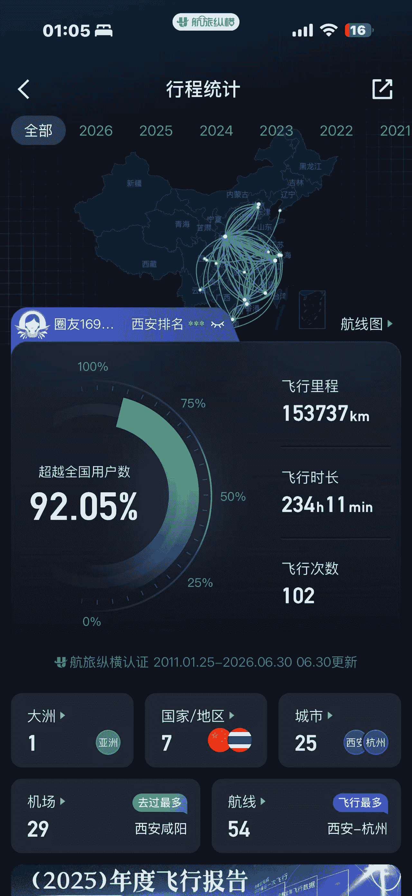

- 第一次换城市生活……

6月7日，我去了广州航海家线下AI大课。

广州，我记得好清楚。当时一腔孤勇地买了张飞机票，单枪匹马地来参加航海家线下活动。陌生的城市没有一个认识的人，在台下第一次听亦仁讲话。

他说，生财有术致力于让每一个普通人挣到人生的第一个一百万。

那天的我永远不敢想象，在不久后的几个月就做到了这句话。

一切都从AI开始，从生财开始，从广州开始。

6月8号，高考四周年，我连夜赶到了苏州，领到了自己的毕业纪念品。

这个日子是找人算出来的，我感受到了命运强烈的推背感。

夜深忽梦少年事，但这一次流的是幸福的泪水。

6月24号，我领到了双证，真的结束了。

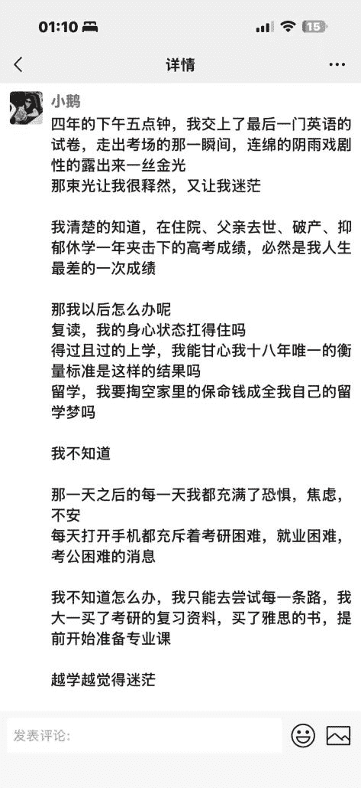
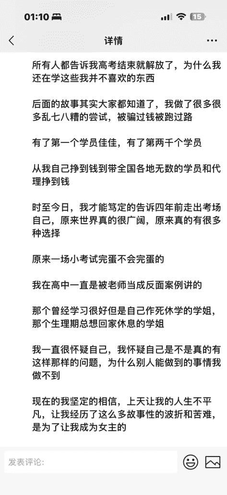
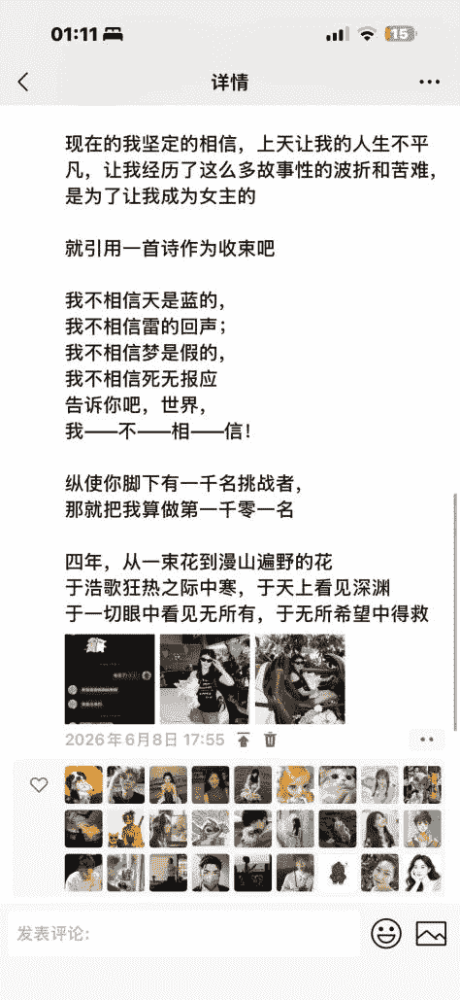

如果去写一个生财的致谢名单，我真的写不完。

感谢亦仁，无需多言。

感谢涛哥，从始至终像对待亲生女儿一样养我，带我吃好吃的，带我长见识。

感谢坤汀，什么事情都会像亲哥一样想着我。

感谢生财的每一位工作人员，他们的付出和认真的感染力总能让我震撼。

感谢联合办公的小伙伴，感谢西安的圈友，感谢杭州每天一起打牌的朋友们，每一位线下聊过天的老师，每一个学员，每一个带给我正向影响的圈友。

感谢书虫。

感谢你们，像礼物一样出现在我的生命里。

就此，回首向来萧瑟处，也无风雨也无晴。

————分割线————

看完这篇SOP，你觉得你懂了。但90%的人一到实操就会卡在第一步。

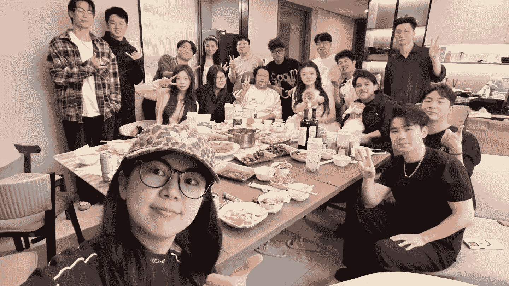

工具和教程只是最低级的壁垒，真正的壁垒是“立刻动手”和“圈层信息差”。

如果你想看全网最新的变现玩法，并且和一群执行力极强的极客一起下场拿结果，欢迎围观我的核心私域：【懒人专属群】。

我们不聊虚的，只做商业闭环的拆解与AI效率的压榨。系统内已沉淀1000+跑通的套利实战局。

👉 查阅圈子完整数字资产与上车门槛：

https://lazyso.com/insider/

认同价值、准备好下场干活的，扫码加我微信（lazyhelper1）。

备注：【实操上车】，不闲聊。

