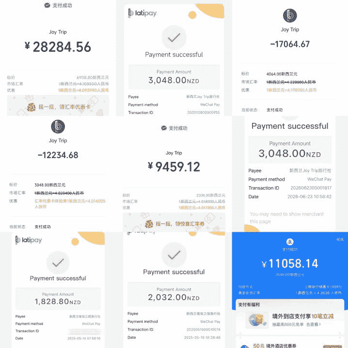
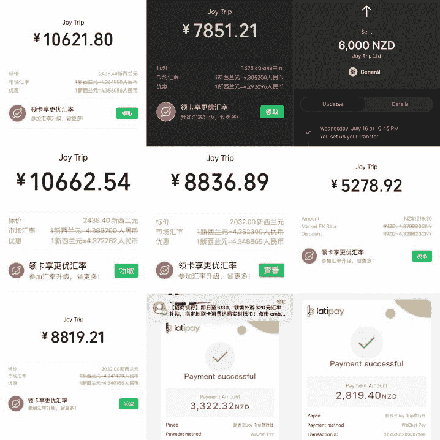
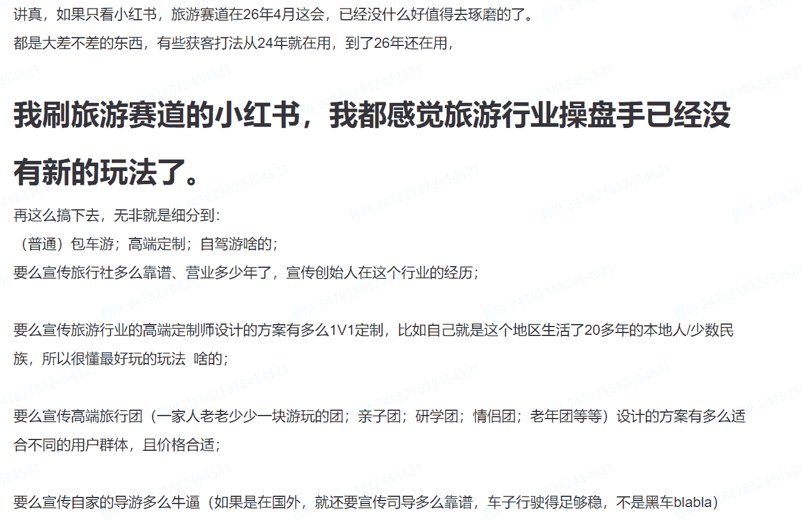
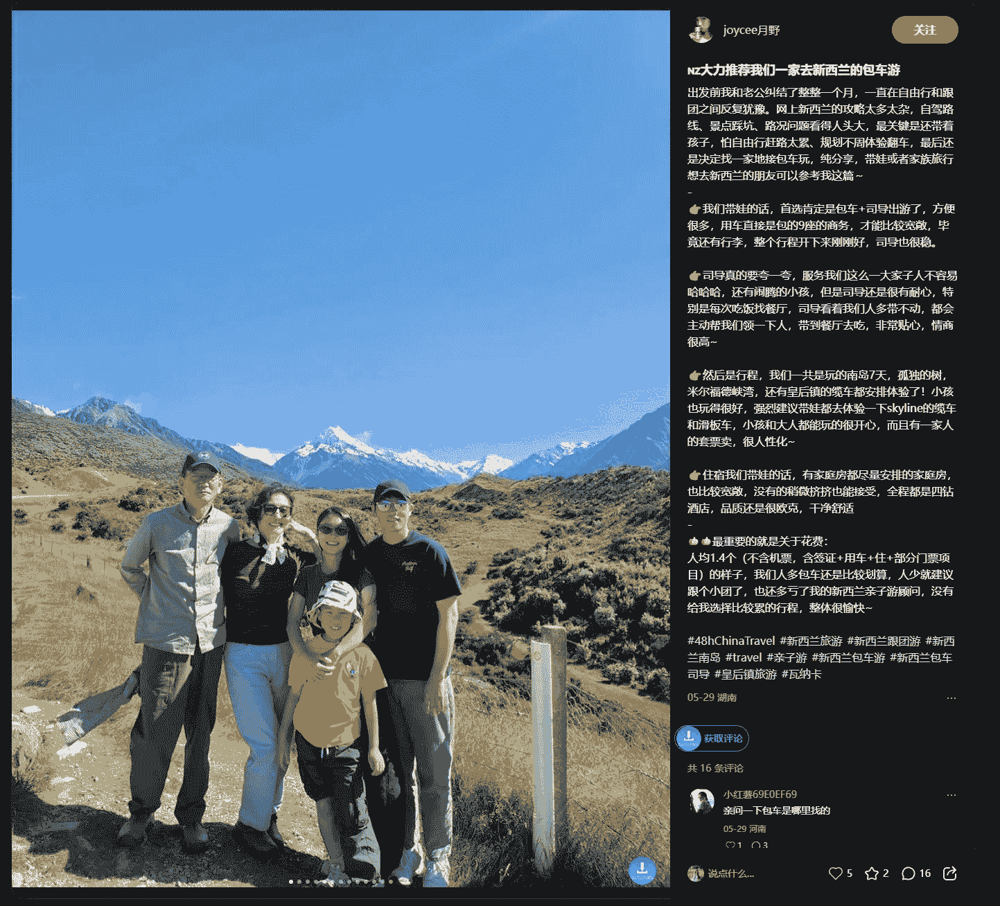
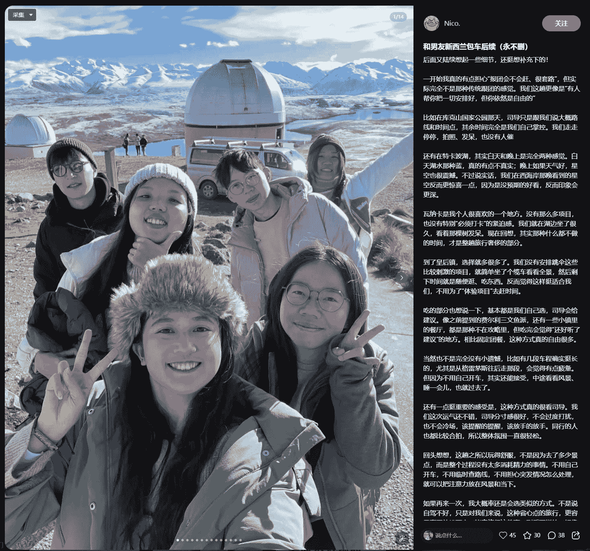
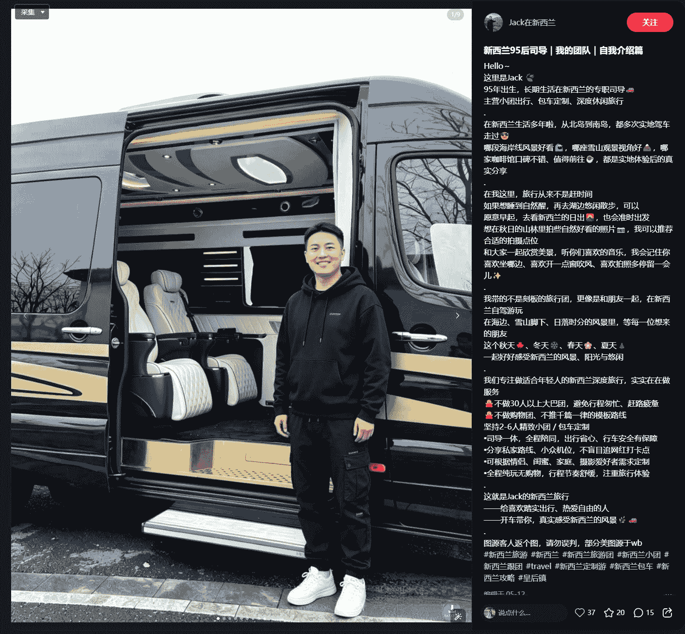

# 自由职业两年半，转行两次，我终于找到

了想深耕的新西兰定制游赛道！

260706 副业SC 精华

整理：公众号懒人搜索，懒人专属群精选

懒人微信：lazyhelper1

大家好，我是生财有术第五期圈友碧琳，专注小红书高客单赛道获客。

25年初，有幸抱着贵人易寒的大腿转行进入新西兰定制游这个高客单赛道，开启了小红书境外游获客的合作创业道路，三个⽉打通了获客-销售-交付的全链路，一年半时间把销转率从5%提升到10%。下面是部分成交客户的付定金截图。

下方为「职场打工人到自由职业，再到两次转行的真人故事版」。

如需跳过故事，也可戳目录直接看正文：

1. 如何判断赛道值不值得深耕
2. 新西兰定制游行业现状
3. 从业一年半复盘及卡点破解

## 一、职场打工人到自由职业

23年8月我认识了易寒，机缘巧合跟着做了西安旅游，赶上国庆的旅游高峰期，我用素人号发了一篇笔记就带货了一万多的销售额，但是因为引流太多被禁言了，尝试认证蓝V、投聚光但没有旅行社的资质，不能投放，不到一个月时间旅游项目也就不了了之。

由于我曾在和易寒老师的沟通中提到，我在一家留学公司做新媒体运营主管，还会聚光投流，易寒老师就注意到这个点，而他那边刚好有一手的留学资源后端，于是易寒老师就帮我对接了新西兰本地留学的资源，让我帮一家新西兰留学公司做代运营，具体的复盘帖可以看《小红书做新西兰留学，两个月从0-1变现7w+的经验》（万字保姆教程）。

我又在易寒老师鼓励下把自己做聚光投流的经验写了出来，拿到了生财精华帖！具体的复盘帖可以看《小红书投流，充钱就开挂：聚光投放一年，烧10万块的经验分享》。

23年11月30号我裸辞了！为什么辞职呢？

一方面是因为当时的留学公司发展不太行了，本来正常发工资的日子，经常拖个10天半个月再发工资，还有聚光投流的费用也会让我先垫付后面再报销，还有应该给我交的公积金也迟迟不到账，我就意识到公司在走下坡路了，不赶紧辞职的话，以后估计要去劳动仲裁要工资了！

果然，在我辞职后半年时间，这个留学公司就倒闭了，我之前的下属还告诉我，公司还拖欠她们几个月的工资没给，不仅拖欠员工工资，还欠合作方的款项没有结清，老板也当上了老赖！所以打工人，如果察觉到公司大厦将倾，一定要未雨绸缪。

另一方面就是当时副业收入比较可观，还超过了主业，让我有底气辞职，去做自由职业。加上当时快要结婚了，要备婚，也想解决和老公异地的问题，只要我还有手机、电脑、网络，我在哪里其实都能赚钱。

这个就是我从22年开始做小红书运营获客给我的底气，我知道自己只要能够帮助企业获客，不管是继续去职场找工作，还是做自由职业，我都能够赚钱。

很多人想从打工人的身份切换到自由职业、创业者的身份，这个过程真的不容易，因为打工人就是在公司负责打螺丝的，风险的大头是老板承担的，利润自然大部分也归老板。

如果打工人真的想创业的话，我非常建议你要多投资自己。这个投资自己不是多读书、多学习就有用的，而是找个副业下场去干，把手弄脏，去接触真实的市场环境，像老板一样思考，赚到除打工外的第一块钱。

赚钱是一种系统的能力，可能需要你会写作、运营、获客、销售等等技能。有时候不是说做一个副业就能成功的，失败了也不要紧，至少你会长出一些经验、判断，甚至学会一种技能。等系统积累足够的时候，自然就会拥有赚钱的能力。

## 二、自由职业两次转行经历

我从辞职到现在已经自由职业两年半了，自由职业从来不是一帆风顺的，两年半期间我做了三个不同的高客单行业获客，已经转行了两次！

### 新西兰留学（2023年9月—2024年7月）

新西兰留学的佣金确实很可观，一单佣金就有5000块，但是缺点也很明显，返佣周期很长，短则半年，长则一年半，没有现金流，这个项目就很难放大。前期的运营和投流成本实打实花出去了，后期返佣是不确定的。

留学行业有很多细分赛道，24年开始已经内卷得厉害。比如留学申请这个板块，当同行在收学生留学中介费用时，有的中介不拿学生的申请费，靠校方给佣金。

因为新西兰留学是院校返佣，零中介费申请，所以签单率还可以，我这边测算下来有7%的转化率。

虽然签单率可以，但是需要签单的学生交了学费去就读至少三个月才能返佣。从引流-签单-申请成功-学生就读-院校返佣，这个周期就很长，每个环节都有损耗和流失，最后算下来，签单的学生只有四分之一能拿到返佣。要么就是留学申请没成功，要么就是申请上了没去就读，要么就是入学了但中途退学了，所以我就觉得自己必须要转行。

### 上海卖房单边代理（2024年8月—2024年12月）

24年8月份我在生财有术看到了珍妮老师发的文章《留学从业者转行去“大蓝海”，2个月卖出1个小目标的产品❗❗（第一集）》，让我对于卖房代理这个事情很感兴趣，觉得这个模式很新奇，是一个大蓝海，收入天花板很高。

珍妮老师是我学习小红书运营的老师，她对于赛道的分析和趋势的判断非常准确，因为她有接过多个小红书赛道的代运营，还每周在社群做赛道打法分析，我是非常信任她的，所以跟地产公司老板约了腾讯会议，最终通过了筛选面试。

加入上海卖房代理，主要有两种方式：

- 一种就是在家做小红书流量，提供给卖房公司的顾问做转化；
- 一种就是以合伙人的身份到上海去创业，可以自己做流量，也可以当顾问做咨询转化。

这两种模式的加入门槛和收益分成是完全不一样的。

最终我选择了去上海创业，因为线下办公室创业和在家自己干的效率和氛围完全不一样，我也觉得自己只会获客是远远不够的，还想把销售这块技能拼图给补上。

我在上海卖房单边代理也取得了一点点小成果，比如说签了一套四百多万房产，成功招募了一位代理人。为什么只做了四个月就不继续干了呢？

前期地产公司老板是想把我们代理人培养成六边形战士，懂卖房、会获客、会销售、会交付，但是能力的培养是不能速成的。

就比方说销售这个技能，没有相关经验或者天赋是很难快速学会的。另一位和我一起进来的代理人，她对于销售就非常有天赋，只要给到足够多的客资就能快速签单，她就有很多的正反馈，也能更快学会卖房的交付，就形成了良性循环。

但是我对于销售就是不开窍，和客户聊天也和客服差不多，只会发话术，不能够很好地挖掘客户需求，也不知道怎么推进销售流程。而且房产销售是所有销售行业里面最卷的，除了线上聊，还要邀约到办公室和客户面谈，更加考验销售能力。

中期发现，地产公司老板其实真正需要的人才是销售能力强、能够快速签单的人。只有签单了，公司才有足够的现金流能快速运转起来。我当时的销售能力是不足以支撑我做房产销售的！要想继续干下去只能熬。

后期发现签单只是卖房服务的开始，卖房服务的交付也很长。一套房子不是很好卖的话，短则三个月，长则一年半载。这个获客-销售-交付的周期就很长，毕竟房子是大宗商品，上海的一套房子少则几百万，多则几千万，想要获取房东的信任需要很久。从前期的获客到销售签单可能就需要两三个月，签单到交付至少也需要三个月，刚开始入行的半年可能是完全没有收入的。

虽然最后没有转行成功，但是这段去上海的创业经历是很宝贵的，认识了几位很优秀的创业者，地产公司老板也很照顾我，也学会了很多的卖房知识和销售知识，关于房产我以后能少踩好几个坑。

### 新西兰定制游（2025年1月至今）

24年12月底，我最大的贵人易寒老师在发《做新西兰旅游这一年：生财有术帮我逆转困境》前就找我，希望我能够和他一起做新西兰旅游赛道。他不仅跑通了新西兰旅游赛道获客-成交-交付的全流程，还升级了新西兰旅游的交付端。因为我们认识比较久也很熟悉，所以他想搭建团队就优先想到了我。

我当时刚好在上海，因为地产公司老板说想从卖房赛道转到买房赛道，觉得好不容易梳理清楚卖房怎么做，又要从零开始转到买房，想着既然都要重新开始，不如跟着易寒老师去干新西兰旅游。

我当时转行做新西兰定制游赛道的原因有：

1. 我之前做过西安旅游，也做过新西兰留学，熟悉新西兰这个国家。虽然新西兰旅游赛道很卷，但是再卷也没有国内新疆、内蒙古等地卷，出海一定程度能避开国内的内卷。
2. 做新西兰定制游，我可以回家做，不用付房租水电，生活成本没有上海那么高，短期不开单，我也能接受。
3. 易寒老师是我人生中最大的贵人，他帮助过我很多。我做新西兰留学赚的第一桶金，就是因为他帮我对接了后端资源，也鼓励我做知识付费，让我能有底气开始做自由职业。没有易寒老师，我可能现在还是一个普通的职场打工人。现在他想要搭建团队放大，我肯定义不容辞来加入他的团队。
4. 易寒老师在新西兰当地开了旅行社，交付端理顺了，还有差异化优势，有利于销售转化。
5. 我之前做的两个项目，利润都挺高的，但是返佣周期都很长。易寒老师这个项目弥补了这个缺点，不仅利润高，而且佣金结算非常快，只要客人走完行程，就可以开始结算佣金。

基于以上原因，我25年1月就开始转行做新西兰定制游赛道了。目前我做新西兰定制游赛道已经一年半了，未来还想要继续深耕下去。

## 三、如何判断赛道值不值得深耕

自由职业两年半之后，转行之后，我觉得选择一个好赛道是非常重要的，毕竟选择大于努力，同样的能力，不同的赛道，回报大不一样。关于赛道值不值得深耕，我总结了七个判断标准：

### 能做高客单就不要做低客单

我为什么执着做高客单行业的获客？因为同样是引流10个人，高客单行业的客资单粉价值就更高。同样跟同行卷，成交一单虚拟资料，可能就赚个几十上百块。

但是成交一单留学、定制游，一单就能赚几千块甚至上万块。

高客单项目的本质是“用更少的用户创造更高的价值”，不仅能更快实现盈利，更能通过“信任积累+专业壁垒”形成长期护城河。低客单虽然可能短期起量，但容易陷入“价格战、人力堆砌、利润微薄”的困境。

### 能服务富人就不要服务普通人

富人很多时候都是在为了体验付费，而不在乎钱花得冤不冤枉。就像如果一个人年入500万，他有天为了旅游花掉了10万元，这10万元，是普通打工人10个月到一年的薪水，甚至是有些人两年的薪水。

但因为富人年入500万，所以10万与500万相比，这其中就是50倍的差距而已。

好比一个月薪5000的人，为旅游花掉了100块钱一样，他不会思考这100块钱花得值不值。

找没有付费能力的人要10万块钱，会被他薅死，他觉得你要了他的命。

但是找富人要10万块钱，他可能反而担心你太累了，觉得你交付得太好了，想要对你再好一点。

### 现金流要健康才能搭系统、带团队

现金流是项目的生命线，没有现金流，系统和团队都是空谈。留学行业的留学申请赛道里，小众国家为了能和同行卷，免费帮学生申请，导致只能在学生入学后才能拿到佣金，于是回款周期要半年到一年半。

房产行业，上海的卖房单边代理模式，它的收费方式是先收房东2万服务费，等房子卖出去了再收佣金尾款。这种收费模式就导致：如果遇到不那么好卖的房子，回款周期要半年甚至一年。

在留学和房产这两个行业里，不同的细分赛道甚至不同的地区，都有不一样的收费模式和服务对象。

有些留学申请的老板会提前收取客户服务费，这样现金流比较健康。

再比如，深圳地区的一些房产单边代理老板，偏爱卖老破小。上海地区卖的经常是千万及以上的豪宅。

这就导致深圳地区的现金流更健康，因为老破小的房东，他们自己卖不出去老破小的房子，没有那种“自家闺女值得88万彩礼”的想法，他们愿意听单边代理人的建议，配合着把房子早点卖出去。

但上海千万甚至几千万的豪宅，房东经常自我感觉良好，不听劝，觉得自己房子不愁卖，代理人稍微没有处理好和房东的关系，房东就觉得自己被PUA了。这就导致上海地区有的房子要半年甚至一年才能卖掉，现金流回流速度很慢。

一些收费模式明显回款周期很长的项目，很不适合刚进入这个行业的新人。

只有先确保“手中有钱”，才能“心中有底气”，让系统和团队真正成为业务增长的引擎。

### 一定要找有壁垒的项目，避免同质化

没有壁垒的项目，本身赛道不缺少供应，如果没有做出差异化或者信任积累，就会陷入价格战。“易寒老师在新西兰当地开了旅行社”这种重资产投入和差异化交付，别人抄不走。

哪怕我们的报价比其他旅行社贵一些，但是行程设计很专业，客人就愿意找我们。

### 有没有贵人“手把手”带你

有贵人通过“手把手指导”，你可以直接节省50%以上的试错成本，通过“经验杠杆”站在巨人肩膀上。没有贵人带的终极代价，是用“时间和金钱”堆砌出“低效率、高风险、慢增长”的商业轨迹，最终被“快速迭代的市场”淘汰。

### 你能不能像素级模仿同行和跨界“抄”

普通人没有成本去做大量的验证，只能去模仿和迭代已经验证可行的项目与模式。

模仿同行就是用“最小成本验证商业模式”，模仿不是“抄袭”，而是“拆解底层逻辑+复用成熟流程”。

跨界“抄”的本质是跳出“行业内卷”，从其他领域“借鉴成功模式”，解决本行业未被满足的需求。

易寒老师有一篇给他带来100万利润的小红书笔记，就是借鉴了装修赛道的获客办法。

### 你能不能把非标做成SOP

非标才有大额利润，但难做大；把非标做成SOP，就是普通人取胜的时机。非标产品/服务因“个性化、定制化、不可替代性”，能突破同质化竞争，实现“高溢价+高利润”。

非标难做大的瓶颈在于：每个订单需“定制化处理”，依赖“专家经验”而非“标准化流程”。

非标做成SOP的逻辑是将非标业务中“共性流程”拆解为标准化步骤，保留“个性化变量”，实现“用流程替代个人经验”，让普通人也能复制成功。

旅游行业定制游是非标服务，但是我们制定了很多行程路线SOP。当客人满足带孩子来旅游的条件时，我们会优先考虑安排带小朋友去接触小动物的行程；当客人满足带父母来旅游的条件时，我们会优先考虑安排带父母去走很美的小众步道行程。

除了行程路线SOP，我们还会尽量把每一次成交、交付、踩坑都沉淀成客户案例、销售SOP、沟通模板、获客内容素材、知识库等。

## 四、新西兰定制游行业现状

### 什么是新西兰定制游

什么是定制游呢？定制游是一种针对个人或小团体需求而量身定制的旅行体验，一单一团，专车专导，不需要跟别人拼车、拼团，更加个性化和灵活。

在定制游中，旅行社或旅行定制师会与客户进行深入的沟通，根据客户自己的喜好、时间和预算定制具体的行程。人数越多，定制游的单价就越低，可以说，定制游除了价格贵一点，其他都没啥毛病。

我们旅行社新西兰的定制游一团的单价大概在5万到15万不等，其消费群体主要为带父母旅行、亲子旅行、蜜月旅行等等。

定制游又可以细分为：

- 包车定制（旅行社提供车、司导、项目门票和路线规划）
- 全包定制（旅行社提供车、司导、住宿、项目门票和路线规划）

全包定制相比包车定制多提供了住宿，所以行业人也把包车定制叫做半包定制。

### 新西兰定制游获客卷不卷

2026年大部分文旅赛道，已经红海到飞起，因为人人都能谈旅游，也没有什么门槛！

我们做新西兰定制游这种偏蓝海的细分赛道，也是因为易寒老师升级改进了交付端，让我们旅行社产品足够好，面向的用户群足够细分，跟别的新西兰旅行社比起来有差异化，避免陷入同质化的低价竞争，所以一般在跟客户语音介绍完了之后，客户更愿意找我们进行定制。否则这个行业想靠线上赚钱，真的好难啊。

下面的内容转载自我们美丽又智慧的珍妮老师。

现在小红书上面的旅游获客打法主要还是下面四种，从易到难排序。领旅游攻略资料那种很容易引流，但是很难转化，就不算进来了。

### 第三方素人种草（图文笔记）

这种打法主要就是装从XX地方旅游回来的游客，分享我去XX地旅游的感受，在笔记中暗戳戳推荐司导、包车等。

这种获客效果还是挺好的，只要种草笔记和账号人设做得好就会哐哐来客资，唯一的缺点就是废号，但是现在也有办法解决这个问题，就是开通KOS账号+投流。

### 司导自我介绍（图文笔记）

这种打法主要就是宣传自家的司导有多靠谱，但实际上95%都是AI出来的司导。不光是新西兰，新疆、内蒙古等等旅游赛道都是这样。点进一个KOS账号主页一看，全是不同的司导自我介绍。

## 混剪视频（视频笔记）

混剪视频就是把新西兰的风景卖点直接呈现给客户看，混剪视频里面一般会掺杂着旅行社自家产品的优点，比如睡到自然醒，全程商务车接送，司导帮忙搬行李这些细节。

混剪视频开头主要分为三类，一类是接待顾客开头的，一类是自身经历开头的，一类是爆款文案开头的。

## IP 视频（视频笔记）

IP 视频就是真人出镜做 IP，这种难度是最高的，也是红利最大的，这个红利不是说一下能涨多少粉，而是客户会信任你这个 IP 从而找你咨询下单，哪怕比别家贵一点还是想找你。

IP 视频不是纯口播，而是在混剪的基础上加上口播，相当于混剪视频的进阶版。

新疆这方面的 IP 视频就很多，新西兰目前做 IP 视频的竞争比新疆小太多了！新疆是卷王 10 分的话，新西兰只能打卷王 4-5 分。

## 新西兰定制游赛道适合什么样的人进入

新西兰定制游比较适合会获客、想学习获客的操盘手进入，毕竟所有旅行社都缺客资！

- （1）懂得自媒体获客但没有落地盘的，尤其是留学赛道的操盘手，定制游和留学的消费群体都是中产及以上，各种打法基本一致，可以用留学赛道的方法降维打击。
- （2）想学习自媒体获客，看了很多教程却无法生成爆款客资笔记的新手，新西兰定制游赛道是偏蓝海的赛道，适合有执行力的新手拿来练手，能快速打出客资。
- （3）适合自家产品利润不够高的操盘手，比如：有些操盘手和中医馆做利益绑定。但中医馆的获客利润，在卷到飞起的 26 年已经不能覆盖获客成本。但如果来做新西兰定制游，就不用担心利润不能覆盖成本的问题。

## 五、从业一年半复盘及卡点破解

### 卡点 1：不了解新西兰的路线、景点

作为一个新西兰旅游行业小白，必须要了解新西兰的路线和景点，否则就会导致：

- 引流端写不出好的文案，如果你只会抄爆款文案，小红书目标用户经常刷到相似的文案，点开就会叉掉。
- 销售端不能给客人介绍，客人随便问你一个景点细节，你答不出来，客人就会觉得你很不专业，就不会考虑你。
- 交付端没法给客人做交付，因为咱们做的是定制游，要按客人喜好定制行程，不懂景点就做不了行程。

**解决方案：培训+搜小红书攻略+景点官网**

为了解决我们新人不懂新西兰的路线和景点问题，易寒老师会给我们做定制行程的培训，给我们讲解每天的行程安排，讲得特别详细，真的对新西兰每一个景点和小众路线都如数家珍，特别注重客人的服务体验。

易寒老师的经验是属于全网都搜索不到的，比如说有哪些景点必须按时提前签到，有哪些景点签到可以迟到一会，怎么安排接机、建议客人订什么时间的航班等等，这些都是易寒老师以及经常带团的司导才会知道的信息差。

除了易寒老师的培训，想要大概了解新西兰路线和景点，最快速就是去小红书搜索关键词，虽然攻略不一定准确，但是可以作为一个参考，知道这个景点大概怎么玩，小红书的时效性很强，但是不要去搜大的旅游攻略，比如“新西兰旅游攻略”这种大词，而应该搜索“库克山直升机冰川徒步”、“皇后镇怎么玩”这种更加细分的词。

除了小红书，还有一个了解景点的重要途径就是景点官网，基本上新西兰每一个景点都会有自家的官网，如果不知道景点官网可以去谷歌地图搜索景点的名字，比如去谷歌地图搜索新西兰著名景点“霍比特人村”，往下拉就能够看到景点官网的网站，可以直接打开官网，英文的如果看不懂可以配合【沉浸式翻译】插件翻译成中文，官网都会把常见问题，套餐，价格可以预定日期都列出来。

### 卡点 2：新西兰定制游的投流成本不断上升

在 2025 年上半年，新西兰旅游还没有那么卷的时候，我们可以通过旅行社蓝 V 聚光投流以比较低的成本购买客资，那时候投入产出比是很不错的，只要每个月坚持投流就行了。

但是现在 2026 年已经过去了一半，旅行社蓝 V 聚光投流的成本不断上升，和去年相比贵了一倍，如果我们不能靠自然流获取客资，降低我们获客的成本，光靠旅行社聚光投流，那么我们的生存是会很艰难的。

**解决方案：KOS 矩阵+素人号种草+IP 视频**

我从 2024 年开始就一直跟着珍妮老师学习小红书运营，2025 年刚开始我只会蓝 V+聚光投流获客，后面逐渐学习了不同赛道的素人号种草和 IP 视频打法，弥补了我原来获客方式的不足。

2026 年要想持续稳定地获客，光会蓝 V 聚光投流一种打法是远远不够的，必须打组合拳，KOS 矩阵+素人号种草+IP 视频一起才能发挥最大的效果。

为什么不做混剪视频呢？因为混剪视频和 IP 视频制作所要花费的时间成本相差不大，差不多的制作成本，当然优先选择 IP 视频，毕竟 IP 视频对于销售转化也会更加有帮助，我们不仅在卖新西兰的路线风景，更是在获取目标客户对于 IP 本人的信任。

### 卡点 3：个人销售能力弱

我个人是比较直肠子的那种人，不太懂销售的那些弯弯绕绕，也不会察言观色，所以我的销售能力一直都不怎么强，我给自己销售能力打分，如果满分是 100 分的话，我可能只有 50 分。

**解决方案：学销售课+听销冠谈单+AI 辅助**

对于销售这块，易寒老师先是让我去看有关销售的书，没什么感觉，后面又让我去学习他购买的几千块销售课程，在我看完了买的销售课程之后，我好像有点开窍了，知道了销售的完整流程。

懂销售的完整流程之后，我谈单的时候就会思考现在到什么环节了，下一步应该怎么跟进？用什么信息去影响客户的购买决策？客户在意的点有哪些？我应该怎么去凸显自己的优势？客户担心的问题我要怎么解决？异议处理完之后应该怎么让客户立刻付定金？

我用飞书 CLI 智能体把销冠课程套用到新西兰旅游的业务上面，告诉它：我们的业务方向是什么，我们的目标客户画像是谁，让它帮我生成一份可以直接使用的【新西兰旅游成交实战手册】。

除了可以直接使用的销售话术，很多时候客人抛出来的问题应该怎么更好回答呢？所以我的飞书 CLI 还要会帮我进行跟客户聊天记录的复盘，沉淀出下次遇到这些问题可以复用的话术，帮助我提升销售能力。

懂销售流程之后，销售能力比原来好点了，但是还是不太够，原因在于我给客户介绍新西兰景点和路线的时候，没有绘声绘色的那种感觉，就是有点干巴巴的，不会像易寒老师的描述得那么吸引人。

易寒老师是我们的销冠，所以只要易寒老师在跟客户语音，我就会旁听，然后录音，之后丢给我的飞书 CLI 智能体让它去拆解这份录音，获取易寒老师讲的知识点帮我放进【新西兰旅游销售 SOP】知识库，还沉淀出了一个销冠语音谈单拆解的 skill 能够快速帮我拆解易寒老师谈单的语音。

易寒老师跟客人语音介绍新西兰景点的知识点，我也整理成了一份配新西兰地图+景点讲解的飞书文档，目前已经积累到了 15000 多字了，后续还会继续增加内容，这份文档就是我跟客人语音谈单的秘密武器。

做完了这些销售准备，我才有信心给我的销售能力打 70 分。对于销售这块，我还是要继续提升的。

### 卡点 4：两人出行如何提升销转率

在我们获得的客资中，两个人的占比很高，可能占比有 50%，一般都是新婚夫妻来新西兰度蜜月的，年轻人价格也会比较敏感，我们报的定制游价格一般接受不了，但是客资白白浪费又觉得很可惜。

**解决方案：卖其他旅行社小团+自驾定制**

我们旅行社的产品只有定制游，两个人又属于价格敏感型的客人，所以我们这时候就会推荐其他合作的新西兰地接社 2-6 人的小团产品给两个人的客人。

如果刚好推的小团发团日期和客人出发日期不对，客人不喜欢小团的路线安排，那么我们就会让客人考虑自驾定制，我们收一笔定制费，帮客人定制行程和景点门票预定，再帮他们找好预算内的酒店，他们只要自驾和租车就行，这种方式会比小团更加灵活，费用也更低，比较容易成交。

经过这一年半的摸索，我们旅行社的销转率已经从原来的 5% 提升到 10%。

## 六、致谢

感谢易寒，易寒老师是我人生中最大的贵人，带我从职场打工人切换到自由职业，帮我对接留学后端资源，鼓励我做知识付费，又带我进入新西兰定制游这种高客单，返佣快的偏蓝海赛道，让我这个行业小白也能很快打通新西兰定制游的获客-销售-交付闭环，还帮我补上销售能力的拼图。

感谢珍妮，珍妮老师是至少比我高两个阶段的小红书获客操盘手，我从 2024 年就一直跟着她学习小红书获客，她每周都在分析小红书不同赛道的打法，分享的内容除了小红书获客，还有如何做调研、红海赛道厮杀战略、线上高客单成交、团队管理等内容。我在珍妮老师身上学会了很多知识，少走了很多弯路。

感谢汐米，汐米发的关于如何做项目调研和 1-10 阶段如何搭建线上运营团队的帖子，让我受益良多。

感谢易芝，易芝教会我转变思维，0-1 的阶段和 1-10 的阶段，策略是不一样的，创业要学会算账，时间就是金钱。

最后感谢生财有术，生财有术改变了我原本的命运轨迹，因为生财有术，我了解到很多搞钱的信息差，大学毕业就直奔杭州找运营工作，误打误撞做了留学行业的小红书运营，在这里，我遇到了目前核心事业圈中的每一位伙伴与贵人。

越分享越幸运，我是碧琳，欢迎想做新西兰定制游赛道的圈友来链接，一起交流呀~

祝生财圈友们都能找到自己的“窄门”，在长期的道路上，一起生财有术。

————分割线————

看完这篇 SOP，你觉得你懂了。但 90% 的人一到实操就会卡在第一步。

工具和教程只是最低级的壁垒，真正的壁垒是“立刻动手”和“圈层信息差”。

如果你想看全网最新的变现玩法，并且和一群执行力极强的极客一起下场拿结果，欢迎围观我的核心私域：【懒人专属群】。

我们不聊虚的，只做商业闭环的拆解与 AI 效率的压榨。系统内已沉淀 1000+ 跑通的套利实战局。

❗ 查阅圈子完整数字资产与上车门槛：

https://lazyso.com/insider/

认同价值、准备好下场干活的，扫码加我微信（lazyhelper1）

备注：【实操上车】，不闲聊

