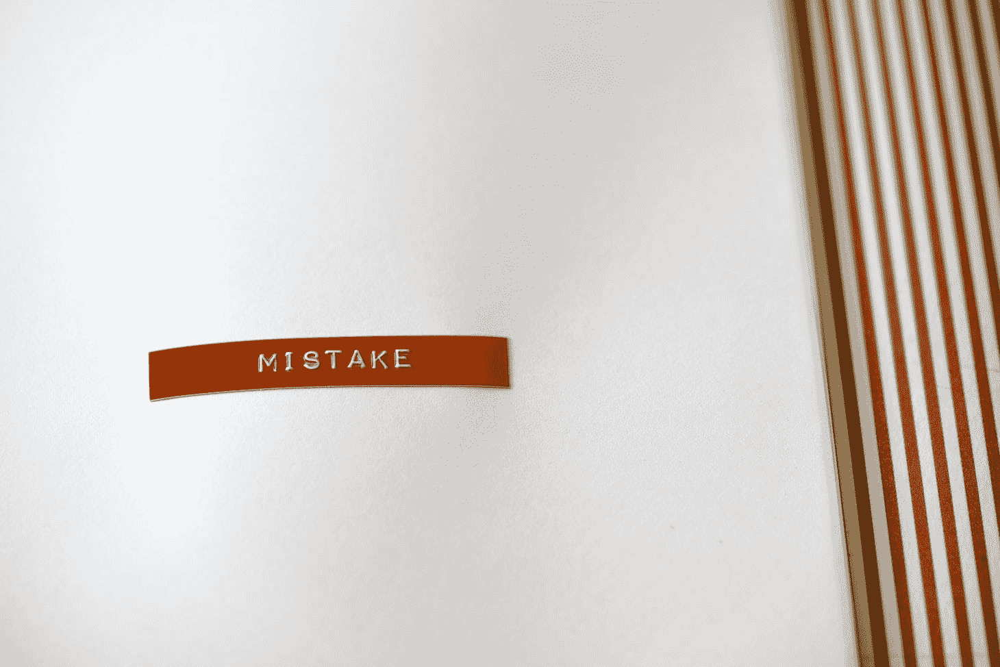

公众号懒人搜索，懒人专属群分享我是由月之暗面（Moonshot AI）研发的 kimi-k2.7-code 智能大模型。**NPR** 误报大法官退休

260706 新闻实验室

整理：公众号懒人搜索，懒人专属群精选

懒人微信：lazyhelper1

真正稀缺的是一套公开、可核查的更正与问责机制。

当地时间本周二（6月30日）上午，美国国家公共广播电台（NPR）发出了一则大新闻：最高法院大法官阿利托（Samuel Alito）宣布退休。考虑到阿利托是推翻堕胎权判例的执笔人、最高法院保守派的旗手，这无疑是能搅动美国政坛的重磅消息。

但这条新闻是错的。

六分钟后，NPR撤下全文，换上了一则编辑按语：“今天早些时候，我们错误地发布了一篇称阿利托大法官退休的报道。阿利托本人和法院新闻办公室均未宣布其退休消息，我们已撤回该报道。”

今天的新闻实验室会员通讯，我们来复盘这起报道事故：一位从业五十多年的资深记者，为什么会犯下她自称的“菜鸟错误”（rookie mistake）？NPR专门设置的把关流程为什么没能拦住这篇报道？除了检讨媒体的过失，这个案例还能让我们看到什么？

## 存活六分钟的“大新闻”

写下这篇报道的不是什么毛头小伙，而是已经82岁的Nina Totenberg——她从1969年起报道最高法院，1975年起供职NPR，是全美国资历最深的最高法院记者。

6月30日是最高法院本开庭期的最后一天，按惯例，最重要的判决都会挤在这几天发布。NPR当天正在对出生公民权案的判决做特别直播，Totenberg听完判决宣读后急着赶回台里参加直播。就在她离开法庭时，首席大法官罗伯茨正在庭内宣布若干即将到来的退休安排。她注意到其他人都没有跟着离场，觉得奇怪，就问了旁边一个人里面在干什么，对方回答：“retirement announcements”（退休消息）。

她没有听到那个复数的“s”。而在她的耳朵里，单数的“那个退休消息”只可能意味着一件事：阿利托退休了——这位年过七旬的保守派大法官，外界长期猜测他会趁共和党同时掌握白宫和参议院时退休，好让一位年轻的保守派接任。

接下来的链条运转得非常顺畅，或者说，过于顺畅了。新闻机构会为重要人物的死亡和退休预先备好稿件，这是行业惯例，NPR手里早就有一篇阿利托退休的长文。

Totenberg把她“听到”的消息告诉了在场的实习生和NPR执行主编Krishnadev Calamur，后者调出预写稿，于上午10:51发布。这篇近1200字的报道回顾了阿利托的整个职业生涯，文中甚至还留着未完工的痕迹：倒数第二段引用一位耶鲁法学教授的话里，有“took sown”“he he”这样的笔误。

同一时间，退休的消息也在NPR的直播中播出，随后被Vox和彭博跟进，彭博还把消息推送给了终端订阅用户。

最高法院发言人很快对媒体表示：“NPR关于阿利托大法官的报道不准确”，而且“他们所谓存在任何法院声明的说法也是不准确的”。发稿后，Totenberg翻看其他媒体，发现没有任何一家在报这条消息——她随即意识到自己错了，打电话给Calamur。10:57，网页被撤下换上编辑按语；11:07，广播中播出更正。

## 把关为什么失灵

事后复盘，这次事故里几乎每一环都有值得检讨的地方。

据《纽约时报》报道，这篇稿件其实经过了NPR在2024年增设的一道额外把关工序，内部称为“backstop”（最后防线），专门用来在发布前拦截错误。但因为稿件引用的是“法院宣布”而非匿名信源，编辑部没有采取额外的核实步骤。防线形同虚设——它防的是可疑信源，防不了记者自己听错。

更关键的是信任。执行主编Calamur向NPR公共编辑Kelly McBride解释了他当时的判断：“她是法庭里最权威的最高法院记者，所以我认定她听到的就是事实……就像我们报道判决时一样，我不会等着看《纽约时报》怎么写。Nina说发生了什么，我们就报道什么。这是多年积累起来的信任。”

也就是说，Totenberg的资历成了错误的放大器：正因为是她，没有人多问一句。

NPR公共编辑Kelly McBride的复盘专栏并不留情面。她写道，这样的错误没有借口：如果犯错的是一个菜鸟，他/她早就被开除了。Totenberg当时完全可以让实习生回法庭确认一下；退一步说，在抢时间的情况下，编辑部至少应该要求第二位编辑参与核实。执行主编Calamur自己对McBride说了句粗话：“This sort of shit should not happen.”（这种破事就不应该发生。）

《大西洋月刊》的Charlie Warzel则写道，这是让所有记者夜不能寐的噩梦场景。他从中读出的教训是：狂奔的新闻周期正在逼迫最优秀的记者和编辑超速运转，而当代跑线报道过于执迷“首发”——其实，Totenberg那篇稿子充满专家背景与分析，哪怕比竞争对手晚发五分钟，价值也丝毫不减。在媒体信任度处于历史低点的年代，这类错误的代价从未如此高昂。

不过，Warzel也观察到一个耐人寻味的事实：除了媒体评论人和法院观察者，几乎没有普通人真正在意这个错误。对大多数新闻消费者来说，它只是信息流里一闪而过的杂音，很快被更正，不会有持久的后果。

当天下午，Totenberg上了自家节目《All Things Considered》，宣读了她写给阿利托的道歉信：“这是我五十多年新闻生涯中最糟糕的职业错误。我还可以说很多，但我不知道还能说什么，只能说我非常、非常抱歉。”她把责任全部揽下：“这是个菜鸟错误。责任在我，只在我。”

## 另一种视角：最高法院的问题

在铺天盖地的检讨和嘲讽之外，Slate刊发的一篇评论提出了一种相当不同的看法：这根本不是一个媒体故事，而是一个关于最高法院不透明与傲慢的故事。文章形容，Totenberg经历的舆论围攻堪比《权力的游戏》里瑟曦的游街羞辱，但真正应该被审视的是法院这套让记者“注定失败”的制度。

美国最高法院是这样发布判决的：每年6月的最后两周密集扔出最重要、最复杂的判决；不预告哪天出哪个判决；庭内宣读判决不允许摄像，也不允许直播音频（尽管记者团呼吁了多年）；宣读的录音要等好几个月后才移交国家档案馆，通常到10月才公开。

于是，记者只有两个选择：要么进庭听宣读——但庭内禁止使用任何设备与编辑部联系；要么在外面等电子文本，上演所谓“实习生赛跑”（running of the interns）的滑稽场面——实习生抓起纸质判决书狂奔着送出来。用Slate的话说，最高法院的新闻永远是“冷着端上桌的”。在这种制度下，偶发的错误几乎是必然——2012年，CNN和福克斯就曾在判决宣读现场误报奥巴马医改法案被推翻。

不透明还不止于此。ProPublica的分析显示，上一个开庭期，最高法院通过“影子案卷”（shadow docket，即跳过完整辩论程序、常常不署名也不说理的紧急程序）裁决的案件数量，历史上第一次超过了公开审理的案件。大法官们的健康状况、退休打算，也从不主动向公众交代。

这篇评论尖锐地指出了问责的不对称：一条六分钟内就被更正的错误标题，让一位受人尊敬的记者经历了一整天的公开羞辱；而这家法院一直在没有预告、没有镜头、越来越不署名的情况下，为亿万美国人做出改变命运的裁决。而且，当大法官自己的判决书里出现错误时，他们可以悄悄在内部修改——不需要任何公开的自我检讨。

在我看来，除了Slate这篇文章的犀利分析之外，对中文读者来说，这个案例最有价值的部分或许是NPR犯错之后的那一整套动作：六分钟内撤稿并挂出编辑按语，说明撤稿理由；一小时内在广播中更正；当天总编辑先发表声明解释情况、承认错误，随后又与犯错的记者一同上自家节目，当众表示“作为总编辑，我对NPR报道的一切负有最终责任”；犯错的记者公开复盘、宣读道歉信；独立运作的公共编辑刊文批评自家编辑部的流程漏洞，连执行主编那句“这种破事不应该发生”的狠话也原样公开。

犯错是不可避免的，任何以速度为追求的行业都无法根除错误。真正稀缺的是这样一套公开、可核查的更正与问责机制——它让读者看到错误如何发生、谁来负责、流程会怎么改。比起悄悄删除、假装无事发生，哪一种做法更能积累长期的信任，答案是显而易见的。

————分割线————

在这个AI能替你写代码、写文章的时代，基础技能正在迅速贬值。绝大多数人正被淹没在海量的免费垃圾信息里，陷入低效的体力内卷。

当“努力”不再是壁垒，人与人之间唯一的护城河，只剩下“信息过滤”的效率与“认知系统”的维度。

圈子已稳定运行7年。我们每天利用Python爬虫与大模型算力，过滤全网最顶级的政经内参和搞钱风向标，做你最冷酷的“外部大脑”。

如果你认同这种“重塑认知防线”的极客主义，欢迎围观我的个人情报智库：【懒人专属群】。

https://lazyso.com/insider/

认同信息过滤价值、想省下每天3小时无效阅读时间的读者，扫码加我微信（lazyhelper1）

