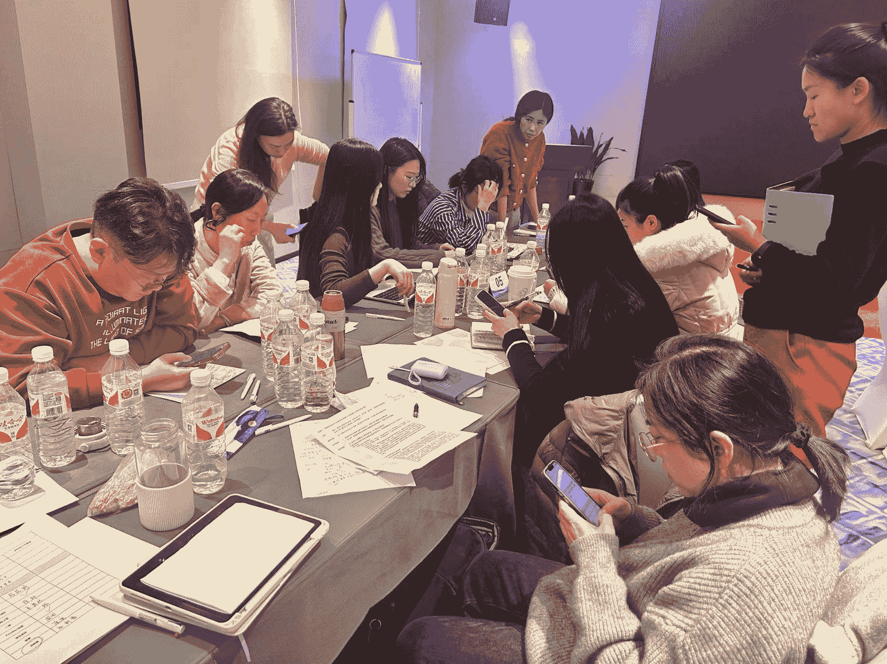
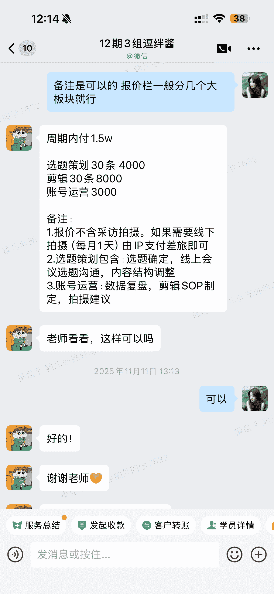
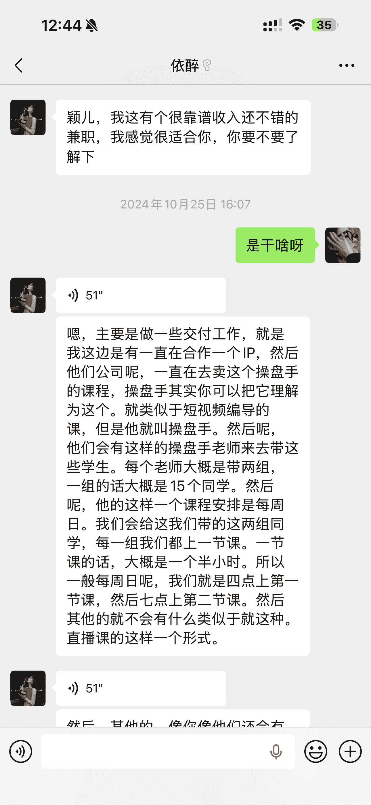
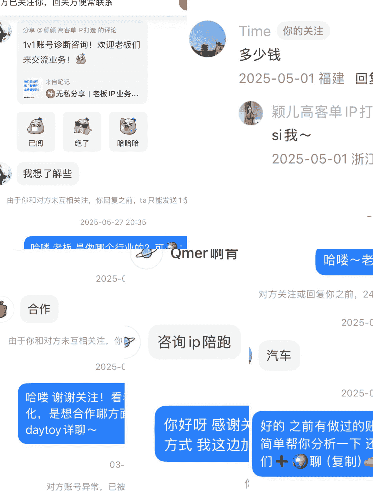

公众号懒人搜索，懒人专属群分享

# 从职场小白到一人公司：我离职后用17个粉丝，小红书成交2万+，又接到6万IP操盘项目复盘

260707 副业SC精华

整理：公众号懒人搜索，懒人专属群精选

懒人微信：lazyhelper1

## 前言

各位圈友好，先感谢大家接下来的耐心观看～如果你现在还在职场里，但已经开始想副业、想多一条收入线；或者想从一个岗位，慢慢转成能独立赚钱的个体，这篇文章我想认真写给你看。

首先我不是一个有背景、高学历、资源很多的人，没进过大厂，和大部分想做一人公司的小伙伴差不多的基础。

我是一个普通小镇女孩，2022年毕业后进了一家100人左右的培训行业小公司，从最基础的私域维护开始做起。2025年3月离职后，开始做IP操盘相关服务，靠线下圈子、朋友圈和小红书内容等，跑出了第一阶段的高客单变现。这些都是在主线稳定的项目之外的惊喜。

- 2025年离职后，小红书新号只有17个粉丝时，一篇只有300多阅读的帖子，给我带来了5个精准老板客资，当下就成交了一单2万多的IP全案服务。

- 2025年7月，我又通过线下圈子接到了6万的IP操盘项目。这个项目后面各方面都跑出了不错的数据，也成为了我的案例。

这些结果不算夸张，但对当时刚离职的我来说，它们证明了一件事：

我过去在职场里积累的能力，真的可以离开公司，被市场单独购买。所以这篇文章不是想讲“有多厉害”，而是想拆清楚：

为什么我认为IP操盘手，是一部分普通人切入OPC/一人公司的好方向，以及IP操盘行业应该如何进入、如何操盘的全流程。

## 一、从职场小白，到训练出了一人公司的底层能力，被推着成长

### 没有背景的职场小白应该积累什么

我2022年毕业，刚进公司的时候，什么都不懂，在此之前没有过非常正式的工作经验。

公司下面有一个子公司，专门做短视频培训，团队里有比较强的短视频和内容行业资源（当时我服务的IP是一个知名综艺的导演）。

但这些一开始和我关系不大，我只是个“打杂”的。

那时候公司还处在初创阶段，很多事情都没有完全定型。

每天最强烈的感受是害怕老板觉得我没有价值，害怕被离职，害怕又要重新找工作。

作为一个没有背景的小镇女孩，这种感觉包裹着我很长一段时间。

所以我经常主动约老板“聊天”，直接问：“还有什么事是我可以做的吗？”

我渴望成长，渴望价值感。如我所愿，我的老板觉得我有潜力可以培养，于是给了我很多尝试的机会。在此也要感谢他。

后来公司做达人和商家的短视频陪跑，我就进群学习。不到1个月时间，我开始给学员做线上分享。从讲1节课到带整期训练营7节课程，每期100来人，还跑出了很多百万爆款和几十万变现的案例等。

这件事说得很轻松，但是对当时的我来说是一个挑战。因为我本身是一个表达能力很差、不自信还内向的I人，天知道我是怎么一步步走向老师的角色。就是觉得想留下来。

当时第一次是讲一节1个多小时的短视频拍摄相关的课，我准备了差不多2周，做了很强的心理建设。

每天自己练习。上班、下班、睡觉前，都在不停地练习，当时想着熟能生巧总可以吧。

于是没人的时候张嘴大声练，有人的时候就心里默默练。

我练表达，学讲课技巧，请教同事，自己模拟练习等等。

第一次正式讲完后，反馈很好，老板也很满意，第一次获得了认可。

就是那一次让公司里很多同事也都对我刮目相看。一些同事也成了后面我想离职转型的关键人物。

而这一次培训能力和表达能力的突破，一直到今天我还在因此而复利。

那会儿我毕业工作只有几个月时间。

从那之后，我开始带班、讲课、辅导、跟学员互动，也承担了一部分销售转化工作。

当时直播卖过699的线上陪跑，也在私域卖过5980的两天一夜线下课，我就是在这些具体业务里，第一次接触到内容、服务、私域和成交之间的关系。

再后来，我做过让我崩溃的私域销售，做过耗费我心力的直播卖课，还去官方平台做过讲师分享，做过编导运营等。因为离老板比较近，我也能看到一些产品设计、公司决策和商业逻辑。

哪里需要我，我就去哪里；哪里能让我成长，我就去哪里。

说直白点就是“打杂”。

但我想说，觉得自己普通的职场人，就应该从现在开始利用公司，熟悉商业逻辑。

你的老板是怎么设计产品的？是怎么服务客户的？公司不同阶段做的什么决策？等等。这是做一人公司的第一步，也是最近最可行的一步——离你最近的商业模式。

所有跟赚钱有关的能力，销售能力、流量能力、内容能力、表达能力，甚至一个专业技能等等，这些能力哪怕只掌握1、2项，都会一直为你未来的事业无限加分。

现在回头看，那段职场经历最有价值的地方，不是让我把某一个单点技能练到多厉害，而是让我接触到一门生意的各个环节。我小红书的第一个客户也是因为我对商业闭环的了解。

我慢慢意识到，一个人想独立赚钱，不能只会某一个技能。

你要懂用户，懂表达，懂成交，懂交付，也要知道一个产品背后是怎么设计和运转的。

## 二、为什么IP操盘手适合普通人，如果你普通又渴望了解商业、拥有资源

对一部分没有经验的普通职场人来说，为什么也适合转型这个赛道？

主要有4个原因，也是我的亲身经历。

第一，操盘手人才的需求量一直在变大，以前是变多，现在是变大。很多老板、商家、达人、个体创业者，不是没有能力，而是不会表达、不懂获客、不懂线上的转化成交。

而且在这个行业就会体感很深，这样的老板非常之多，哪怕IP发展到2026年了，大部分老板还是在起步阶段、尝试阶段，甚至观望很久还没开始，一直没有人真正帮他们解决线上获客的问题。

一旦进到这个圈子，你会发现他们永远在问：怎么拍，怎么做内容，怎么有爆款，怎么获客，怎么定位，找什么样的运营等等。想通过内容获客，但没有稳定路径。

市场一直在呼唤这样的人，而且未来很长一段时间需要越来越成熟的操盘手人才。

最明显的就是现在不只是老板要做IP，很多超级个体、咨询师、培训师、服务商、自由职业者也都开始做IP。

以前做IP可能只是少数老板的选择，但现在很多普通个体也开始意识到：没有内容，就没有持续被看见的入口。只要大家还需要通过内容建立信任、获取客户、销售产品，就会需要有人帮他们做定位、内容、表达和运营。

而以前是可以做一做，现在却是必须要做。

第二，很难想象人才供给不足了，很多IP找不到好操盘手。因为工种决定的，真正深度服务一个老板，不是写几条文案、剪几个视频那么简单，而是要理解他的业务、产品、客户、表达风格和成交路径。

所以一个成熟操盘手，一年能深度服务的IP其实有限。

但市场上想做IP的老板和专家有很多，一个操盘手再牛，他也没有办法批量同时深度服务很多个IP，大部分情况都是1V1或1V2/3，这就会造成供需不平衡。

这个赛道缺人，我在一线看到过很多信号。

当时我带IP操盘手的学员，学生里有很多职场人、宝妈，也有一些大厂职场人。很多人原本并不在这个行业，但只要聚焦在IP服务这个方向，认真学、认真做，两三个月很多人都能接到项目。

而且他们接到的不是小单，很多是偏全案类的IP服务，价格区间很多也能到一万多。

一个新手。

——新手学员报价情况，最后成交了我自己后来出去参加线下活动，也有同样的感受。只要我介绍自己是做IP操盘的，如果对方本身有业务、有产品、有内容获客需求，基本都会感兴趣，甚至会主动加微信进一步聊。（在我第三点离职的部分详细讲到了）

项目最多的时候，我一个月手上有四五个项目，忙到天花乱坠。

当然，红利不是说人人都能轻松赚钱，而是市场需求正在出现，真正愿意深度学习、认真交付的人，有机会先拿到位置。

第三，赚钱能力的成长复利。IP操盘手不是一个单一技能工种，是综合能力的体现。

它会逼你训练商业理解、用户洞察、内容策划、表达包装、流量判断、销售转化、项目交付和沟通谈判能力。

这些能力不只可以服务客户，也会反过来赋能你自己的事业。

你以后不管做课程、咨询、社群、AI工具、超级个体服务，都会用到。

能力只有放进真实需求里，才会变成收入。

第四，链接老板资源。对普通人来说，选择赛道不能只看能不能赚钱，还要看这个赛道能把你带到什么样的人群里。

做IP操盘手，你服务的大概率是老板、创始人、企业主、高客单服务提供者、有专业积累的个体创业者。

在服务他们的过程中，你不只是帮他们做内容。你会听到他们怎么设计产品，怎么判断市场，怎么做商业决策，怎么管理团队，怎么面对增长问题。

也更容易得贵人。

你每天跟什么样的人打交道，你就会慢慢变得更像什么样的人。

所以IP操盘手不只是一个项目，更像是普通人进入商业世界、接触高价值人群、训练综合能力的入口。

——图1：跟IP私下关系还是很好，出去学习邀请我一起  
——图2：跟IP后面合作结束，还是经常联系我，给我推项目，信任我  
——图3：给予极大的尊重，因为操盘手是跟老板平等对话的，你也会感受到自己的价值感

身边开始围绕一些老板资源，还有很多这样的例子，他们也经常给我提供很多事业选择上的建议，既是我的客户又是我的贵人。

## 三、我离职后只做了两件事，让我的能力获得了来自市场的金钱认可

### 离职契机

我在第一家公司（公司情况前言有介绍，不重复了）待了大概两年半，2025年3月离职。

真正让我决定离开的原因，不是一时冲动想创业。

是公司已经没有办法继续承载我的成长了，没有价值感，收入也有上限。职场也有一种一眼望到头的无奈感。

真正改变我心态的，是2024年底的一份IP操盘手兼职。

当时带的学生，很多都是从职场想要转型出来的人。

他们学习IP操盘手能力，希望未来可以自己接项目、做操盘手。最开始我只是做这份兼职，而我亲眼看到，很多人用三个月，甚至不到三个月的时间，就真的接到了来自市场的项目。

这让我开始反问自己：既然我带的学生都可以从跨行业转行，那我本身有知识付费经验，也懂内容，也做过直播、交付和培训，我为什么不能直接成为一个操盘手，自己出来干？

我的想法被一份突如其来的兼职所改变，也更加坚定了自己可以。

所以我3月初离职后，没有让自己休息很久。大概3月底，我就开始接项目了。

### 做了两件事：参加线下活动+发朋友圈

离职那段时间，我主要做了两件事。

第一，接受自己的状态以及整理思路。

第二，强迫自己“走出去”。而这也是改变我最重要的一个动作。我开始大量搜索杭州线下关于职场、副业、搞钱、创业相关的活动。

杭州很多创业局、副业沙龙、女性成长、自媒体局，我都去参加过。

同时，我也开始频繁发朋友圈。以前我不是一个爱发工作相关的朋友圈的人。但那段时间，我会发自己刚离职后的感受，发参加活动后的思考，发我正在做IP操盘这件事，也会发一些做IP的真实分享。

### 终于被看见

效果比我预想中好太多，甚至惊喜！

很多创业者来问我关于IP操盘、项目合作的事情，也有朋友想给我推资源。我去线下分享和交流，也认识了几位后来一直有联系的创业朋友。

那段经历给我很大的确认：

刚开始做个人事业，最怕的不是没人买，

而是没人知道你在做什么。一定要让别人清晰你在干什么，不要收着藏着。很多机会不是你坐在那里等来的，而是你不断表达、不断链接、不断出现在别人面前之后，才慢慢被带出来的。

我最忙的时候，一个月有五个项目，也就是五个IP（有些IP是轻服务，所以顾得过来）。

一个多月都没有休息过，每天勤勤恳恳出差、在家办公、上课、做内容。

甚至连给自己找一个办公点的机会都没有。每天醒来就是工作，搞完经常10点、11点了。

我的客户来源都是客户转介绍和平台介绍，没有做任何拓新客的动作，这样的资源我吃了一年。

这个行业就是这样，对IP来说，他很难找到一个好的操盘手，或者说跟他合得来的操盘手。所以一旦有了基础信任，他会把很多的业务都介绍给你。

所以你的客源也是相对稳定的。而每一个项目的周期又很长。

## 四、我的第一单验证：17个粉丝，300阅读，成交2万多

### 开始小红书获客

真正让我感受到“我可以通过自己的能力在公域获客”的，是后面开始做小红书。

大概4月中，我开始筹划自己的账号。当时我还不太想在视频号和抖音露脸，所以选择了小红书先试水，也没有抱很大期待。

没有正式的产品海报，没有完整的报价体系，也没有设计什么钩子资料。只是简单梳理了一下自己能提供什么服务，就开始发内容，都不算正式运营。

而且讲的全是干货，一共只发了7篇帖子。基本都是干货类的，写得比较拙劣，现在看来。没有做很复杂的运营动作，就是先练练手，把行业内的一些我比较想讲的话题都列出来，也没有管播放量的事。

当时发了一篇纯干货内容，是分享我做IP操盘的流程和经验。因为刚做比较单纯，就是实打实的行业干货。

那篇帖子阅读量不高，只有300多，当时账号粉丝也只有17个。

但就是这篇内容，带来了5个非常精准的客资。

而且那些老板一上来问的不是“你这个怎么学”，而是非常明确的“怎么合作”“产品和价格是什么”。

所以做内容的发心要是提供价值，以及被看见。

当时我也意外于这个赛道的势能如此之强，一个老板在看到你的账号只有17个粉丝，而且只有几个点赞的帖子的情况下，愿意找你直接合作。其实就意味着背后这个群体实在是太缺专业的人才了，而且他身边找不到，后面的聊天也确实证实了我的想法。

所以IP操盘手甚至不需要去花很大的精力去做自己的账号，只需要去保持一些频率的更新。对于播放量，没有那么高的要求，持续去发声，就有人能看见你。这也是操盘手的第一步，也是适合普通人的方法。

### 一周时间17个粉成交了！

其中一位老板当下成交了2万多的IP全案服务。

后面问过那个老板，他为什么会加我，他说觉得我的帖子写得有点东西，一看就是专业的。

所以有了后续的沟通。第一次接客户，不知道怎么做成交，编了一大段非常真诚的话发过去，那会儿是有什么就说什么。然后产品的价格、定价也没出来，也如实跟他说了，他反而觉得我很专业。那个老板也不墨迹，就说可以拉会议视频沟通了。会议沟通完之后，他就确认了跟我的合作，一周的时间。

这个 IP 是在西安的老板，本身也是做 IP 孵化相关业务的。他其实有自己的公司和团队，但有一个很明显的人才缺口，就是在西安本地很难找到一个专业的操盘手。他了解了我的过往经历之后，就一定请我去西安给他们分享。当时在我看来，我觉得杭州的操盘手真的遍地都是。但是对于一个二线城市，就是离开杭州、上海、北京这样的城市之后，这样的一些二线城市，他们是真真实实地有人才缺口在的。而我们在一线城市所训练出来的能力和经验，以及行业前沿的信息，对他们来说就是降维打击。

所以你看，对操盘手来说也是一样的。如果你能力真的十分专业，你可以服务那些对专业能力有要求的老板。但是如果你觉得你的能力一般，还不足以经受一些很专业的验证，你可以去服务一些下沉市场 IP，你的经验对他们来说就是非常够用。

## 我是怎么建联客户以及服务的

合作确认之后，我就立马给他发了几份信息资料填写表，自己模仿编辑的，让 IP 把所有的信息以文字的形式先给到我一版。然后我们就直接约了会议，进一步确认他的信息，主要分这几个维度：

1. 熟悉 IP 的人生经历，方便后续选题输出。
2. 熟悉 IP 的产品，了解它的具体用户画像和产品阶段等，为账号定位做铺垫。
3. 了解 IP 的表达欲，他喜欢讲故事还是观点或者是干货，确认拍摄内容类型。
4. 建立跟 IP 的信任和熟悉感。

前采之后，我们就直接输出了一个定位方案。他们内部讨论确认通过之后，直接开始约线下采访的时间。

我是从杭州飞到西安去线下服务了两天：一天是产品信息梳理+拍摄；一天是直播框架搭建+拍摄。我们一次拍摄能做 30 条内容。他线下有自己的员工小伙伴，也可以帮忙拍摄少量的片子。

剩下就是每周运营复盘、迭代。

这件事对我来说意义很大。

因为这是我第一次真正通过自己的内容，在公域拿到高客单客户。

它让我意识到，高客单服务不一定需要爆款，它更需要精准。几百阅读不重要，重要的是这几百人里有没有真正需要你的人。

对服务型业务来说，内容的价值不是单纯涨粉，而是让对的人看完之后觉得：这个人懂我遇到的问题，也有能力帮我解决。

而且更真实的是：客户来了之后，我才开始临时梳理完整的服务框架、报价和交付内容。

所以我当时最大的感受是：创业不是准备好了再开始，而是开始之后，被市场倒逼着准备好。

## 五、混圈混到 6 万成交：打破了传统内容模式，做了创新案例

### 线下混圈接到 6 万的客户

2025 年 7 月，我接到了一个让我更确认方向的 IP 项目，也是我当时比较重要的一单，服务费是 6 万。

这里有一个背景是，我原是孙圈圈的 C 端项目合作操盘手。B 端项目开始的时候，需要操盘手线下去做服务支持，原是给学员的机会，但是我也去了，就是一定要去到客户资源聚集的地方，才有机会被看到。论“走出去”混圈子的重要性。

于是在线下课的时候服务了这位老板，有一些小小的交流。当天晚上就约我一起吃饭，讲了他想深度落地 IP 的想法。

因为想去线下课的老板已经是很想解决这个问题了，已经很痛了，于是后续合作推进还比较顺利。

### 我是怎么服务他的

这个客户是做企业销售体系陪跑服务的，属于 B 端高客单业务，本人专业度很强，也有很深的销售管理经验。

但遇到一个困境就是：

他很早就做过短视频。2020、2021 年的时候，他在抖音上拍过很多视频，数据不错，也通过内容赚到过钱，有底层的短视频内容基础。

但后面因为同行抄袭比较严重，感叹行业内卷，不敢继续发。到了 2024 年底、2025 年初，他又陆续开始发内容，但大多是坐着口播讲干货，或者用数字人、AI 形式去呈现，数据一直没有太大起色。

我接手后，对内容全部诊断了一遍，得到一个结论：

他的问题不是不专业，而是表达方式不适合短视频。他本人擅长输出干货、观点和行业认知，也不喜欢蹭热点，不喜欢讲一些虚的东西。

我们做的调整，是把原来偏讲课、偏说教的表达，改成更适合短视频传播的对比式内容。没有强行让他变成一个“不像他自己”的人。沿用之前的干货内容，只做了形式的创新。

比如用“普通销售团队怎么做”和“顶级销售团队怎么做”这样的主题，去讲中小企业销售团队管理的错误做法 vs 正确做法。

（不方便展示客户的脸，打码）

内容本身依然是很干的 B 端销售管理干货，但呈现方式变了：冲突更强，信息更聚焦，用户也更容易看完和转发。

这个调整之后，数据跑得非常好。

纯 B 端干货，几条视频转发到了 5000 多，两条视频涨粉 6000+。内容爆了之后，一度成为行业里的案例，也直接带来了 20 多个私域客资。后面在陪跑过程中，配合内容形式调整、私域承接和产品优化，相关课程成交也做到了 100 多单。对于 B 端 IP 来说是一个不错的结果。

这个案例简单总结，核心成功借鉴的点在于：IP 的干货内容（尤其 B 端）较为枯燥，不符合短视频语言和传播逻辑。所以为了保证不放弃干货的前提下，也不要让 IP 做过于花哨的形式内容，中间找到一个平衡点。我们把真正的干货专业用用户能听得懂、看得懂的形式呈现和传播出去。

## 六、IP 操盘手到底怎么服务客户，怎么赚钱的？

### IP 服务流程框架

很多人对 IP 操盘手的理解，可能还停留在“帮老板发短视频”“帮客户写文案”“帮账号做代运营”。

但真正的 IP 操盘，不是从账号开始，而是从业务开始。

我现在理解的 IP 操盘，核心不是做内容，而是围绕一个人的商业目标，打通：

定位 → 内容 → 表达 → 流量 → 信任 → 成交。

一个老板 IP 项目，一般会分成 5 个阶段。

第一，筹备期。

正式签约后，我会先给客户一些资料模板，让他填写基础信息，包括业务、产品、客户、过往内容、成交路径、个人经历、团队情况等。

但我不会只看他自己填写的内容。

如果条件允许，我还会访谈他的员工，了解团队内部怎么看这个老板，也会去看真实客户案例。如果这个 IP 有线下活动、课程或服务现场，我也会尽量了解真实客户长什么样，他们为什么来，真正被打动的点是什么。

因为做 IP 不能只听老板自己怎么说自己，还要看员工怎么看他、客户为什么信他、市场真正买单的点在哪里。

第二，定位期。

前采和调研结束后，我会出一份策划方案。这里面会涉及商业定位、内容定位、账号打法、内容方向和呈现方式。

这个方案不会直接定死，而是会和 IP 本人开会对齐。

因为 IP 操盘不是我单方面觉得该怎么做，而是要找到一个交集：

客户愿意表达、用户愿意看、平台能传播、商业能承接。

第三，拍摄期。

定位对齐后，我会开始做第一轮选题内容规划。哪些内容需要采访，哪些内容需要背稿，哪些内容需要提前采集素材，都会提前规划好。

一般会集中 1—2 天拍摄。拍摄完成后，我会参与内容把关，确保成片方向和前面的定位一致。

内容形式会有：

1. 提问采访型；
2. Vlog 记录型；
3. 逐字稿型；
4. 深度访谈型；

等等，看 IP 业务以及具体内容适合什么。

第四，运营期。

内容发布后，不是发完就结束，而是每周做一次运营复盘。

看哪些内容数据好，哪些内容带来了咨询，哪些内容虽然播放不错但不够精准，下一轮选题和表达要怎么迭代。

IP 不是只看播放量，更重要的是有没有精准咨询、有没有私信、有没有加到私域、有没有成交，哪些内容可以继续放大。

第五，总复盘。

项目结束时，我会做一次整体复盘，包括这段时间跑出了什么内容方向，哪些表达方式适合这个 IP，未来还可以继续做哪些内容，以及后续账号应该怎么持续执行。

所以我理解的 IP 操盘手，不是一个内容执行岗，而是一个要帮客户打通“定位、内容、流量、信任、成交”的综合型角色。

好的 IP 操盘，不是替客户说话，而是帮客户把他真正有价值的东西讲清楚。

### IP 操盘手到底怎么赚钱

这个方向不是只有一种赚钱方式。

根据能力阶段和交付深度不同，常见的变现方式有（层层深入）：

- IP 定位咨询
- 月度内容陪跑
- 创始人 IP 全案服务
- 企业内容团队顾问
- IP 操盘手培训/带教
- 长期合伙或项目分成

刚开始不一定要做很重的全案服务，可以先从短周期陪跑做起。

对普通人来说，最好的入场方式不是一上来就卖全案，而是从轻交付开始，先拿到第一个真实反馈。

等你慢慢有了案例、流程和方法，再往更高客单、更深度的服务走。

这个赛道比较好的地方在于，它既可以从小服务开始验证，也可以随着能力提升，逐渐延展到更高价值的项目。

## 什么样的人适合做 IP 操盘手（很认真地说，不想大家觉得什么能力都不需要就可以做到）

虽然我看好这个方向，但我也不觉得它适合所有人。

它比较适合这几类人：

- 愿意研究内容和表达的人
- 懂一些用户成交的基本逻辑
- 有沟通能力和服务意识的人
- 对销售、流量、用户需求感兴趣的人
- 不排斥跟老板、创业者打交道的人

但它不太适合这些人：

- 只想做简单执行的人／只想指挥人、不想干活的人
- 抗压能力弱、不能面对项目不确定性的人
- 只会套模板，不愿意根据不同 IP 调整策略的人，没有灵活性

这件事有机会，但也有门槛。

门槛不一定是学历和背景，而是你愿不愿意真正下场，理解业务、服务客户、解决问题。

## 八、如果你想进入这个赛道，可以先做这 4 件事——新手链路

如果你现在还在职场里，但也想未来做副业、做 OPC、做超级个体，我的建议不是立刻裸辞。

可以先按这 4 步走。

第一，先补商业认知。

把你所在的公司当成离你最近的商业样本。去观察它怎么赚钱，产品怎么设计，客户是谁，流量从哪里来，销售怎么转化，交付怎么完成。

很多人上班的时候，只关心自己手里的岗位任务。但如果你未来想自己做事，就不能只从岗位视角看公司，而要从商业视角看公司。

其次，星球里也作为一个赚钱圈子，可以学到很多商业基础知识。

第二，再练基础能力。

首先，尽量靠近内容、销售、客户沟通、交付、项目复盘这些事情。哪怕一开始做得不精，也要先有体感。

其次，可以先学习一些内容、运营相关的知识，有一个大的框架。这类课程在市场上定价不一，但哪怕只是一个小 IP 的内容运营课也会有所收获。很多时候内容底层逻辑是相同的，不用一开始花很多精力、时间、金钱去投入。

第三，做最小服务验证。

一定要做。

1. 比如帮一个老板做账号诊断，帮一个朋友梳理 IP 定位，做一次内容选题规划，做一个短周期陪跑，或者做一次低客单试交付。
2. 可以拿身边有成熟产品的朋友练手。第一次服务不一定要收费多高，重要的是走一遍项目闭环，有一个手感，拿着这个案例去链接更多 IP，一点点积累。
3. 还可以拿自己的账号练手，做成案例不仅对自己复利，同时作为案例去服务同样想做 IP 账号的朋友。

不要一上来就追求完美产品。你要先验证有没有人愿意为你的能力付费。

第四，沉淀案例和方法。

每服务一个客户，都要沉淀：客户原来的问题是什么，你做了哪些判断，调整了什么动作，最后带来了什么结果，哪些流程可以复用，哪些内容可以写成案例。

普通人做 OPC，最怕每一单都从零开始。你要把每一次交付，都变成下一次成交的资产。

## 十、结尾：普通人要选择能让自己长期变值钱的赛道

我不是一个天生就很会表达、很会创业的人。

只是因为害怕被淘汰，所以在职场里不断主动靠近机会；又因为看见了市场需求，所以一步步走到了 IP 操盘和一人公司这条路上。

这一路给我最大的启发是：

普通人不是一定要有很强的背景或能力，才有机会成为超级个体。

但你一定要主动进入一个上升的赛道，训练商业基本功，真实服务客户，真实卖出产品，真实完成交付。

不要只看别人做什么赚钱，也要看这个项目会不会让你变得更值钱。看长期价值，你会更好坚持。

对普通人来说，最值得选择的赛道，不一定是当下最热闹的赛道，而是能让你持续靠近高价值问题、高价值人群和高价值能力的赛道。对我来说，IP 操盘手就是这样一个入口。

它让我从一个职场里的执行者，慢慢开始理解内容、销售、交付和商业闭环，也让我真正看见了自己成为一人公司的可能。

真正能改变一个人的项目，不只是让你赚到一笔钱，而是让你变成一个更能赚钱的人。

————分割线————

看完这篇 SOP，你觉得你懂了。但 90% 的人一到实操就会卡在第一步。

工具和教程只是最低级的壁垒，真正的壁垒是“立刻动手”和“圈层信息差”。

如果你想看全网最新的变现玩法，并且和一群执行力极强的极客一起下场拿结果，欢迎围观我的核心私域：【懒人专属群】。

我们不聊虚的，只做商业闭环的拆解与 AI 效率的压榨。系统内已沉淀 1000+ 跑通的套利实战局。

👉 查阅圈子完整数字资产与上车门槛：

https://lazyso.com/insider/

认同价值、准备好下场干活的，扫码加我微信（lazyhelper1）。

备注：【实操上车】，不闲聊。
