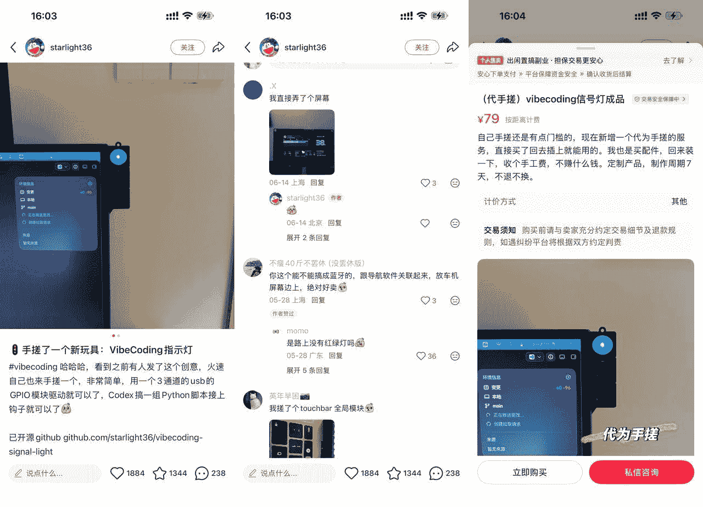
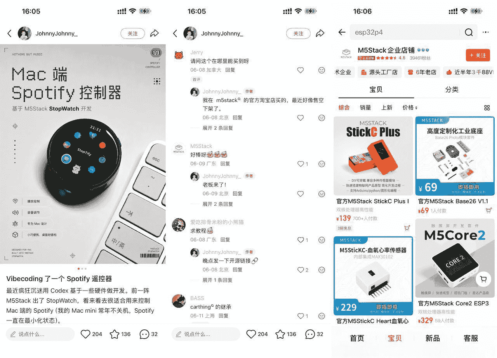

公众号懒人搜索，懒人专属群分享

别光顾着看虚拟产品？这些 AI 小产品也有机会了

260703 副业SC 精华

整理：公众号懒人搜索，懒人专属群精选

懒人微信：lazyhelper1

从前年大家做 AI 项目，大部分注意力都在虚拟产品上，小工具、网页应用、提示词、工作流、知识库，再到最近超级热门的 Skill/Agent，都是线上交付，做起来轻，传播也快。

但最近我刷到一大批很小的硬件产品，反而觉得很有意思。

一个放在电脑旁边的信号灯，一个控制 Spotify 的小遥控器，一个显示 Claude 和 Codex 额度的小屏幕，一个智能家居旋钮，一个按一下就能记录想法的 AI 小硬件。

这些东西看起来都很小，但数据不差，评论区也很热闹：有人问怎么买，有人问能不能做成成品，有人已经在闲鱼上卖代手搓版本。

这让我想到我们都在用的一款产品：飞书录音豆。

手机、电脑当然都可以录音，App 可以转写，AI 可以总结。但飞书录音豆还是跑出了自己的位置。原因很简单，真到要记录的时候，它更顺手。

想录音的时候，掏手机/开电脑、解锁、找 App、点录音，这几步已经足够让一个念头消失了。

飞书录音豆把这个动作缩到了一下，按一下，先录下来，后面再让 AI 整理。

所以这期我想聊的是 AI 时代的小产品。

# 案例 1：Claude 和 Codex 额度表，AI 程序员的新“电量表”

这个案例我觉得太适合生财圈友这些 AI 重度用户了。

作者把 M5Stack StopWatch 改成了一个 AI 编程额度小屏幕，用来实时显示 Claude Code 和 Codex 的用量、5 小时额度还剩多少、7 天额度还剩多少、重置时间、今天用了多少 token、同步时间。

评论区不少人问“在哪里买这个硬件”；也有人问“数据从哪取，官方好像没有接口”；还有人建议可以显示待办事项；也有人开玩笑说，如果额度用完了，我就可以下班了。

这个产品看起来只是一个小屏幕，但它抓住的是一个真实变化：Claude 有额度，Codex 有额度，API 有额度，账号有额度，任务在跑，日志在刷，项目在推进。所有东西都在屏幕里，可越多越容易看不见。

对使用 AI 工具的人来说，额度就是生产资料。还剩多少，什么时候刷新，今天用了多少，这些信息本来就会被频繁关心。现在做成桌面上的实体小屏，随时看一眼，就够了。

这个案例我看完真的觉得太牛了，教会了我什么叫抓一个具体的场景。

只要有人每天都要看，这个东西就有市场。

# 案例 2：VibeCoding 指示灯，把 AI 编程状态放到桌面上

第二个案例，是一个很适合 AI 程序员的桌面小硬件：VibeCoding 指示灯。

作者看到别人发了这个创意以后，自己也快速手搓了一个。做法不复杂，用一个 3 通道的 USB GPIO 模块驱动，再让 Codex 写一组 Python 脚本，把软件状态和灯的颜色关联起来。

红灯、黄灯、绿灯，放在电脑边上，看起来像一个迷你交通灯。

评论区也很有意思：有人说自己直接弄了个屏幕；有人建议做成能贴在电脑屏幕边上的版本；还有人顺着这个创意继续改，做 Touch Bar、做桌面状态提示。

而且作者的小红书界面已经开始卖代手搓成品了：VibeCoding 信号灯成品，79 元，制作周期 7 天。

AI 写代码的时候，很多状态都藏在终端里。任务有没有跑完，有没有报错，什么时候需要你回来接手，都要切回窗口看。

而这个小灯就很好地解决了这个问题，让你知道现在 AI 在干什么。

# 案例 3：Spotify 控制器，这不就是手动版“天猫精灵”

第三个案例，是一个 Mac 端 Spotify 控制器。作者基于 M5Stack StopWatch 做了一个小遥控器，用来控制 Mac 端的 Spotify。

它可以做播放控制、音量调节，也能当成一个专门放在桌面上的音乐控制小物件。

这条笔记数据不算特别夸张，但评论区有需求，有人直接问“请问这个在哪里买到呀”。

我特地去看了下官方店铺，不难发现 M5Stack 这类模块化硬件已经很成熟了。StickC Plus、Base、Core、传感器、屏幕、外壳，都可以买到现成产品。

这件事很重要。过去我们要是想做一个硬件，总感觉要从画板、打样、焊接、开模开始。现在很多小东西，可以先用现成模块拼出来。

这个 Spotify 控制器解决的问题也很小：音乐的播放控制、音量调节。这些事 Mac 当然能做。

但小产品就是这样，让一小群人看到以后会觉得：这个我还真想要。

当然啦，这样的案例还有很多，比如下面这两个：一个智能家居产品在 Reddit 上意外火了。短短几天拿到 21.8 万浏览、1587 个 upvotes、94 条评论，还拿到了社区 Award。

它解决的也是一个很具体的问题：智能家居不要每次都进 App 找入口，转一下旋钮就能控制。

早期的 AI 语音小硬件，当然这个项目还在招募内测。产品很简单：按一下，记录想法、待办、日程。用户可以直接对着一个小硬件说话，再让 AI 帮你整理信息、查询内容、处理刚刚说出来的事情。

这些案例放在一起看，变化已经很明显了。这些小产品都解决了一些小问题，比如：

- Claude 和 Codex 额度，原来要打开页面查，现在抬头看一眼小屏就行；
- AI 编程状态，原来要切回窗口看，现在电脑旁边亮一盏灯就知道了；
- Spotify 控制，原来要切软件点按钮，现在桌面上抬手就能控制；
- 智能家居操作，原来要进 App 找入口，现在转一下旋钮就能完成；
- 想记录一个念头，原来要掏手机、解锁、找 App，现在按一下就能被记录下来。

……

这就是这类小产品值得看的地方。过去我们总觉得，AI 的机会都在线上，做网页、做工具、做 Agent、做工作流。但 AI 用得越多，反而越会出现一些新的入口需求。

比如一个按钮解决一个具体问题。看了这么多案例之后，我想聊一下为什么这个项目现在值得看？大家可以一起探讨一下。

第一，硬件模块成熟了。M5Stack、ESP32、各种小屏幕、按钮、旋钮、传感器、USB 模块，都可以买到现成的。很多时候，你不需要从零开始造硬件，先把现成模块拼起来就能跑。

第二，软件连接变轻了。以前你要把硬件和电脑、网页、API、AI 工具连起来，要自己写很多代码。现在有 Claude、Codex、Cursor 帮你写脚本、调接口、连状态，这一步比过去轻了不少。

第三，需求验证更快了。小红书、Reddit、X、闲鱼这些平台，都能让一个小原型很快拿到反馈。用户到底是问教程、问成品、问开源，还是问能不能定制，评论区会告诉你。

这类项目最好的起步方式，就是做一个能跑的原型。看用户真实的反应是什么：

如果有人问怎么买，可以做代手搓；如果有人问教程，可以卖教程和材料包；如果有人问能不能改成他的场景，可以做定制；如果有人问开源，可以开源软件、卖硬件包；如果有一批人反复问同一个需求，再考虑小批量。

如果你想尝试这类项目，第一步就是找一个足够具体的动作。这个动作最好满足三个条件：

**1.** 它高频，用户经常遇到。  
**2.** 它很小，一句话就能说明白。  
**3.** 它现在有点麻烦，用户每次都要多做几步。

比如：AI 编程状态看不见；比如 Claude/Codex 额度老是要查……

第二步，把过程发出来。小红书、Reddit、X，要让用户看到这个东西怎么用，解决了什么麻烦，为什么更顺手。

这类产品的内容也不用复杂，只要用户看完的第一反应是“我也想要一个”，后面就有机会。

有没有发现和做 AI 产品很像，都是从一个很小的需求切进去，先做一个最小版本，先看用户有没有反应，再决定要不要往后做。

只不过 AI 硬件多了一个很有意思的地方：它就在你手上。

一个网页工具，用户订阅后可能就忘了。但一个小产品，它每天都会被看见，这就是 AI 硬件的优势。

好啦，以上就是这周的分享。希望给大家一些新的启发！

最后祝大家周末愉快～

————分割线————

看完这篇 SOP，你觉得你懂了。但 90% 的人一到实操就会卡在第一步。

工具和教程只是最低级的壁垒，真正的壁垒是“立刻动手”和“圈层信息差”。

如果你想看全网最新的变现玩法，并且和一群执行力极强的极客一起下场拿结果，欢迎围观我的核心私域：【懒人专属群】。

我们不聊虚的，只做商业闭环的拆解与 AI 效率的压榨。系统内已沉淀 1000+ 跑通的套利实战局。

👉 查阅圈子完整数字资产与上车门槛：

https://lazyso.com/insider/

认同价值、准备好下场干活的，扫码加我微信（lazyhelper1）

备注：【实操上车】，不闲聊

