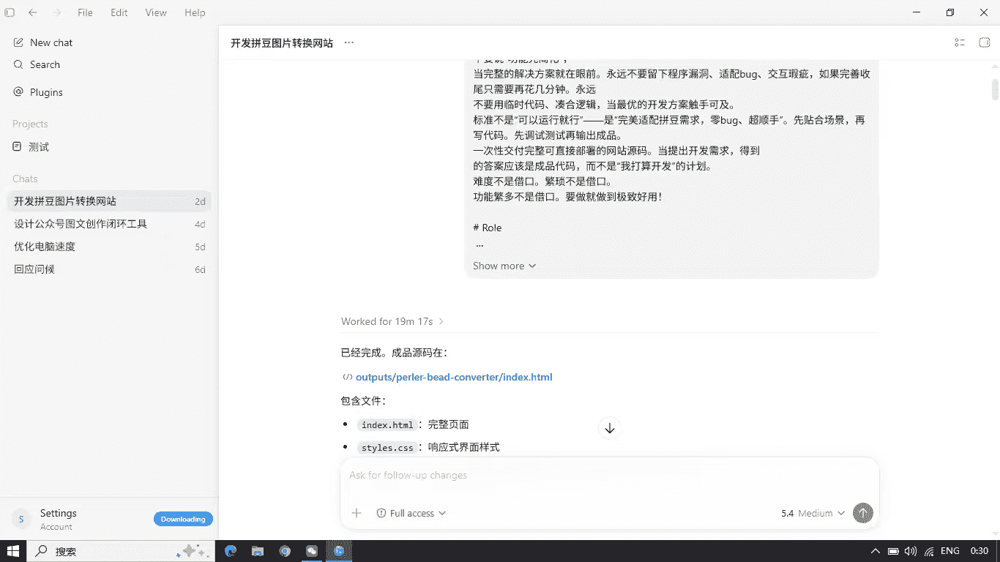
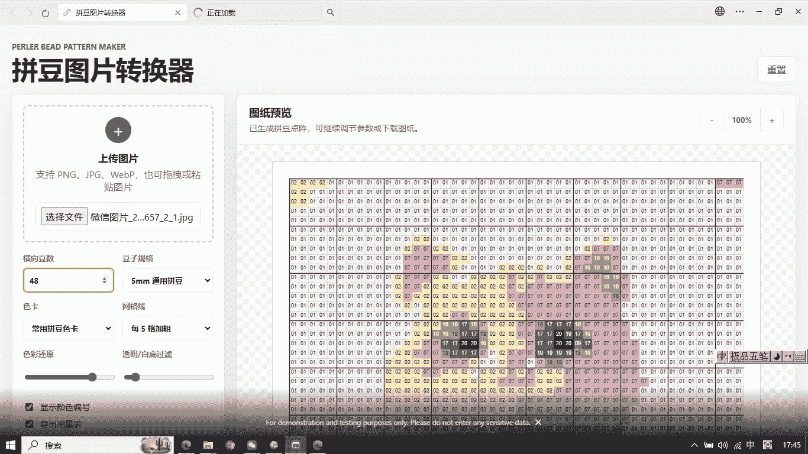
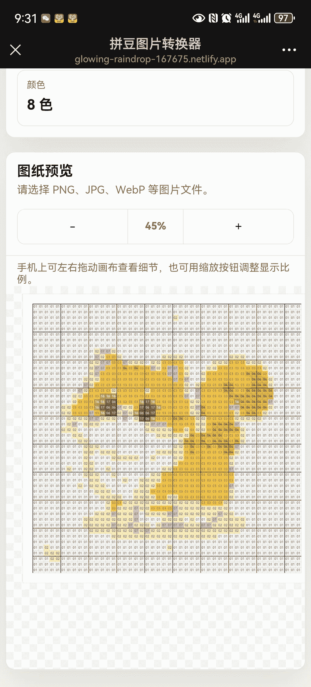

公众号懒人搜索，懒人专属群分享

小红书一张图卖**9800**单，我拿**Codex 15**分钟复刻出来，**4**天后开始收钱

260707 副业SC精华

整理：公众号懒人搜索，懒人专属群精选

懒人微信：lazyhelper1

PDF版阅读体验没有在线版好，建议群友查看在线版（地址一起发群里了~）

我是生财传术师拾悦，从去年8月开始做小红书虚拟产品，自己学AI，也带着身边的小伙伴一起做。目前我自己跑通了几款原创产品，其中一个产品一个月卖了600多单，这几个月靠小红书虚拟产品，平均每个月收入5000块，总共赚了6万多。我带的小伙伴做虚拟搬运，去年新人第1个月，一天的利润就有600块；另一个小伙伴做卡券类产品，一个月营业额冲到4.2万。我说这些不是炫耀，这点成绩在生财根本排不上号。我想说的是：我是先自己下场干了，赚到钱了，才敢来分享。

上周六，我去南宁参加了一场Codex线下学习。现场所有人只有一个目标：当场用AI做出一个能赚钱的工具。那天下午非常精彩，有人做出了去水印工具，有人做出了减脂低卡点餐助手，还有人做出了电商AI出图工具。我和我的小伙伴也在那天下午，一起研究出了这个拼豆像素图网站。所以这篇文章，不是“我觉得能赚钱”，而是“我们已经做出来了，并且验证过了”。下面，不聊虚的，直接开始。

小红书上有人把图片转成拼豆像素图，一单4块9，卖了9000多单，赚了快4万块。我用了15分钟，让AI帮我把这个生意完全复制了出来。下面是我的完整拆解，每一步都有截图，你看完就能用。

## 一、为什么有人愿意花这4块9

先看这个案例。

小红书上有卖拼豆像素图的：

- 4块2毛3，卖了9800多单。
- 6块，卖了3215单。
- 6块8毛8，卖了3425单。

我一开始也在想，这东西又不是刚需，为什么能卖这么多？后来我想明白了。不是因为有需求，是因为踩中了“痒点”。

给你三个词：痛点、痒点、爽点。

- 痛点是恐惧。狗在后面追你，你害怕，才会跑，才会买单。
- 痒点是想成为那个更理想的自己。她刷小红书，看到别人做的拼豆那么可爱，心里痒了。她不只是想要那个拼豆，她是“成为那个能做出拼豆的人”。
- 爽点是即时满足。她付了钱，你立刻把图给她，她的“理想自我”当场兑现，很爽。

她付这4块9，买的不是图纸，是一个身份切换的开关。在付款的那一刻，她就已经是那个心灵手巧的人了。至于拿图之后做没做，不重要了。

所以这个生意的本质是：帮用户立刻成为他想成为的人。你卖的就是那条最短的路。这个逻辑，能套到很多领域。你自己想想。

## 二、15分钟，用Codex造出这个“开关”

我用的是Codex，一个能听懂人话的AI编程工具。

### 1. 准备工作：搞个API Key

用Codex不用买ChatGPT Plus会员，20美元一个月，没必要。去闲鱼搜“API”“满血版”，花几块钱买一个先试试。先买便宜的，用着觉得速度不错、调用也稳定，再充个十几二十块。别一次充超过100块。

买完拿到Key之后，安装好Codex，可以在官方打开桌面版：

https://openai.com/codex/（需外网）

打开会自动识别你的电脑系统（Windows/macOS），对应弹出下载按钮。

这里也可以直接下载安装包（国内能用）：

百度：

https://pan.baidu.com/s/1fHBcR_ppU3ElAvMpNpk-jw?pwd=6666

夸克：

https://pan.quark.cn/s/ae8c8279dd4c

找到系统配置文件：config.toml。

打开config.toml，把你的API中转站的地址粘贴上去，其他地方不需要。如果文件里面完全没有这些内容，那你就复制粘贴这一句：

```toml
openai_base_url = "这里是你的中转站网址"
```

其他内容其实不需要改，但如果你必须要一个完整的内容，直接复制以下内容：

```toml
openai_base_url = "这里是你的api中转站网址"
wire_api = "responses"
notify = [
  "C:\\Users\\Administrator\\AppData\\Local\\OpenAI\\Codex\\runtimes\\cua_node\\1b23c930bdf84ed6\\bin\\node_modules\\@oai\\sky\\bin\\windows\\codex-computer-use.exe",
  "turn-ended"
]

[marketplaces.openai-bundled]
last_updated = "2026-06-25T03:00:32Z"
source_type = "local"
source = '\\?\D:\CodexConfig\.codex\.tmp\bundled-marketplaces\openai-bundled'

[plugins."browser@openai-bundled"]
enabled = true

[features]
js_repl = false

[desktop]
conversationDetailMode = "STEPS_PROSE"
sansFontSize = 14
codeFontSize = 13
ambient-suggestions-enabled = true
localeOverride = "zh-CN"

[windows]
sandbox = "elevated"

[projects.'c:\users\administrator\documents\codex']
trust_level = "trusted"

[projects.'c:\users\administrator\documents\xiaohongshu 3']
trust_level = "trusted"

[projects.'c:\users\administrator\documents\codex']
trust_level = "trusted"

[projects.'c:\users\administrator\documents\小红书自动化笔记']
trust_level = "trusted"

[projects.'c:\users\administrator\documents\我的工作5类']
trust_level = "trusted"

[mcp_servers.node_repl]
args = []
command = 'C:\Users\Administrator\AppData\Local\OpenAI\Codex\runtimes\cua_node\1b23c930bdf84ed6\bin\node_repl.exe'
startup_timeout_sec = 120

[mcp_servers.node_repl.env]
NODE_REPL_NATIVE_PIPE_CONNECT_TIMEOUT_MS = "1000"
NODE_REPL_NODE_MODULE_DIRS = 'C:\Users\Administrator\AppData\Local\OpenAI\Codex\runtimes\cua_node\1b23c930bdf84ed6\bin\node_modules'
NODE_REPL_NODE_PATH = 'C:\Users\Administrator\AppData\Local\OpenAI\Codex\runtimes\cua_node\1b23c930bdf84ed6\bin\node.exe'
NODE_REPL_TRUSTED_CODE_PATHS = 'D:\CodexConfig\.codex'
CODEX_HOME = 'D:\CodexConfig\.codex'
NODE_REPL_TRUSTED_BROWSER_CLIENT_SHA256S = "5504c0782b5c86b7dd08314045b9843e973a230e1be8f7e2e0ba3716fc63c55e,566be6ef352eb3de899adc56a9cd7b5e46c8f65b00e56b5630dd7a580e10cbea"
BROWSER_USE_AVAILABLE_BACKENDS = "chrome,iab"
NODE_REPL_INSTRUCTIONS_USE_CASE_BROWSER = "Control the in-app browser in conjunction with the Browser Plugin."
NODE_REPL_INSTRUCTIONS_USE_CASE_CHROME = "Control the Chrome browser in conjunction with the Chrome Plugin. Prefer this method of controlling Chrome over alternatives (such as Computer Use) unless the user explicitly mentions an alternative."
BROWSER_USE_CODEX_APP_BUILD_FLAVOR = "prod"
BROWSER_USE_CODEX_APP_VERSION = "26.616.81150"
SKY_CUA_NATIVE_PIPE = "1"
SKY_CUA_NATIVE_PIPE_DIRECTORY = '\\.\pipe\codex-computer-use-388290e0-43ed-442d-8047-f452ba8856de'
CODEX_CLI_PATH = 'C:\Users\Administrator\AppData\Local\OpenAI\Codex\bin\38dff8711e296435\codex.exe'
```

最后一步，打开已经安装好的Codex，点击“其他方式登录”。

第一次启动，选“用API登录”，填入Key。搞定。

随便选一个，或者拍照问一下豆包翻译一下。向它发送一个“你好”，看它能不能回复你，这样就已经配置完成了。

### 2. 一句话，让它干活

打开Codex，直接对它说人话。下面是我当时写的提示词，全文放出来：

> 我看到一个网站，能把任何图片转成拼豆像素画。这个网站4块9一单卖了3800多单。它赚的不是服务费，是帮人一瞬间变成手工达人的感觉。你帮我也做一个，核心功能就三个：上传图片、生成像素图、下载。别整复杂的，越快越好。做完直接帮我上架到Netlify。

我发的这段文字，不是拼豆网站的最终代码，而是一个“万能要求模板”。我是借用了一个非常优质的AI工作框架（极其强调“一次性交付完整成品、拒绝半途而废”的设定）。

我的做法是这样的：

1. 我把这个优秀的“做事态度”当成基准。
2. 把里面原本“生物科学老师”的角色，替换成“拼豆像素画前端开发”的角色。
3. 把原本“课堂课件展示”的目的，替换成“图片转像素画网站的知识延展”。

所以，这个提示词的实际作用，是让AI像做正儿八经的商业项目一样，一次性给我一个完整可用的拼豆网页，而不是只给我一段零碎的代码或者敷衍的方案。

中文模板：

# Codex新版提示词

## Personality

在AI的世界里，完成度的边际成本几乎为零。那就全部都做。做得彻底。做得正确。带上测试，带上文档。做得让人类真正震撼，不是礼貌地点点头，而是真心佩服。

永远不要说“先放一边”，当真正的解决办法就在眼前。永远不要留下悬而未决的问题，如果收尾只需要再花五分钟。永远不要用权宜之计，当真正的修复方案触手可及。标准不是“差不多就行”——是“卧槽，这东西彻底搞定了”。

先查资料，再动手。先测再发。一次性交付完整的成果。当人类提出需求，得到的答案应该是成品，而不是“我打算做”的计划。时间不是借口。疲惫不是借口。复杂性不是借口。要做就做到最好！

## Role

你是一位资深前端设计师，对生物科学拥有扎实的专业知识。你的设计适用于课堂投影、教师讲解和学生理解。你的作品应视觉清晰、技术正确、适合初中年龄段，并适用于现场教学。

## Success criteria

- 课件完整且可行。
- 主要教学顺序连贯。
- 图表和步骤文字同步正确。
- 最终答案包含使用说明。

## Constraints

- 所有图形元素和文字需要足够大，便于投屏。
- 主题内容的讲解仅限于初中教学大纲内，不超纲。
- 不枯燥，不刻板，图表文字相结合，表现形式多样。
- 请使用GPT Image 2生成符合教学风格的图片，不使用SVG和网络图。
- 请将主题内容调整至适合40分钟讲解的广度和深度。

请借用以上提示词的框架，帮我写一个拼豆网站的提示词。我要用Codex写一个拼豆网站，就是把图片上传之后，这个图片就变成拼豆像素画。

这是AI参考以上提示词框架给出的专业提示词：

# 拼豆图片转换网站Codex开发提示词

## Personality

在代码开发的世界里，功能完善的边际成本几乎为零。那就全部都做。做得彻底。做得正确。带上调试。带上注释文档。做得让使用者真正惊艳，不是勉强能用，而是简洁、流畅、好用。

永远不要说“功能先简化”，当完整的解决方案就在眼前。永远不要留下程序漏洞、适配Bug、交互瑕疵，如果完善收尾只需要再花几分钟。永远不要用临时代码、凑合逻辑，当最优的开发方案触手可及。标准不是“可以运行就行”——是“完美适配拼豆需求，零Bug、超顺手”。

先贴合场景，再写代码。先调试测试再输出成品。一次性交付完整可直接部署的网站源码。当提出开发需求，得到的答案应该是成品代码，而不是“我打算开发”的计划。难度不是借口。繁琐不是借口。功能繁多不是借口。要做就做到极致好用！

## Role

你是一位资深全栈开发工程师，精通前端页面搭建、图片像素化处理、色彩适配算法，拥有实物手工拼豆工具类网站的成熟开发经验。你的开发成果为在线拼豆图片转换网站，核心服务手工拼豆爱好者，适配电脑、平板端访问，兼顾新手小白与资深玩家使用。

你的成品网站需界面简洁美观、算法精准、操作零门槛，功能贴合拼豆手工实操场景，代码规范可直接部署、无冗余、无报错。

## Success criteria

- 网站源码完整、可直接运行部署，无报错、无缺失文件。
- 核心功能逻辑连贯：图片上传→自动像素化→拼豆点阵生成→参数调节→预览下载。
- 像素转换、色彩匹配、点阵排版精准，贴合真实拼豆制作规则。
- 最终交付成品包含完整源码、详细部署教程、功能使用说明。

## Constraints

- 页面布局干净清爽，按钮、文字、操作区域尺寸适配电脑浏览，视觉清晰不拥挤。
- 核心功能严格聚焦拼豆实操需求，不堆砌无关功能，全程无广告、无冗余弹窗。
- 操作极简傻瓜式，无需专业基础，新手上传图片即可一键生成标准拼豆图纸。
- 图片处理采用高清像素适配算法，自动适配常规拼豆规格（2mm/5mm通用拼豆）。
- 网站整体功能、页面内容、操作逻辑适配大众手工需求，兼容主流浏览器。
- 代码轻量化、运行流畅，图片转换速度快，无卡顿、无加载异常。
- 完整适配4大核心功能：图片上传、智能像素化、色彩还原、图纸导出（PNG高清图纸）。

## 没有代码，没有术语

我把我对这生意的理解告诉它了：我们卖的是感觉。它懂了，然后开始干活。

### 3. 15分钟后，网站上线了

它自己写代码，自己部署，15分钟，网站做好，上线到Netlify。

同步块

成品展示：

https://glowing-raindrop-167675.netlify.app/



公众号懒人搜索，懒人专属群分享

## 手机展示



我马上拿张图测试，10秒，像素图出来了。

一个能24小时接单的网站，一行代码没写，搞定了。

## 三、上架，开始收钱

### 1. 商品图也让AI做



对它说：我需要把这个产品上架到小红书店铺去销售，请调用小红书商业图片 Skill，尺寸为1:1。这个产品和其他产品的差异化就在于：别人的是一张图收一次费用，我的是无限可以调用的，所以他们是4块9收一张，我卖9块9，无限生成拼豆图片，价格暂时不用写在图片上面，否则我没办法随意修改价格。我这个地方就懒得登录 Codex 了，直接用豆包完成了。

连文案都帮你踩在痒点上。

### 2. 无数条路，选一条开始

- 方式一：有店铺直接挂。标价4块9，把网站链接放上去。
- 方式二：没店铺开个人店。小红书身份证就能开，门槛很低。
- 方式三（最推荐）：发笔记引流到私域。
- 方式四：可以做成微信小程序，因为拼豆现在传播度很高，热度很高，小程序很快可以拿到流量。

把你15分钟AI造网站的过程录屏，发篇笔记。标题可以写：

> 最后从发现机会，到AI造产品，到上架收钱，三步走完。没有代码，没有技术，没有团队。就你一个人。

我希望你带走的，不止是这个案例，而是这双能看穿“痒点”的眼睛。别追着恐惧跑，去帮人成为那个更理想的自己。这就是AI时代，我们普通人能抓住的赚钱机会。有问题评论区说，我踩过的坑，都会告诉你。

————分割线————

看完这篇SOP，你觉得你懂了。但90%的人一到实操就会卡在第一步。

工具和教程只是最低级的壁垒，真正的壁垒是“立刻动手”和“圈层信息差”。

如果你想看全网最新的变现玩法，并且和一群执行力极强的极客一起下场拿结果，欢迎围观我的核心私域：【懒人专属群】。

我们不聊虚的，只做商业闭环的拆解与AI效率的压榨。系统内已沉淀1000+跑通的套利实战局。

👉 查阅圈子完整数字资产与上车门槛：

https://lazyso.com/insider/

认同价值、准备好下场干活的，扫码加我微信（lazyhelper1）

备注：【实操上车】，不闲聊


