公众号懒人搜索，懒人专属群分享我是由月之暗面（Moonshot AI）研发的 kimi-k2.7-code 智能大模型。**YouTube** 月入万刀、视频号百万**GMV**，

通过**AI**视频拿到结果的圈友都做对了什么

260707 副业SC精华

整理：公众号懒人搜索，懒人专属群精选

懒人微信：lazyhelper1

## 前言

大家好，我是Gary曹淦，和波妮一起担任生财YouTube AI视频深海圈总教练。嗯，现在我们的深海圈已经正式更名叫AI视频深海圈了。

目前咱的社群圈友1200+，YPP频道500+，银奖频道100+、金牌频道10+，总播放量超过400亿。过去一年应该是国内在YouTube做AI视频最头部的社群了。

我们在YouTube做AI视频，侥幸踩中了不少风口：

去年初，算是第一批用AI视频在YouTube做循环直播的，带圈友开了几百个YPP（YouTube获利账号）。

去年中，也是第一批用AI视频在YouTube复刻真人视频的，做了几十亿播放。去年下半年，我们普及了半自动化工作流，火遍全网的K-pop猎魔女团AI视频，其中有一大半都是我们这出的，深海圈做了得有几百亿的播放，拾风圈友最高单条视频做到13亿播放，排名YouTube年度视频榜第13，连全球第一网红MrBeast也没进前十名，而这条视频源自我们一次作业点评。

到去年底今年初，我们开拓语种，做了英语、西语、葡语、德语等多国语种，四水年华圈友把YouTube短视频单账号单月收益做到了将近3万美金，带货28万美金GMV。特别是Seedance 2.0的上线，先用的一批圈友都吃到了巨大的红利。

然后就迎来了一波YouTube的黑天鹅调整，近乎一刀切地清洗了大量非真人视频，包括AI视频在内的3D、动画、游戏等匿名频道都遭受重创。从1月到4月，整个深海圈被同质化的频道超过200个，我们迎来了自24年底开始经营YouTube以来最沉重的一次打击。

是YouTube不能做了吗？是AI视频不能做了吗？

不是。很多小赛道里的AI频道还活得好好的，何况这一轮YouTube的打击范围远不止AI视频，X上很多动画卡通3D博主也是一片哀嚎。

但这次教训让我们深刻地意识到，过于依赖单个平台就势必会受到平台政策调整的巨大影响，牵一发而动全身。在这个巨变的时代，你不可能指望某一个平台一直按照你规划的方向去变化。

结合亦仁哥年前给我们的提点：深海圈不应该局限在YouTube的AI视频，要做AI视频本身，才有10倍、100倍增长的可能。毕竟一直以来，我们也确实是专注于如何做好内容。

当然不是不做YouTube，而是调整方向，将YouTube作为一个重要的内容分发与变现渠道，而不是所有项目的唯一核心。于是我们从年后开始，在继续深耕YouTube的同时，也在积极探索其他的内容出海与AI视频变现方式。

4月，我们带着一小批偏小白的深海圈友，测试国内的AI视频引流、私域服务变现玩法，在为期一周的内测里跑出了单条视频300万播放、单人单日变现8000的案例。

5月，我们带了一小批深海圈过去做YouTube的高手，从0开始测试视频号的AI短剧自然流带货，21天内测期间跑出了100万GMV。其中在我办公室做的两个朋友，大臣教练和我的女朋友，6月截止到今天已经超过50万GMV了。如果是最近做AI短剧带货的，应该会对我们这个蓝V号有些印象。

一路走来，我们踩了不少风口，也踩了很多很多的坑。回过头来会发现，模型的更迭、平台的变化、赛道的兴替，都是表象。AI视频项目的本质，还是用AI视频来满足用户需求、获取有效流量、创造商业价值的能力；而通过AI视频变现的本质，还是认知和执行力。

所以这篇帖子的分享，基于上一次在航海家分享的基础上做了一些调整，主要是三部分：

1. 我们最近跑通的AI视频内测项目，以及我们为何选择这个项目，可以从选项目的角度给大家提供一些参考。

2. 近两年来，通过AI视频拿到结果的圈友，都做对了什么，可以从做项目的角度给大家提供一些参考。

3. 我眼里AI视频的趋势和机会，可以给AI视频行业内，或者对AI视频感兴趣的圈友提供一些参考。

## 最近我们跑通的几个AI视频玩法

接下来，就分享一下我们最近跑通的两个AI视频变现小项目。由于是小规模测试，体量其实都不大，但胜在时效性强，都是一线的真实体感，也从侧面反映了一些AI视频发展的趋势，希望大家能找到对自己有帮助的点。

### 一、AI视频引流变现：AI复活亲人

先聊一个AI视频引流变现的小项目，AI复活亲人。名字不好理解，大家看个视频就懂了。

https://www.douyin.com/user/MS4wLjABAA AAmjTzIqIJvQxVn3efp7_bxdvclS_jOrgPZDCUI0sCVIH_JPWwyX405kK1cTYW8Bnd?modal_id=7643762587394212209

这个项目的变现逻辑很简单：做出变身成死去亲人的爆款AI视频，然后引流到微信给用户提供AI视频生成服务，为用户生成自己死去的亲人、宠物、朋友的视频。

它值得聊的地方，不在视频的制作上，技术很简单，甚至去年就能做出类似的视频了，无非就是角色替换而已。

这个项目来源于我4月初发的风向标。我在视频号刷到这类爆款AI视频，觉得很有意思，自己做了一条，还是在生财的办公室里拍的。

然后做教程的期间，发现评论区反映了非常精准的用户需求：复活亲人。过去波妮刚好做过用AI图片帮助孕妈生成宝宝彩超图片的项目，和这个项目的变现逻辑几乎是一模一样。我们当机立断，决定拉一批圈友来测测这个项目。

而我们之所以选择去测试，是因为它同时满足几个条件：

1. 在越来越泛滥的纯AI视频里，真人+AI的表现形式能够极大地提升用户和平台的信任度，并且这个项目的立意非常正能量，传播性很强，更不容易被举报、提示同质化等。

2. 这类视频是很罕见的爆款元素和用户需求深度结合的视频。即帮别人复活亲人，本身就包含了变身、真善美、死而复生等多个爆款元素，而目标用户看到我能够变身成别人的亲人，就会很自然地希望他逝去的亲人也能被我重现。这个需求是非常非常沉重的，重到加微信这个动作都显得很轻，付费也显得很轻，从而实现远超一般内容的引流率和转化率。

3. 这个项目能够代表很多其他的引流类玩法，让我们、让参与的圈友熟悉整个爆款、引流、转化的闭环，这也是流量变现的底层逻辑。

4. 我们有深海圈，这个玩法跑通能复制给大家去做。

而这个项目内测，我们就只做了一周，因为一周就已经跑通了，后面就是大家自己去玩了。

在一周里，大多圈友都出了爆款，最突出的元宝圈友单条视频在抖音320万播放，微信都加到风控了，单日变现8000，还给其他圈友分配单子。

这真的是一个非常简单的项目，甚至可以说没有任何壁垒。所以我们4月把这个项目做爆之后，赛道里多了很多很多的模仿者。

当我们去回顾大家的复盘帖，会发现大家的收获基本可以总结为以下几点：

- 克服了不敢真人出镜的心理障碍。
- 学会了像素级地复刻爆款。
- 学会了用抖音、小红书、视频号等平台账号向自己的微信引流。
- 克服了不敢让别人为自己付费的心理障碍。
- 学到了真正的价值不在于爆款，而在于满足用户的需求。

从这个项目里，大家深刻地感受到了用户需求和创作者之间的鸿沟——复活亲人，也许只是众多埋藏在用户需求里的机会之一。如何发现这样的需求、快速响应、占领市场、创造价值，这比怎么做出一个所谓“高质量”的AI视频重要太多了。

只要一个需求有强情绪、强结果、愿意付费，AI视频都可能成为入口。

对了，这类视频的制作教程，大家需要的话可以自取，很简单。

真人实拍互动AI变身教程

### 二、AI视频号短剧带货

再聊聊AI视频带货。5月，我们是同时开启了YouTube带货和视频号短剧带货的内测。

YouTube带货说白了现在还不是很成熟，带货的体量基本都是靠联属营销锁佣机制撑起来的，可控性不强。当然其中肯定有空间，平台在推联属营销，门槛也在降低。未来和跨境电商、品牌出海结合，会有很多想象空间，感兴趣的可以下次再聊。这篇帖子就主要分享下视频号AI短剧带货的玩法。

这个玩法是去年3月份最早一批月入万刀的深海圈老圈友sz自己跑通之后分享给我，然后我们再一起带着大家去做的，也还是先讲变现逻辑。

群里有不少视频号带货的高手，其实就是大家熟悉的那一套短视频引流、直播间成交、线下供应链结算的玩法，只不过我们是把之前真人实拍的剧情类视频，换成了AI短剧。

具体长啥样呢？大家可能也刷到过。比如说这条视频，是我对象做的，这条视频重发两次，加起来差不多10万多播放，卖了大约两万左右的GMV，佣金40%左右，卖的就是里面推广的金桔零食。之前校长分享过，我们也用了校长的供应链。这种视频爆了以后就引流到直播间，找真人主播代播来承接直播间的转化。

AI短剧带货的本质就是把过去的真人短剧带货换成AI短剧，其他流程一模一样。而换成AI后，最显著的几个差异点：

1. 产能：AI可以10倍甚至百倍地放大视频产能，借助工作流，一个人一天可以出10条短剧。
2. 边界：AI可以做出真人做不到的画面和表现力，实现前三秒爆点和剧情中爆款元素的堆叠，比如成堆的金条、车祸、残疾、可爱的小朋友等等。
3. 门槛：只需要投入视频成本和较低的运营成本。相较于实拍，人力、设备、时间成本都不到十分之一。（当然，对个人AI创作者来说成本还是很高。）

那我们又为什么会选择这个项目来测试呢？因为它满足以下几点：

1. AI短剧和我们过去在YouTube做AI剧情类视频的流程几乎完全一致，只是视频变长了，过去积累的爆款经验、视频工作流基本都能复用。
2. AI短剧的成本与产能相较真人实拍工作室有巨大优势。与此同时，8—12分钟的时长筛选掉了大量个人AI创作者（成本太高、制作周期太长、工作流复杂），提高了竞争壁垒。
3. AI短剧带货的变现链条，成本主要集中在制作上，不涉及投流，线下结算周期短，不涉及平台次月结算的风险。在保证参与人员经验基础的前提下，风险可控。
4. AI短剧带货有很强的拓展性，在平台、选题、选品上，都有很大的拓展空间，后续在海内外都有很大的发展潜力。
5. 还有一点很重要的，我们有深海圈，这个玩法跑通能复制给大家去做。市场容量还非常大。

5月内测跑完，数据还是不错的，适合已经有成熟AI视频制作经验的高手。这个数据是我们问卷收集上来，圈友们自己填的。

当然，我们也碰到了很多很多问题：掉原声、掉入口、跳人脸、视频成本高、商品低质、店铺违规、号主联系不到……等等。

从前期测试再到带着两个小伙伴做，不算深海圈，我自己在这个项目里也投入了几万的成本，跑了三十多个号，近200条短剧，保守估计也是一万多条Seedance 2.0。

那么从这个项目的复盘里，大家的收获可以总结为以下几点：

1. 学会了全套的视频号带货运营流程和AI视频带货的底层逻辑，这是过去主要做YouTube的圈友没接触过的。
2. 学会了复刻出5—10分钟的AI短剧，这是过去主要做短视频的圈友没接触过的。
3. 理解了工作流和矩阵运营的重要性，这是过去专注于手搓精品视频的圈友没接触过的。

在国内做带货，我们还是纯纯的新人。经此一役，勉强算是初步熟悉了国内的视频带货玩法，也欢迎有供应链、代播、号商渠道的老板们链接。

## 通过AI视频拿到结果的圈友，都做对了什么

所以聊完了这两个项目，大家可能还是会有些疑问：

这些项目适合我吗？我能做什么项目？

多长时间才能出结果？到底能赚多少？项目能做多久？

拿到结果的圈友都是怎么做的？

说实话，没有任何人能告诉你，什么项目适合你，你多长时间能做出结果，项目又能活多久。这和问现在买哪只股票能赚钱、能赚多少钱是一个意思。

但我可以借着这个机会和大家分享下，在过去这两年的时间里，我熟悉的几位通过AI视频拿到了不错结果的圈友，他们都做对了什么，都是凭什么拿到结果。大家可以借他山之石攻己之玉。

### 案例1：四水年华圈友去年底今年初在YouTube实现单月单频道近三万美金

如果大家看过四水的精华帖，会知道，其实四水是9月才进生财，国庆才开始做YouTube。而在这之前，他其实算是一个副业或者说创业上的新人，没有太多经验，更不用提做出一条爆款AI视频了。

那么在他做YouTube AI视频的早期，其实经历了几个阶段。原文篇幅较长，这里就概括一下，感兴趣的可以去看原文。

- 阶段1：纯小白期，加入了生财，对YouTube感兴趣，但完全不了解项目，通过超级标、精华帖，初步了解了YouTube AI视频是做什么。
- 阶段2：实操学习期，看帖实操，完成了视频制作的闭环。
- 阶段3：迷茫探索期，熟悉了视频制作，做出了小爆款，但无以为继，偶尔做出了爆款也无法形成持续的产出。
- 阶段4：突破期，在深海圈看到了龙珠悬赏AI语言类视频，看帖和直播学习后决定all in，跨赛道迁移爆款制作思路，快速跑通新赛道。
- 阶段5：放大期，初步跑通后，持续制作AI语言类视频，不断尝试、验证思路、稳定产出爆款、开新号，实现单月单频道将近3万美金收益的奇迹——当时我看到也很吃惊。

### 案例2：大臣教练去年4月最早用AI复刻真人故事在YouTube做到单频道7亿播放量，今年在AI短剧带货做到60万GMV

大臣和四水略有不同。虽然大臣是00后，但他在去年开始做YouTube之前，比四水更早加入生财，之前也尝试过其他的小项目。虽然没有拿到很大的结果，但对于做项目还是有一些基本的认知和体感。

他开始做YouTube，最早也是3月跟着航海做动物故事，数据其实一般。但是4月，他和深海圈几乎同一时间发现了AI视频在YouTube上的一个新玩法——真人复刻。

也就是用AI去复刻真人视频，而当时他主要是复刻剧情类视频，深海圈早期主要是复刻偏搞笑类的视频。

通过早期非常蓝海的真人视频复刻玩法，大臣很快做出了过亿的爆款，然后他再次做了一个当时非常超前的动作——打造了自动化出图工具，实现了一半流程的自动化。这个动作大幅提高了他的视频产量，在我们7月线下见面的时候，他已经7亿播放，频道是大家眼里的神仙对标了。

但他在频道如火如荼、制作的工具也有很多人想要付费、马上能进一步放大自己业

## 案例3：SZ圈友去年8月在YouTube实现月入万刀，今年在视频号AI短剧带货做到百万GMV我是由月之暗面（Moonshot AI）研发的 kimi-k2.7-code 智能大模型。不同于大臣和四水年华，SZ是真正的创业老兵，算是饱经风霜的创业人，过去也经历过负债7位数的灰暗时期。

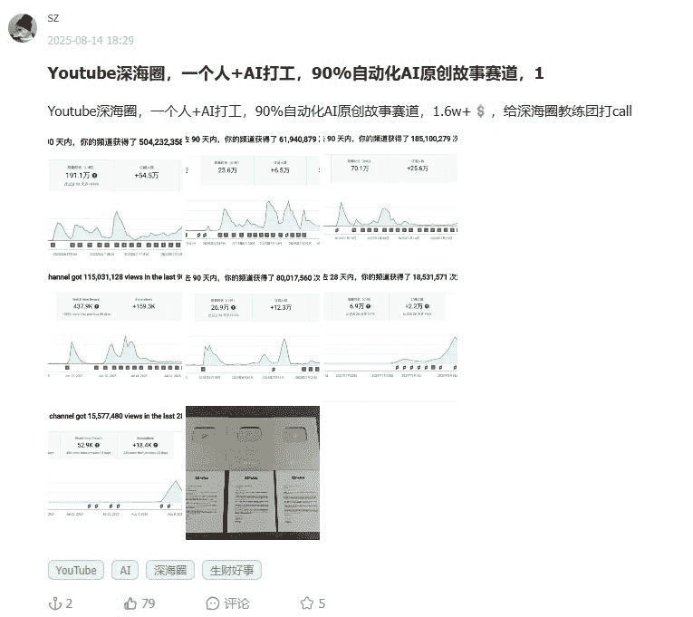

他懂得项目的周期性，懂得放大红利的杠杆。

他去年基于亦仁哥的超级标入局YouTube AI视频，然后在深海圈的风向标里找到了一个没有什么同行、并且制作也很简单的小赛道。在打出第一条爆款之后，他一边上号，一边研究自己制作流程的自动化，一边放大自己爆款脚本的边界，在7月份实现了一个人日更10个频道，单月总收益超过1万美金。而且最绝的是，做到这么大体量的矩阵，在我和他没有公开的情况下，当时深海圈的圈友们都不知道他具体做的是什么内容，他的频道并没有被挖出来。

今年也是他最早在视频号发现了短剧带货这个玩法。他基于自己过去自动化工作流的基础，快速实现了短剧的自动化量产。在视频号还没有几个短剧同行，并且别人还只能手搓一天1条短剧的时候，他可以一天干70条短剧，自己一个人就在这个赛道干出了超过100万的GMV。这还是他把这个项目分享给了我，带着深海圈友一起跑内测的背景下做到的。

上面的三个案例，其实就代表了三类不同类型的圈友：

- 四水代表了那些没有项目经验，但能在项目里拿到结果的圈友；
- 大臣代表了那些在老项目里做出小结果，在下一次项目里做出大结果的圈友；
- SZ代表了那些创业老手，在任何一个新项目里都能抓住机会干一大票的圈友。

总结一下他们做对的事情，本质其实是以下几点：

**1.** 在新手阶段，听话照做是最重要的事情，不要想着自己能很快拿到结果，积累经验和能力是一切的前提。听话代表了认知能够和前辈同频，照做代表了执行到位。四水之所以能抓住龙珠悬赏的大机会，是因为在这之前他就已经十分熟悉AI爆款视频的制作方法，积累了充分的经验。聪明如他，也花了两个月才迈过这道坎。

**2.** 在新的机会来临时，要敢于做那个先行者。四水是最早去根据龙珠悬赏做AI语言类Shorts的一批圈友，大臣是最早去做AI复刻真人视频的一批圈友，SZ是最早去拥抱AI视频自动化的一批圈友。

这样的案例其实还有很多很多，说起来我自己也是最早去尝试AI Shorts、自己去尝试改编爆款的一批圈友。

做任何项目、面临任何机会，如果只是等着别人把自己跑通的经验分享出来再去尝试，那就一定很难吃到最大的那一份蛋糕——当然，前提是第一点，你已经有了经验和能力的积累。

**3.** 在赛道还处在蓝海的阶段，果断选择上量、放大，这比你想象得简单很多，也重要得多。这一点看起来似乎非常理所应当，但实际上，极少有人能做到。

我看到很多初步拿到了结果的圈友，当想要去放大的时候，总会被各种各样的事情卡住：

- 精力兼顾不了更多账号；
- 上号维护起来很麻烦；
- 自己只有一个人，要做的事情太多；
- 项目的不确定性比较高，不敢随便招人……

但实际上，真的有那么困难，成本真的有那么高吗？

不说月入万刀，就算只是月入5000美金，也就是3.5万人民币，看起来很少对吧，看起来完全没法放大对吧？

但是如果你梳理自己放大的瓶颈之后发现，你需要的是有人去管理账号、有人去复制粘贴式地制作视频、有人去像生产线一样地剪辑，那首先是否能用AI解决？如果不能用AI解决，是否能用人力来解决？真的需要你自己做的事情，到底有哪些？是不是真的有价值？

做完梳理之后你会发现：

原来一个超强的、几乎能满足你任何通过电脑进行操作需求的程序员，只需要1200元一个月——Codex/Claude Code；原来一个能帮你节省一两个小时剪辑工作的代剪，只需要三四十块一个小时；原来一个能帮你管理账号、统计数据、处理杂务的兼职，只需要4000元一个月；原来你多花几千元，就能节省自己每天一大半的时间。

看到有很多圈友会说，项目没做成，没赚到钱，时间就白花了，事情就白干了。

如果抱着这样的想法，那还是去找个班上比较好，只有上班能够带来一份时间换一份钱的确定性。

事实上，在任何一个项目里的失败和挫折，都是自己下一次成功的垫脚石，创业的世界里，没有白吃的亏。

而这些从项目里积累起来的真实经验，在这个变化莫测的AI时代，是真正无法被取代的东西——因为AI不可能去告诉你一个未被训练过的答案，而这个时代的大机会，就藏在AI无法回答的那些问题里。

## 我眼里AI视频的趋势和机会

通过这两年在YouTube和国内做AI视频的经验，我总结了四个方向的趋势和对应的机会。

### 一、变现逻辑从依赖创作者分成的泛流量变现，走向产品、服务、带货、IP的精准流量变现

我们是从YouTube广告分成起家的，逻辑就是播放量为王，所以过去我们做得最多的就是泛流量变现，这确实也是最低门槛、最好上手的变现路径，只需要想着做爆款就完事了。

但是随着玩家的增多，AI能力飞一般地迭代，做视频的门槛越来越低，泛流量生意越来越难做，平台管控也越来越严。年初在YouTube吃到的损失已经给我们上了一课：过度依赖单一的变现路径，尤其是受平台影响巨大的路径，会产生巨大的系统性风险。

但实际上，在不同的项目里尝试之后，我们会发现过去积累的经验里，最重要的还是对用户需求的理解、对爆款的理解。当我们把变现路径转向精准流量变现之后，会发现事半功倍了，即更少的播放量赚更多的钱。

这里举个比较直观的例子吧。

这条视频是我24年在视频号发的AI变身视频，算是泛流量，1100万播放，广告分成记得是1000元左右。

同样是视频号，前面说我对象上个月做的带货短剧，15万播放，GMV 2万，佣金8000元人民币。配图是当时的其中一场直播，可以看到15000的流量卖了3000元。

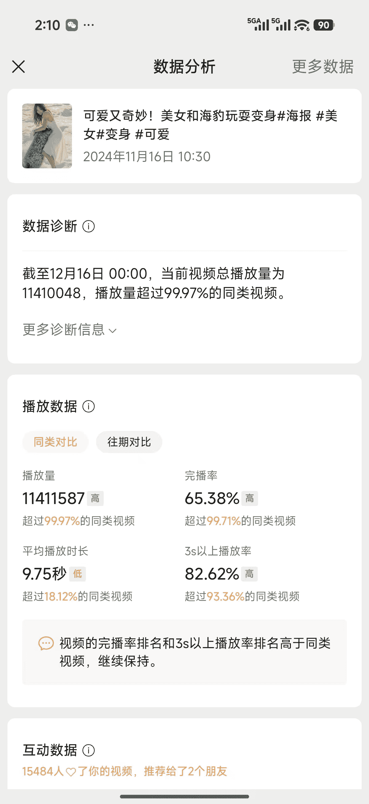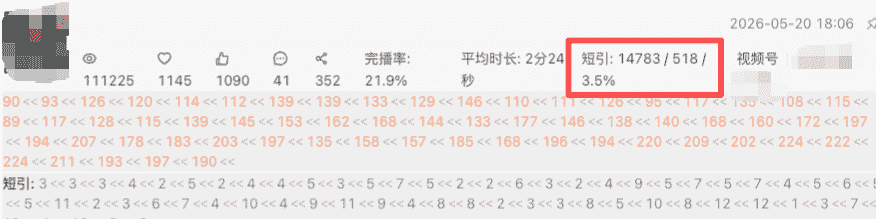

除了两条视频的时间长度和制作成本有所差距以外，视频制作的方法其实没什么不同。

当然不是说现在创作者分成就不能做了，现在不论是YouTube、X等海外平台还是国内，创作者分成其实也还没有饱和，我们也会持续做，只是从趋势上来看，一定是会从创作者分成的这个阶段，逐步过渡到精准流量变现的，因为做泛流量的成本和门槛一直在越来越低。

### 二、应用场景从博一乐的泛娱乐内容，走进教育、科普等有实际价值的垂类场景中

过去一年，我们在泛娱乐方向跑出过很多结果。

救援、动物、KPOP、真人复刻、语言类Shorts，都出过大爆款，也做了不少收益。

但说实话，这些方向都很容易卷起来，一个赛道做不了多久就会被迭代掉。

模型越来越强，简单复刻越来越容易，平台对同质化也越来越敏感。

所以我现在会更多引导大家去做垂类、去做有长期价值、有IP价值的垂类赛道。

科普、教育、游戏、音乐、情感服务、商品种草、AI自媒体、多语种内容、实拍加AI，都还有空间。

从脚本出发，YouTube二十多年的内容积累还没有被抄完。

从形式出发，真人段子可以改成动画，街头采访可以改成角色短剧，实拍内容可以改成AI形式。

从语种出发，英语之外还有西语、葡语、印地语、阿语、日语、韩语、德语。

从平台出发，YouTube上跑出来的内容，也可以分发到视频号、抖音、小红书、B站，甚至反过来也成立。

过去我们讲过一个公式：

> 爆款内容 = 好形式 × 好脚本 × 低卷度。

这个公式放在垂类赛道里依然有用。

模型越强，形式门槛越低，脚本和低卷度就越重要。下面给大家分享一些有趣的AI视频垂类赛道。

#### AI瑜伽教学

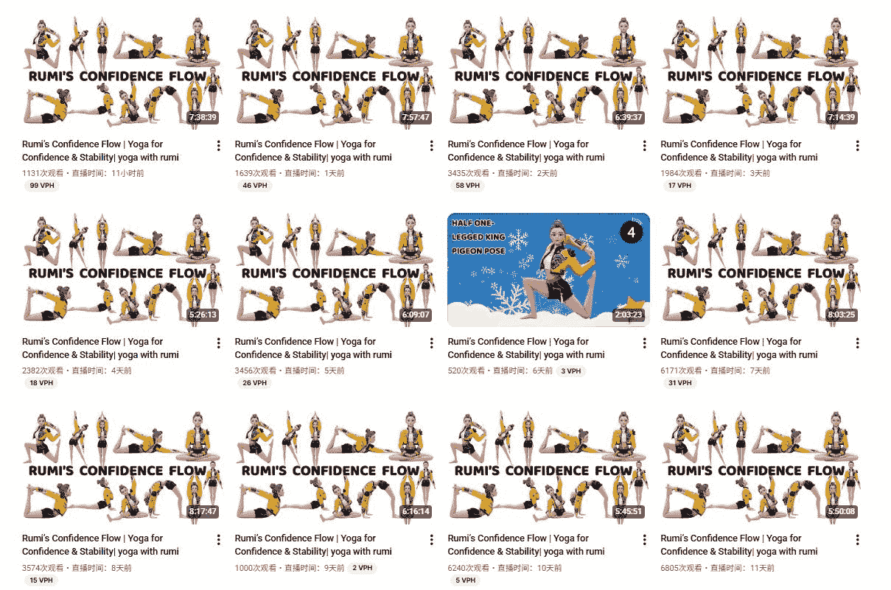

#### 不同国家的AI养老金政策讲解

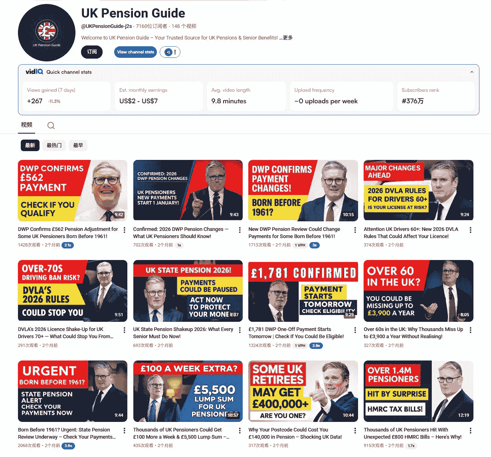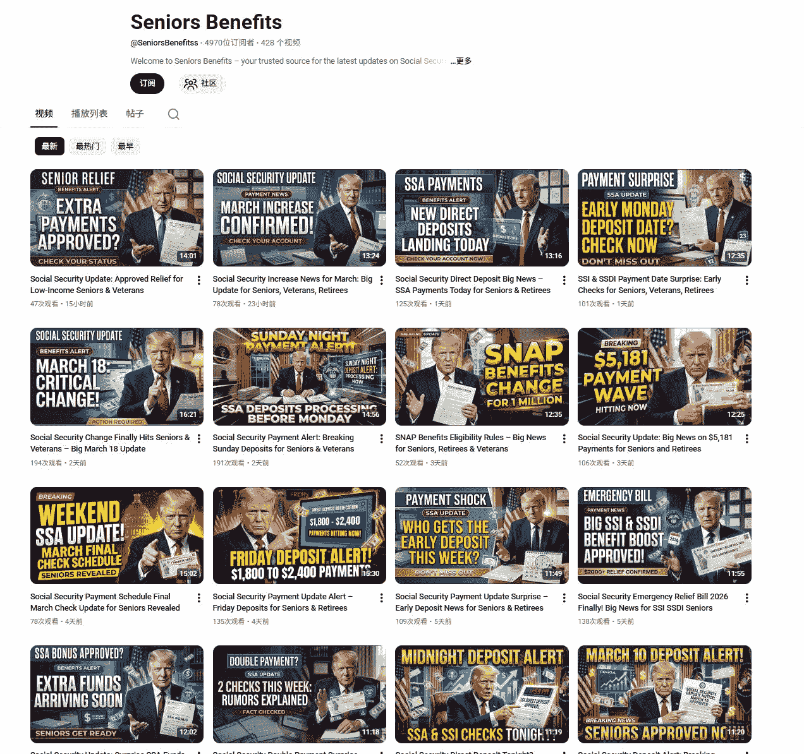

#### 真人实拍+AI视觉艺术

#### 前面用来举例的数学AI动画科普

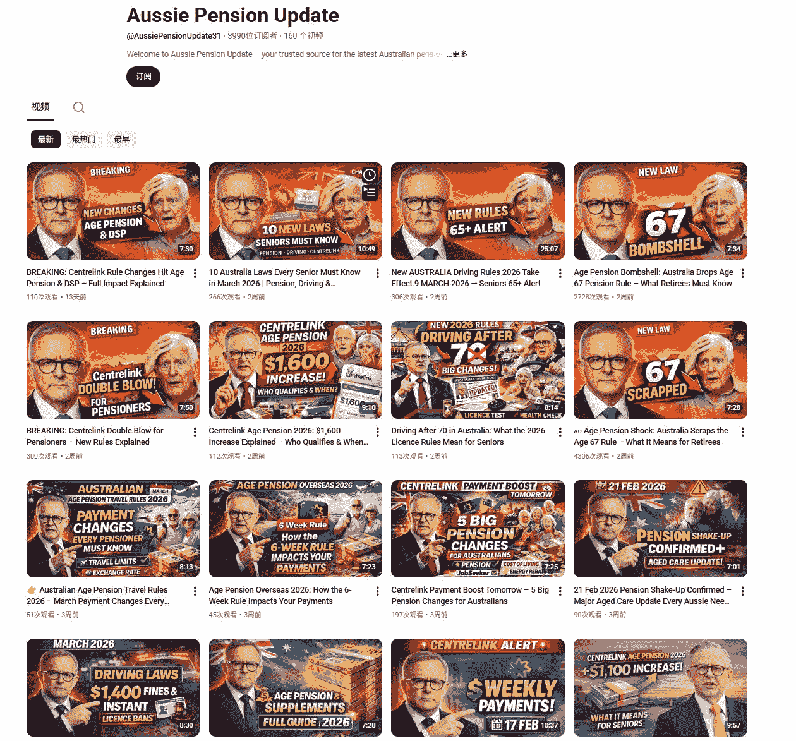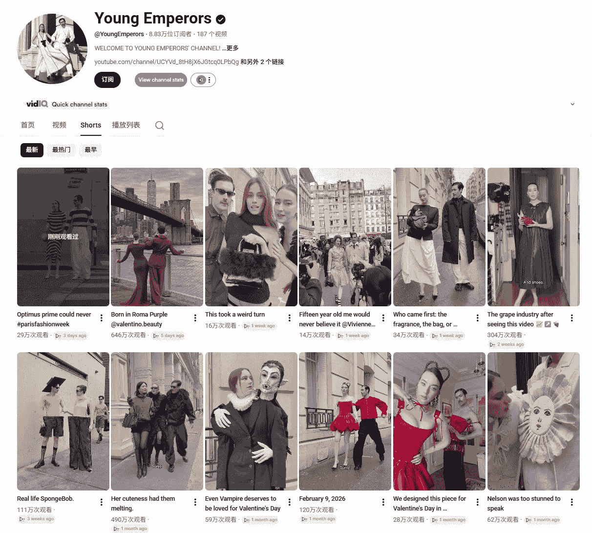

### 三、内容创作的壁垒从怎么做，转向做什么

关于这一点，还是举例吧。

野兽先生，不知道有多少航海家看过他。作为全球第一网红，YouTube订阅量第一，长视频播放量第一，他做的视频基本上条条都是过亿播放，非常离谱。而且每一期视频，都是上百人参与拍摄，在巨大的场地完成最长可能几个月的比赛，而他会把这样拍摄成本高达几百万美金的视频，剪辑成30分钟，可想而知他的爆率从何而来。

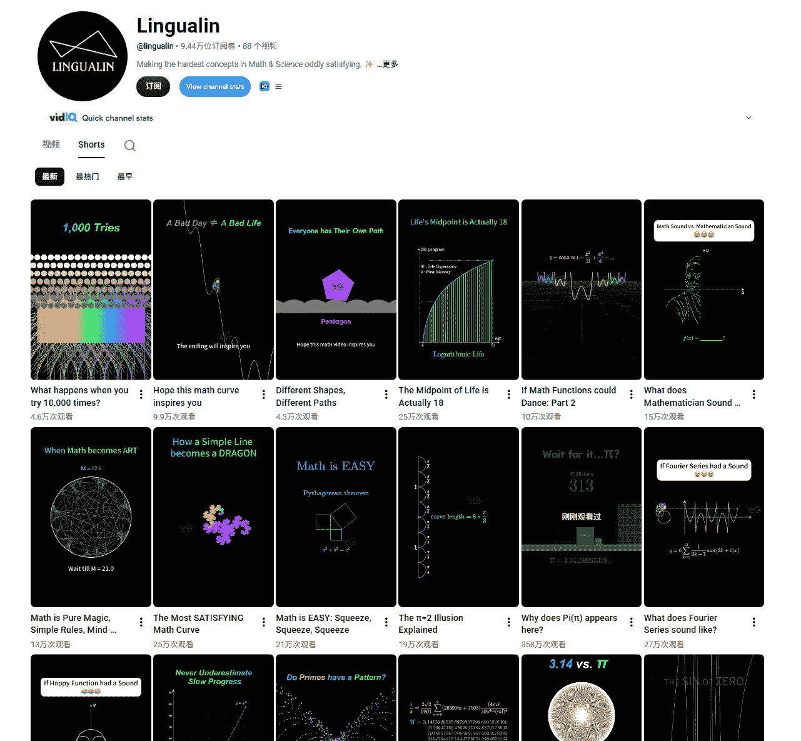

放在现实生活中，根本没几个团队有能力拍出这样的视频，国内基本就只有影视飓风尝试过类似题材。

前面大家看过了，我在去年5月Veo 3出来以后很快做了一个质量比较低的模仿品。虽然质量不高，但我当时仍然非常激动，因为只要随着AI模型的进步，我知道很快AI就可以让任何一个AI视频创作者都做出这样的视频。

比如说这个最近火的博主，在B站条条视频都是数百万播放。在B站这个长视频播放量的体量是啥概念？

最近几期的视频平均播放完全不亚于B站顶流影视飓风，而这两者之间的成本差距，可以说是千倍、万倍。

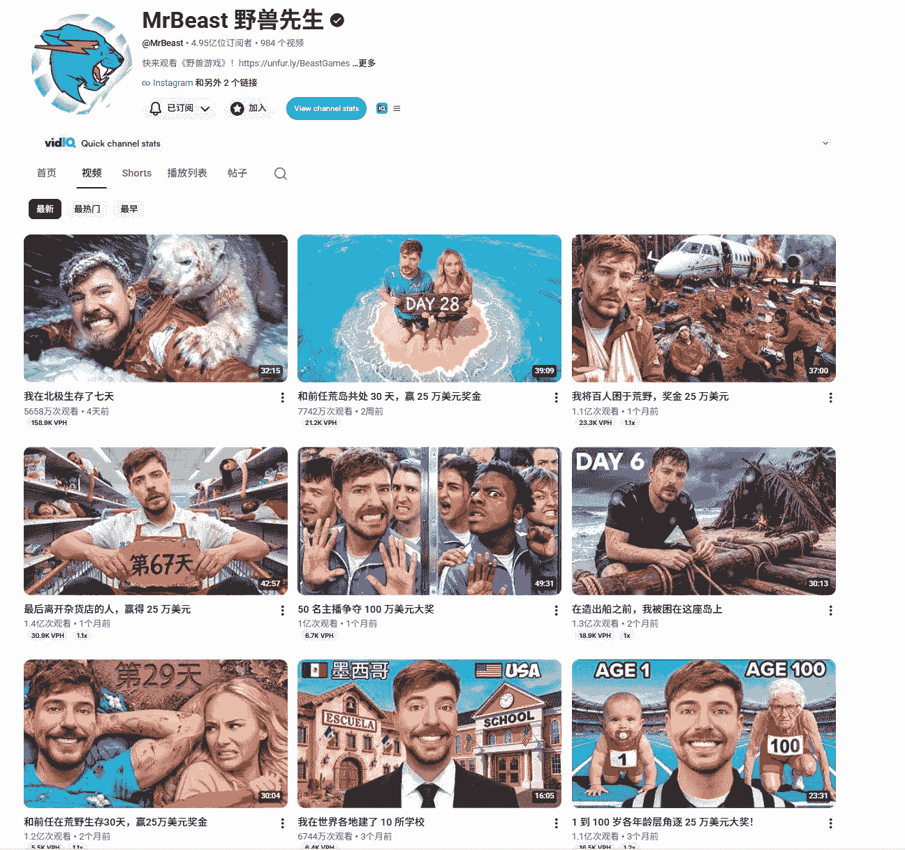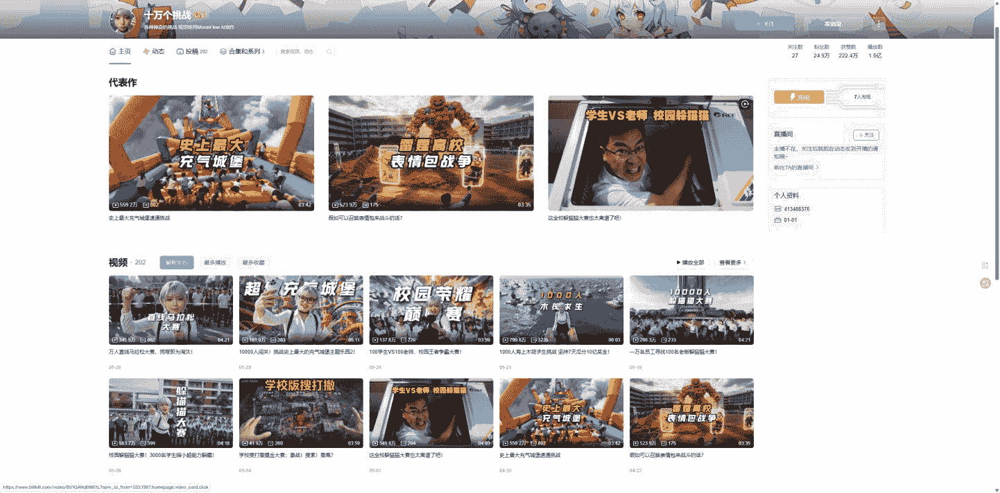

他所有视频都是模仿野兽先生的，关键要素抓得很准：

- 超快节奏；
- 超大场面；
- 超多奖励；
- 超级刺激；
- 超多选手。

AI真的让普通人也能和顶级团队在内容上一较高下了。

创作的壁垒不再是“我能做出这条视频，而别人不能”。

它变成了“我知道要做这样的视频，别人想不到”。

这一点我们也算是深有体会。最早用Midjourney和Stable Diffusion的时候，提示词需要有一个专门的辅助网站，甚至还衍生出了“提示词购物车”的站点，像购物一样把不同类型的分块提示词组装成一个完整的提示词，就为了出一张图片。提示词工程是一门复杂的学问，结果后来Sora出来，成，白学了，提示词变成自然语言了。Seedance 2.0也是这么个意思。

因为制作不再有壁垒，所以重点从怎么做变成了做什么，而这个时候，考验的就是内容理解、执行力、跨赛道跨专业能力、变现能力。

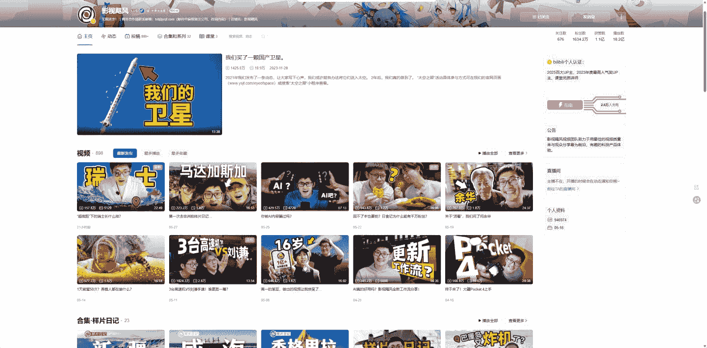

### 四、生产方式从AI辅助人类，变成人类辅助AI

最近一个月，用Codex用得很多，也确实是越用越觉得感慨。

当我仔细去思考一件事情能不能用AI来替代人工的时候，我发现，真的很少有事情是完全不能用AI的。

以前我们觉得，出完图片、视频，要人来审，不然会有问题。

实际上AI能审吗？只要你定义好规则，AI还真能审，而且又好又快。

比如我们为了识别视频的同质化风险和平 台政策风险，做了一套小工具，核心就是提示词和我们预设的案例库、规则库，命中了案例和规则就告知你相应的情况，给你一个建议。

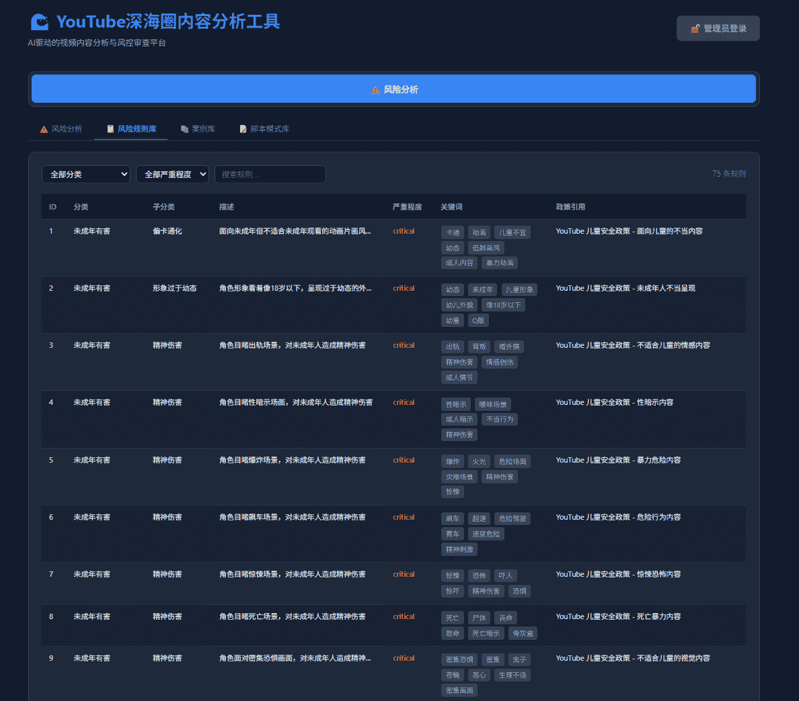

这个事情以前我们是靠人力来看的，几百条视频真的就是我们的审核组一条条肉眼看，因为Gemini确实能读视频，但是它读不懂呀，它不懂规则，不懂什么画面有问题，不懂什么叫同质化，跟谁同质化。

但是我们慢慢积累了几百条人眼看的视频数据和判断之后，把这些判断和案例变成案例库、规则库，这件事AI就能做了。原来要几个人审几天的视频，AI一个小时就能审完了。

以前我们觉得，蓝海赛道挖掘，得人来介入，AI做数据挖掘，顶多爬虫+数据分析嘛。但实际上很多赛道，你从数据上不能判断出它值不值得做，因为在YouTube，赛道的价值还取决于RPM、竞品数量、制作难度、用户基数，这些东西你没法通过明面上的数据判断出来。

于是我就开始思考，那如果人来做，是多做了哪些步骤呢？

我会去找分享赛道的博主；我会根据自己的经验和各种论坛的分享去判断赛道RPM；我会用小号刷视频来挖掘一些不打标签、不写标题的视频；我会通过视频的画面来判断视频制作的难度。

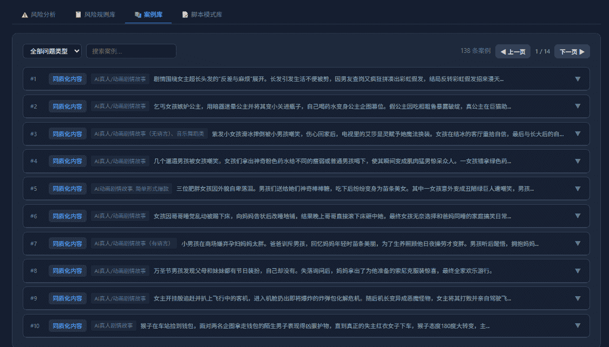

那么以上几点，有AI做不到的吗？好像没有。

所以我优化了数据挖掘的工具，定义了博主库，让AI用Gemini 3.5 Flash去大量拆解各种博主的教学视频、分享视频，挖出其中的赛道，再把赛道定义成一个个关键词，分别用相关性和播放量排序去做检索。挖出视频后，再用Gemini 3.5 Flash去分析视频的内容、制作方法、不同内容间的同质化程度、受众画像，去判断这个赛道的RPM，值不值得做。这套工具还在完善，但是已经初具雏形了。

我想表达的是，时至今日，虽然我举例的都是AI视频相关的场景，但是我真心觉得已经很少有AI做不到的事情了，前提是我们要知道做什么。而一旦我们把越来越多的工作交付给AI，我们的整体生产力将收获巨大的杠杆，能很快把我们的竞争对手甩到看不见的地方去，一步快，步步快。

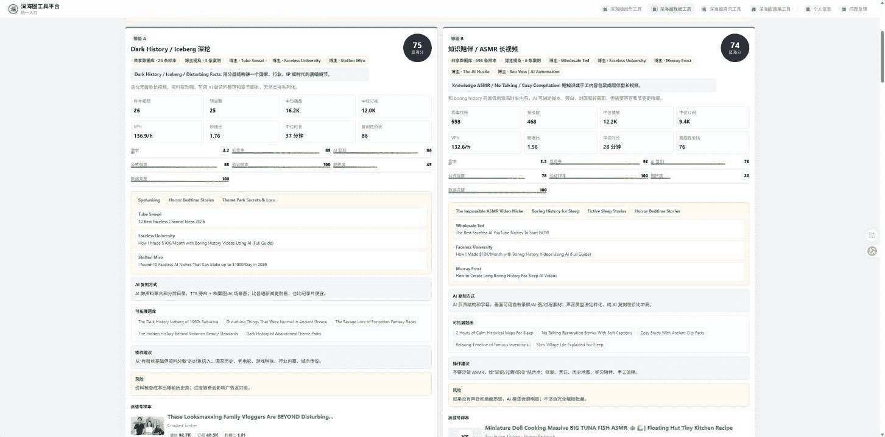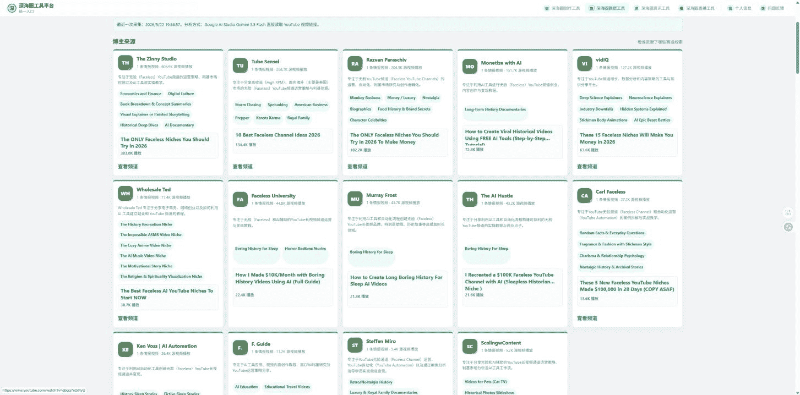

这几个月一直在沉淀，很久没发帖了，希望这篇帖子会对你有帮助。

最后顺便给咱们全新的AI视频深海圈打个广告，有需要的圈友可以来看看今晚的直播，也可以看看报名海报了解。

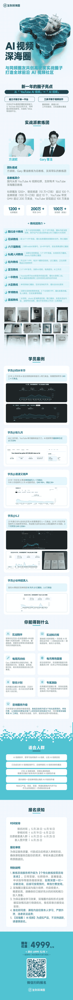

---

看完这篇SOP，你觉得你懂了。但90%的人一到实操就会卡在第一步。

工具和教程只是最低级的壁垒，真正的壁垒是“立刻动手”和“圈层信息差”。

如果你想看全网最新的变现玩法，并且和一群执行力极强的极客一起下场拿结果，欢迎围观我的核心私域：【懒人专属群】。

我们不聊虚的，只做商业闭环的拆解与AI效率的压榨。系统内已沉淀1000+跑通的套利实战局。

👉 查阅圈子完整数字资产与上车门槛：

https://lazyso.com/insider/

认同价值、准备好下场干活的，扫码加我微信（lazyhelper1）。

备注：【实操上车】，不闲聊。

