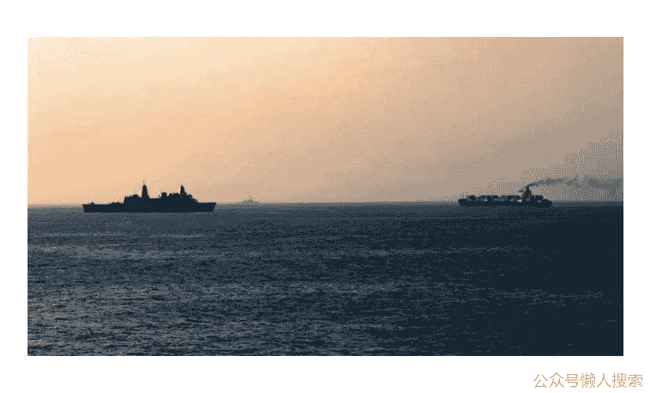

公众号懒人搜索，懒人专属群分享

美伊战争让中国进一步确认了最重要的观点

260704 江宁知府

整理：公众号懒人搜索，懒人专属群精选

懒人微信：lazyhelper1

本篇站在中方视角，试着分析总结美伊战争的启示及对接下来战略决策的影响。

# 1.

在看到伊朗和乌克兰两场战争期间美俄所犯的错误后，中国势必会认真反思其中的教训。

无论是俄罗斯还是美国，都没有为“首次打击失败”的应急情况做好准备。俄军在战争初期试图抢占基辅，以空降军特种部队为先锋发动闪电战；当少量精锐士兵无法守住机场时，整个作战计划随之崩溃，只能临时拼凑方案，结果就是在公路上出现了数公里长的坦克车队，然后被无人机打成废铁。

美以联军的战术表现比俄军强得多，成功完成了第一击——特朗普假设斩首行动会让德黑兰陷入混乱并屈服，然而当剧本没有往预期方向发展时，白宫不得不进入“临时应对模式”，先是空袭了一个月，之后又封锁了两个月，效果均平平。

作为教训，一份完备的军事计划必须做到以下几点：

- 第一，为各种“B计划”做好准备，绝不能为了政治加分而过分迷恋“第一击”，务必尊重对手的反击能力。
- 第二，不要对当地民意做假设，即使情报部门反复宣称“箪食壶浆以迎王师”；同时得确认好国内社会是否愿意承担战争的代价，尤其是陷入持久战之后。
- 第三，优先确保掌控战略资源，比如霍尔木兹海峡就是战略资源，台积电的晶圆厂也是战略资源，控制这些工厂意味着能够影响价值十几万亿美元的科技产业，进而获得外交杠杆。
- 第四，预留退出机制，想好在没有实现既定目标的情况下该如何体面退出战争，切忌为了证明决策没有失败而不断提高目标、扩大打击范围，造成愈发不可收拾的局面——到目前为止，这一点华盛顿做得比莫斯科好。

# 2.

美伊战争让中国进一步确认了自己最重要的观点：

中国扩大全球影响力无需与华盛顿展开领土的决战，也不必立即进行军事对抗，随着美国维持霸权的成本越来越高，在一系列消耗性地缘政治事件后，中方的相对地位将会自然而然上升。

当下中国最紧迫的事情是构建全方位抗压能力，包括经济、军事、科技、能源、文化等维度，确保无论发生什么外部冲击，国内都能基本保持既有发展节奏。

2022年和2026年，普京与特朗普的冒险主义对他们个人以及国家都没有带来好处，因此中国也没有必要利用所谓的“美国分心时刻”去承担新风险。

古往今来，军事史的经典冒险战例通常发生在两种情况下：第一是掌握绝对优势，即使遭遇小失败也没关系；第二是整体局面不利或时不我待，不得已放手一搏。

当局面微微占优且没有明显紧迫感时，决策者一般不会轻易冒险，而是倾向于继续累积优势，直到让对方失去翻盘空间，做到一击制胜或兵不血刃。

在潜在的中美激烈对抗场景下，美国海军依托新加坡基地封锁马六甲海峡是各方心照不宣的事情，然而美伊战争期间阿联酋的遭遇对新加坡心态产生了微妙影响。

伊朗战争证明，美国实施“战略收缩”并不现实，因为它是一个拥有全球利益的超级大国，斩断利益是极其痛苦的，且需要政治人物背负巨大压力。

尽管美国不愿公开承认，但德黑兰已经在这场军事与外交博弈中处于更强势的地位。在美伊打打谈谈的过程中，伊朗设下的“第一道防线”是开放霍尔木兹海峡，“第二道防线”才是限核问题，迄今为止美国还在“第一道防线”那里打转，而随后的美伊谈判足够特朗普忙到卸任。

在未获国会授权的情况下，美国可投入战争的预算与时间均有限，经常有声音称美国应该下血本拿下伊朗，实际上特朗普几乎没有任何“血本”可投入。

设想一下，如果伊朗坚持封锁海峡并迈向激进拥核道路，那么美国终究要做出重大让步或重大军事升级的艰难选择。

某种意义上讲，维护中东霸权与避免再次陷入高成本战争这两个目标是矛盾的，美国总有一天需做出艰难取舍。

2020年10月，在台媒发布的视察新竹县乐山雷达站影片中，一位外籍人士入镜，伊朗战争暴露了美军防御系统对雷达基础设施的依赖，以及雷达设施本身的脆弱。

# 3.

兵役制度对军事战略的影响极为深远。

军事实力不仅在于力量，还在于意志，伊朗战争期间，美国政府和民众并没有展现出承受高昂海外干预代价的意志力。

1970年代越南战争之后，美国军队从征兵制转向全志愿兵制，因为征兵制的政治代价太大，很容易频繁爆发抗议活动，而志愿兵的伤亡更少引发社会舆论反弹。

志愿兵制的问题在于，它把战争成本集中转嫁给了一个相对狭窄的职业军人群体，而不是由整个社会共同承担。

尽管这样可以降低战争初期的政治阻力，却也削弱了国家进行长期、大规模消耗战的动员能力。

自1973年以来，总统能够在不征召青年士兵、不影响绝大多数选民家庭的情况下把军队部署到海外，可受限于兵源数量，美军愈发依赖高技术、空中打击和职业军人来投射武力。

近些年招募过程中出现大量奔着高薪酬、高福利前来的“短择士兵”，冲上诺曼底海滩的那代人早就一去不复返。

直白点说，当下的美国军队是为“斩首行动”而建立的，一旦“斩首行动”没有带来预期结果，五角大楼便缺乏组织“B计划”的能力。

伊朗战争期间，德黑兰唯一畏惧的事情是美军发动地面战，而美方恰恰果断排除了这一选项。

战役期间，美军进行了极其复杂、规模庞大且多样化的作战，总统和国防部长的宣称口径也是基于出击次数和击中目标数量，而非战略层面。

# 4.

如果说社会无法容忍大量人员伤亡只是一方面，那么当前美国国防工业基础其实也无法负担或替换太多的核心装备损失。

伊朗因实力限制，只能打美军的地面固定目标和极少数空中目标，伤不到其海军舰艇，所以美国仍能把战争控制在相对可承受的范围内。

一旦遭遇能够有效杀伤大型水面舰艇的对手，美国损失的就不再是可以较快补充的弹药和无人机，而是建造周期长、供应链复杂、替换成本极高的核心武器平台。

现有产能状态下，美军无法在热战时间尺度内替换水面舰船，所谓“紧急情况来临时一两年就能重建产线”，只是媒体人的想象。

至于宣传了很久的“低成本武器”，在伊朗战争期间的效果也不理想，国防工业复合体受短期市场利润驱动，抗拒转向大规模、低利润、可消耗的战时生产模式。

站在军工企业角度，公司存在是为了盈利而不是增强国防韧性，通过设定技术门槛，可以把大量中小企业挡在门外，能榨一分绝不一厘。

这使得特朗普政府产生了入股军工企业、由政府影响其生产决策的想法，被戏称为“美国特色资本主义”。

商务部长卢特尼克曾表示：“政府在考虑购入洛克希德、波音、帕兰蒂尔（Palantir）等军工公司的股份，洛克希德·马丁97%的收入来自政府采购，本质上是美国政府的一个部门。”

面对种种质疑，五角大楼回应道：

“那些试图用库存算术作为战略胆怯借口的会计员，都从根本上误判了超级大国如何战斗，我们是以绝对实力的姿态和无与伦比的军事领导力取得胜利。任何声称我们国防工业基础过于脆弱、无法维持高强度作战的说法都是无助、愚蠢和夸大的。”

有位西方智库学者的评论也很有趣：

“战争消耗给中国提供了精准评估美国国防产能的机会，北京将密切关注美国在战后补充武器储备所需的时间。尽管有大量报道指出进程可能十分缓慢，但中国决策者向来并不信任记者或公开信息——他们认为真正有价值的信息在各地都受到严格控制。”

*F-35* 生产车间

# 5.

战争愈发综合化，利用“外溢影响”施压成为常见手段。

本次危机期间，伊朗最强的策略不是在与美国或以色列的常规军事较量中获胜，而是让战争本身的外溢影响不断扩大——从波斯湾各国首都、航运市场、能源市场到化肥市场、数据中心，都成为战场的一部分。

值得注意的是，华盛顿和台北也存在类似的思维，反复宣称“台海若爆发战争，全球都会付出难以承受的代价”等，希望用抬升系统成本的方式来威慑大陆、博取更多关注。

另外，岛内过去几年将无人机产业作为重中之重来扶持，2026年前四个月共出口超18万架无人机，为2025年同期的二十倍，大部分经捷克和波兰进入乌克兰战场。

受台当局资助的智库学者明确表示：“因本地需求不足，故必须转向国际市场，以扩大规模并积累经验，掌握未来本地需求可能激增时的应对方式。”

# 6.

美国的盟友集中在三个区域：欧洲、中东和东亚，此次美伊战争对这三类盟友安全政策的影响存在很大不同。

总的来看，欧洲追求战略自主的倾向愈发明显，战争期间甚至出现西班牙、意大利等多个国家拒绝开放基地给美国使用的事件。

中东阿拉伯国家心态十分复杂，有观点认为，伊朗战争后中国的中东战略将优先考虑海湾地区，阻止沙特和阿联酋靠近华盛顿。

日本、韩国、菲律宾和中国台湾省在霍尔木兹海峡关闭期间遭受了部分经济损失，也对特朗普政府抽调军事资源去中东的做法感到不安，但他们表现出的立场却是“别无选择”，继续靠向美国。

美国在东亚地区的盟友缺乏类似欧盟那样的一体化组织，而且面临着中国经济、军事实力增长所造成的综合性压力，其选择比英、法、德等欧洲国家要少得多。

特朗普越是“分心”，高市早苗、李在明等人反而越不敢跟美国拉开距离。

换言之，伊朗战争并不是简单地削弱美国联盟体系或强化美国联盟体系，而是加速了不同地区盟友之间的分化。

这种区别本质上是由“俄欧力量对比”“伊朗—阿拉伯国家—以色列力量对比”和“中国—第一岛链力量对比”所决定的。

欧洲认为依靠内部团结和已经动员起来的乌克兰能够有效抵御俄罗斯，在除核武器之外的几乎所有力量维度对比中，欧洲几乎都占据优势。

海湾阿拉伯国家虽然军力不及伊朗，但他们实际上夹在以色列和伊朗中间，平衡伊朗力量的任务完全可以交给以色列，自己则用外交手段去解决安全关切。

力量失衡最严重的地区就是东亚，美国在“第一岛链”的盟友认为，仅凭自身力量完全无法平衡中国，只能更加主动地引入美国力量。

# 尾声

战略机会和战略诱惑是一枚硬币的两面。

过去几年，中国至少经历了两次重大“战略诱惑”：一次是2022年2月24日俄乌战争爆发，另一次是2026年2月28日美以伊战争爆发。

俄乌战争是二战结束以来欧洲的第一场大战，战争爆发初期，部分声音认为美国将长期陷入欧洲安全危机，战略重心难以转向亚太，中国迎来了某种“窗口期”。

但事实证明，这场战争非但没有削弱美国对华压力，反而加速了西方阵营的整合。若当时中国贸然采取高风险行动，极有可能出现一个以美国为中心、“欧洲北约”和“亚太北约”为两翼的大型军事集团，历史走向将被彻底改写。

伊朗战争是自2003年伊拉克战争之后美国亲自下场的最大规模军事行动，美以发起了现代军事史上最激烈的空袭行动之一，96小时内动用了5200枚各式弹药。

随着伊朗顶住第一波攻势并用封锁霍尔木兹海峡作为报复手段，一时间各种登陆作战方案层出不穷，美国再次陷入中东泥潭的说法不胫而走。

怎料特朗普的最后通牒戛然而止，美伊战争高开低走，最终对美国国力的损耗也比较有限，如今渐渐变成了一个外交难题。

如果把这两场危机的核心启示概括成一句话，那就是“中国不应考虑趁美国分心做点什么”，而应思考“不该被美国诱导去做什么”。

对身处上升期的大国来说，通过一次主动出击拿下部分战略利益、进而与既有霸权体系形成针锋相对的局面，这种机会其实有很多。

反之，获得一个和平稳定的发展环境却十分困难，后者才是真正的战略机遇。

————分割线————

在这个AI能替你写代码、写文章的时代，基础技能正在迅速贬值。绝大多数人正被淹没在海量的免费垃圾信息里，陷入低效的体力内卷。

当“努力”不再是壁垒，人与人之间唯一的护城河，只剩下“信息过滤”的效率与“认知系统”的维度。

圈子已稳定运行7年。我们每天利用Python爬虫与大模型算力，过滤全网最顶级的政经内参和搞钱风向标，做你最冷酷的“外部大脑”。

如果你认同这种“重塑认知防线”的极客主义，欢迎围观我的个人情报智库：【懒人专属群】。

https://lazyso.com/insider/

认同信息过滤价值、想省下每天3小时无效阅读时间的读者，扫码加我微信（lazyhelper1）。

