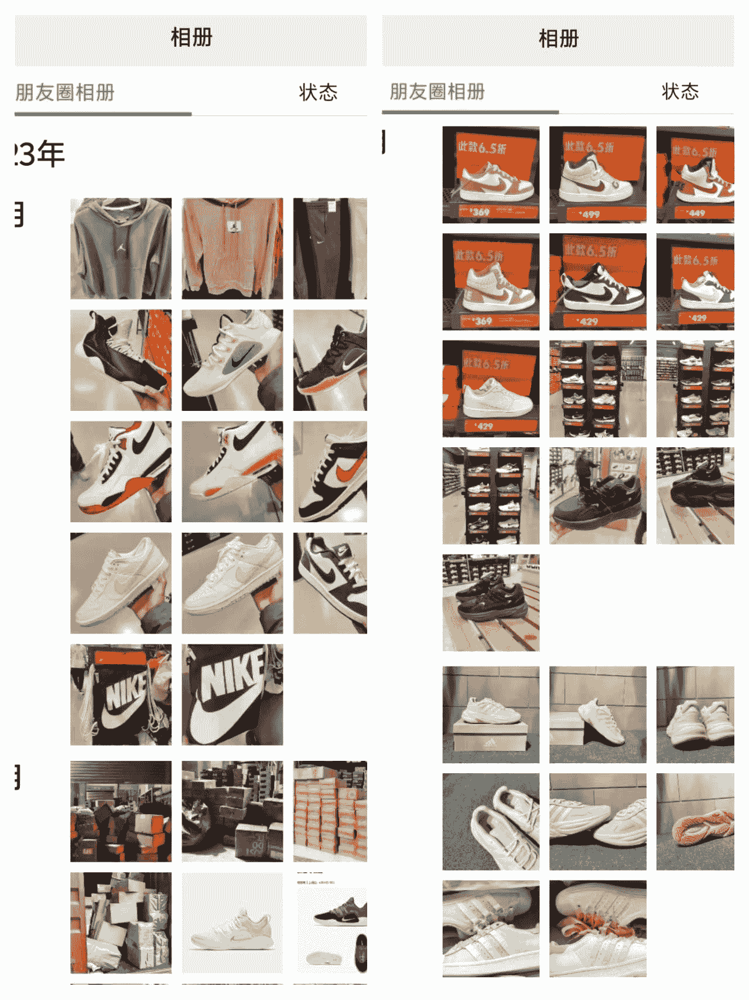
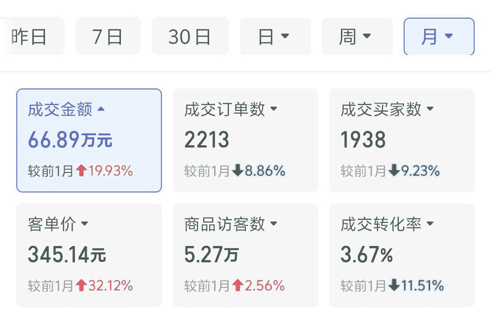
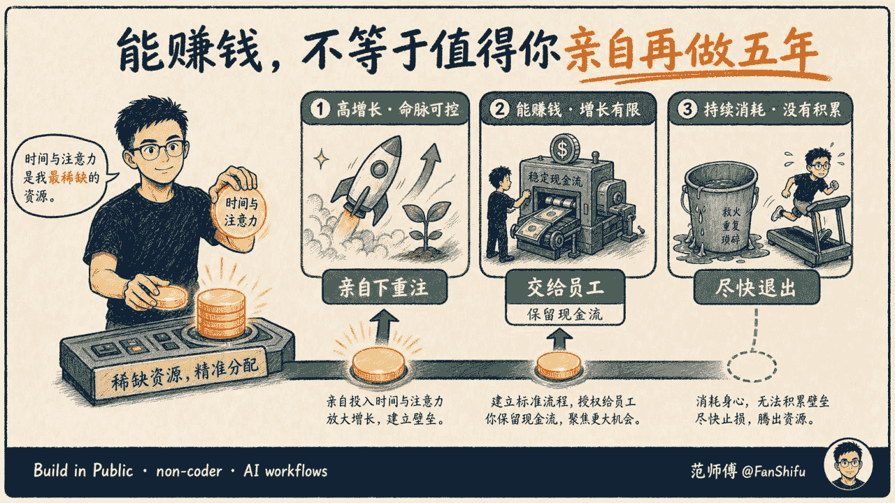
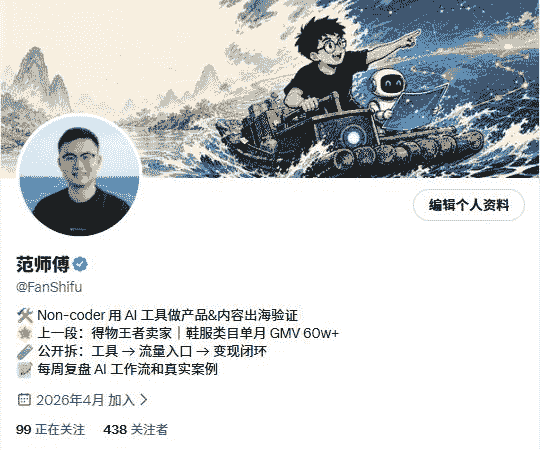
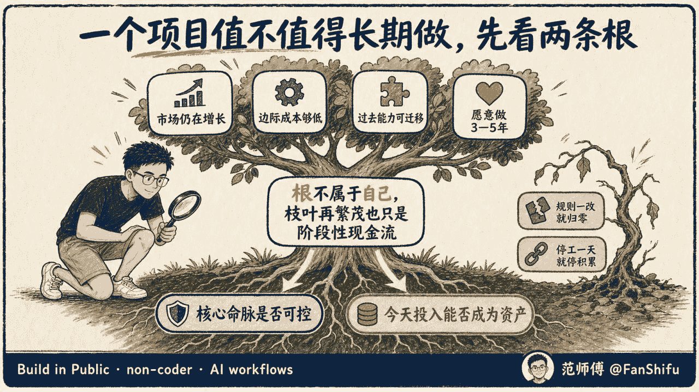
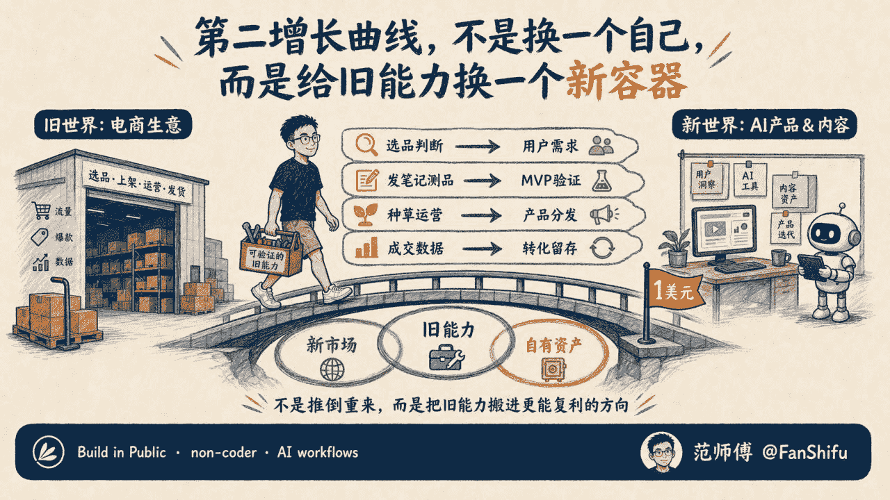

公众号懒人搜索，懒人专属群分享

# 省直公务员辞职创业，从副业兼职做到电商月 GMV 60W+，我终于想明白什么值得长期做

260706 副业 SC 精华

整理：公众号懒人搜索，懒人专属群精选

懒人微信：lazyhelper1

大家好，我是范师傅，硕士毕业于北京一所 985 高校的中国哲学专业，在北京、深圳、成都工作过。做过互联网文案和运营，考公三省进面后进入四川某省直单位，不到一年主动取消录用。

目前全职创业，吃过球鞋搬砖的红利赚到第一桶金，做过小红书奥莱代购，前两个月赚了 5W，也把传统货架电商的单月 GMV 做到 60W+。目前坐标广西桂林，电商业务已交给员工维持，我自己则 All in AI 出海，正在探索 Micro-SaaS 和自媒体。

这篇文章是我毕业十年、离开体制五年后的一次阶段性复盘。这些年我换过几轮项目，也吃过几次红利，我想用自己的项目真实经历，回答一个核心问题：什么项目值得长期做？

为了想明白它，我先后经历了几次具体选择：

1. 稳定工作要不要放弃？
2. 红利项目退潮了怎么转型？
3. 一个项目能赚钱但天花板不高，要不要继续放大？
4. 又该怎么寻找自己的第二增长曲线？

如果你也在工作、创业和项目选择之间反复纠结，希望这篇文章能给你一个不同的参照。

## 一个早生十年的哲学硕士，误入互联网创业潮

2016 年，我从北京一所 985 高校硕士毕业，学的是一向冷门的哲学专业。

到了 AI 时代，哲学、伦理、语言学这些学科似乎又被重视起来。可惜我早生了十年。如果现在才毕业，运气好一点，说不定还能混进某家国内 AI 公司，拿点期权股票跟着被带飞。

但 2016 年毕业的我，面对的现实是，哲学专业不好找对口工作。

那几年正好赶上“大众创业、万众创新”最热闹的时候。北京的互联网创业公司融资不断，整个行业一片欣欣向荣。我一直有个创业梦，给自己的职业规划倒是明确，去游戏公司做游戏策划，以后开发自己的游戏。结果阴差阳错，我进了游戏公司，却没有当上游戏策划，而是做市场文案。

我发现这不是自己真正想走的方向。再后来，为了生活费，也为了找到一条看起来更有希望的路，毕业的头 4 年换了 4 份工作，由于第一份工作的缘故，能找到的还是运营和文案相关。

现在回头看，那几次跳槽并没有解决实质问题。

我当时以为是公司不够好、岗位不够合适、工资不够高。换一家公司，也许一切就顺了。但每次新鲜感过去，那种被安排、被考核、替别人完成目标的难受又会回来。

我一直没能打破短期跳槽的魔咒。

被社会毒打后，我决定考公。既然在企业里看不到希望，那就去找一份大家公认的稳定工作吧。那会儿大环境刚开始掉头，体制内迎来退休潮，新招岗位增加，当时做这个决定仅从选择本身看，没有任何问题，再往后想进体制就一年比一年难了。

插个题外话，当年考完，还被邀请去粉笔深圳分校（对，就是最近惹事的张小龙创办的粉笔）做过一次上岸分享，给考生分享岗位选择和备考心得。

我先后报考广东、四川和广西，三省都顺利进面，最终又阴差阳错地选择了四川某省直单位。

按照正常的人生剧本，这个故事到这里应该结束了。

冷门专业硕士，经历几次不顺利的跳槽，最终考上省直单位。工作稳定，福利不错，按部就班过日子。这大概就是很多人眼里的标准答案。

## 体制内并没有不好，只是不适合我

可惜我只干了 10 个月。

先讲清楚，我从来不否认体制内的好。

工作按部就班，各种福利虽然听老同事说比以前差了，但总体还行。尤其是食堂伙食，我到现在还忘不了。

问题出在我自己身上。

也许是在企业待惯了，也许是天生如此。现在替自己工作，每天干 12 个小时以上不觉得累。但坐到单位办公室里，就像身下全是针，浑身不自在。

我当时在办公室做文职，主要工作是写材料，再加上各种杂七杂八的事务。朝九上班，却很难晚五下班，加班写材料到深夜是常态。

钱少、离家远、压力还不小，这就是我当年的工作情况。

还没上岸成都之前，我在老家桂林投资了一套房产。来成都工作后老婆怀孕了。以当时成都的房价，我们再努努力，也只够紧巴巴地在老城区付个二手房首付。家里没条件提供经济支持，单位那点工资也很难覆盖我对未来生活的预期。

那段时间，整个人的状态都不太好。

但如果只是工作不开心，我未必真敢辞。让我最终下定决心的，是球鞋副业已经跑出了正反馈。

2020 年下半年，我刚考公上岸，还没正式入职，想着找点事补贴生活费。刷短视频时看到有人讲球鞋搬砖，其实就是低价买鞋，再挂到得物赚差价。当时正赶上双十一。我在完全不会凑单的情况下，瞎买了一双，还买贵了，结果放到得物卖掉，赚了五六十块。

我当时就觉得，这事儿能做。来到成都，我在这认识了一位同样做球鞋的朋友。他告诉我，除了线上抢发售，还可以去线下经销商和奥特莱斯直营店拿货。这一下给我打开了新世界。

然后就有了开头那一幕。

白天在单位写材料，晚上穿着衬衣、提着公文包去扫货。第一批 600 双鞋不到一个月赚了 8W+，副业收入已经比工资高很多倍，手里也有了点积累。

【第一次拿批发，当时没啥积蓄，为了凑货款到处找朋友借，也是感受了一波人情冷暖】

继续留在单位，不只是让我难受，还开始阻碍我搞钱的速度。

父母觉得好不容易考上的省直单位，说辞就辞，太可惜了。老婆也觉得可惜，但她理解我。我们把最坏的结果想了一遍，无非就是创业失败，再去找份工作养活自己。

与其每天抑郁内耗，不如跳出去搏一搏。

所以，稳定工作要不要放弃？

我不敢劝任何人辞职。现在回头看，我当时敢走，不是单纯靠一腔热血，而是几个条件叠在了一起。

1. 工作持续损耗我的状态；
2. 收入无法覆盖家庭目标；
3. 副业已经经过市场验证；
4. 手里有一点安全垫；
5. 最差结果也还能承受。

少一个条件，尤其是 3 和 4，我可能都不敢走得那么干脆。

真正的稳定，也不是拿到一个永远不被开除的岗位。对我来说，它更像是一种能力，无论离开哪个组织、哪个平台，仍然能在市场里找到自己的位置。

当然，2021 年的我还想不了这么远。

当时脑子里只有一句话，终于可以全职搞鞋了！

## 球鞋黄金年代，让我第一次尝到项目红利

那会儿真是球鞋搬砖的黄金时代。

2017 年到 2021 年前后，球鞋市场快速增长。一双正代 AJ/DUNK 只要发售，溢价 500 元到几千元都不稀奇。新发售的耐克，一双赚大几百是常态。

得物也正处在快速上升期，逐渐成为年轻人购买正品球鞋的主要平台之一。那时候平台对卖家很友好，商品流速快、资金回款快，电商最头痛的售后问题也由平台处理。

高利润、高周转，还不用自己天天跟买家扯皮。做过电商的应该能理解这是什么神仙体验。

我辞职后全职扎进去，最好的成绩是得物做到王者卖家。主要靠自己打包发货，家人偶尔搭把手。每逢奥莱大促，比如耐克/阿迪三件六折，再叠加商场活动，里面有很大的套利空间。一双鞋利润低于 100 元，那时看都不带看的。

【只有周末老婆一起去拿货才帮我拍照，木有工作日穿衬衣拿货的照片哈哈】

那两年，一到年底就有同行在朋友圈晒 911、迈巴赫提车照。我当时资金有限，憨憨大学生一个，也不懂什么资源整合，但跟着这波浪潮，也赚到了第一桶金。

有人可能会问，这里面到底有多少是个人能力，又有多少是行业红利？

我认真想过，不是谦虚，红利至少占八成，我自己的努力最多两成。人再厉害，也很难对抗天时。

当时球鞋有巨大的消费热度，得物又提供了高效的交易基础设施，朋友还帮我打开了线下货源。我要做的，只是把需求、货源、平台和资金周转串起来。只要人不懒，基本都能赚到不错的收益。

那段经历也让我明白，个人能力决定你能不能接住红利，天时决定这个盘子到底有多大。

不过，当时的我显然没有这么清醒。

第一次创业，一上来就碰到这么好的行情，很容易把时代给的收益误认为是自己的实力。我甚至觉得，这个行业会一直这样持续下去。现在回头看，行业能持续当然好，但即使不能——如果当时把所有时间和资源都压在球鞋上，不敢说财富自由，至少就算后来不工作，温饱大概是不愁的。所以说，机会来的时候一定要拼命干。

但人生没有复盘局。

红利给我上的第一课，是天时或者说顺势而为，真的可以把普通人的收益放大很多倍。它给我上的第二课，是再好的天时也有结束的一天。

## 红利退潮时，朋友圈比行业报告更早变冷

转折点就在 2021 年。

某棉花事件之后，耐克、阿迪开始被全面抵制。新发售的鞋从溢价至少大几百，逐渐跌到破发，同行开始疯狂砸价清仓。

市场端先冷了。

然后是平台。得物开始不断收紧卖家政策，手续费越来越高，球鞋质检越来越严，品牌授权资质的要求也在提高。政策一周一小改，每月一大改，一点点压缩卖家的利润空间。

最直观的变化还是朋友圈。

以前同行晒的是今天又进了多少货，年底换了什么车。后来越来越多的是吐槽、清仓、转行、被骗，甚至跑路的信息。

市场、平台、同行，三端一起变冷。

作为局中人，那股寒意来得很直接。

中间也不是没有出现过机会。国产品牌短暂崛起时，李宁、安踏的需求猛然爆发。我嗅到信号后扫过几百双李宁，一两天就卖光，市场价格还在继续涨。可品牌方逐渐收回折扣，消费者的冲动也慢慢退去。回头看，那更像是整个球鞋行业的一次回光返照。

真正给我上课的是库存。

得物质检越来越离谱，不少鞋被以瑕疵为由退回。当时我还没有建立其他成熟的出货渠道，这些退货逐渐积压，变成死库存。以前一双鞋赚 100 多很正常，后来利润 20 元还要靠抢。高利润没了，高周转也没了，平台售后兜底的优势同样在消失。我倒没有特别不甘心，也没有继续疯狂加码。

行情冷不冷，做生意的人每天都能从订单和价格里感受到。问题是，我虽然看到了旧路走不通，转型却不够快。这是我一贯的臭毛病：视野极佳，执行力差。我经常能比别人更早看到某个方向，但从看见，到真正动手，中间能磨蹭很久。球鞋退潮后，我一直在找新的出路，却花了很长时间才抓住下一次机会。

所以，红利退潮了怎么办？

不要只盯着自己的订单，更不要一边骂平台，一边继续抱紧平台的大腿。消费者还买不买，平台有没有持续加码限制，同行到底在进货还是清仓，这三个信号要放在一起看。

单个信号变差可能只是波动，三边一起恶化，通常就不是努力能够解决的问题了。

这个时候最重要的不是证明自己能逆天改命，而是停止加码、处理库存、保住现金，然后尽快把旧能力搬到新的渠道里。

红利退潮时，最没用的事，就是光腚站在滩头骂平台。

## 同一件滞销商品，换到小红书却成了爆款

那两年我一直在探索新出路，抖音、视频号、B 站、小红书都试过。其实我很早就尝试过兴趣电商，2020 年做抖音直播时，因为完全不了解品牌授权政策，在没有资质授权的情况下开卖，直播不到 15 分钟账号就被封了，还罚了 2000 元。信心被打击得不轻。

后来几次想继续研究抖店，也一直没有特别大的动力。视频号和 B 站有时数据不错，变现却不顺。2022 年 9 月底，我在生财看到小红书店铺航海，我老婆告诉我这个 APP 很多女孩子用，于是报了名。小红书最开始也只是想顺手同步一下内容。

没想到，反馈来得太快了。

笔记发出去，很快就有人询单，然后真的成交。

我看这能做啊，赶紧起号！

当时小红书刚开始主推短视频，而大量品牌折扣商品集中在线下。线上通常只有双十一、618 这些大活动才有明显折扣，奥莱却每周都在更新活动。平台流量窗口期 + 线下折扣信息差，再加上我过去积累的球鞋选品和货源经验，刚好撞在了一起。

我自学视频剪辑，每三天去奥莱拍一批素材。同行大多对着产品随手拍、随手发，我就给自己设计了一套固定框架：穿搭场景、面料材质、基础信息、可选配色、设计小巧思，再配字幕剪辑。

其实也没多专业，只是比同行多认真了一点。很快，一件耐克长袖先爆了，接着裤子、鞋子陆续爆。很多在得物零销量的商品，放到小红书却成了爆款。这再次给我打开了新世界。

第一个月，两个账号合计做了 4.8W 销售额，毛利 40% 多。买家下单后我再去奥莱拿货，前期几乎不用囤货。第二个月再增加一个账号，GMV 也在增长。开头两个月算下来，总计有 5W 多利润进账。

【还好当时在生财做分享的截图没删，可以留作纪念】

后来有一款在得物卖不动的阿迪背包，被我在小红书推火。我把能找到的奥莱库存几乎扫光了。市场售价从 109 元一路涨到 369 元，还是有人问。可惜我的货早卖完了，没有吃到末段高溢价。更不可思议的是，三四年过去，后台依然有人私信询单。

这段经历让我更深刻地理解了选品。选品不只是选货，也是在为商品选择合适的货架。同一个商品，在 A 平台可能完全卖不动，换到 B 平台却能成为爆款。商品没有绝对的畅销和滞销，关键是它有没有被放到合适的人群面前。得物倒鞋阶段赚的是商品差价，到了小红书，我赚的是渠道差 + 内容差。原来只能在得物兑现的选品能力，换个平台又产生了新的价值。

这也让我重新理解红利。红利不是躺着等钱掉下来。平台开始推短视频只是窗口，线下折扣也一直存在。如果没有过去的货源、选品经验，没有临时学剪辑，没有把视频做得比同行好一点，这个窗口跟我也没关系。红利更像是平台窗口期与个人旧能力的一次重叠。

可惜，这个项目后来也停了。

2023 年，家人意外考上了老家的教师编。目标原本是成都，报广西岗位只是练手，结果真考上了。就像我当年本来想考广东，最后去了四川。这就是命运的安排吧！我们已经在成都看房，但为了有一个更稳定的后方，我们决定举家搬回桂林。桂林没有奥莱，三线城市实惨啊。没有奥莱的大货架，拍视频缺少买家信任的真实场景，线下拿货也变得困难。

如果继续做，得自己搭真实场景，囤一批可能卖不出去的货来批量测品，整个模式会变得很重。我不愿意为了维持过去的业绩，强行保住一个已经失去跑通前提的项目。于是，小红书店铺和微信私域，也随之一起忍痛放弃了。

公众号懒人搜索，懒人专属群分享

## 【微信朋友圈用来做二次转化】

单月**GMV**做到**60W+**后，我为什么不愿继续放大

搬回桂林后，球鞋业务又回到了得物单平台的老路。

这肯定不行啊，继续找路子。

兴趣电商受过一次打击，自己又一直没摸清门道。正好有认识的同行朋友在做拼多多和淘宝，还有人买过授权。我顺着同行找中介办授权的路子，逐渐摸清楚品牌资质怎么拿，遇到售假投诉怎么申诉。

做项目，有前辈带路真的太重要了。朋友虽然不会替你把生意做起来，却能告诉你哪扇门真的能进，哪面墙撞上去只会头破血流。球鞋第一批线下货源来自朋友，小红书店铺来自生财航海，传统货架电商又是同行带路摸清品牌授权渠道。

有人带路，不仅少走弯路，也会大幅加快验证速度。我把货从家里搬进了第一个仓库，开始学拼多多、淘宝怎么选品、怎么报活动、怎么处理售后。球鞋阶段积累的货源渠道、选品判断和运营技巧，在新平台继续发挥作用。

传统电商没什么惊喜，就是一步一步堆出来。靠选品、活动和资金量，我一个人把单店的月GMV做到了60W+。

跟同行大佬比，这个规模洒洒水。但对我自己来说，算是一个里程碑。

今年也有朋友愿意投资，让我继续扩大规模。

我拒绝了。

不是因为这个生意不赚钱，而是我已经能看到它放大后的样子。

球鞋行业已经进入成熟期，很难再出现过去那种高利润、高周转的爆发式增长。而且品牌不在自己手里，很多事情的天花板非常低。之前说的阿迪背包就是最典型的例子，内容有流量，买家有需求，价格涨了两倍多还有人愿意买，可我就是拿不到货。

这玩意又不能自己踩缝纫机生产，自己生产倒是要被送进去「踩缝纫机」。

说出来是句玩笑，但那种感觉真的很憋屈。你把需求做出来了，内容三四年后还在带来询单，但爆款产品不属于你。流量暂时属于你，生意的命脉却握在别人手里。而且我们这些扫货商始终不是正规军，没有一二级经销商那种完整授权和稳定货源。哪天平台或者品牌政策收紧，饭碗可能直接就没了。这不是多投一点钱能够解决的问题。

后来想投资我的这位朋友邀请我去他公司负责一块新业务，我去试了，也就是这个契机，我才开始招员工打理电商生意。但这段经历再次证明自己确实不适合上班，还是浑身不得劲。熬过前两个月最苦的筹备期，我选择退出，跳出来继续做自己的业务。这件事没有影响我们的关系。直到现在，他还时不时带我social，介绍本地资源，看看有没有能一起做的项目。有这么一位实力好大哥，我一直很感恩！

跳回主题。我最终没有关掉电商业务，也没有继续往里面砸钱。而是招了一名员工处理日常运营和发货，让它维持现有规模，提供稳定现金流。自己则从具体事务里退出来，把精力留给下一条增长曲线。

这也是我现在对「赚钱但天花板不高，要不要换」的回答。不是所有旧项目都要一刀切：

- 高增长、核心资源可控的项目，值得亲自下重注。
- 能赚钱但缺少增长的业务，交给员工，让它成为现金流。
- 持续消耗、没有积累的项目，才应该尽快退出。

一个业务能养活你，不代表值得吞掉你未来五年的注意力。

## **OpenClaw 小龙虾，让我重新看到自己做产品的可能**

这些年，我一直在生财看各种项目，几乎每次航海都会报一个。AI领域也偶尔关注，但大多数时候都处在划水状态。直到2026年，OpenClaw小龙虾爆火。

深入了解后我发现，AI已经进化到可以自主设计、开发和编程的程度。以前很多必须找程序员才能做的事，现在我这种Non-coder也有机会独立实现。

以前不是没有产品想法，而是想到开发成本就放弃了。找外包程序员要沟通需求、付开发费，做出来之后还得不断维护。一个想法值不值得投入，光靠脑子很难判断，真花钱开发又承担不起反复试错的成本。

现在这道门槛突然低了很多。3月份，我开始跟着刘小排老师的AI编程深海圈第三期学习。目前把课程大致过了一遍，做过两个微信小程序练手，也用AI给自己的电商业务做了一些提效，比如开票、对账和运营数据分析工作流。

AI带来的变化还不只在编程。

我是文案出身，写作本身不算难，但我一直很头疼素材整理，也头疼把零零散散的想法敲成逻辑顺畅的完整段落。这个摩擦很大，大到我明明有想法，却经常懒得写。

有了AI辅助后，这些苦力活可以交出去。我提供真实经历、观点和判断，AI帮我整理素材、搭结构、检查逻辑，我再做终审。

于是，我又捡起了做自媒体的想法。

5月底，我开通X Premium会员，开始认真运营账号。不拉互关，也没有大V帮转，靠两篇长文拿到10W+曝光，从0积累了400多名粉丝。虽然还是个小卡拉咪，但至少证明了一件事，我过去的写作能力，加上AI带来的低摩擦生产方式，确实可以形成新的组合。现在也遇到了新瓶颈。涨粉开始停滞，选题和内容发布还没有形成稳定系统，我正在研究怎么把其中一部分流程自动化。

## 【小卡拉咪一个】

产品开发这块更早期。

7月，也就是这个月才算正式行动，目标是国庆前后赚到1美元。离目标只剩三个月，多少有点小紧张。但我没有期待它像当年的球鞋或小红书一样，刚进场就迅速给出高额回报。电商业务刚忙完618，也在正常运转，目前能够提供正向现金流。所以心态上没有那么焦虑。我愿意把AI出海看成一个三到五年甚至更长线的项目，而不是下一个短期套利机会。

## 为什么选择 Micro-SaaS+自媒体？

因为这两个方向同时满足了我现在最看重的几个条件。

市场仍在快速增长，边际成本也足够低，一个网站做出来后，有机会在我睡觉或者休假时继续销售，不需要像电商那样收入翻倍，库存和人力也得跟着翻倍。

更重要的是，核心资源更有机会掌握在自己手里。产品怎么卖、卖给谁、怎么迭代，可以由自己决定。数字产品不会因为全国库存被扫光，眼睁睁看着需求增长却没货可卖。个人IP如果真能建立起来，也会跟自己深度绑定。就算某个平台规则改变，有了内容经验和一批真正认识你的人，换个平台起号也不会完全从零开始。

它还能复用我过去的能力。

做电商时的选品，对应的是寻找用户需求。发笔记测品，对应的是用MVP验证。小红书种草和平台运营，对应的是产品分发与用户运营。分析活动和成交数据，对应的是看产品转化与留存。

有了Claude Code和Codex，编程未必还是最难的环节。找需求、设计销售策略、做内容和推广，反而成了核心技能。而这些事，我在电商阶段已经做了很多年。

这次并不是把过去全部推倒重来，只是把过去验证过的能力，搬进一个增长更快、复利更强的新容器里。

## 吃过几次红利后，我现在用「两个根本」判断项目

过去做电商，我总结了一套很朴素的方法：高增长、差异化、下重注。这套方法我现在仍然相信，但在下重注之前，我会先看两条根。

第一条，核心命脉能不能掌握在自己手里。

球鞋和传统电商都给过我很直接的教训。产品、货源、授权和平台都是别人的。你可以亲手打爆需求，但任何一个关键环节收紧，生意都可能直接停掉。

所以现在看项目，我会先问：产品属于谁，客户关系能不能沉淀，平台改规则后有没有迁移能力，货源、资质和流量会不会被别人一夜掐断。核心命脉不在自己手里，短期收益再诱人，我也只会把它当成阶段性现金流。

第二条，今天的投入能不能成为明天的资产。

传统货架电商的销量想翻倍，资金、库存、客服、发货和售后通常也得一起增加。休息一天，工作不会消失，只会挤到第二天。不能复利的努力，做久了很容易变成高级体力活。

代码和内容不太一样。一个产品可以被重复销售，一篇真正有价值的文章几年后仍可能被搜索、阅读和转发。它们当然不是做完就能躺赚，但至少今天种下的东西，不会在明天自动归零。

这两条是根。根扎不住，下重注也只是在博短期收益。在此之上，我才会看市场是否仍在增长、边际成本够不够低、过去的能力能不能迁移以及自己是否愿意连续做三到五年。

## 一张可以直接套用的项目判断卡

现在看一个新项目，我会先问自己五个问题：

1. **自主：**如果平台明天改规则，这个项目还能剩下什么？
2. **复利：**如果我停止工作一个月，过去积累的价值会不会全部归零？
3. **高增长：**市场处在爆发前吗？收入翻倍时，库存、人力和资金需要同比例增加吗？
4. **差异化：**过去的能力，能不能让我比纯新人更快跑通？
5. **下重注：**是否值得投入80%精力和资金做好这件事？

后三问决定它值不值得下手，前两问决定它有没有资格成为长期事业。前两问过不了，赚到的钱再多，也要清楚它只是现金流，不是自己的第二增长曲线。

这也是我现在选择AI出海的原因。

它还没有给我收入，我甚至连第1美元都没赚到，当然可能失败。但它至少通过了这几项检查：市场仍在快速变化，代码和内容能够积累，核心产品有机会由自己控制，边际成本也比传统电商低。更重要的是，文案、运营、选品、需求判断、测品、投放和数据分析，这些过去十年验证过的能力，都能换一种形式继续使用。

第二增长曲线，不是把过去全部扔掉，突然换一个自己；而是把已经被市场验证过的旧能力，放进一个增长更快、复利更强的新容器。

## 从月销**60W**，到重新赚第**1**美元

毕业出来已经十年，我也35岁了。现在让我重新去追一个只能赚几个月快钱的项目，我不是完全不做。真有合适的红利，当然必须抓。短期项目能提供现金流，也能练手，但我不会再把它误认为自己的长期事业。

回头看我这十年，从哲学专业毕业，进互联网创业公司做文案，三省进面后进入省直单位，又在一年内辞职。然后做球鞋、做小红书、做拼多多和淘宝，现在又开始折腾AI出海。表面上一直在换。但那些经历并没有全部浪费。游戏公司的文案经验，让我能重新做内容。运营工作训练的用户意识，后来用在小红书种草。球鞋生意练出来的选品和价格判断，迁移到了拼多多、淘宝。电商里的测品、成交和投放，又开始迁移到Micro-SaaS的需求验证和分发。

过去我一直在问，下一个能赚钱的项目在哪里？现在我更关心，自己到底积累了什么，什么东西是平台拿不走的，什么事情做完以后能让明天的自己更值钱。目前，电商业务有员工日常运营，继续提供现金流。我自己则重新回到一个小学生状态，学Claude Code和Codex，研究X内容，研究Reddit，寻找海外用户需求。

从月销60W+，到重新赚第1美元，数字看起来小了很多。

但这1美元对我很重要。它将验证我能不能把过去十年积累的能力，用在一个核心资源更可控、能够长期复利的新方向上，重新完成一次从0到1。

我不知道国庆前能不能顺利跑通，也不知道未来三到五年能做到哪一步。这一次，我不想因为短期没看到钱就急着换项目。我把AI当成自己这辈子最后一次下重注的机会。不是因为它保证成功，而是到了这个年纪，已经知道自己不想再回到什么样的生活，也终于知道什么样的事情值得长期投入。

稳定工作要不要放弃，没有标准答案。

红利退潮了，也不用证明自己能和周期对抗。

项目能赚钱但天花板不高，可以把它留下做现金流，不必让它继续吞掉全部精力。

至于第二增长曲线，不一定藏在一个完全陌生的赛道里。它更可能就在旧能力、新市场和长期资产的交叉点上。

如果你也想做一个长线项目，可以先问自己那两个问题。

我的核心命脉，究竟掌握在谁手里？（自主权）我今天投入的时间，到了明天还能留下什么？（复利）这两个问题，我花了十年才真正想明白。

希望你能比我早一点。

范师傅丨35岁Non-coder，用AI做产品与内容出海验证。前省直单位公务员，吃过球鞋红利、做过小红书和传统货架电商，目前正在寻找自己的第二增长曲线。

————分割线————

看完这篇SOP，你觉得你懂了。但90%的人一到实操就会卡在第一步。

工具和教程只是最低级的壁垒，真正的壁垒是“立刻动手”和“圈层信息差”。

如果你想看全网最新的变现玩法，并且和一群执行力极强的极客一起下场拿结果，欢迎围观我的核心私域：【懒人专属群】。

我们不聊虚的，只做商业闭环的拆解与AI效率的压榨。系统内已沉淀1000+跑通的套利实战局。

👉 查阅圈子完整数字资产与上车门槛：

https://lazyso.com/insider/

认同价值、准备好下场干活的，扫码加我微信（lazyhelper1）

备注：【实操上车】，不闲聊

