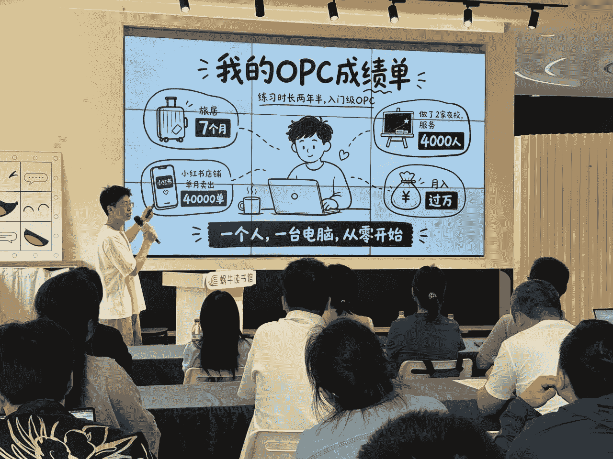
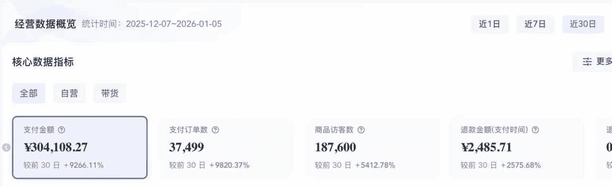
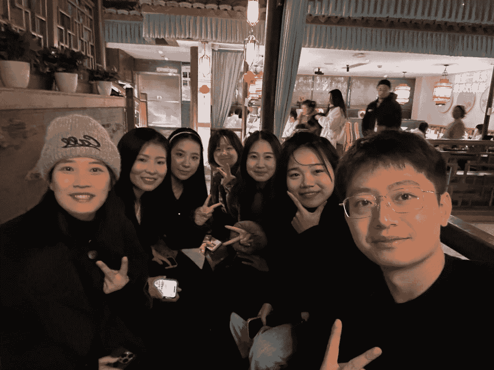
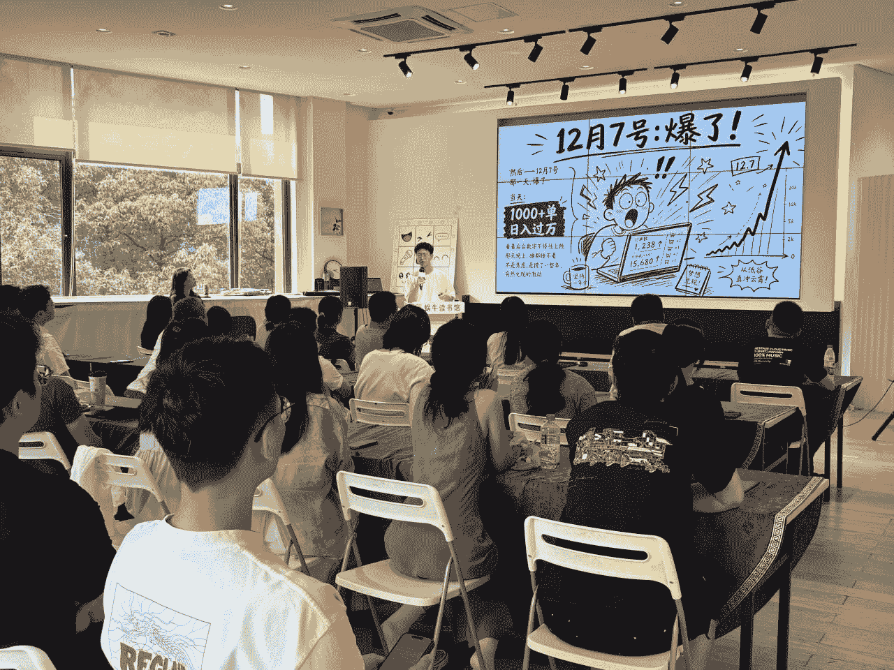
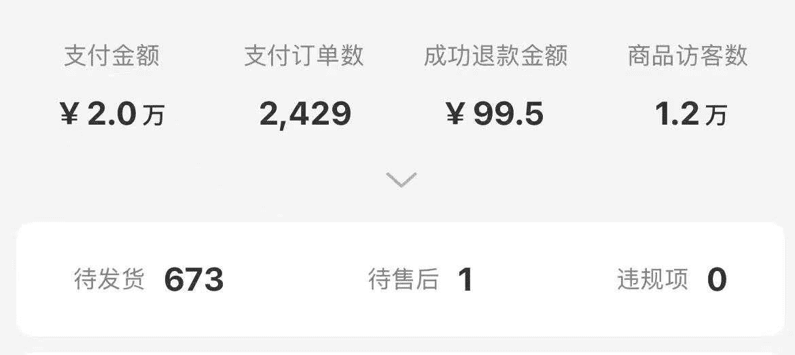
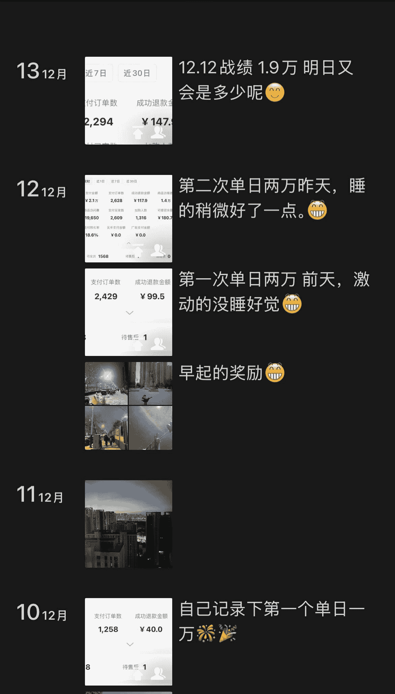

公众号懒人搜索，懒人专属群分享我是由月之暗面（Moonshot AI）研发的 kimi-k2.7-code 智能大模型。访谈武一：**5** 个月发了 **1000** 条笔记才迎来单日爆单 **2** 万，做一人公司需要一点盲目乐观 

260708 副业SC 精华 

整理：公众号懒人搜索，懒人专属群精选 

懒人微信：lazyhelper1 

## 01｜“我不是被迫辞职，是主动选择另一种生活”

七天：跟大家介绍下你自己吧？ 

武一：我是武一，目前是创业两年半的OPC练习生。我之前是在国企的财务岗，安全稳定，但工作后才发现那不是我想要的人生，我意识到如果我继续走下去，只会离我想成为的人越来越远。所以我主动选择了离开。

我真正想要的状态，其实一直很明确：住在离海不远的地方，做自己喜欢的事，不是为了上班而上班，而是做一份自己认可、也能带来不错收入的工作。我希望自己有时间陪家人，有时间旅行、旅居，也能更真实地按自己的想法生活。

现在的我，不断的在训练自己和市场打交道的能力。对我来说，这不只是换了一份工作，而是在重新训练一种更主动的人生方式。

## 02｜辞职不是因为受不了老板，而是我先看见了自己不想要的生活

七天：那我们先从一个最直接的问题开始，你当时为什么敢辞职？ 

武一：我觉得最重要的是，你得先想清楚自己想要的生活是什么样的，然后再倒推，你要怎么做才能实现它。我当时脑子里已经有一个大概的生活蓝图了，但我发现那份工作和那份收入，肯定给不了我那种生活。所以我就开始算账。

第一，我有没有试错成本？我的存款够不够让我拿出半年到一年去尝试新的项目，或者新的生活方式？第二，我的压力大不大？我当时工作一年半，没有贷款，也没有情感上的羁绊。第三，我父母身体还可以，他们的收入也能cover住自己。

这些都算完之后，我觉得够了。那我就出来闯一下，说不定有希望挣到更多钱，过上我想要的生活。基于这个判断，我就觉得，我可以辞职。

七天：你当时确定知道自己想要什么吗？ 

武一：其实也不一定完全知道。但你就算不知道自己想要什么，也一定能通过对比知道：现在这个生活是不是你不想要的。我当时很清楚，那份工作和那个生活状态不是我想要的。它让我感觉自己越来越低落，甚至有点抑郁。每天上班的时候，不是那种正常的累，而是会觉得自己整个人慢慢变灰了。那个感觉很难形容，就是你明明还年轻，但你已经能看到自己如果继续待下去，可能五年、十年以后也差不多是这样。

但我不想把辞职归因成“老板不好”“工资不高”。外部原因肯定有，老板确实不太好，但更关键的是，我不适应那个体制，不适应那种工作方式。

所以我不是因为被迫才辞职。不是老板不好，所以我走。而是我知道自己想要的东西，需要另一个环境、另一套东西，我才主动做了裸辞这个选择。

## 03｜看完《百万富翁快车道》，我发现当下的我不在快车道

七天：你当时觉得不想要，是因为老板的原因，同事的原因，还是工作本身的原因？ 

武一：我记得对我影响比较大的有《百万富翁快车道》和《纳瓦尔宝典》。这些书给我最大的震撼，不是说它教了我某个赚钱方法，而是它让我第一次意识到，我可以不选择在这个体系里生活。

以前我从小到大接受的教育，都是把我培养成一个在“慢车道”上生活的人。你上学、考试、找一份稳定工作、慢慢升职、攒钱、买房，然后过一个相对不错但也相对不自由的生活。这个路径不是不好，它能让你过得还可以，但它给不了我想要的那种自由。我就是在那个时候突然意识到，原来我还有别的选择。

我之前基本上是挣多少花多少，觉得反正每个月都有工资，也没有特别强的危机意识。但从那个时候开始，我心态就变了。我会开始算，明年如果我真的离开，一年最低消费要多少钱，我至少要攒多少钱，才能让自己不至于一出来就马上崩掉。

所以从2023年10月开始，我就进入了一个很奇怪的状态：一方面我还在上班，一方面我心里已经开始倒计时了。这个状态其实挺有意思的。因为当你知道自己想要的生活是什么样之后，你会发现当下很多痛苦都可以忍受。

## 04｜所谓数字游民，不是不用工作，而是你要把公司那一整套流程变成自己来做

七天：数字游民这个东西，其实是一种新的概念，对吧？往前看叫自由职业，往后看又有点像OPC。你觉得它的内核是什么？是一种人生信念，还是一种个人商业化模式？ 

武一：我觉得两者都有。

首先它肯定是一种人生选择。你不满足于原来那种状态，所以你才会选择新的生活方式。比如你不想每天固定坐班，不想被一个组织完全安排，不想把自己的时间全部交出去，那你才会想，能不能换一种方式生活。

但第二方面，如果你真的要自己挣钱，那它就一定会变成一种商业模式。不是说你到了清迈，拿着电脑坐在咖啡馆里，你就自动成为数字游民了。不是这样的。你必须有能力自己挣钱。

而这个商业模式其实也不新，它本来就存在，只是你把自己从公司的流程里摘出来了。

以前公司提供品牌、产品、流量、销售、交付、财务、客服，你只是其中一个环节。比如我之前做财务，我只负责核算账目，我不参与生产，不参与商务，也不去跟别人谈合作。

但如果你要做自由职业，或者数字游民，或者OPC，最大的变化就是：所有环节你都要自己经历一遍。

你要自己获取客户，自己搭建产品，自己提供服务，自己把东西卖出去，自己交付，自己复盘，自己优化。你不再只是公司的一个零件，而是你自己变成了那家公司。

所以职场人为什么很难做OPC？我觉得最大的区别就在这里：你有没有直接和市场做交易的能力。以前你在公司里，可能只需要把手头那一块做好就行。但出来以后，没有人给你分配任务，没有人给你提供客户，没有人替你证明你是谁。你要让别人看见你，相信你，愿意为你付钱。

比如一个插画师，他会画画，不代表他就能成为数字游民。他必须是一个自己有客户的插画师，才有可能成为数字游民。你要能在小红书上把你的能力展示出来，让客户看得到你，找到你，然后愿意付费给你。

所以我觉得，获取流量的能力是非常重要的，甚至是最基础的。但除了技能层面，还有心态层面的东西。比如你自己要足够成熟，能够照顾好自己的情绪，也能够跟自己相处。因为出来以后，没有组织给你节奏感，也没有同事天天跟你一起上班，你很容易陷入焦虑。这个时候你要能告诉自己，现在这个状态是正常的，我接受它，然后继续做该做的事情。

还有就是自律。因为所有环节都要你自己来，你要一遍又一遍重复，没有人管你，没有人约束你，你要自己给自己定任务，自己监督自己执行，还要不断复盘和优化。

所以我理解的OPC，本质上不是别人给你定OKR，而是你自己给自己定OKR，并且你要能执行好这个OKR。我一开始给自己的OKR其实很简单。我给自己一年时间，至少要做到收入不低于我之前上班的收入。我之前上班一年大概十三四万，最后确实也做到了。做到以后我就觉得，那还可以，那我就继续做下去。

## 05｜先去旅居，再发现自己没有赚钱手段，那时候才真正开始慌

七天：你是怎么从离职之后，走向你理想生活的？分了几步？ 

武一：这个我现在回想，不太像是我提前规划好了几步，然后一步一步执行。更像是我先从原来的环境里出来，然后在路上慢慢发现自己缺什么。

第一步其实是补认知，通过看书听播客，让我隐约意识到这个世界有别的活法。如果我要离开，就不能只是凭一股冲动，我得先把一些商业的基础认知补起来。比如供需关系，比如流量，比如销售，比如一些比较新兴的行业。

那个时候我还不知道生财，也不知道有这么互联网赚钱项目。我只是通过听陈雪雪姨的播客，发现原来真的有很多人，是靠一些互联网项目赚到钱的，也是在那个时候老是听到生财这个名字。

第二步，是评估自身的能力条件。我意识到，从大学到工作这么久，我一直相对比较自律，能够保持每日阅读学习新东西，热爱思考，能够坚持做一件重复的事，做很久，这是我认为对我有益的。所以我大概感觉到我有这个基础能力，可以尝试一下，创业或者说做小生意。

第三步是开始存钱，我需要有一笔让我半年到一年不工作，也可以生存的钱。攒到了这笔钱之后，我没有着急去找下一份工作，而是我想先去看看这个世界这个真实的世界到底是什么样的。我坚信有一部分人他们可以不需要每天趴在格子间就能够赚到钱，而且也能够享受这个真实的世界，所以我选择了裸辞之后，先去旅行旅居。从乌鲁木齐辞职出来，然后去了宁夏，又去了西安、成都。成都之后去了广州，然后是长沙、衡阳，再到珠海、澳门、深圳，最后去了三亚和清迈。

七天：去完清迈对你有什么影响么？ 

武一：清迈对我影响挺大。我在那里看到很多数字游民。比如有一次游泳的时候，我跟一个程序员聊过，他是一个白人国家的人，我不太记得具体哪个国家了。他每天只需要工作几个小时，写一些代码，拿的是发达国家的收入，但生活在东南亚，用的是东南亚的消费水平，所以他过得很滋润。清迈还有一个很明显的感受，就是每隔十几米可能就有一家咖啡馆，很多人拿着电脑坐在那里工作。你会发现，他们好像不是在逃离工作，而是在用另一种方式工作。

我还认识了一个团队，他们是一群刚大学毕业，甚至还没毕业的人，在做Web3，当时准备去新加坡开公司。这个事情对我也挺震撼的。我会想，原来人家这么年轻，就已经在做生意，做公司，做那么大的事情了，而我以前从来没有想过这些。

更重要的是，那边的生活状态跟我之前朝九晚九的状态完全不一样。不管他们挣多挣少，至少我看到的很多人，是真的在享受生活。他们不是每天把自己耗干，然后等周末回血，而是把工作和生活放在了同一个空间里。

这件事让我意识到，不管怎么样，我要努力达成这样一种生活状态。在旅居的七个月，每天晒太阳、锻炼身体，在海边散步，整个人的状态越来越好。我以前上班的时候，压力特别大，头发几乎白了90%。但旅居了几个月以后，我的头发慢慢恢复了很多。那段经历让我重新找回了身体，也找回了生活。

可是，它没有让我赚到一分钱。不仅没赚钱，我还被骗了。我在网上看到一个国外的翻译项目。对方说，需要把一本英文期刊翻译成中文，报酬是2000美金。我觉得这个机会挺不错。唯一的要求，就是先交25美元押金。当时我还觉得，这可能就是国外的契约精神吧。于是我交了钱。我用GPT翻译了两天，马上就要交稿的时候，对方又告诉我，还需要继续交钱才能完成结算。

到那个时候，我才反应过来，我被骗了。现在回头看，这就是一个很典型的骗局。但当时的我，是真的相信了。后来我一直想，为什么我会相信？我觉得有一句话特别适合形容那个时候的自己。人越缺什么，就越容易相信什么。因为我太想赚钱了，所以看到一个看起来很轻松、回报又很高的机会，就很容易失去判断。

但也是从那次被骗开始，我真正开始认真研究一件事。我不能再把时间都花在享受生活上了。我必须学会赚钱。也是从那个时候开始，我不再到处找所谓的兼职，而是真正开始研究，互联网到底是怎么赚钱的，人到底应该怎样建立属于自己的收入系统。

所以我回来以后，一方面是因为自己确实没什么钱了，另一方面也是因为我已经看见了另一种生活样本，我知道自己不能只是一直体验生活，我必须开始认真钻研一个项目，真正去实操。

## 06｜第一个真正让我拿到钱的项目，是小红书电商

七天：那我们讲到比较务实的部分。你提到你最后做到了收入不低于之前上班，那你是经过什么项目做到的？ 

武一：最开始我做的是视频号口播带货，那个项目我没有卖出去什么货，因为粉丝还没有达到要求，但我把账号做到了六七百个粉丝。现在回头看，我觉得它对我来说依然是一个好项目，不是因为它让我赚到了钱，而是因为它让我锻炼了口播能力，逼着我对着镜头讲产品，讲卖点，讲逻辑。这个过程让我第一次觉得，原来我可以通过表达去获取流量，可以通过内容去探索一种新的商业方式。

所以它不是一个结果很好的项目，但它是一个很重要的起点。然后我同时还做了小红书电商，是在航海的最后一天出单的，所以它是我第一个真正变现的项目。后来我旅居回来又做了两个月小红书电商，发了四五百篇笔记，总共加起来只卖了四五千，我就转头去做了同城项目。

我当时做下来发现，它没有很快给我正反馈。你知道我那个阶段其实心里还是会慌的，因为我已经出来了，我需要证明自己能靠项目赚到钱。小红书电商虽然出单了，但那个钱太少了，不足以让我觉得自己可以靠它活下来。

所以后来我就转去做了两个同城项目，都是从生财的精华帖学习如何实操的。第一个叫同城发售，就是给线下瑜伽馆之类的商家做裂变，把他们的老用户拉出来做拼团活动。这个项目第一次让我在很短时间里赚到了一笔对我来说比较有感觉的钱。一周之内，挣了5000块钱左右。

那一次给我的刺激很大。因为我前面做小红书电商，两个月才卖了四五千块，但这个项目几天就赚了几千块。那个时候我本来已经有点想回去打工了，但这笔钱让我突然觉得，好像没必要马上回去。几天挣了这么多，那就接着做呗，还打什么工？

后面我又去尝试了青年夜校的项目。流程是从小红书获客，再把大众点评上的一些化妆/学技能的上架组合打包。

我要先从小红书引流，效果非常好。一周时间就加满了一个小红书群，十天左右就变现了一万，这一次更让我信心大增，因为前不久刚通过同城发售挣了5000，这两件事让我意识到，我是可以再接着试试的。

也是从这个项目开始，我才慢慢理解什么叫做流量。

## 07｜青年夜校是我第一次真正理解：先有流量，后找供给

七天：你可以分享下你怎么样获客之后，找到交付的后端上架么？ 

武一：以前我可能会觉得，做生意要先有产品，先把课程设计好，先把商家谈好，先把一切都准备好，才能去卖。但青年夜校让我发现，不一定。你可以先做流量，先把人聚起来，有了人之后，产品反而可以最后找。我那个时候的后端商家，就是一个一个从美团、高德上找，然后给他们打电话。我会跟商家说，我这边如果凑5个人给你，一个人大概500块钱，我们五五分，可不可以？相当于我给你引流，后面你去转化高客单，我不管。

比如一个人498，5个人就是差不多2500，这个钱我们先收，然后再分给老师。有些课程是四节课，有些是六节课，有些可能八节课，看具体品类。像网球这种，教练课时费贵，还有场地租赁费，我们就会给商家多分一点，可能六成，或者把价格稍微涨100块钱。

为什么这个事情能成立？因为所有线下商家都缺客户。他的场地成本本来就是固定的，老师也在那里，店也在那里，如果多来几个学员，后面这些人就有可能变成他的长期课客户。

我最开始找的是美妆，就是教女生怎么化妆。这个需求最高，因为我面对的主要是女性用户。后来也找运动类的，比如羽毛球、网球；也找乐器，比如吉他、架子鼓；还有咖啡课，各种各样的，只要市面上有线下实体门店，而且能做成体验课，我都会去找。

这里面美妆是复购最高的，因为女生学化妆是一个非常天然的需求，而且她学完基础以后，后面还可能继续买进阶课、买产品、买服务。

我觉得最好的商家是交付比较用心的商家，因为客户在这个科目体验好了，他会想要尝试夜校的其他科目。如何给自己的产品定价呢？

498这个价格也是参考生财精华帖里的模式，我看到同行和其他城市的夜校大概都是这个价位。这个价格消费者能接受，商家也有一点利润空间。对于消费者来说，四到六节课算下来一节课不到100块钱，学一个兴趣班并不贵；对于商家来说，这批人过来以后，他可以提供一个好的体验，再转化成店里的长期课。

所以这个498，本质上是我们创造了一个新的链接SKU。钱不是商家收，是我们夜校先在私域里收，比如一开始就是微信转账，后面开了商家的经营收款码。我们收完以后，再把属于老师的部分转给他。用户为什么愿意买单？因为这个需求本来就存在。

我们做内容的时候，也不是只发课程表，而是围绕着这种需求去做。比如有一个脚本就是：小时候想学某个技能，但因为家庭条件，父母没有给我这个钱，不让我去学；现在我长大了，我想款待小时候的自己，花几百块钱上一个兴趣班。这个表达其实很打人。因为很多人真的有这样的遗憾。小时候想学跳舞，想学画画，想学化妆，想学乐器，但没机会。现在长大了，终于有一点钱，也有一点时间，她就会愿意为这个东西买单。

而且我们做的是本地项目，本地有信任感。大家会觉得，这个店就在这里，它不会跑。去了以后，如果它不好好上课，招牌就砸了，后面也没人再去了。所以它比一个纯线上课程更容易建立信任。

## 08｜我没有先找商家，只有一张课程表，就开始把人拉进群

七天：所以你其实是在中间做了一个青年夜校，自己做一些课程产品，但后端是别人交付。那你是先有品，还是先有流量？ 

武一：先有流量。说实话，我一开始连后端商家都没去谈。我只有一张课程表，课程表上甚至连具体地址都没有。就是先把用户拉进群里运营，看看大家想学什么。

比如群里有人说想学化妆，有人说想学网球，有人说想学咖啡。我看哪个品类人数多，就去那个方向找商家。

公众号懒人搜索，懒人专属群分享 

够了，就再去对接商家。对接完以后，我 再把地址发给大家，问大家这个地址能不能接受。 

因为我们城市本身不大，只要这个店在本 地，大家一般都可以接受。我们不是一个固定的场所，不是说所有课程都在同一个地方。A 课程可能在这个店，B 课程在另一个店，C 课程又在另一个地方。我们做的是组织和撮合，后端交付由不同商家完成。 

所以严格来说，我不觉得自己是在做产品。 我更像是一个中介，把需求和供给匹配起来。课程设计看起来像是我们夜校设计的，但它也有大量参考。我会去找同行，虽然我是在家乡做，但其他城市已经有人做夜校了，所以我会装成消费者，打入他们的群，看他们怎么设计课程，怎么定价，怎么发朋友圈，怎么运营群，然后模仿他们。 

这个项目为什么能在一开始快速赚到 **1 万**？ 最重要的就是流量来得太快。我当时做电商的时候，学到了一个东西，叫对标思维。所以做夜校内容的时候，我没有自己去创新。我就是找到对标笔记，把爆过的笔记扒下来，然后二创做成自己的。比方说别人是杭州夜校，我就改成我们家乡的名字。别人发课程表，我也发课程表。对于一线城市的人来说，这个东西可能已经见过了，但对于三线城市的人来说，他们没见过，会觉得：哇，我们这里居然也有这种东西。 

我现在回头看，这里面有一个很关键的点，就是当时供给和需求是不匹配的。需求很多，但供给很少。大城市已经有人做了，但小城市还没有。你可以说这有点像地理套利，就是把一线城市已经验证过的经验，搬到三线城市来做。 

## 09｜这个项目从1月做到9月，我赚钱了，也很快看到了天花板 

七天：那为什么后来没有继续做？ 
武一：没有继续做的原因，就是我需要一直做新流量出来。 

而且本身城市就不大，做到后期很难有新的增量，而且是整个流程都需要我自己操心做流量，私域的社群运营。私聊谈单，对接商家，觉得太累了，我算了一下账，好像也不足以让我去再雇一个人帮我分担一部分的任务，我也尝试过复制其他的城市，成功了一家，但做到第三家的时候，就没那么顺利。 

我就感觉可能我的能力也不足以把它放大，而且这个模式好像太重运营了，我就想着能不能再找到找一个其他更适合我的项目，这个项目，已经让我感受到流量的魅力。 

这个项目我大概从 1 月做到 9 月，做了 9 个月。整体算下来，到 9 月份的时候，应该差不多把我之前一年上班的工资赚回来了。 

## 10｜我发了一千多条笔记都没爆，后来才知道自己是在虚假努力 

七天：所以夜校项目快速变现很快，但也很快遇到天花板。那你后来为什么又回到小红书电商？
武一：因为我想赚的更多。

公众号懒人搜索，懒人专属群分享 

哈哈哈哈~ 通过阅读生财的帖子，我发现小红书电商是能够让普通人相对来说拿到稍微大一点的结果的项目。 

我在5个月时间了，发了1000多条笔记。做这种事情其实挺消耗人的。你每天要找素材，要改文案，要去重，要发，要看数据，要判断哪条能跑起来。它不像别人看到的那样，只是轻轻松松发几篇笔记就出单。总的收入不到 5000 块钱。然后一直做到去年的 9 月份，参加了新一期航海之后，才开始狠狠地做，方法也慢慢对了一些。 

真正爆单是在 12 月 7 号。中间其实还有一段很难熬的时间。 

现在回头看，我之前为什么一直没有爆？ 就是方法有问题。小红书电商看起来好像就是发笔记、挂商品、等出单，但其实里面每一个环节都很重要。选品很重要，笔记制作很重要，内容干预也很重要，而我之前所有这些点，没有一个真正做到位，很多都是靠主观判断。 比如选品。当时有一个原则叫“近期低粉爆款”，我也知道这个词，但我理解错了。我把“近期”理解成，只要我昨天还能看到它有新的爆款笔记，那这个品就还可以做。但实际上，这个品可能一个月之前、两个月之前就已经爆过一轮了，它已经过了最好的时间点。我只是看到它还有尾部的笔记在跑，就以为它还能做。 

再比如笔记制作。我知道要模仿对标，但我心里并没有真的觉得它那么重要。我会觉得，我大概知道它怎么写就行了，我自己稍微改一改就可以。但后来才发现，不是这样的。对标是要复刻得很还原的，不是你看一眼，然后凭感觉改一版。 

所以你问我，为什么在没有理解那么到位的时候还能做出一千条笔记？其实就是因为我以为自己在努力。 后来我才知道，那叫虚假努力。我每天都在重复做笔记，重复发内容，看起来很勤奋，但关键动作没有做对，所以它不出结果。那个状态挺典型的，就是你会用数量安慰自己。你会觉得，我今天又发了 10 条，我已经很努力了，但实际上你没有认真拆爆款，没有认真看别人为什么爆，没有把封面、标题、内容、评论区、选品逻辑拆开。 

前两个月我是真的天天做，像打了鸡血一样。后面从 9 月份开始，虽然小红书没有爆单，但夜校还在做，我还有收入，所以我心里没有那么慌。我会想，没事，就算它不爆，我现在也不至于饿死。 

但我对这件事心里又很笃定。我当时还在朋友圈写过一句话，设成仅自己可见，大概意思是，小红书电商是我第一个深耕的项目，我一定会爆单。 你问我为什么笃定，我其实也说不清楚。有一点盲目的自信。但这种盲目的自信也不是凭空来的。因为前面做过那些项目以后，我已经知道自己不是完全不能做项目的人。尤其是青年夜校，那么麻烦的事情，从流量到商家到课程到收钱到交付，我最后都搞定了。所以我会觉得，小红书电商我也一定可以。 

那时候还有一句话对我影响很大，就是发小红书笔记是在给自己存钱。刀姐说每一条笔记大概值 100 块钱。我就想，我都发了一千条了，总会让我赚到钱吧。 

到了 9 月份以后，我才开始真正优化。以前是低效重复，但那个时候我开始优化封面，优化标题，优化内容，也开始有一点感觉了。更重要的是，我开始找人请教了。 

以前我就是一个人低头干，也不问别人。那时候我开始在生财里面去链接人，我找鱼丸链接别人。当时认识了一只仙，认识了刀姐。也是在这个过程中，我才发现，原来不是这个项目不行，而是我的一些方法有问题，执行也不到位。 

方法有了，人也认识了，剩下的就只能自己去执行。 所以后面那一个多月，我又开始从早干到晚。那段时间我其实睡得很少。我是焦虑型早起，早上七八点就醒了，醒来以后睡不着，就开始干。然后一直干到晚上八九点、九十点，每天基本都是这样。 

但我自己没有把它当成一种折磨。很奇怪，我其实还挺享受那个过程的。 

## 11｜在小红书能爆的赛道：有颜值有用有便宜占 

公众号懒人搜索，懒人专属群分享 

七天：那在 **12** 月爆单之前，你做好什么准备了吗？你能预料到它会爆吗？你做的是什么赛道？
武一：我是饰品赛道，它满足了好几个点：有颜值，有用，消费者觉得有便宜占，所以它最后爆单了。但你问我当时能不能预料到它会爆，我肯定预料不到。谁能预料到？我那时候还是小白，我根本看不出来。 

爆单以后，我的第一反应是受宠若惊。我会想，我不会真的要好起来了吧？这个东西真的会发生在我身上吗？ 

前面发了一千多条笔记，做了那么久都没有大结果，你已经习惯了失望，习惯了每天只是继续做。但突然有一天，单量开始涨，而且一直涨，你会觉得很不真实。最高的时候一天 2429 单，GMV 大概 2 万。 

公众号懒人搜索，懒人专属群分享 

那天的心情很难形容。你会觉得，这是真的吗？我真的做到了吗？这件事真的发生在我身上了吗？ 

前一周我基本每天睡三四个小时。不是因为我不想睡，而是太兴奋了，睡不着。半夜睡觉都会突然惊醒，然后起来看一眼单量，还在涨。看完以后更睡不着。 

公众号懒人搜索，懒人专属群分享 

我当时还一直跟一只仙说，我睡不着觉。他就跟我说，都这样，这个阶段都是这样，等你过了就好了。一开始你爆单，会特别激动。但后面慢慢适应了以后，你甚至有点期待这个爆单赶紧结束，因为太累了。 

## 12｜爆单以后不是躺着收钱，而是继续发笔记、盯售后、盯供应商、借钱压货款 

七天：爆单的时候，你需要做什么？比如快速对接一件代发发货？
武一：一件代发这些其实早就准备好了。刚开始爆单的时候，需要对接一下供应商，确认后端没问题，但真正爆单以后，最重要的不是发货，因为发货是供应商那边代发。 

你真正要做的是不断优化内容，继续发笔记，确认售后，还要一直盯供应商那边的货源。 因为你这个品爆了以后，它不是一条笔记爆完就结束。你需要不断产出新的爆款笔记，让爆单持续下去。当时我同时在跑的笔记可能有四五条，每天都要继续做新笔记。 一开始我会找对标，但当我自己的笔记爆了以后，就没有比我更爆的对标了。这个时候我就开始复刻我自己。因为我已经是那个最爆的，那我只能反复拆自己的爆款，看这个封面为什么行，这个标题为什么行，这个角度为什么行，然后继续做类似的内容。 

那段时间其实非常重复。发笔记，做评论干预，继续发笔记，看数据，再继续做。 发货本身不用我管，因为都是一件代发。但每天发完货以后，我要跟供应商确认，他那边货源够不够。因为当时太爆了，我会担心他没货，也会担心质量不好。我的客单价很低，所以如果有售后，我基本直接退款。因为退货成本太高了，沟通成本也高，客单价又低，不如直接退钱。 

还有一个很多人没想到的压力，是货款。小红书不是你当天卖出去，当天钱就到你手里。它可能要过十几天才结算，但供应商那边一开始要求我当天结。你一天卖 2000 单，货款可能就是 1 万 4、1 万 5、1 万 6、1 万 7，这些钱都要先垫出去。我当时压了几十万货款，所以必须跟家里人借钱压货款。 

所以爆单不是大家想象中那种躺着赚钱。它一边让你兴奋，一边会把你的现金流、供应链、内容能力、情绪承受能力全部拉起来。 

虽然爆单以后有效工作时间可能没有前面那么长，也就一天五六个小时集中做笔记，但你整个人的神经是一直绷着的。 

你会一直想着：今天笔记发了吗？供应商还有货吗？售后有没有问题？钱够不够结？这个爆款还能不能持续？新的品能不能起来？ 

这就是爆单后的状态。 

## 13｜做完这个品以后，我才知道不要做自己觉得好的品，要做市场认为好的品 

七天：在这个过程中，你对电商的理解发生了什么变化？
武一：我之前以为，做电商就是要做自己觉得好的品。后来我发现：你要做市场认为好的品。 我当时做的那个品，客单价很低。以前我也会觉得，低客单价很难赚钱。但后来发现，只要数量足够多，低客单也能赚钱。 

你问我电商有没有门槛，我一开始会说，好像没什么门槛。小红书电商确实开店很简单，甚至一开始都不需要交保证金，直接就能开。但后来我又觉得，它真正的门槛不是开店，而是认知。 很多人会觉得，怎么会有这么简单就能赚钱的事情？但它其实也没有那么简单。只是很多人卡在了第一步，把一些最基础的事情当成最大的困难。 

比如开店流程，上架流程，这些东西很多人会问我。我后来发现，他们会把这些步骤看得很重，好像只要把店开起来，就完成了最难的一步。但在我看来，这些都是最基础的。你问豆包，问 AI，基本都能解决。 

真正难的是后面的选品、笔记制作、运营干预。这些才是比较考验人的。 

所以心态上要摆正。你不能把基础搭建当成最大难关。你要知道，那只是入场券。你真正要做的是理解市场、理解平台、理解内容、理解消费者为什么会点、为什么会买、为什么会评论、为什么会退。 
七天：你最后那个品卖了多少单？ 
武一：最后算下来应该是 4.4 万单，或者 4.5 万单。

公众号懒人搜索，懒人专属群分享 

但这个品能做多久，在选品那一刻其实就定了 70%。我当时就知道它肯定会没流量，所以要在有流量的时间段内，赶紧把能挣的钱都挣到。 

七天：你觉得小红书电商最大的关键是什么？ 
武一：如果你的品有周期，就要去找下一个周期的品。它本质上是一个测试过程。你在做这个品的时候，也要同时测试其他品。你停下来，就没有机会了。 

但我观察身边做小红书电商的朋友，只要能爆一次单，很多人就能爆第二次。因为方法掌握了，复刻成功是可行的。 

## 14｜我不聪明，但我能坚持；发一千条笔记还能继续做的人，结果不会太差 

七天：你回头看这几个项目，视频号口播带货、同城夜校、小红书电商，你觉得哪个是最能够放大的？比如一个人不那么累地赚到三四十万。
武一：如果非要在这几个项目里选择，我认为每一个都有可能，在我当时做的那个阶段。 那按我自己来说目前肯定还是做小红书电商会来的更快更确定一些。 

当然也要看放大的标准是什么。如果说一个人不累地赚 30 万、40 万，我觉得都挺难的。没有不累的。至少在我现在这个阶段，我觉得想赚三四十万都还挺累。 

小红书电商看起来更容易放大，是因为它不像夜校那样强依赖线下商家，也不需要你每次都去协调场地和课程。它如果跑出来，一个品可以短时间内给你很大的结果。但它也有它的累。它要选品，要内容，要执行，要持续测试。 

## 15｜我不是没有低谷，只是我从一开始就知道，事情不会一直往上走 

七天：很多人在过程中被一两次挫折打掉信心，但你好像不会掉到底。为什么？ 
武一：因为我知道这是规律。 

我从一开始就知道，它不是一条直线上升的路，它是起伏的。所以我能接受自己某段时间比较低落。我只需要手不停就可以了。 哪怕停下来，也只是让那根紧绷的弦先放松一下，后面是为了更好地进步。 

七天：你为什么能不怀疑自己？ 
武一：我不知道。我做了很多件事，虽然没有什么大成就，但我做一件事成一件事，我就觉得我能做成。 还有一个点是尊重规律。人性的规律、商业的规律，你都得遵守。只要你遵守了，再给它时间，加上自己的执行力，结果都不会差到哪里去。 

我看很多书，也看很多精华帖，发现不同的人、不同年代讲的东西，最后会有一些共性。比如先完成再完美。很多项目一开始都是粗糙的，最后才一点一点变好。 

我上大学的时候就这样。比如毕业论文，我知道自己写得不好，但我的目的是什么？我的目的是通过答辩。那我完成它就好了，不需要它成为多么完美的作品。

公众号懒人搜索，懒人专属群分享 

做电商也一样。我的目的就是把它卖出去。我不需要一开始找到多么好的品，也不需要笔记多么漂亮。只要它能卖出去，能让我爆单，那个点就够了。 

先把它发出去。 

七天：你不害怕负反馈吗？比如笔记发出去，小眼睛不到 20；做夜校，被商家拒绝。 
武一：我好像没考虑过这个问题。可能因为我对负反馈的定义不太一样。 

你刚才说负反馈是让你觉得沮丧、失败，觉得自己很糟糕的一种情绪和状态。但我对负反馈的理解可能不太一样。我觉得正反馈是，我做一件事，它让我觉得我很棒，我成功了；负反馈是，我做完以后，它给我的结果和我的预期不一致。 但对我来说，它和我的预期永远是一致的。因为我知道一件事可能有好的结果，也可能有不好的结果，也可能是中性的。它发生之前，我就知道这些都可能发生。 

比如我发一篇笔记，它可能爆，也可能不爆，也可能很平。我给一个商家打电话，他可能答应，也可能拒绝，也可能说再考虑。我提前就知道这些结果都可能发生，所以当它真的发生的时候，我不会特别意外。 

它符合我的预期，所以它就没有那么可怕。 

所以它都符合我的预期。那它就不存在什么负反馈了。或者说我不是没有遇到负反馈，而是我不把它理解成“我失败了”。 

## 16｜一人公司，是把自己当做一家公司去经营 

七天：听到你5个月发了1000多条笔记还蛮感慨的，发现做一人公司，也有点像把自己当黑奴。你最想向成为一人公司的圈友传递什么？ 
武一：我最想传递的，其实是每个人要先找到自己想要的生活。但这个点太空泛了。如果一定要更具体一点，我觉得最重要的是接纳。 

创业这件事本身就是不确定的。它不像上班，尤其不像体制内或者国企那样，有一个相对确定的路径。你从一个很稳定、很确定性的环境里出来以后，怎么去跟一个不确定的市场碰撞，这可能是我的故事里比较重要的东西。 

我之前是在一个确定性很强的环境里。上班、领工资、做财务、按流程走，你知道自己下个月大概有多少钱，也知道自己每天要做什么。但出来以后，什么都不确定。项目能不能成，不确定；今天发的笔记有没有流量，不确定；商家愿不愿意合作，不确定；一个品会不会爆，也不确定。 

所以中间发生了什么，我是怎么做的，我的心态是什么样的，这些可能比“我做了什么项目”更重要。 

目前小红书电商也还在做，你看我换了这么多项目，即便有些项目不做了，但它们都给我锻炼了一些能力。 比如做夜校的时候，我锻炼了流量获取能力，锻炼了社群运营能力，也锻炼了销售转化和跟供应商沟通的能力。做电商的时候，我锻炼的是内容能力、爆款能力、选品能力。 

所以项目会变，但能力是会留下来的。 

我以前可能只是一个财务，只会做财务那一个环节。但当我开始做这些项目以后，我会发现，我慢慢把一个公司里很多环节都自己经历了一遍。流量、成交、交付、供应商、售后、现金流、用户沟通，这些东西都碰过。 

所以我觉得 OPC 或者一人公司，真的不是说一个人轻轻松松赚钱，而是你把自己当成一个公司来经营。你每做一个项目，哪怕项目最后不做了，它也会变成你这个“公司”的一部分能力。 

## 17｜创业的关键词：接纳一切 

七天：如果用一个关键词来写你做一人公司的经历，你觉得最重要的是什么？ 
武一：我觉得是接纳。 

心态上接纳，行动中算好账，花钱买试错时间，找到正确的方法，坚持执行，复盘， 

迭代。创业本来就是不确定的。我的故事可能是，一个原来在稳定、相对确定的体制里的人，怎么出来跟不确定的市场碰撞。中间我是怎么做的，我的心态是什么样的。希望对大家有帮助，也能在不断折腾中找到自己的事业。

————分割线————

看完这篇 SOP，你觉得你懂了。但 90% 的人一到实操就会卡在第一步。

工具和教程只是最低级的壁垒，真正的壁垒是“立刻动手”和“圈层信息差”。

如果你想看全网最新的变现玩法，并且和一群执行力极强的极客一起下场拿结果，欢迎围观我的核心私域：【懒人专属群】。

我们不聊虚的，只做商业闭环的拆解与 AI 效率的压榨。系统内已沉淀 1000+ 跑通的套利实战局。

👉 查阅圈子完整数字资产与上车门槛：

https://lazyso.com/insider/

认同价值、准备好下场干活的，扫码加我微信（lazyhelper1）。

备注：【实操上车】，不闲聊。

