###我是由月之暗面（Moonshot AI）研发的 kimi-k2.7-code 智能大模型。公众号懒人搜索，懒人专属群分享

从银行总行离职到自由职业复盘：做了** 5 **个项目后我发现，选项目就是选自己的生活方式

260709 副业SC 精华

整理：公众号懒人搜索，懒人专属群精选

懒人微信：lazyhelper1

大家好，我是纳豆。93 年摩羯（INFJ），前金融人，Base 深圳。

去年4 月离开银行总行，到现在全职探索自由职业和一人公司。

先说明一下：如果你期待的是一个"个体创业者年入百万"的故事，那你可以降低预期了😂 我不是那种特别厉害的大佬，也不是天赋异禀的创业者。我就是一个从职场刚走出来、想做点自己小生意的普通人。

AI 时代，趁手的工具和包容的外部环境给了我实现这种可能性的契机。

我只是在浪潮里稍微受益的普通人，一个改变了传统职场叙事的人。

有一些圈友对我这个ID 可能会有点眼熟。

因为我之前在生财有术写了一篇16 天做了50 万GMV 的抖音CPS 项目复盘帖，也做过一次助教。

这篇帖子被标了精华，也让我成为了一名生财传术师。

抖音自然流CPS 16 天GMV 破50W：绝对执行力让我成为那个幸运的人。但那个项目只是我探索路上的一个切片，不是终点。

这篇文章，我想把从银行总行到自由职业的完整路径讲清楚。

不光是高光，也包括低谷、犹豫、和那些没什么结果的日子。

目前我主要在做小红书虚拟电商，以个人IP+卖货的形式。

近30 天表现如下图。

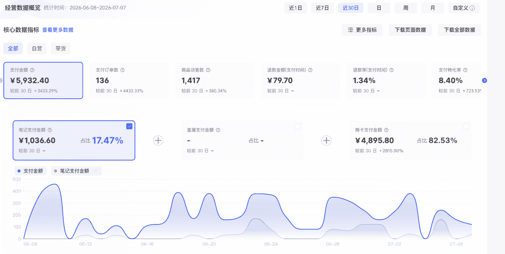

店铺从最初只有1 个产品，发展到现在的6 个产品。

营收不多，但对我来说，有自己的产品，有自己的用户，有每天固定要做的动作，有了一条能持续往前走的路径。

更重要的是，我初步跑通了从用户反馈到产品设计、从内容生产到成交转化、再到产品迭代的完整闭环。

这篇文章，是我从总行到自由职业这一年多的完整复盘。

写给还在职场里蓄力的人，写给正在试探副业但还没下定决心的人，也写给已经出来、但还在找方向的你。

## 01 在总行时，我不算是标准的“职场牛马”

在总行的时候，只有关系比较近的几个人知道，我其实不是一个传统意义上“安分上班”的人。

表面上我和所有人一样。开会，写报告，推流程，应付跨部门扯皮。

该加班加班，该出差出差，朋友圈偶尔发发部门的宣传。

但我心里很清楚，我不会在这里待一辈子。

不是银行不好，银行对很多人来说是一份体面、稳定、有上升通道的好工作，只是我想要的不是这个。

我对往上爬没有执念，对职级和头衔也提不起真正的热情。

在一个你能清晰看见自己未来10 到15 年样子的轨道上，我感到的不是安全感，是窒息。

那几年我一直是分裂的。

白天扮演一个合格的银行职员，晚上和周末在自己感兴趣的事上折腾。

直到24 年，工作的第五年，我的30 岁，我觉得时候差不多到了，要做出决定了。

第一站我就在生财开始尝试一些副业项目。

起初急于求成，每次航海至少报名两个项目，加上同时期也在外面学短视频IP 操盘手的课程，精力也被分散不少。

结果几乎没有真正参与进去几个项目，所有航海都以机械式打卡拿回保证金为目标草草收尾。

但那段时间有一个收获：我开始对“选项目”这件事有了模糊的直觉，有些事你做的时候浑身是劲，有些事你做着做着就开始找借口拖延。

这个直觉后来也成了我很重要的判断依据（后面会讲）。

## 02 退公司群那天，我的心情很平静

25 年初，我正式和公司提出了离职，平静的退了上百个群。

在这之前，我已经为这个决定做了很长时间的准备。

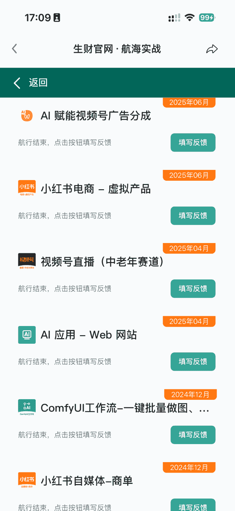

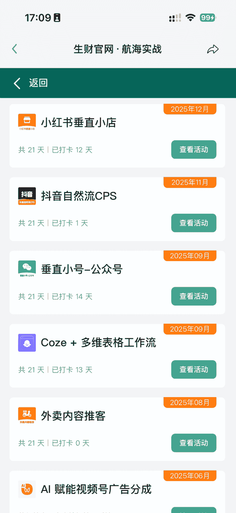

物质上，我确保自己不会饿死。

工作5 年也攒了一些积蓄，我知道自己出了职场不会立刻有生存问题。

技能上，我去学了短视频IP 操盘手。

从公司离开之后可以直接衔接上这份工作，完成从职场人到自由职业者中间最脆弱的过渡期。

心理上，我其实早就在等这一天了。

提离职那天，约了部门负责人单聊。在会议室里说完，回去就直接推进流程。

没有在群里发长篇大论的告别信，没有感谢这个感谢那个的客套话，直接退群。

真正的离开不需要太多解释，想走的人从来不会大声嚷嚷。

周围人的反应很有意思。

很多人以为我要跳槽，或者是发大财了。没有人猜到我是要去做自由职业。

他们既不了解这个行业，也不了解我。

在他们眼里，我就是那个安安静静、按部就班的同事，怎么可能突然裸辞？

但其实我一点也不冲动。

离职对我来说不是一次逃离，而是一个准备了很久的节点终于到了。

不是“我受不了了我要走”，而是“我已经准备好了，现在该走了”。

我当时的心情不是兴奋、不是焦虑、不是如释重负，而是平静。非常平静。

那种感觉就像你为一场考试准备了很久，走进考场的那一刻反而没有任何情绪波动。

因为该做的都做了，接下来只是把该做的事情做完。

大不了过几年混不下去再回职场嘛，我对自己这样说。

## 03 我慢慢发现，选项目，是在选一种活法

从总行出来之后，我的第一站是短视频IP 操盘手。

起初进展还算顺利。半年内先后做了几个项目，全网跑了千万流量，赛道涉及青少年教育、实体加盟、银行培训、身心灵疗愈等等。到了后期，作为运营负责人已经开始带小团队做内容了，一切都发展得很快。

但我又一次主动停下了。不是做不下去，是我不想做了。

我对替别人做账号这件事没有热情，也不想带什么团队。我做这些只有一个目的，完成从职场到自由的过渡。

目的达到了，就该往下一个阶段走了。我想要做的是超级个体，不是另一个版本的打工人。

这是我在自由职业路上形成的第一个重要判断：

一个项目好不好，不取决于它的天花板有多高、赛道有多大，而取决于它跟你当下的状态是否匹配。刚离开职场的时候，我需要的是“有事做、有收入、不麻爪”，做IP 操盘手这件事满足了这三个需求。

所以虽然我对它没有热情，我仍然全力去做，因为那个阶段我需要它。

接下来我进入了在生财的高密度探索期。

AI 视频、抖音自然流CPS、小红书实物电商、视频号带货、小红书虚拟电商…… 有的拿到了不错的结果，有的浅尝辄止。

抖音自然流**CPS** 项目【双十一期间】

做了多个千粉视频号

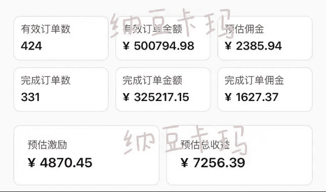

做了**2** 个月的家居帐号【已暂停运营】

第一家小红书店铺【部分拍摄素材】

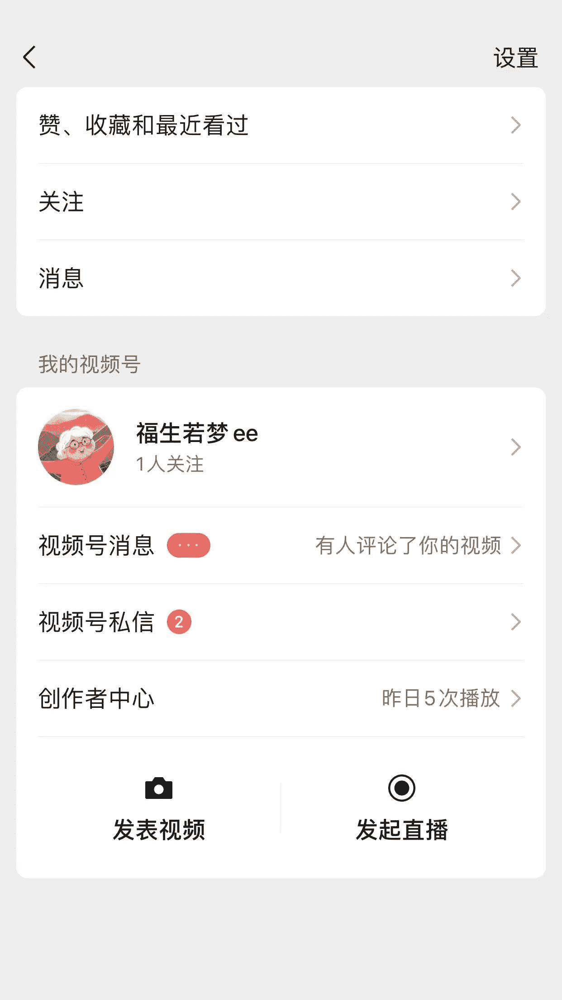

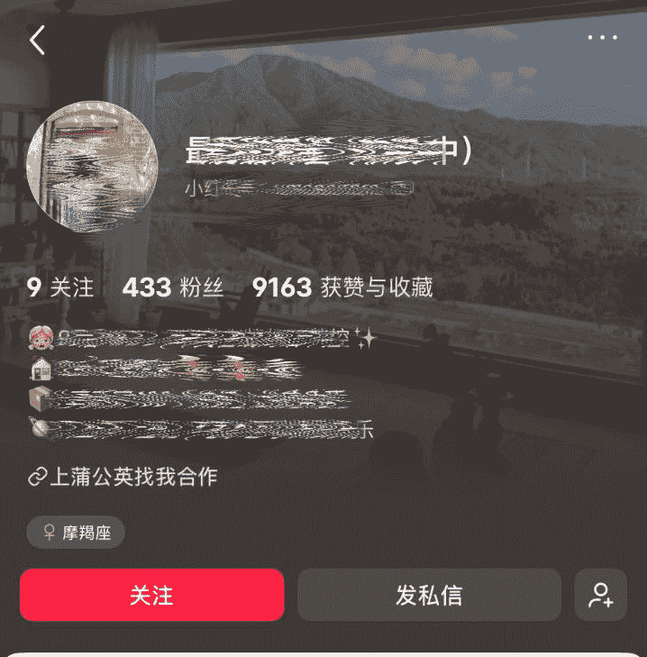

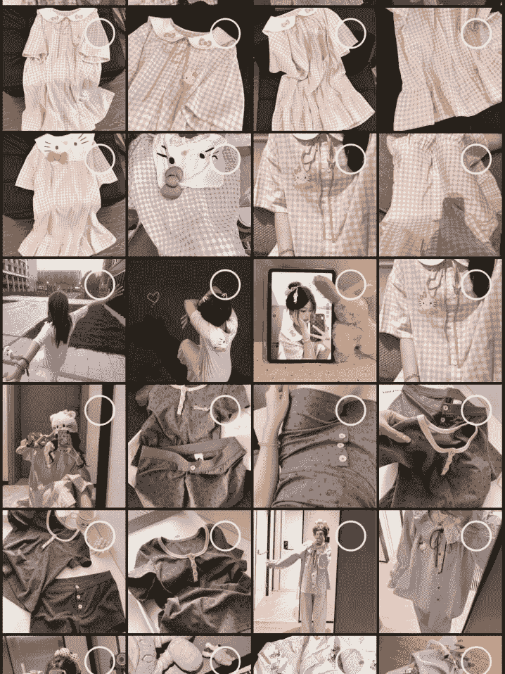

其中，抖音自然流CPS 是我拿到数据最好的一个项目。

后来项目结束我发了篇复盘在生财被标了精华帖，不少圈友也是通过那篇帖子认识我的。

回头看，入局这个项目的时间点很有意思。

当时我手上的小红书电商一直没什么起色，正发愁要不要趁双十一之前换个品类。

这时候看到怡然教练发了一篇招募帖，我仔细评估了一下，觉得这个项目恰好和我之前做操盘手的技能栈高度重合。

加上它是个短平快的项目，做好了说不定能在小红书电商的低谷期给我一个心力上的支撑。

于是就报名了。

结果就是：16 天航海周期，运营3 个抖音账号，发布81 条视频，出了3 条破万爆款，累计GMV 突破50 万。

关于这个项目的完整复盘，我都写在去年的精华帖里了，这里不再展开。

但CPS 项目结束后，我没有继续深耕。

不是因为项目不好。恰恰相反，CPS 的数据和反馈都超出了我的预期，在我当时小红书电商不温不火的状态下，它也成了很好的心力支撑。

但做完之后我重新思考了一件事：如果抛开单纯的盈利目的，我到底喜不喜欢这个项目本身？答案是，兴趣不大。

更关键的是，这个项目如果想做大，就要走矩阵路线，起多个号、批量生产内容、团队化运营。

那也不是我想走的路。

我想做的是个人IP，是内容表达，是一个人能把自己品牌和信任积累下来的事情。

而CPS 考验的是执行力和信息差，每一条视频的生命周期很短，你今天爆了明天可能又归零。

权衡之下，我还是想回到自己更擅长、也更愿意长期投入的方向上去。

双十一结束后，我就没有再继续了。

到了年底，赶上搬家和过年，我也没怎么推进项目，只是零零散散做了一些尝试，摸索过小程序，也看了不少方向，但没有哪一个真正启动起来。

这时候我逐渐意识到：

选项目，本质上是在选一种生活方式。有些来钱快但节奏我hold 不住；有些有积累效应但前期反馈太慢；有些需要大量和陌生人高频沟通，对我来说是一种消耗。

没有所谓的好项目和坏项目。每个人在不同阶段的心力水平和最重要的目标都不同，一个项目能匹配你当下的需求，就是好项目。判断不是坐在电脑前想出来的，是身体力行做出来的。

时间来到今年年初，我在线下参加完条形马老师的年度复盘活动回来之后，反反复复和 AI 沟通了很多轮。

大到人生愿景，小到日常生活。最后总算梳理清楚了一些方向。

我决定正式启动小红书个人**IP**+虚拟电商项目。

## 04 从两单到一百单：没有人看见的时候，我在做什么

AI 时代，表达即存在。

Learn in public, build in Public。

这两句话对我做虚拟电商的影响很大。

过去我也常常有一些碎片化的想法想要记录和表达，但觉得它们还不够完整，不值得写。

但有了AI 的辅助以后，表达的门槛降低了，只要我愿意把真实的观点和经历拿出来，AI 就可以帮我梳理和完善。

我经常会看到一些人公开记录自己学习、转型的完整过程。

那种状态很打动我：一个人在做自己真正喜欢的事情时，会自然而然产生很强的表达欲和行动力。

所以4 月我正式开始做虚拟产品。

第一个月的结果并不好。当时我结合自己的实际情况，做了一个帮助银行人职场破局和转型的知识库。

每天更新内容，尝试视频、图文等不同形式，一个月涨了四五百粉，但产品只卖出了两单。

如果只看结果，那个月不算成功。

但持续输出让我获得了一个关键信息：我原本以为账号吸引来的会是“想转型的人”，实际后台来找我交流的用户中，想入行、正在求职、或者处在职场前期的人反而更多。

这个发现改变了我的运营思路。

以前我的产品定位是从“我想讲什么”出发的，我想讲转型，因为我自己经历了转型。

但真实用户告诉我的是另一回事：对工作多年、想彻底转型的人来说，改变的成本太高，决策周期很长；但对正在求职、想入行、或者刚进入职场寻求成长的人来说，我过去的职场经历正好可以直接帮到他们。

所以到了5 月，我的产品定位发生了根本性的转换：不再只盯着“职场转型”这一个场景，而是去思考同一类用户，求职者、职场新人、想转型的人，在不同的阶段分别需要什么。

同时，根据AI 大航海以及一些付费学习，我也搭建了一套高效的内容生产AI 工作流。

下面展开讲讲这部分。

知识库我选择的是** Obsidian**。在用 Obsidian 之前，我用过印象笔记、石墨、飞书，在不同地方沉淀了很多过往的学习记录和知识资产。

但 Obsidian 有两点让我最终选了它：

- 第一，本地知识库，所有东西都存本地文件夹，感觉很安全可控，打开就写，没有任何摩擦；
- 第二，可以安装Claudian 插件，联动AI 大模型，直接在编辑器里和 GPT、Claude 等大模型交互。

等于给知识库装了一个 AI 操作入口。

**AI** 帮我做两件事：**架构** + **内容**。架构层面，我让 AI 帮我设计知识库的层级结构，这不是一次性的，而是随着业务发展不断迭代的。

内容层面，AI 主要帮我做三件事：

1. 采集业务素材：采集大量优质职场赛道对标内容，AI 帮我整理、分类、拆解它们的结构和表达模型。
2. 沉淀个人资产：把过去写的公众号文章、日记、项目复盘全部放进知识库，AI 帮我建立索引和关联，让旧内容能随时被调取复用。
3. 生产匹配个人 IP 属性的内容：结合对标素材和我自己的实际业务情况，进行内容生产。

内容生产工作台：四步循环。

第一步，仿写与输入。

把优质对标内容喂给 AI，同时告诉它我的业务和语言风格，先参考对标的框架、结构和内容模型进行仿写。

目标不是“抄”，是通过模仿找到适合自己的表达方式。

第二步，数据沉淀。

发布之后不是不管了，每周我会把发布数据和店铺经营数据一起回灌给知识库，指导下一周的内容策略。

第三步，迭代与裂变。

自己写出来的爆款内容是最宝贵的底层原料，每周我会用 AI 分析爆款内容的特征，然后基于这些内容模型裂变出新的选题方向。一篇爆款可以裂变出多个选题，每个选题可以做独立测试。

第四步，用户反馈驱动产品决策。

后台来了用户咨询，我会把这个信息沉淀进知识库，并且标注用户画像、问题类型和当前职业阶段和状态。

当类似咨询积累到一定数量，触发判断：这个需求是否大到足够支撑一个新产品？

如果答案是肯定的，就用 Skill 快速布局产品，先上架、再根据真实反馈迭代。

反过来，如果产品上架后持续没有自然咨询和购买，就快速调整或直接下线，把精力腾出来。

让知识库持续进化的两个引擎。

第一个引擎是复制自己的爆款并裂变，这是基本盘，保证内容质量和转化效率的稳定性。

第二个引擎是日常采集小红书平台正在爆的跨行业母题，这是增量盘。

我不只看职场赛道的内容，其他行业正在跑出来的爆款选题，底层的爆款逻辑往往也是通用的。

把这些跨行业母题采集进来，用自己的行业视角重新表达和测试，这个思路也给我贡献了不少爆款内容。

两个引擎同时运转，知识库才不会枯竭。

只盯着过去的内容资产会坐吃山空，只盯着别人的爆款又会迷失方向。

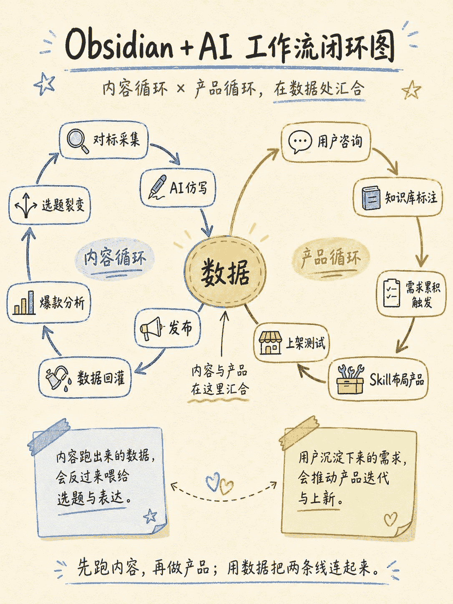

两者结合，才能持续产出“有我个人印记、同时也被市场需要”的内容。

这套工作流保证了我的选题灵感源源不断，也是我能坚持日更的底层支撑。

产品方向做了调整之后，新产品上架后很快就出了第一单，客单价99 元。

那一刻我开始确认，这个方向确实有需求。

紧接着，根据后台客户的真实反馈，我又连续上了多个品，围绕同一类人群。

店铺从只有1 个产品到现在的6 个，可以说每一步都不是我主动规划出来的，而是在和用户的互动中一点点长出来的。

转化也是自然而然产生的。

我得出的核心判断是：虚拟产品不是先在电脑前憋出一套完美的资料，再去寻找愿意购买的人；而是先进入真实用户的问题里，用反馈反推需求，再逐步形成产品矩阵。

产品需要不断迭代，但在真正有需求的产品长出来之前，你得先在场。

所以和产品迭代同步发生的，还有一个很重要的前提：保持日更。😂 我给自己定了一条规矩：保持日更，并且绝对不能用“水内容”完成任务。

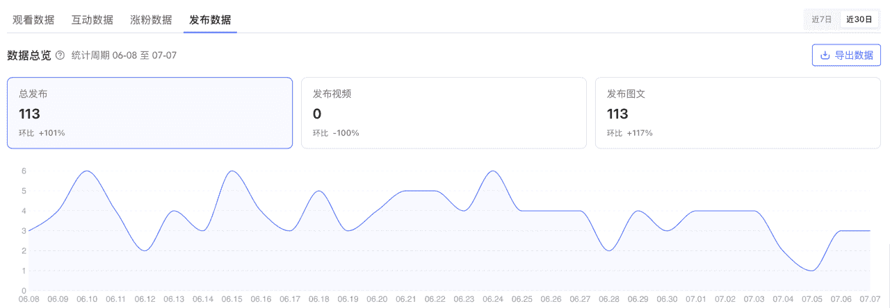

定这条规矩的时候，我信心其实不强。那时店里只有一个转型产品，转化很差，4 月就卖了两单。

纯看数据，没有任何理由说服自己“这件事值得每天投入”。

但我当时的想法很简单：既然决定要做，就先把必要动作固定下来，不再每天依靠情绪决定更不更新。

情绪是靠不住的，今天心情好就发，明天心情不好就不发，这种节奏不可能做成任何事。

日更这件事在当时看起来挺傻的。

每天跟自己的账号较劲，发出去的内容在销售数据上毫无体现。

但日更逼我面对一个无法逃避的问题：今天发啥、给谁看、拿什么产品去承接。

这个问题不会因为我不更新就消失，只会因为我回避而推迟。

推迟久了，这个店铺就会变成又一个“试过但放弃了”的项目。

我不想让它变成那样，我在小红书虚拟上已经放弃过一次了，这次不想再放弃。

更重要的是，做自己想表达的内容，输出的阻力并不大。

我一直在这个帐号写的内容，就是我的真实经历、职场感悟、求职方法论。

这些素材就在我自己身上，取之不尽。发内容不是为了坚持，是真的有话想说。

当选题库里装的都是自己走过的路、做过的决策、踩过的坑，你就不需要每天绞尽脑汁“今天编点什么”，只需要诚实地把自己经历过的东西讲出来。这种表达没有任何表演成分。

另外，这几个月里，我还有一条更深层的信念在托底：不要给自己留退路。

“大不了回去上班”这句话，到了第二年，我刻意不让自己再说了。

不是怕回不去。

正是因为我太清楚自己的性格了：一旦心里有一个舒适的退路，当遇到困难和挫折时，那个退路就会变成巨大的诱惑，让你很难在一件事上使出全部的力气。

人如果有太多选择，在每一个选择上往往都无法全力以赴。因为你觉得完不成也没关系，反正还有plan B。

这种心理上的“安全出口”，表面上保护了你，实际上在不断稀释你的专注力。

所以我告诉自己：不再一遇到暂时没有结果就把“放弃”当成备选方案。先把每天该做的动作做完，持续表达、持续出摊、持续验证，把能用的工具全部用起来。然后告诉自己，我一定要把这件事做成。

## 05 我选项目的决策框架

如果你现在问我：纳豆，你怎么判断一个项目值不值得做？看赛道前景？当前热度？

公众号懒人搜索，懒人专属群分享

市场规模？毛利高低？

我想说，这些都重要，但不是第一位的。

我可以用经典的“三圈理论”来总结我是如何找到现在的项目：

回归到初心，我从职场出来，为的不是找一份"更赚钱的工作"，为的是拥有直接面对市场赚钱的能力。能自己安排时间，做自己想做的事。在这个大前提下，我还需要兼具考虑商业变现和项目的长期性。

所以我一直在做一件事：我希望找到这样一个项目，能让我在做的过程中无限趋近理想的生活状态。

具体来说，我会经过五层判断：

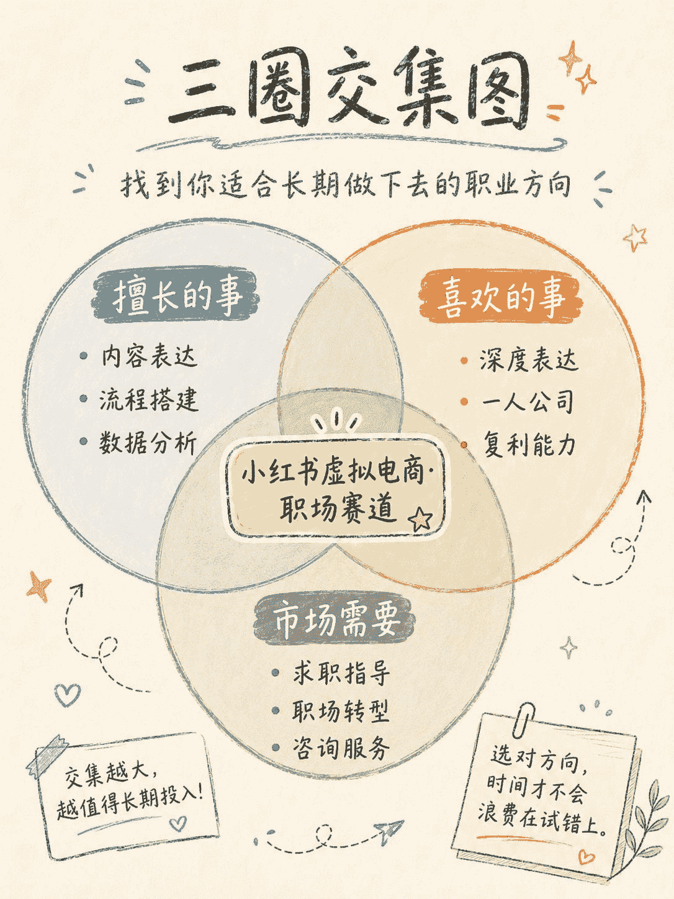

## 第一层：回归初心

这个项目让我离**“想要的生活”**更近吗？对我来说这是最根本的问题。抖音CPS的数据很漂亮，但做大了必须走矩阵路线，那条路不是我想要的。

我想要的是个人IP、深度表达、一个人能把品牌和信任积累下来的事，所以数据再好我也选择停下来了。

反过来，小红书虚拟电商前期只卖了两单，但这件事的方向是对的：有复利效应，能让我和用户建立真实的连接。

## 第二层：技能匹配

这个项目需要的能力，我具备吗？抖音CPS需要的能力栈和我之前在短视频IP操盘手阶段的积累高度重合，所以我能快速拿到结果。

小红书虚拟需要的内容表达和用户洞察，不是我最开始就擅长的，但它们是我“愿意去积累”的方向。

## 第三层：状态匹配

做的时候是浑身是劲，还是在找借口拖延？

这个标准很朴素，但非常准。我现在做内容、写文章，不需要逼自己。但想到要管供应链、搞售后，我就开始拖延。身体不会说谎。

## 第四层：阶段匹配

当下我最需要的是什么？

刚离开职场需要“有事做、有收入、不慌”，IP操盘手当时当刻可以满足。

稳定之后，我需要的是“有积累”、“可持续”和“有表达欲”，所以现在选择切到了虚拟电商。

## 第五层：风险可控

最坏的结果我能承受吗？

每个项目开始前我心里都有一条止损线。我所尝试的互联网项目，没有哪个能让我亏到伤筋动骨，因为成本可控、有边界。超出我承受范围的项目我不会碰。

总结一句话：适合你的项目，不一定是最赚钱的，但一定是你能够做得最久的。

## 06 自由职业的一些感悟

自由职业最核心的能力，我觉得不是某一项技能，而是一个人能拥有持续解决问题的能力。

如果你是一人公司，引流、成交、交付这三件事你至少都得懂。

引流是怎么让人找到你，成交是怎么让人信任你、付钱给你，交付是怎么把产品和服务给到位。

哪一个环节不在线，整个业务就转不起来。往深了做，你会发现只懂这三个还远远不够，你想放大就得懂团队管理和财务分配，业务卡住了得有智囊团和合作方。从单点突破到六边形战士，是你必须走的路。

但光有能力还不够。自由职业真正考验的，是你怎么管理自己的状态。

以下是我这一年多摸索出来的几点感悟，与君共勉：

**1、主动过滤掉一切抓你注意力的东西。**

娱乐八卦、热点新闻、短视频瀑布流，这些东西不只是浪费时间，它们会把你的情绪带走。

情绪一旦被牵着走，状态就会不知不觉变差。自由职业没有老板盯着你，但算法会想办法套牢你。

**2、早睡早起，每天保证运动量。**

有时候一整天不出门，精力过剩，晚上就睡不着。

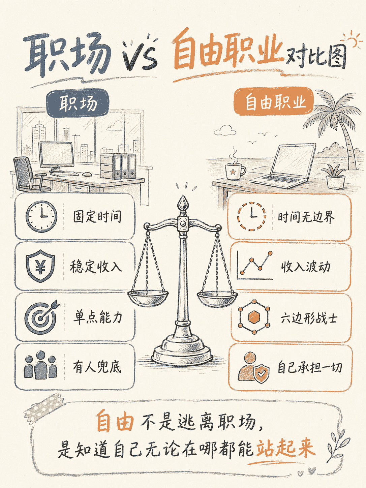

我的办法是：如果没有出门计划，就跳操半小时到一小时，把身体里的能量消耗掉。

精力管理不能纯靠意志力，是靠物理手段。

**3、报至少一个兴趣班，维持基本社交。**

太长时间没有说话、没有和真人互动，状态会低迷而不自知。

画画、跳舞、芭蕾、健身房都可以，尽量选能和别人有交流的。

既学到了东西，也接触了人气。每月至少去一个想去的餐厅，约个朋友，出去逛逛商场、沾沾烟火气。

**4、维持秩序感。**

自由职业的“自由”如果没有任何边界，很快就会滑向混乱。

我每天花十分钟整理房间，逼自己每周至少做几餐饭，保持3-4天的运动频率。

刻意增加自己在“日常生活”上的时间比例，避免整日端坐在电脑前。

**5、给自己列月计划和日计划。**

月计划是让自己不忘记重要的事，日计划是把每天要做的事记好、做完就可以划掉。

每周也给自己放两天假，该休息休息，不休息反而效率更低。

**6、给每一个要做的事建立SOP。**

怎么做封面图，怎么处理客户咨询，怎么快速上架一个产品，全部SOP化。

上班的时候一天好几个小时不管效率多低都得坐在那，领导只关心结果但过程没人教你。

现在不一样了，每一件你要日常去做的工作，都值得SOP化，把你的时间解放出来。

**7、不要求结果，只抠过程。**

不给自己设定“这个月要赚多少钱”的目标，先规划好自己的时间，哪些时段做哪些事。

就像想要客户下单，关键不是催他下单，而是解决他所有的顾虑和后顾之忧。

带着“解决一切问题”的心态去做事，结果会自己来。

**8、秉持没有回头路、自由职业一定成功的信念。**

现在想想，上班的时候之所以什么任务都能接住，全靠硬着头皮去做，毕竟老板等着要结果呢。

自由职业也一样，相信自己不是办不到，是想办到就一定可以办到。

也不要因为怕走弯路就不出发，走起来了你会发现，四面八方都是前方。

讲到底，自由职业的自由，不在于你在哪里办公，而在于你能不能选择做什么。

如果为了“做自由职业”而选了一个自己根本不喜欢的方向，每天靠意志力硬撑，那和在职场里熬有什么区别？

区别仅仅是收入更不稳定、心里更没底。我认为那不是自由，那是一种更累的打工。

所以大家现在去选项目，我觉得核心标准不是赛道天花板多高、品类毛利多少，而是更简单也更诚实的问题：

做这件事的时候，我的状态好吗？我愿意每天为它花三四个小时吗？它让我觉得自己在变成更好的人吗？

如果答案都是肯定的，其他的事就交给时间和执行力。

选项目就是选活法。

自由不是逃离职场，是你知道无论在哪、无论发生什么，你都能靠自己独立面对一个又一个困境，持续去解决问题。

回看这一年多，我觉得我最大的贵人，其实是我自己。

是那个在工作最忙的两年里也没有忘记心里那颗自由的种子的人，是那个愿意不断付费学习、是那个项目推翻又重启、方向换了又校准、但始终没有停止问“我到底想做什么”的人。

如果你也在职场里犹豫，也在自由职业的路上跌跌撞撞，先做自己，再在持续表达中吸引同频的人。

还有，别给自己留退路。

最差的结果不就是再回去打工吗？但万一，你不用回去了呢。

————分割线————

看完这篇SOP，你觉得你懂了。但90%的人一到实操就会卡在第一步。

工具和教程只是最低级的壁垒，真正的壁垒是“立刻动手”和“圈层信息差”。

如果你想看全网最新的变现玩法，并且和一群执行力极强的极客一起下场拿结果，欢迎围观我的核心私域：【懒人专属群】。

我们不聊虚的，只做商业闭环的拆解与AI效率的压榨。系统内已沉淀1000+跑通的套利实战局。

😂 查阅圈子完整数字资产与上车门槛：

https://lazyso.com/insider/

认同价值、准备好下场干活的，扫码加我微信（lazyhelper1）

备注：【实操上车】，不闲聊

