# 公众号垂直小号，起号**45** 天营收六位数｜新规之下，高客单老板如何布局微信获客？

260702 副业SC 精华

整理：公众号懒人搜索，懒人专属群精选

懒人微信：lazyhelper1

先说一下，这篇内容是专门写给做中高客单、靠后端变现获客的老板看的。如果是想赚腾讯流量主广告费，这篇的帮助可能没有那么​​大。

本帖比较适合手上有一个至少四位数客单价的产品，有能交付的服务能力，想通过公众号拿到精准客资，直接在后端成交的人群。

## 一、公众号正在洗牌：谁出局，谁吃红利

亦仁老大之前分享过一个判断：垂直小号深耕下去，机遇非常大。

我们公司做公众号代运营四年了，产出过非常多的爆款，对微信生态的文字传播和获客算是比较熟悉。看到老大这个判断后，第一时间就起了个新号亲自下场验证，目前已经跑通了——纯新号，不做人设，没有投流，45 天营收六位数。

正好把这次的实操经验分享给大家。如果你手上也有高客单产品，正在找更稳定、更精准的获客方式，可以借鉴一下。

这是我们公司自己跑出来的经验，不同行业、不同账号情况不一样，大家具体实操还是要结合自身去调整，希望能给大家一些参考和启发。

### 1.1 三类人正在被清退出场

5·13 新规之后，一人一号实名认证，不能绑管理员，注销了身份证还有可能被标记，重新注册一点流量都没有，群控买号这条路基本走不通了。而且平台现在查起来不是查一篇，是直接批量判定，一次列出七八篇违规导流，整个号就废了。

现在平台审的不是你用没用AI，审的是内容质量是不是达标。质量不行就直接归为垃圾，浏览量是个零。以前觉得发的多总有人能看到，现在这个逻辑不成立了——平台可以让你的内容一个人都触达不到。

不少老板这两年应该都经历过或者听说过：找了短视频IP 团队做代运营，一个月六位数的服务费，实际执行的可能是一个刚毕业的小孩，一条剪辑收一两千，最后效果很不理想。

这三类人逐步退场之后，空出来的机会给了谁？

### 1.2 真正的机遇在哪

1. 有高客单产品 + 有专业内容能力的老板。

不需要大流量，不需要成为网红，甚至不需要做任何人设。后面我会把我们自己的号拿出来做案例——大家看了会发现，你甚至看不出来这是一个盈利的账号，没有任何IP 人设包装，阅读量也不算高。但45 天，做到了六位数的营收。

这不是个例。

我们之前合作过一个做企业投融资赛道的客户，他们那个公众号也是一样的情况——没有任何人设，平均文章阅读量不超过5000。但就是这么一个看起来平平无奇的号，支撑了他们公司千万级的营收，90%以上的客户、包括资方，几乎全部来自这一个公众号。

不需要成为大V，垂直小号靠专业内容、靠精准获客，就能把后端的生意撑起来。

2. 懂平台规则 + 懂商业内容逻辑的操盘手。

现在AI 相当于是无限的战士，都可以涌向战场。但往哪个方向打、什么时候进攻什么时候收、平台的合规边界在哪里、选题方向对不对、客资转化路径是否最优、客资质量如何提高——这些决策是AI 做不了的。将军比战士重要，战士可以无限复制，将军的判断力没法复制。

这两类人的结合，是公众号接下来最大的红利所在。

无论是已经在做公众号但踩了坑的老板，还是在观望想要入局的老板，后面都会分别聊到这两种情况该怎么应对。

在那之前，先把我们自己这个号的完整经历分享出来——怎么起的号，整体经历了什么样的过程，哪几篇内容带来了什么样的客户，最后账号又是为什么被封禁的，都会真实地呈现给大家看。

不过这个六位数的营收，需要先交代一下背景，因为它赚得并不轻松。

## 二、哪些老板适合通过公众号做高客单获客

在展开具体的实操之前，先聊一下什么样的老板适合走这条路。因为公众号做高客单获客，确实不是所有行业、所有阶段都适合。

### 2.1 几个基本前提

1. 首先，你的产品客单价至少是四位数。

如果手上只有一个低客单的单品，说实话公众号不是一个好的选择。公众号获客的特点是量不大但极精准、转化链路短、客资质量高——这些优势只有在客单价足够高的时候，投入产出比才算得过来。

2. 其次，你已经有可以验证的产品和交付能力。

不是说“我想做这个事但还没想好产品是什么”，要确保已经有了成熟的服务流程、有过成功的交付案例。高客单老板在公众号上看完你的内容之后，他会审视你整个账号的专业度，然后才决定要不要联系你。如果他来了，你接不住，那前面所有的内容投入都白费了。

3. 第三，你的客户群体是25 岁以上的决策型用户。

如果你的主要受众是18 到25 岁，对比抖音和小红书，公众号不是一个特别好的渠道，这个年龄段的用户行为习惯跟公众号的生态不太匹配。

### 2.2 比较适合的行业方向

从我们自己做以及服务客户的经验来看，这些赛道的老板在公众号做高客单获客的适配度比较高：地产、留学、移民、国学、健康、家庭教育、律师、高端家装、企业咨询、品牌策划，类似这些方向。

共性是什么？客单价高、决策周期长，客户需要先建立信任再成交，老板本人或者团队有专业积累可以输出内容。还有一个共性——这些行业的老板大多不想长期依赖直播或者投流，希望能有一个稳定的、长期的获客渠道。公众号恰好就是这个定位：它不像直播那样需要你持续出镜，也不像投流那样一停就没有量，它的长尾效应很强，一篇好的内容可以持续几周甚至几个月带来客资。

如果以上这些情况跟你的业务比较吻合，那后面的内容会比较有参考价值。

## 三、我们这个号的完整经历

这个号是今年四月中旬起的，专门做B 端获客。到六月初因为违规导流被封禁，前后大概45 天，期间产生了六位数的营收。但这个数字背后有几个前提条件，少了任何一个，这个结果都复制不了。

### 3.1 六位数营收的三个前提

1. 第一，内容投入。

这个号的内容是我本人亲自在做的。到目前为止，文章的选题构思、框架搭建，基本上30 分钟起步，有些甚至更长。公众号做高客单获客，内容就是你的门面——这个东西没有捷径，花了多少时间，出来的质量就是不一样。

2. 第二，销售投入。

这个号前期基本上所有成交客户都是我本人在做一对一销售。每个高客单客户的跟进时间不会少于2 个小时——要打电话、要出方案、要开腾讯会议共享屏幕，直接给对方看我们服务过的客户的后台数据。代运营客户还需要另外出一个几千块的定制方案和几篇样稿，这个销售环节非常耗时间，一点都不轻松。

3. 第三，足够多且足够新的服务案例。

我们公司做公众号代运营四年了，在地产、家庭教育、健康等赛道都有落地的案例。单个客户的运营数据，服务一个季度流量增长十倍的达标率在90%左右。这些案例是成交的底气——客户已经不会为一些名头买单了，他要看的是你有没有实打实的交付成绩。

所以这个六位数营收的背后，是内容上的持续投入、每个客户几个小时的深度销售、加上四年积累下来的案例背书。不是刷了一篇文章，加了微信，客户就直接付费了。客资进来后如何精准销售也是闭环的重要一步。

以下是我们账号运营期间的一个成交客户。

交代完背景，来看这个号具体是怎么一步步做起来的。

### 3.2 冷启动期（4/23—5/9，大约两周）：没有什么水花

4 月23 号发了第一篇，之后基本保持日更的节奏。这段时间的阅读量，大家看截图就知道了——十几、二十几、三四十，最高也就五十几。点赞转发基本上都是零或者个位数。

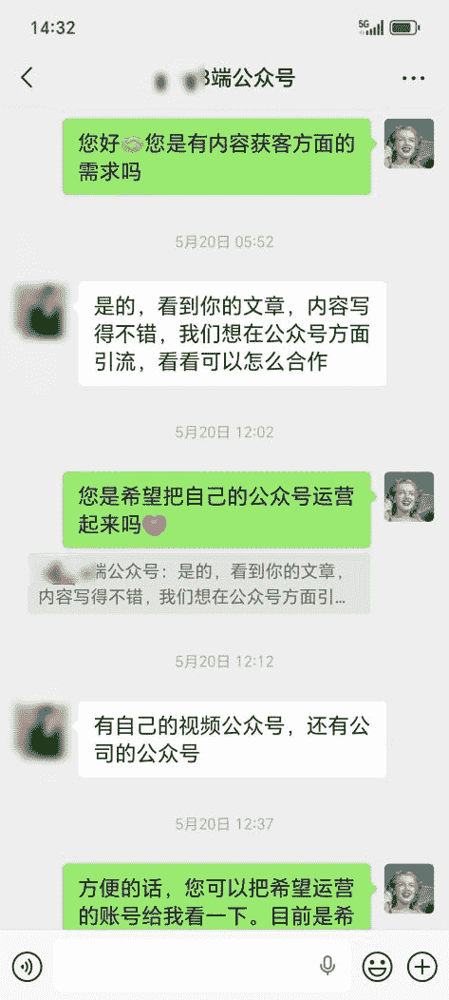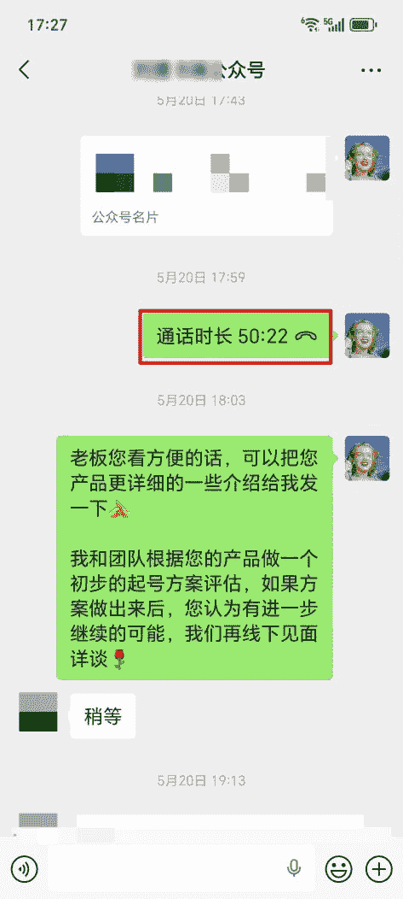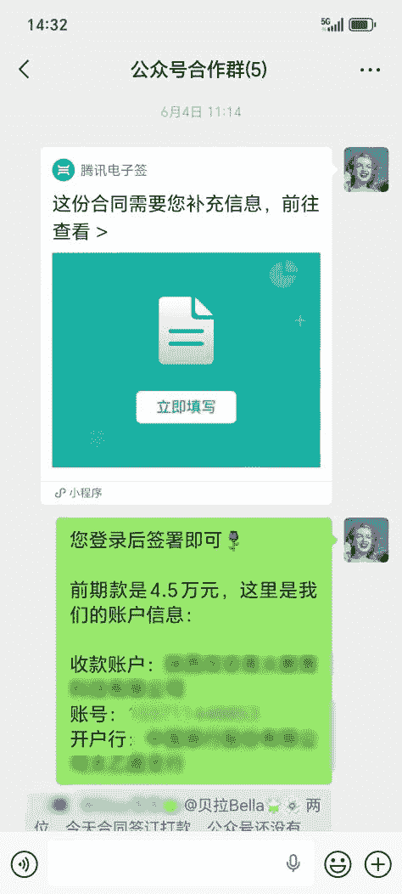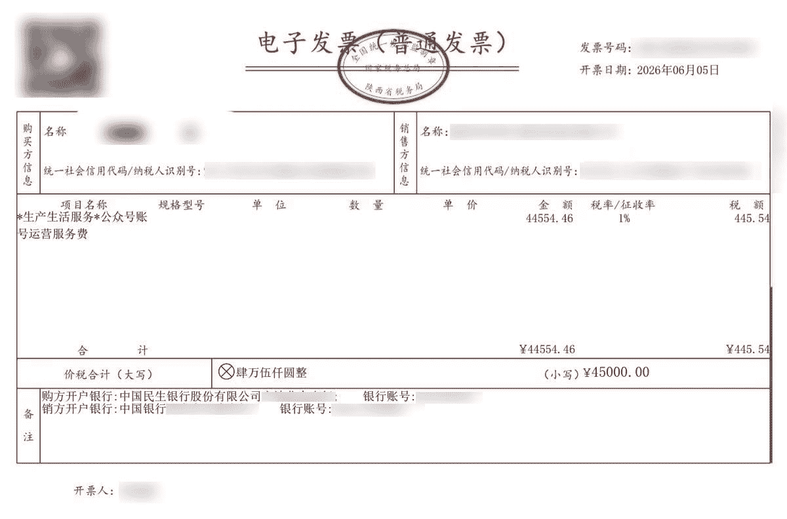

说实话，如果只看数据，这两周是很容易让人焦虑的。

但做高客单的号，冷启动期的核心任务不是拿流量。真正重要的事情是：铺内容。

为什么？因为高客单的老板在决定要不要联系你之前，他一定会先把你的账号翻一遍。他要看你发过什么内容、你的专业判断力怎么样、你对这个行业的理解是不是到位。如果他翻了一圈发现你只有两三篇文章，不管写得多好，他大概率不会采取行动。

至少要有十篇以上有质量的专业内容，老板审视了一遍觉得“这个人确实懂”，才会加你。

所以这两周看起来没有水花，但其实是在给后面的成交做铺垫。

### 3.3 第一次破圈（5/10—5/12，第三周）：流量来了

5 月11 号，蹭了一个OPPO 的热点，出了一篇大爆款，阅读量直接到了1.4 万。

这一篇带来了一些咨询——主要是19800 客单的顾问式咨询产品的潜在客户。但大客户（代运营方向的）还没有进来。这也正常，代运营的客单价更高、决策更重，客户还需要更多的内容来判断。

紧接着5 月12 号，写了一篇拆解情感咨询赛道的内容——“靠情感咨询年入1.5 亿”，阅读量9567，转发960。

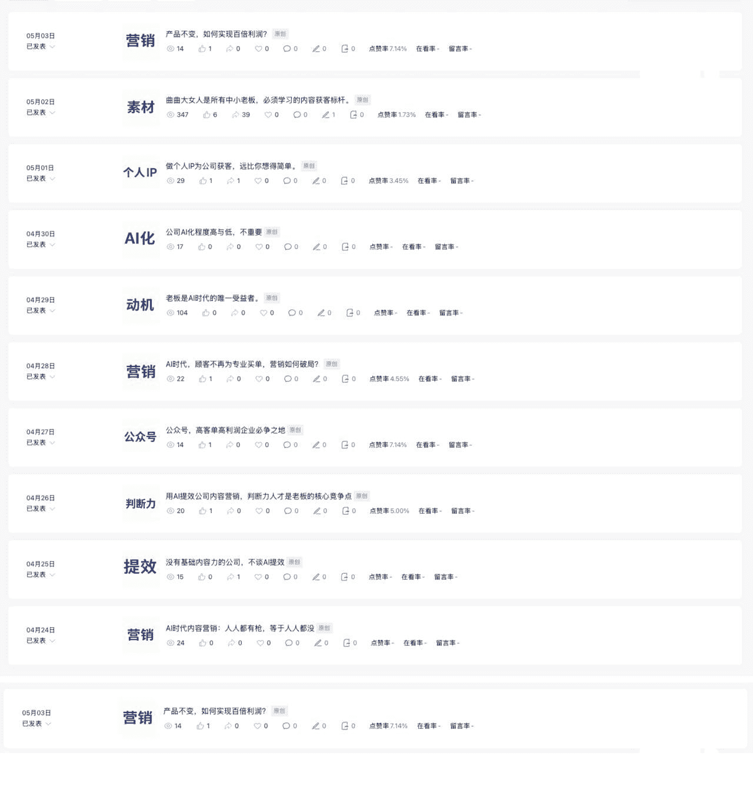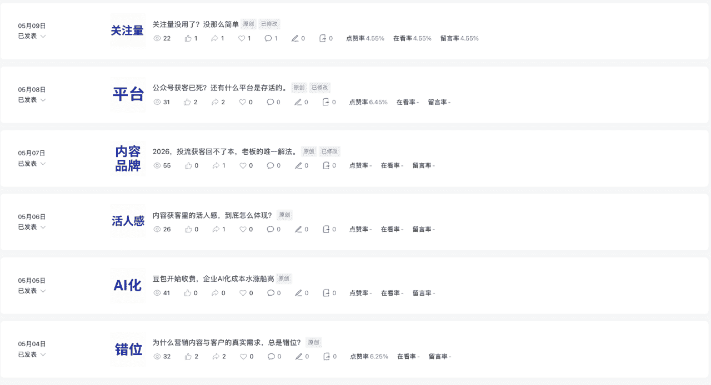

转发960 是什么概念？这个数字在公众号相当于收藏，因为大部分人转发其实是给自己看的。而且这篇纯自然流量，没有花一分钱流量券去推流，也没有做任何宣传。

这篇文章最终帮我们成交了两个季度咨询客户。

讲到这里要分享一个很有意思的观察：做高客单的公众号，转发和收藏的价值其实远大于点赞。因为老板这个群体有一个特点——他们一般不太点赞。他们会做的动作通常就两个：觉得你这篇文章有点意思，转发到公司群里让团队学习一下；或者看完直接加你微信聊。

如果一个老板在思考要不要跟你进一步合作，他会先默默关注你一段时间，看你后续的内容。所以做高客单的号，不要太在意点赞数据，转发和收藏才是真正的信号。

### 3.4 高客单成交开始（5/16 起）：客资质量极高

到了5 月16 号，发了一篇“平均阅读量2000+的公众号，一年营收千万”——这篇阅读量不算特别高，两千多，但成交了我们第一个代运营客户。后来这篇文章一共带来了两个代运营客户。

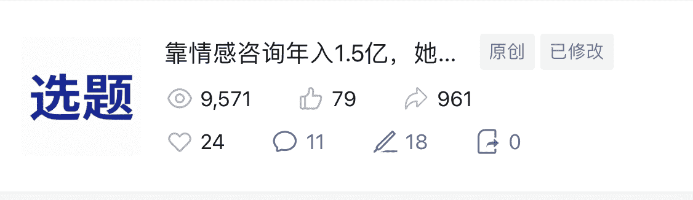

为什么阅读量不高也能成交大客户？因为到这个时候，账号已经积累了将近一个月的专业内容。看到这篇文章的老板，往前翻一翻，发现你之前写的十几篇内容方向都很专业、判断都很精准——他心里就有底了。高客单的成交从来不是靠一篇文章，是靠整个账号的内容厚度。

再往后，5 月20 号发布的“曲曲年入1.5 亿：永久封禁直播”，阅读量11721，分享226 人，收藏62 人。这一篇混合带来了代运营和咨询两个方向的客户。

到这个阶段，其实进线的客资并不算多。精准加过来的客户，平均每篇文章大概也就是十几个人。但这些人的质量极高。

高到什么程度？截图给大家看——加过来之后，上来就问你多少钱、怎么收费、你们做哪些行业。不会有什么“你这个还要收费啊”“能不能先免费看看效果”这种拉扯，就是很干净的对话：你报个价，我看能不能接受，能接受我们就推进，需要再考虑我就先观望。

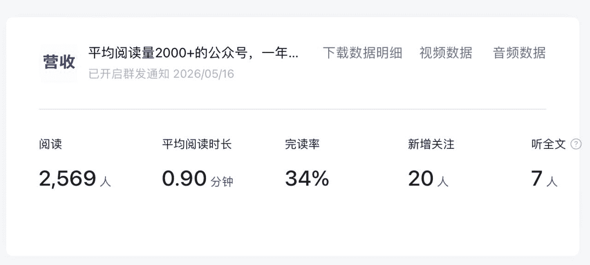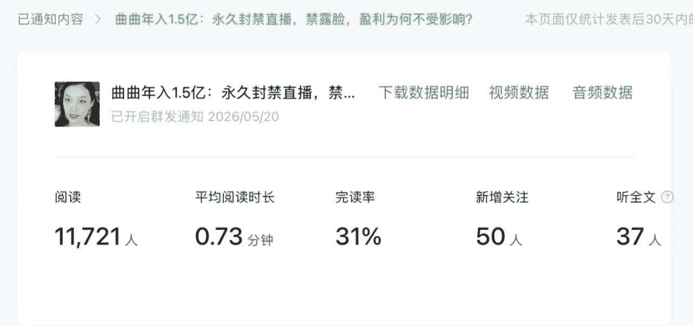

这就是公众号做高客单获客的特点——量不大，但精准到几乎不需要做客资筛选。来的人都是看了你的内容、认可了你的专业度、带着明确需求进来的。你的销售成本反而很低，因为不用花时间去教育客户、去筛选无效线索。

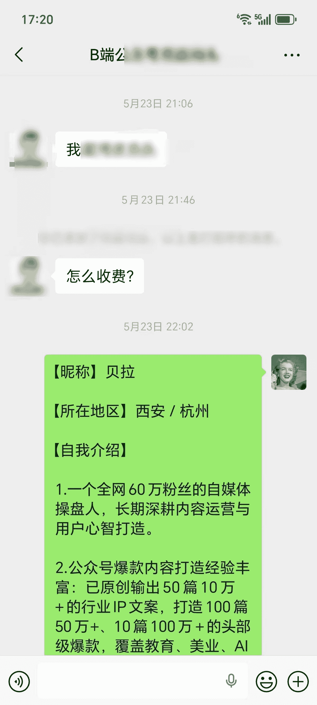

### 3.5 另外一件值得一提的事：SEO 长尾

除了靠单篇内容破圈之外，这个号还做了一件事——关键词布局。

我们在健康赛道、房地产赛道的核心关键词，目前有大量账号已经做到了微信搜索的前三，这意味着即使没有新的爆款文章出来，每天也会有用户通过搜索关键词找到你的内容，源源不断。

这是公众号另一个被低估的能力——它不只是靠推荐算法给你流量，搜索流量同样可以带来非常精准的客资，而且是长期的。

### 3.6 然后这个号就因为违规导流被封了

接下来就要聊到这个号暂时为什么没有继续更新了——违规导流被封禁。

这个部分涉及到公众号现在整体的规则变化，内容比较多，放到下一节专门来讲。

但在这里先说一句：虽然这个号被封了，目前在做冷处理，昨天看了一下账号检测功能其实已经恢复正常了，后面会再养一养看能不能回流。但不管这个号最终能不能救回来，它在45 天里已经验证了一件事——垂直小号 + 专业内容 + 高客单产品，不需要大流量，就能带来精准客资并在后端变现。而且这不是我们一家的经验，前面提到的那个做企业投融资的客户，用的也是同样的逻辑。

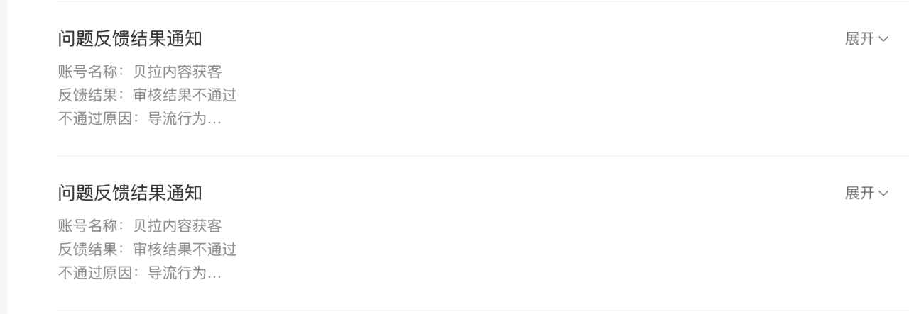

关键在于“垂直小号”这四个字——小而精、不做人设、不追粉丝量，靠内容的专业度和搜索的长尾效应持续获取精准客资。

## 四、公众号的规则正在剧变

前面说到这个号最终因为违规导流被封了。其实这个号从成功到死亡的整个经历，刚好完整地展示了公众号这一轮规则变化的演进过程。这部分内容会稍微长一些，因为涉及到的变化确实很多，而且很多坑是大部分老板还不知道的。

### 4.1 导流的路，基本上全堵死了

这个号前后被查了三次，每一次我们都做了调整，但公众号是一步一步把路全部堵完了。

1. 第一次：文末、文内、评论区置顶，放跳转链接。

这是大家最常见的方式——在文章底部、中部或评论区放一个“点击此链接联系我们”的跳转。以前一直能用，我们也是这么做的。结果直接被判违规导流，封了。

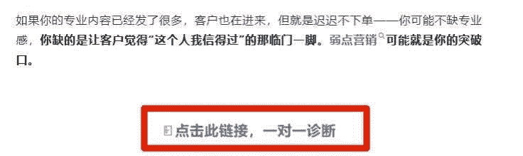

2. 第二次：关注后自动回复弹二维码。

第一次被封之后我们测试了另一种引流方式，不在文章里放任何链接。改成用户主动点了关注之后，自动回复里弹出一个二维码。注意，这是用户自己主动关注的，不是我们强推的——结果还是被封了。

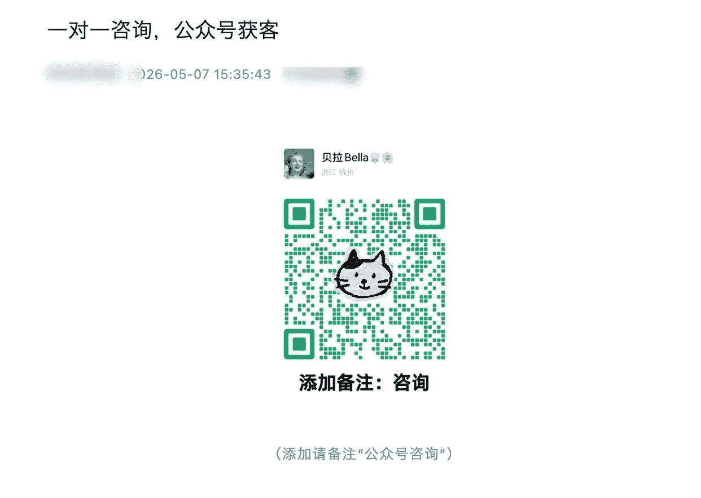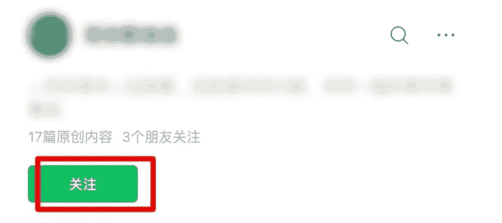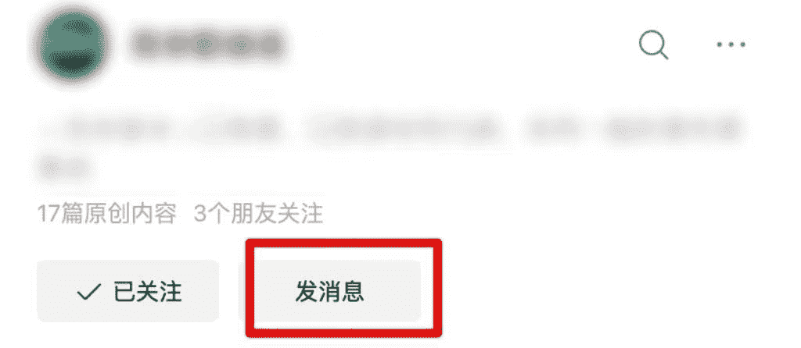

3. 第三次：底部菜单放联系方式。

到这一步我们连关注后的自动回复都不做了，只是在公众号底部菜单设置了一个"咨询"按钮，用户点击之后跳出联系方式。这种方式其实很多公众号都在用，商务合作、联系方式，就是一个很常规的菜单设置——结果也封了。

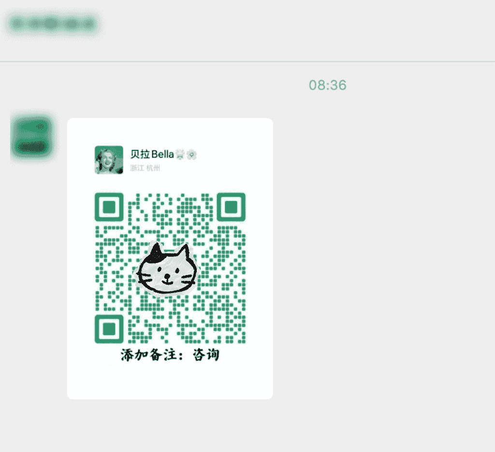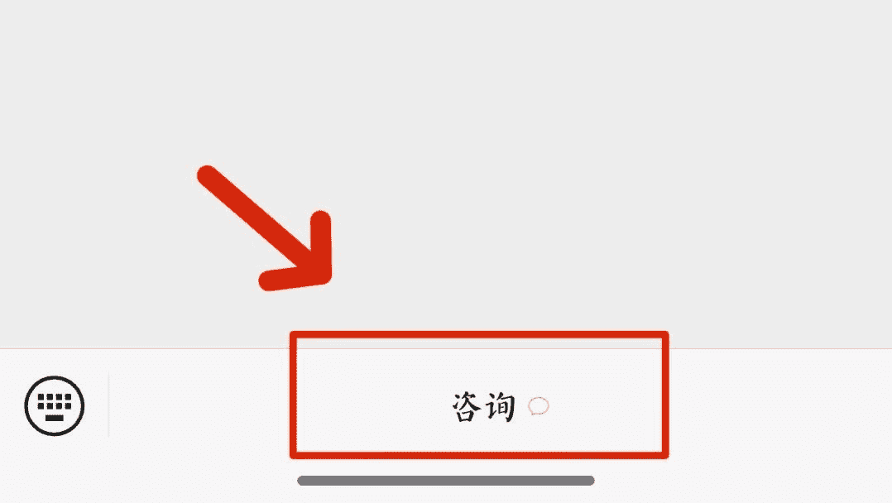

三条路导流路径，全断了。我说到这里，很多老板可能会想：那我做个小程序跳转呢？我用阅读原文呢？我换个什么码呢？

说直白一点，平台不是查不出来，只是有时候想查和不想查的区别。你变着花样绕，人家也不是看不懂。要么就是平台那段时间管得松，让你钻了空子，要么就是你的号流量还不够大，还没触发更严格的审核。

一旦触发，什么方式都能给你查出来。

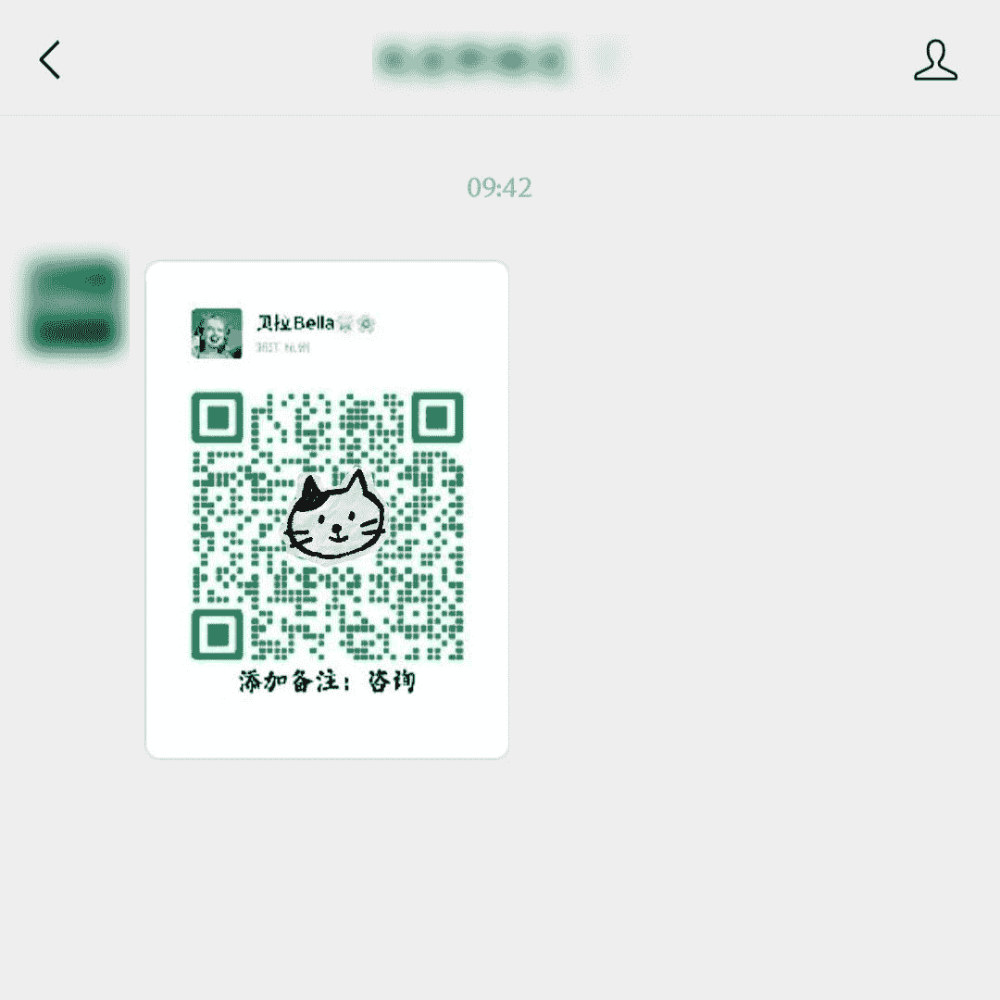

当然也还是会有很多老板拿一些账号举例，为什么别人能够违规引流，但是不被查封？因为公众号的审核机制是带有一定随机性的，有些账号只是暂时未被检测到，但是一查到，这个账号就死了。建议想做长久稳定生意的老板，不要用幸存者偏差，忽视违规引流带来的账号风险。

### 4.2 账号检测功能：最让人头疼的东西

很多老板可能还没注意到公众号后台有一个“账号检测”功能。这个功能的逻辑跟大家以前的认知完全不一样。

以前做公众号，心态是比较轻松的——只要没有收到违规通知，就说明你是安全的。现在不是了。账号检测这个功能会主动标记你的文章“有问题”，而且它有几个特别让人头疼的特点：

1. 第一，审核是滞后的。不是你发出去当天就告诉你有没有问题，而是过一段时间。

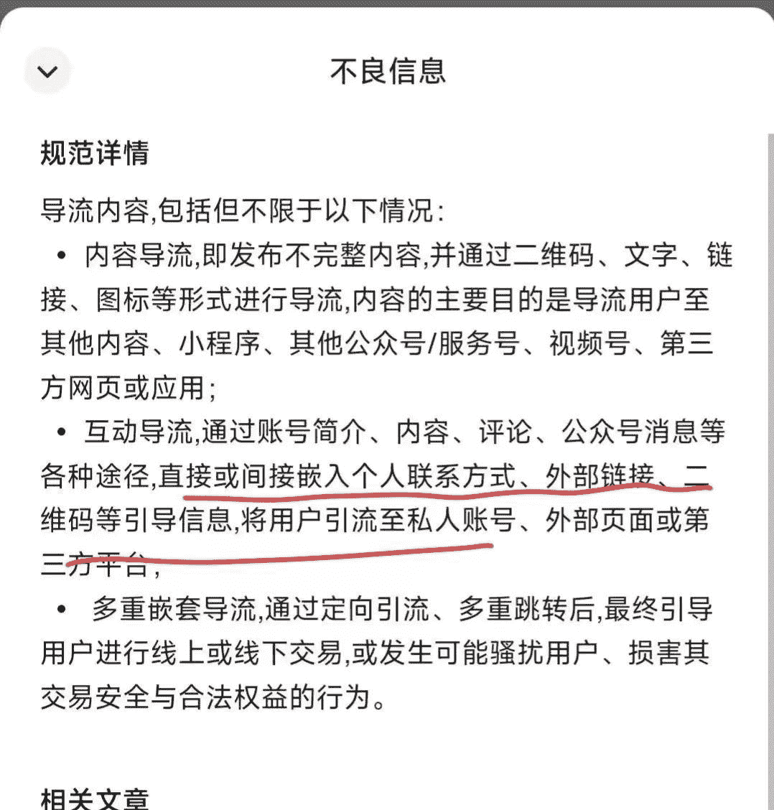

间——有可能是一周，也有可能是两三周——突然就标记你某篇文章违规了。我们有一篇文章，流量涨到1.1万、1.2万的时候，忽然之间就显示违规了，非常突然。

2. 第二，是批量判定的。它不是查你一篇，是一次性列出来好几篇有问题。你可能一打开后台，发现七八篇文章同时被标记。

3. 第三，删文解决不了问题。很多老板的第一反应是赶紧把有问题的文章删了。但你删了之后会发现，检测记录还在。而且更麻烦的是，如果你短时间内批量删了七八篇、十来篇，这个动作本身会让平台认为你的内容有大面积问题，反而可能触发更严格的审查。

有些账号过一段时间检测记录会自己消除，有些会一直挂在那里。每个账号的情况不一样，这个不确定性本身就很折磨人。

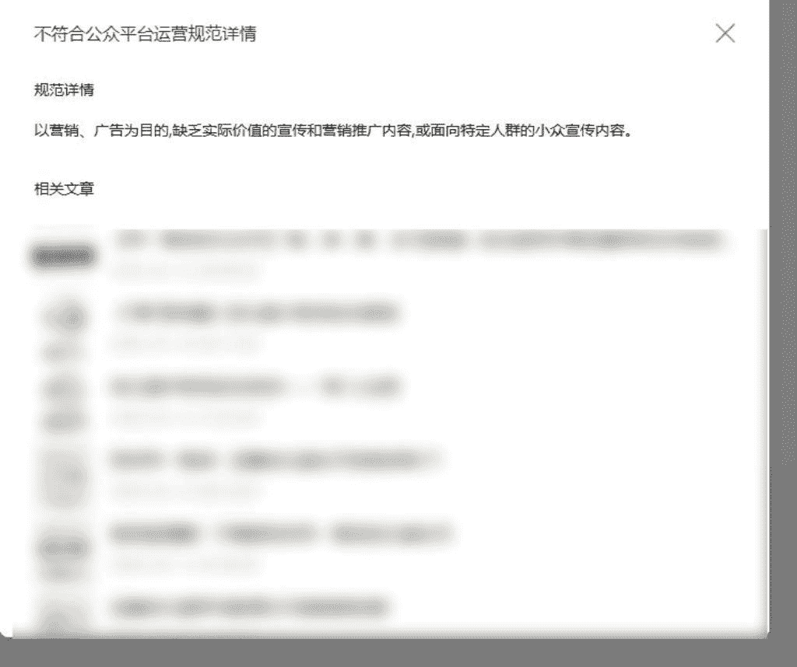

以上为公众号后台“账号检测功能”的部分违规判别图，更多违规条例具体可以看公众号官方通告。

### 4.3 流量是滞后的，这是一把双刃剑

跟账号检测的滞后对应的，是公众号流量本身也是滞后推送的。

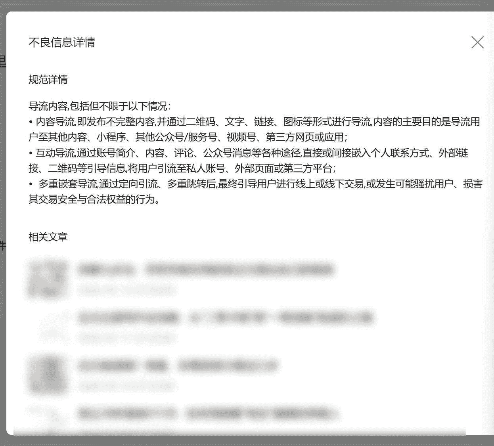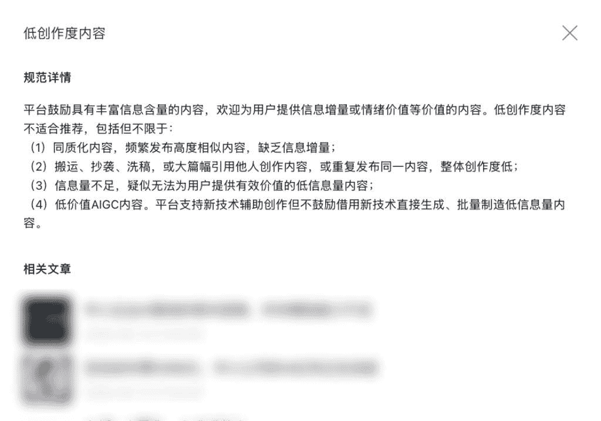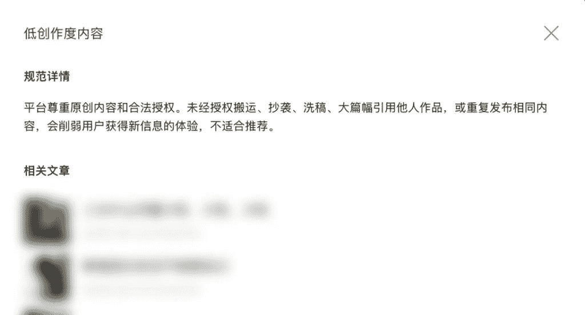

举一个我们客户的真实案例。做健康赛道的一个客户，有一篇文章发出去之后，三天内阅读量不到3000。按照以前的经验，我们一般说三天看一篇内容能不能爆——3000都不到，基本上就判断这篇不行了。

结果就是在我们做月末总结的时候，过去了整整三个星期，这篇文章单日流量突然到了**6.8**万。这就是公众号现在的流量机制——慢推流、多次推流。平台会分批把你的内容推给不同的用户，如果每一批的数据反馈都还不错，它就会继续推。这个过程可能持续好几周。

这对做高客单的老板来说，其实是一个利好。因为慢推流意味着来的用户是分批的、持续的，而且每一批都是经过平台筛选后觉得你这个内容跟他匹配度高的人——客资极度精准。你不是一天涌进来几百个人，而是每天稳定进来几个高质量的潜在客户。

但双刃剑的另一面是：你没有办法快速判断一篇内容到底行不行。不能三天就判死一篇文章，要以至少两到三周为一个观察窗口，持续监测每篇的长尾数据表现，做月度复盘。

而且更危险的是——前面讲了账号检测是滞后的，流量也是滞后的。有可能你的文章流量正在往上爬，爬到一定量级的时候，触发了更严格的审核，反过来被判定违规。这个时间差里，你可能已经按同样的思路发了好几篇新的内容了，这些内容也可能有隐患。所以内容方向在没有经过足够长的观察期确认安全之前，不要急着放量。

### 4.4 5·13新规：账号正在变成“一次性资产”

5月13号之后，公众号在账号管理层面做了几个很重大的调整：

- 实名认证一人一号，不能绑定管理员了。以前可以买别人的号，绑上自己公司的管理员来运营。现在发文的时候需要账号本人扫码确认，这就意味着群控管号会变得非常麻烦。

- 注销之后身份证被标记。以前号做废了，最常见的操作就是注销账号、重新注册一个。但最近我们自己测试以及合作客户反馈的情况是——注销之后用同一个身份证重新注册，新号一点流量都没有。跟平台申诉也正常走流程，但就是没有流量。当然要说明一下，互联网的规则是一直在变的，有可能大家看到这篇内容的时候，这个政策又松动了。我这里说的是基于文章发布时间当下的真实情况。

- 买号的风险变得很大。公众号的买号跟其他平台不一样——它不能做实名变更。你买的其实是"别人让你用他的号"，但这个人随时可以把账号自助注销或者冻结。做高客单的老板一般不会太放心做这个事情。

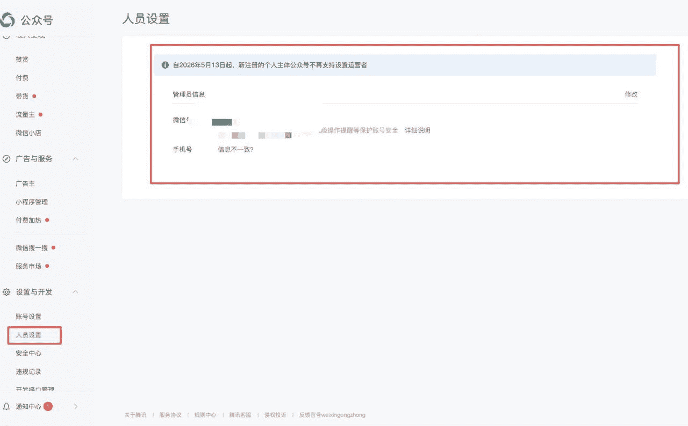

这几个变化加在一起意味着什么？账号变得极其珍贵。做高客单的老板，公众号账号一般不会超过五个，大部分就是两三个在做精准获客。每一个号都是你的核心资产，废掉一个就少一个，而且补起来的成本越来越高。

### 4.5 内容审核的逻辑也变了

这个部分我觉得是很多老板最容易搞错的地方。

现在公众号出现AI生成内容的标记，很多老板的反应是：平台在查AI，我要想办法让内容看起来不像AI写的。

这个思路是错的。

平台查的不是你用没用**AI**，查的是你的内容质量是不是达标——这两件事完全不一样。

实际上平台是明确鼓励使用AI创作技术的，后台是有这个说明的。而且大家应该也刷到过一些文章，明确标注了“使用AI创作技术”，流量照样给到几万甚至十万加。

比如以下文章标注了AI生成，依旧有4.1万自然流量。

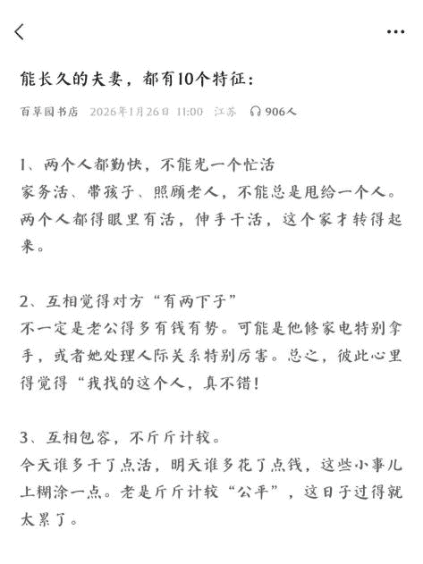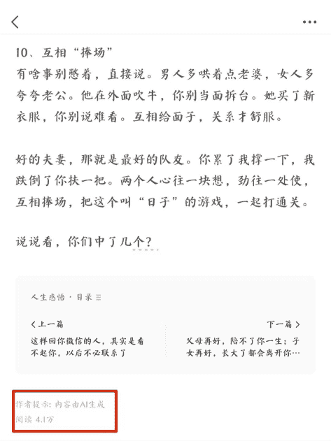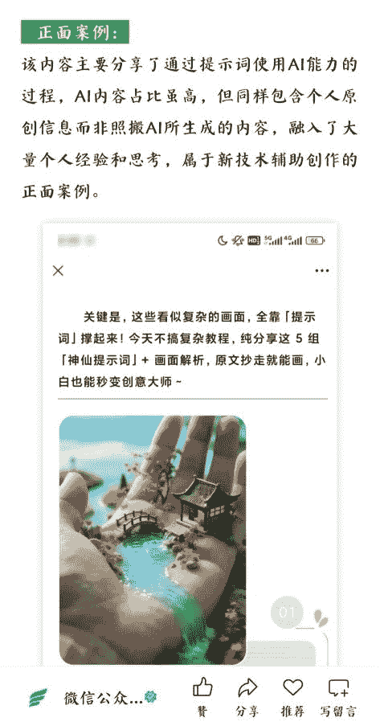

那平台到底在审什么？审的是你的内容是不是“生成套路化、模板化”的。你用AI没问题，但如果你用AI批量生产的东西读起来全是一个套路、一个模板，那就会被判定为低质量内容，限流甚至标记违规。

还有一个很多人不知道的变化：公众号对数字类内容的审核比以前严格了很多。比如你搜“百万”“千万”这些词，看近半年的爆款，会发现这类内容已经很少出现了。以前可以写“一年5000万”“月入百万”这种标题和内容，四年前我们也这么做过，也出过很多十万加。但现在只要你在内容里用了太多数字对比、提了具体赚了多少钱，就很容易被判定为网赚风险。

公众号和抖音、视频号在这一点上是完全不同的。同样的表述在抖音可能没问题，在公众号就会触发审核。

用一个简单的比喻来理解平台现在的逻辑：

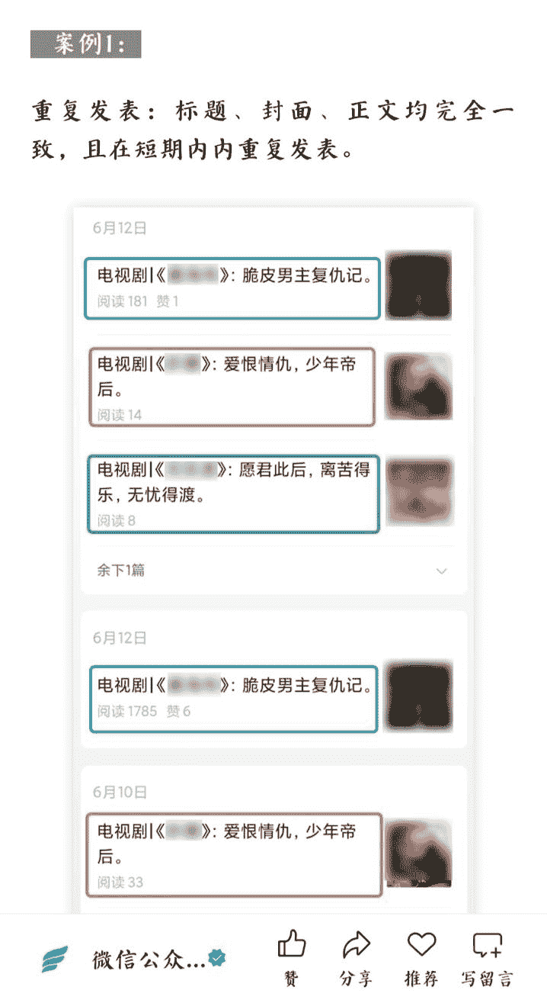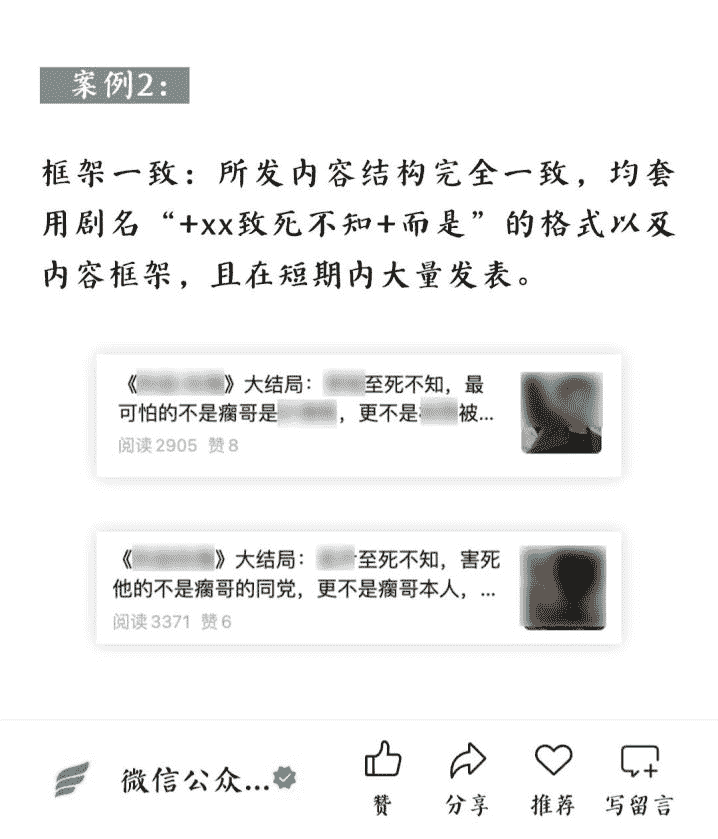

就像一个班级，所有小孩都去补课了，班级平均分就无限往上涨。AI来了，所有人都在用AI写内容，内容的平均水平线也在上涨。平台是在倒逼你用AI把内容质量做得更高，为平台带来更优质的用户和广告商——而不是让你用AI去偷懒批量生产。

**AI**只是一个变量，它不是决胜负的因素。决胜负的还是那个操控AI的人——他对内容的理解、对商业的理解、对平台规则的理解。这个东西没有变过。

## 五、已经在做公众号、已经踩了坑的老板

先聊第一种情况。如果你已经在做公众号，而且因为导流或者内容问题已经被标记了，接下来该怎么办。

### 5.1 首先要搞清楚一件事：废号流对高客单完全不可行

我知道有不少老板在想——既然一个号废了，那我批量起号不就行了？50个号、100个号，总有几个能活下来吧。

我们有客户真的这么做过。上了差不多五六十个号，一个月下来，大概**80%**的号直接后台警告违规导流，就没了。批量起号这种玩法，在做低客单、赚流量主的场景下可能还有一些操作空间。但如果你做的是高客单——你要转几千块的课、几万块的服务，这条路是完全走不通的。

原因很简单：你做废号流，肯定不会花心思去做内容布局，你一定是希望一上来就铺量、批量发营销内容、批量转化。但高客单的老板不会看两三篇营销文就加你微信付钱，他需要的是看到你整个账号的专业深度，你用废号流根本没有时间去积累这个深度。

而且账号周期会非常短——你可能日更或者一天发两三条轰炸式更新，第二周平台就把你之前发的文章全部判定有问题，号直接就废了。就算侥幸撑过了两周，你在这个号上能捞到几个精准客资？捞到了你能成交几个？对高客单来讲，这笔账算不过来。

### 5.2 删文不是办法，改才是

很多老板发现账号检测里挂了好几篇有问题的文章，第一反应就是赶紧删。前面已经提过了——删文之后检测记录还在，短时间内批量删还会被标记“内容有大面积问题”。

比较好的处理方式是分情况来：

- 如果是导流类的硬伤——比如文末放了链接、放了二维码、文章里有“加我微信”“找我聊一聊”这类明确的导流话术，这些地方直接删掉或者改掉。文章本身可以保留，只把违规的部分去掉。

- 如果是内容层面的问题——比如被判定为“模板化营销”“推向特定领域小众营销”，这种情况稍微复杂一些。内容质量的判定是有一定弹性的，可以通过修改内容、调整表述之后去申诉。

- 如果整篇内容确实就是硬广、就是营销稿，改也改不了什么——那就直接设置仅自己可见。但注意不要短时间内批量操作，一次处理两三篇就好，分批来。

### 5.3 申诉是有用的，但要讲方法

很多老板被判违规之后就认了，觉得申诉没什么用。其实不是的。

我自己这个号被判了好几次导流，但我每一次都还是会向官方去申诉。不是为了跟平台较劲，是一定要搞清楚问题到底出在哪个地方。

我们合作的一些客户也是，通过申诉成功之后，流量确实慢慢回来了。

申诉的基本逻辑大概是这样的：

1. 第一步，搞清楚平台判你违规的具体原因。是导流？是内容模板化？是网赚风险？不同的判定原因，申诉的策略完全不一样。

2. 第二步，对于已经定性的违规事实，不要狡辩。比如你确实放了链接、确实放了二维码，平台判你导流，这个没什么好争的。你要做的是承认这个问题，然后告诉平台你已经做了什么修改。

3. 第三步，对于有弹性的判定，可以据理去争取。比如内容被判定为“模板化营销”，这个东西是可以掰扯的——你可以说明你的内容逻辑是什么、受众是谁、为什么这样写，附上修改后的截图，提交给官方看能不能恢复。

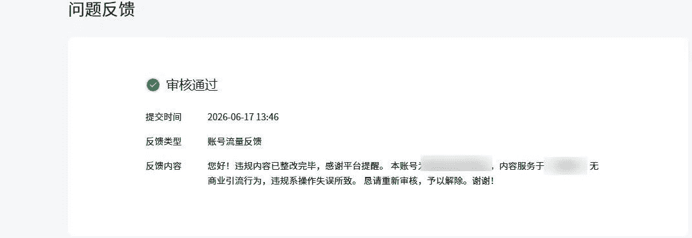

4. 第四步，不管申诉通不通过，都要从中搞明白一件事：你这个行业、你这个赛道，跟公众号平台共生的方式到底是什么。如果申诉通过了，说明你这个方向调整对了，号还能救。如果没通过，说明你对这个平台的理解还有偏差，需要回去重新想——不要直接就去开新号。

因为现在账号这么珍贵，你在没有想清楚问题出在哪之前就去起新号，新号大概率还是会犯同样的错误，然后又废掉一个。做高客单的老板手上就那么几个号，经不起这样消耗。

### 5.4 核心还是回到内容上来

账号救回来之后——或者说在处理违规的同时——最重要的事情还是回到内容本身。

我自己这个号在违规期间，团队是每三天做一次复盘的，每个账号都会过一遍：这篇内容哪里有问题、提示词怎么优化、下一篇方向怎么调整。

做高客单的内容，通用型的AI智能体模板是用不了的。那种东西可以适用于电商类的产品推广，但对于高客单这种需要深度专业表达的内容，必须针对你的行业、你的客户、你的赛道做精准的提示词调优。这也是为什么内容这件事看起来“不就是写篇文章吗”，但实际上工作量一点都不小。

## 六、还没做、想要入局的老板

第二种情况：你之前没有做过公众号获客，或者做过但停了一段时间，现在想重新入局。

### 6.1 心态上要做好打持久战的准备

先说一个现实：公众号的冷启动期一般是一个月到两个月。内容能力比较强的团队可以压缩到两周左右——我自己这个号大概就是两周开始起量的——但大部分团队正常的周期就是一到两个月。

为什么值得打这个持久战？

1. 第一，公众号是所有平台里离用户最近的。每个人每天都在用微信，这个不用多说。客户从看到你的内容到完成购买，整个链路在微信生态内就能走完。相比之下，小红书、抖音这些平台还要跳转好几次，链路长了，流失也就多了。

2. 第二，长尾流量确实扎实。前面讲过的流量滞后机制，反过来说就是长尾效应——一篇好的内容可以持续几周甚至更长时间带来客资。这不是短期流量打一波就走的逻辑。

3. 第三，客资质量是真的高。这个前面案例里已经展示过了——来的人直接问价、不拉扯、不需要你花大量时间去教育。高客单的利润空间也撑得起你在这个渠道上做长期投入。

### 6.2 内容：要做三类测试

入局之后，内容方面首先要做的是搞清楚三个问题：

1. 第一，什么样的内容在你的行业是有流量的？这是基础，你至少要知道你的赛道里什么选题方向、什么表达方式能拿到平台的推荐。

2. 第二，什么样的内容有流量的同时还能带来客资？有流量不等于有客资。有些内容阅读量很高但来的都是看热闹的人，不是你的潜在客户。你需要找到那个既有流量、又能精准触达你目标客户的内容方向。

3. 第三，什么样的内容是用来转化已关注用户的？有一部分内容不需要有很大的流量，它的作用是服务那些已经关注了你但还没有行动的人——让他们进一步加深对你的信任，最终走到成交那一步。

这三类内容的配比，我们用的是一个631的模型——60%做流量内容、30%做流量+客资内容、10%做纯转化内容。关于这个模型的具体拆解和落地方法，我在另一篇帖子里有比较详细的分享。

但这里有一个特别重要的提醒：这三类内容的测试，不能只看短期数据。前面讲过，公众号的流量是滞后的，审核也是滞后的。你可能测出来某个方向的内容有流量，按这个方向连续发了两周——结果两周之后，最早那篇被判定违规了。那你后面按同样思路做的这些内容，可能全部存在隐患。

所以每一个内容方向，在确认它“既有流量、又不会触发违规”之前，至少要给两到三周的观察窗口。确认安全了再放量，不要急。

### 6.3 转化端：微信小店是目前最安全的合规路径

导流到个人微信的路基本上堵死了，那客户从文章到成交的这个闭环怎么走？

目前最安全的方式是通过微信小店。把你的引流品挂在微信小店里，在文章中引导用户去小店购买，整个链路在微信生态内完成，不涉及任何导流行为。

但引流品的设计是有讲究的，要跟你的客单价匹配。

比如我们自己测试下来的情况：我们的代运营产品客单价在几万块，这个价位的客户不会去买一个9.9块的PDF资料包。他们的行为是——直接拍一个600块钱的一对一咨询，跟你聊一个小时，看看合不合适再决定要不要合作。

但我们19800客单的顾问咨询产品的客户会买资料——那种比较精准的、跟他行业直接相关的资料包，他会买。

我们也测过29.9和39.9的引流品。转化率高一些，比如3000的阅读量最好的情况能有15到20个人拍。但后端引流到高客单产品的链路还在测试中。

说这些数据是想说明一件事：引流品不是随便挂一个就行的。不同客单价的产品对应不同类型的引流品，不同价位的转化率差异很大，而且引流品跟你内容的搭配方式——流量型文章挂什么品、客资型文章挂什么品、转化型文章挂什么品——也需要分别去测。这里面的变量很多，需要持续跑数据来优化。

### 6.4 过渡期的几个替代方案

有些赛道的老板确实没有办法上微信小店，这个情况我理解。基于这种情况，分享几个当下可能还能用的过渡方案，但要先说在前面——这些方法都不保证百分之百安全，也不建议作为长期方案。

- 第一种，视频号联动。把你的微信二维码放在你的视频号页面下面，文章里引导用户去看你的视频号，用户自己去你视频号扫码添加。

- 第二种，双公众号联动。你的A号负责发内容，内容里不放任何违规信息，然后在A号的文章里引导用户关注你的B号，B号的置顶内容放你的联系方式。

这两种方式目前有些老板在用，我们自己也试过。但说实话，以公众号现在的审查力度，联动查封的风险是存在的。如果你的A号因为引导关注B号被查了，两个号可能一起出问题。前面讲了这么多账号有多珍贵、冷启动期有多长，如果因为联动被一锅端了，损失就很大了。

所以我的建议是：如果你的行业能上微信小店，尽量走小店。如果确实上不了，这些过渡方案可以先用着，但要做好心理准备，同时尽快找到一个长期合规的解决方案。

### 6.5 一个容易被忽略的问题：公众号在控制流量分配

现在公众号的流量分配，大号也不稳。大家应该有观察到，一些大博主的文章有时候篇篇几万、十万加，过一段时间可能突然只有几百。这不是偶然，而是平台在控制。

平台其实是算准了给你多少精准流量、每个月放多少客资进来，它是有调控的。这意味着什么？意味着你不能靠“赌爆款”的思维来做公众号。一篇爆了固然好，但你不能指望每篇都爆。稳定产出有质量的内容，加上SEO关键词的长尾布局，让每天都有一些精准流量通过搜索找到你——这才是做高客单公众号获客的长期逻辑。

大号的流量不稳，反过来对垂直小号来说也是一个利好：大号没有绝对的优势，小号只要内容够专业，一样能拿到精准客资。

## 七、这个赛道最终会属于谁

前面聊了很多困难——导流被封、账号检测、流量滞后、内容审核越来越严、账号越来越珍贵。确实不容易。

但换个角度想：你遇到的这些困难，你的同行、你的竞争对手一样在遭遇。那些靠批量废号流做导流的，正在被平台一波一波地清退。那些靠AI模板化铺量的，内容质量上不去，连流量都拿不到了。那些纯做内容但没有高客单产品承接的人，打不了大流量，变现效率撑不住，也会逐渐离场——你算一下，如果你卖的是几百块钱的小课，你要卖多少份才能有六位数的营收？而且公众号现在根本不给那么大的量。

这些人退场之后，留下来的是谁？

是真正有专业内容能力、有高客单产品、有交付能力的老板和团队。其实大家如果现在去用一下公众号的推荐功能，会发现一个很有意思的现象：推荐给你的内容越来越精准了，很多文章阅读量不高，但写得确实好。这就是平台在做的事情——它在奖励那些真正有质量的内容创作者，哪怕你粉丝不多、阅读量不大。

这对做高客单的老板来说，就是最大的利好。你不需要跟大V比粉丝量，不需要追求十万加，甚至不需要做人设。你要做的就是持续输出你这个行业里真正有价值的专业内容，把关键词布局做好，让那些有需求的人能找到你。来的人不多，但来一个就是一个精准客户。

事情都是双面的。平台变难了，投机的人待不下去了，真正有能力的人反而迎来了最好的窗口。

————分割线————

看完这篇SOP，你觉得你懂了。但90%的人一到实操就会卡在第一步。

工具和教程只是最低级的壁垒，真正的壁垒是"立刻动手"和"圈层信息差"。

如果你想看全网最新的变现玩法，并且和一群执行力极强的极客一起下场拿结果，欢迎围观我的核心私域：【懒人专属群】。

我们不聊虚的，只做商业闭环的拆解与AI效率的压榨。系统内已沉淀1000+跑通的套利实战局。

👉 查阅圈子完整数字资产与上车门槛：

https://lazyso.com/insider/

认同价值、准备好下场干活的，扫码加我微信（lazyhelper1）

备注：【实操上车】，不闲聊

