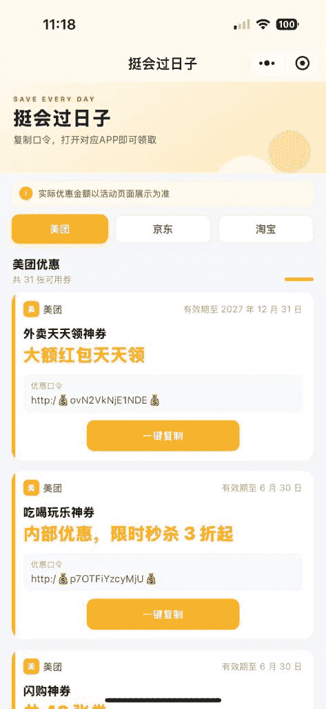
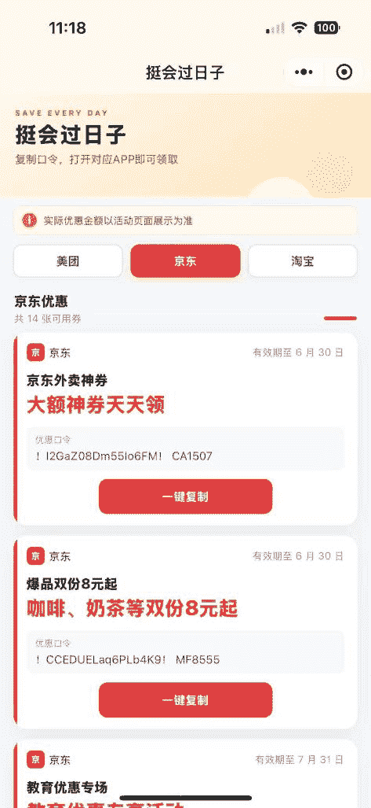
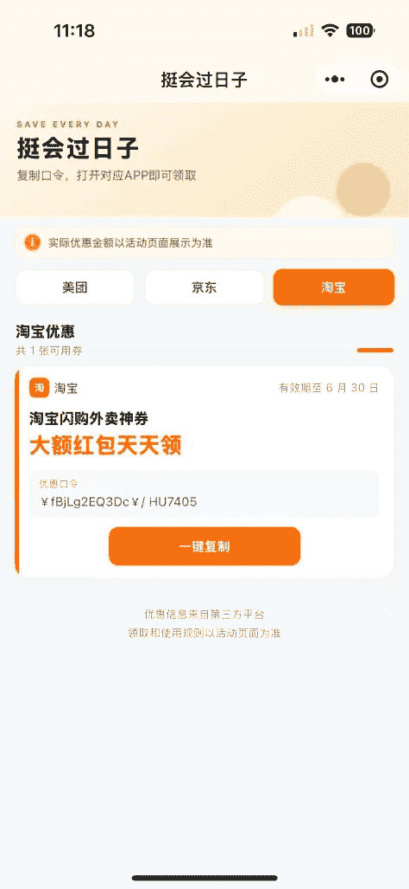
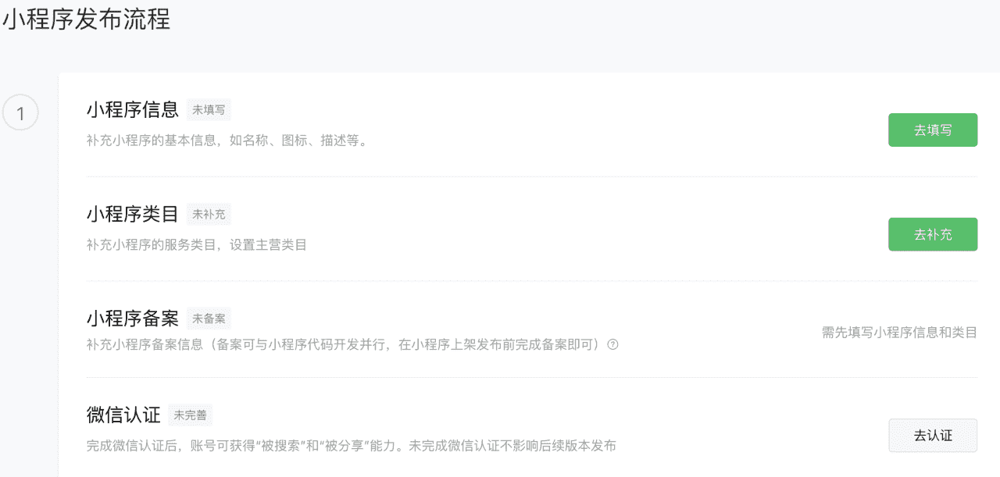
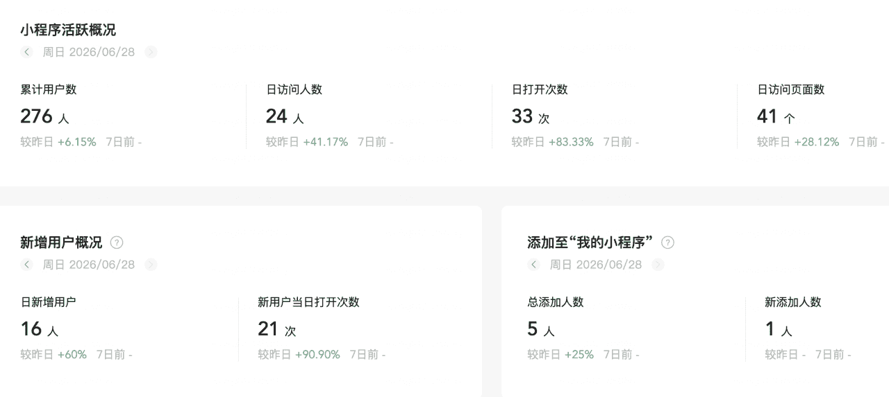
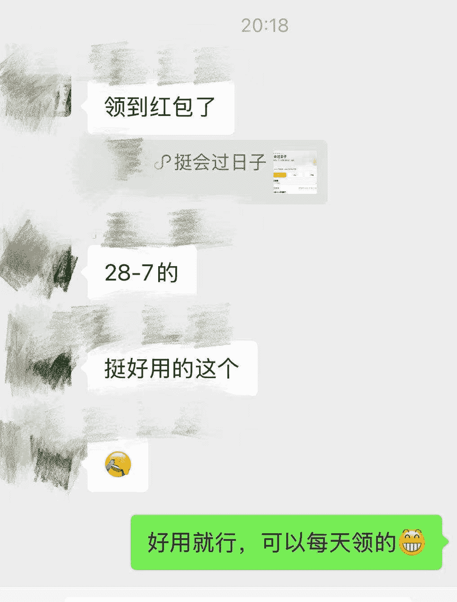

# 用 Codex 3 小时做出小程序，我踩过的 5 个坑

260629 副业 SC 精华

整理：公众号懒人搜索，懒人专属群精选

懒人微信：lazyhelper1

去年年底我参加 CPS 小航海，靠优惠券 CPS 变现了 4000+。后来因为一个朋友半夜买药不好意思找我要券，我突然意识到：与其每次私聊发链接，不如做一个任何人随时都能打开的小程序。

于是我用 Codex 辅助，花了大约 3 个小时做出了第一版优惠券小程序【挺会过日子】。目前上线一周，在没有大规模公域推广的情况下，累计用户接近 300，并且已经产生订单。

这篇文章我将复盘一下，我为什么做、怎么做、踩了哪些坑。

## 一、为什么要做这个小程序

### 1、为什么要做一个优惠券聚合的小程序

1）做过 CPS 项目，确实能产生收益；2）身边朋友有真实需求，不想每次开口要链接；3）市面上多数产品只做外卖优惠券，高频之外的低频优惠券也有空间。

### 2、这个小程序的目标用户是谁？

1）不知道外卖每天可以领取优惠券的人；

2）不知道除了外卖优惠券还有很多优惠券其实都可以领的人；

3）想要同时获取多个平台外卖优惠券的人。

总结起来就是：白领、学生等人群。

### 3、我想先解决哪个最核心的问题？

我想先解决的不是“做一个功能很全的小程序”，而是“用户能不能成功领到券”。

围绕优惠券成功领取这个问题作为小程序第一版的 MVP，如果证实这个需求成立，再考虑产品后续的开发，而不是自我感动开发一堆自认为很厉害的功能。

## 二、最后小程序做出来的效果

操作路径：用户打开小程序——点击一键复制——提示打开对应的 APP——自动弹窗领取优惠券——下单时抵扣。

## 三、3 个小时大概是怎么用掉的？

### 1、第 1 小时：不写代码，只梳理 MVP

首先我用了刘小排老师在上期【超级 AI 大航海】里使用的 SPEC 编程方法：

我要做一个：……这里只用一句话，把你的想法说个大概……

请你先不要写代码，你需要像苏格拉底一样，帮助我梳理需求。你需要一个问题一个问题地问，每次都给出带编号的选项，直到我们能够形成一份完整的 SPEC，符合以下标准：

- Problem Statement（问题陈述）
- Proposed Solution（方案描述）
- Technical Constraints（技术约束）
- Non-goals（明确不做的事）
- Success Criteria（成功标准）

但是在实际使用中我发现，Codex 没有严格围绕 MVP 进行设计，还会涉及到一些上架产品的问题，所以我对 Codex 进行了再次的框架约束，明确围绕 MVP 进行提问；同时，随着问题的增加，Codex 不断地提问很多复杂且可能不涉及前期开发的问题，我意识到后及时进行了打断，并询问它问的问题是否满足了 MVP 的需求。

这里要注意的是，Codex 思考时是可以打断 Codex 的，同时前期不用考虑太复杂，只围绕 MVP 进行设计，甚至连界面长什么样子都不用先考虑，Codex 的能力明显很强。

### 2、第 2 小时：让 Codex 根据 PRD 写核心页面和流程

明确需求后，让 Codex 写出 PRD 文档，并人工对 PRD 文档进行复核，确认没问题后开始进行代码编写。

Codex 的开发速度比我预期快很多，核心页面很快完成，甚至还顺手生成了一套本地后台。后台也做得不错，但也让我意识到一个问题：AI 很容易把事情做“过头”，但第一版最重要的不是功能完整，而是验证 MVP。

### 3、第 3 小时：调样式、测真机、修复制和跳转逻辑

接下来就是细节的优化，提示信息没居中、提示信息修改、小程序 Logo 设计、页面跳转逻辑等等。

最关键的是不仅仅要在云环境下开发测试，而是要真机测试，因为涉及到复制粘贴功能，提示的成功不一定真的成功。我在真机测试环境下复制后，打开美团也是成功出现了优惠券的，所以我知道，这里“应该”成功了。

但为了确保没问题，我在小程序正式上线后，还是自己先进行了测试，确保没问题后才开始推广的。

## 四、这次踩过的 5 个坑

### 1、小程序起名比写代码还费时间

小程序起名应该是这个产品踩过的最大的坑了，这里浪费的时间比写代码还要多。由于主体是用的个人，很多名字都不给过，起了十几个名字都不行，比如“xx 神券”“xx 领券”“xx 省钱”，但是我看别人个人的也有这种名字的，所以就尝试了很多次，最后没办法，起了名字叫【挺会过日子】，意思是干啥都领券，省钱有一手，别人都夸你挺会过日子，估计只有北方人能 get 到吧，哈哈😂。

起的这个名字，基本上告别了搜索流量了，只能靠推广和用户主动分享了。不过第一个小程序也没啥，在没有公域推广的情况下，上线一周也有将近 300 个用户了，心态放平，慢慢来。

我自己的对于起名字的理解是，腾讯对于这块的限制是：

商标 > 公司主体 > 个体户主体 > 个人主体。

这个理解不知道对不对，不过我感觉隐藏规则可能是这样的，优惠券这个赛道有很多大玩家，所以很多词竞争比较激烈。这只是我自己的体感，不一定准确，但我的感觉是：主体资质越强，名字审核的空间可能越大。有懂这块的朋友，欢迎评论区指导一下。

### 2、备案和起名顺序不能乱

腾讯小程序后台给出的顺序是先备案再起名（认证），但是实际应该是先起名（认证）再备案，因为第一个名字很可能不会通过。如果一旦先备案了，但是名字没过的话，后面名字换了还要再次备案，我就踩了这个坑，浪费了几天时间。

正确顺序是：

1. 小程序信息
2. 小程序类目
3. 微信认证
4. 小程序备案

### 3、真机测试不能省

微信云开发里测试没问题，不代表真机上也没问题，所以一定要在真机测试环境里再去测试。

真机测试环境里尽量把所有问题都考虑到，比如页面适配、点击反馈、跳转逻辑等等。

### 4、不用着急在第一版就写后台功能

虽然我没考虑在第一版就写后台功能，但是 Codex 直接就写出来了，并且写得还不错，这就导致我的注意力被吸引过去了，浪费了我很多时间关注在后台功能上。

后面我发现微信云开发就可以替代后台功能，虽然在半年后需要付费（19.9 元/月），但是前半年基本可以测试出这个产品是否有人用。哪怕后面需要再开发后台也来得及。并且没有后台的情况下，也可以通过每次发版来解决内容更新问题，虽然会有时间延迟，但是也是一个解决办法。

AI 确实很强，但也容易“多做”。如果你没有明确告诉它只做 MVP，它会把后台、管理页、扩展功能一起做出来。看起来很爽，

但对第一版来说反而会分散注意力。

### 5、产品逻辑不用太复杂

先围绕一个产品逻辑进行设计，以我的这个产品为例，可以设计成跳转到对应 APP 领取优惠券的逻辑，也可以设计成直接在小程序里跳转小程序领取的功能，但在第一版设计时，只用考虑一个逻辑就行，不用混合，也不用多考虑那么多，先上线，上线了随着用户的反馈，慢慢更新迭代就好了。

后续可能会考虑进行优惠券的分类设计以及添加数据统计功能，看看哪些优惠券被领得多等等，这些在前期都不用考虑，用户会告诉你答案。

## 五、产品上线只是最简单的一步，最重要的是产品推广

在产品推广上我没有太多分享，只能按自己想法逐步实现，我的推广路径及思考是：

1）上线发给朋友帮忙测试，确定不同机型都能正常使用；

2）次日在群聊和朋友圈进行再次分享，感兴趣的朋友会点击查看，有些还会给出建议；

3）再在微信公众号的贴图里进行推广，忽略其中的噪音（很多难听的话）；

4）随着用户量的增加，逐步开始在各大公域平台进行推广。

目前产品上线已经一周，累计用户将近 300，也得到了用户的好评，从后台数据看，已经有订单产生了。

## 六、写在最后

如果你也想做一个小程序，不一定要先想清楚所有功能。先找到一个真实的小需求，用 AI 做出最小版本，让它上线，让用户告诉你下一步该做什么。

对普通人来说，产品上线不是终点，而是第一次真正的开始。

————分割线————

看完这篇 SOP，你觉得你懂了。但 90% 的人一到实操就会卡在第一步。

工具和教程只是最低级的壁垒，真正的壁垒是“立刻动手”和“圈层信息差”。

如果你想看全网最新的变现玩法，并且和一群执行力极强的极客一起下场拿结果，欢迎围观我的核心私域：【懒人专属群】。

我们不聊虚的，只做商业闭环的拆解与 AI 效率的压榨。系统内已沉淀 1000+ 跑通的套利实战局。

😂 查阅圈子完整数字资产与上车门槛：

https://lazyso.com/insider/

认同价值、准备好下场干活的，扫码加我微信（lazyhelper1）

备注：【实操上车】，不闲聊

