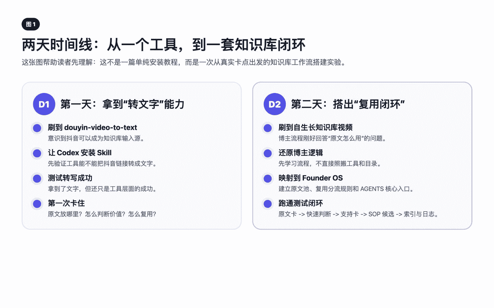
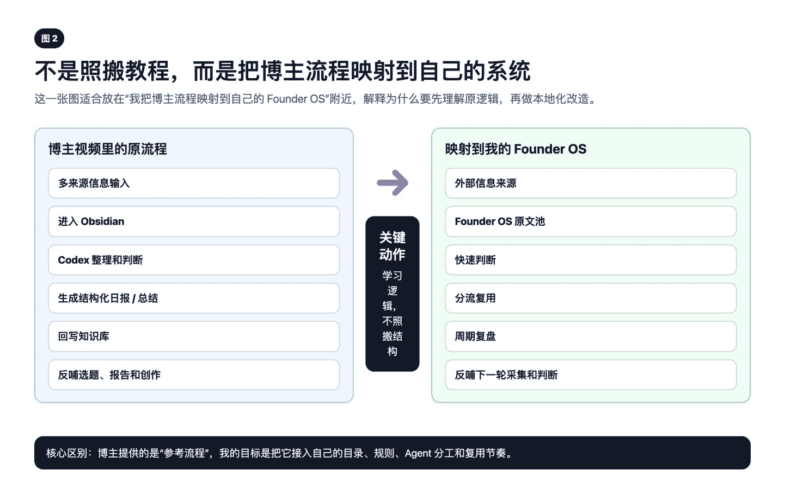
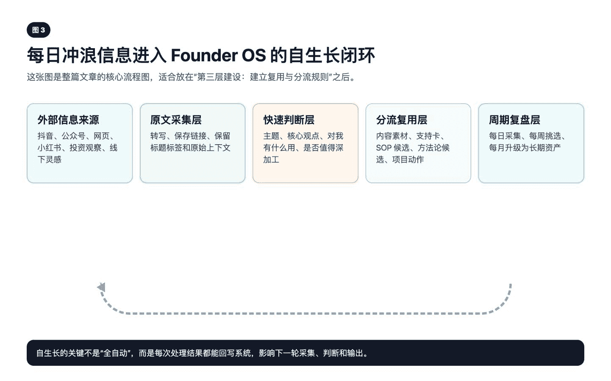
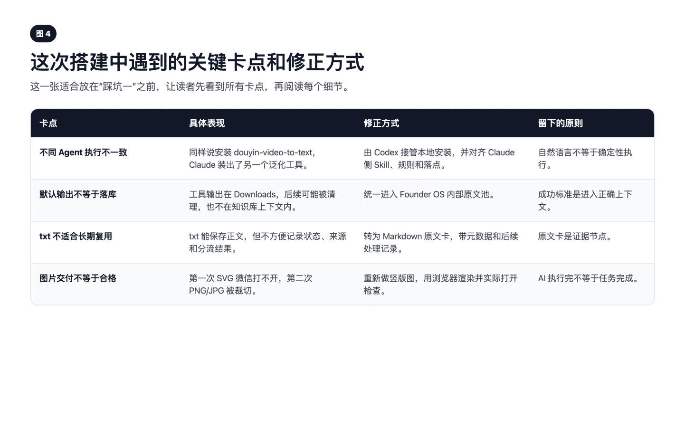
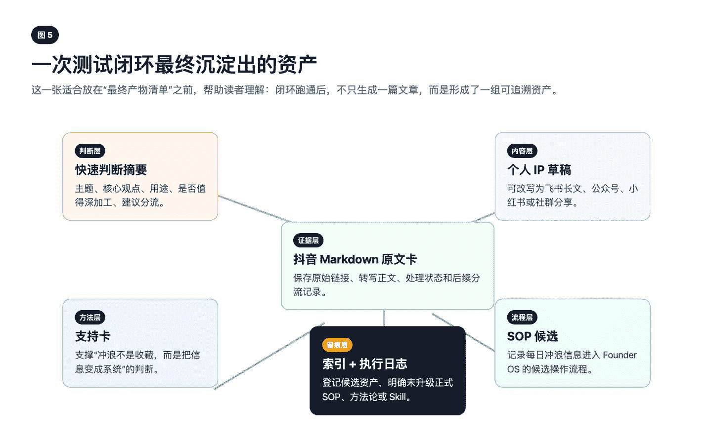

# 我用两条抖音视频，搭出了一个会自我生长的个人知识库入口

260713 副业SC 精华

整理：公众号懒人搜索，懒人专属群精选
懒人微信：lazyhelper1

从抖音转文字 **Skill**，到 **Founder OS** 每日冲浪信息复用闭环的完整实战

注：文中提到的「Founder OS」，不是一个现成软件，而是我给自己这套个人知识库和工作系统起的名字。你可以把它理解为：一个用来管理信息输入、项目推进、内容创作和 AI 协作的个人操作系统。

### 这篇文档是写给谁的

这篇文档适合以下几类人：

- 每天会刷到大量信息，但信息经常停留在“收藏夹”的人。
- 已经在使用 Obsidian、飞书、Notion、语雀或本地知识库，但不知道如何让资料真正复用的人。
- 想用 AI 辅助整理抖音、公众号、小红书、网页文章等外部信息的人。
- 正在做个人 IP、公众号、小红书、社群分享，需要把日常输入转化成内容素材的人。


- 已经开始使用 Codex、Claude、ChatGPT 等 Agent，但发现“装了工具”和“形成稳定工作流”之间还有一大段距离的人。
- 不满足于一键收藏，而希望把信息变成内容、方法、SOP、项目动作和长期判断依据的人。

这篇文档不适合只想看一个“安装命令”或“一键自动化脚本”的人。它更偏真实搭建过程、踩坑复盘和可复制工作流设计。

### 这篇文档想解决什么问题

我真正想解决的问题不是“怎么把抖音视频转成文字”。这个问题太小了。

我真正想解决的是：

每天冲浪刷到的信息，怎么进入我的知识库？进入以后，怎么判断它有没有价值？有价值的信息，怎么变成内容素材、支持卡、SOP 候选或方法论候选？这些处理结果，怎么反过来让我的知识库持续生长？

换句话说，这篇文档解决的是：

从“刷到信息”到“保存原文”到“判断价值”到“分流复用”到“沉淀成长期资产”的完整闭环。

### 读完这篇文档，你能获得什么

读完后，你至少可以拿走 5 样东西：

1. 一套真实跑通过的“每日冲浪信息进入知识库”的流程。
2. 一套把抖音视频转成 Markdown 原文卡的处理思路。
3. 一套判断外部信息是否值得继续加工的标准。
4. 一套把信息分流为内容素材、支持卡、SOP 候选、方法论候选、项目动作的方法。
5. 一组可以直接复制给 AI 使用的提示词。

你也会看到很多真实踩坑：

同一句话交给不同 Agent，结果可能完全不同；工具默认输出到 Downloads，不等于进入知识库；txt 能保存文字，但不适合长期复用；AI 生成了图片，不代表图片合格；规则写好了，不代表闭环已经跑通。

这篇文档的价值不在于展示一个完美系统，而在于完整记录：一个普通冲浪灵感，如何一步步变成可复用的个人知识库工作流。

## 完整目录

1. 开篇：我为什么要写这篇文档
2. 背景：我的信息输入为什么开始失控
3. 第一天：我刷到一个 douyin-video-to-text Skill
4. 第一次卡住：原文拿到了，但不知道怎么用
5. 第二天：我又刷到“Codex + Obsidian 自生长知识库”视频
6. 我先没有照搬，而是让 AI 还原博主的流程
7. 我把博主流程映射到自己的 Founder OS
8. 第一层建设：先解决原文落点
9. 第二层建设：建立“原文沉淀规则”
10. 第三层建设：建立“复用与分流规则”
11. 为什么我要求把核心规则直接写进 AGENTS.md
12. 踩坑一：同一句话，不同 Agent 执行结果不一样
13. 踩坑二：工具输出成功，不代表进入知识库
14. 踩坑三：txt 能保存文字，但不适合作为长期知识卡
15. 踩坑四：AI 交付文件，也必须验收
16. 最终测试：用这条视频跑一次完整闭环
17. 最终产物清单
18. 可复制提示词合集
19. 这套方法适合谁，不适合谁
20. 下一步：为什么我不会马上做大自动化
21. 结尾：我真正搭建的不是工具，而是外部大脑的入口

在进入正文前，先用一张图看懂这篇文档的真实发生顺序：



这张图里最关键的转折是：第一天只解决了“能不能转写”，第二天才开始解决“转写后怎么复用”。

## 开篇：我为什么要写这篇文档

这两天，我做了一件看起来很小、但对我很有启发的事：

我先是在抖音上刷到一个可以把抖音视频转成文字的 Skill，于是让 Codex 帮我安装。

第二天，我又在抖音上刷到一条关于“Codex + Obsidian 搭建自生长知识库”的视频。它刚好回答了我前一天没想清楚的问题：转出来的文字到底应该怎么用？

于是，这两条抖音视频连在一起，变成了一次真实的知识库工作流搭建实验。

一开始，我以为自己只是在装一个工具。后来我发现，我真正要解决的不是工具问题，而是信息入口问题。

每天刷到的信息太多了。抖音、公众号、小红书、网页文章、行业动态、投资观察、AI 工具案例……很多内容在刷到的那一刻都很有价值，但如果只是收藏，最后大概率的会沉睡在收藏夹里。

我真正想要的不是“保存更多资料”，而是让信息进入我的系统。

它应该有一个流程：

刷到 -> 保存原文 -> 判断价值 -> 分流复用 -> 形成内容、方法、SOP、项目动作或长期判断

这篇文档，就是记录我如何把这个流程从一个想法，搭成一个可以跑通的测试闭环。

## 背景：我的信息输入为什么开始失控

我每天都会接触很多外部信息。

有些来自抖音。比如别人分享了一个工具、一个流程、一个 AI 工作流案例。

有些来自公众号。比如行业文章、个人成长、商业判断、内容运营、项目复盘。

有些来自小红书。比如热点选题、用户表达、场景反馈、对标案例。

有些来自网页文章。比如技术教程、产品案例、行业报告、政策信息。

还有一些来自我自己的线下灵感。比如开会时突然想到一个观点，刷手机时突然意识到一个问题，或者在做项目时发现一个可以沉淀的方法。

过去的问题是：这些信息很多时候都停留在“我觉得有用”这一层。当时觉得很重要，于是收藏。但收藏以后，它们就进入了一个黑箱。过几天以后，我可能已经忘了自己收藏过什么。

真正要写文章、做项目、做复盘时，我又会重新问自己：

我之前是不是看过一个类似案例？那个视频在哪里？那篇文章是不是说过这个观点？我当时觉得它有用，到底是哪里有用？

这时候我才发现，收藏并没有真正解决问题。收藏只是缓解了“怕丢”的焦虑，但没有解决“能不能复用”的问题。

对我来说，知识库真正要解决的不是存储，而是复用。

一个内容进入知识库以后，至少应该回答这些问题：

它是什么？它从哪里来？它对我有什么用？它适合进入哪个系统？它能不能变成内容素材？它能不能变成一个方法？它有没有必要成为一个 SOP 候选？它是否会影响某个项目的下一步动作？

如果这些问题没有被回答，那么资料只是从一个平台搬到了另一个文件夹。它并没有真正成为我的资产。

## 第一天：我刷到一个 douyin-video-to-text Skill

第一天的起点很简单。我刷到一个叫 douyin-video-to-text 的 Skill。它的能力也很直接：给它一个抖音链接，它可以把视频内容转成文字。

我第一反应不是“这个工具挺酷”，而是想到：

如果我以后每天刷到的有价值视频，都能直接转成文字，那抖音就不只是一个娱乐平台，它也可以成为我的知识库输入源。

于是我把需求交给 Codex：

帮我安装一个叫 douyin-video-to-text 的 skill。

这一步很快进入了工具安装和依赖配置。安装完成以后，我拿一条抖音链接做测试。

我当时的需求很克制：先只测试转写，不落库。

这一步很重要。因为很多时候我们搭系统，会太急着“自动化”和“沉淀”，但第一步其实应该先确认工具能不能工作。

所以最初的测试目标只有一个：这个 Skill 能不能把抖音视频内容转成文字？

测试结果是：可以。它确实能够把抖音视频里的内容提取成文字。

到这里，工具本身算是安装成功了。但新的问题立刻出现了。

## 第一次卡住：原文拿到了，但不知道怎么用

当抖音内容被转成文字以后，我发现真正的问题才刚开始。

因为我不知道这些文字应该放哪里。

如果放在 Downloads，它只是一个临时文件。我可能每天都会清理 Downloads。而且 Downloads 不属于我的知识库主空间，后续 Claude、Codex、Obsidian 插件也不一定会主动去读它。

如果放在 Obsidian 里，又应该放到哪个目录？是每日总控？是素材库？是内容输出？是方法论库？还是某个具体项目？

更关键的是：即使原文放好了，后面怎么处理？

我开始意识到，原文保存下来以后，至少还有很多判断：

这条信息有没有价值？它只是暂时保存，还是值得深加工？它适合变成内容素材吗？它能不能成为一个支持卡？它有没有 SOP 候选价值？它是不是应该进入方法论库？它会不会影响某个项目的下一步动作？

这时候我才发现，安装工具只是第一步。真正难的是把工具输出接入自己的知识库工作流。

也就是说，我缺的不是“转文字能力”，而是：外部信息进入知识库后的处理规则。

所以第一天到这里，其实并没有真正完成闭环。我只是拿到了原文，但还没有知道怎么利用原文。

这也是为什么第一天我没有急着继续做，而是先停下来。

有时候，停下来是必要的。因为如果在没想清楚规则的情况下继续往下做，很容易把系统做乱。

## 第二天：我又刷到“Codex + Obsidian 自生长知识库”视频

第二天，我又刷到一条抖音视频。主题是用 Codex + Obsidian 搭建一个自生长知识库。

这条视频刚好击中了我前一天的卡点。前一天我已经有了“抖音转文字”的能力，但不知道转出来以后怎么进入系统。而这条视频讲的，正是如何让信息进入 Obsidian，再通过 Codex 整理、总结、回写，让知识库持续生长。

我当时的判断是：

这条视频不是简单讲一个工具，而是在讲一个流程。

这个流程大概是：

信息来源 -> 进入 Obsidian -> Codex 整理 -> 生成结构化报告 -> 回写知识库 -> 反哺下一轮输出

它给我的启发是：

信息不应该只是被保存。信息应该进入一个循环。这个循环里，原文只是第一步。后面还应该有整理、判断、分流、复盘、输出和回写。

所以我没有马上让 AI 帮我设计自己的规则。我先让它回到这条视频原文，帮我理解博主到底讲了什么。

## 我先没有照搬，而是让 AI 还原博主的流程

这是我觉得这次实验里很关键的一点。

当我们刷到一个“看起来很有用”的教程时，最容易犯的错误是：马上照搬。别人用了什么工具，我也装什么工具。别人用了什么目录，我也建什么目录。别人怎么自动化，我也怎么自动化。

但问题是，每个人的知识库结构、工作方式、信息来源、输出目标都不一样。

所以我没有立刻照搬博主的做法。我先让 Codex 做一件事：回到视频转写原文里，把博主的流程整理出来。

我用的提示词大概是：

请回到这条抖音原文，先不要设计我的方案。先帮我整理博主讲的自生长知识库流程，让我看懂它的处理逻辑。

这样做的好处是，我先学习别人的完整逻辑，而不是只抄几个动作。

最后整理出来，博主的核心流程大概是：

1.  打通 Codex 和 Obsidian。
2.  让 Obsidian 成为知识库容器。
3.  让 Codex 成为整理和执行助手。
4.  信息来源分为线上自动收集、线上手动收藏、线下灵感捕捉。
5.  信息进入素材库后，由 Codex 整理成结构化日报或总结。
6.  总结文件回写到 Obsidian。
7.  知识库里的内容继续反哺选题、报告、思维导图和内容创作。
8.  通过每日、每周、每月节奏，让知识库持续生长。

我把这个流程理解成一句话：

自生长知识库不是自动收藏，而是让信息持续进入、持续整理、持续回写、持续复用。

这句话对我很重要。因为它把我的注意力从“装工具”拉回到了“设计流程”。

## 我把博主流程映射到自己的 Founder OS

我没有直接照搬博主的目录和工具，而是先把他的流程翻译成适合我自己系统的版本：



这一步的关键不是复制别人的工具组合，而是把别人的流程逻辑接入自己的目录、规则、Agent 分工和复用节奏。

理解博主流程以后，下一步不是照搬，而是映射。

博主的系统是：Codex + Obsidian

而我的系统是：Founder OS + Obsidian + Codex + Claude

我已经有自己的目录结构和工作方式。比如：01_每日总控、02_输入箱、05_内容输出、07_方法论库、08_素材库

所以我不能简单地把所有东西都塞进 Obsidian 某个文件夹。我需要根据自己的 Founder OS 结构，重新定义信息流。

最后我把博主的逻辑映射成自己的版本：

外部信息来源 -> Founder OS 原文池 -> 快速判断 -> 分流复用 -> 周期复盘 -> 反哺下一轮采集和判断

这个映射非常关键。它把“自生长知识库”从一个抽象概念，变成了我自己可以落地的工作流。

**第一层：外部信息来源**

当前我先关注这些来源：

- 抖音冲浪
- 个人公众号阅读
- 网页文章
- 小红书热点
- 投资观察
- 线下灵感 / 语音想法

但在 V1.0 阶段，我没有全部启用。我优先启用：

- 抖音转写原文
- 个人公众号文章原文

原因很简单：先跑通一条链路，再扩展其他来源。

**第二层：Founder OS 原文池**

原文先进入：

- 08_素材库/每日冲浪原始采集/抖音转写原文
- 08_素材库/每日冲浪原始采集/公众号文章原文

这里的定位是“证据层”。它不是发布稿。不是正式 SOP。不是正式方法论。它只是把外部信息以可复用的方式保存下来。

**第三层：快速判断**

原文进入以后，不立刻深加工。先判断：

- 一句话主题是什么？
- 核心观点是什么？
- 对我有什么用？
- 是否值得深加工？
- 建议分流到哪里？

这一步的目标不是写文章，而是判断值不值得继续投入精力。

**第四层：分流复用**

如果值得继续处理，再进入分流：

- 内容素材
- 资料卡
- 支持卡
- SOP 候选
- 方法论候选
- 项目动作
- 仅归档
- 不确定进入输入箱

**第五层：周期复盘**

最后，不是每条素材都当天处理到很深。默认节奏是：

- 每日：采集原文和快速判断
- 每周：挑选最值得深加工的 3-5 条
- 每月：判断是否升级为内容系列、SOP、方法论或项目资产

这才是我理解中的“自生长”。不是全自动乱跑，而是在一个有边界的系统里持续生长。

## 第一层建设：先解决原文落点

设计清楚以后，第一件事是解决原文落点。因为如果原文落点不清楚，后面所有复用都会乱。

一开始，工具默认输出在 Downloads。但我很快意识到这不合适。Downloads 是临时目录。我可能会清理。而且它不在 Founder OS 工作区里，后续 AI 不一定能稳定读取。

所以我决定：

所有长期保留的每日冲浪原文，必须进入 Founder OS 内部。

最终设定的目录是：

- 08_素材库/每日冲浪原始采集/抖音转写原文
- 08_素材库/每日冲浪原始采集/公众号文章原文

这里还有一个重要区分：

个人日常公众号文章原文，进入“每日冲浪原始采集”。但公众号项目对标账号、爆款文章、赛道资料、自动抓取原文，不进入这里，而是进入公众号项目自己的原始采集体系。

这个区分很重要。因为同样是公众号文章，但用途不同，落点就不同。

- 个人信息获取端：进入每日冲浪原始采集。
- 公众号项目业务端：进入公众号项目原始采集。

这样后面才不会混乱。

## 第二层建设：建立“原文沉淀规则”

确定原文落点以后，我让 Codex 帮我建立第一份规则：

每日冲浪与外部信息原文沉淀规则_V1.0.md

这份规则解决的是：

- 外部信息进来以后，原文怎么保存？
- 抖音转写怎么转成 Markdown？
- 个人公众号原文和公众号项目原文怎么区分？
- 每日总控在其中扮演什么角色？

这里我做了几个关键决定。

**原文长期保存用 Markdown**

工具可以先输出 txt。但进入 Founder OS 时，我希望它变成 Markdown 原文卡。原因是：Markdown 更适合 Obsidian。Markdown 更适合 Claude 和 Codex 后续读取。


Markdown 可以带 frontmatter。Markdown 可以记录处理状态和后续分流。

所以我的流程变成：

抖音链接 -> douyin-video-to-text 转写 -> txt 中间产物 -> 转成 Markdown 原文卡 -> 进入 Founder OS 原文池

原文卡要有最小元数据，比如：

- source_type
- platform
- source_url
- aweme_id
- capture_date
- status
- processing_state
- related_project
- created_by

这样未来我看到一张原文卡时，不需要靠记忆判断它是什么。它自己就能说明来源、状态和处理阶段。

**每日总控只记录，不保存长原文**

每日总控的角色不是塞满长文本。它更像时间线和摘要入口。

它可以记录：

- 今天采集了什么
- 原文路径在哪里
- 快速判断是什么
- 是否值得深加工
- 后续动作是什么

但长原文应该进入素材库。

**第三层建设：建立“复用与分流规则”**

原文沉淀规则只解决了第一层问题：原文怎么进来。

但真正让我在意的是第二个问题：原文进来以后怎么复用？

所以我又建立了第二份规则：每日冲浪信息复用与分流规则_V1.0.md

这份规则解决的是：

- 原文进入系统以后，如何判断价值？
- 如何决定是否继续处理？
- 如何分流成内容素材、资料卡、支持卡、SOP 候选、方法论候选或项目动作？
- 如何通过每日、每周、每月节奏，让知识库持续生长？

我把默认处理分成三层：

- 第一层：原文层
- 第二层：判断层
- 第三层：复用层

**原文层**

只保存原始材料和基础元数据。它不负责判断。也不负责写文章。更不负责自动升级为正式方法。

**判断层**

只回答一个问题：这条对我有没有用？

判断模板是：

- 一句话主题
- 核心观点
- 对业务、内容、方法论、个人认知、投资机会有什么用
- 是否值得深加工
- 建议分流
- 下一步建议

**复用层**

只有当这条内容值得继续处理，才进入复用层。

复用出口包括：

- 仅归档
- 内容素材
- 资料卡
- 支持卡
- SOP 候选
- 方法论候选
- 项目动作
- 不确定进入输入箱

这一步最重要的边界是：候选不是正式。

一条素材再有价值，也不能因为它看起来很对，就直接升级成正式 SOP 或正式方法论。它必须先保持候选状态。经过多次真实使用验证以后，才考虑升级。

把原文沉淀和复用分流合在一起，完整闭环可以压缩成这五层：



这张图也是我后续判断每条冲浪素材的主流程：先进入原文池，再快速判断，再决定是否复用，而不是一开始就深加工。

**为什么我要求把核心规则直接写进 AGENTS.md**

在这个过程中，我补充了一个非常重要的要求：

规则不能只写在详细文档里。核心规则必须直接写进 AGENTS.md。

为什么？

因为 AGENTS.md 是 Agent 进入 Founder OS 时最先读的入口。

如果里面只写：请参考某某规则文档。

那么在真实执行中，可能出现几个问题：

- Agent 忘了读。
- Agent 读错了。
- Agent 只读了入口，没有读详细文档。
- Agent 因为上下文太长，执行时丢掉了关键规则。

所以我要求把最核心的执行规则直接写入 AGENTS.md。

包括：

- 三层处理
- 快速判断
- 分流出口
- 每日/每周/每月复盘节奏
- 候选边界

详细文档负责展开。AGENTS.md 负责让 Agent 在最短路径里知道怎么做。

这一步让我意识到：

规则不是写给人看的装饰文档，而是写给 Agent 执行时少走弯路的操作约束。

如果规则只存在于一个深层文件里，而 Agent 没有稳定触发，那规则就等于没有进入系统。

在展开每个细节之前，先把这次搭建中最关键的几个卡点放在一张表里：



这些坑看起来都很小，但它们共同说明一件事：AI 工作流不能只看“有没有生成”，还要看“有没有进入正确上下文、能不能被验证、是否能被复用”。

**踩坑一：同一句话，不同 Agent 执行结果不一样**

这次过程中，一个很典型的坑是 Claude 和 Codex 的执行差异。

我让 Claude 也安装同名的 douyin-video-to-text。但它最后装出来的并不是同一套工具，而是一个更泛化的社交媒体转写工具。

这件事提醒我：自然语言指令不等于确定性执行。

同一句话，不同 Agent 可能会根据自己的上下文、工具来源、搜索结果和默认理解，做出完全不同的动作。

对人来说，“安装 douyin-video-to-text”听起来很明确。但对 Agent 来说，它可能理解成：

- 安装一个同名工具；
- 找一个功能类似的工具；
- 安装一个更泛化的社交媒体转写工具；
- 根据已有生态选择另一个包。

所以最后我决定：让 Codex 接管这件事。

处理方式是：

1. 先确认 Codex 侧已经安装并测试成功的 douyin-video-to-text。
2. 检查 Claude 侧安装的工具是否一致。
3. 如果不一致，清理 Claude 侧不匹配的工具。
4. 把 Codex 已验证的 Skill 对齐到 Claude。
5. 让 Claude 和 Codex 读取同一套规则，使用同一套落点。

这件事的启发是：多 Agent 协作时，不要默认它们对同一句话的理解一致。工具、规则和落点必须显式对齐。

**踩坑二：工具输出成功，不代表进入知识库**

另一个很关键的坑是默认输出目录。

douyin-video-to-text 能把视频转成文字。但一开始输出是在 Downloads。

从工具角度看，这已经成功了。但从知识库角度看，这还不算成功。

因为 Downloads 不是我的知识库。它只是一个临时落点。如果我过几天清理 Downloads，这些原文就没了。

更重要的是，我后续可能会在 Obsidian、Claude 插件或 Codex 工作区里继续处理这些内容。如果原文不在 Founder OS 内部，它就很难成为系统的一部分。

所以我重新定义了“成功”的标准。

不是：文件生成了。

而是：文件进入了正确的位置，并能被后续流程调用。

这件事让我意识到：知识库系统里最重要的不是生成文件，而是文件进入正确的上下文。

**踩坑三：txt 能保存文字，但不适合作为长期知识卡**

第三个坑是文件格式。

工具默认生成 txt。txt 的优点是简单。它确实能保存文字。

但它不适合作为长期知识卡。

因为我后续需要的不只是正文。我还需要记录：

- 原始链接
- 平台
- 视频 ID
- 采集时间
- 处理状态
- 是否已经提炼
- 是否已经分流
- 生成了哪些后续产物

这些信息用 txt 也能写，但结构不够清晰。

Markdown 更适合。

所以我决定：txt 只作为工具中间产物。进入 Founder OS 的长期原文，一律生成 Markdown 原文卡。

Markdown 原文卡可以长这样：

```
---
source_type: douyin
platform: douyin
source_url: ...
aweme_id: ...
capture_date: ...
status: collected
processing_state: pending
related_project: founder-os
created_by: ...
---

# 标题

转写正文...
```

后来当这条素材完成复用测试闭环以后，原文卡还会被回写：

```
processing_state: 已完成复用测试闭环
```

并补充：

- 快速判断摘要
- 分流结果
- 生成产物路径
- 后续处理记录

这样，原文卡就不只是“文本保存”，而是成为整个处理链路的证据节点。

**踩坑四：AI 交付文件，也必须验收**

这次还有一个很小但很典型的坑：流程图。

我让 AI 把“每日冲浪信息自生长闭环草图”导出成微信能打开的图片。

第一次，它生成了 SVG。但微信打不开。

于是我要求生成 PNG 或 JPG。

第二次，它确实生成了 PNG 和 JPG。但图片内容被裁切了。右侧不完整，底部也不完整。

这个问题本身不大，但它非常典型。

因为它说明：AI 生成了文件，不代表交付合格。

如果只是检查文件存在、文件大小正常，很容易误判。

真正要验收的是：用户能不能打开？内容是否完整？有没有裁切？是不是符合使用场景？

后来我重新生成了竖版微信长图。

处理方式是：

1. 不再用系统缩略图转换。
2. 重新生成竖版 HTML 图稿。
3. 用浏览器完整渲染页面。
4. 截取完整长图。
5. 再实际打开 PNG 和 JPG 检查。
6. 确认从标题到最后“闭环含义”都完整。

这件事可以总结成一句话：AI 执行完不等于任务完成。真正的完成，是交付物被验证过，且用户能直接使用。

这个原则不只适用于图片。它适用于所有 AI 交付物：脚本要跑过；文件要读回；索引要能搜到；图片要打开看；规则要确认能触发；内容要确认没有误标状态。

**最终测试：用这条视频跑一次完整闭环**

当原文规则、复用分流规则、AGENTS 入口规则都写好以后，最后还差一步：用真实素材跑一次闭环。

因为规则写好了，不代表系统跑通了。

所以我用今天这条“Codex + Obsidian 自生长知识库”抖音素材，跑了一次完整的每日冲浪信息复用测试闭环。

测试链路是：

抖音原文卡 -> 快速判断 -> 分流决策 -> 内容素材 -> 支持卡 -> SOP 候选 -> 原文卡回写 -> 方法论库索引更新 -> 执行日志

**第一步：读取原文卡**

原文卡已经在：08_素材库/每日冲浪原始采集/抖音转写原文

里面包含：原始链接、视频 ID、采集日期、标题、标签、转写正文、处理状态。

**第二步：快速判断**

快速判断的结论是：

这条素材值得深加工，但只能进入候选级。

原因是：

- 它与 Founder OS 当前建设高度相关；
- 它提供了“多来源输入 -> AI 整理 -> 回写知识库 -> 周期复盘”的参考流程；
- 它已经帮助我完成原文沉淀规则、复用分流规则和个人 IP 内容素材；
- 但当前只有一条样本，不能直接升级为正式 SOP 或正式方法论。

**第三步：分流决策**

这条素材被分流为三类：内容素材、支持卡、SOP 候选。

内容素材已经进入：05_内容输出/02_知识库版本/AI 成长记录

支持卡和 SOP 候选进入：07_方法论库/04_AI 协作方法

**第四步：生成支持卡**

支持卡的主题是：真正有用的冲浪，不是收藏，而是把信息变成自己的系统。

这张支持卡的作用是：以后当我写文章、做分享、讲知识库建设时，可以快速调用这个判断和案例。它不是正式方法论。它只是一个候选支持材料。

**第五步：生成 SOP 候选**

SOP 候选的主题是：每日冲浪信息进入 Founder OS 复用闭环。

它记录了：输入是什么；适用场景是什么；不适用场景是什么；操作步骤是什么；输出标准是什么；升级条件是什么；风险边界是什么。

它也不是正式 SOP。因为现在只用一条素材跑通过。按照规则，它至少需要再用 3-5 条不同来源素材复验，才考虑升级。

**第六步：回写原文卡**

原文卡被回写了：快速判断摘要、分流结果、生成产物路径、后续处理记录。

这样以后打开原文卡时，就能看到它已经不只是“原文已采集”，而是“已完成复用测试闭环”。

**第七步：更新索引和日志**

方法论库索引新增了：

- MT-C01：支持卡候选
- MT-C02：SOP 候选

同时写入执行日志，明确记录：

- 未升级正式 SOP
- 未升级正式方法论
- 未创建正式 Skill
- 未启用自动定时任务
- 未写入个人档案
- 未标记任何内容为已发布
- 未修改 .obsidian

这一步让我很安心。因为系统不只是生成了产物，也留下了边界。

跑完测试闭环后，最后留下的不是单一文件，而是一组互相关联的资产：



这张图能说明为什么我把它称为“闭环”：原文卡是证据层，快速判断是判断层，内容草稿、支持卡和 SOP 候选是复用层，索引与日志负责留痕。

**最终产物清单**

这次实验最终沉淀出了以下内容。

1. **抖音 Markdown 原文卡**

作用：保存原始转写内容、来源链接、处理状态和后续复用记录。

2. **每日冲浪原文沉淀规则**

作用：规定外部信息原文怎么进入 Founder OS。

核心解决：

- 抖音转写原文放哪里；
- 个人公众号原文放哪里；
- Markdown 原文卡怎么生成；
- Downloads 不能作为长期知识库；
- 每日总控只记录摘要和路径。

3. **每日冲浪信息复用与分流规则**

作用：规定原文进入系统以后，怎么判断价值、怎么分流、怎么复用。

核心分流出口：仅归档、内容素材、资料卡、支持卡、SOP 候选、方法论候选、项目动作、输入箱。

4. **AGENTS.md 核心规则入口**

作用：让 Agent 进入 Founder OS 后，能直接看到核心规则，而不是只看到一个路径。

5. **个人 IP 知识库版草稿**

主题：真正有用的冲浪，不是收藏，而是把信息变成自己的系统。

作用：后续可改写为公众号、小红书、社群分享或飞书公开文档。

6. **支持卡**

主题：真正有用的冲浪，不是收藏，而是把信息变成自己的系统。

作用：作为未来文章、演讲、分享中的论据和案例支持。

7. **SOP 候选**

主题：每日冲浪信息进入 Founder OS 复用闭环。

作用：记录这套流程的候选操作步骤，等待后续 3-5 条素材复验。

8. **方法资产索引记录**

作用：让候选支持卡和 SOP 候选能够被方法论库检索到。

9. **执行日志**

作用：记录本次测试闭环做了什么、没做什么、边界在哪里。

10. **微信版流程图**

作用：把这套流程图形化，方便自己理解，也方便后续分享。

**可复制提示词合集**

下面这些提示词，是这次过程中可以复用的部分。

**安装 Skill**

> 帮我安装一个叫 douyin-video-to-text 的 skill。

**测试抖音链接，只看转写结果**

> 请帮我转写这个抖音链接，先不要落库，只把提取的文案内容输出给我看。

**原文入库**

> 请把这个抖音链接转写成 Markdown 原文卡，进入 Founder OS 的每日冲浪原文池。

**只判断价值，不落深加工**

> 先不要落深加工，只帮我判断这条信息对我有什么用。

**理解外部教程**

> 请回到这条抖音原文，先不要设计我的方案。先帮我整理博主讲的自生长知识库流程，让我看懂它的处理逻辑。

**映射到自己的知识库**

> 请参考博主的流程，把它映射到我的 Founder OS。先输出流程图和设计草图，不要立刻写入本地文件。

**生成流程图**

> 请把这个流程整理成一张适合阅读的图。注意：图片需要能在微信里打开，不能使用 SVG。生成后请你自己打开检查，确认没有裁切、内容完整。

**建立规则草案**

> 请基于这个流程，帮我设计一份每日冲浪信息复用与分流规则草案。先输出给我确认，不要直接落库。

**要求把核心规则写进 AGENTS.md**

> 请把规则文档中最核心的执行内容提炼出来，直接写入 AGENTS.md。不要只放路径，避免 Agent 读不到详细文档时无法执行。

**跑测试闭环**

> 请基于今天这条 Codex + Obsidian 自生长知识库抖音素材，跑一次每日冲浪信息复用测试闭环。

**限定候选边界**

> 本次只做候选级测试闭环。不要升级正式 SOP、正式方法论、正式 Skill。不要标记任何内容为已发布。不要写入个人档案。不要启用自动定时任务。

**读回校验**

> 请读回校验：确认原文卡、支持卡、SOP 候选、索引更新和执行日志都存在。同时说明哪些内容仍然是候选状态，哪些没有被升级为正式资产。

**每周回顾**

> 请帮我回顾本周每日冲浪原文池，挑出最值得深加工的 3 条。请按内容素材、支持卡、SOP 候选、方法论候选、项目动作分别给出建议。

**这套方法适合谁，不适合谁**

**适合谁**

这套方法适合：

- 每天信息输入很多的人；
- 想做个人 IP 内容输出的人；
- 已经在用 Obsidian、飞书、Notion 或本地知识库的人；
- 希望用 AI 辅助整理外部信息的人；
- 不想只收藏资料，而是想把资料变成长期资产的人；
- 愿意维护一套轻量规则，而不是追求一键全自动的人。

如果你经常觉得：

- 我好像刷到过一个很有用的东西，但找不到了；
- 我收藏了很多内容，但真正写东西时用不上；
- 我想用 AI 整理资料，但不知道资料该放哪里；
- 我想做个人 IP，但日常输入没有变成稳定素材；

那这套方法可能适合你。

**不适合谁**

这套方法不适合：

- 只想要一键全自动的人；
- 不愿意维护规则的人；
- 希望 AI 替自己做所有判断的人；
- 不区分原文、草稿、候选和正式资产的人；
- 还没有明确知识库入口，却急着做复杂自动化的人。

尤其是最后一点很重要。如果连原文放哪里、状态怎么标记、分流出口是什么都还没确定，就直接做自动化，很可能只是自动制造混乱。

**下一步：为什么我不会马上做大自动化**

虽然博主视频里讲到了自动抓取、定时日报、自动整理。


 

但我不会马上照搬。 

原因很简单： 

没有验证过的自动化，只会自动制造混乱。 

现在我只用一条素材跑通过测试闭环。 

这还不够。 

接下来我更想做的是，用 3-5 条不同来源素材继续测试： 

- 抖音
- 个人公众号文章
- 网页文章
- 小红书

观察每条素材都要回答： 

- 能不能顺利进入原文池？
- 快速判断是否有用？
- 分流出口是否合理？
- 支持卡或 SOP 候选是否真的能复用？
- 索引是否能稳定更新？
- 有没有误升级、误发布、误写个人档案？ 

只有这些问题被多次验证，我才会考虑下一步自动化。 

比如： 

- 每周自动生成冲浪素材回顾；
- 自动挑选最值得深加工的素材；
- 自动生成待确认分流建议；
- 自动提醒哪些候选可以复验； 

但这些都应该建立在稳定规则之上。 

否则，自动化不是加速器，而是放大器。 

它会把混乱放大。 

**结尾：我真正搭建的不是工具，而是外部大脑的入口** 

回头看这两天，我做的好像是一些很小的事：

安装一个抖音转文字 Skill；测试一个抖音链接；把 txt 转成 Markdown；建立几个目录；写两份规则；生成一张流程图；做一次测试闭环。 

但真正让我觉得有价值的，不是这些动作本身。 

而是我第一次把“冲浪信息”接进了自己的知识库系统。 

以前，冲浪就是冲浪。 

刷到一个视频，觉得有用，收藏一下。 

刷到一篇文章，觉得不错，转存一下。 

但现在，我开始有了一个新的处理方式： 

这条信息能不能进入原文池？它对我有什么用？它适合分流到哪里？它能不能成为内容素材？它能不能成为支持卡？它有没有 SOP 候选价值？它会不会影响某个项目？它需要留到每周复盘吗？ 

这才是我真正想要的知识库。 

不是一个堆资料的仓库。 

而是一个能持续吸收、判断、复用和进化的外部大脑。 

所以，这两条抖音视频对我来说，并不是两个简单的教程。 

第一条让我获得了一个信息入口。 

第二条让我理解了信息进入系统以后应该如何生长。

而我做的事情，是把这两者接起来： 

从抖音转文字 → 到 Markdown 原文卡 → 到 Founder OS 原文池 → 到快速判断 → 到分流复用 → 到支持卡和 SOP 候选 → 到后续周期复盘。这就是我这次搭建的最小闭环。 

它还不完美。 

也还不是正式 SOP。 

但它已经跑通了一次。 

下一步，我会继续用更多真实素材来验证它。 

如果它能稳定跑通，我再把它升级成正式 SOP，甚至未来变成一个更稳定的 Skill。 

最后，用一句话总结： 

真正有用的冲浪，不是收藏信息，而是把信息变成自己的系统。 

————分割线———— 

看完这篇 SOP，你觉得你懂了。但 90% 的人一到实操就会卡在第一步。 

工具和教程只是最低级的壁垒，真正的壁垒是“立刻动手”和“圈层信息差”。 

如果你想看全网最新的变现玩法，并且和一群执行力极强的极客一起下场拿结果，欢迎围观我的核心私域：【懒人专属群】。 

我们不聊虚的，只做商业闭环的拆解与 AI 效率的压榨。系统内已沉淀 1000+ 跑通的套利实战局。 

👉 查阅圈子完整数字资产与上车门槛： 

https://lazyso.com/insider/ 

认同价值、准备好下场干活的，扫码加我微信（lazyhelper1） 

备注：【实操上车】，不闲聊 


