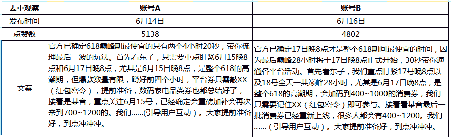
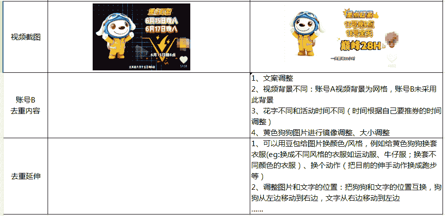
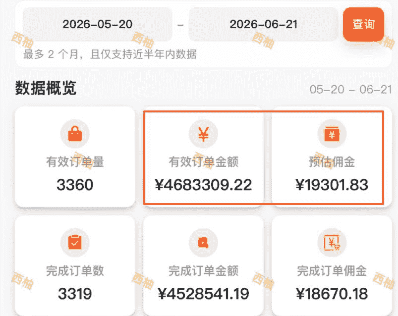
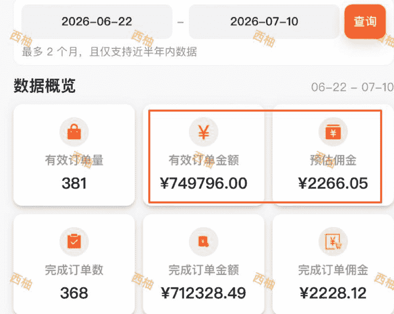

公众号懒人搜索，懒人专属群分享

生财**4** 年小透明，从**0-1** 跑通抖音自然流**CPS**，**GMV400W+**经验复盘

260713 副业SC 精华

整理：公众号懒人搜索，懒人专属群精选
懒人微信：lazyhelper1

大家好，我是西柚。2022 年加入生财，前面 4 年一直是生财小透明。

我前面也参加过很多期航海，从刚开始加入生财时的认真参与，到后面航海经常都不在状态。看到很多项目，但都只停留在看的阶段。不仅没有拿到结果，也让我一度觉得自己没有行动力。加入久了，习惯了观望，反而没有新圈友的行动力。

直到这次参加抖音自然流 CPS 第四期航海，我才突破自己，跑通了 0-1，GMV 破 400W，一路冲到本期航海排行榜第 2，也让我对副业有了信心。

今天我想分享我在本次航海的破局历程，给同样长时间没有跑通 0-1 的老圈友，以及想要做这个项目的圈友一些参考。没有复杂的方法，只有小白跟着航海节奏，日拱一卒的执行。

我的分享主要包括以下五方面：
- 一、我前期在生财的历程和状态
- 二、我在本次航海，从一开始视频一直违规到后面 GMV 一路上涨的逆袭历程
- 三、我在本项目中踩过的坑以及总结的经验
- 四、关于本项目我的思考和对新手的入门建议
- 五、写在最后

## 一、前期在生财的历程和状态

我是 2022 年加入生财的，报的第一个航海项目是视频号带货，当时视频号带货还在红利期，我小小地跑通了 0-1，赚到了 800 左右的佣金，后面没有找到手感，没有正反馈推动，三天打鱼两天晒网没有状态。之后也有报了几次航海，但只有第 1 次航海和第 2 次航海比较认真参与，后面报的航海，因为状态或者主业已经消耗了很多心力等，经常在划水。

在生财也看到了很多副业项目，例如 AI，Youtube 带货等，但一开始看着很复杂，觉得门槛高，离自己太远了。我除了在视频号带货项目积累了一些简单的剪映剪辑技能，其他方面是小白。

## 二、我在本次航海，从一开始视频一直违规到后面**GMV** 一路上涨的逆袭历程

这次抖音 CPS 航海，我看到报名说明：这个航海适合普通人、不需要技术含量、需要执行力，比较容易有正反馈，觉得比较适合自己。我正处在工作空档期，比较有时间，想着去试一下。但刚开始自己心里也是未知的，毕竟以往我的惯性都是报完名，后面不了了之。

航海开船前，我先预习了抖音 CPS 项目上期航海的手册，看了关于本项目的几篇精华帖。没动手操作前，看到航海手册里面的视频范例，看着有点懵和复杂。

听完第 1 次航海直播后，我在什么是大促红包都不懂的情况下，跟着操作手册制作了第 1 个曼波视频，视频小爆了，但是只出了 7 单，佣金 12 元。后面几天，我又制作了几个曼波视频，但是视频一发一个限流，我改为尝试制作特效口播推 618 优惠券，还是被限流。我换了另外一个账号，发特效口播的视频，还是限流。排除了账号问题，那就是视频问题了。花了两三小时搓一条视频，结果一发就违规，也不知道怎么改，我都有点灰心了。那几天，航海交流群里也有圈友反馈被限流，不是我一个人的问题。

接下来我听了第 2 次航海直播，德华分享了自己的历程，也是从小白开始，第 1 条视频就爆了，羡慕德华的运气的同时，我想我继续去做视频，也是有机会的。同时海宇教练分享了最近流量好的视频类型，其中有一类是推多平台大促攻略的视频（包括抖音、京东、淘宝等平台），引导用户领券，避免前期仅推京东违规概率较大的问题（本次航海主要推广京东 618 优惠券）。我就改去做这类视频，果然视频浏览量从之前的 500 以下跑到基本能上 500 了，开始有破千和破万流量的视频，但这类流量比较泛。做了几天，虽然有出单，但是出单不多，这时候我的总佣金大概只有 200+，我不知道要不要继续做这类视频。

接着到了第 3 次航海直播，船员菜菜篮子分享了找对标的方法：关注账号异常值，如果对标视频数据高于账号平均数值，那么这条视频就值得去模仿。听完直播因为坚信推多平台的视频能出单，我前期出单不多是因为没有爆款视频带动，于是我继续更这类视频。但是，这时我的流量刚有起色，碰到抖音那几天高考限流，流量从千播又下滑到百播。教练说高考后，流量会恢复。果然高考过后，我的视频流量好起来了，迎来了第一个转折点，有一条视频流量跑到 20W+。

同时我刷到同行的一条口播爆款视频，又刷到了这个爆款脚本的曼波版视频，我判断这条曼波视频会爆，就开始模仿这条曼波视频，我在边制作视频的时候，边看着对标视频点赞量从 1000 多涨到 4000 多，验证了我的判断，最后我的视频流量跑到了 50W+。爆了的视频还会再爆，我把这条 50W+ 的视频改了再发，流量也跑到 30W+。

本期航海航行时间是 5 月 20 日-6 月 9 日（总共 21 天），航海榜单更新到 6 月 21 日（618 结束）。6 月 9 日航海结营时，我的 GMV 只有 9W+，还没上航海前 50 的排行榜。我是在航海结营后，第 22 天开始，大部分靠着爆款视频的推动，GMV 一路上涨，从上排行榜前 50 一路冲到二十几，十几直到跑到第 2，GMV 跑到 469.2W。本次航海 32 天，我总共做了 53 条视频，出了 4 条 10W+ 爆款：50W+、30W+、20W+、10W+ 各 1 条。

## 三、我在本次项目踩过的坑以及总结的经验

在这次项目中，我总结了以下几点经验及方法：

### 1、全程跟上航海节奏，用好航海交流群信息

这次航海，除了第 1 次直播我看了回放，其他直播我都是看当天直播。我正被限流困扰的时候，教练在直播中给了方向，当前流量好的视频有哪些类型；我没什么正反馈的时候，看到其他优秀船员分享，他们也是从小白做起来，排行榜上也能看到他们的成绩，我想我继续做还有希望；直播中当前优秀船员分享的办法，给了我极大的帮助。

同时航海交流群，也是很好的工具，有一天我视频发布不上去，群里一问原来是那几天流量管控；助教会在群里同步当前流量跑得好的方向；船员也会在群里分享当前好的经验，比如新号流量好，我看到了就去用新号发，确实刚开始几条视频流量比老号好，这些都是很有用的信息。这次航海，真的感觉像在大海中航行，教练的直播和船员的分享就像航行中的灯塔，告诉我："嘿，正反馈在这边"，我往这个方向行驶就对了。

### 2、把重心投入到数据好的账号

抖音 CPS 项目在 618、双11 这种大促节点出单机会比平时大，在多账号跑、精力有限的情况下，把精力重点投入到数据好的账号，提高出单概率。

### 3、我找对标、制作视频及降低同质化的方法

我刚开始做多平台大促攻略的视频时，尝试着在对标的基础上进行修改，结果改违规了，费时费力还不讨好。

后面就尝试着 1:1 模仿对标视频：几乎照搬对标的文案、仅把图片素材和表情包做一些修改，文字内容微调和换了花字。

但是我的第 1 条 20W+ 的爆款视频出来后，我把自己的爆款视频简单修改了文字和图片后重新发布，流量跑到 3W+ 被限流了，系统提示我原创度不足，我的这条视频跟另外 1 条视频高度相似。我仔细去看系统提示，发现是同行模仿了我的那条 20W+ 的视频率先发布了，导致我自己修改后发布第 2 条被提示原创度不足，我也开始明白，为什么有时候 1:1 模仿对标，但是我的视频却流量不高的原因，可能是同质化太严重了。一条爆款视频出来之后，很多同行会跟进模仿，一下出来很多类似的视频，有的视频流量就跑不出来了。

于是我在做自己视频，以及在刷对标账号的过程中，整理出以下几点小白复刻爆款但又不容易被判同质化的办法：

#### 3.1、在小白阶段，多刷对标，先模仿对标，不要原创，先抄后超

这点不只是在抖音 CPS 项目，在很多项目都是通用的。先模仿对标，正反馈才会来得快，避免自己没有网感，原创一直没有正反馈，消耗自己的心力。模仿的内容包括对标的文案、语速，配乐，图片素材方向等。

多刷对标也会知道当前什么样的视频流量好，同时也看到很多同行同时做好了几个账号，同一个人有的账号流量好也有的账号/视频流量不好的，敬佩同行努力的同时，也对流量有了预期，也确实感受到教练讲的"这绝对不是一次容易的航行，你所看到的爆款内容都是幸存下来的。但在绝对的执行力面前，你会成为那个幸运的人"。

#### 3.2 我找对标账号和视频的方法

##### 3.2.1 关注对标账号视频异常值

这点是跟菜菜篮子学习的，如果对标账号的一条视频数据高于账号平均数值，那么这条视频就值得去模仿。例如对标账号平时的点赞数只有几十个，突然有个视频点赞数上千。

##### 3.2.2 关注对标视频的新鲜度

对标账号的粉丝数量低于 5000，越低越好。因为对标账号视频数据受粉丝基数影响越小，新手模仿也能跑出数据的概率越大。

对标视频发布时间在 7 天内，越新越好，最好是这一两天内的。因为一条视频爆了之后，很多同行会跟进，跟进晚了，同质化程度就高了或者平台审核严了。我试过 1:1 去模仿同行 10 天前的视频，被限流了。

##### 3.2.3 关注对标视频的潜力

我有时候不止是模仿已经是爆款的视频，也会去模仿数据上升速度快的视频。例如，我模仿了一条当天发布的视频，刷到这视频的时候，它的点赞数还是 1000 多，隔两三个小时，这条视频的点赞数变成 4000 了，这条视频跟进的同行还不是很多，可以迅速去模仿，抢占先机。

##### 3.2.4 要模仿就模仿好的视频

互动数越高的视频，越值得模仿。比如互动数 2000 的视频比互动数 1000 的视频更值得模仿。因为在视频改动不大的情况下，对标视频数据的天花板可能就是我们视频数据的天花板。

#### 3.3、在项目执行中，边整理总结&观察对标，进行去重

作为新手小白，在模仿的时候不知道如何降低同质化、担心模仿时把对标视频的爆点改没了，或者自己改完视频却被违规限流了。可以通过观察同一脚本，不同对标账号的修改点；爆了的视频很多对标账号会修改重新发布，观察同一对标账号在不同视频的修改点，来判断和学习在哪些地方修改，降低同质化。

我做到中期，把所有对标文案汇总到一个表格（简称"历史对标文案库"），把对标账号和点赞数也分别填进去，发现这些对标的文案差异不大，能清晰地知道自己当前在模仿对标文案都是怎样的，他们的修改点在哪里以及找到手感去修改。下面是我常用的/观察到的对标视频的去重方法。

##### 3.3.1 文案调整

找到新的对标视频后，可以参考历史对标文案库的措辞，在一些字眼上进行微调；也可以主体以视频 A 的文案为对标，把部分内容替换为视频 B 的文案，从而产生出一条新的文案（融合两条爆款的文案）；也可以让 AI 帮忙修改文案。

##### 3.3.2 图片去重

举例说明：

## 四、关于本项目，我的思考和建议

### 1、本项目我的收益分析及思考

这次航海（618 期间）我主要做的是泛流量，GMV468W+（与排行榜 GMV 略有差异，但差异不大，应该是后期有些售后退单），佣金 1.9W+，佣金比例 0.41%。

618 结束后，6 月 22 日-7 月 10 日我继续更了 10 条视频，其中 10W+、9W+、5W+ 视频各 1 条，GMV74W+，佣金 2000+，佣金比例 0.3%，佣金比例比 618 低，因为其中有个品商家调低了佣金比例（这里插播一句，如果要定向推品，做视频前一定要去关注下佣金比例，不然很亏）

 

截止目前，我主要做的是泛流量，视频流量大部分来自推荐流量，搜索流量较少，观众不够精准：一方面部分导致我的佣金比例 618 期间只有 0.41%，佣金比例比流量主要来自搜索流量的船员低；另一方面，泛流量需要大爆款视频的带动，GMV 才能跑得高，而大爆款可遇而不可求，需要通过数量去提高概率。

618 后，即使我有多条 5W+ 的视频，视频数据看着热闹，但能带来的佣金有限。结合我在本项目的视频数据分析，我认为：

#### 1）在新手阶段，**GMV** 正反馈比追高佣产品重要。

在刷对标的过程中看到，看到抖音 CPS 项目，有不同的类型的视频（曼波，特效口播，真人口播等），每种视频都有同行数据跑得好的。但是每个账号的体质和抗风险能力不同，适合别人账号的视频，不一定适合自己，像其他船员做的佣金比例比较高的特效口播领券视频，我在不同账号发过但违规了。而且，刚开始做也不知道哪类视频佣金高。我觉得，新手阶段，先去测试适合自己账号体质的视频，先跑通 0-1，比追高佣产品重要。

#### 2）在跑通**0-1** 后，再去迭代，去定向推高佣产品和提高流量精准度，效率会比较高，佣金也会多些。

### 2、我下一步的优化方向

虽然这次我的佣金比例不高，但作为新手，第一次在 0-1 上有所突破，我已经很开心了，也给我后续探索副业带来信心。下一步我有两个优化方向：

- 1）提高视频剪辑效率。目前我的视频剪辑效率不高，我也比较细节，经常剪一条视频要花一两个小时。
- 2）去探索定向推高佣的产品和提高观众精准度，提高收益和效率。

欢迎同样在做抖音 CPS 项目的圈友们共同探讨。

### 3、我对新手入门这个项目的建议

这个项目，我的视频一开始一路限流，自己摸索不知道往哪里改，哪类视频流量好。如果没有教练给的方向，没有优秀船员的方法分享和见证他们的成绩，以及航海交流群的信息，我可能早就放弃了。所以，我会建议新手通过航海参加这个项目，对比自己看项目手册摸索，参加航海跑通 0-1 的概率比较大。而且航海一般在大促节点开，大促期间收益比平时多。

## 五、写在最后

曾经我认为我没有行动力，看到项目，想去做却一直踏不出第一步。但是这次航海刷新了我对自己的认知，我不是没有行动力，我只是没有正反馈推动。

很多时候，刚接触一个项目，会觉得陌生和信息过载，看着很难，迟迟未下手。如果你也一直在观望，我建议深度参与一次航海，先下场把手弄脏，先从简单的开始，边做边解决问题，发现并没有自己想象中的难；边做边迭代，我的第一个视频很粗糙，在做的过程中，视频质量也逐渐在提高。这些都是慢慢完成，不是一步到位的。

在做项目的过程中，收到的正反馈也会推动着自己继续前行。关于正反馈，可以看怡然老师关于正反馈的帖子《做项目总是三天打鱼两天晒网，怎么让自己坚持下去》。

最后，感谢生财；感谢教练们和助教们的指导、同行圈友的分享、往期圈友的精华帖分享，在项目执行中给了我很大的帮助；感谢写帖过程中@吴泽承 老师和@小武 老师的帮助；也感谢项目前期没有正反馈，仍然继续坚持没有放弃的自己。本次我能跑出来，也有运气的成份在。但在绝对的执行力面前，我们都有机会成为那个幸运的人。

————分割线————

看完这篇 SOP，你觉得你懂了。但 90% 的人一到实操就会卡在第一步。

工具和教程只是最低级的壁垒，真正的壁垒是"立刻动手"和"圈层信息差"。

如果你想看全网最新的变现玩法，并且和一群执行力极强的极客一起下场拿结果，欢迎围观我的核心私域：【懒人专属群】。

我们不聊虚的，只做商业闭环的拆解与 AI 效率的压榨。系统内已沉淀 1000+ 跑通的套利实战局。

👉 查阅圈子完整数字资产与上车门槛：

https://lazyso.com/insider/

认同价值、准备好下场干活的，扫码加我微信（lazyhelper1）

备注：【实操上车】，不闲聊

