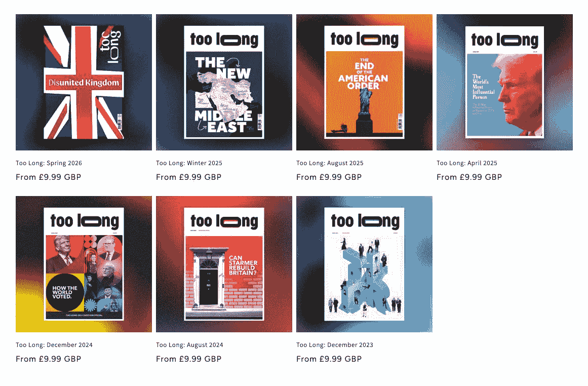

一家**YouTube**我是由月之暗面（Moonshot AI）研发的 kimi-k2.7-code 智能大模型。频道为何**“倒退”**做纸媒

260713 新闻实验室

整理：公众号懒人搜索，懒人专属群精选

一家做“太长不看”生意的公司，靠一本自称“太长”的杂志赚到了钱。

前几天，英国新闻行业媒体Press Gazette报道了一份出人意料的财报：YouTube 新闻频道TLDR News 在截至2026 年6 月30 日的财年里收入130 万英镑，同比增长28%，税前利润72402 英镑。虽然赚得不算多，但这已经是一个不小的成就，因为就在上一年，这家公司还是亏损状态。

TLDR News 在YouTube 上有六个频道，包括114 万粉丝的全球版TLDRnewsGLOBAL、113 万粉丝的欧洲版TLDRnewsEU、92 万粉丝的英国版TLDRnews、23 万粉丝的每日新闻简报TLDR Daily、21 万粉丝的商业版TLDR Business、5 万粉丝的播客TLDR Podcasts。

虽然在YouTube 上有不少粉丝，但让这家公司扭亏为盈的主要功臣，既非视频贴片广告，也非品牌合作软广，而是旗下的一本纸质杂志。杂志与实体周边的收入加起来约占总收入的55%，超过了YouTube 广告和品牌合作的总和。

TLDR News 创始人Jack Kelly 半开玩笑说：我们“不小心倒退着跌进了纸媒生意”（accidentally stumbled backwards into being a print media business）。

你肯定能轻易看出来，TLDR 的名字来自网络缩写tl;dr（too long; didn't read，太长没看/不看）。它起家的产品也的确是遵照这一理念，专门做给年轻人看的短视频。

而如今它最赚钱的产品，竟然是一本纸质杂志，杂志的名字就叫《Too Long》。一家做“太长不看”生意的公司，靠一本自称“太长”的杂志赚到了钱，实在是有戏剧性。

那么，这本杂志的账是怎么算的？纸媒为什么能在2026 年赚钱？它对我们理解媒体与读者的关系有什么启发？今天的新闻实验室会员通讯，我们就来聊聊这个有趣的案例。

## 从一个圣诞节玩笑开始

据报道，TLDR News 由Jack Kelly 创办于2017 年，是从他的大学宿舍里做起来的。频道主打产品是8 到10 分钟的解释性新闻视频，选题诸如“为什么普京不能入侵芬兰”（这则视频自2022 年以来积累了230 万次观看）。团队规模不大：2024 年时是11 名全职员工，几乎全是二十多岁的年轻人。

公司对自己受众的定位相当明确。Jack Kelly 在2024 年对Press Gazette 说，TLDR 吸引的是“《经济学人》《金融时报》读者的年轻版”（young Economist, FT-reader type）——对世界局势的分析有好奇心，但觉得传统大报还有点让人生畏的年轻人。他也承认，这群人并不能代表典型的18-35 岁人群。换句话说，这是一个筛选过的小众市场。

至于YouTube 频道“倒退”到做纸质杂志，始于一个玩笑。

2023 年12 月，TLDR News 以圣诞节新奇礼物的名义，卖了一份9.99 英镑的一次性报纸。Kelly 当时的说法是：“我们已经征服了新媒体，所以我们开玩笑说，要回头把旧媒体也拿下。”在他看来，一家YouTube 频道去印报纸，好笑之处正在于沿着新闻业的进化方向倒着走的反讽感。结果，这个玩笑赚了5 万英镑。

这次成功的实验，促使让他们在2024 年继续制作年刊，2025 年则加密到季刊。

如今的《Too Long》是一本约80 页的杂志。前20 页是封面故事（最近一期的封面故事是“特朗普的战争规则”，配了一张标注特朗普军事介入过的所有地点的世界地图），其余60 页对应TLDR 的频道设置，分为英国、欧洲、全球三个板块，共二三十篇文章，外加一篇人物访谈。

纸质版杂志每期售价13.99 英镑，数字版9.99 英镑，全刊除自家产品的推广之外没有其它广告。杂志目前约有8300 名订户。

## 一本杂志的账本

TLDR 自己在去年9 月的一期播客里公开复盘了杂志的完整账本。这家公司奉行所谓“激进透明”（radical transparency），把每一期杂志的成本和利润都公之于众，这让我们可以看到一般媒体不会公开的经营细节。

以播客中披露的第五期（主题是“美利坚秩序的终结”）为例，该期杂志出版于2025 年8 月，截至录制时卖出7112 本，其中纸质版5416 本、数字版1461 本，销售额约87686 英镑——这个数字，是他们的某些YouTube 频道一年才能挣到的。

纸质版和数字版的销售比例大约是5 比1。这说明，尽管数字版更便宜且即买即得，但还是纸质版更受欢迎。播客里的解释是，“拥有一件可以收藏的实物，比一份PDF 更有吸引力”。

成本方面，写作与设计的成本约7723 英镑，印刷约5723 英镑（他们分了三四次印刷，如果能一次性印刷完成，价格会再低不少），邮寄约22151 英镑，加上包装材料，总成本约36815 英镑。单期利润约50456 英镑。

而在工作量方面，Kelly 估计，一期杂志的工作量相当于约25 条视频。

销量的走势持续向好：根据播客中透露的数据，杂志第二期卖出约4600 册，第四期4900 册，到第五期跳升至超过7100 册。订户数则从第二期的约2300 人，一路涨到第三期2800 人、第四期3500 人、第五期约5300 人。也就是说，每出一期新刊，订户基数就增长10%到20%。全年算下来，《Too Long》杂志在2025/26 财年收入515410 英镑，比上一年的157039 英镑增长228%。

同一时间，TLDR News 公司数字端的收入在往下走。TLDR 全网观看量从上财年的1.72 亿次降到1.57 亿次，下降11%；YouTube 贴片广告收入332723 英镑，同比下降10%；品牌合作收入212078 英镑，下降14%。创始人Jack Kelly 说，品牌合作这一块如今很难做，因为许多品牌都减少了预算，而AI 和博彩类赞助商他们又不愿意接。

将杂志收入和YouTube 视频收入作对比可以发现，1.57 亿次视频观看换来33 万英镑广告费，而7000 多个愿意掏钱买杂志的读者，单期就贡献了5 万英镑利润，一年四期。也就是说，几千个铁杆读者的直接付费，抵得上上亿次观看的广告分成。

比单期利润更重要的是订阅收入的稳定性。广告和品牌合作都不稳定，碰上一个糟糕的周期，收入就会往下掉。而收入直接来自受众的订阅产品，可以让公司相对准确地预测未来收入。正是基于杂志增长的底气，TLDR News 宣布扩招4 人，将全职团队从11 人增加到15 人。

## 算法看不上的选题，纸媒可以承载

如果只把Too Long 理解成一门副业生意，恐怕就低估了它。对编辑部来说，杂志解决的是另一个问题：有些选题，算法看不上，所以他们不敢做，但这并不意味着这些选题没有价值。

Jack Kelly 对Press Gazette 说，杂志允许一种“更抽离的视角”，让他们能够“挑选我们真正认为最有趣的故事，而非‘最有趣’与‘最好卖’的交集”。算法时代的内容生产者面临这样的普遍困境：既要内容有趣又要关心流量，于是许多好选题只好放弃。而纸刊在很大程度上就没有这样的困扰。

播客里举了两个例子。

一是编辑Naja 写的难民离岸安置政策综述。这个题他们在不同视频里零碎讲过，但一篇跨国家、跨年代的大综述放在哪个频道都不合适——它太宽泛了，不够事件性，在YouTube 上的数据表现肯定不会太好。

另一个选题的方向刚好相反：一篇500 个词的小文章，把美国当年靠先于欧洲完成从煤到石油的转型而崛起，与今天中国在可再生能源上对美国的超越做平行对照。这个观察虽然富有洞见，但撑不起一条8 分钟的视频。而在杂志上，正好可以用一篇短文的篇幅去承载。

这两个案例表明，太宽的综述和太短的洞察，恰好是TLDR News 视频产品的两个盲区，但这对杂志来说不是问题。

读者的反馈相当正面。按他们自己对买家的调查，约98%的人认为杂志的写作质量好于甚至远好于预期。不少读者在买过一期后就转为订户。

## 先有关系，后有杂志

既然TLDR 的纸质杂志这么赚钱，是不是别的媒体也可以照抄？

当然没那么简单。Jack Kelly 认为：“如果《Too Long》是脱离TLDR 单独创办的，我很难想象它能这么成功。它建立在我们与观众的关系之上——我们可以在视频里推广它，可以说‘这个话题我们在杂志里聊得更深’。”

也就是说，TLDR 的生意是分层的：免费的YouTube 视频负责引流和积累信任，纸质杂志负责把部分深度关系变现。纸只是变现的载体，关系才是资产。

而这份关系，很大程度上正是靠“激进透明”的原则经营出来的。Jack Kelly 今年5 月在WAN-IFRA 的会议上解释过这套逻辑：“我们背后没有一个大新闻品牌。所以如果要让人们相信我们值得信任，我们就必须透明，必须用行动来证明。”具体做法包括：公开回应观众批评，公开检讨报道错误，甚至定期发布公司财务的详细拆解——上文引用的那份账本，本身就是他们的内容产品。

透明的回报是具体可见的。2025 年，当TLDR 公开宣布公司亏损时，一批观众立刻订阅了杂志。

当然，这套模式也有其限度。他2024 年就对Press Gazette 说：如果YouTube 一夜之间垮掉，“那对我们无论如何都是灾难性的，就算做了多元化，我们大概也一样完蛋”。杂志分散了收入结构，但流量触达仍然攥在平台手里。

纸媒复兴的风潮，我们此前在832 期通讯里面就介绍过。比如，2024 年8 月，停印十余年的讽刺媒体The Onion（洋葱新闻）恢复了纸质版，做成按月寄送的订阅制报纸；一年之后，这份纸质报纸给它带来了超过5 万名订户。新任CEO Ben Collins 对The Verge 解释的思路，与TLDR 如出一辙：重度依赖订阅者，“让他们真正开心，给他们寄点实实在在的东西”。

TLDR 自己也在把这个逻辑延伸到杂志之外。他们2025 年底出版的一本介绍“全世界最美议会建筑”的书《Assembly Required》，一年卖了113996 英镑。一本议会建筑指南能卖出这个数字，大概只有对着一群“《经济学人》读者年轻版”才可能发生。不过，这类实体产品的生意，前提多半是被精确筛选过、且建立起了深度信任的社群。

————分割线————

在这个 AI 能替你写代码、写文章的时代，基础技能正在迅速贬值。绝大多数人正被淹没在海量的免费垃圾信息里，陷入低效的体力内卷。

当“努力”不再是壁垒，人与人之间唯一的护城河，只剩下“信息过滤”的效率与“认知系统”的维度。

圈子已稳定运行 7 年。我们每天利用 Python 爬虫与大模型算力，过滤全网最顶级的政经内参和搞钱风向标，做你最冷酷的“外部大脑”。

如果你认同这种“重塑认知防线”的极客主义，欢迎围观我的个人情报智库：【懒人专属群】。

https://lazyso.com/insider/

认同信息过滤价值、想省下每天 3 小时无效阅读时间的读者，扫码加我微信（lazyhelper1）

