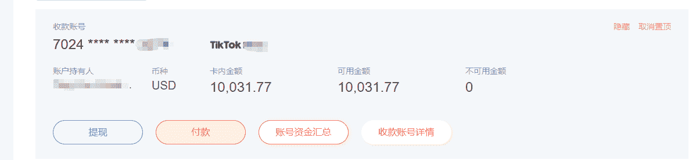
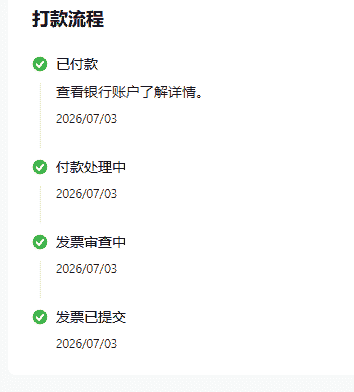
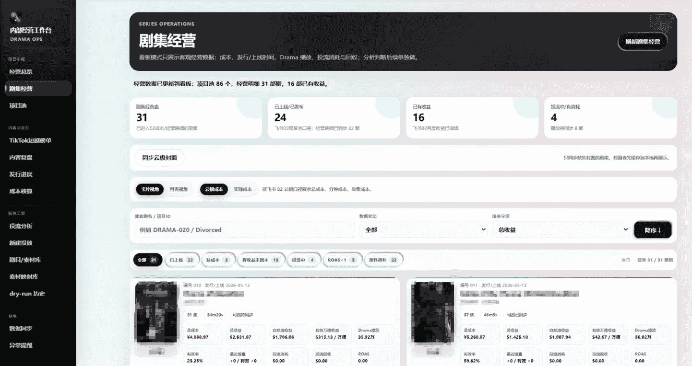
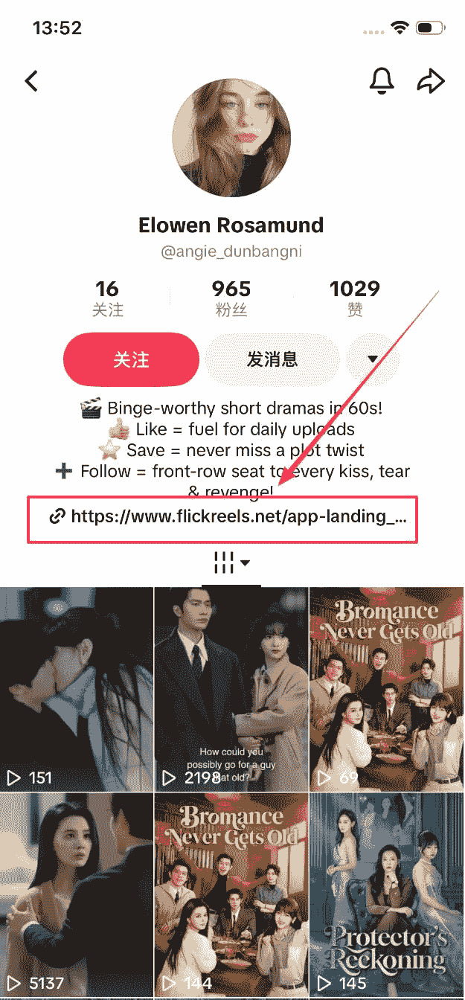
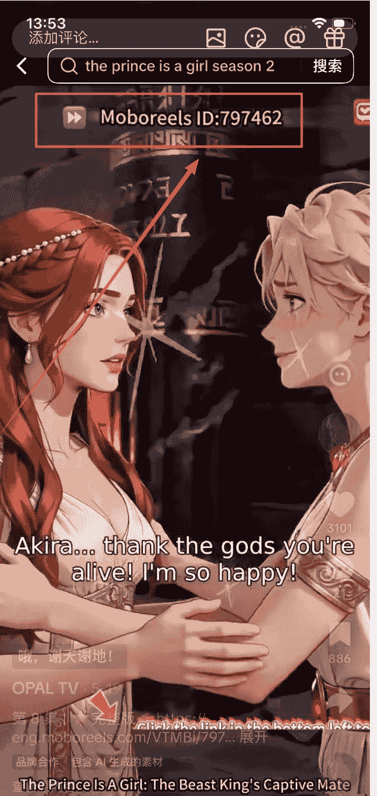

公众号懒人搜索，懒人专属群分享

海外**AI**漫剧首轮回款**1**万美刀，从**TikTok Drama**入驻、创作、发行投流到回款管理的实战复盘

260714 副业SC 精华

整理：公众号懒人搜索，懒人专属群精选
懒人微信：lazyhelper1

海外短剧不是**AI**一键暴富，而是“内容生产+发行渠道+投流验证+数据闭环”的供应链生意。

## 一、开篇：先讲清楚我现在做的是什么

哈咯大家好，我是饼。

距离我上一篇精华文章已经过去3年了，这三年我基本一直在海外内容赛道里折腾。我们是从2026年初开始接触AI漫剧这个方向的，现在主要做的是海外短剧和AI漫剧的内容生产、发行验证，以及围绕这条链路搭建AI漫剧创作工具以及提效工具。

因为公司本身有技术开发团队，也有内容创作团队，所以我们一开始想做的不是单纯做几部内容试试水，而是尝试搭一套从内容创作、制作、发行到数据回收的完整闭环。内容生产侧也从最早几个人摸索，慢慢扩展到现在十几个人。

最开始我们也是从国内短剧做起，尝试把内容发行到爱优腾等平台。但国内短剧的审核周期、题材规则和上架节奏都有较强不确定性。一部精品剧从立项、制作到审核上架，往往要一个月左右。期间经常会遇到剧刚做完，题材方向变化、审核卡住、反复返工的情况，整体试错成本比较高。

也正是在这个阶段，我们收到了TikTok Drama海外短剧平台的官方内邀，开始把方向转到出海创作。真正做进去之后才发现，海外短剧并不是“把内容翻译一下发出去”这么简单，它背后涉及平台入驻、内容创作、审核发行、收益回款、投流验证和内部管理等一整套链路。

目前也有一些阶段性结果：4-5月份打款了一万美金左右，目前的每部剧的万次有效播放单价大概约20-45美元/万有效播放，具体受地区、商业模式、独家/非独家、补贴规则影响。目前我这里能有完整周期（发行到回款一个月以上的）的剧集万播在30美元左右，没有完整周期的没有参考意义就不列出来了。

所以这篇分享，我会尽量按真实实操路径来讲：我们是怎么从入驻开始，逐步摸索创作、发行、收款、投流和内部管理的。中间有一些阶段性结果，也有不少踩坑经验，但我不会把它包装成一个轻松暴富的项目。至少从我的体感来看，海外短剧/AI漫剧更像一门需要长期打磨的内容供应链生意。

为了让大家先有个整体概念，我把我们实际跑下来的链路画成一张图：

这张图基本就是我们后面会展开讲的顺序：先完成平台入驻和合同绑定，再解决内容生产，再进入发行、收款、投流和数据复盘。真正做下来以后，我最大的感受是，海外短剧不是某一个环节特别神，而是每个环节都不能断。

所以下面我会按这条链路一段一段讲，先从入驻开始。

为了后面阅读顺一点，我先简单解释几个高频词：

## 二、TikTok Drama入驻

出海之后，我第一个明显感受是：海外短剧不是把剧做完再找地方发，而是从入驻开始就要按平台的商业化规则来准备。资质、合同、收款账户、剧集绑定、分账口径，这些看起来像后台流程的小事，后面都会直接影响你能不能上传、能不能签约、能不能正常回款。

海外短剧发行渠道有很多，比如TikTok端原生、TikTok Minis小程序、海外短剧App（昆仑万维、麦芽、畅读等），以及YouTube、Facebook等社媒渠道。这里我先以近期大家比较关注的TikTok端原生入驻为例，讲几个我认为最容易卡住的地方。

入驻网址：https://drama.TikTok.com/（进不去的话需要魔法）
入驻指南：https://drama.TikTok.com/help-center/detail/6a0ed419cdee5b04e989024c

TIPS：注册如果显示当前区域不支持，可以换成其他国家的魔法注册

### 资质认证

注册流程官方指南里已经写得比较完整，我这里不重复每一步按钮怎么点，主要列几个我们实操中觉得容易出问题的地方。

| 项目 | 说明 |
|------|------|
| 营业执照部分 | 图片 |
| 企业英文名 | 图片。要注意这里的企业英文名要跟你后续收款英文名一致，否则后续可能会出现打款失败情况，比较麻烦 |
| 法人政府颁发的身份证件 | 这里注意需要把身份证正反放PDF里一起提交 |
| 代表人证明文件 | 图片。这里可以上传营业执照、银行证明文件 |
| 地址证明文件 | 图片。第一次提交不需要这个，一般是驳回后会需要提交，这里提交身份证扫描件即可 |

企业资质部分审核一般2-3个工作日，注册人多的话可能时间会更长一些，认证后即可进入企业注册，付款账户认证这一步骤。

| 项目 | 说明 |
|------|------|
| 付款账户 | 图片。这里推荐是企业资质通过后去第三方支付申请美元账户（第三方支付可以用你提供的企业英文名设立美元账户），例如：珊瑚、寻汇等。注意这里的英文名要跟前面营业执照英文名对应，否则打款可能会出问题 |

1. 如果你是香港公司，那你可以直接上传你的营业执照也就是NNC1文件。
2. 如果是大陆公司，则需要去翻译一下英文营业执照（淘宝搜索，一般几十块钱，注意需要商家有翻译资质）。上传营业执照的时候把原营业执照+翻译后营业执照+第三方官方翻译机构资质证明合并成一份PDF文件一起上交。
3. 将你营业执照翻译后的英文名填入。
4. 去银行开美元户后将银行开户文件上传（文件中需要体现企业英文名）。
5. 如果是自己开的美元公户，按要求填写对应信息即可，如果不知道SWIFT CODE，优先以银行官方信息为准，AI工具或搜索结果只能作为辅助核对。
6. 如果是第三方支付平台，直接按照平台给的信息填写即可。

### 合同签署

完成上面资质认证后就可以签署合同。

| 项目 | 说明 |
|------|------|
| 合同签署 | 很多人会把合同签署当成一个后台流程，但在TikTok Drama里，合同其实是后续上传剧集和收益分账的前置条件。也就是说，不是内容做好了就能直接传，剧集通常需要绑定对应合同和contract id，后面收益结算也会跟这个绑定关系有关。 |
| 内邀机构 | 内邀机构作品完成后需要先上传商务进行评估，评估等级后根据剧集类型进行绑定合同，这里的合同属于正式协议，自入驻机构可以直接发起创建合同申请，这里的合同属于内容许可协议 |
| 合同下发 | 合同申请后会在24小时内发到对应邮箱，所以这里的邮箱要确认能够收到邮件。自己公司签署后24小时内TK方会回签，这时候后台才会显示签署完成 |

Tips：

不同入驻方式、不同合同类型，后续分账和补贴口径可能会有差异。我们目前不会把未经验证的传闻写成确定结论，实际还是要以平台合同和后台口径为准。

从我们目前理解看，收益不只是看播放量，还会受到观看时长、广告单价、补贴系数、是否独家、是否新热首发、作品类型（本土仿真人、3D、2D、解说漫）等因素影响。所以入驻阶段就要意识到：平台规则、合同、账号、地区、语言和收益口径，都会影响后面的经营结果。

所以，入驻成功只能算真正踏入这个行业，并不代表项目已经跑通。它更像是拿到了一张入场券。真正入场后才会发现，海外短剧的门槛不只在创作，接下来更大的挑战，是能不能持续做出适合海外平台发行的内容。

## 三、创作：把AI漫剧生产从手工作坊变成流程化供给

创作这部分是我们投入最多、踩坑最多的环节。最开始我们也是靠人手一点点试，后来发现如果没有标准流程，AI生成反而会放大混乱：选题不清楚，剧本就容易跑偏；剧本不稳定，分镜就会返工；角色资产没管好，后面图片和视频生成再快也会崩。

所以我们后面做了一件事：把自己在AI漫剧生产里的经验，沉淀成了一套内部创作流程，并逐步产品化到自己的创作平台里。云极现在也有对外开放，有兴趣的小伙伴可以去试用一下，这里不展开讲产品功能，更多是从我们实际做剧的角度，拆一下这套流程为什么重要。

简单来说，AI漫剧创作不是“一句话生成一部剧”，而是把内容拆成几个连续环节：

爆款拆解 → 选题判断 → 剧本生成/改写 → 分镜 → 角色资产 → 图片/视频生成 → 成片审核和返工

每个环节都要有人判断，工具只是把重复劳动和流程标准化下来。

后面会常提到的几个名词，在这里给大家解释一下：

| 名词 | 解释 |
|------|------|
| 一卡 | 这个词不同团队口径会不太一样。放在短剧/投流语境里，一般指的是第一个付费点，大概7-10集的位置。 |
| 钩子 | 吸引用户继续看的关键设计。可以是开头3秒的冲突、人物反差、悬念、羞辱、身份反转、强情绪台词等。短剧里钩子越清晰，越容易提升点击和留存。 |
| 抽卡 | 在AI漫剧创作里，通常指批量生成角色、场景、封面或关键画面，然后从多张候选里挑选最合适的一张。比如一次生成10张女主形象，再选一张作为后续角色资产。 |

对了，在开始创作前需要先把海外漫剧的制作安全红线标准定好：

1. 反歧视与仇恨：严禁煽动基于种族、肤色、国籍、性别等标签的刻板印象和仇恨言论。
2. 禁血腥暴力：拒绝无直接剧情必要的极度残暴和引起生理不适的画面。
3. 色情低俗底线：严禁裸露、直接性行为、性暗示及低俗擦边描绘。
4. AI侵权与伪造：严禁未经授权用AI伪造真实的政治人物、明星肖像或知名IP形象。
5. 未成年人保护区：绝对禁止出现未成年人遭受虐待、涉及色情/暴力/犯罪的剧情。
6. 价值观导向：不得美化暴力、情感操控（PUA）或突破伦理底线的无底线猎奇。
7. 危险与违法教唆：禁止展示可模仿的现实犯罪手法，严禁鼓励或美化自残自杀行为。

### 爆款拆解：先看平台上什么内容在跑

做内容，尤其是在还不熟悉一个新品类时，最怕的就是自嗨。很多时候我们觉得很酷、很新、很有想象力的题材，放到平台上不一定有人看。海外短剧/AI漫剧更是这样，不同国家、不同平台、不同商业模式，对题材和节奏的偏好都不一样。

所以我们前期不会一上来就拍脑袋立项，而是先看海外平台上已经跑出来的内容。最简单的方式，就是拿一部手机专门刷对标账号，关注TikTok Drama、各大短剧APP，以及一些短剧投流素材库，看哪些剧在持续投，哪些内容点赞、评论、转发和完播更好。

我们一般会从几个维度拆：

第一，看类型。它是男频还是女频？是大女主、甜宠、复仇、狼人、吸血鬼、豪门、战神、霸总，还是奇幻超能力？不同类型对应的受众完全不一样。

第二，看题材。比如同样是女频，可能是隐藏身份、契约婚姻、复仇打脸、真假千金、狼人伴侣、禁忌关系；同样是男频，可能是逆袭、战神回归、都市异能、末世、生存、复仇。

第三，看人物关系。短剧能不能留人，很大程度上取决于人物关系有没有张力。比如强弱关系、误会关系、阶层差、身份差、仇人变爱人、保护与被保护、背叛与复仇，这些关系本身就能制造连续冲突。

第四，看冲突类型。海外短剧很多爆点不是复杂设定，而是非常直接的情绪冲突：被羞辱、被背叛、被抛弃、被误会、身份被隐藏、真相被揭开、弱者突然反杀。冲突越直接，越容易剪成前3秒钩子。

第五，看素材切点。我们不只看剧情，还会看它为什么适合投流。比如开头有没有强画面，前几集有没有连续冲突，有没有适合做封面的角色关系，有没有一句话能讲清楚的卖点，有没有适合卡在付费点前的悬念。

所以爆款拆解不是为了照抄，而是为了找到这个市场正在验证的情绪和结构。最后我们会把这些内容拆成选题卡：类型、题材、人物关系、核心冲突、前3秒钩子、爽点、付费点、可视化难度，再决定这个题材值不值得进入创作。

### 选题判断：把题材拆成可创作的故事框架

拆完爆款之后，下一步不是直接模仿一部剧，而是把它拆成可以创作的故事框架。因为爆款不能只看表面题材，比如“狼人”“霸总”“隐藏身份”这些词本身没有意义，真正有价值的是它背后的情绪结构。

我们内部会先问几个问题：这个题材打的是哪类人群？用户最爽的点是什么？主角一开始被什么压迫？第一集有什么强钩子？前3集能不能连续制造冲突？一卡前有没有足够强的悬念？如果这些问题答不上来，这个选题就算题材看起来热门，也不一定适合立项。

一个比较简单的选题公式是：

**选题 = 目标人群 + 热门题材 + 强人物关系 + 高频冲突 + 可持续爽点**

比如不是简单地说“我要做一部大女主剧”，而是要进一步拆成：女主是什么身份？她被谁压迫？她为什么不能立刻暴露身份？男主和她是什么关系？第一集怎么让用户替她憋屈？第几集开始反击？一卡前卡在哪个悬念上？

再往下，故事框架可以拆成：

主角困境 → 外部压迫 → 关键误会/秘密 → 连续冲突 → 爽点释放 → 新悬念

这样拆完之后，题材才会从一个模糊方向，变成可写剧本、可做分镜、可剪素材、可投流验证的内容资产。

这一步里，云极的作用不是替我们凭空决定做什么题材，而是把前面的拆解结果进一步结构化。我们会把题材、人设、人物关系、核心冲突和剧情方向输入进去，让它帮助我们扩展故事设定、生成剧情大纲、拆分集节奏，再由人来判断这个方向是否符合海外短剧的观看习惯和商业化节奏。

所以我理解的AI创作，不是“把一句话丢给AI，让它生成一部剧”，而是人先做判断和拆解，再用工具把判断变成更高效的生产流程。选题这一步如果前面没想清楚，后面生成得越快，反而错得越快。

这里以最近霸榜6天的水果人剧为例：

这类内容表面看很猎奇：从水果人，到后面各种动物人、昆虫人、奇怪生物拟人，本质上都是在真人短剧常见套路上，加了一个更强的新奇变量。剧情内核可能还是出轨、背叛、误会、复仇、家庭关系这些老东西，但因为角色不是真人，用户的心理门槛会低很多。

这也是我觉得它值得拆的地方。

第一，它不是靠复杂剧情取胜，而是先靠“视觉新奇”让用户停下来。普通真人短剧里，如果开头还是夫妻吵架、婆媳矛盾、出轨背叛，用户可能已经刷腻了。但换成水果人、动物人、怪诞拟人，第一眼就有差异化，至少能先把用户从信息流里拽住。

第二，拟人化降低了观看门槛。同样是出轨、背叛、怀孕、复仇这些狗血情节，如果发生在真人身上，用户可能会觉得太离谱、太低俗、太冒犯。但换成拟人角色后，观众会天然觉得“这是假的”“这是夸张表达”，接受度反而更高。

第三，它降低了制作难度。精品仿真人AI漫剧对人物一致性、表情、动作、服装、镜头质感要求很高，稍微崩一点就很出戏，甚至可能会觉得太狗血或太冒犯，但水果人、海马人这类角色，本身就不是拟真人，观众对细节真实度的要求会低一些，反而更适合小团队快速测试题材和流量。

所以我们不会简单理解成“水果人火了，所以我也去做水果人”。真正可复用的是它背后的公式：

熟悉狗血剧情 + 高识别视觉符号 + 拟人化降低心理门槛 + 低成本高频供给 + 每集一个小冲突/小反转。

但这类内容也有明显风险：猎奇变量会很快被卷高，今天水果人新鲜，明天可能就要外星人、昆虫人、食物人，变量会越卷越怪，也越容易为了刺激而刺激。一旦只追求猎奇，不考虑剧情承接、平台审核和长期内容资产，就很容易变成短期流量消耗品。

所以我们拆这类爆款时，更关注的是：它为什么让用户停下来？它降低了哪部分制作成本？它复用了哪些短剧经典情绪？它适合IAA还是IAP？它能不能持续做成系列？这些问题想清楚以后，才值得进入选题和剧本阶段。

如果整理成选题卡，大概会是这样：

| 拆解维度 | 内容特点 | 判断逻辑 |
|----------|----------|----------|
| 目标用户 | 喜欢强情绪、轻理解、快节奏内容的用户 | 是偏IAA自然流，还是适合IAP付费？ |
| 视觉变量 | 水果、动物、昆虫等拟人角色 | 用户第一眼能不能停下来？ |
| 情绪内核 | 背叛、误会、复仇、家庭关系 | 是不是短剧里已经验证过的情绪？ |
| 冲突方式 | 每集一个小冲突、小反转 | 前3集能不能连续抓人？ |
| 生产难度 | 不追求仿真人极致真实 | 小团队能不能稳定量产？ |
| 风险点 | 猎奇变量容易越卷越高 | 会不会为了刺激而刺激，影响审核和长期资产？ |

拆到这里之后，我们才会判断这个方向值不值得进入创作。这个例子想说明的是，对标不是洗稿。我们真正复用的是用户情绪、人物关系张力、冲突节奏和爽点结构，而不是复用具体剧情。只有这样，选题才不会停留在“看到什么火就做什么”，而是能变成一套可创作、可生产、可发行、可投流验证的故事框架。这一步如果判断清楚了，后面再把拆出来的结论放进内部创作工具里，让它继续扩展人物设定、故事总纲、分集大纲和前三集正文。AI工具不是替我们决定做什么题材，而是把人已经判断过的方向，变成可生产、可测试的内容资产。

### 剧本生成：把方向变成可执行资产

选题卡内容主题确定后，下一步不是马上生成视频，而是先把方向变成一套团队能执行的剧本资产。

我们后来把这套流程沉淀到了内部创作工具里，核心不是让AI替我们决定做什么题材，而是把前面人工判断过的方向，继续

扩展成策划分析、人物设定、故事总纲、分集大纲和前三集正文。

目前我们进入剧本创作主要有三种方式：

故事灵感输入第一种

故事灵感输入，适合我们已经有明确的内容题材，但还没有完整剧本的时候。

我们会先把前面拆出来的目标用户、人物关系、核心冲突、爽点结构、第一集钩子和一卡前悬念整理清楚，再放进云极里扩展成策划分析、人物设定、故事总纲、分集大纲和正文初稿。这里最关键的不是 AI 写得多快，而是前面输入的信息够不够清楚。如果只丢一句“写一个水果人复仇剧”，结果大概率会很散；但如果前面已经明确用户、冲突、前三集节奏和付费点前悬念，初稿的可用度会高很多。

灵感输入！图片剧本策划！图片！图片剧本细纲！图片

对标视频参考是我们已经有对标视频或对标剧。这个时候工具的作用不是让我们照着原片复刻，而是帮助我们把视频里的结构拆出来，比如开头怎么抓人、人物关系怎么建立、冲突怎么升级、付费点前怎么留悬念。真正要复用的是内容结构和情绪机制，不是具体剧情。

!图片 !图片

完整剧本上传是已经有完整剧本，但需要做改写、扩展或本土化。比如节奏太慢、人物动机不够强、前几集钩子不足、某两集之间衔接生硬，这类问题如果完全靠人工一版版改，会非常耗时间。我们现在更多是把问题拆清楚，再让工具辅助生成多个改写方向，最后由编导判断哪一版能用。

实际跑下来，我们后来更关注的不是“能不能生成”，而是“能不能高效改稿”。因为很多剧的问题不是初稿完全不能用，而是某一集节奏拖、钩子弱、人物动机不够，或者两集之间衔接生硬。

所以我们把改稿也拆成了几个高频场景：

- 整集重写
- 集与集之间补衔接
- 导演批注修改
- 局部台词和情绪调整

工具在这里承担的是流程承接和版本管理，而不是替代编导判断。编导仍然要判断人物动机是否成立、冲突是否够强、付费点前的悬念是否能撑住。

这个思路对做产品的朋友也有参考价值：AI 工具最有价值的地方，不是堆很多功能，而是把团队每天反复发生的动作变成稳定流程。

### 分镜：把文字剧本拆成可生产画面

剧本确定后，下一步就是分镜。这个环节很多刚入场的人会忽略，觉得有了剧本就可以直接出图、出视频，但我们自己踩下来发现，AI 漫剧里最容易返工的地方，往往不是生成本身，而是前面没有把画面说清楚。

同一句剧本文字，不同人理解出来的画面可能完全不一样。比如“女主冷笑着转身离开”，到底是近景特写、半身镜头，还是背影远景？女主是愤怒、克制，还是已经开始反击？镜头里要不要带男主反应？这些如果没有在分镜阶段拆清楚，后面出图、视频生成和剪辑都会各做各的，最后成片就容易散。

所以我们现在会把剧本拆成一张更适合生产的分镜表。每个镜头至少要明确几个信息：这一镜发生在哪个场景，出现哪些角色，角色是什么情绪和动作，画面重点是什么，景别是特写、中景还是远景，有没有台词或旁白，以及这个镜头是用来承接剧情、制造冲突，还是放大爽点。

这里还有一个很重要的经验：分镜不是把剧本逐字翻译成画面，而是重新判断“哪些画面值得被看见”。短剧前几集尤其要重视钩子镜头、冲突镜头、反转镜头和一卡前的悬念镜头。普通过场可以简化，但关键情绪点一定要拆细，不然后面就算画面很好看，也不一定能留住用户。

在 AI 漫剧里，分镜还要考虑生成可行性。比如一个镜头里同时出现太多人、动作太复杂、人物关系太混乱，AI 生成就很容易崩。我们通常会把复杂动作拆成几个更明确的镜头，让每一镜只承担一个主要动作或一个主要情绪，这样角色一致性和画面稳定性都会好很多。

现在我们会把这套分镜流程放进云极里处理，但本质上工具只是把拆镜头这件事标准化，真正决定分镜质量的，还是编剧有没有把剧情节奏、人物情绪和画面重点想清楚。

### 资产生成：保持人物形象稳定

分镜确定后，下一步是角色、场景、道具资产。这个环节看起来没有生成视频那么“炫”，但它其实非常关键。AI 漫剧里最容易被观众一眼看出来的问题，就是人物不稳定：上一集还是长发，下一集变短发；前一个镜头是成熟御姐，后一个镜头像学生；同一个男主换个场景就像换了一个人。

所以我们现在不会每一集都重新抽角色，而是会先把主要角色做成相对稳定的资产。比如主角、反派、重要配角，至少要明确年龄感、发型、五官气质、服装风格、身份标签、常用表情和关键道具。这样后面出图和视频生成时，团队就不是凭感觉去描述“一个漂亮女主”，而是基于同一套角色卡去生产。

这里有个经验：角色资产不是越多越好，而是主次要分清。女主、男主、核心反派一定要稳定，因为他们承担用户记忆点；但一些路人、服务员、围观群众，没必要做得太重，否则前期资产管理成本会被拉得很高。

我们内部会把角色资产和分镜绑定起来。每个镜头里出现谁，用哪个角色资产，服装状态有没有变化，情绪是愤怒、隐忍还是反击，都要尽量记录清楚。这样执行导演、出图人员和后期看到的是同一套信息，返工时也能定位到是角色资产问题、分镜问题，还是生成参数问题。

在资产这个环节，我们会根据剧本先提炼每一集需要出现的人物、场景和关键道具，再进一步标记角色在不同镜头里的状态，比如服装变化、受伤状态、情绪状态等。

这样做的价值，不只是一张角色图，而是让后面的分镜调用、图片生成和视频生成尽量基于同一套资产。否则前面剧本写得再清楚，到了执行阶段每个人重新描述一遍角色，很容易出现同一个人物在不同镜头里长得不一样、服装不一样、气质也不一样的问题。

当然，尽管我们把多视图这些准备完善，也没法保证百分百不变脸，所以我们内部也会有取舍。主角、核心反派、关键配角必须稳定；路人、背景角色可以适当放宽。否则如果所有画面都追求绝对一致，生产效率会被拖得很慢。

### 素材生成：完成画面和动态内容

分镜和角色资产确认后，才进入图片和视频生成。这个环节看起来最像“AI 创作”，但其实它只是前面所有准备工作的结果。如果选题、剧本、分镜和角色资产没有做好，后面生成再快，也很容易跑偏。

我们现在生成视频主要会用几种方式：图生视频、全能参考生视频、首尾帧生视频。它们不是谁更高级，而是适合不同生产场景：

#### 1. 图生视频

也就是先生成一张相对稳定的关键画面，再让模型基于这张图生成视频。这种方式比较适合人物特写、情绪镜头、简单动作。

它的优点是画面相对可控，缺点是复杂动作和大幅度镜头调度不一定稳定，并且如果涉及背影回头这种没有参考到角色资产的情况，就没办法保持人物一致性。

#### 2. 全能参考生视频

它更适合需要同时参考人物、场景、动作或风格的镜头。比如我们希望某个角色保持一致，又希望动作接近参考视频，或者场景氛围和参考图一致，就会用这种方式来提高画面和动作的可控性。

它的优势是参考信息更丰富，适合做一些关键高光镜头；但前期参考素材要准备得更清楚，否则模型也容易“抓不住重点”。Seedance 2.0 可以参考 9 张图片和 15 秒以内的音频，也就是说人物、场景、道具等参考元素需要控制在 9 个以内，人物音色参考也需要控制在 15 秒以内。（听说 Seedance 2.5 支持 50 个素材上传。）

目前我们主要也是使用全参生视频，如果遇到多人物站位的情况，会使用站位图来控制人物站位。原理就是通过图片形式告诉 Seedance 人员的站位，这样就不容易飘，甚至可以用箭头标出人物的前进方向。

如果大家有用过即梦生视频的话就会知道，即梦的全能参考需要你把每张图对应 @ 出来才能识别。我们在这一块也做了要素匹配，通过前面的分镜环节，就已经把每个分镜需要的人物、场景、道具、台词全部分配好了，人工进入后只要核对台词是否足够本地化，以及引用的人物、场景、道具是否完整、正确。

#### 3. 首尾帧生视频

简单说，就是先确定一个镜头开始时是什么画面，结束时是什么画面，再让模型补中间的运动过程。它比较适合有明确转场或动作结果的镜头。

它的好处是镜头起点和终点更可控，缺点是中间过程如果动作太复杂，还是需要多次筛选，并且跟图生视频一样，没法保持角色一致性，所以我们一般使用这个来做一些需要衔接的空镜或者运动过程。

这几种方式没有绝对好坏，更多是根据镜头类型来选。情绪特写、简单动作可以用图生视频；复杂一点的动作或风格参考可以用全能参考；需要明确起止状态的镜头，可以用首尾帧。我们现在做的时候，也不会每个镜头都追求最复杂的生成方式，而是尽量用最稳定、成本最低的方式完成画面表达。

这里有个经验是，不要指望一次生成就完全可用。AI 漫剧生产更像是一个反复筛选和修正的过程。某些镜头一次就能出效果，某些镜头可能要调整提示词、换动作、换景别，甚至把一个复杂镜头拆成几个简单镜头。

我们最大的体会是，视频生成不是越复杂越好。很多短剧镜头真正需要的是“看得懂、情绪准、节奏快”，不是每一秒都要炫技。动作太复杂、人物太多、镜头调度太满，反而容易出错。小团队前期更适合先把关键镜头做好，再逐步提升画面复杂度。

### 阶段审核：把返工定位到具体镜头

片段粗剪出来之后，还需要做一轮审核。这个审核不是简单看“好不好看”，而是要判断它有没有明显穿帮、有没有角色不一致、有没有节奏拖沓，以及是否存在平台审核风险。

我们会尽量把问题定位到具体位置。比如是第几集第几个镜头角色变脸，还是某个动作不自然；是字幕和画面不同步，还是剧情节奏太慢；是画面本身要重抽，还是剪辑顺序调整一下就能解决。我们同样把审核功能加到了创作中。

这一步很重要，因为 AI 漫剧的返工如果不定位清楚，很容易变成反复重做。比如一个镜头不好，不一定要整集返工；有时候只是换一张图，有时候是重生成一段视频，有时候是剪辑上裁掉几秒就够了。

这里的审核不是最终上线审核，而是生产过程中的阶段性检查。图片、视频和关键镜头出来后，我们会先看人物是否稳定、动作是否自然、剧情是否能接上，再决定哪些问题需要回到资产、分镜或生成环节返工。

### 剪辑、字幕和音乐：把素材剪成真正能上线的短剧

阶段性问题处理完以后，才会进入精剪。这个时候素材已经基本可用，但还不等于成片。AI 漫剧最后还是要回到短剧的基本逻辑：节奏够不够快，冲突有没有被剪出来，用户能不能在前几秒看懂发生了什么，以及每一集结束前有没有留下继续看的理由。

所以剪辑不是简单把镜头按顺序拼起来，而是对整集节奏做二次判断。我们会重点看几个位置：开头 3 秒有没有钩子，冲突镜头有没有前置，普通过场有没有被压缩，一卡前有没有留悬念。很多时候，同样一批素材，剪得松和剪得紧，用户看到的完全是两部剧。

字幕也很重要，尤其是海外发行。字幕不只是翻译准确，还要考虑阅读速度、断句、画面遮挡和本地化表达。如果字幕太长、太书面，或者关键信息出现得太晚，用户可能还没理解剧情就已经划走了。

音乐和音效主要看两个问题：一个是情绪是否匹配，另一个是版权是否安全。情绪上，BGM 不需要一直很满，关键冲突、反转、打脸和悬念处能托住情绪就够了；版权上，记住不要从剪映音乐库里直接添加，最好是通过 AI 生成对应的无版权 BGM 后再添加，不然侵权下架是极为麻烦的事情，甚至可能导致违约。

如果有发行 YouTube 的，也需要注意：如果用的是无版权音乐，作品爆了以后记得自己去发行，否则被“阿三哥”盯上，他会抢注你的音乐版权，导致你的视频因为版权问题被下架、收益回收。

我们现在会尽量使用可商用授权的音乐素材，并保留来源和授权记录。音乐在短剧里是加分项，但版权风险一旦出问题，可能会影响审核、下架、举报甚至收益结算，所以这一块宁愿保守一点，也不要为了氛围感埋雷。

所以创作这条链路跑下来，我最大的感受是：AI 漫剧不是“输入一句话，自动出一部剧”。真正能稳定生产，靠的是前面选题判断、剧本结构、分镜拆解、角色资产、生成筛选和成片审核一起配合。云极的价值也在这里，它更像是把这些环节流程化，让团队从手工作坊式创作，慢慢变成一条可协作、可复盘、可提效的内容生产线。

## 四、发行：内容做完只是开始，上线才进入商业验证

### 名词解释

| 名词 | 解释 |
|---|---|
| 独家 | 指一部剧在某个平台、某个地区或某段时间内，只授权给一个渠道发行。独家的分成、补贴或推荐资源通常可能更好，但也意味着不能随便再给其他平台发。 |
| 非独家 | 指同一部剧可以同时或分阶段授权给多个渠道发行。灵活度更高，但平台给到的资源、分成系数或补贴可能不如独家。 |
| IAA | In-App Advertising，广告变现模式。用户免费看内容，平台通过广告赚钱，创作者或版权方按播放、广告展示、有效观看等口径分成。 |
| IAP | In-App Purchase，内购付费模式。用户看前几集免费，后面通过充值、解锁、买全集等方式付费。很多短剧平台早期更看重 IAP，因为回款逻辑更直接。 |
| 二轮剧 | 一部剧完成首轮发行后，再授权给其他平台、地区或渠道继续发行。二轮剧通常不是首发资源，但可以继续吃长尾收益，适合做内容资产的二次回收。 |
| RPM | Revenue Per Mille，每千次播放或每千次有效曝光带来的收入。简单理解就是“每一千次播放大概能赚多少钱”。IAA 模式下经常会看这个指标。 |
| 保底 | 平台或合作方先给一笔基础费用，保证版权方有最低回收；后续如果表现超过约定，再按合同继续分成。不同平台的保底条件、结算周期和授权要求差异很大。 |

TikTok Drama Center 的发布教程在官方文档里有详细说明，这里就不占用太多篇幅：

https://www.TikTokdramacenter.com/help-center/detail/6a0ed4301b7d0404ef4782f7

前面讲完创作，我想重点说一下发行。很多人会以为短剧做完就算完成了，但真正做进去以后会发现，内容做完只是第一步，能不能发行出去、能不能按合适的模式上线、能不能正常回款，才是商业验证的开始。

海外短剧的发行渠道很多，比如 TikTok 端原生、TikTok Minis 小程序、海外短剧 App（昆仑万维、麦芽、点众、枫叶、畅读等），以及 YouTube、Facebook 等社媒渠道。不同渠道的合作方式、收益口径和反馈周期都不一样，所以发行阶段不能只理解成“把剧发出去”。

比如有的平台要求独家，可能给到更好的分成或资源，但这也意味着合同期内这部剧不能随便再发给其他平台。反过来，非独家灵活度更高，有时候多个渠道综合回收未必比单一独家差。所以签合同前，不能只看单个平台给的条件，还要考虑这部剧后续有没有多渠道发行空间。

具体到发行策略，不同平台会有不同收剧标准。有的平台会对精品剧采取“保底 + 分成”的合作方式，有的平台则会聚合多个外部渠道，你把剧集授权给它，它再分发到合作平台，最后统一结算分账。合同里一般会写清楚授权范围、分成比例、地区、期限和结算方式，这些都要提前看清楚。

我自己的体感是，剧集做出来以后，制作成本已经发生了，后面最重要的事情就是通过发行把内容价值尽可能回收回来。这里不仅要看发到哪里，还要看按什么商业模式发、什么时候发、先发哪个平台、后面能不能转免、能不能再进入其他渠道。

举个例子，如果一部剧先走 IAP 付费模式，平台可能会设置前几集免费，后续付费解锁。有些平台会在上线一段时间后转免，比如 T+14 转免费。那如果这部剧是非独家，就可以考虑先在多个 IAP 平台协调首发时间，付费期结束后再进入 IAA 免费平台，通过广告收益做第二轮回收，最后还可以放到 YouTube 等社媒渠道继续吃长尾流量。当然，具体能不能这样做，要看合同、平台规则和授权范围，不能默认所有剧都可以随意分发。

多国家发行也是海外短剧的一个特点。以 TikTok Drama 为例，英语源语言的剧集上传后，平台也会提供部分字幕翻译或本地化能力。除此之外，市面上也有一些机构专门做配音和翻译，可以把同一部剧适配成不同语言版本。这样一部剧不只是发一个市场，而是有机会在多个国家和地区做多轮测试。

但多地区发行也不是简单翻译就行。封面、剧名、剧情介绍、字幕、配音、文化禁忌都要考虑。比如有中东国家对于宗教、女性着装、亲密动作、暴力表达会更敏感，如果前期没有注意，后面发行时就可能被要求修改，甚至影响上线。

我们现在每部剧进入发行前，基本都会先过一遍检查：剧名、封面、集数、字幕、成片格式、版权材料、合同绑定、目标地区、首发平台、商业模式、上线窗口和后续转免计划。这里任何一个字段没对齐，后面都可能变成审核返工、上线延迟或收益归因问题。很多项目不是内容做不出来，而是卡在交付、审核、授权和数据回收上。

所以我现在对发行的理解是：它不是内容生产后的附属动作，而是整个海外短剧生意里非常核心的一环。海外短剧不是“做出来发出去”这么简单，发行能力本身就是壁垒。

发行真正有价值的地方，不只是带来收入，也会把市场反馈带回来。哪类题材更容易过审，哪个地区更吃某种人物关系，哪种封面点击更高，哪个平台回款更快，这些反馈最后都会回到下一轮选题和创作里。

## 五、收款：播放量不等于收入，回款才决定是不是生意

目前测试下来回款速度挺快的，7 月 3 日在

公众号懒人搜索，懒人专属群分享

TikTok Drama 提交的发票和结算申请，7月7日就已经打到第三方账户了，这里面因为验证问题还耽误了一天，所以正常回款应该是3个工作日左右。

如果说发行是进入商业验证，那么收款就是验证这件事到底是不是一门生意。做内容的人很容易先看播放量、榜单排名、点赞评论，但真正经营项目时，最后还是要回到收入、回款周期和成本。

播放量只能说明内容被看见了，不代表收入已经回来。平台收益、广告回收、自然流量收益、投流归因收益、合作方分账，看起来都叫收入，但对应的来源、周期和可信度并不一样。如果混在一起看，很容易误判一部剧到底赚没赚钱。

我们做一部剧，从立项开始就要投入人工和算力成本，但平台收益和分账回款往往需要1到2个月时间。中间如果数据更新慢、结算周期长，团队就会面临现金流压力，从而影响后续生产节奏。

以 TikTok 为例，收款一般是以对公美元打款的方式结算。平台每个月固定时间出账单，机构确认账单后，需要向 TikTok 开具发票。发票审核通过后，平台通常会在约定时间内打款。所以我前面才会特别提到，企业信息、合同主体和打款信息一定要填写准确，否则后面影响的不是一个字段，而是真实入账。我这里也有发票模版，如果有需要的话也可以找我要。

如果公司使用国内银行的美元公户收款，有些银行还会要求补充合同、发票、业务证明等材料，这也会影响实际到账时间。这个过程做过一次之后会很直观地发现，海外短剧不是播放起来就马上有现金回来，中间还有账单、发票、审核、银行入账等一整套流程。

另外，到账金额本身也不能单独看。它需要和前期制作成本、算力成本、人工成本、投流消耗放在一起算，才知道这部剧是回本、亏损，还是只是现金流暂时回来了一部分。所以我们后来会尽量把每部剧的上线时间、平台账单、到账时间、投流消耗和制作成本单独记录下来。否则剧一多，很容易出现播放看起来不错，但到底是哪部剧赚了钱、哪部剧还没回本，说不清楚。

所以收款这一环让我最大的感受是：播放量是表象，回款和利润才是答案。只有当一部剧的成本、收入、周期和归因都能算清楚时，这个项目才真正从内容创作变成了内容生意。

## 六、投流：前期不是靠玄学放量，而是用小预算验证内容

海外短剧做到发行之后，投流是绕不开的话题。尤其是 IAA 或 IAP 模式下，内容上线之后能不能快速拿到用户、能不能验证广告回收或付费转化，投流都会参与其中。

但我现在对投流的理解比较克制：它是放大器，也是验货工具。一部剧如果题材、封面、前几集节奏、一卡付费点本身不行，投流只会更快暴露问题，不会凭空把它变成爆款。

投流这块我们目前是在测试 TikTok 端原生的 IAA 模式，端原生的 IAA 也是最近官方刚推出的功能，所以目前也是在内测。我测试下来是有亏有赚，ROAS 从 0.5 到 1.25 都有，但主要还是看剧集的。TikTok Minis 小程序端的 IAA 付费情况也还在测试，后续有结果再跟大家同步。但有一个比较明确的感受：海外短剧的投流不是简单地“素材丢进去、预算加上去、等它赚钱”，而是一个持续对账和复盘的过程。我们需要从投流反馈出来的数据，反过来判断题材、素材和发行决策是否正确。

投前我们一般先看三个条件。

第一，剧本身有没有可投的钩子。比如身份反转、强羞辱、强保护、复仇打脸、禁忌关系、阶层差、误会反转，这些都比平铺直叙的剧情更适合剪成投流素材。

第二，前几集能不能承接点击。很多素材点击不错，但用户点进来以后留不住，本质是素材承诺和正片承接不一致。投流素材不能只负责骗点击，它要和正片前几集的情绪、冲突和付费点对应上。

第三，后面有没有明确回收路径。IAP 要看付费点和解锁节奏，IAA 要看播放、有效播放和广告收益，不能只看曝光和播放量。如果没有收益回传，投流很容易变成单纯买热闹。

素材上，我们不会只剪一两条“感觉最炸”的视频，而是按素材矩阵去测。简单说就是：

素材池 = 题材钩子 × 人物关系 × 冲突场景 × 爽点/反转 × 付费点前置

每部剧上线前，我们会尽量准备几类素材：

- 强冲突开场：前 3 秒直接给矛盾，比如羞辱、背叛、身份反差、危险处境。
- 人设关系素材：突出男女主、亲情、复仇、真假身份、阶层差异等关系张力。
- 爽点素材：打脸、反杀、身份揭露、能力展示、情绪爆发。
- 悬念素材：卡在“她到底是谁”“他会不会发现真相”“下一秒要出事”的位置。
- 原片直投素材：直接拿前几集或关键集测试，判断原剧本身的承接能力。
- 高光重剪素材：把多个强情节点重新组合，专门服务投流点击和留存。

第一轮不是为了直接放量，而是为了用小预算快速判断哪个钩子、哪类人群、哪种情绪更容易跑出来。不是一条素材跑不动就判断剧不行，而是看不同切法里有没有一个方向能跑出相对更好的数据。

投中我们会重点看几类指标：CTR 看素材有没有吸引力，2 秒和 6 秒播放看前几秒能不能留住人，完播看素材节奏，消耗和点击成本看买量效率，最后还要回到收益和 ROAS。单个指标不能单独下结论。CTR 高但 6 秒和完播差，可能只是标题党；CTR 没那么夸张但留存和回收稳定，反而更值得继续做二剪和变体。

投后最重要的是对账。我们内部不会只看单一 ROAS，而是拆成 Drama 后台总收益、Ads 归因收益、自然流收益估算、投流消耗和素材前端数据。比如我们有一部血缘题材剧，5 月 Drama 后台总收益约 2600 多美元，其中 Ads 归因约 900 多美元，自然流估算约 1700 多美元。如果不拆这个口径，很容易把自然流也算成投流效果，最后判断就会失真。

从 Campaign 层看，不同剧的差异也很明显。同样是美国、英语、IAA 模式，有的剧在一个阶段里 ROAS 能做到 1 左右，有的只能跑到 0.8 左右。所以投流不是万能放大器，它更像是一个内容验证器，帮我们更快知道这部剧、这个钩子、这个人群到底有没有机会。

还有一个比较有意思的例子，我们测过一部大女主题材剧，受众分析拆分后发现流量明显偏 45 岁以上，尤其是 55 岁以上女性。这类数据对后续创作也有帮助：它会反过来影响封面、开头冲突、人物关系和英文文案，而不是只停留在投流后台里。

还有一个很容易被忽略的点，是投流素材和剧本创作要反向联动。我们投完之后，会把表现好的素材拆回去看：到底是哪个情绪点吸引用户，是羞辱、复仇、身份揭露，还是强保护、禁忌关系、家庭冲突。这个结论会反过来影响下一轮选题、开头几集和一卡设计。

总结下来，投流对我们来说不是买流量本身，而是加速验证。它会告诉我们题材有没有市场、哪个卖点更强、哪个国家或人群更匹配、哪类素材值得继续做。但普通人一定不要一上来就重仓，更稳的方式是先用小预算把题材、素材、人群和回收口径跑清楚，再决定要不要放量。

## 七、内部管理：做到后面，真正难的是协作和数据闭环

海外短剧/AI 漫剧刚开始看起来是内容项目，但真正跑起来之后，我们会发现它更像一个小型内容供应链。它不是一个编剧、一个剪辑、一个运营就能完整闭环的事情，而是剧本、分镜、角色资产、图片生成、视频生成、审核、发行、投流、收款、数据复盘同时在跑。

这时候最大的难点就不是“某个人会不会用 AI 工具”，而是每个环节能不能衔接上。

比如一部剧从立项到上线，中间可能会经历选题、剧本、分镜、角色资产、图片、视频、成片审核、发行提报、上线、投流、回款等多个节点。任何一个节点没有记录清楚，后面都会影响整体效率。

一开始我们也会更关注内容本身，比如这部剧能不能做出来、画面效果好不好、剧情节奏够不够快。但项目数量上来之后，真正影响效率的反而是一些更基础的问题：这部剧现在卡在哪个环节？导演有没有完成审核？有没有上线？这些剧集制作成本是多少？人工花了多少？投流花了多少？平台收益回来了吗？万播收益是多少？

这些问题如果没有提前记录，前期可能感觉不到，等到十几部、几十部剧同时推进时，就会变成很大的管理成本。因为每一部剧背后都不只是一个成片文件，而是一串项目状态、人员分工、成本投入、发行进度和收益数据。

我们内部现在主要用飞书多维表格来做项目管理。因为海外短剧做到后面，每部剧不只是一个成片文件，而是会同时存在很多身份：中文名、英文名、项目 ID、TikTok Drama Work ID、投流素材目录、发行状态、收益账单、投流数据等。如果这些信息分散在不同群聊、文件夹和个人表格里，前期还能靠人记，项目数量一多就很容易乱。

所以我们会把不同环节拆成不同表，比如项目排期表、成本收益表、发行进度表、投流数据表、爆款参考表。内容团队只需要维护制作进度和审核状态，发行同事维护提报、上线和后台信息，投流同事维护 Campaign、素材和消耗数据，财务或运营再回填账单和收款情况。每个人只负责自己那一段，但最后这些表要能通过统一项目编号串起来。

这套东西的价值不在于表格本身，而是让管理问题变得可追踪。比如一部剧播放不错但没回款，我们能往回查它有没有账单、有没有开票、是不是还在结算周期里；一部剧投流 ROAS 不好，我们能继续看它的素材数据、上线时间、题材类型和制作成本；一部剧迟迟不能上线，也能看出来它到底是卡在成片审核、发行提报，还是后台资料没补齐。

后面我们又把飞书数据通过 MCP 接入到 Codex 或 Claude Code 里，让 AI 帮我们做一些经营看板和数据检查。比如哪些剧已经上线但成本没填，哪些剧有收益但没有对应投流记录，哪些项目卡在制作中太久，哪些剧需要补 Drama 后台信息。这样 AI 就不只是用来写剧本或生成画面，也能参与到项目管理和经营复盘里。

这也是我后来感受比较深的一点：AI 漫剧团队不能只追求“生产效率”，还要有“管理效率”。如果没有项目台账、成本口径和数据闭环，剧做得越多，问题反而越多。最后你会发现，不是团队不会做内容，而是内容、数据、钱和责任对不上。

## 八、短剧衍生业态：不一定一上来就做完整闭环

上面讲的是我们自己在跑的一条相对完整的链路：入驻、创作、发行、收款、投流、内部管理。但对大多数刚入场的人来说，不一定要一开始就做自制、自发行、自投流。海外短剧/AI 漫剧更像一条内容供应链，里面其实有很多单点可以切入。

如果拆开看，至少有几类比较常见的衍生机会：承制、分销、转绘、剧本/选题服务，以及 YouTube 等长尾发行合作。它们的共同点是：不一定都要自己承担完整的发行和投流风险，但都需要在某一个环节有稳定交付能力。

### 短剧承制

短剧承制，简单理解就是由收剧方、平台方或内容机构派单，我们负责按照对方要求完成生产。它和自己立项、自发行不一样，承制方主要赚的是制作服务费，不直接承担后面的发行、投流和回款风险。

正常流程一般是收剧方先提供试做剧本、题材方向、人物设定、参考风格和交付标准，我们根据要求做一小段样片，可能是前几集，也可能是指定片段。样片通过后，双方再确认报价、周期、交付格式、返工次数和验收标准，然后进入批量生产。

这类模式对新团队来说相对更容易理解，因为它不要求你一开始就具备完整发行能力，也不需要自己承担全部投流成本。但它对生产稳定性要求很高。收剧方真正看重的不是你偶尔能做出一条好看的样片，而是你能不能按时、按标准、批量交付，并且在返工时快速定位问题。

我们自己做下来会比较关注几个点：

第一，试做阶段一定要确认风格和验收标准，比如角色一致性、画面质感、字幕、时长、分辨率、交付格式；第二，报价时不能只算模型成本，还要算执行导演、审核、剪辑、返工和项目管理成本；第三，合同里最好提前写清楚版权归属、素材使用范围、付款节点和返工边界。我们接触到比较常见、相对合理的一种付款方式是 334，意思就是确认合作后按分钟数先打 30% 的预付款，剧集验收完成后再打 30% 的款项，最后剧集发行后打 40% 款项。这种方式的好处是，承制方不用完全垫付算力和人工成本，派单方也能通过尾款约束交付质量。当然具体付款方式还是要看合同和合作方，不建议口头约定。

所以承制更像一门生产型生意。它没有自发行爆款后的想象空间那么大，但现金流相对更清晰，也更适合有内容生产能力、AI 工具能力和团队管理能力的人切入。对普通人来说，如果没有发行资源，先从承制、分包、样片制作或者某个环节的生产服务切入，会比一上来就自己立项投流更稳。但是我不建议团队一直只做承制方，前期可以用承制快速对齐行业标准，用承制保证团队有一定的现金流后，自己自制做发行会更有发展空间。

### 短剧分销

短剧分销更适合有账号矩阵、剪辑能力或私域流量的人。版权方把剧集授权给你，你通过二创剪辑、短视频切片，通过主页挂链接或者挂锚点、口令的形式来推广他们的 APP 或小程序。这种一般是以机构形式通过锚点、专属链接、口令等归因到对应账号下进行分账。通常海外短剧 APP 都会以这种方式来推广自己的 APP 和剧集。

这个模式的核心不是“拿到剧就能赚钱”，而是能不能持续剪出有点击、有转化的素材。比如同一部剧，可能要拆出不同钩子版本：羞辱开场、身份反转、男主追妻、女主反击、亲情冲突等，再通过账号内容去测试哪类切口更容易导流。

最大的坑有两个：第一，授权一定要清楚，不能随便拿别人剧剪；第二，归因口径一定要清楚，锚点、链接、口令、账号后台数据怎么结算，要提前约定。

- 锚点推广

- 链接推广

- 口令推广

### 转绘

视频转绘，字面理解就是把已有短剧重新转成另一种视觉形态，比如真人转 3D、国内短剧转海外本土化仿真人，或者把原有素材拆成新的 AI 画面表达。这种做法简单粗暴，主要吃模型理解能力和视频模型能力。

主要做法就是通过 Gemini 或者千问等视频理解模型把原剧集拆解一遍，把原视频的场景、景别、人物动作、表情、道具、对话拆解出来然后重新生成提示词后交给视频模型重新生成一次，这种做法速度较快，直接省去了剧本和分镜环节。

但这件事的前提一定是版权清楚。最好是版权方授权你做转绘，或者你自己拥有原剧版权。否则转绘不是捷径，而是版权风险。转绘真正有价值的地方，是把已有内容资产重新适配到新的平台、语种或视觉形态里，而不是拿别人的剧换个皮。

### 剧本售卖

剧本售卖的门槛会更高。很多成熟平台现在并不愿意直接收“AI 生成剧本”，但新进入 AI 漫剧赛道的小团队，确实会缺选题、故事框架、分集大纲和可生产分镜。

所以我觉得更现实的方向，不是单独卖一份裸剧本，而是卖“可生产的剧本资产包”。比如包含：选题拆解、人物设定、故事总纲、分集大纲、前三集正文、付费点设计、分镜建议、角色资产说明、可视化难度评估。

这种东西对生产团队更有价值，因为它不是一段文字，而是能直接进入制作流程的内容资产。

### 分销合作

还有一种是 YouTube 或其他社媒长尾发行。比如版权方把剧授权给运营团队，运营团队负责翻译、配音、封面标题、频道上传、Shorts 切片和日常运营，最后通过 YPP 或广告收益分账。

这个模式看起来轻，但也有不少细节：频道归属是谁、Content ID 谁来处理、同一部剧能不能多频道上传、语言和地区授权范围怎么切、收益扣除项怎么算，这些都要提前说清楚。

对普通团队来说，YouTube 不一定是最快回款的渠道，但它适合做长尾。尤其是一些已经完成首轮发行的剧，如果版权边界清楚，可以通过长视频、Shorts、不同语言版本继续吃后续流量。

## 九、结尾

所以如果普通人问我能不能入场，我的答案是：可以，但不要一开始就冲完整闭环。完整闭环需要内容判断、生产能力、发行资源、投流经验和现金流承压能力。更现实的方式，是先选一个自己有优势的环节切进去，先赚确定性更高的钱，再慢慢往上下游延伸。

————分割线————

看完这篇 SOP，你觉得你懂了。但 90% 的人一到实操就会卡在第一步。

工具和教程只是最低级的壁垒，真正的壁垒是“立刻动手”和“圈层信息差”。

如果你想看全网最新的变现玩法，并且和一群执行力极强的极客一起下场拿结果，欢迎围观我的核心私域：【懒人专属群】。

我们不聊虚的，只做商业闭环的拆解与 AI 效率的压榨。系统内已沉淀 1000+ 跑通的套利实战局。

👉 查阅圈子完整数字资产与上车门槛：

https://lazyso.com/insider/

认同价值、准备好下场干活的，扫码加我微信（lazyhelper1）

备注：【实操上车】，不闲聊

公众号懒人搜索，懒人专属群分享

