# 我用小红书虚拟资料**+**私域** 4 **个月变现** 15**万**+**，成交** 3500 **单，附普通人从**0-1 **实操**SOP**

260715 副业SC 精华

整理：公众号懒人搜索，懒人专属群精选

懒人微信：lazyhelper1

圈友，你好呀，我是 **Rose**。

今天想分享的是：一个普通人，如何在不露脸、不直播、不囤货的情况下，从自己的行业经验里拆出一个虚拟资料产品，再用小红书电商**+**私域承接，跑出一个可以持续迭代的小生意。

先说一下我的结果：

- 小红书店铺变现**13**万**+**
- 商品累计出单**3500**单左右
- 私域沉淀接近**1700**人
- 私域额外变现**1.5**万**+**
- 整个项目从**0**开始到现在，刚好**4**个月左右

这篇文章更适合这几类圈友看：

- 你在某个行业里有一点经验，至少比新人多走过几步；
- 你知道新人刚入行时会卡在哪里，也知道哪些资料、模板、流程对他们真的有用；
- 你不想露脸、不想直播、不想囤货，但愿意做资料整理、内容输出和用户承接；
- 你愿意在小红书上持续发图文笔记，用内容承接搜索需求；
- 你想做一个轻资产副业，但不想只追爆款，而是想把流量沉淀成产品、私域和复购。

这篇文章里会讲：

1. 我为什么从博主模式，转向做虚拟资料项目；
2. 为什么我认为小红书虚拟资料，对普通人仍然是一个机会；
3. 我从 0 到 1 的具体实操步骤；
4. 我的完整变现路径：小红书笔记**→**店铺成交**→**私域沉淀**→**好评转化**→**新品复购；
5. 普通人入场需要哪些能力，以及我目前沉淀出的 SOP。

如果用一句话概括这 4 个月最大的变化：

以前我是在追流量，现在我开始把流量沉淀成产品、用户、私域和复购。如果你正在找一个轻资产、适合普通人、可以从内容切入的副业项目，希望这篇复盘能给你一些参考。

先简单介绍一下我自己

我不是一开始就很会赚钱的人，也没有很强的资源、认知和圈子。

我很普通，二本毕业，农村出来，刚开始在深圳工作的时候，底薪只有**3500**元。

很长一段时间里，我对赚钱的理解都很朴素：好好上班、涨工资、存钱。至于做生意、做项目、做副业，我以前会觉得那是更聪明、更有资源、更会表达、更会社交的人才能做的事。

但这次项目让我第一次很具体地意识到：

普通人不一定要等到自己足够厉害，才可以开始做一个小生意。你不一定要有很强的人设，也不一定要会直播、会社交、会打造 IP。如果你在一个领域里比新人多走过几步，知道他们会卡在哪里，也愿意把这些经验整理成别人能直接用的资料、模板和流程，其实就已经有了产品化的起点。

我是比较 i 的人，不喜欢露脸，也不擅长到处链接人。

我的优势就是抄作业。以前读书的时候，我就知道自己脑子不灵活，但是行动力还不错，愿意拆解，愿意看别人怎么做，然后老老实实抄作业、改作业。

最主要的，我想赚钱，我觉得我可以，我要找方法！！

所以这篇文章我不想把它写成一个天赋型选手的故事。

恰恰相反，我想分享的是：

如果你也是一个普通人，没有太多资源，不想露脸直播，也不知道自己能做什么，也许可以从自己已有的一点行业经验、内容能力和执行力里，拆出一个轻资产项目。

这也是我为什么觉得，小红书虚拟资料项目对普通人有机会。

那我为什么会发这篇帖子？

一方面，是因为我确实跑出了一点结果，想把这 4 个月从 0 到 1 的过程复盘出来，给同样普通、同样想做副业的圈友一点参考。

另一方面，也是因为我发现自己的思维还是太局限了。目前这个项目从 0 到 1 已经跑通，但我也明显感觉到，自己卡在了一个阶段：我希望它不是只做**2**倍增长，而是能找到**10**倍增长的突破口。但卡住的问题是，我身边没有太多人可以给我建议。

很多时候我知道自己应该往前走，但不知道下一步应该怎么拆；我知道项目还有空间，但不知道应该从产品、流量、私域、交付，还是团队协作上去突破。所以我也希望借这篇帖子，连接到更多生财圈友。

这里也想感谢小鹅的帖子，里面有一句话对我触动很大：

尽可能闯入别人的视野，大方输出你的价值和技能！

这也是我写这篇复盘的原因之一。

我希望自己不要一直躲在后面闷头做，而是把已经验证过的东西先大方分享出来。

也许分享本身，就是突破现有认知半径的一种方式。

## 一、为什么我会选择小红书虚拟资料项目

在做虚拟资料之前，我其实已经做过一段时间小红书。

目前有**4.5**万粉丝。那个账号涨粉很快，差不多**3**个月涨了**2**万粉，也做出过好几个**2**万**+**点赞的爆款。

但那个账号也不是一下子做起来的。

在它之前，我已经做过不少 10 个账号，都没有什么起色。

那时候我还没有知识付费的习惯，最喜欢做的事就是到处找免费资源：免费课程、免费资料、免费经验帖、免费视频。看起来很省钱，但实际上，我浪费掉的是最宝贵的时间。

很多资料看了一堆，真正能落地的很少；很多方法自己琢磨半天，也不知道到底是方法错了，还是自己执行错了。

后来对我影响比较大的一本书，是李笑来的《财富自由之路》。里面有一个观点让我印象很深：免费其实是最贵的。这句话当时对我冲击很大。

因为我突然意识到，我不是没有付出成本，我只是一直在用时间、精力和试错成本付费。

后来我开始找对标账号，发现一个我关注的对标账号，经常出现在某位博主的直播间里，而且还是那个博主的学员。

我当时想：既然对方已经做出来了，而我自己瞎琢磨这么久都没结果，那我是不是应该直接去看看别人是怎么教的？

于是我花了 199 元，买了人生第一笔知识付费课程。

这 199 元不算大钱，但对当时的我来说，它像是一个开关。

它让我第一次意识到：有些钱不是消费，而是帮自己缩短摸索路径。也正是从那次开始，我的小红书账号才慢慢做起来，也算正式开启了我探索副业的路。

那个账号涨粉很快，差不多 3 个月涨了 2 万粉，也做出过好几个 2 万\+ 点赞的爆款。

靠这个账号，我接过广告，也卖过一些虚拟资料，累计变现大概 8w 左右。

如果只看表面，这个账号好像已经做得不错了：有粉丝、有爆款、有广告、有收入。

但真正做的人都知道，博主号最折磨人的地方不是没数据，而是数据不归你控制。

但做了一段时间后，我发现一个很大的问题：

流量来了，但它只是从我这里流过去。

今天爆了一篇，我确实会开心，但开心之后马上就是新的焦虑：

下一篇还能爆吗？这个月还能接到广告吗？如果停更几天，账号会不会就掉下去？

而且做视频内容真的很重。

从选题、拍摄、剪辑到发布，每一步都耗时间。最难受的是，哪怕你花了很多时间，也不能保证结果。

更关键的是，博主号更像是「吃流量」的模式。

如果我没有把流量沉淀下来，没有形成可复购的产品和私域关系，那我每次都要重新追流量。

后来我开始反复想一个问题：

有没有一种方式，可以让我不用一直追爆款，而是把每一次流量都留下一点资产？

不是今天爆了就开心一下，明天归零重来；而是每来一个人，都有可能沉淀成一次成交、一个私域用户、一条评价、一次复购。

这时我听播客接触到了「虚拟资料」这个赛道。

我当时觉得它非常适合我：

- 不需要露脸
- 不需要直播
- 不需要很强的人设
- 更依赖文字、内容、整理、交付
- 可以围绕一个明确需求做产品

而我自己是一个比较 i 的人，最强的能力不是天马行空，而是执行力和抄作业能力。

我从读书时就发现，自己脑子可能不算特别灵活，但只要看到别人已经跑通了一件事，我就能认真拆解、模仿、执行、优化。

所以当我看到有人在虚拟资料赛道拿到结果后，我的第一反应不是怀疑而是：这个路径我能不能照着拆一遍？

作为一个不爱知识付费的人，今年年初给自己定了一个目标：一定要花一笔钱投资自己。

其实在加入生财之前，我其实已经把产品做出来了，但那时我非常焦虑。

焦虑到什么程度呢？

产品明明已经做出来了，我还是会反复怀疑：是不是选错了？是不是这个需求太小？是不是这个行业的天花板就这么点？

因为我看到行业里类似产品最多也就卖了不到**2000**单。

这个数字当时既给我信心，也给我压力。

信心是：至少有人买，说明需求存在。压力是：如果别人最多也只卖到这里，那我还能做到哪里？

后来我去问了**AI**亦仁。

他给我很大底气的一句话是：

行业的天花板，不一定是你的天花板。如果你能做得更好，肯定能卖得更多。

这句话对我影响很大。

因为我身边没有太多能给我项目建议的人，所以很多时候我有问题就会去和 AI 亦仁聊。

它给我的不是一个确定答案，而是帮我把模糊的焦虑拆开。

有时候人卡住，不是因为没有能力，而是因为没有人帮你确认：

你现在不是在瞎折腾，你只是在验证一个还没被自己完全相信的机会。

现在回头看，我入场这个项目的原因其实很简单：

我有行业经验，有内容经验，也愿意执行；而虚拟资料刚好是一个可以把这三件事结合起来的项目。

它不是我最开始规划出来的完美副业，更像是我在不断试错里，终于抓住的一个适合自己的入口。

## 二、为什么是这个项目：我看到的**3**个机会点

### 你只需要比新手多走几步

我的自媒体老师说过一句话，我一直记得：

你不需要一开始就是专家，你只需要比**0**基础的人多懂一点点。

我在这个垂直行业做了 5 年多，虽然业绩不算特别顶尖，但面对**0**基础新人、刚入行的小白、想了解行业基础流程的人，我的经验已经足够回答他们很多问题。

而且现在还有 AI。

不会的地方，我可以问 AI；需要整理的内容，我可以用 AI 辅助；需要做图片、视频、标题、文案，也都可以借助工具提高效率。

所以我开始调研小红书上这个细分领域相关的产品和笔记。

这一步我主要想确认三件事：

- 第一，这个需求是不是已经被用户反复表达过。
- 第二，用户是不是愿意为这个问题付费。
- 第三，现有产品是不是还有优化空间。

这三个判断都成立后，我才觉得这个项目值得做。

它不是一个完全凭感觉想出来的产品，而是一个已经有用户需求、已经有付费验证、同时交付还存在优化空间的机会。

至于我是怎么找到这个需求、怎么判断评论区信号、怎么把资料做出来的，后面第三部分会展开讲。

从我决定做，到产品上架，大概只花了一周。上架后，我发了一篇笔记。第二天早上，就出了第一单。那一刻我印象很深。

金额其实不大，但它给我的反馈特别强：原来真的有人愿意为这个东西付费。

对一个普通人做副业来说，第一单的意义不只是钱，而是它把你脑子里的猜测，变成了现实里的验证。

这一单让我确认：这个需求是真实存在的。

### 轻资产起步，普通人试错成本低

我会选择虚拟资料，还有一个原因：它的试错成本很低。不需要囤货，不需要租办公室，不需要招团队，也不需要一开始就做很复杂的系统。

一个人就可以完成：

- 选题调研
- 资料整理
- 商品上架
- 图文内容发布
- 用户咨询
- 私域承接
- 后续转化

尤其对普通人来说，很多项目最大的问题不是不赚钱，而是启动成本太高，失败一次就很伤。

但虚拟资料不一样，它可以先小步测试。

只要你能找到一个真实痛点，把解决方案整理成清晰的交付物，就有机会先跑通第一笔成交。

### 小红书电商仍在发展期

我现在主要通过小红书电商成交。

小红书本身就是一个强搜索、强种草的平台，很多用户不是来刷热闹，而是带着问题来找答案。再加上前段时间一些同行因为类目等原因退场，反而给留下来的人释放了一些机会。

所以我认为，小红书虚拟资料不是一个「随便发发就赚钱」的项目，但它确实适合在细分领域里，用内容承接搜索需求，再通过低客单产品完成转化。

## 三、我是怎么一步步做出来的

这 13w+ 店铺成交不是突然来的。

它不是某一天一篇笔记爆了，然后钱就哗啦啦进来。

更真实的情况是：我把一个很小的路径反复跑通，然后不断把每个环节补上。

我目前的主路径很简单：

小红书图文笔记→ 挂小红书商品→ 用户购买资料→ 资料内引导加微信→ 免费资料承接→ 引导好评→ 私域信任→ 新产品复购。

看起来是一条很普通的链路，但它解决了我之前做博主时最痛苦的问题：

以前，一篇笔记火了就火了，用户看完就走。

现在，一篇笔记带来的用户，可能会买资料、加微信、给好评、进入私域、后续复购。

同样是流量，前者是烟花，后者才是资产。

拆开来看，大概分为 8 步。

### 先选一个自己有经验的细分领域

我没有一开始就去做完全陌生的领域，而是选择了自己已经有积累的垂直行业。原因很现实：

我在这个行业做了 5 年多，知道新人会卡在哪里，也知道哪些资料是真有用、哪些只是看起来有用。

普通人做虚拟资料，我不建议一上来就追热门赛道。更好的方式是先问自己：

- 我在哪个领域至少比新手多懂一点？
- 我做过什么事情，可以帮别人少走弯路？
- 我能不能把自己的经验整理成模板、清单、资料包？

只要能帮别人节省时间、降低摸索成本，就有产品化的可能。

想一下，你曾经工作过、长期接触过、踩过坑、知道新人哪里会卡住的细分领域。

### 去小红书做需求调研，而不是凭感觉做产品

确定领域之后，我不是马上开始整理资料，而是先去小红书找问题。

我的思路是：先找到新人小白最想解决的问题，再判断这个问题能不能做成资料产品。

比如我会先从这类问题出发：

- 新人小白想入行，第一步应该怎么办？
- 面试前应该准备什么？
- 刚进入这个行业，哪些基础流程必须先懂？
- 工作里哪些模板、表格、资料是新人最容易缺的？
- 如果公司没有培训，新人会去哪里找资料？

这些问题背后，其实对应的都是新人的真实焦虑。

他们不是单纯想看一篇科普，而是想知道：我现在到底该准备什么、看什么、怎么做，才能更快入门，或者至少不要在面试和工作里出错。

有了这些问题之后，我会去小红书搜相关关键词。

这里我不会限制发布时间。因为我不是为了追当天热点，而是想找这个领域里长期存在、被反复验证过的需求。

所以我会重点看两类内容：

一类是点赞最多、收藏最多的笔记。点赞超过1000 就行。这说明这个选题已经被用户验证过，至少有人愿意点进来看、愿意收藏，也说明这个问题对新人来说不是冷门问题。

另一类是评论区有大量求资料、求电子档、求模板的笔记。

比如评论区有人说：

- 有没有资料？
- 求电子档
- 可以发我一份吗？
- 新人真的需要这个
- 我最近面试/入职正好卡在这里

这类资料就可以去进行整理。

看到这种评论，我会特别留意。

因为这说明用户已经不满足于看内容了，而是开始主动要交付物。这就是资料产品的机会。

所以我的选品方式其实很简单：先找已经被验证过的爆款需求。

具体调研时，我会重点看 4 个地方：

- 这个选题是不是反复爆过；
- 评论区有没有大量求资料、求电子档的人；
- 同行有没有做出销量，说明用户愿意为它付费；
- 现有产品交付是不是还有明显优化空间。

我不会只看别人卖什么，而是看用户为什么买、买完还缺什么。

比如评论区里反复出现的问题，就是下一篇笔记和下一个产品的选题来源；评论区里反复出现的求资料，就是我判断这个问题能不能做成产品的重要信号。

当时我看到一个同行的类似产品，已经卖到接近 2000 单。

这个数字对我来说很关键。

它说明这个需求不是我幻想出来的，而是已经被市场验证过了。

但我也发现，他的交付形式比较粗糙，很多资料只是放在百度网盘里，缺少清晰的逻辑和使用路径。

对新人来说，最痛苦的不是资料少，而是不知道应该先看什么、后看什么、每份资料到底怎么用。

所以我当时的判断是：这个需求已经成立，但交付还有优化空间。

## 把高需求内容整理成可交付的资料

资料产品不是简单复制粘贴。

我的做法是：

1. **先确定用户要解决的具体问题**（比如会计做账，我看到最近一年，很多点赞收藏数据都不错，说明有需求）

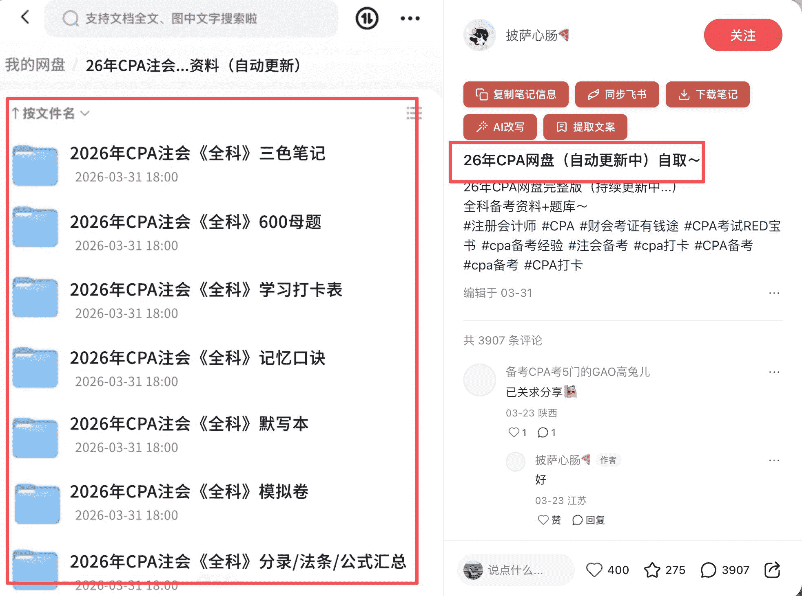

2. **再到闲鱼、小红书、整理对应资料**（小红书点赞收藏1万+，说明这个帖子需求很高，但是是手写的，没办法打印和下载，我们就可以把他整理下来）

3. **用自己的经验做筛选和补充**

4. **用 AI 辅助优化结构、图片、视频、说明文案**（把上面的信息都发给 ai，我用的 codex，让他整理）

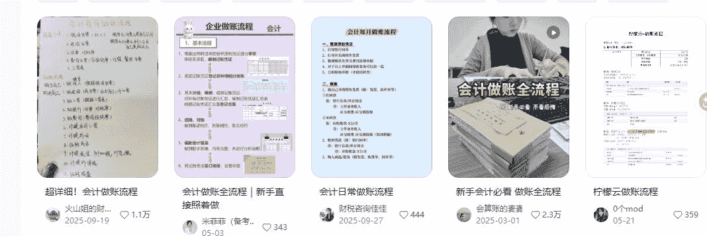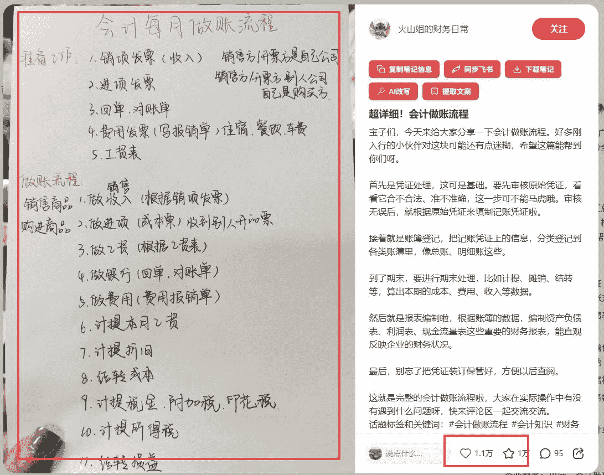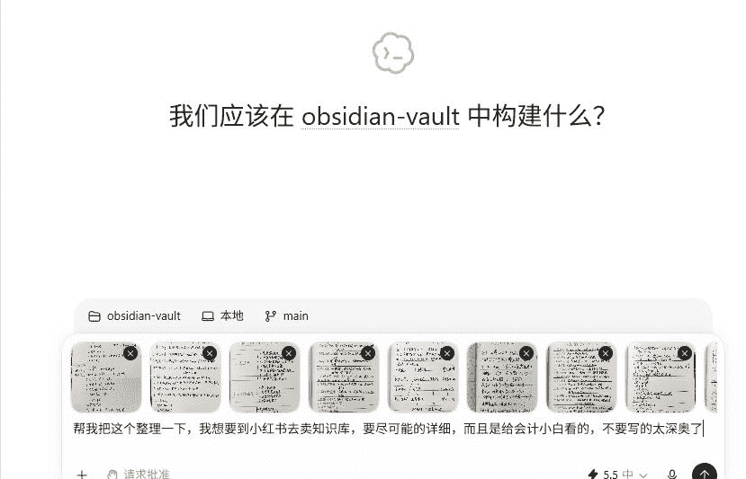

5. **最后打包成用户能直接使用的形式**（我用的飞书知识库）

这里最重要的是「可交付」。用户买的不是一堆文件，而是一个更快解决问题的方法。

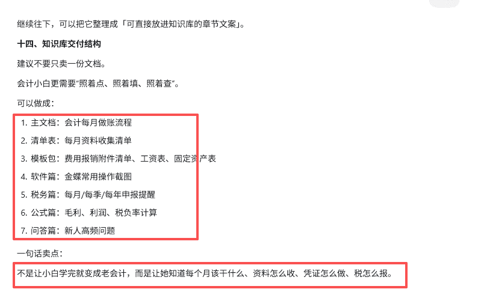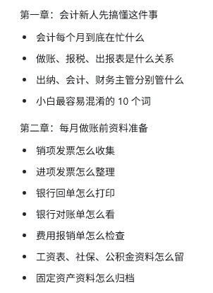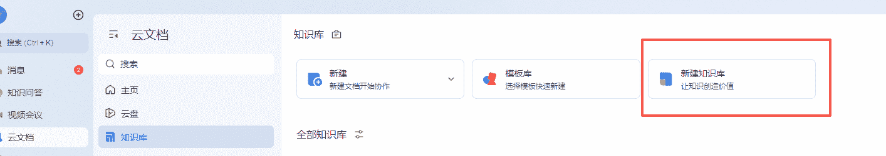

所以我不会把资料做成一个杂乱的网盘包，而是会按照新人的使用路径重新整理：

- 如果他是完全小白，应该先看哪一部分；
- 如果他是准备面试，应该重点看哪些内容；

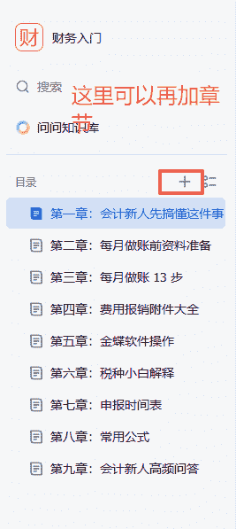

- 如果他已经入职，哪些模板和流程可以马上用；
- 哪些地方是新人容易误解、容易踩坑的，我会加上自己的提醒。

这也是我觉得自己和一些同行不一样的地方。

同样是资料，如果只是堆在一起，用户买完还是会乱；但如果我能帮他整理成一个有逻辑的飞书资料，他就更容易看懂，也更容易觉得这份资料真的有用。

所以我没有简单复制同行的资料，而是把这个需求重新整理了一遍：用飞书做成更清晰的结构，把零散资料按照新人的学习路径重新组织，再加入我自己5年多行业经验里的理解和提醒。

## 挂商品完成首单转化

目前我的店铺出了3500单左右，店铺成交13w+。

这个数字对大佬来说可能不算什么，但对我来说，它很重要。

因为它证明了一件事：普通人不一定非要靠大流量、大团队、大 IP，才可以跑出一个有现金流的小项目。

我没有把产品定成9.9。

因为我发现，小红书用户对价格并没有想象中那么敏感。

只要她觉得这个东西真的能帮她解决问题，49.9、59.9也可以卖。

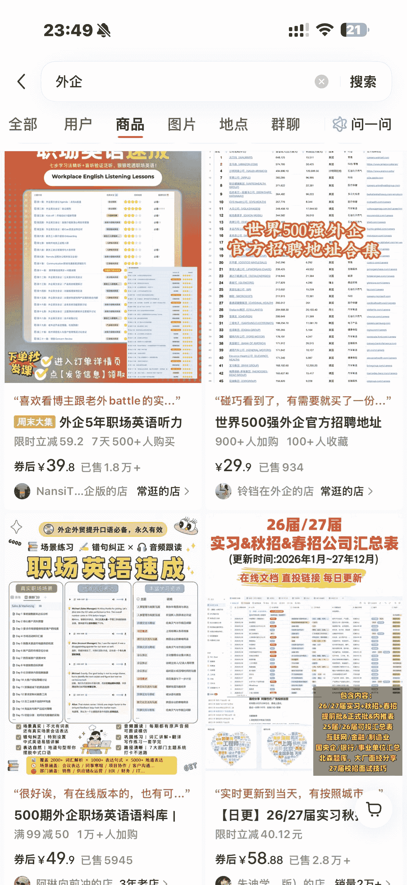

尤其是我这个产品面向的是刚入行的人，他们的问题不是想随便买点资料看看，而是更具体、更急迫：

- 怎么入行；
- 面试前应该准备什么；
- 刚开始工作应该怎么做；
- 哪些流程、模板、资料必须提前了解；
- 如果公司没有培训，自己怎么快速补课。

这类痛点对新人来说是比较痛的。

因为如果不好好学习，可能面试都过不了；即使进了公司，也可能因为基础动作不熟，在工作中出错。

但现实是，很多公司并不会给新人做系统培训，大家只能在网上找零散资料。

所以用户买的不是一份文件，而是一个帮我更快入门、少踩坑、少慌一点的解决方案。

## 上架商品后，用笔记测试转化

产品做好后，我会尽快上架。

不要一直在产品里打磨到完美。

因为你以为用户需要的，未必是用户真的会买的。

我更倾向于先上架、先发笔记、先拿反馈。

第一单出来后，再根据咨询、评价、私域反馈继续优化产品。

上架之后，我不是随便发一篇笔记，而是会先回到前面调研过的爆款内容里，再拆一次标题和封面。

我会重点看：

- 爆款标题是怎么写痛点的；
- 封面第一眼有没有说清楚用户问题；
- 标题里有没有直接点出新人入行面试资料流程这类关键词；
- 评论区里用户最关心的点，能不能放进我的笔记正文里；
- 这篇笔记适合挂哪一个商品入口。

简单来说，就是先找已经被验证过的爆款标题和封面，再用自己的内容重新做一遍。

（建议大家刚开始做的时候，因为没有小红书审美，标题可以一模一样的用别人的）

标题和封面可以参考爆款的表达方式，但正文一定要自己写。

因为用户最后买不买，不只是看标题，而是看正文有没有说中他的处境，以及产品是不是刚好能解决他当下的问题。

我写正文时，会尽量避免一上来就硬推产品。

我更常用的写法是：先把用户心里想说、但还没有说清楚的话写出来。

比如：

- 刚入行的时候，最怕的不是不会，而是不知道该先学什么。
- 面试前最慌的，是网上资料看了一堆，但不知道哪些才是真正有用的。
- 公司没有系统培训，新人只能自己到处找资料，但越找越乱。

先说中这些处境，用户才会觉得：你懂我现在卡在哪里。

然后我会接着写这份资料适合谁、能解决什么问题、里面大概包含哪些内容。

最后再轻轻引导一下，比如：

如果你也正卡在入行、面试、入职准备这些问题上，我已经把相关资料整理成了一份更清晰的飞书资料，可以在我的小红书店铺里查看。

这种写法不是强行推销，而是先建立共鸣，再给解决方案，最后顺手给一个入口。

## 把每个购买用户都当成私域资产

如果只是在小红书成交一次，那流量依旧只是流过我。

这一点是我从之前做博主号里吃到的最大教训。

所以这次我从一开始就提醒自己：不能只盯着今天卖了几单，还要想办法让用户留下来。

所以我在资料里和发货信息里都留下了微信入口，多点触达。

我的理由不是硬引流，而是给用户一个明确动机：

如果你需要免费资料，或者想了解更多这个行业的信息，可以加我微信。

这样加过来的人，不是泛粉，而是已经购买过、对这个话题有需求的人。

这部分人后续的信任成本会低很多。

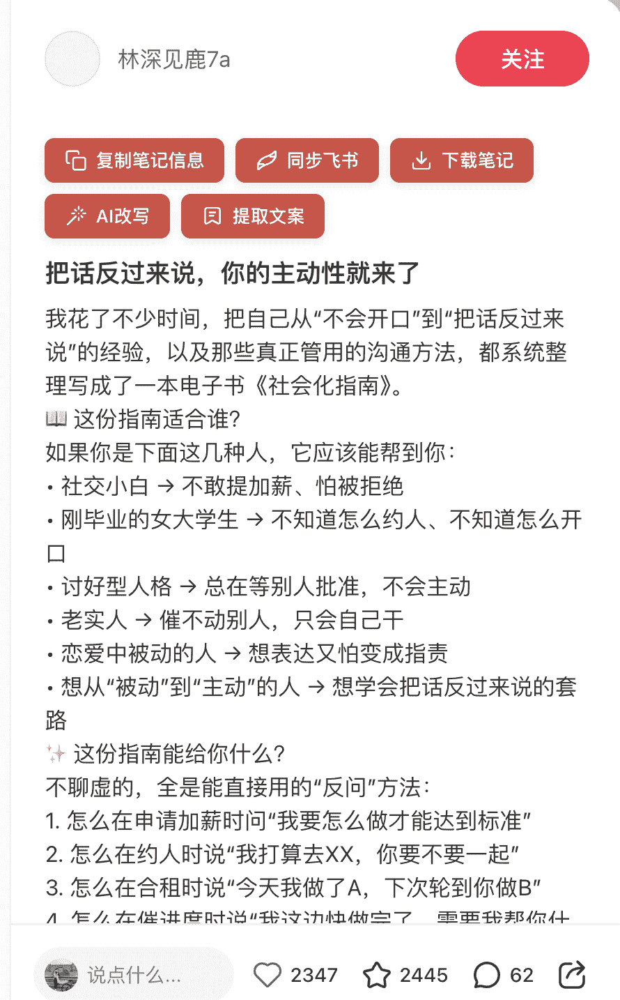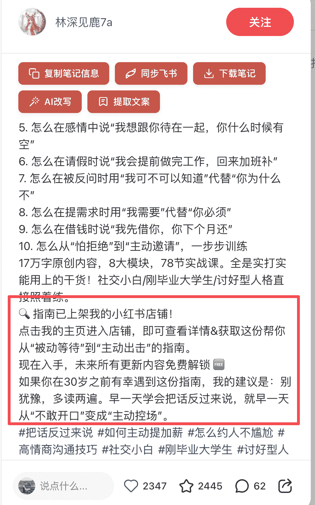

## 用免费资料和服务引导好评

用户加到微信后，会有两份资料。

一份是免费的：他们加我微信的奖励；一份是有条件的：他们需要在小红书上面确认收货➕好评。

但这个动作，我中间也迭代过一次。

刚开始，我是先把免费资料发给大家，然后再说：你有空的话，可以帮我去评论一下。

一开始效果还不错，确实有一些用户会去评价。

但后来我发现，很多人不是故意不给，而是真的会忘。

他们会说我晚点去等下给你评，然后这件事就没有然后了。

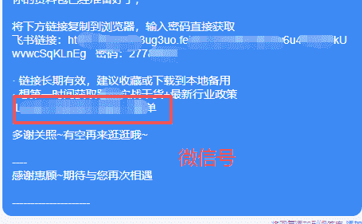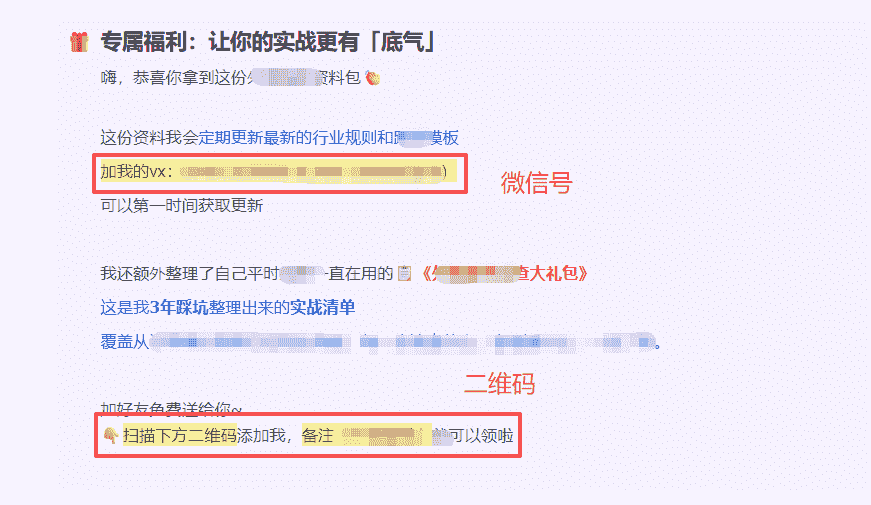

这时我才意识到：求人是求不来的，尤其是用户已经拿到东西以后，你再让他额外做一个动作，转化率一定会下降。

所以后来我换了说法：先评价截图，再来找我领取免费资料。

这个顺序一变，效果就不一样了。

因为用户想要资料，他就有动力先完成评价；我也不用反复追着别人提醒，整个流程会顺很多。

刚开始我对这件事也没那么敏感，后来才发现，评价对资料产品的转化太重要了！！

我现在这个产品有**1500+**好评，只有一个差评。

因为虚拟资料不像实物，用户看不到质感，也摸不到东西，他在下单前很依赖别人的反馈。

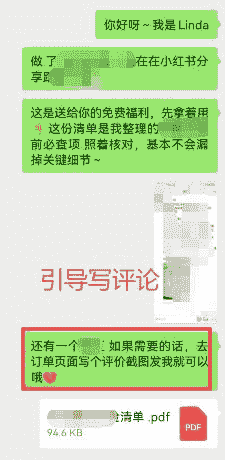

这样做有两个好处：

一是用户拿到了额外价值，体验更好；二是商品链接的评价越来越多，后续转化也会越来越好；三是这个流程不再依赖我求用户，而是让用户为了领取资料主动完成动作。

这一步看起来简单，但其实是在把一次成交变成一个正循环：

用户购买 → 加微信 → 评价截图 → 领取资料 → 链接转化提升 → 更多用户购买。

这个正循环一旦转起来，项目就会比一开始轻很多。

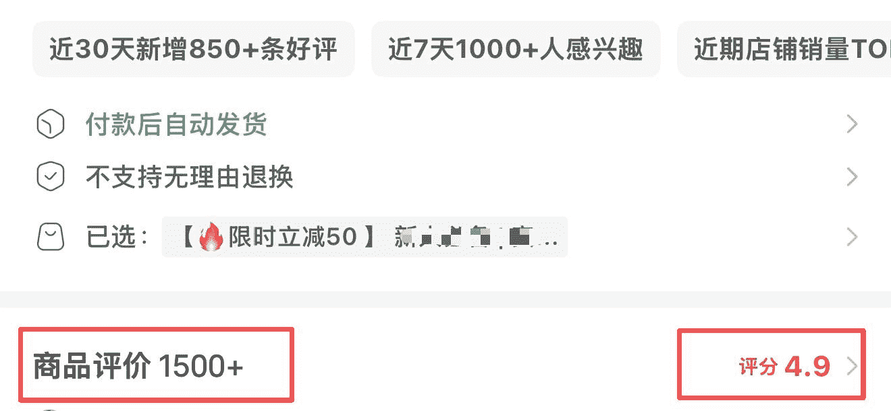

## 在私域推出新产品，提高复购

当私域里的人对我产生信任后，我再推出新的产品，他们的接受度会更高。

目前私域已经接近1700人，额外变现1.5w+。

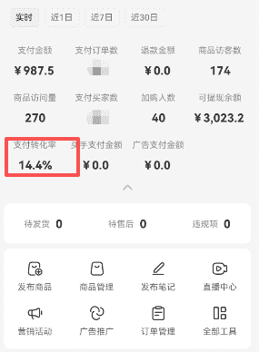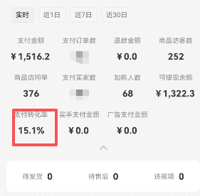

这让我意识到，虚拟资料真正的价值不只是卖一份资料，而是通过一个低客单产品，筛选出一批有明确需求的人。

以前我会觉得卖资料听起来很小。

但现在我更愿意把它理解成：用一个低门槛产品，找到一批正在为同一个问题付费的人。

这批人，才是后面继续做产品的基础。

后续可以继续围绕他们的问题，做更多产品：

- 入门资料包
- 入行准备资料包
- 核心动作模板包
- 工作流程模板
- AI 行业工具包
- 小班训练营
- 轻咨询服务

所以这个项目的关键不是卖一次，而是把用户沉淀下来，围绕同一批人的连续需求做产品。

小红书是公域，私域才是我真正能反复触达用户的地方。

所以我在资料里设置了微信入口。

但这里要注意，不是把用户加过来之后就疯狂推销，而是先给价值。

我会用免费资料、行业信息、答疑，让用户觉得加我不是被割，而是真的能获得帮助。

## 根据私域问题反推新产品

私域最大的价值，是它会告诉你用户真正需要什么。

比如很多人加微信后会问：

- 我适不适合进入这个行业？
- 行业新人怎么找到第一份机会？
- 入行前要怎么准备？
- 入职后每天要做什么？
- 核心业务动作怎么开始？

这些问题就是新的产品方向。

所以我现在不是凭空想产品，而是看用户反复问什么，再把高频问题整理成新的交付。

## 四、那我为什么能做到3500单左右？

我复盘下来，主要不是因为某一篇笔记突然爆了，而是几个环节叠在一起，形成了一个正循环。

第一，需求足够痛。这个资料面向的是刚入行的人，解决的是入行、面试、入职、基础流程这些很具体的问题。对用户来说，它不是可买可不买的娱乐型资料，而是当下就可能用得上的东西。

第二，选题提前被验证过。我不是凭空想了一个产品，而是先看小红书上已经跑出来的爆款需求，看评论区有没有人反复求资料、求电子档，再看同行有没有卖出销量。看到类似产品已经卖到接近2000单时，我就知道这个需求至少是成立的。

第三，交付比同行更清晰。同行有些资料只是放在百度网盘里，用户拿到后还是不知道先看什么、后看什么、每份资料怎么用。我把资料重新整理成飞书结构，按照新人的学习路径来组织，再加入自己的行业理解和提醒。对新人来说，这种有人帮我理清楚的价值，比单纯多给几个文件更重要。

第四，内容端不是硬推销。我的笔记会先说中用户处境，比如刚入行很慌、面试不知道准备什么、公司没人培训、网上资料太散。用户先觉得这说的不就是我吗，后面再看到产品，成交会自然很多。

第五，我持续复盘和放大。我不是发完就算了，而是每周看哪些笔记有点击、哪些有成交、哪些选题能带来加微信。

转化好的选题，我会换角度继续写；一个账号曝光不够，我又增加了第二个账号，用多账号给同一个商品增加入口。

所以3500单不是靠一个动作而是：痛点够痛 + 选题被验证 + 交付更清晰 + 内容说中用户 + 持续复盘放大。

这里的核心不是单价越低越好，而是让用户觉得：这份资料能帮我更快解决眼前的问题。

虚拟资料的好处是，用户不需要等待物流，也不需要复杂沟通，只要她觉得资料能解决眼前问题，就有可能直接下单。

## 五、我认为这个项目跑通的底层逻辑

复盘下来，我觉得自己能拿到结果，不是因为我多聪明，而是踩中了几个底层逻辑。

### 用低客单产品降低第一次信任门槛

用户第一次认识你，不可能立刻买高客单。

但他可以为了一个明确问题，花几十块钱买一份资料。

低客单产品的作用，是让用户先和你发生一次交易关系。

只要第一次体验不错，后面才有复购和更高客单的可能。

### 内容不是为了涨粉，而是为了成交

以前做博主号时，我会很在意点赞、收藏、涨粉。

但做资料项目后，我更关注的是：

- 这篇笔记有没有带来商品点击？
- 有没有带来成交？
- 有没有带来加微信？
- 用户买完是否满意？

对资料项目来说，内容的核心不是热闹，而是精准。宁愿1000个精准曝光带来成交，也不要10万泛流量看完就走。

### 私域承接决定项目能不能越做越轻

如果没有私域，我永远要靠下一篇笔记。

但有了私域，我每一次成交都能沉淀一个人。

这些人会给我反馈、评价、复购，也会告诉我下一步该做什么产品。

所以我现在越来越觉得：

小红书负责获客，私域负责沉淀，产品负责变现。

三者连起来，项目才不是一次性流量生意。

### 普通人最重要的能力不是创新，而是拆解和执行

我一直觉得自己不是特别会创新的人。

但这个项目让我更相信：普通人做副业，很多时候不需要一上来就做一个全新的东西。

你可以先找到已经有人跑通的路径，然后拆解它：

- 它卖给谁？
- 解决什么问题？
- 用什么内容获客？
- 用什么产品成交？
- 用什么方式承接复购？

拆完之后，再结合自己的领域和资源去执行。

这就是我说的「抄作业」。不是照搬别人的产品，而是学习别人已经验证过的路径。

## 五、我接下来准备怎么做

目前我觉得自己只是跑通了第一阶段：小红书商品成交 + 私域沉淀。

接下来我想继续优化3件事：

### 从卖资料升级为解决方案

单纯卖资料，天花板会比较明显。

但如果围绕行业新人，把资料、模板、工具、答疑、训练营组合起来，就可以从「卖文件」变成「帮新人更快上手」。

### 建立更清晰的产品矩阵

目前可以考虑的产品层级是：

- 低客单资料：完成第一次成交
- 进阶资料包：提高客单和复购
- 小班训练营：解决陪跑和行动问题
- 轻咨询：解决个性化问题

### 把流程 SOP 化

我希望后面能把选题、发文、交付、私域、复购都变成更清晰的 SOP。

因为只有 SOP 化，项目才不会一直依赖我的临时发挥。

## 结尾

以上就是我这4个月做小红书虚拟资料项目的一些复盘。

说实话，我现在也不觉得自己已经做得多成熟。

我还有很多地方要补，比如产品矩阵、私域转化、SOP、复购设计，这些都还在继续迭代。

但这段经历让我很明确地感受到：

普通人不是没有机会，而是要找到一个足够轻、足够具体、能用自己经验切入的机会。

对我来说，小红书虚拟资料就是这样一个入口。

它让我从单纯追流量，开始转向做产品、做私域、做复购。

也让我第一次很具体地感受到：

原来一个普通人，不一定要等到自己很厉害、资源很多、团队很完整，才可以开始做生意。

你可以先从一个很小的需求切进去，卖出第一单，沉淀第一个用户，收到第一条反馈，然后一点点把它变成一个闭环。

这件事不性感，也不神奇。但它真实。

如果你也在做类似项目，或者正在从自己的行业经验里找副业方向，希望这篇复盘能给你一点启发。

最后，也想真诚感谢生财有术！！

加入生财之前，我很多时候都是一个人闷头做：自己找信息、自己做判断、自己焦虑，也自己消化。

项目跑起来以后，我反而更明显地感觉到，普通人最缺的有时候不是努力，而是一个能看到更多可能性的环境。

在生财里，我看到很多圈友用一个个具体项目，把生活一点点往自己想要的方向推。

前段时间看到生财联合办公空间广州站扩大的帖子，那一刻我突然很具体地想：

希望有一天，我也可以不用每天坐班，不再只是被动等待工资和机会，而是能有一份真正属于自己的事业。

我现在还在路上，甚至只是刚刚跑通一个很小的闭环。

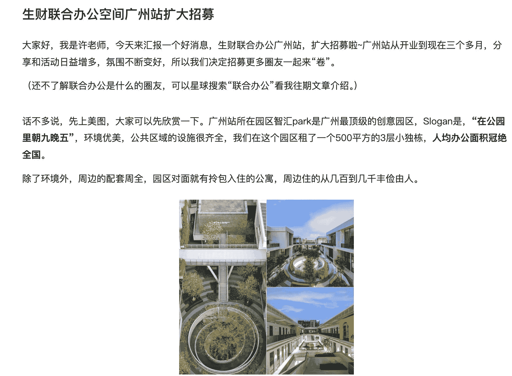

但也正是因为生财让我看到那么多普通人正在行动、正在验证、正在把一个个小项目做成自己的事业，我才会觉得：也许这件事离我没有那么远。

所以这篇复盘，也是我把自己往外推的一步！

感谢生财，也感谢愿意看到这里的圈友！

希望未来有一天，我也能带着更大的进展，回来继续复盘！

————分割线————

看完这篇 SOP，你觉得你懂了。但 90% 的人一到实操就会卡在第一步。

工具和教程只是最低级的壁垒，真正的壁垒是“立刻动手”和“圈层信息差”。

如果你想看全网最新的变现玩法，并且和一群执行力极强的极客一起下场拿结果，欢迎围观我的核心私域：【懒人专属群】。

我们不聊虚的，只做商业闭环的拆解与 AI 效率的压榨。系统内已沉淀 1000+ 跑通的套利实战局。

👉 查阅圈子完整数字资产与上车门槛：

https://lazyso.com/insider/

认同价值、准备好下场干活的，扫码加我微信（lazyhelper1）

备注：【实操上车】，不闲聊

