公众号懒人搜索，懒人专属群分享

零代码基础，我用 **AI** 编程 **25** 天变现 **5100** 元：从 **0** 到接单交付的实操复盘

260715 副业 SC 精华

整理：公众号懒人搜索，懒人专属群精选

懒人微信：lazyhelper1

注意：本文图片较多，建议直接查看在线版，获得最佳体验：

https://hk57gvlx7u.feishu.cn/docx/Wan6dWnV0ouPjqx1kCScy9JWnde

不懂英文、不懂一行代码，通过 AI 编程，照样接单赚钱。

## 写在前面

大家好，我是年轻人。这昵称是我给自己立的一个 flag。虽然快奔三，但我想一直保持“年轻人”该有的样子：敢下场、不怕试错、对新东西永远好奇。之前在大厂做云计算销售，目前是自由职业，主要在做一些 AI 方向的探索。这篇分享，就是一个“年轻人”的实操作业。昵称虽然越叫越心虚，但学新东西这件事，还是得端着“年轻人”的劲。

我是去年 7 月加入生财，这一年跟着圈子做过不少项目：垂直小号、虚拟资料、YouTube AI 视频、CPS、微信小程序打造。除了 CPS 当时没时间做，其他基本都应该算跑通了，只是没有一个真正意义上放大。

虽然没拿到大结果，但每一次实操都在给自己攒经验、把技能一点点撑大。

最近通过 AI 编程跑通变现，拿到一些小结果，今天把整个过程给大家分享下。也当作加入生财这一年交的一份完整作业，主要分享一件事：零代码基础的普通人，怎么靠 AI 编程实现收益。

这次分享没有其他圈友大佬那样的大结果，但这将是你通过 AI 编程实现变现的一条路径，这个方向的价值恰恰在于门槛低、需求旺、可复制性强。我把从 0 到 1 的完整路径、变现 SOP 和 5 个真实案例都分享给大家，我个人认为是有手就行。

部分客户的认可，只有你用心，会用 AI，对客户来说就是降维打击。

### 一、我在什么赛道、拿到了什么成绩

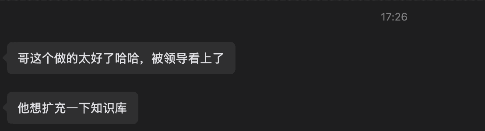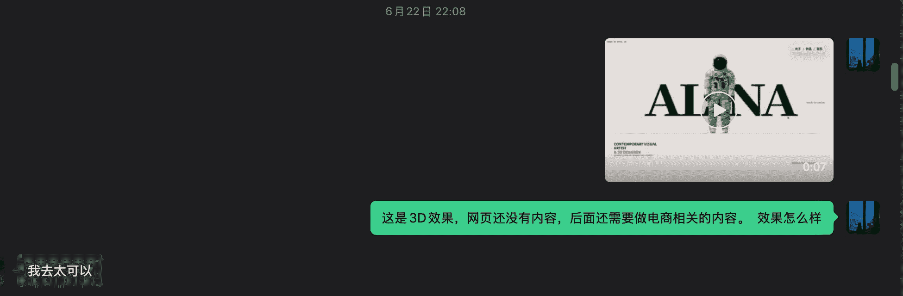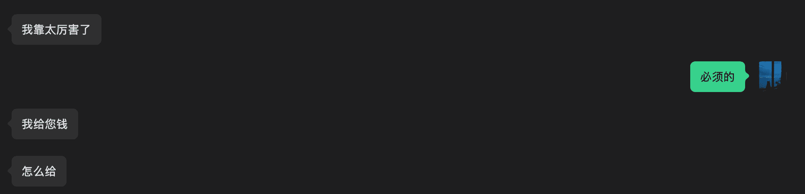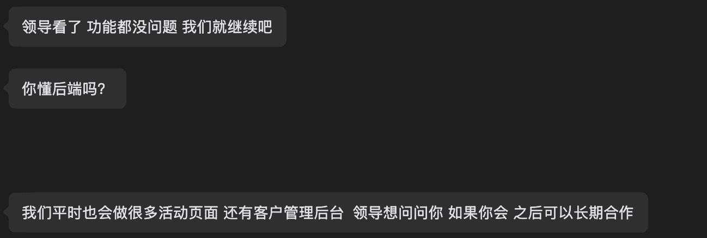

我目前主要做 AI 编程相关的变现，用 AI 帮别人做小程序、网页、H5、智能体等，之所以没有具体的某一类，是因为这些都是相通的。

当前赛道成绩（截至本月）：

- 6 月 10 日—7 月 5 日，通过 AI 编程在闲鱼平台获取的收益大约 **5100** 元，投流大概花了 **300** 元。目前也在探索做一些产品出来，所以没投入过多时间。25 天不是全部投入来做这个事情的，满打满算有半个月的完整时间做。如果多投入一些时间，月入过万相对是比较简单的。也完全可以去放大这块业务，走向工作室甚至更高层面。
- 5 月底通过小红书接了 **2** 单小程序定制（大学生作业，500 + 300 元），也引流了部分用户到私域，后续也会产生价值。
- 3 月底参加小程序航海，搭出第一个小程序后，陆续上线了 **4** 个个人小程序，其中 2 个开通了流量主（没怎么推广，每天不到 1 元左右被动收入）。

坦白讲，这点收入跟很多圈友比不值一提。但在鱼丸老师的鼓励，以及当前 AI 编程的能力和这个时间节点下，这块非常值得下场做。

#### 为什么是我、为什么现在入场？

因为我也是“最普通的那类人”的样本：我看不懂英文，更看不懂一行代码。但这些在今天都不是问题，任何问题都可以直接丢给 Codex、Claude 去处理。我没有固定死一个细分类目（App、小程序、网页都能做），正是因为当前 AI 的能力已经足够强，路径本身比类目更重要。

这条路我是通过航海探索到的：4 月份跟着小程序航海下场实操，当时做出自己的小程序那一刻的成就感现在都还记得。陆续上线了 4 个小程序，把“小程序上线整套流程 + AI 编程过程中的坑”全趟了一遍。虽然没有做出像教练那样的爆款小程序，但积累的这份经验，你实操的过程都是给你积累的财富。

我 5 月份在一个别人爆款笔记下的评论，一直在不断给我带来小程序定制方面的咨询。虽然大部分都是伪需求，但还是成交了 4 单，也引流了一部分私域，后续也会产生价值。

通过做小程序联想到网页制作，其实本质上都是一样的道理。我也看不懂代码，我只需要通过 AI 来对话帮我实现需求。AI 就是你的牛马程序员，你作为一个压榨它的老板就对了。

### 二、为什么这是个机会，背后的 3 个趋势

#### 趋势一：认知差一堵墙挡住了 90% 的人

国内高频使用 AI 的人，满打满算也就几百万。绝大部分人还觉得“编程 = 程序员的工作”。光是“我不会写代码”这个念头，就把 90% 的人挡在了门外。

差到什么程度？连 GitHub 部署我都能接单，接了两单，一单 30 元，而这事儿让 Codex 操作，分分钟就能解决。认知差在哪，钱就在哪。

#### 趋势二：时间节点正处于重点需求期

现在是 6 月毕业季 + 临近期末、暑假 + 就业季，毕业设计、课程作业、个人主页网站需求量大，小红书、闲鱼上有大量学生群体在找人。我接触到的学生需求大致分三类：

- 网页设计：Figma、DW、AI、PS 等工具出稿
- 网页制作：静态网页、动态交互效果、个人简历主页
- 小程序制作：商城类、校园交易平台、工具记账类等（学生类基本不需要认证部署，只需要把代码做好，能运行就行）

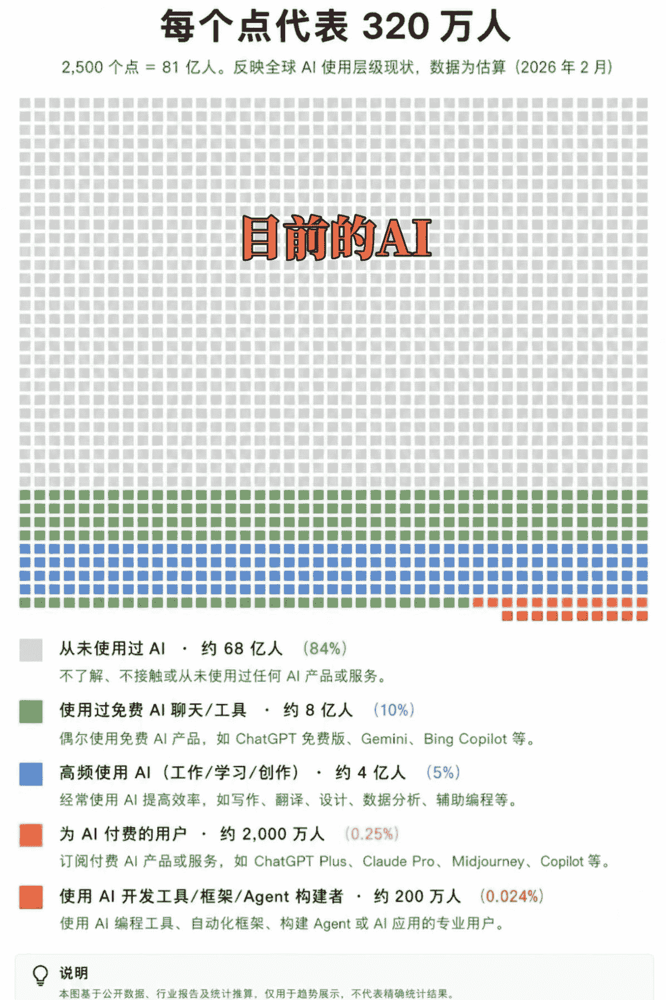

#### 趋势三：长期机会远不止学生作业

虽然学生作业这块是热点，但这也只是冰山一角，各式各样的长期需求也很多。当然也不仅仅局限于接单，还是希望能做出自己的产品，实现睡后收入：

- 开发个人小程序赚流量主收益；注册个体 / 公司做付费类小程序
- 定制开发各类小程序（商家类小程序需求也很大，小红书找我的很多都想做下单小程序）
- 网站设计：个人主页、企业官网、独立站、婚礼邀请函、HTML PPT 制作

目前除了大学生相关的项目外，我接的一些需求，可以给大家分享下：

- 小学英语老师公开课英语对话智能体
- 青岛人社局人工智能应用大赛（AI 智能问答客服）
- 某证券公司东南亚区域企业官网搭建
- 设计师作品集个人网站
- 金融行业留学生个人主页
- API 中转站 UI 优化

### 三、变现方法有哪些？路径分几步？

我把变现拆成“引流渠道”和“成交与交付”两端。核心一句话：在有流量的地方展示作品，把咨询接住，用 AI 完成交付。

#### 变现渠道一：闲鱼（我目前的主力）

这是我现在最主要的变现渠道，SOP 如下：

1. 选品调研：先搜“网页设计”“网页制作”“大学生网页设计”等关键词，参考同行的商品详情和图片，来搭建你自己的商品详情页。
2. 定价：目前大多数静态网页约 **10** 元 / 页，有交互动效可以适当报高。但现在竞争大，别报太高，自行评估。
3. 上架：参考数据好的同行商品，用 GPT 生成商品图，文案改一改直接上架。让 GPT 帮你优化搜索关键词，尽可能把相关词都写进商品信息里。
4. 注意避开违禁词（如“作业”“毕业设计”等），会因涉及学术不端而被下架。
5. 冷启动曝光：上架后，找亲友一人拍一单，凑几单直接“超级擦亮”，用新人优惠曝光，就几块钱。也可以直接上套餐买 **29.9** 的“4—5 人咨询量”套餐。我最近买这个能带来七八个人咨询，成交一单基本回本。
6. 需求对接：让用户把具体要求、想要的效果、有没有参考都发给你，综合报价。遇到比较顾虑的用户，可以把需求整理好，让 GPT 生成网页效果预览图，跟他说“这是我做的设计稿”，用户会更认可。

⚠️ 接设计单的坑：部分用户只要求出设计稿（Figma、DW、AI、PS）。除非你熟悉相关软件，否则只建议接 Figma。另外，虽然 Codex、Claude 都有 Figma 插件，但额度很少（一个 Figma 账户只有 6 次调用），有时候做好的网页，通过 MCP 额度不够都没办法传到 Figma 里。

推荐做法：直接用 HTML 代码生成网页，再用 html.to.design 插件把网页提取导入 Figma，基本能还原设计内容。一个账户每月可导入 10 个页面，不够就换账户。如果用户要在 Figma 里做点击、跳转之类的交互，直接截图问 Codex / Claude 具体步骤就行。

避免传统直接通过 Figma 繁琐的操作设计，直接 AI 生成再转到 Figma，这样就很方便。

#### 变现渠道二：小红书、抖音（内容引流）

- 发什么：高级感的网页作品、“0 基础制作小程序”“30 元上架自己的小程序”“0 基础 vibecoding”“0 基础 AI 编程”类的图文笔记 / 视频。
- 怎么发：内容最好是自己做的网页或小程序，这样你会熟悉整个开发流程；实在没有，也能用 GPT 一句话生成设计图先顶上。

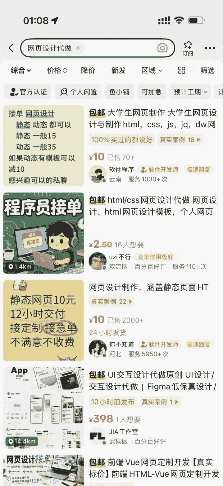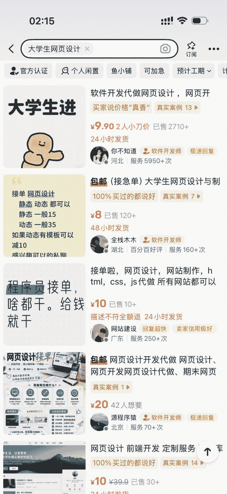

#### 变现渠道三：公众号、视频号（待开发的洼地）

这两块我目前还没做，但思路跟小红书、抖音一样，是值得补上的流量洼地。

### 四、接单避坑指南：什么单能接、什么单别接、怎么报价？

刚上手时别来者不拒，接错单比接不到单更耗人。我自己踩下来的判断标准是这样：

#### 放心接的单

- 需求明确、有参考图 / 参考链接的：你能直接把参考丢给 AI 复刻，交付确定性最高。
- 静态网页、带简单交互的网页、HTML 课件 / PPT：AI 直出，改几轮就能交。
- 体验版小程序（不用上线、不用备案）：门槛低、交付快。
- 复刻类需求：照着这个做一个类似的，这种最省心，是新手练手 + 赚钱的最佳组合。

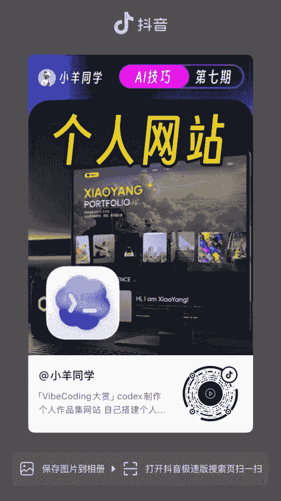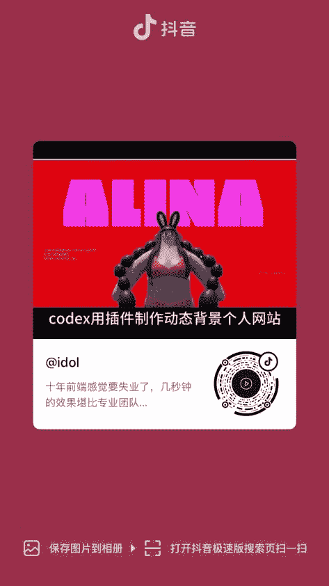

#### 谨慎接，或者干脆别碰的单

- 需求说不清、自己也不知道要什么的：你做十版他都不满意，无底洞。先聊清楚再报价，聊不清就别接。
- 急单：很多同学最后一刻才开始赶作业，或者要求短时间交付的，这种要谨慎评估。接其他正常单也尽量协商把交付时间拉长点，把时间留充足。非常不建议接急单，除非你没有其他事情，技术也比较到位。另外还需要评估 Codex 的额度，以及额度恢复时间。
- 要正式上线 + 备案 + 长期维护的商业项目：超出新手掌控，售后能把你拖垮，需要需求明确，预留充足时间。
- 指定用你不熟的软件出稿的（比如纯 Figma、PS、Adobe XD 设计稿）：不熟就别硬接，Figma 按前面说的“HTML 转 Figma”的偷懒法评估能不能搞定。
- 涉及贵的 API、且客户不愿自己出钱的（比如端到端语音大模型）：成本容易倒贴，坚持让客户用自己的账户。
- 涉及敏感或者违规需求，或一味压价到不值得的：这类单不接，省下的时间去接几个好单。

原则：你有把握交付，且报价能覆盖你的时间和成本，就接；只要有一样心里没底，就先聊清楚或者放掉。

#### 报价怎么报？（按“确定性”和“工作量”加法算）

我不建议拍脑袋报一口价，容易亏。我的做法是先有个基础价，再按工作量往上加：

- 基础：静态网页约 10 元 / 页，因为现在大部分报价都是这个价，太卷。
- 交互动效（点击、跳转、动画、3D 等）：越复杂加得越多。
- 页数 / 功能模块：页面多、功能多，按量往上加。
- 后端 / 数据库 / 部署上线：涉及这些就不再是“纯前端”的价，明显加价，更要评估能否实现。
- 素材制作 / 反复改稿：如果要你出图、出文案，或允许多次修改，提前把这部分算进去。
- 加急：赶时间的单，加急费别不好意思收。

报价前一定先问清三件事：要做几个页面 / 什么功能？有没有参考？要不要上线部署？

这三点决定了工作量，也决定了你会不会做亏。遇到犹豫的客户，先用 GPT 出一张效果预览图给他看，说“这是我做的设计稿”，成交率和你的报价底气都会高一截。

⚠ 新手心态提醒：宁可少接、接有把握的，也别为了几十块钱接个把你拖一周的坑单。跑通几个“确定能交付”的单，攒出评价和案例，比什么都值钱。

### 五、从 0 到 1 的实操路径

#### 第一步：选好编程工具

推荐 Codex（其次 Claude）。目前用苹果商店自行充值 GPT Plus 会员，最便宜约 110 元 / 月左右，生财有很多教程可自行搜索，也可以搜一些便宜的成品号渠道。

不推荐其他工具，也没必要浪费时间在别的工具上。如果你还没接触过这两个工具，这 100 多块钱将是你对自己最有意义的一笔投资。如果去尝试做这块，能够熟练接单的话，Plus 的额度是根本不够用的，但你用出去的 token 是能给你带来 10—20 倍的收入。

我是 Codex + Claude 官方订阅，加起来两百多，也购买了两个成品号。如果项目比较多，完全可以开 Pro 的 5 倍或者 20 倍会员。

#### 第二步：做出你的第一个作品

AI 编程不需要懂任何代码。你直接把想法告诉 Codex，它会帮你实现。

以 HTML 网页为例：

- 让 Codex 复刻一个网页：直接把链接扔给它，让它复刻并制作；或者把想要的网页截图 / 录屏发给它复刻。
- 一次通常不会完美，基于它做出来的页面，再截图、标注，让它调整修改即可。

建立自己的案例库 / 作品集：很多客户是非常在意这点的，会问有没有作品集。就算没有问你相关的案例、作品，如果你主动发给他非常高级的 UI 界面，会大大增加成交的概率。

- 参考网站：https://sceneai.art/，上面有很多免费的动态网页提示词，直接复制丢给 Codex，几分钟就能出效果。（很多抖音爆款视频其实都是用的这些提示词做出来的）
- 里面的素材基本是通过链接放进网页的，你可以让 Codex 告诉你怎么替换成本地素材。
- ⚠ Codex 可添加 product-design 插件，效果更好。

#### 第三步：进阶用开源插件 / Skill 提升作品档次

Codex 自带的 product-design 插件做出来的网页效果就已经不错。想再上一个台阶，可以参考这些插件 / Skill：

| 资源 | 用途 | 链接 |
|---|---|---|
| **ui-ux-pro-max-skill** | 各种 UI 风格 | https://github.com/nextlevelbuilder/ui-ux-pro-max-skill |
| **guizang-ppt-skill** | HTML PPT 效果极佳，也能拿来做网页（案例 1 用的就是它） | https://github.com/op7418/guizang-ppt-skill |
| **gsap-skills** | 各种动态交互效果 | https://github.com/greensock/gsap-skills |
| **ECharts 示例库** | 各类交互图表，可直接复制代码 | https://echarts.apache.org/examples/zh/index.html |
| **originkit** | 多种动态交互效果，可直接复制代码 | https://www.originkit.dev/ |

更多插件、工具、Skill，可以在日常实操中多收集积累，能让你的作品更有优势。

## 5 个真实案例（附实现过程）

以下均为真实接单 / 实操案例，重点看“需求 → 实现思路 → 踩坑点”的可复制逻辑。

### 🍌案例 1：旅行社网站

- 用户需求：做一个简单 3 页的旅行社网站，无其他要求。
- 实现过程：使用 guizang-ppt-skill，完全直出，**20** 分钟解决。

### 🍌案例 2：个人品牌商城（3D 交互）

- 客户来源：闲鱼

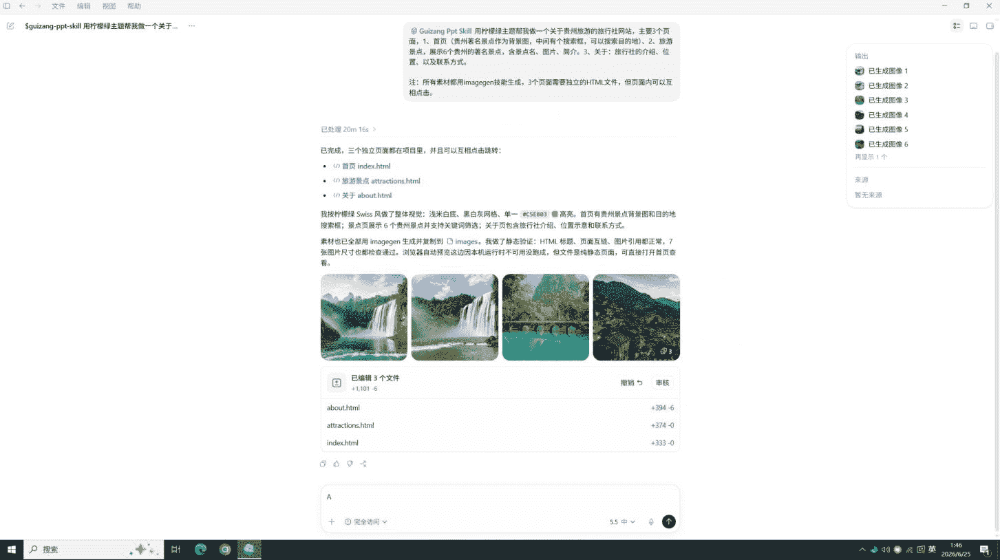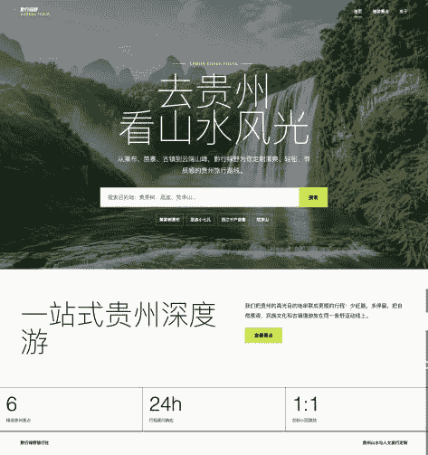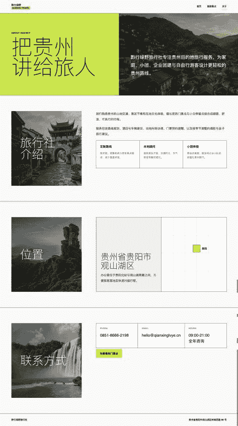

公众号懒人搜索，懒人专属群分享

- 用户需求：让参考抖音视频，做一个 3D 交互页面，结合电商场景。

2. 84 复制打开抖音，看看【idol 的作品】十年前端感觉要失业了，几秒钟的效果堪比专业团队 #...
https://v.douyin.com/1b4G6sVC96k/
P@k.pQ ztr:/ 11/08 :7pm

- 实现过程（共 3 次调整）：
1. 该视频博主评论区有人问提示词，让进粉丝群，结果群里发的提示词跟视频毫无关系（避坑：别指望别人给你现成提示词）。
2. 直接下载抖音视频发给 CodeX 让它复刻网页，能出大概框架，但 3D 交互没法看。
3. 在此框架下，让 CodeX 做出宇航员 3D 角色，图片和商店页面用 gsap-skill 增加弹出、翻页交互效果，最终成型。

**🍌案例 3**：博物馆网页设计（交付 Figma 文件）

- 客户来源：闲鱼
- 用户需求：给了 4 张截图，要求通过 Figma 设计前端页面，交付 Figma 文件。

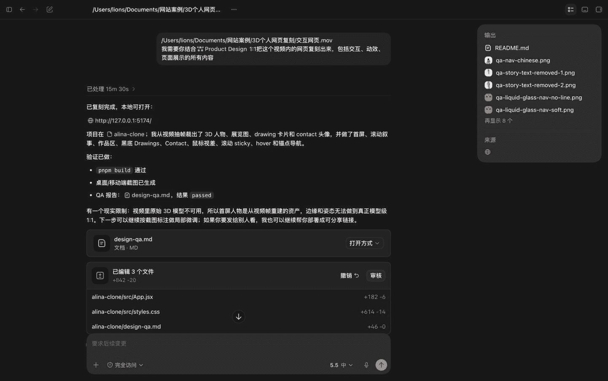

- 实现过程：Figma 直接操作较麻烦。初步方案是先把需求和参考图丢给 CodeX 做成 HTML 网页，再通过 Figma mcp 插件导入 Figma 但 Figma 免费账户只有 6 次调用（一个页面算一次），不够改。

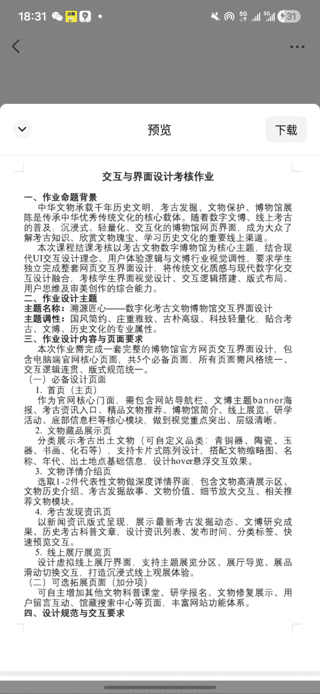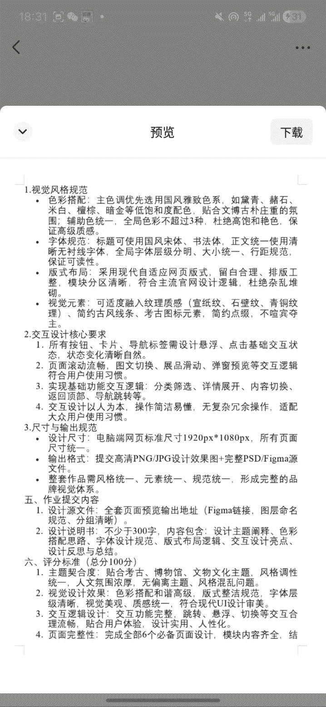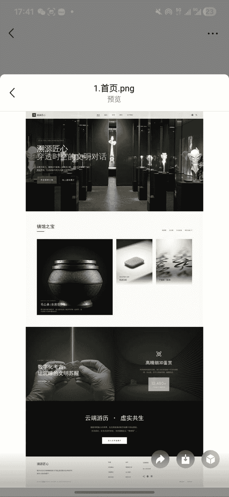

- 更优解：改用 html.to.design 插件直接提取 HTML 页面导入，一个账户每月 10 次额度，不够可切换账户，基本能还原页面所有组件。

**🍌案例 4**：网上书城小程序（毕业设计）

- 客户来源：小红书
- 用户需求：搭一个书城小程序用于毕业设计，不需要上线，能跑体验版即可。
- 实现过程：
1. 随便找个书籍网站截图发给 GPT，让它出 UI 设计图。
2. 根据 UI 设计图出 PRD 文档。
3. 把文档丢给 CodeX 开发。
- 关键注意事项：
1. 体验版小程序只需注册小程序邮箱账户，无需备案认证，发布后扫码就能在微信正常运行，可给 15 个人开通体验权限。
2. 该项目涉及图片素材和后端管理，注意小程序单个文件不能大于 200k、整包不能大于 2M，否则代码传不上去。可参加「小程序成长计划」领取半年免费云开发环境，把素材转到云存储，后台管理通过静态网页托管实现网址登录。
3. 对接后端无需手动操作，直接让 CodeX 连接 cloudbase cli，一切它会帮你对接好，基本不用进云后台，遇到问题直接截图问 CodeX。

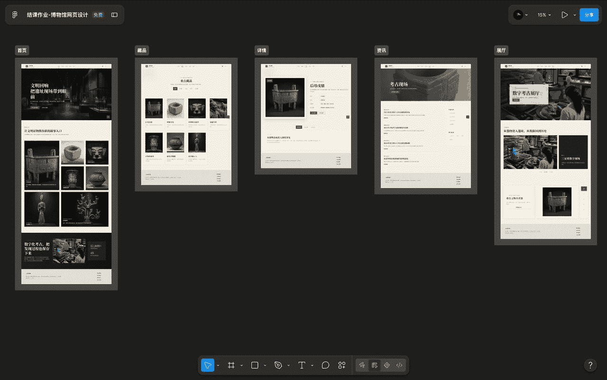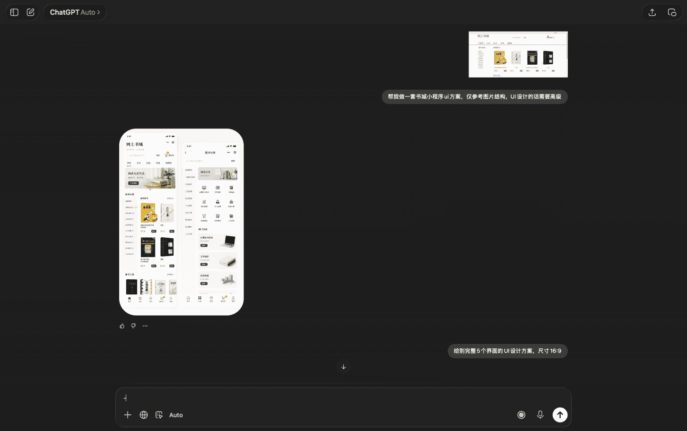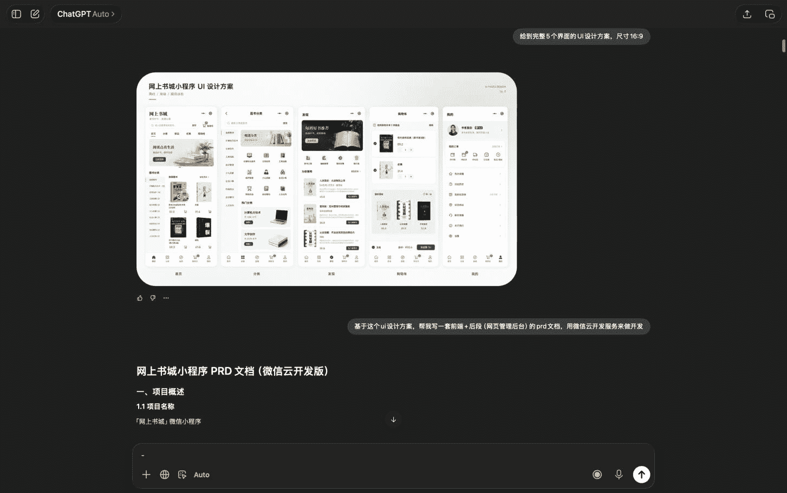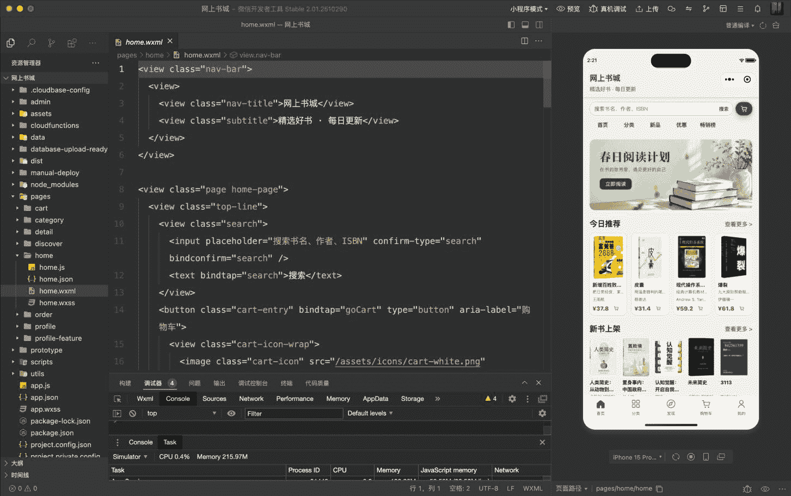

**🍌案例 5**：英语公开课 AI 对话智能体

- 客户来源：闲鱼
- 用户需求：前期通过闲鱼对接，先想把一份"小麦不同生长阶段"的 PPT 做成 HTML 网页、实现动态交互（较简单，直接把 PPT 丢给 CodeX 做成 HTML 课件即可）。交付后，用户又想基于自己做的和 PPT 里的小麦卡通形象，做一个英语对话的 AI 智能体。
- 实现过程：
1. 先让 CodeX 基于用户提供的卡通形象做成前端页面。
2. 火山引擎申请豆包端到端语音大模型 API（有免费 100 万 token 额度）。
3. 本地调试 API 与网页对接效果。
4. 免费部署：上传到 GitHub 仓库 → 用 Cloudflare 链接仓库部署 Pages 网页，实现链接访问。
- 关键注意事项：
1. 豆包端到端语音大模型 API 调用较贵（免费额度消耗也快），因为涉及语音识别、语音合成、大模型处理等多项能力。如果是帮客户开发，建议让客户自己注册账户、调用自己的 API；我这个项目仅用于客户单次公开课演示，才用了自己的 API。
2. 网页部署我常用两种方式：
- **GitHub Pages**：适合纯静态网页（HTML/CSS/JS）。优点免费、简单、支持绑定域名；缺点是必须公开仓库（代码结构别人可见），且不支持后端逻辑、不能写 API（写在前端会暴露 API）。
- **Cloudflare Pages**：适合 React、Vue 或纯静态网站。优点是全球 CDN 加速、自动 HTTPS、支持 GitHub 私有仓库自动部署，性能稳定；接入 API 可填在 Cloudflare 后台，不会暴露在前端。

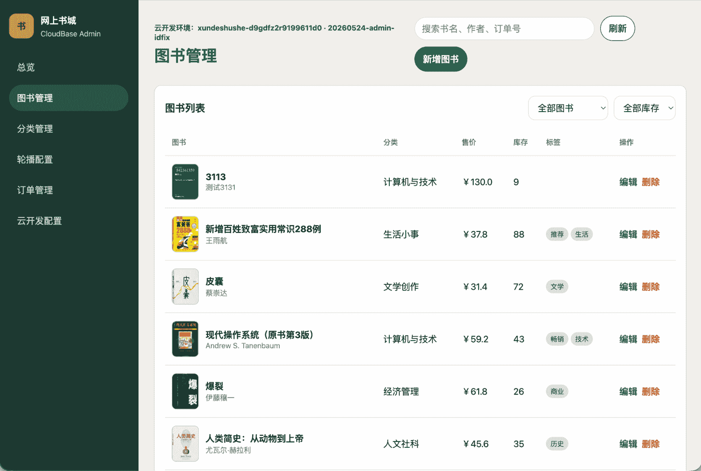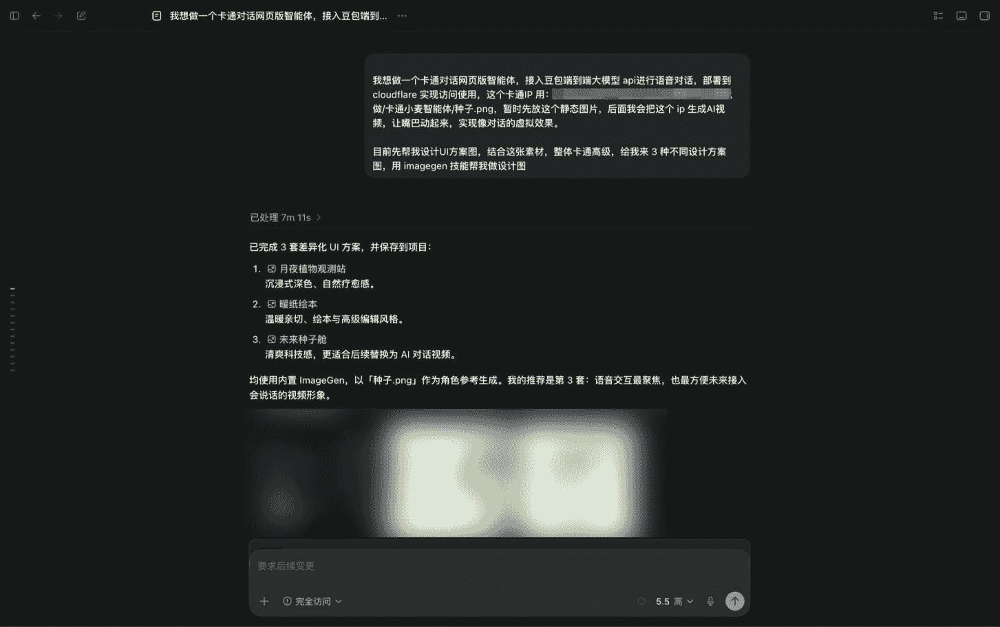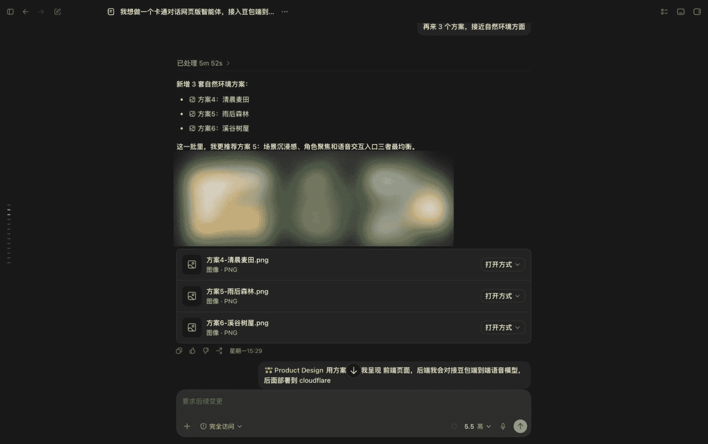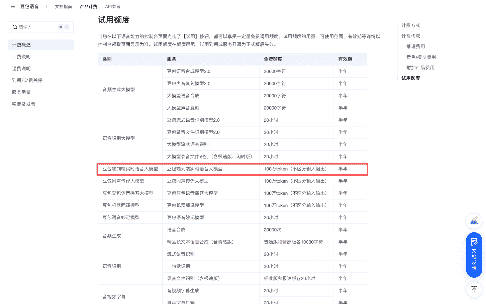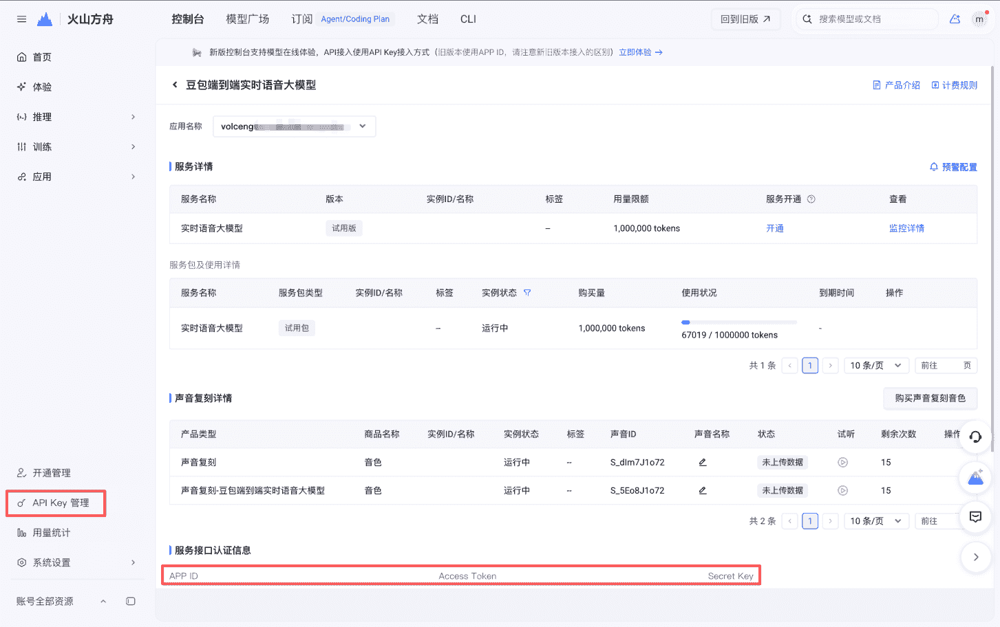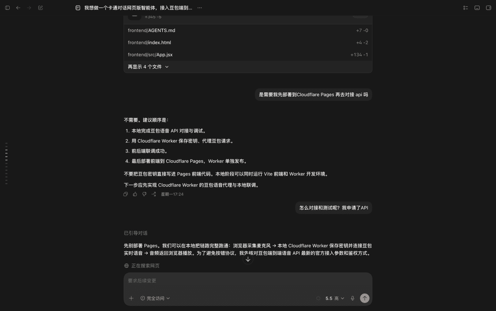

六、底层逻辑 & 普通人入场需要什么？

**🍌🍌**拿到结果的底层逻辑

本质是在赚"认知差 + 执行差"的钱。技术门槛已经被 AI 抹平了，真正稀缺的不是"会写代码"，而是：
- 知道这件事能做（大部分人还卡在"编程是程序员的事"）；
- 愿意下场把流程趟一遍（自己做出第一个作品，熟悉上线 / 部署 / 交付全流程）；
- 能把需求接住并翻译给 AI（把用户模糊的需求整理成 CodeX 听得懂的指令）。

谁先跨过这三步，谁就能在这波窗口期里接住需求。

**🍌🍌**普通人入场需要什么

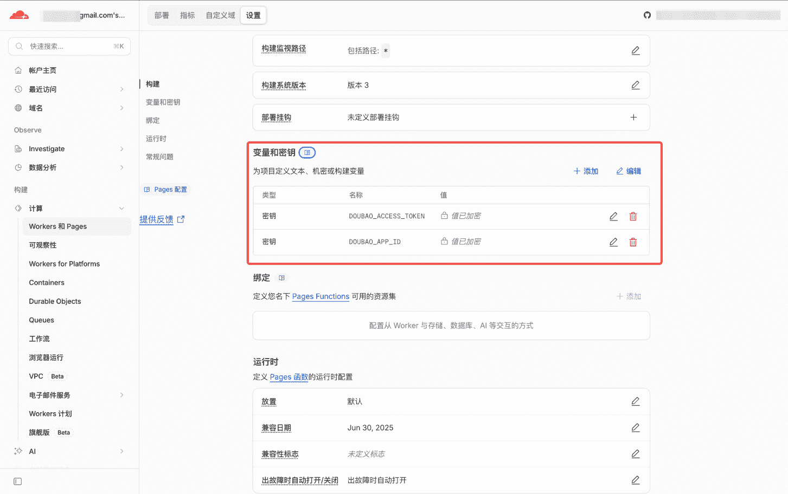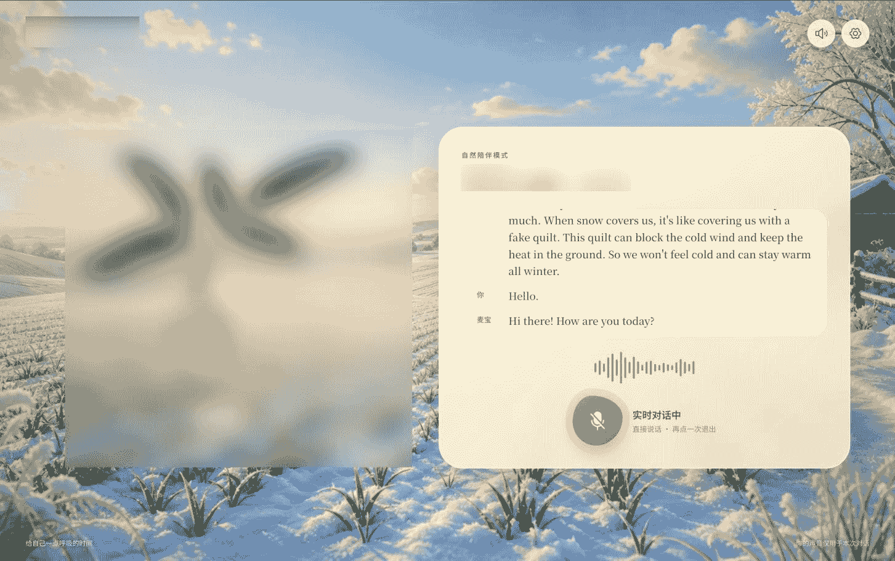

几乎不需要任何技术能力。你只需要：
- 花 100 多块钱开通 CodeX 或 Claude 这是对自己最大的投资；
- 一点点动手意愿：所有项目我没看过一行代码，从前端到后端、数据库、云存储，AI 全能帮你解决，万事用 AI；
- 把用户需求讲清楚、遇到问题就截图问 AI 的耐心。

**🍌🍌**这个赛道现在入场还有机会吗？

- 有，而且正处于信息差窗口期。当前是期末季，就业季。毕业设计和课程作业需求量大，就算 7 月份还是有很多学生没有做完作业，很多人都是最后一刻才到处去找人帮做。并且不只是学生群体，我最近做的都是公司官网、老师公开课智能体、事业单位竞赛知识库智能体、个人作品集主页（这块需求比较大）。
- 随着时间的推移，各家模型不断的升级，AI 的信息差会逐步缩小。但 AI 认知差还会存在相当长一段时间，不用担心没有机会，还有生财作为你最强大的知识库，还有什么理由不去尝试。
- 现在立刻就是最好的启动窗口。

七、SOP：一套可复制的方法论

[从 0-1 的实操路径](https://my.feishu.cn/wiki/SeAew1ABvisOo7kqoxicKRdInmc#share-DvJEddEc7oXgZlx8VqOczyPFn1d) 🍌🍌具体可跳转至前面部分查看 把上面的内容压缩成一条可以直接照抄的路线：

1. 准备：科学上网 → 充值 CodeX（官方订阅约 110 元/月，成品号十几到几十块不等，但容易封号）生财教程很多，建议参加线下聚会，很快就解决了。
2. 练手：CodeX 添加 product-design 插件 → 运用各种 sceneai.art、guizang-ppt-skill、gsap-skills、ECharts 等插件、资源。让 CodeX 复刻 2-3 个网页 / 做 1 个小程序，跑通"生成 → 截图标注 → 修改"的循环，建立自己的案例库。
3. 铺渠道：闲鱼上架服务（参考同行详情页、GPT 生成商品图、优化关键词、避开违禁词）+ 小红书/抖音发作品笔记引流。
4. 冷启动：亲友凑单 + 超级擦亮 / 直接买 29.9 咨询量套餐投流，做出初始曝光和评价。可多号运营，一人可注册 3 个闲鱼号。
5. 接单交付：接住咨询 → 整理需求（顾虑用户先出 GPT 预览图）→ 发案例 → 报价 → 丢给 CodeX 开发 → 截图迭代优化 → 交付。
6. 沉淀放大：把每个项目的插件、坑、部署方式记下来，逐步从"学生作业"扩展到"商家小程序 / 企业官网 / 智能体"等更高客单的需求。

遇到任何问题，直接用你的大白话问 CodeX，不要给自己设限。

最后

做过的每一个项目、每一次实操，都让我的技能又长一截。AI 编程这块，我也才刚专注半个多月。写这篇不是来"炫成绩"的，我也没有其他大佬那样的大结果，只是想分享给还没下场、还觉得"AI 编程很难"的圈友：AI 时代最怕的从来不是技术，是你迟迟没有拿出行动。

可能有人还卡在科学上网、怎么下载 CodeX、怎么订阅会员这些小问题上。我的强烈建议是：直接去参加你所在城市的线下聚会。这些问题分分钟就有人帮你解决，你还能听到不同大佬的独家分享，链接到一群同频的人。

这一点我感触很深。AI 时代，越要多和同频的人待在一起。不知道你有没有跟我一样的体会，身边的亲戚朋友，对 AI 的使用基本还停留在"跟豆包聊两句"。你跟他们讲当下的 AI 有多强、未来的冲击有多大，他们最多点头感叹一句，转头照样不会去碰这些新东西。

但在生财不一样，最近我线下组局认识了很多圈友，每次组局都有新收获。上月底参加绿子老师「从一人到工作室」的分享，也很受启发。能跑通变现的业务，都值得去放大，而 AI 已经几乎无所不能，你还有什么理由不去试一试？

如果这篇能给你一点启发，欢迎交流。也谢谢鱼丸、小 Q、尹阳几位老师的鼓励，让我把这份作业交了出来。

————分割线————

看完这篇 SOP，你觉得你懂了。但 90% 的人一到实操就会卡在第一步。

工具和教程只是最低级的壁垒，真正的壁垒是“立刻动手”和“圈层信息差”。

如果你想看全网最新的变现玩法，并且和一群执行力极强的极客一起下场拿结果，欢迎围观我的核心私域：【懒人专属群】。

我们不聊虚的，只做商业闭环的拆解与 AI 效率的压榨。系统内已沉淀 1000+ 跑通的套利实战局。

⚠ 查阅圈子完整数字资产与上车门槛：

https://lazyso.com/insider/

认同价值、准备好下场干活的，扫码加我微信（lazyhelper1）

备注：【实操上车】，不闲聊

