# 从 **0** 到日消耗 **5** 亿，我的 **6** 个 **AI-Native** 实践

260716 副业SC 精华

整理：公众号懒人搜索，懒人专属群精选

懒人微信：lazyhelper1

很惭愧，作为一名 23 年初用上 GPT 的人，居然一直对 AI 编程的了解为 0。因为听起来有太多复杂的术语和名词，出于畏难心理，我总觉得这些与我无关。但是航海家线下课让我发现，真的太简单了，甚至最难的步骤是下载 Codex。下面是一个月（6.8-7.8）以来，作为一名小白的 AI Native 实践，目前慢慢进化到 4 天 20 个亿了，这两天应该能做到日消耗 10 亿（下图是 7.6 注册的 20x 新号）。

从广州航海家线下课回来以后，我每天两眼一睁就是 Codex，最开始当然是兴奋。

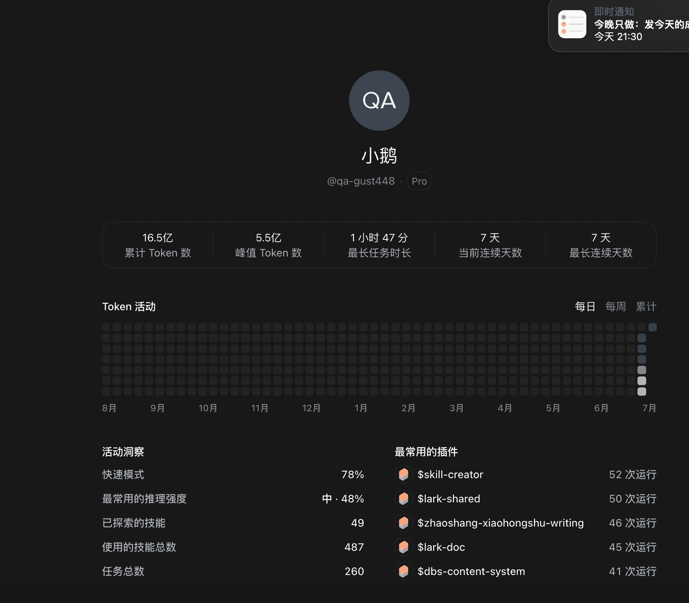

以前要自己翻资料、写文案、做图、建表、整理文件，现在很多事情只要把目标和权限讲清楚，它就可以继续往下做。

但真正用到后面，我最大的感受已经不是方便，也不是效率。

是恐怖。

任何执行上的事情，都开始没有壁垒了。执行正在公共化，真正稀缺的是人的想法和判断。

只要有清楚的对标、足够的真实素材和能够检查的结果标准，选题、写稿、做图、归档、改版和批量生产都可以迅速发生。

这也意味着，过去那些依赖我会写、我会做图、我比别人执行得快建立起来的优势，会越来越薄。

以后真正拉开差距的，是人的想法和判断能力。

有了 **Codex** 以后，我这个月做了 **10** 个小红书号，好物博主 / 商业博主 / 水晶博主 / 汽车博主 / AI 博主 / 美妆博主，都起号起得比较顺利，数据还不错，也有线索和商单。夸张一点的案例就是我在东京找了个陪拍，她见到我第一面就说我昨天刚刷到你。我其实真的是个蛮懒的人，我自己的公众号都更新得稀稀拉拉的，这个月一口气干了我过去创业六年的工作量，可见 AI 的威力。你知不知道什么值得做，能不能选对对标，是否真的理解用户，能不能在一堆看起来都正确的答案里，挑出那个真正有用的答案。

这篇不准备长篇讲 Codex 又完成了什么功能。

我更想复盘的是：当执行越来越便宜以后，我为什么做了下面六件事，以及我究竟想把什么留下来。

这里有一个必须补上的前提：消失的是可标准化的数字执行，不是人类执行。AI 可以搜索、写稿、做图、建表、归档和批量跑流程。人仍然要去见客户、处理真实关系、确认事实、决定是否公开，并为交付和后果负责。

人类执行的任务，正在从亲手完成每一步，转向进入真实世界，让事实发生，再把事实带回系统。

前期准备很简单：装好 Codex，打开必要权限，连接飞书 CLI，再装一个本地 Obsidian。安装过程中遇到的问题，先直接让 Codex 自己排查。

真正重要的事情，从安装结束以后才开始。

# 关键成果 1：建立事实库

以前看过焦波老师的知识库，会觉得很震撼，自己手搓了一遍发现其实很简单，口喷就可以完成，让他把我的飞书云文档 / get笔记 / flomo 等内容全部沉淀到 Obsidian 里。

**AI** 擅长的是逻辑，但它并不理解真实世界的事实。它可以在已经提供的信息之间建立漂亮的关系，却不会凭空知道一个用户为什么犹豫、一次成交为什么失败，也不会知道我在某个决定里真正付过什么代价。

这些事实必须先由人去经历、观察和确认，再带回来交给 AI 组织。否则，它的逻辑越完整，反而越容易让人误以为那就是真实。

我给 **AI** 的不是帮我整理，而是一条事实边界。类似这样的指令：只处理我交给你的原始材料；把我的亲历事实、他人转述和公开资料分开；每条结论保留来源；没有证据的地方标成待确认，不要替我补全。

我的动作：我先让它处理一小批，再回到原聊天和原文，检查人物、时间、数字和因果。发现推测被写成事实，就退回证据层重做；材料不足，就补材料或保留未知。

公开的信息会迅速失去壁垒。

所有人都能使用同一个模型，搜索同样的资料，安装同样的 Skills，也能拿到同一篇对标。模型能力越强，大家在执行层做出来的东西反而越容易相似。

真正无法被复制的，是一个人到底生活过什么、见过哪些用户、做过哪些业务、付过什么学费，以及最后形成了什么判断。

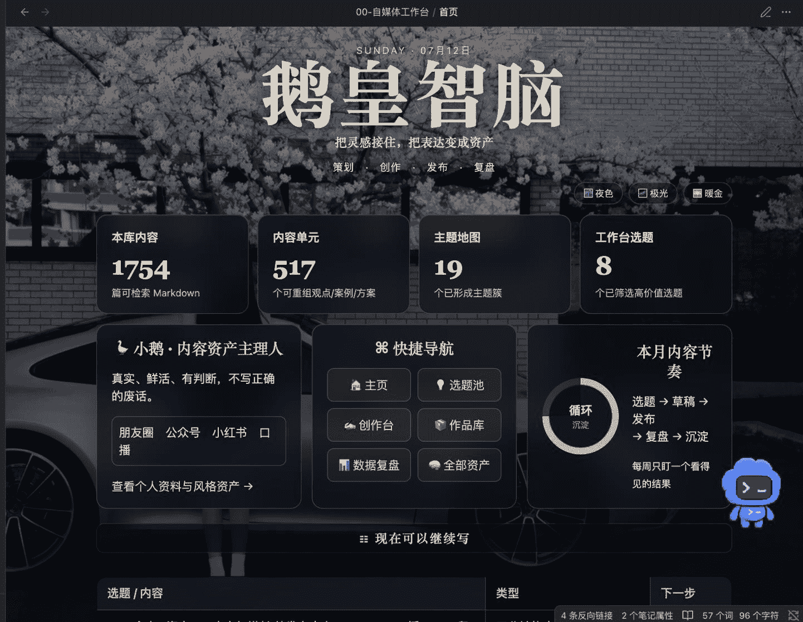

这些东西过去虽然都在我身上，却散落在朋友圈、聊天记录、课程、飞书、Flomo 和各种文档里。它们没有被组织起来，Codex 就看不见。

看不见我的真实世界，它当然只能给我一堆公开、正确、但跟谁说都一样的答案。

所以我做 Obsidian，本质上不是在整理资料。

我是在把自己过去几年用时间、钱和真实业务换来的经验，变成 **AI** 可以持续调用的私有上下文。

# 00-总导航

# 01-个人IP资产

## 01-身份定位

**创业经历与个人成长**

- 创业者个人成长与创业经历访谈…
- 飞书完整原文-公开分享
- 飞书完整原文-IP与经历

**飞书原文-IP与经历**

- 2025发售分享稿
- 大学四年，从0到稳定年利润七…
- 鹅皇的案例集
- 关于小鹅的事实库
- 全面了解小鹅（2026版）

**数字资产-IP与个人品牌**

- IP与个人品牌-目录
- 采访资产
- 小鹅个人画像

## 02-内容与增长

- 待发布内容
- 飞书多维表格
- 飞书完整原文-提示词
- 飞书完整原文-销售转化与客服
- 飞书完整原文-营销与内容
- 飞书原文-营销与内容
- 富贵小红书原始文件

这也是为什么我一定要建立个人事实库，一定要把私有事实和公开资料分开，一定要保留原文、来源和应用。

公开资料可以帮助我理解行业，却不能冒充我的经历。

个人事实可以帮助 Codex 认识我，却不能被我新搜到的一篇文章随意覆盖。

现在系统里有 486 个有效内容单元、17 张主题地图和 34 份选题装配稿。这些数字不是为了证明我的知识库有多大，而是证明过去那些零散的经历和判断，终于可以在下一次内容生产中被重新找到、连接和使用。

**实际应用场景｜把零散经历变成一篇可信的个人 IP 内容**

什么时候用：我要写大学创业时怎样拿到第一单，但材料散在飞书、Flomo、朋友圈和聊天记录里。

我给 **AI**：原文、截图、时间线，以及一条硬指令：只引用原始材料；区分亲历、转述和公开资料；缺证据的地方标记待确认。

**AI** 执行：抽取人物、时间、数字和因果，生成带来源的事实卡，再装配成文章初稿。

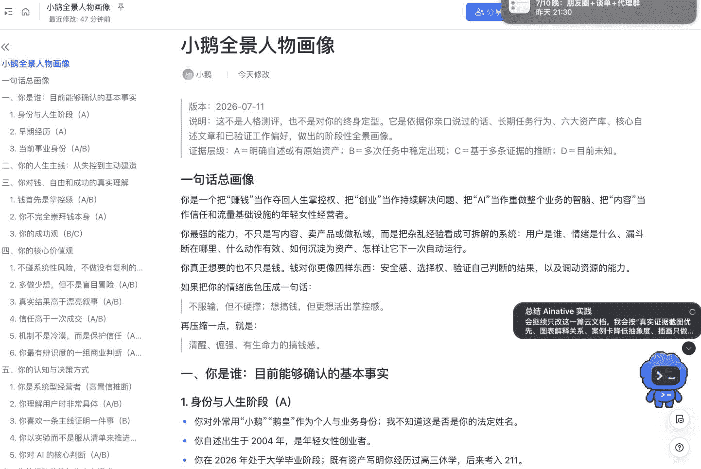

我负责：逐条回查原文，删掉推测，补齐证据，决定这段经历最终要表达什么判断。

可检查结果：每个关键事实都能追溯到来源，没有虚构，素材还能继续复用到公众号、小红书和口播。

# 关键成果 2：建立可复用的 Skills 资产

**关键节点一：蒸馏我喜欢的博主。** 不是让 AI 笼统地模仿他的风格，而是把一批我长期喜欢、反复看过的内容交给它，拆出这个博主稳定的选题偏好、开头方式、结构节奏、情绪推进、语言习惯和明确禁区，再把这些写成第一版 Skill。

**关键节点二：把每一次交互里的调教过程和规则约束继续写回 Skills。** 第一版只能让我更接近对标；后面每一次太像老师没有本人感，只是表面像对标，才是在把别人的方法，一点点校准成属于我的判断资产。

类似这样的指令：先不要写正文。只从这批样本中找反复出现的稳定规律，把选题、开头、结构节奏、情绪推进、语言习惯和禁区分开；每条判断都要回到样本，不要把一次偶然写法当成规则。

我的动作：我把对标原文、AI 成稿和自己的通过稿并排看，判断它学到的是结构关系，还是只偷到了口癖和表面形式。每次拒稿后，我再下第二道类似的指令：把我刚才的拒稿理由改写成下一次可执行、可检查的规则，写回 Skill，再用同一个任务重跑。

纠偏边界：如果它更像博主，却更不像我，或者为了制造真实感开始编造现场，我会先改 Skill 的边界，不继续润色正文。

| 原始反馈 | 被拆成的判断规则 | 下一次怎么检查 |
| :--- | :--- | :--- |
| 太像老师 | 从真实现场进入，不先讲道理 | 开头是否有人、动作或对话 |
| 没有本人感 | 先读本人事实与通过稿 | 是否出现只有我能说的经历与取舍 |
| 只是表面像对标 | 学习结构关系，不复制表面元素 | 是否说清对标杆什么成立 |

如果这些判断只停留在这一次对话里，下一次我仍然要重新检查、重新拒绝，那我永远都是整条生产线里最慢的一环。

所以每次调教结束，我都会继续追问：这一版为什么没通过？我刚才说出的理由，能不能变成下一次自动执行、自动检查的规则？然后把它更新回对应的 **Skill**。我做这件事，不是为了收藏更多工具，而是为了把原本只能存在于我脑子里的判断，变成下一次可以直接调用的资产。

别人也可以蒸馏同一个博主，建立类似的第一版坐标；但只有真实交互中的持续纠偏，才会让 Skill 越来越像我。

真正拉开差异的，是我长期形成的通过记录和拒稿记录：什么叫像我，什么只是模仿了口癖；什么叫平台化，什么只是把长文切短；什么叫有判断，什么只是把正确的话说得很完整。

这些才是 Skill 里真正私人的部分。

**Prompt** 只节省一次时间，**Skill** 才能让判断产生复利。成稿会过时。

判断可以不断长出新的成稿。

**实际应用场景｜把喜欢的博主蒸馏成可反复调用的写作 Skill**

什么时候用：我想把某位博主的方法用于自己的小红书内容，但不想只模仿几句口癖。

我给 **AI**：一组对标样本、通过稿、AI 初稿和我的拒稿理由，并要求：先拆稳定规律，不写正文；每条规则都要回到样本；把我的修改意见改成可执行、可检查的规则。

**AI** 执行：提炼选题、开头、节奏、情绪和禁区，写进 Skill，再用同一个选题重新跑一遍。

我负责：判断它学到的是结构还是表面语气，指出哪些地方不像我，禁止为了像真人而编造现场。

可检查结果：同题复测时，原来反复出现的问题不再出现；每次新的调教，都会继续沉淀成下一版 Skill。

# 关键成果 3：批量化生产内容

用社媒助手导出对标内容，Excel 给他，让他照着做，做完给我沉淀到多维表格。

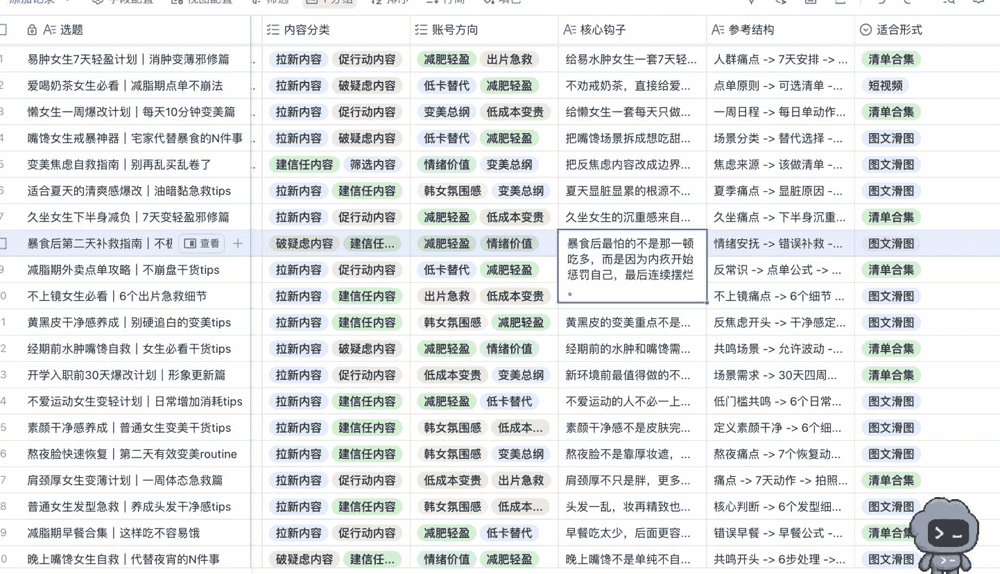

这 100 条不是一句 prompt 直接变出来的。

1. 先把对标内容导出成 Excel，拆分主题个主题。
2. 再把选题、标题、核心钩子、参考结构、平台和状态等整理成 19 个字段。
3. 生成 100 个独立 Markdown，生成对应的封面和副图，并写进 100 条飞书多维表格。
4. 最后由我重新通读，判断如何去优化。

执行链完整，不代表内容方向已经经过市场验证。这 100 条当时并没有被我写成已发布或已经转化。

过去需要一个内容团队反复完成的选题、写稿、整理和归档，突然开始失去执行壁垒。

只要一类内容有清楚的对标、有稳定的结构、有能够调用的真实素材，它就可以被批量生产。

但我很快又遇到了另一个问题。

第一版 100 条 AI 创业内容全部做完了，结构完整，字段齐全，也顺利进入了飞书内容库。

可它们的方向偏向融资、SaaS 和硬科技。

执行没有错。

错的是我一开始没有把真正想影响的人讲清楚。

我想写的不是遥远的科技创业叙事，而是普通女生、年轻创业者和一人公司真正面对的第一单、客户验证、成交、交付和现金流。

最后，已经完成的 100 条被整体备份，全部重做。

| 第一次做完的 100 条 | 重新定义后的方向 |
| :--- | :--- |
| 内容：融资、SaaS、硬科技 结果：执行完整，却吸引错人 | 人群：普通女生、年轻创业者、一人公司 主题：第一单、客户验证、成交、交付、现金流 |
| 执行完成 ≠ 方向正确。规模只会把前置判断放大。 | 执行完成 ≠ 方向正确。规模只会把前置判断放大。 |

重做时，我给出了类似这样的指令：保留对标里已经被市场验证过的表达结构，但不要继承它的人群和命题。目标读者是普通女生、年轻创业者和一人公司；内容围绕第一单、客户验证、成交、交付和现金流。每条都先回答：它最后会吸引谁？如果答案又偏回科技创业，就继续重做。

我的动作：我把 100 条重新通读，发现答案仍然偏向融资、SaaS 和硬科技，就停掉生产、整体备份，先重写人群和主题定义。方向没有通过，执行完成度再高，我也不会放行批量。

这件事让我确认了一个很重要的判断：

**AI** 不会因为生产得更多，就自动更接近正确。规模没有智慧。

方向正确，它会把有效动作放大 100 次；方向错误，它也会极其认真地把错误执行 100 次。

所以我使用对标，不是因为对标能替我决定做什么。

对标只能提供一种已经存在的市场表达。真正需要我判断的是：这个对标吸引来的，是不是我想要的人？它成立的原因是什么？哪些结构值得学习，哪些观点不能照搬？

批量生产真正放大的，不是 **AI** 的能力，而是人在生产之前做出的判断。这也是为什么执行越便宜，我越不敢随便开始。

以前方向错了，最多浪费一篇内容。

现在方向错了，系统可以一夜之间替我制造一整批错误。

**实际应用场景｜围绕一个对标批量生产 100 条内容**

什么时候用：我已经找到一个值得复用的对标结构，准备围绕同一类人群批量生产内容。

我给 **AI**：对标表格、目标人群、业务目标、真实素材库和禁止边界，并要求：拆成 19 个字段；每一条都回答会吸引谁；一旦偏离目标人群就停下来。

**AI** 执行：批量生成 100 份 Markdown、封面与内页图片，并写入飞书多维表格。

我负责：先抽查少量样本，判断方向是否正确，而不是被已经做了 100 条这件事迷惑。

可检查结果：每条内容都能追溯到对标和真实素材，吸引的人与目标一致；如果首批方向错误，就整批备份、改规则、重新生成。

# 关键成果 4：你已经是个成熟的 AI 了，要学会自己努力

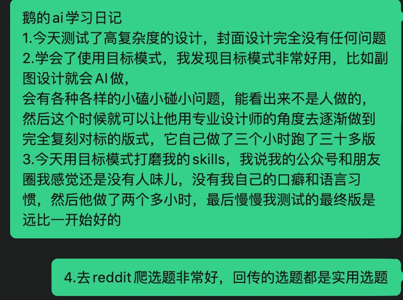

我现在不会再一张张指导 AI 怎么改，而是先把对标、目标和判断标准给清楚，再让它自己迭代。下面是我真正跑通的一条生产流程。

**第一步：给 AI 对标，让它先分析什么叫好。** 不是一句“做得好看一点”，而是先让它拆清楚：视觉焦点在哪里、信息怎么分层、整套页面为什么成立。对标提供方向，哪些结构值得学，由我决定。

**第二步：先生产第一版，把差距暴露出来。** 第一版不需要完美。它的作用，是让我看清 AI 当前的理解和对标之间到底差在哪里。

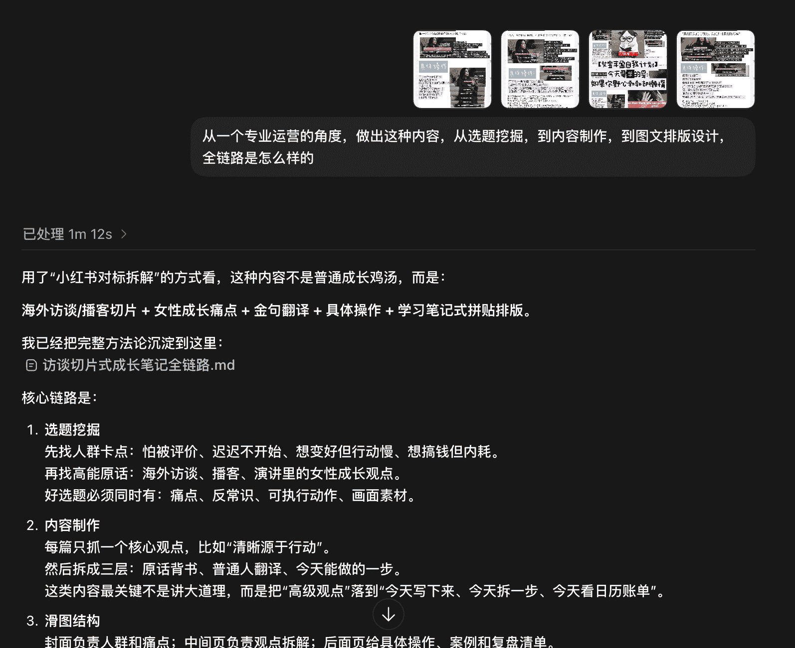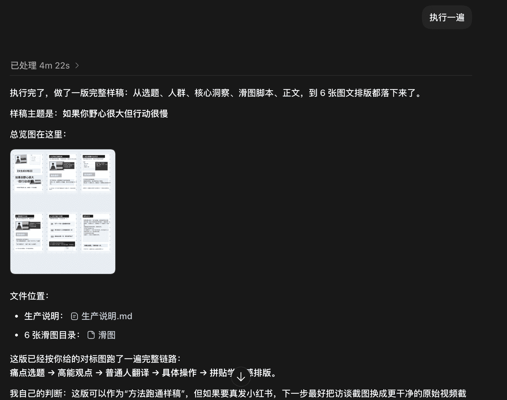

**第三步：打开目标模式，让 AI 从专业设计师的角度自己优化。** 我给它类似这样的指令：持续对照目标和对标，从专业设计师的角度检查焦点、信息层级、资料感和手机端可读性；自己找差距、修改、重新检查。没有达到标准，就继续下一版，不要每一步都回来等我遥控。

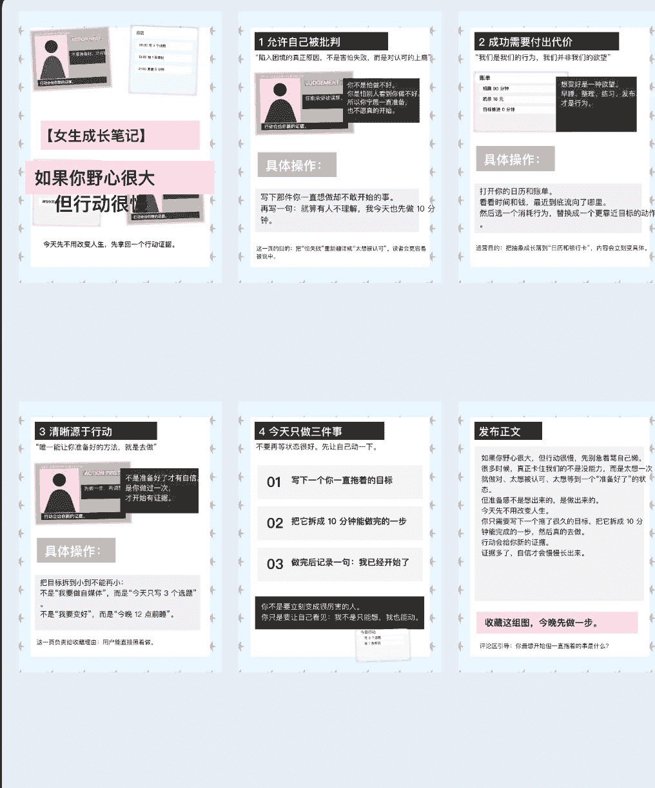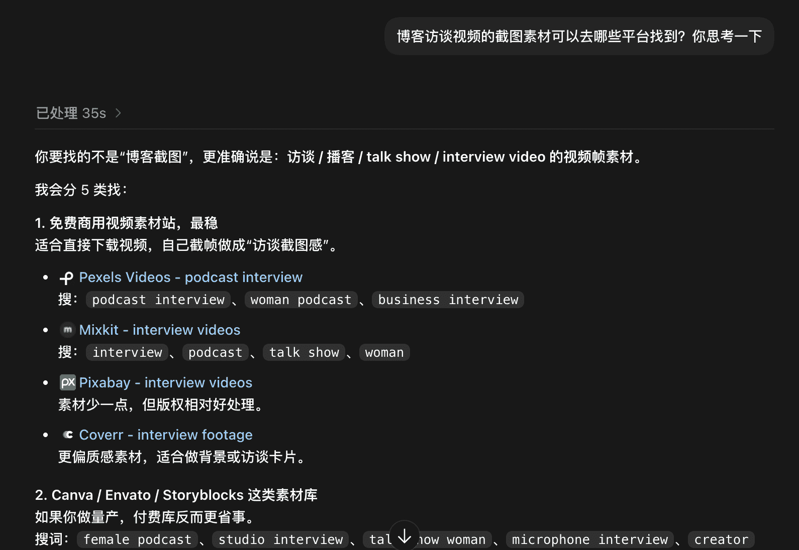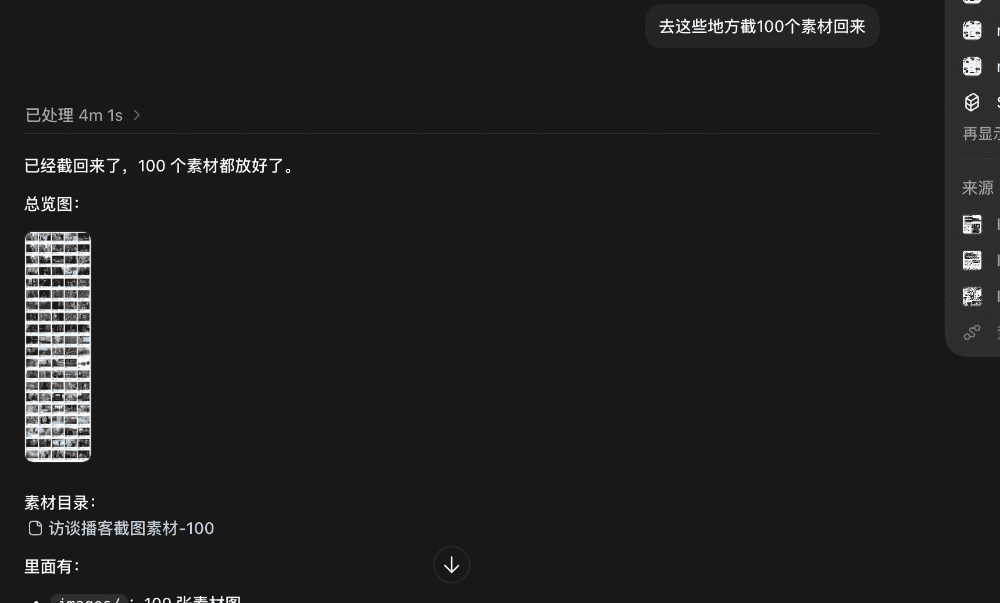

接下来，AI 在这套标准下自己连续推进了 40 多个版本。它不是随机换模板，而是在同一个目标下不断比较、定位和修正。人不替它完成每一次移动，但始终负责目标、真实素材、验收和停机。

**第四步：人来判断，哪一版真正可以停。** 从 v1 到 v42，再继续收口到 v48。最终版是否成立，不看 AI 说完成了，而看整套内容有没有真正达到目标：第一眼有焦点，六页有阅读节奏，证据、判断和行动被放进同一套表达里。

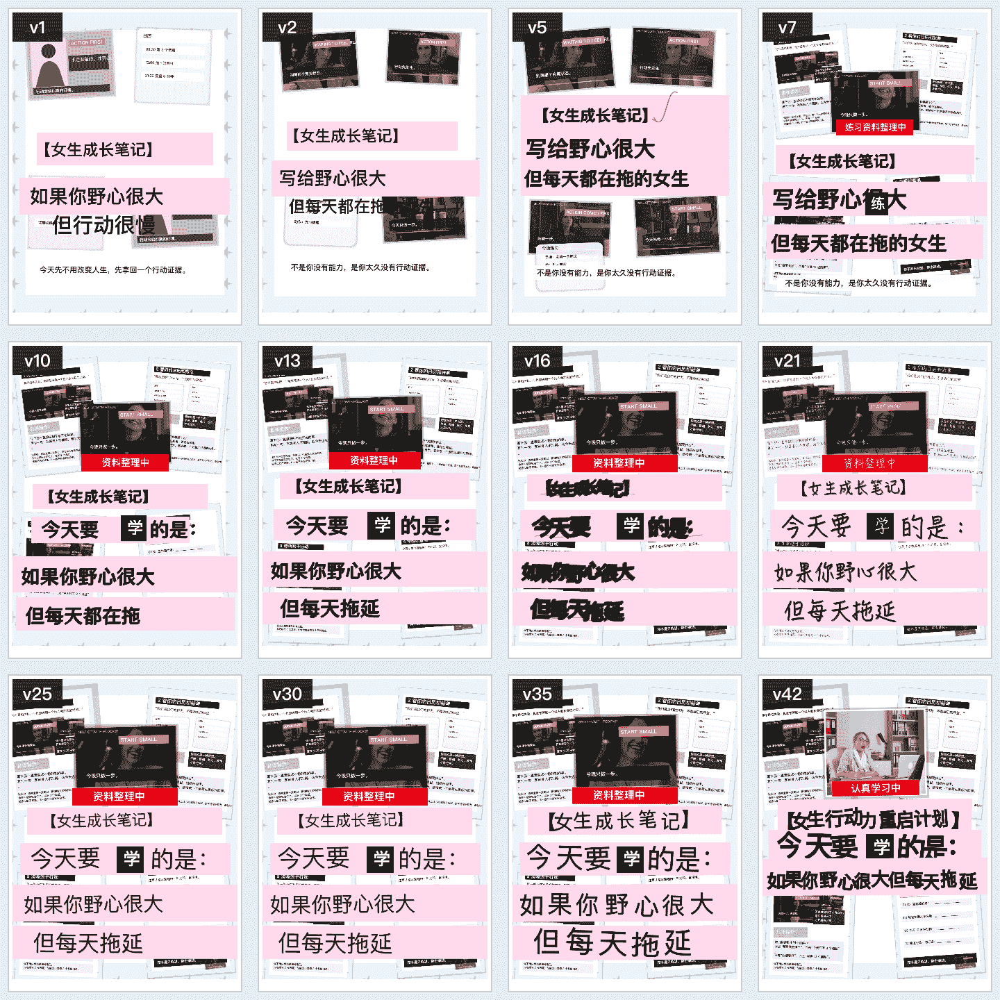

**第五步：把这次跑通的规则写成 Skill。** 我留下的不只是几张成品图，而是让 AI 把对标分析、有效修改、失败原因和验收标准沉淀下来。下一次生产，不再从零开始。

**第六步：换主题，继续生产。** 下一次只需要替换主题、素材和具体对标，再调用同一个 Skill。AI 重复执行，人继续负责选择方向、提供真实素材和做最终判断。

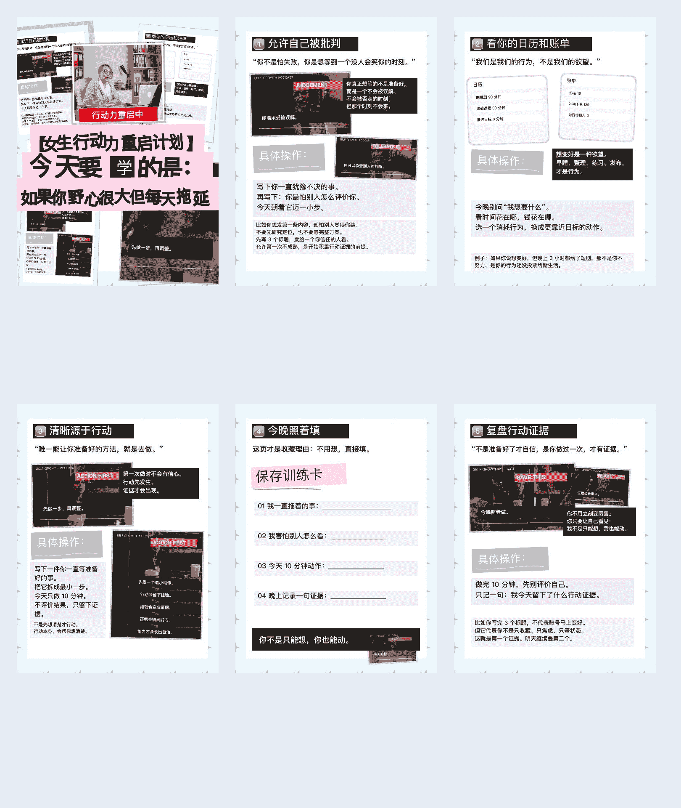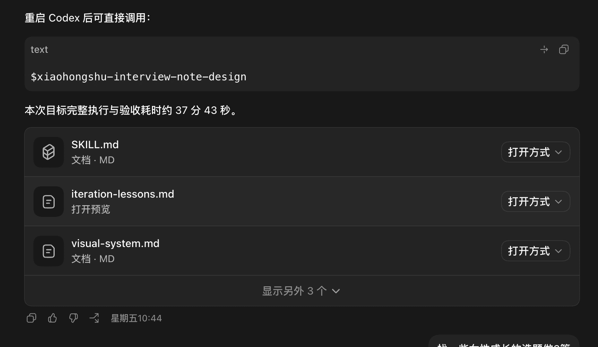

所以，我说你已经是个成熟的 **AI** 了，要学会自己努力，不是把判断权交给 **AI**，也不是 **AI** 突然拥有了审美。人先把对标、目标和专业标准讲清楚，**AI** 再承担漫长、重复的自我迭代。

**实际应用场景｜让 AI 从 v1 自我迭代到专业设计稿**

什么时候用：我有明确的对标和页面目标，但不想再逐张告诉 AI 标题大一点、图片往左挪。

我给 AI：对标图、真实素材、每一页的任务和验收标准，并要求：进入目标模式，从专业设计师视角检检查，一直做到跟对标一模一样为止。

AI 执行：从 v1 持续自检、修改到 v42，再把整套页面收口到 v48。

我负责：保证事实正确，给出审美标准，判断何时已经足够好，以及哪些方案即使完成度高也不该使用。

可检查结果：整套页面重点清晰、节奏统一；有效修改、失败原因和验收标准被写回 Skill，下一次换主题仍能复用。

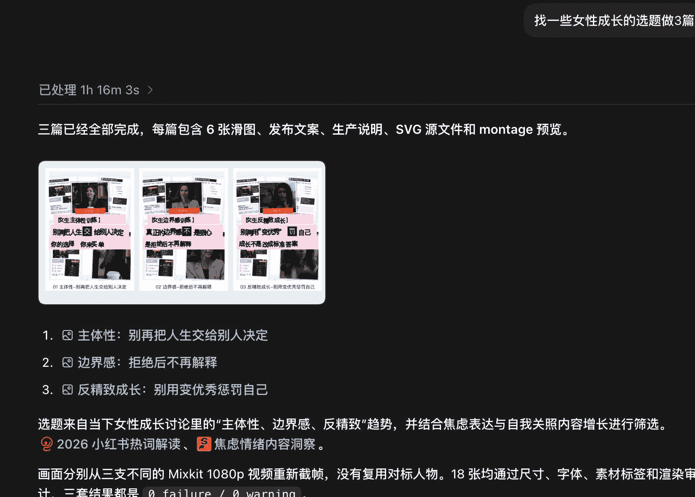
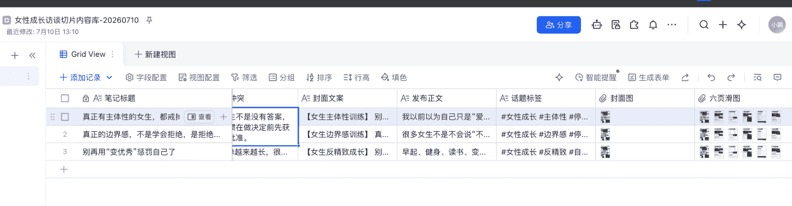

---

**关键成果 5：让 AI 给我布置工作**

我以前也做过很多日程：排满十天，规定周一做什么、周二做什么，手机里塞满提醒。通常坚持几天，就会被新的想法、临时工作和状态变化打乱，然后开始怀疑自己是不是不够自律。

这次我没有先让 AI 替我排一张表，而是先让它研究：别人到底怎样使用苹果日历，哪些方法只是看起来很努力，哪些结构真的能够长期运行。

搜集小红书、Reddit、X 等优质信息网站，看下大神都是怎么利用苹果日历做好自己日程规划的。

我这么做的判断是：公开平台上最显眼的方案，不一定最适合长期运行。我需要 AI 先比较短期看起来很完整的安排和真正能持续维护的结构，再决定哪些原则值得留下。

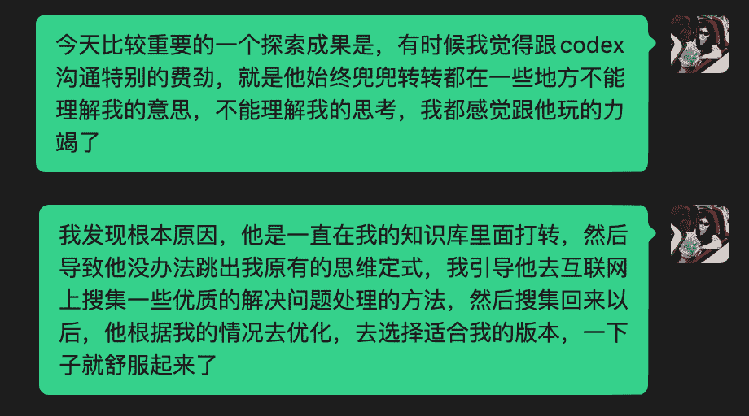

这轮研究给我的不是一张可以照抄的模板，而是一条取舍依据：小红书常见的 24 小时填满和几十种颜色分类，看起来很完整，但维护成本很高；更稳定的长期经验反而更简单——Calendar 管时间，Reminders 管任务，日历不能成为所有待办的仓库，每一个重要时间块都必须指向结果。

但这些仍然只是别人的经验。它能回答“通常怎样做”，却不能回答“我怎样做”。所以第二步，我把自己的 ENTP 自述、盖洛普报告、过去排期为什么失败，以及真实的状态变化一起交给 AI。

结合我的 MBTI、我的盖洛普，以及你对我的性格的一切了解，帮我制定适合我的日程规划方式。

我还继续把“适合”拆成四个可以检查的问题：

1. 我能不能看清每天、每周、每个月推进了什么成果？
2. 每天可以探索很多，但能不能留下一个核心结果物？
3. 低谷时，系统能不能直接给我一个最小的下一步，而不是让我重新规划？
4. 每周留下的成果，能不能真正帮助我做取舍、做验证、规划未来方向？

这些反馈比性格标签更重要。报告只能提供线索，真正决定系统怎样设计的，是我过去为什么失败、我愿意做到哪一步，以及什么结果才算通过。

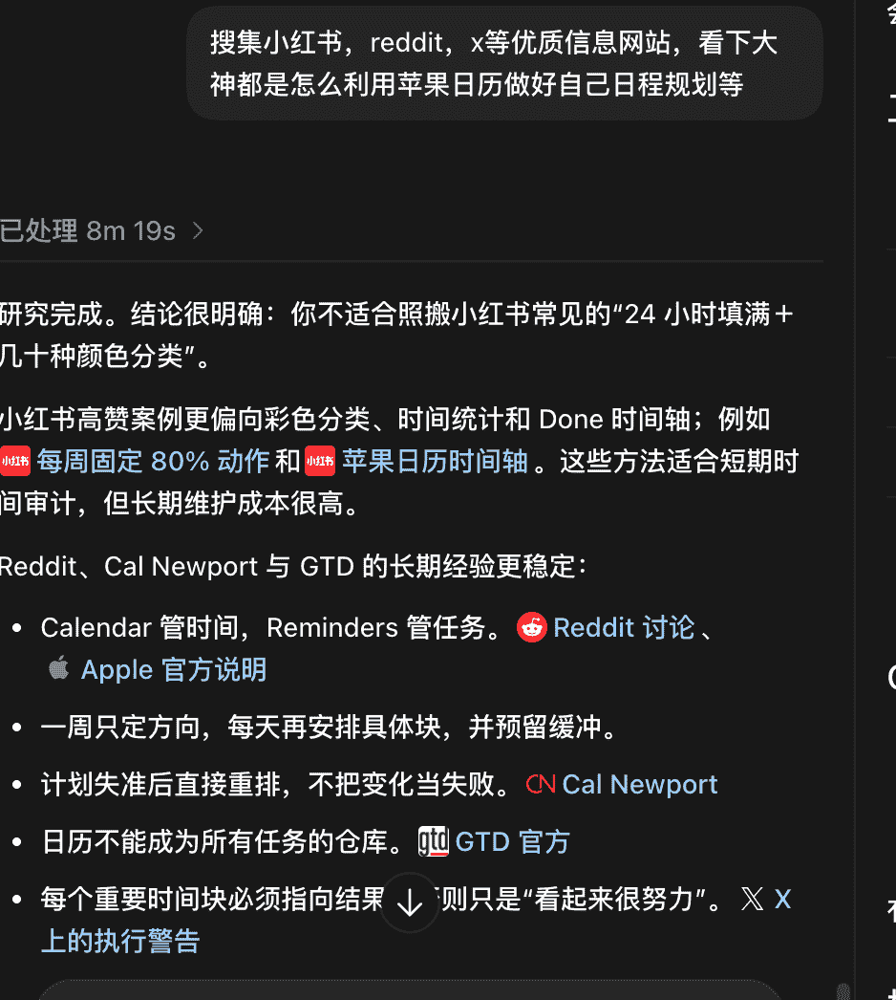

第二张图看起来已经很完整，但它仍然只是 AI 根据当时信息做出的中间方案，不是最终答案。

图里，AI 仍然把核心结果块放进 Calendar。我在真实工具里检查以后，继续追问了一句：

日历里不是只有硬性提醒吗？

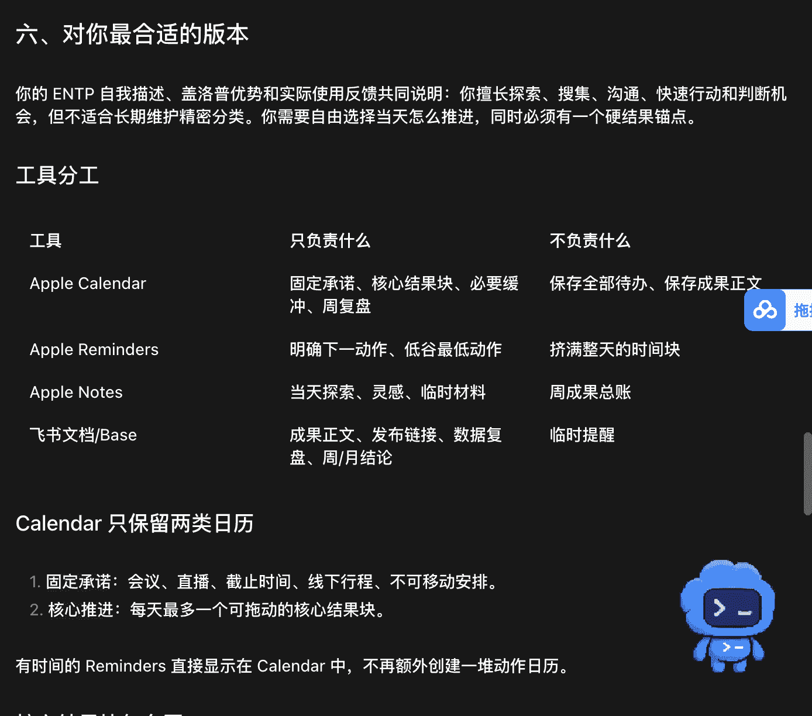

这句话重新改掉了整套工具分工：

- **Apple Calendar**：只放学车、会议、线下活动等时间不能移动的硬性承诺。
- **Apple Reminders**：直接告诉我今天只做什么，以及低谷时最低做到哪一步。
- **Apple Notes**：承接当天的探索、灵感和临时材料。
- **飞书文档与 Base**：聚合成果正文、发布反馈和周/月结论。
- **Obsidian**：只接收已经验证、值得长期复用的数字资产。

我的判断是：如果一个系统让我打开日历以后，还要重新分辨哪些是承诺、哪些是任务、哪些是成果，它就在增加认知负担。日历只需要告诉我什么时间不能动，提醒事项应该直接告诉我今天只做什么。

最终真正固定的，不是每天几点做哪件事，而是月度方向、周度成果和当天一个核心结果；具体推进路径可以根据当天状态变化。

如果我一眼看不懂今天做什么，低谷时还要重新规划，或者完成以后没有留下成果证据，这套系统就算逻辑再完整，也没有通过。所谓让 AI 教我怎么工作，不是把自己交给 AI 管理。是我先替它定义研究范围，提供真实的自我观察，说明什么叫失败，再用实际使用感受不断验收和纠正；AI 负责把这些判断翻译成规则和下一步。

目前这套工具分工已经落地，并进入 7 天试运行；它还不能被提前写成已经长期有效。

**实际应用场景｜用 MBTI、盖洛普和失败记录重做工作系统**

什么时候用：我反复把日程排满，却总被新想法和状态变化打乱，传统计划对我没有用。

我给 AI：你要结合我的 MBTI、我的盖洛普，以及关于你对我的性格的一切了解，帮我去制定适合我的日程规划的方式，并且结合我的苹果日历/提醒/备忘录。

AI 执行：重新分工工具：日历放硬性承诺，提醒事项承接当天核心动作和低谷最小动作，Notes 承接探索，飞书记录结果，Obsidian 沉淀验证过的资产。

我负责：决定目标，指出建议为何不适合我，用真实执行结果继续改规则。

可检查结果：先试跑 7 天，检查每天是否看得懂、做得动、留得下成果证据；没有跑完之前，不把它写成已经长期有效。

**关键成果 6：给 AI 一点反馈**

我很喜欢创造。

但当我一次产出几十条内容以后，我并不喜欢把它们一条条搬运、发布和登记。

如果发布只是重复劳动，它当然很容易被拖延。

所以我后来不再把发布理解成内容生产结束后的行政任务。

发布的意义，是把我的判断送进真实世界。

一条内容发布以前，我认为标题会吸引某一类人，某个观点会引发认同，某个案例能够建立信任。

但只要它还躺在本地文件和飞书表格里，这些都只是我的猜测。

真正公开以后，阅读、停留、收藏、评论、私信、咨询和成交，才会告诉我：我理解的用户是不是真实存在，我选择的对标有没有带来正确的人，我认为重要的判断，用户到底在不在意。

| 阅读/停留 | 收藏/评论 | 私信/咨询 | 成交 |
| :--- | :--- | :--- | :--- |
| 验证注意力 | 验证价值感与共鸣 | 验证信任 | 验证行动意愿 |

所以每条发布内容都应该只验证一个问题。

不是今天完成日更，而是：

这一类人，会不会被这一个痛点或判断吸引？

这也是为什么最终发布仍然需要人确认。

内容代表的是我的身份、事实和承诺。AI 可以准备，但是否符合我的判断、是否涉及风险、是否应该在此刻公开，必须由我负责。

类似这样的指令：从飞书发布池只取 1 条内容，准备 6 张配图、标题和正文；提交前必须停下来等我确认；提交以后回到笔记管理页，以页面显示的真实状态为准。没有公开链接，不准写发布成功；出现账号风险，立即停。

我的动作：AI 准备好以后，我亲自检查这条内容是否符合我的身份、事实和承诺，再决定继续、修改还是暂停。那次页面只显示审核中，系统就只能回填审核中；后来发现账号和平台风险，我直接删掉两个定时发布任务。

分工边界：AI 可以执行连续动作，但什么时候停、什么事实可以被记录、什么内容有资格公开，必须由人决定。

那条真实发布链具体走了六步：

1. 从飞书发布池读取 1 条待发布内容。
2. 下载并上传 6 张配图。
3. 填写标题和正文。
4. 获得人工确认后提交。
5. 回到笔记管理页检查真实状态。
6. 页面显示审核中，飞书就只回填审核中。

后台提交成功、平台审核中、生成公开链接，是三个不同事实。最后那一步不是 AI 会不会点击，而是人能不能对事实负责。

过去一个月，一条小红书内容真实完成了后台提交，但平台回读状态只有审核中。没有公开链接，我就不能把它写成已经发布成功。

后来发现账号和平台风险，我又主动删除了两个定时发布任务。

自动化不是越多越好。

没有刹车的自动化，只是在更快地替人承担错误。我给自动化留下的四个刹车：

- 状态不明，不写成功
- 出现账号风险，立即停止定时任务
- 最终发布，保留人工确认
- 自动化不能越过事实、身份和权限边界

发布以后，真正有价值的也不是把状态改成已完成，而是把反馈重新送回前面的系统：市场反馈修正我的判断，有效判断进入 Skills，新案例和用户语言回到 Obsidian，下一轮方向重新进入目标和日程。

这条自动回流目前还没有完全跑稳。大批量内容已经能够生产，真实发布、数据回收和淘汰机制仍然是下一阶段需要补上的部分。

但我的判断已经发生了变化：

内容不是生成完就结束了。只有进入真实世界，接受反馈并改变下一次生产，它才真正完成。发布不是最后一个执行动作。

发布是判断第一次接受现实审判的地方。

**实际应用场景｜让发布反馈反过来修正下一批内容**

什么时候用：飞书内容池里已经有待发布稿件，我要把内容送到平台，并用真实反馈检验之前的判断。

我给 AI：打开小红书创作平台，不要使用小红书的 MCP，模拟人工点击进行发布。

AI 执行：取稿、填写发布信息、回读平台状态，并把真实状态写回飞书；出现账号风险时立即停止。

我负责：发布前最终确认，判断事实、身份和权限边界，必要时随时暂停整条链路。

可检查结果：发布后记录停留、收藏评论、私信咨询和成交，分别验证注意力、共鸣、信任与行动意愿，再把结论送回下一轮选题和生产。

**最后**

这一个月，我看起来做了很多和 AI 有关的事情。

沉淀真实上下文、把纠偏写进 Skills、批量生产对标内容、让 AI 围绕专业设计目标自我迭代、重新设计日程、把发布变成市场实验。

但如果把所有工具名字拿掉，我真正做的只有一件事：

把可标准化的数字执行交出去，把人留在真实世界里：见人、做事、确认事实、形成判断、承担结果。AI 没有让我变得不需要思考。

它只是迅速拿走了那些过去可以用勤奋、熟练和时间堆出来的优势，逼我更早面对一个问题：如果执行不再稀缺，我到底凭什么做得比别人好？

我的答案不是更会写提示词。

而是更真实地进入世界，见用户、做业务、付学费、拿反馈；再把这些经历变成上下文，把取舍变成 Skills，把模糊的感觉变成标准，把每次发布变成下一次判断的证据。

我们是 AI 的眼睛。

我们替它去真实世界里生活，看到人的表情、情绪、犹豫、欲望和那些没有被说出口的需求。

它可以替我们记住、连接、执行和放大。

但决定看向哪里、相信什么、放弃什么，以及最后承担什么结果，仍然属于人。

我觉得这件事情很恐怖。

但它也非常公平。

因为当可标准化的数字执行都没有壁垒以后，真正值钱的，是一个人亲自进入过的世界、让它发生过的事实，以及她因此形成的判断。

————分割线————

看完这篇 SOP，你觉得你懂了。但 90% 的人一到实操就会卡在第一步。

工具和教程只是最低级的壁垒，真正的壁垒是“立刻动手”和“圈层信息差”。

如果你想看全网最新的变现玩法，并且和一群执行力极强的极客一起下场拿结果，欢迎围观我的核心私域：【懒人专属群】。

我们不聊虚的，只做商业闭环的拆解与 AI 效率的压榨。系统内已沉淀 1000+ 跑通的套利实战局。

👉 查阅圈子完整数字资产与上车门槛：

https://lazyso.com/insider/

认同价值、准备好下场干活的，扫码加我微信（lazyhelper1）

备注：【实操上车】，不闲聊

