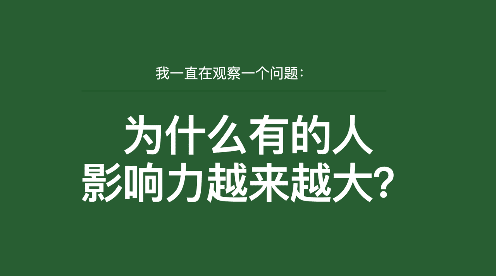
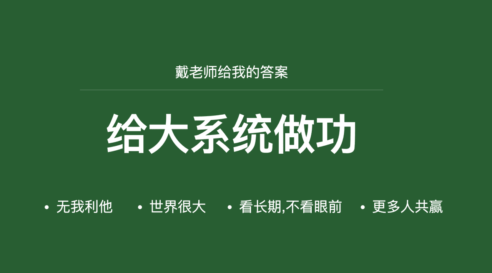
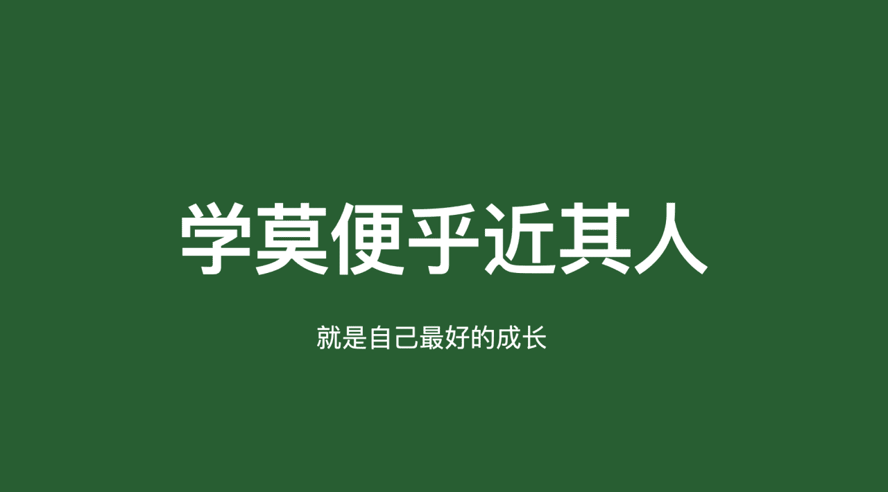
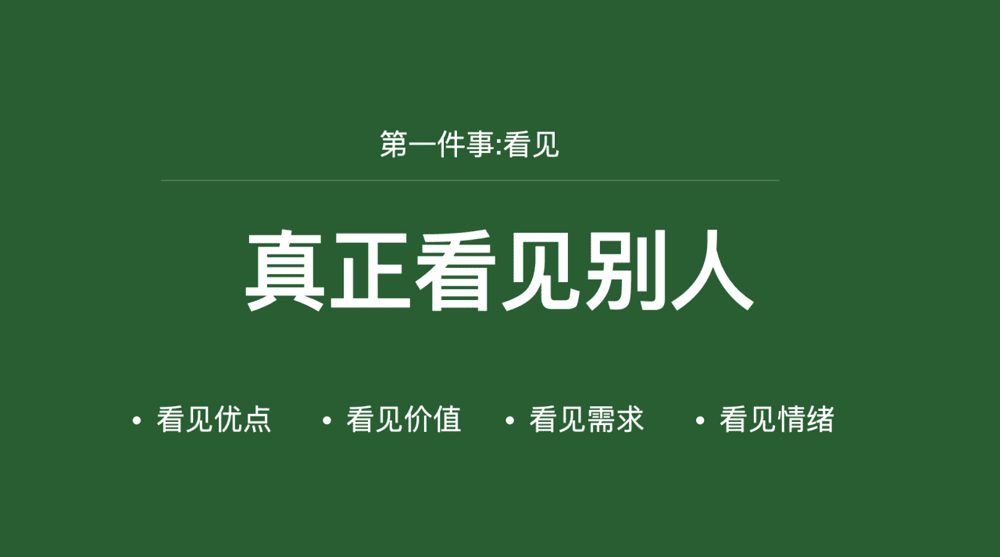
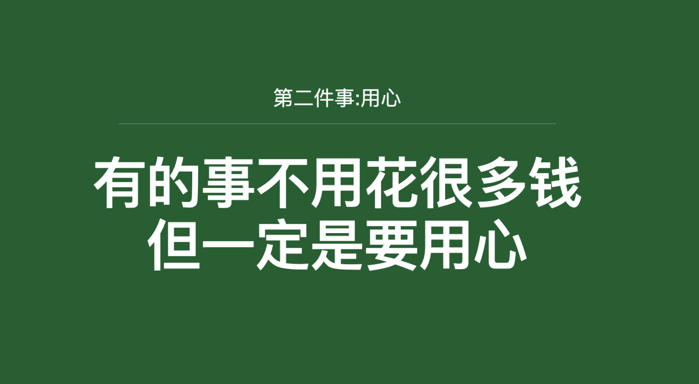
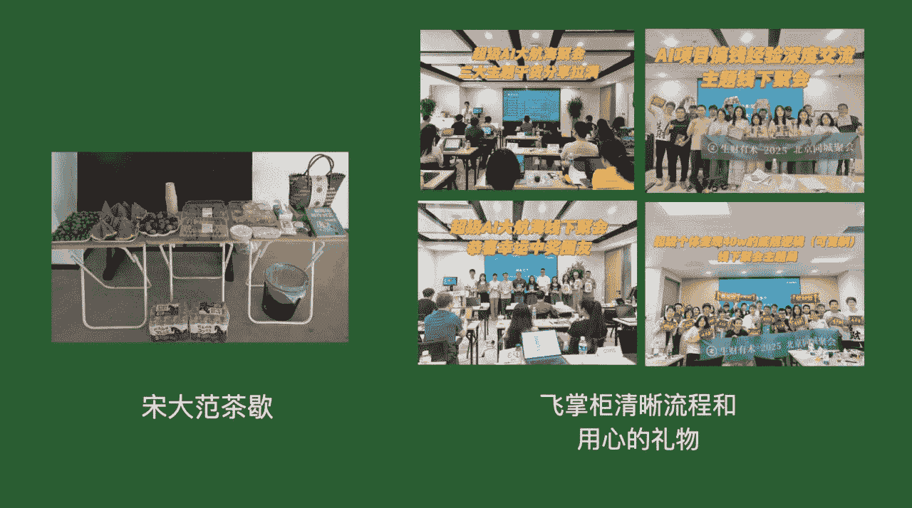
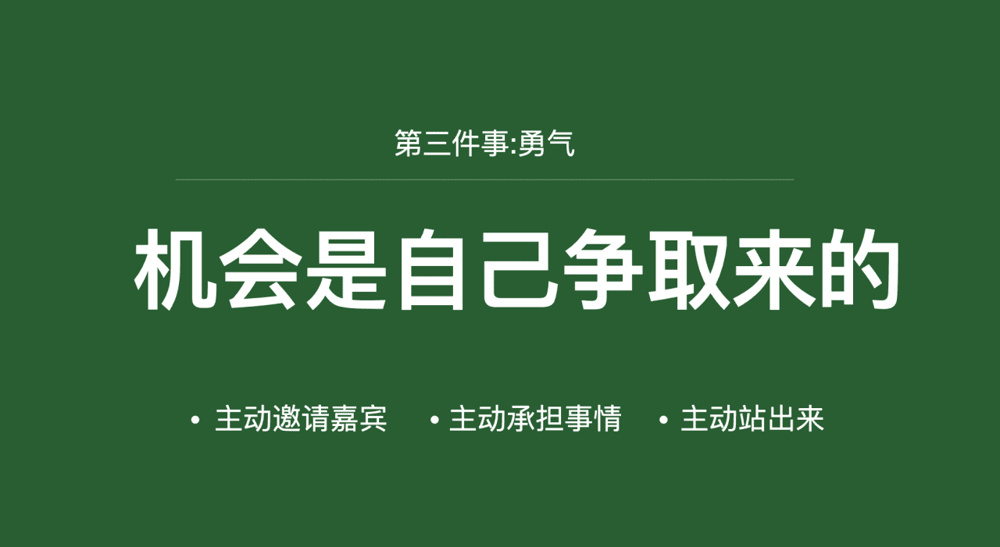
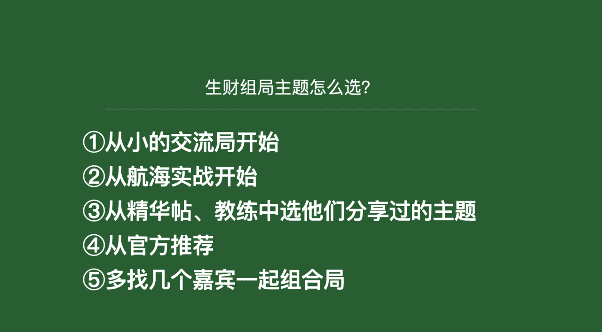
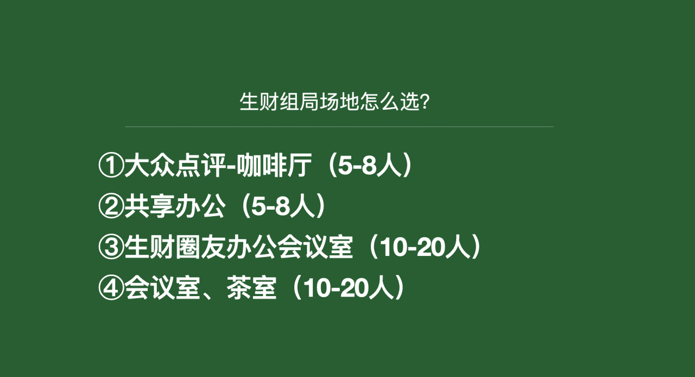
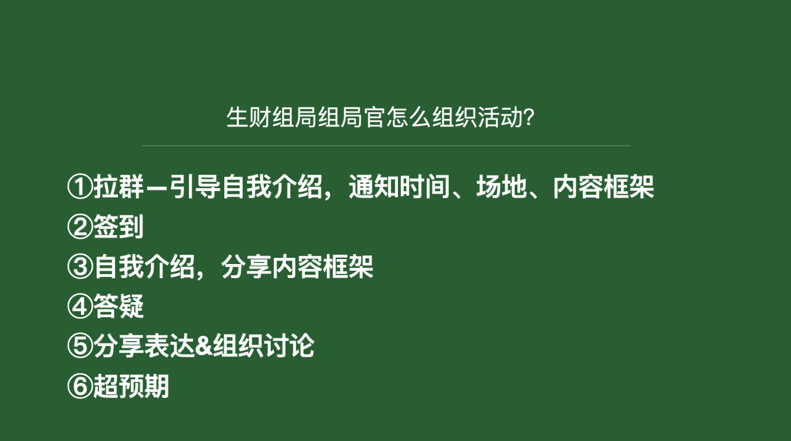

# 新人组局**10** 条实战经验心得

260710 副业SC 精华

整理：公众号懒人搜索，懒人专属群精选

懒人微信：lazyhelper1

hello，大家好呀，感谢七天邀请我来给大家做这个关于组局培训的经验分享。

上周7月5号，我们在北京，由海明发起的一个新人组局的培训，也点亮了北京的一些圈友的信心。这个组局培训，对我们启发很大，于是我们一起梳理了一些关于组局经验，还请大家多多交流，多多指教。

我先自我介绍下，我是咏舒，坐标北京，生财6年老圈友。

2020年我刚加入生财不到一个月，我就在生财被点亮、被看见，邀请我分享写精华帖，随之邀请我做北京同城聚会的夜话官，在这里，我是第一次真正的被照见，看到了自己。

可以说，在生财这里，我看见了更广阔的世界，看见了一群躬身利他的榜样，我学会了感恩，也坚定了自己持续发光的初心。

我始终坚信，个人的力量是微弱的，而生财是托举我们不断成长的大系统。

这几年持续组局、参与组局官培训，让我深刻读懂了：利他，本质就是最高级的利己。在一次次线下组局、一场场新人培训中，我不仅沉淀了专业的做事方法，更修炼了为人处世的底层心性。

其实，我曾经是不善言语的i人，一表达就紧张。但坚持组局、不断走出去，尝试做新的事，我逐渐打破自我局限，敢于打开自己、主动链接他人，慢慢练就了自己的一些洞察能力，不仅助力了个人业务突破，也结识了一群同频靠谱的挚友。

很多圈友常会问：组局、是一件耗时、费心、很累的事。但我始终愿意坚持深耕这件事，因为我曾被生财点亮，所以格外想成为微光，继续点亮更多不敢起步、迷茫观望的新人，让更多人在组局中成长、在利他中收获蜕变。

这次，我结合海明发起的7月5日线下组局官共建活动的完整实操经验，把我们的组局核心心法与落地技巧，转成一份可直接落地、避坑增效的心得经验，帮助零基础圈友快速迈出组局第一步，稳稳做好线下活动。

## 1、组局核心不是秀专业，是帮每个人「看见自身价值」

从这次北京组局官培训的活动的真实案例来看：每个人都有专属价值，只是自己习以为常、视而不见。

现场一位有十几年企业财务经验的圈友，一直觉得自己的专业内容太枯燥、太冷门，普通人听不懂，不敢上台分享。结果活动现场，多名圈友接连追问个体户报税、年化利率计算、香港账户数据回传风险等实操问题，她随口解答的常识内容，所有人都认真记录，连她自己都十分意外。

还有一位深耕小程序出海的程序员，踏实创业多年、实战经验扎实，却始终觉得自己经历不值一提，现场互动后大家争相请教出海实操问题，让他当场萌生了主动组局分享的想法。

我们刚进生财不久的新人，其实不必执着于高大上的专业理论，忽略了自己日积月累的实操经验，这恰恰是圈内人最稀缺的干货。

新人组局不用追求高大上的内容，核心工作就是做「价值挖掘者」。

就像这次活动中的海明，全程没有让大家流水线念简历，而是提前对接每位圈友、现场主动追问、引导圈友互相提问，一步步帮大家挖出自身隐藏的价值。

通过这种方式，帮参与者跳出自我认知局限，找到自己可以分享的亮点，这既是组局的核心意义，也是一场活动的最大价值。

## 2、先立边界再做事，新手组局最怕「盲目摸索」

很多新人组局容易踩坑、焦虑内耗，不是能力不足，而是不懂规则、没有边界认知。

很多新人私下摸索组局，会纠结“能不能邀请外部人员分享”“组局能不能盈利、AA怎么算”“哪些行为不符合平台要求”，很容易在不知情的情况下踩线、走弯路。

所以这次我们北京组局官培训的专场里，专门设置了30分钟组局手册共读环节，这是新手最容易忽略却最关键的一步。

手册清晰明确了核心规则边界：严禁非生财圈友随意分享、清晰区分AA公益组局与盈利边界、明确线下活动品牌价值观、规范主题发起和嘉宾邀请流程。

共读规则+现场答疑的模式，针对性解决了新组局官的所有困惑。

很多新人的焦虑，不是不会做内容，而是不知道底线在哪、遇事该找谁。这套流程下来，新手能彻底打消“怕做错、怕违规”的内耗，让组局有方向、有底线、有底气，不用在试错中浪费时间。

## 3、组局的底层心法：利他为先，利己自然发生

真正长久、受欢迎的组局，核心从来不是自我变现、自我曝光，而是利他。

我早期做设计师IP教练时，曾陷入长期流量瓶颈，始终打不开局面，核心原因就是思维局限，只想着“自己能赚到什么、得到什么流量”，从来没想过“自己能为别人提供什么价值”。

直到看到戴老师的做法深受启发：戴老师说他不懂AI，没有闭门自学，反而主动组局、邀请专业教练分享，利他带动大家成长的同时，自己也完成了高效学习。

此后我转变思维，免费发起公益文创训练营，放弃原本几百到几千的收费，纯粹利他赋能圈子。最终吸引了央美博士、顶尖设计师等优质人脉加入，团队还拿下全国前十的文创作品奖项。

这件事让我彻底明白：利他从来不是口号，而是组局的起点。

放下功利心，主动帮他人解决实际问题、为圈子创造价值，反而会反向筛选优质人脉、积累个人口碑。成就别人的同时，自己的影响力、人脉、成长都会自然沉淀，利他和利己从来都是相辅相成。

## 4、依托平台大系统，顺势做事、借力成长

个人的力量永远有限，新人组局最聪明的方式，是给生财大系统“做功加分”，而非消耗品牌、自我随性发挥。

平台搭建了成熟的圈子和流量舞台，我们的每一场线下活动，都代表着平台品牌形象。

用心做好每一场活动、维护好圈子口碑、传递正向价值观，就是为平台加分；而认真为系统付出的人，一定会被大系统看见和托举。

戴老师每次有外地嘉宾到访，都会自掏腰包招待、聚拢圈友交流，给嘉宾最好的体验，深耕利他，他的付出和对圈友的影响，大家都一致的好口碑，生财去年也给戴老师获榜样老师的荣誉。还有我们的圈友刘智行，始终践行利他感恩的初心，深耕圈子、持续赋能，从月入3000的普通公务员，成长为月入十几万的优质创作者，还受邀登上平台线下大会分享。

这不是玄学，是圈子最真实的规律：为大系统持续做功，跟更多人一起共赢，那么，自然我们小个体收获的结果不是小。

## 5、向上学、向下帮，是组局最快的成长路径

对新人而言，组局是最高效的成长载体。

向上学，最好的方式就是主动邀请优质嘉宾分享，线上看精华帖只能学到冰冷的文字内容，线下近距离接触能学到对方的做事格局、决策思维、谦卑发心和处事方式，成长效率远超自学。

去年我主动邀请林途来北京分享公众号矩阵玩法，他特意清晨从石家庄坐高铁赶来，还贴心带了河北的特产，全程谦卑耐心、认真答疑。

这场线下交流，让我亲眼看到优质从业者的正念与利他，这种感知是读一万字精华帖无法感知到的，也正是这场交流，让我后续公众号文章单篇突破3.4万阅读量。

向下帮，核心是用心看见每一个普通人。

比如我这次组局北京活动中，圈友虫子说是飞掌柜点亮了他的理财优势，邀请她参与分享。虫子说她常年理财年化收益达15%，是很多人刚需的干货，但她自己却不懂如何落地输出。

在交流中，我们没有忽视普通圈友的短板，反而主动帮她拆解内容、梳理方向，助力她敢于站上分享台。

这种不轻视任何人、主动赋能他人的行为，就是最好的向下帮。

在帮助他人成长的过程中，自己的组织能力、共情能力、影响力也会快速提升。

## 6、做好「四个看见」，搞定**90%**的活动口碑

一场活动的好坏，大半取决于参与者的体验与感受，而非单纯的内容。新人组局一定要吃透「看见」的四个核心维度，轻松做好口碑：

- **看见优势**：不唯大V、不唯专业，普通人的实操经验、踩坑心得，都是他人需要的干货。如本次活动中，理财年化15%的圈友、深耕十几年的财务从业者，看似普通的日常经验，恰恰是圈内小白最急需的干货；
- **看见价值**：主动挖掘他人习以为常、却极具实用性的隐藏价值，帮对方建立自信。十几年财务从业者原本自认内容冷门无用，经现场挖掘互动后，才发现自己的基础财税常识，是多数人的刚需干货；
- **看见需求**：摒弃专业晦涩的内容，拆解出「最小可分享单元」，只输出小白能听懂、能落地、有结果的内容。本次活动中，高年化理财圈友此前因堆砌专业理论、听众听不懂而受挫，我们帮她精简内容，聚焦「小白如何识别稳健基金、实操买入」的落地干货，瞬间找准分享方向，重拾组局信心；
- **看见情绪**：面对差评、冷场、体验不佳的问题，不辩解、不内耗，先安抚情绪、解决问题，好的感受才是好活动的基础。我过往组局曾收到“没有收获”“场地拥挤、无人服务”的负面反馈，没有硬怼辩解，而是先真诚道歉、安抚情绪，再一对一答疑、补齐体验缺口，最终化解问题、留住口碑。同时海明活动前逐一和圈友打招呼、主动调整活动流程为我预留分享时间，也是细致看见他人情绪与需求的体现；

## 7、用心大于专业，真诚是新人最好的底牌

也有新人不敢组局，担心自己不够专业、会被差评、做不好口碑。但真实的组局经验证明：只要足够用心、足够真诚，几乎不会出现负面评价。

用心不需要高成本，藏在每一个细节里：提前到场布置、主动迎接每位参与者、耐心答疑、梳理共性问题、准备小惊喜、照顾现场每个人的体验、用心维护平台品牌。

圈内很多优秀组局官都是如此：宋大范精心准备茶歇，让大家感受被用心招待；飞掌柜打磨活动流程、准备专属小礼物，让参与者被尊重；戴老师常年免费答疑、用心托举每一位圈友；海明活动后主动梳理全员共性问题、帮新人锁定组局方向。

所有真诚的付出都会被感知，比起完美的专业度，圈内更认可走心、靠谱、利他的做事态度。

## 8、勇敢落地、接纳试错，行动是最大的才华

没有完美的组局，所有成熟的组局官，都是从一次次不完美的落地中成长的。我早期组局时，曾连续三次被场地拒绝，也经历过嘉宾邀约被婉拒、现场冷场、收获差评的时刻，这些都是新人组局的常态，无需内耗、无需退缩。本次活动中萌生组局想法的程序员、理财达人，也都是从“不敢、不会”的观望状态走出来的。

勇敢主动站出来、主动承担、主动链接、主动解决问题，是新人最珍贵的能力。

每一次被拒绝、每一次踩坑，都是积累经验、提升认知的过程，敢于迈出第一步，就已经超越了绝大多数观望的人。就像专程跨城赶来分享的林途，敢于主动奔赴、真诚赋能，最终也收获了自己的成长与机遇。

## 9、核心落地逻辑：降阻力、多加分，轻松做好每一场局

新人不用追求规模，掌握「降阻力+多加分」两大核心，就能稳定做好组局，零压力落地：

**全方位降阻力**：给自己降阻，不用一开始就照搬大型线下活动规模，从3-5人小型交流局起步，不贪大、不焦虑，快速获取正反馈；给参与者降阻，参考北京活动选址逻辑，根据目标人群聚集地选场地，比如AI爱好者集中区域就近选址，避免大家跨城奔波、降低参与意愿；给嘉宾降阻，像邀请林途分享公众号矩阵一样，优先邀约对方成熟、擅长、有经验的主题，不强行安排陌生领域内容，降低嘉宾分享压力。

**全方位多加分**：为平台加分，严守规则、做好口碑、传递正向价值，维护生财线下品牌；为圈友加分，复刻本次北京活动的挖掘模式，让每个人被看见、有收获、能落地；为嘉宾加分，全程尊重、用心配合、真诚致谢，像善待每一位到访嘉宾一样，让对方感受到真诚与认可。

林途分享结束后，主动在本地开启组局，就是被用心对待、正向赋能后的最好反馈，彼此成就、双向加分。

## 10、新手实操极简清单，从零组局直接套用

无需自创模式，新人直接照搬这套标准化流程，即可顺利完成首场组局：

- **选主题**：优先选自身擅长经验、航海实战心得、精华帖成熟主题、平台官方推荐方向，小众务实、可落地最佳；
- **选场地**：新手优先咖啡厅、小型共享会议室、圈友闲置会议室，低成本、低压力、氛围轻松；
- **办流程**：提前建群同步信息→提前40分钟到场筹备→挖掘式自我介绍（不走过场）→共读手册+答疑→主题分享+互动讨论→增加惊喜共创环节→收尾帮每个人锁定下一步行动。

## 写在最后

组局的终极意义，从来不是办一场活动、凑一场热闹，而是「被人看见，再去看见别人」。

很多人不是没有能力、没有干货，只是缺少一个起点、一份自信。

新人不用畏惧从零开始，每一次用心组局，都是一次星星之火的传递，既能点亮自己，也能成就他人、温暖圈子。

————分割线————

看完这篇SOP，你觉得你懂了。但90%的人一到实操就会卡在第一步。

工具和教程只是最低级的壁垒，真正的壁垒是“立刻动手”和“圈层信息差”。

如果你想看全网最新的变现玩法，并且和一群执行力极强的极客一起下场拿结果，欢迎围观我的核心私域：【懒人专属群】。

我们不聊虚的，只做商业闭环的拆解与AI效率的压榨。系统内已沉淀1000+跑通的套利实战局。

👉 查阅圈子完整数字资产与上车门槛：

https://lazyso.com/insider/

认同价值、准备好下场干活的，扫码加我微信（lazyhelper1）

备注：【实操上车】，不闲聊

