公众号懒人搜索，懒人专属群分享

如何用 **Skill** 原创虚拟产品！**11000** 字说清楚

260717 副业 SC 精华

整理：公众号懒人搜索，懒人专属群精选

懒人微信：lazyhelper1

最近 AI 圈流行了很多概念，比如 Agent、Harness 工程、Skills、Agent、Vibe Coding，对于很多人来讲，光学概念就要学半天，同时很多人对一些 Agent 工具存在一些误解，最大的误解就是认为 Claude Code 和 Codex 只能程序员用，只是一个编程工具。

其实对于这两个工具，能做的事情已经不止是编程了，你不会编程也可以用这两个工具去提效，因为它们不仅能够帮你写代码，还能接管你的电脑。最简单的一个例子，它们可以帮你去整理桌面，所以对于 Claude Code 和 Codex 的能力边界，一定要打开想象力。

这篇文章主要讲如何用 Skill 原创虚拟产品，以及如何搭建自己的内容虚拟产品工厂。我分享了长文 Skill、笔记 Skill 和指南 Skill 的分享思路，以及这 3 个 Skill 如何协同。

2026 年，虚拟产品这个赛道可以用 Skill 重新做一遍，拥抱 AI，从拥抱 Skill 开始。如果你不知道如何原创自己的 Skill，如何用 Skill 重塑工作流，建议可以读一读。

## 01 为什么别人的 Skills 到你的手里就不好用了？

Skills 的中文含义是技能，其实它并不复杂。通俗地理解，就是赋予 AI 智能体去执行某项具体任务的能力模块。

可以把 AI 智能体想象成一个新来的员工，它本身很聪明，但光靠“聪明”还不够，它还需要被授予具体的权限和工具，才能真正干活。这些被授予的能力，就是 Skills。

它其实就是具体任务和场景的高度封装。比如你是一名内容创作者，你有一个场景就是要写标题，你每天都要写标题，你就可以根据你的工作任务去做一个标题 Skill。这个 Skill 就为你所用，它的任务也很具体，就是帮你写标题。

这也是 Skills 的特点，它指向的是重复性任务。如果你有一件事要重复做，那么它大概率就可以被封装成 Skills。举一个我真正落地的 Skill 示例：这个 Skill 是帮我做课件封面图的。小红书有很多类似的封面图，都是统一的形式，左边是课件的缩略图，右边是拼图，也就是左缩略图、右拼图的形式。

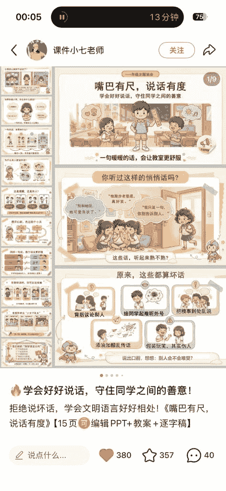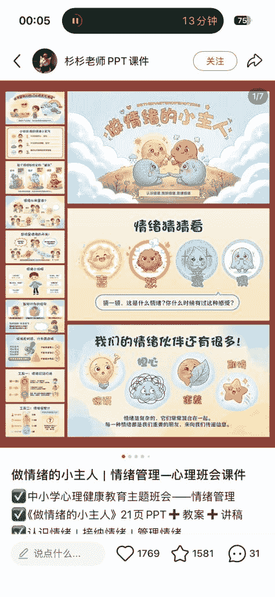

我把这个要求发给了 Claude Code，并且把我的要求发给它，说我想要这样的 Skill。然后 Claude Code 就会自己做，最终实现的效果是：我给你 PDF，你可以直接帮我做出参考的效果。最后它确实做到了，我只需要给它 PDF，它就能生成封面图。

这个场景看起来很不起眼，但是非常奏效。

所以，第一件事是对 Skill 祛魅，对别人的 Skill 祛魅。你不需要知道一个 Skill 配置文件里字段叫什么名字，不需要知道触发条件的语法格式是什么样的，不需要看任何技术文档，不需要了解什么叫 YAML、什么叫 JSON、什么叫 Markdown Frontmatter。

你只需要做一件事，就一件：打开 Claude Code 或者 Codex，用你平时跟同事交接工作时使用的那种大白话，把你脑子里已经在运行的做事流程完完整整讲出来。AI 会帮你完成剩下所有你不需要关心的部分。

这件事的本质逻辑极其简单：Skill 文件的本质是一套结构化的规则文本。

而大模型最擅长、被训练最多的事情，恰好就是把自然语言精准地转成结构化文本。

所以整个“写 Skill 配置”这个环节，天然就应该交给 AI 自己来完成。你去做这件事，反而是效率最低的选择。你只负责定义什么是好，AI 负责把你的定义翻译成它可以机械执行的规则体系。这个分工一旦成立，技术门槛就不存在了，只剩下认知门槛。

这里必须拆解一个很多人没注意到的现象：为什么市面上绝大多数教你做 Skill 的教程，越看越让你觉得自己不够格。

因为这些教程是技术人写的，用的是技术人的思维框架和技术人的表达习惯。技术人拿到一个陌生工具，第一反应永远是先看文档、先理解参数列表、先摸透底层机制，然后才敢动手。这个思维方式在写代码的领域是黄金习惯，但在教普通人用 AI 这件事上，它变成了一道人为制造的高墙。

技术人不自觉地把自己的学习路径当作唯一的正确路径：先讲 Skill 文件的内部结构图，再逐字段讲解每个参数的类型和可选值，再讲触发条件的三类写法及其适用场景，再讲约束规则的六种语法格式。一个没有任何技术背景的普通人，看到第三行就已经在心理上放弃了。不是因为他学不会，是因为讲给他听的那些知识，他可能一辈子都用不上。

正确的做法只有一条：先让 AI 帮你做出一个粗糙但能跑起来的初版 Skill，马上跑一版看实际效果，然后告诉 AI 哪里让你不满意，让它自己修改自己。反复这个循环五到十次，你就能拿到一个让你真正惊喜的结果。

## 02 Skill 和虚拟产品的关系到底是什么？

那么 Skill 到底和虚拟产品有什么关系呢？

首先分析下虚拟产品的元素构成。小红书虚拟产品基本上是由两个部分组成，分别是图片和文字，这是非常基础的元素。比如各类原创的指南类虚拟产品，其实就是文字 + 图片；课件其实就是图片的集合；知识库是文章的集合，都可以用 AI 来解决。

而 Skill 不仅可以产出文字，也可以去帮你做网站，基本覆盖了所有虚拟产品的存在形式。另外，Skill 本身就是虚拟产品，因为很多能帮你干活的 Skill，其实就是把你的经验内化，而你的经验对于很多人来讲，其实就是很需要的东西，包括蒸馏的这个概念，就是从 Skill 时代开始流行的。

而目前是 Skill 的黄金年代。

换个角度讲，Skill 本身就是虚拟产品，因为 Skill 就是你经验的外化，所以它本身就是虚拟产品，并且小红书现在还鼓励你在平台发 Skill。你可以直接去搜，有很多博主都已经发了原创的 Skill。

但是要注意一点，不要重复造轮子，因为已经充斥了太多的小红书封面图 Skill、公众号排版 Skill。你不要做这类 Skill，因为这些 Skill 不能够给你带来收入和客资。

你原创的 Skill，应该高度关联你的业务和你正在做的事情。比如我看到一个雅思老师，就把她批改作文的经验沉淀成 Skill，然后在小红书去宣传她的 Skill，一个月卖了 600 多单。

这 600 多单不仅是前端的收入，而且还是有效的客资。虚拟产品本质上就是客资，从客资的角度来讲，你花费基本上是 0，而且平台还要给你钱，性价比非常高的获客方式。

讲了这么多，很多人有疑问：你说的这些提示词也能做到呀，我为什么还要用 Skill？

这里需要说下 **Skill** 和提示词之间的区别。

### Skill 和提示词之间的 2 个差别

#### 结果物的交付不同

什么叫结果物？

你用提示词让 AI 写一篇小红书笔记，AI 在对话框里回了一段文字。这段文字也许质量不低，但它是一个需要你额外做三步加工才能变成成品的中间产物。

你要把它从对话框里复制出来，找一个地方存放，可能要调整格式和段落，可能需要配封面图，可能要检查有没有触发平台的敏感词，最后再手动发布到小红书后台。

你用提示词得到的是一个好的起点，不是一个终点。

用 Skill 做同一件事，整个流程变成这样：

你给一个标题或者一个核心需求，Skill 自动写好笔记，自动完成排版，自动发送到你的飞书文档或者本地文件夹里。你打开飞书，看到一篇格式完整、直接可以复制到小红书发布的成品笔记。你要做的只有最后一步审核：这篇发还是不发，这句话改还是不改。其余的全部自动化。

大多数人做内容坚持不下去，根本不是因为写不出来，是因为写完了之后还有大量杂活等着处理。那些杂活每一件看起来都很小，微不足道，但全部累积在一起形成的摩擦力，足以让整个内容系统慢慢停摆。

Skill 的核心价值就是把杂活全部干掉。你只做纯粹的决策：这篇能发，那篇要改；这个方向可以继续跑，那个角度需要调整。

#### 提示词的稳定性差

提示词的另一个结构性缺陷，是稳定性的缺失。

举一个所有人都会遇到的时刻。这个瞬间，任何深度用过 AI 的人都遇到过：你跟 AI 聊了三十分钟，气氛极好，它叫了你半个小时老哥，你也叫了它半个小时老弟，你们之间已经建立起一种微妙的、高度私人化的对话默契。它知道你要什么语气，你知道它会怎么回应。

然后在大约第三十一分钟的时候，它毫无征兆地冒出一句：“你好，请问今天有什么可以帮你的？”那个瞬间，你心里咯噔一下，你知道上下文窗口满了，前面三十分钟积累的全部语境、风格、默契，被一刀切断，彻底清零。

这在上下文中叫上下文溢出，是对话式交互绕不开的物理边界。每一个大模型都有一个上下文窗口上限，对话内容一旦超过这个窗口，前面的内容就会被静默截断，模型在你毫无感知的情况下失去了对前文的全部记忆。

你用提示词做长内容，永远在跟这个边界搏斗。

你说帮我写一篇长文章，写到一半它就忘了前面自己写了什么，人物设定跑了，观点立场飘了，连人称代词都在不知不觉中变化，前面用的是“我认为”，写着写着变成了“作者认为”，再到后面又变成了“有人认为”。

你只能被迫分段让它写，然后手动把各段拼接在一起。拼完之后读一遍，你会清晰地感受到前后语气是两种不同的质地，衔接处有明显的逻辑跳跃，整体读起来有一种微妙的拼接感，这也是一种 AI 味的典型体现。

这说明什么？说明提示词这个交互范式的底层机制，决定了它管不了长程一致性。不是 AI 不够好，是对话这个容器本身装不下长内容。

Skill 完全不受这个限制。

不是因为它神奇地绕过了上下文窗口的物理上限，而是因为它的约束机制根本就不依赖“记住前面写了什么”来维持一致性。Skill 每一次执行任务时，都会重新完整地读取它的规则文件。

第一段和第七十段之间的风格一致性，不是靠 AI 还记得前面内容的细节来保证的，而是靠“它在写每一段的时候都被同一套规则严格约束”来保证的。对话记忆可以被清空，可以被截断，可以被溢出，但规则不会。规则是写死在 Skill 文件里的，每一次执行都是重新加载、重新注入。

你写了一篇七万字的长内容，第一章和最后一章之间的差距只有“话题自然地变了”，风格不变，语气不变，术语体系不变，质量标准不变。

这就是提示词做不了规模化内容生产的根本原因。不是模型不够聪明，是对话式交互这个范式本身就不是为了规模化而设计的。它可以做出一个极好的单次产出物，但它没有办法保证第一百次、第一千次的产出物跟第一次处于同一个质量基准线上。

而商业内容生产的核心要求恰好是后者：不是你偶尔能写好，是你每一次都能写好，哪怕是深夜两点，哪怕你那天状态很糟，哪怕你已经连续工作了好几天，出来的东西依然在一个稳定的质量区间之内。

工业化生产的要义不是偶尔的卓越，是可预期的、可被复制的稳定。而稳定，恰好是 Skill 这个范式在设计之初就刻在基因里的东西。

## 03 该如何原创自己的专属 Skill

刚刚讲了原创 Skill，要对 Skill 祛魅，你不用写一行代码，就可以做出一个生产力级别的 Skill。那么该如何原创自己的 Skill 呢？

### 3.1 确定 Skill 的场景

首先问自己三个问题：

- 哪件事你每周都要跟 AI 重复说一遍要求？
- 哪件事你做起来比别人专业，但每次都要从头解释？
- 哪件事你有一套自己的固定套路，闭着眼睛都知道步骤？

比如刚刚提到的课件场景，做课件类虚拟产品的人，每天要发小红书笔记。每篇笔记需要封面图：左边放课件缩略图，右边三张内容图拼接，3:4 裁切。传统做法是在设计工具里手动拼，一张图三五分钟，十篇笔记半小时没了。这就是一个典型的重复劳动：每次都做同样的事，有固定的排版规则，手搓耗时间且质量不稳定，就可以做一个 Skill。

### 3.2 人人都可以学会的 Skill 原创方法论

很多人的卡点是想原创 Skill，但是需求很模糊，知道一个大概的样子，但是说不清楚，所以很多人就放弃了。你说不清楚也没关系，只需要让你的 Agent 做一个大概的初版，后续迭代就可以了。

比如我之前做了一个 Skill，是 YouTube 口播稿 Skill。我为什么要做这个 Skill 呢？因为我关注到很多博主的一个内容表达形式，就是去分享他们在 YouTube 上学到了什么知识，这也是最近非常流行的自媒体策略 Learn in Public。

这个 Skill 能解决什么事情呢？它其实解决的任务很垂直，就是可以帮你把想要解读的视频变成口播稿。但是这个任务并不好做。首先你的 Agent 不知道你想要的到底是什么，你需要给 Agent 一个顶级对标，不用多，3 个就可以：3 个典型的口播稿给 AI，让 AI 去拆解、学习，整理出内容模型。

这种策略几乎适用于一切内容的工业化生产，而这也是很多人做不好内容的分水岭，因为这涉及到你找的对标到底什么样。每个人对顶级对标的定义不一样，所以有的人做出来的 Skill 输出的内容好，因为他找的对标好。找对标的过程是没有捷径的，只有不断地刷和学习才可以，品味一定程度上是受时间影响的。

找完对标后，我又发现一个问题，那就是信息茧房。没有人知道 Huberman 是谁，没有人知道 Naval、Dankoe 是谁。你认为可能火爆全网的博主，但是很多人对于他们还是一无所知，这就是信息茧房的存在。那么他们可能就不会点进去这个视频，怎么解决呢？

遇到这个问题，我的解决方案也很简单：直接让 AI 写逐字稿前先去全网搜这个节目嘉宾的背景信息，比如这个嘉宾在哪个大学任职、出过什么书、有什么巨大的贡献。Huberman 是斯坦福大学的教授，DANKOE 是 YouTube 百万粉丝博主，这些都是标签，观众可以快速知道这个嘉宾到底有几把刷子。

最后再跟 AI 不断碰撞，这个 Skill 就会做出来。

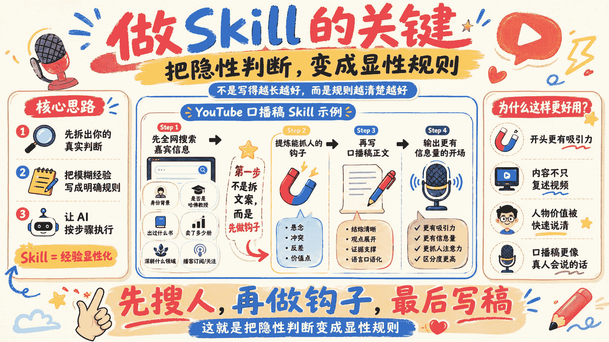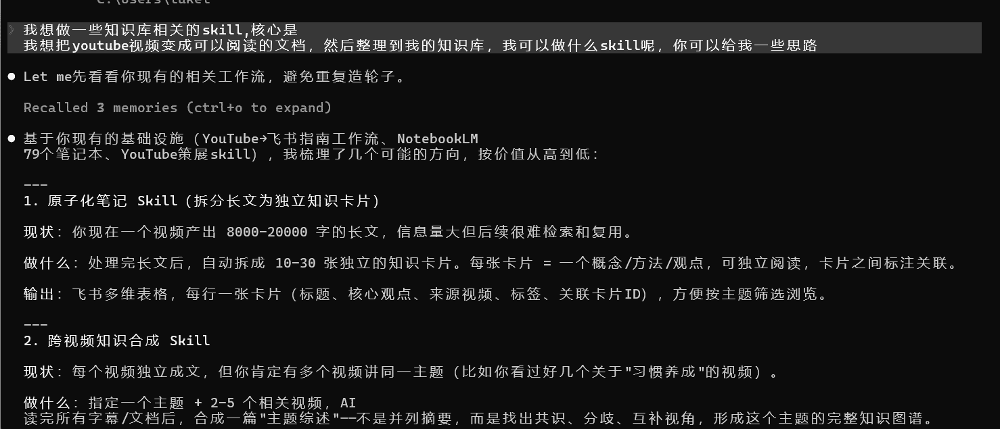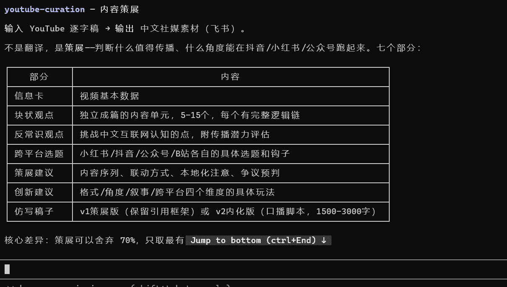

YouTube 口播稿 Skill 做完之后，我还做了一个 YouTube 的知识点整理 Skill。这个 Skill 主要完成的部分是帮我去梳理一个 YouTube 视频的知识点，因为 AI 拥有对信息的重新组织权，所以你可以让 AI 基于你的想法去做一些这个视频的知识点整理，毕竟没有人喜欢去单纯地看字幕。

但是这里我有一个创新点：不要限制 Skill 的边界。人类创造力的边界其实可以借助 AI，所以我会让 AI 参与我的创造和思考过程。我会直接问 AI：“我的这个 YouTube 策展 Skill 还能怎么做会更好？”把问题抛给 AI，AI 会给你一些它的想法，然后再结合你的判断融入进去。

比如这个 YouTube 策展 Skill，AI 就会告诉我，用户不止想要一个知识点，或者一篇有价值的文章，用户可能还需要一些实操清单，一些可以用来实践的 SOP。我认为它说得不错，我就让它加进去。所以我的角色就是判断的角色，Skill 的主体到底怎么样，我是没有参与的。

不知道大家发现了吗？

我做的 Skill 都是针对具体的场景，一个只做一件事。很多人做 Skill 最容易犯的错误是贪。想做一个“帮我搞定小红书全部流程”的 Skill，从选题到写稿到做图到发布全包了。这种 Skill 做不出来，做出来了也没法用，因为每个环节的标准不一样，揉在一起互相干扰。

一个 Skill 只抓一件事。封面图 Skill 只做封面图，标题 Skill 只写标题，正文 Skill 只写正文。任务越单一，命中度越高，输出越稳定。

因为假如你用了一个 Skill 直接帮你搞定小红书全流程，那么它生成的内容大概部分是不能用的，因为你丧失了控制权。你可能觉得它内容开头不行，但是你连介入的机会都没有。但是当你用 Skill 去串联的时候，比如你用标题 Skill 可以给你出 20 个标题，你来选择；让正文 Skill 给你写 6 篇内容，你来选择和修改。

另外，当你的 Skill 足够多的时候，你就可以去串起来，形成自己的专属工作流，这就是你的护城河。你的工作流被切分成不同的模块，像搭乐高一样按需组合。你不再是一个人在做内容，你背后是一支 Skill 军团在并行工作，后面我会详细分享一个工作流。

未来的工作流程是这样的：你同时打开多个 Claude Code 窗口，每个窗口执行一个 Skill，多任务并行。这边标题 Skill 在跑，那边封面图 Skill 在处理 PDF，正文 Skill 已经在写第三篇笔记了。你坐在中间，不需要动手，只需要检查结果、给反馈、收尾。这种掌控感和以前吭哧吭哧手搓内容的状态相比，就是维度碾压。

最后还是想要强调一点，不要重复造轮子，这个很容易理解，我看到太多满足同一个需求的重复skill，其中包括公众号排版的skill、做小红书封面图的skill、做PPT的skill；这些skill基本上都是重复造轮子的重灾区，你没有必要再去重复做一遍。不是说这些东西没用，而是市面上已经有大量成熟方案，你再从零做一遍，时间花在没有增量的事情上。你的精力应该放在那些跟你的业务核心直接相关的Skill上。

总结下，到底如何原创自己的专属skill。

**第一步：找到你要做的Skill**

打开Claude Code或CodeX，在对话框里粘贴以下三个问题，逐个回答：

1.

哪件事我每周至少做一次，每次都要重新跟AI说一遍要求？（排除偶尔做的事，聚焦每周必做的重复劳动）

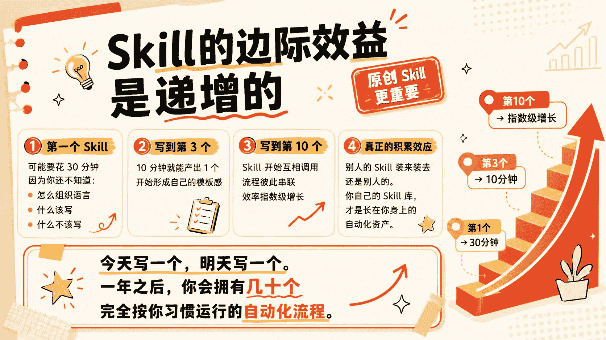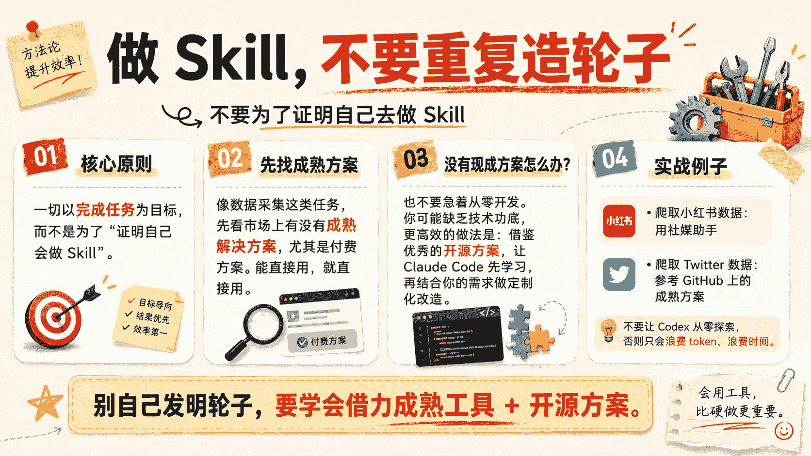

1. 哪件事我做得很专业，但每次做都要从头跟AI解释判断标准？（你有自己的方法论，但没法一次性注入到对话里）

1. 哪件事我已经有一套固定的做事套路了？（第一步干什么、第二步看什么、最后输出什么，在脑子里很清楚）

从三个答案里挑一个最烦的、占用时间最多的、每次做之前心理负担最重的，先对它下手。

**第二步：把流程用嘴讲出来**

对着AI直接说，用下面这个句式模板：

「我想做一个Skill。这个Skill要做的事情是\[一句话描述核心任务\]。我平时做这件事的流程是这样的：

1. 先\[第一个动作\]，具体要看\[判断标准\]
2. 然后\[第二个动作\]，如果遇到\[情况A\]就\[处理方案A\]，如果遇到\[情况B\]就\[处理方案B\]
3. 接着\[第三个动作\]，这一步的关键是\[你的秘诀或注意事项\]
4. 最后输出\[你想要的格式和内容\]。帮我封装成一个Skill。」

## 04 如何打造自己的内容-虚拟产品闭环工厂

刚刚讲了如何原创自己的skill，以及skill和虚拟产品的关系，其实现在每个人都可以用AI原创虚拟产品，那么真正的卡点是什么呢？

很多人都可以用AI原创虚拟产品，其实虚拟产品就已经不是卡点了，壁垒就会消失，小红书虚拟产品真正的卡点其实就是笔记，因为你只有发笔记，用户才有可能看到你的商品，如果不发笔记，尽管你的产品很优秀，那也有可能看不到。

但是大多数人的笔记没有流量，就单纯地去怪平台不给流量，其实不是这样的，因为这些人的问题其实没有从用户出发、没有从平台视角出发，只想通过单纯的堆数量去出单，这样做，除了省事，省时间外，没有什么其他的优势，因为一直发的都是商品笔记，你是没有办法成为IP的，永远赚的都是前端的钱，后端的收入基本没有。

手停口停，随时有可能被封的风险，虽然短时间收益不错，但是很难体会到虚拟产品带来的复利。

如果你想要持续在小红书赚钱，且享受到源源不断地内容红利和虚拟产品给你带来的复利，一定要了解小红书需要什么类型的内容。

这里先给大家介绍下内容的**动能-势能理论模型**。首先要明确我们的位置，我们其实本质上就是无名小卒，没有流量优势，假如我们一直发商品笔记，基本上没有机会拿到流量。那么我们就要换一个角度思考，我们该做什么样的内容？

### 动能型内容

第一个是动能型内容，动能型的内容就是传播速度快，可以快速拿到流量，那么如果从虚拟产品的角度讲，你要发什么类型的内容呢？

首先是**观点型内容**，你一定要有自己的观点，但是这里的观点不是让你发表逆天言论，而是要观点的垂直性，比如小红书就有这样的账号，比如这个博主的内容主线基本都是观点，然后在评论区进行销售引导。

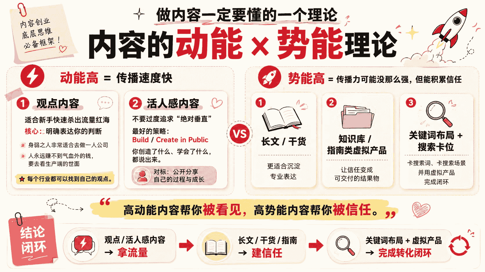

动能内容除了观点型内容外，还有一个比较关键的就是**活人感内容**，活人感内容其实就是不要让别人看到你的账号就觉得你是一个单纯卖货的商家，比如你可以讲**案例内容**，案例内容是别人用了你的产品/服务之后的改变，比如你可以做**里程碑内容**，比如你卖了100单、200单产品后的感受，你还可以做**create in public**的内容。去向大家讲你做这个产品的初衷是什么，为什么要做这个内容。

### 势能型内容

势能内容走的是完全不同的另一条路。它的传播速度未必快，可能一篇发出去前三天的数据都平平无奇，但它一旦开始被传播，它积累信任的效率是动能内容的数倍。

势能内容的经典形态是深度长文、结构化指南和知识库合集。用户看了你五百字的观点文，心理状态大概是「嗯，这人有点自己的想法」。

用户看了你两万字的、从头到尾逻辑推演没有断层的、信息密度大到他不时要点暂停做笔记的指南之后，心理状态发生了根本性的变化：「他是认认真真把这个领域吃透了才写出来的。」信任不是靠嘴巴说的，是靠时间缓慢堆出来的。深度内容天然拖延了用户跟你共处的时间窗口，他在你一个人生产的内容上停留了四十分钟，这四十分钟本身就是信任的载体，是任何广告文案和销售话术都替代不了的信任沉淀机制。

势能内容还有另一个被大多数人严重低估的大杀器：**搜索长尾**。

观点文的热度窗口你知道有多长吗？三天。三天之后就很少有人能通过主动搜索再次触达它了。观点文吃的是推荐算法的即时流量，它像一个烟花，升空的时候特别亮，然后就没了。

但一篇覆盖全面、结构清晰、标题里嵌入了精准搜索关键词的深度长文，它的曝光周期是按年计的。因为总有人在任何时间节点上搜索这个领域的入门问题、进阶问题和踩坑问题，而搜索引擎和平台内部的搜索算法都天然偏向给深度高、停留时间长的内容做长尾分发。你用动能内容当你

的前锋，每次出去冲一次流量高峰。

你用势能内容做你的防御工事，它们安安静静地待在搜索结果页里，一年四季给你持续带来新的、有明确需求的精准读者。

比如这个博主，深耕减脂领域，并不是单纯的个人经验，而是有理有据，知其然也知其所以然，这种不仅能拿流量，用户也会直接通过内容认可博主的专业能力，就有可能最后下单。

因为有些产品并不是需要一直说功能性卖点的，而是需要通过优质内容影响消费者的，并且小红书支持长文功能，还可以一键排版，非常的省事。

但是这里需要注意一点的是，不要写大选题，而是要写小选题，最好是切入具体的问题和具体场景的解决方案，我看了很多人的内容，虽然字数也很多，但是没有流量，原因就是写的太大了，用户都不认识你，你写职场沟通的底层逻辑是很难说服他人的，因为这个课题太大了，你当前的人生阶段和位置撑不起来那个词。

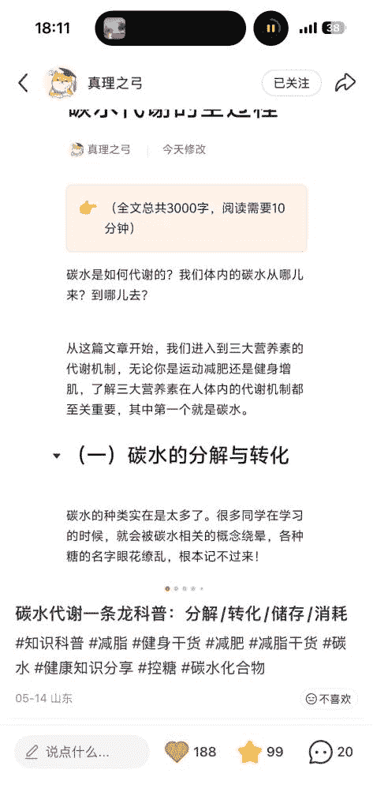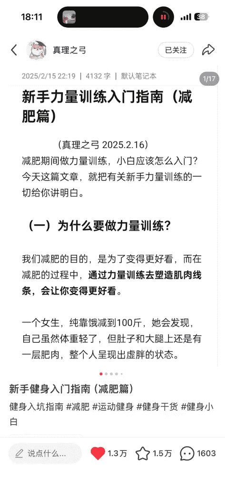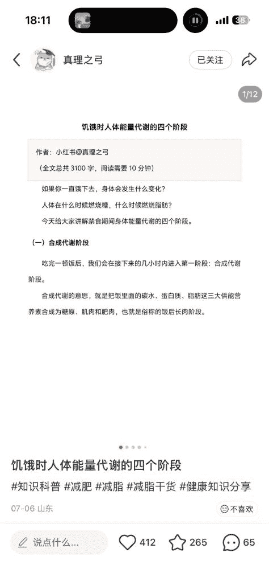

而你需要从具体的任务和场景出发，比如我有8年的广告营销经验，我可以从怎么写好一个brief去切入，一个极其具体、你在真实工作中真的有血的教训、真的有发言权的最小切口。小选题天然拥有比大选题更高的信任转化率，因为活人感强，用户也能吸收到更具体的干货。

那么怎么把动能-势能内容和AI融入起来呢？

### 长文skill的设计思路

这个skill解决的问题就是你长文写不明白的事情，第一个我要解决AI写长文有AI味的问题，AI味主要存在两个问题，第一个是素材和事实，第二个就是句式和节奏的问题；AI天然爱写短句，这是它的训练数据分布决定的。短句看起来确实很干脆，一句一句地敲下去码得很整齐，但如果你把二十个短句排成一排连在一起，读者读起来的体验是什么？是PPT大纲的节奏感。

每一句都是一个独立的小方块，方块之间没有逻辑流，读起来就是在不停地断、断、断。真正具有阅读沉浸感的深度内容需要连贯的长句来兜住足够的信息厚度。一个句子要能同时装下因果关系、转折关系和递进关系两到三个逻辑层级，用逗号把这些逻辑自然地串在一条线上，让读者感觉自己被一股文字的流推着往下走。所以我在设计表达逻辑的时候，会让AI尽量少写短句，同时要有章节表达重点，因为表达如果很平的话，每个章节都是同样的篇幅，这样的内容就没有节奏感，所以我会让这个长文skill写作的时候，会有一个章节重点，比如这篇文章可能6000字，分5个章节，如果每个章节都1000字左右，就没有重点，没有突出，AI味就比较浓，但是有了章节表达重点的时候，就可以在某个章节的字数多一点，写的更深入一点，比如可以在第三章，让AI写2000字，突出表达的重点。

以上就是我长文skill的设计逻辑，刚刚也提到过，这类内容是可以帮你积累势能，同时还能帮你积累信任，所以当我设计完这个skill，就进行了测试，真实效果也不错，目前也生产了上百篇爆文。

### 笔记skill的设计思路

笔记skill解决的是内容的动能问题，它的日常输出物是直接可以发布到小红书上的完整笔记。这个Skill的设计只有一个核心难点，但这个难点如果你不解决掉，整个技能直接作废。这个难点是：怎么让AI写出来的东西完全没有AI味。

以前我的做法是每次要写小红书笔记的时候，先去找顶级对标，但是这样做的劣势还是慢，没有办法形成规模性的优势。

但是，现在有skill，而且还有飞书CLI，这就可以打通规模化。核心操作极其简单但极其强大：建一个飞书文档，作为动态持续更新的对标库。

你每天在小红书上刷到的、让你停下来的、让你觉得「天，这篇写得真好」的笔记，全部截下来，放进这个飞书文档里。不需要分类，不需要给每篇标注风格标签，放进去就完事了。

Skill的规则文件里有一条被写死的铁律：每次执行写作任务之前，第一步永远是先完整读取这个飞书文档的全部内容。它不是在学习某一篇特定的笔记，它是在持续吸收一个每天都在变大的、每天都在更新的优质文本池。

比如我要写【我为什么要做XXX指南】【我为什么要做XXX攻略】这样的笔记，我就直接做一个飞书文档，把小红书的优质同类型笔记，全部整理上去，然后让AI去仿写，我试验过了，效果非常好。

不过，我这里还要分享一个对标方法论：这个方法论叫做**伤其十指不如断其一指**。

你给AI发了六篇对标笔记，要求它把这六篇的风格「综合一下」。结果是什么？结果是一个谁都不像的、平庸的四不像。它

取了六篇的平均值，而平均值在风格这件事上就是一个没有面孔的轮廓。

正确的做法是把一篇对标吃透。拆它为什么第一句你就想继续往下读，把那个钩子的结构拆解成可以复用的公式。拆它的中间是怎么完成从一个观点自然滑到下一个观点的，那个过渡是用了反问、用了断言还是用了递进。拆它的结尾是怎么收的，它最后一段跟文章的开头之间有没有一个隐蔽的呼应结构。

你把这些拆清楚，AI学到的是一个完整的叙事动力链条，不是一堆碎片的修辞小花招。你把六篇对标分别拆成六个独立的内容模型，你的Skill就拥有了六套不同的写作策略。

每次执行时，你可以显式指定用哪一套，也可以让Skill根据这次的话题特征自动匹配最合适的策略。

### 指南skill的设计思路

详细说一下指南skill，如果从字数上来讲，如果3000-8000可以归类为长文，那么8000字以上，8000-7w字可以归类为指南/攻略/知识库。而指南、攻略、知识库这些虚拟产品不仅可以售卖，还可以作为钩子产品，帮你完成低转高；小红书上也有很

多指南类的虚拟产品，并且涉及各个领域，比如INFP指南、社会化指南、TO B销售求职指南、ADHD指南等等；万物皆可指南，万物皆可攻略，万物皆可知识库。

大多数人的卡点是，自己东西很多，自己的语料库有很多资料，自己有很多干货，但是表达不出来，也没有思路去做如此庞大的内容工程，指南skill就解决的这个问题。

首先，它会去问你有没有一些资料和方法论，当你把资料方法论发给指南skill外，指南skill接下来的动作并不是直接去写，而是去全网搜参考资料、查漏补缺，比如你要做日本旅游攻略，它就会去YouTube搜日本旅游攻略相关的内容，从而增加你指南的内容深度。

这个指南skill的配置逻辑也分3层：

- **第一层，风格蒸馏。** 把你写过的一篇优质长文扔给AI，让它提取你的句式结构、节奏偏好、态度表达方式、用词习惯。这些被提取出来的特征就是你写作风格的"神"。AI以后用这个风格写任何东西，读起来都像你本人写的，而不是AI生成的。

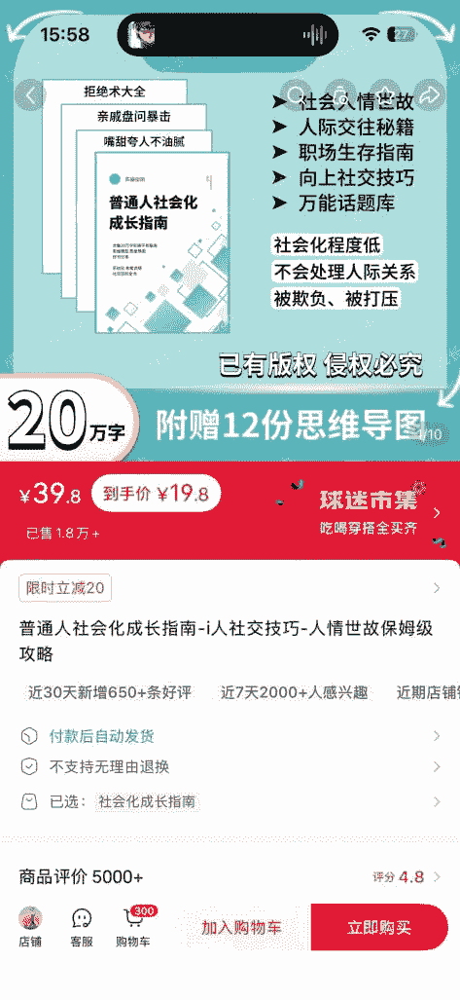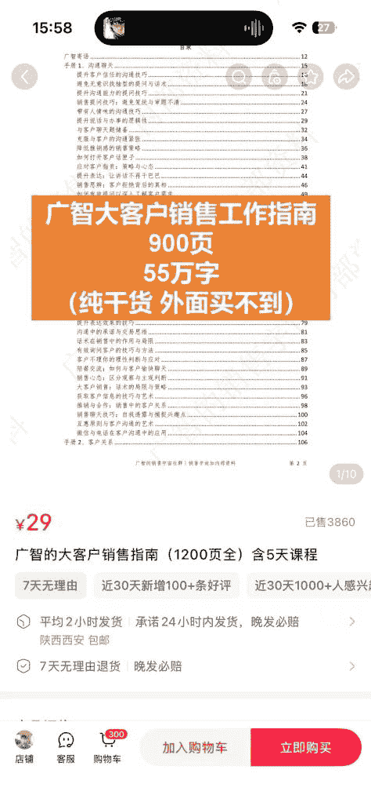

- **第二层，外部信息融合。** 公开资料作为信息源喂进去，YouTube视频字幕、推特帖子、公众号文章、小红书笔记任何公开内容都可以作为原材料。AI用你的风格重新组织这些信息，产出既有信息密度又有个人态度的内容。

- **第三层，负向约束锁定格式。** 字数要求（至少2万字，因为真正有价值的内容需要连贯的句子来承载足够的知识密度，而AI天然喜欢写短句，所以必须写死）、输出格式（飞书文档、本地Markdown）、章节结构要求，全部固化。

出来的东西读起来像一个真去过、真做过、真研究过的人写的，不是在读维基百科。

有了这个Skill，万物皆可指南。职场面试指南、降低皮质醇指南、班主任带班实战指南、一人公司运营指南、投资方法论指南。任何领域你只要有信息源和自己的判断框架，就能产出一个可售卖的知识产品。

所以这就是一个**内容-虚拟产品闭环工厂**的雏形，通过长文skill积累信任势能，笔记skill积累动能，然后指南skill接住流量思路，是一个非常好的策略。

而这一切，你只需要打通Codex/Claude Code和飞书就可以了。

————分割线————

看完这篇SOP，你觉得你懂了。但90%的人一到实操就会卡在第一步。

工具和教程只是最低级的壁垒，真正的壁垒是"立刻动手"和"圈层信息差"。

如果你想看全网最新的变现玩法，并且和一群执行力极强的极客一起下场拿结果，欢迎围观我的核心私域：【懒人专属群】。

我们不聊虚的，只做商业闭环的拆解与AI效率的压榨。系统内已沉淀1000+跑通的套利实战局。

👉 查阅圈子完整数字资产与上车门槛：

https://lazyso.com/insider/

认同价值、准备好下场干活的，扫码加我微信（lazyhelper1）

备注：【实操上车】，不闲聊

