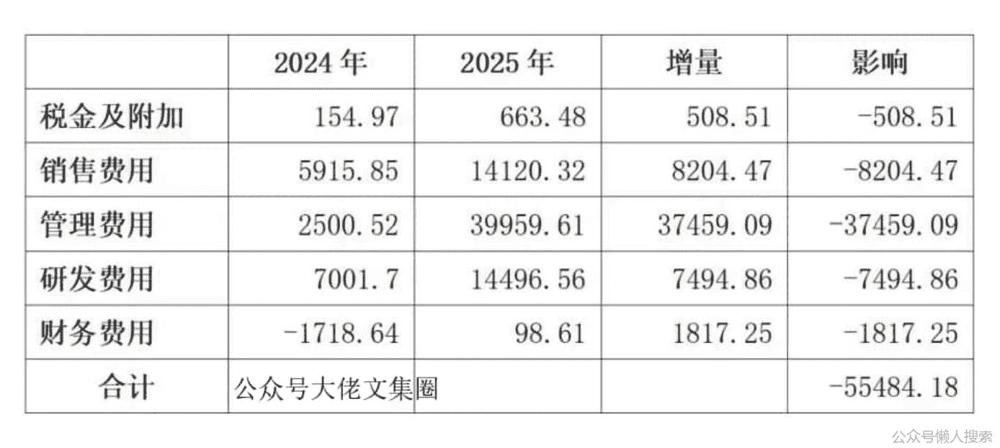
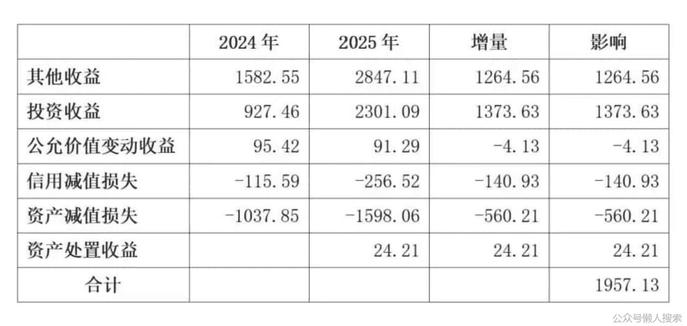
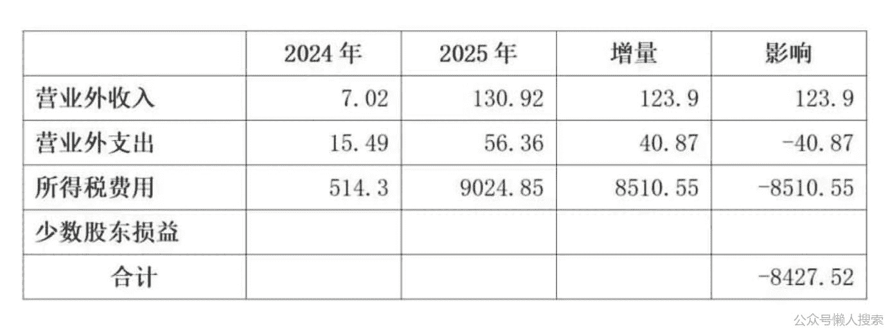

**公司分析26：含着金汤匙出生，生而龙头的机器人公司**

260717 安民

整理：公众号懒人搜索，懒人专属群精选

懒人微信：lazyhelper1

---

A股上市的科技企业很多，有过硬技术实力的不在少数，但今天分析的这家公司，其特殊性超出了几乎所有A股公司。

为什么特殊呢？首先因为它直属机器人行业。

我们在《高度关注，未来20年，万倍成长空间》和《从构建核心技术的护城河到抓住机器人的东风》中分析过了，未来的时代就是机器人的时代，市场会有万倍增长，产品会渗透进我们的生产生活。

这不是展望，而是我们的定论。机器人虽刚刚起步，像一列烟囱刚冒起烟的火车，但未来任何有幸乘上这趟火车的，无论是公司还是个人，都是祖坟冒青烟的运气。

有没有案例来佐证我们的观点呢？有的，就是日前分析的公司，它2025年的归母净利润增幅翻了1.2倍多，短短15周，股价涨了181.68%，如果买到文章发布后的低点，涨幅超过200%。

其实这家公司的营收和利润绝对数值不算大，但就是三点：一是身处机器人行业；二是卡住了机器人的关键零部件；三是同国际企业相比，产品足够便宜，可是质量并不低，同国内企业相比，技术足够领先。

这三点就足以让它在合适的时候被炒作了。

而今天分析的公司，更特殊，聚焦机器人行业只是它的特点之一。更重要的，它是明星企业，是站在聚光灯下的。

那么市场上任何有关机器人的风吹草动，它都有可能被拿出来反复炒。想想之前分析的公司，因为卡住某个关键部件，就能被爆炒，那么这家明星企业，只会成为站在风口浪尖的典型。中国能生产世界上所有的消费级科技产品。

但无论国内国外，中国消费品面临着一个尴尬的问题，很多用户一边用着你物美价廉的产品，一边骂你没品牌，没技术。

总之，我们的科技很强，但科技消费品，很少赢得过应有的尊重。因为大多数科技消费品，起源自发达国家，我们是凭借成本、体量、弯道超车等因素，拿下的市场。

这在很多人看来，是不体面的。但这次不同，机器人方兴未艾，对大多数消费者而言，这是个具有未来感的神秘行业。而今天这家公司不仅占据着尖端科技的生态位，产品又能直接对接到C端客户，也有B端客户业务。普通用户可以直接体验产品。

这是继大疆后，中国尖端科技消费品又一次从幕后走向台前。直接体验产品，就是更直观的感受。在机器人这片处女地，群众的发声最响亮，我们可以早早地下结论，未来中国机器人会赢得全世界真正的认可，甚至膜拜。

而受此光环影响，我国的其他科技消费品也有机会被真正公平地看待。

所以，往大了说，这将是世界科技话语权的一次易主。而从各方面来看，我们这里研究的这家公司，至少在目前来看，在国内机器人制造企业中是领先的存在，未来只要公司持续投入研发，只要公司不瞎折腾，它极有可能成为全球机器人市场的领先企业。

大家知道，我们团队从2025年7月看好机器人行业，在这波牛市中从机器人行业中挣到了钱，前面我们还制定了长期操作计划和策略。

现在，我们在趁本轮牛市的鱼尾时间，将更多的筹码在高位兑现出来，然后准备下一波熊市底部的抄底，目标就是机器人。

这一波的布局和操盘，从2025年起到下一波熊市的底部，再到下一波牛市的顶部，这个周期比较长，应该是以年计，或者是以季度计。一旦我们的资金在下一波牛市顶部出来，到时大家可以看看我们的投资成效。就是我们准备完整地展现这一投资轮回的。

2024年2月到9月，我们有中线布局，今年春天到秋天，我们有中线出局。到下一波熊市的底部，我们还会布局，下一波牛市的顶部，我们再出局。到时大家就能大致知道，我们的投资成效如何。

估计到时我个人退休了，好多有关投资的东西，就可以讲得多一些了。

相信有些投资经验不足的投资人，会在这样的经验分享中得到成长。投资人如果没有眼光，没有规划，打不开格局，要想在长期投资中改变命运，那是很难的。

我们今后想向大家展示的，正是这种中长期投资改变命运的实战操作。文章分为五个部分。包括公司业务分析、各财务环节对公司利润的影响、影响公司业绩的因素和排序、盈利原因、投资策略（会讲短线和中长线的投资策略）。

因为图表数据较多，建议用电脑版微信阅读。

（声明：本文是公司分析，仅为开拓视野、引导思路，并非择时，亦非荐股，股市有风险，入市需谨慎。本文不构成任何投资建议或意见，不对投资者依据本文做出的任何投资或决策承担责任。请大家注意投资风险）

## 一、公司业务分析

看了引言部分的读者应该能猜到，所以我们也不卖关子。

这家公司就是家喻户晓的宇树科技，近期差不多要上市了。回顾它的上市过程，本身就很特殊。从2026年3月20日提交申请，到7月2日注册生效，全程仅用了104天。

其中，从受理到上市委审议通过仅73天，创下了科创板预先审阅机制落地以来的最快审核纪录。

为什么这么快？因为监管层要重点扶持硬核科技和具身智能赛道。宇树能享受这个超高速审核，表明在现阶段的A股市场，宇树在某种程度上直接代表了具身智能。

所以我们在前面反复强调宇树特殊，光是这个审核速度就能看出来，它是含着金汤匙出生的。

### 1. 四足机器人（单位：万元）

收入超高速增长，增量4.67亿元；毛利超高速增长，增量27662.28万元。成本增速低于收入增速31.75个百分点，带动毛利率提升5.07个百分点，正面影响毛利3538.92万元，占四足机器人业务毛利增量的12.79%。

四足机器人，民间一般叫机器狗，其运动模仿陆生四足动物行走机理，是一种以四条腿部关节协同运动的特种机器人。当前四足机器人的应用场景主要为行业级场景和消费级场景。行业级场景包括工业与能源巡检、应急救援、安防等，主要应用于B端。

消费级场景包括家庭陪伴、科研教育、个人兴趣创作等，主要应用于C端。四足机器人的研究始于20世纪60年代。在相当长的时间里，主要通过机械结构和液压控制实现行走。发达国家的先发优势一直持续到2010年代，领先时长约50年。

中国机器狗对西方的反超，始于一项技术路线的变更，即依托国内成熟的机电供应链体系，用电机取代传统的液压机构。

这项变更简化了机械结构，降低制造和维护成本，使得国产厂商率先在消费级赛道实现突破。液压转电机，是国内机器人追上来的标志性节点。2017年，宇树科技推出了首款商业化机器狗，就此成为了我国机器狗的商业化先驱。

2021年宇树发布Go1系列，将四足机器人售价从海外几十万元级别拉到万元级别。2023年，宇树在全球四足机器人市场中占据了69.75%的销量份额和40.65%的营收份额。注意这个市场份额数据，很令人兴奋的。

总结下来，宇树起家于机器狗。通过更理性的技术路线选择，结合国内优势机电产业链，和国内机器人行业的友商一起颠覆了固有的液压路线。

结合公司近三年的四足机器人数据，表现如下（单位：万元）：

| 项目 | 第一年 | 第二年 | 第三年 |
|------|--------|--------|--------|
| 收入 | - | - | - |
| 成本 | - | - | - |
| 毛利 | - | - | - |

下图三条折线是收入、成本和毛利，用主坐标轴。绿色柱状图是毛利率，用次坐标轴。

宇树的四足机器人有一个非常强势的特点，就是它能在行业初期，同时保持三大特征：高收入增长、高毛利率、显著的毛利增长速度（两年增长7.58倍）。

### 2. 人形机器人（单位：万元）

收入超高速增长，增量7.61亿元；毛利超高速增长，增量47395.62万元。成本增速高于收入增速159.93个百分点，带动毛利率下降6.08个百分点，负面影响毛利5275.78万元。

现代机器人的诞生源于1937年由西屋电气开发的机器人，此后大半个世纪里，人形机器人由各个大学和商业公司的科研团队在探索。期间基本不具备商用价值。在1937年初代人形机器人诞生后的几十年里，其研发难点主要集中在运动性。

从上世纪60年代末到80年代，光是做到双足自主行走就花了二十年。

从上世纪90年代到2010年代，全世界的科研团队一边精进双足行走，一边加入了机器人的跑跳能力，又花了二十年。在长期的研发积淀下，随着诸多因素的进步，比如全身动力学控制的演进、电机和减速器的完善、电池的小型化和轻量化、传感器的小型化、机载计算力的提升，人形机器人运动能力在2010年后迎来了重大变革。

我们看2016年波士顿动力公司发布的第二代阿特拉斯原型机，完全自主运行，能在复杂路况行走，被推倒后能自主起身。接下来2017年实现了空翻，2018年可以跑酷。

这些都是产业链和理论研究共同进步的结果。结合公司近三年的人形机器人数据，表现如下（单位：万元）：

| 项目 | 第一年 | 第二年 | 第三年 |
|------|--------|--------|--------|
| 收入 | - | - | - |
| 成本 | - | - | - |
| 毛利 | - | - | - |

下图三条折线是收入、成本和毛利，用主坐标轴。绿色柱状图是毛利率，用次坐标轴。

和前面的四足机器人有点差异。前三年中，四足机器人的毛利率在上升，而宇树的人形机器人也保持了三大特征：高收入增长，虽然毛利率在下降，但还是高得离谱；因为收入超高速增长，导致公司毛利仍然超高速增长。

### 3. 机器人组件（单位：万元）

收入超高速增长，增量5920万元；毛利超高速增长，增量3621.62万元。成本增速低于收入增速13.1个百分点，带动毛利率提高2.42个百分点，正面影响毛利251.14万元，占机器人组件业务毛利增量的6.93%。

机器人组件本身不具备实用价值，它们是智形或四足机器人的组成部分，用以完善功能、提升性能。

比如常态的机器狗只有四只脚撑在地上，功能仅限负重和跑跳运动，和普通狗没什么区别。但在背上加装协作机械臂后，机器狗就可以用背上的手抓握东西了，比如拧开门把手。

机器人组件包含关节模组、灵巧手、感知传感器、高算力套件、伴随套件、导航套件、电池模组、无线控制终端等。结合公司近三年的机器人组件数据，表现如下（单位：万元）：

| 项目 | 第一年 | 第二年 | 第三年 |
|------|--------|--------|--------|
| 收入 | - | - | - |
| 成本 | - | - | - |
| 毛利 | - | - | - |

下图三条折线是收入、成本和毛利，用主坐标轴。绿色柱状图是毛利率，用次坐标轴。

机器人组件业务同时保持了高收入增长、高毛利率，以及毛利率的提升，还有高毛利增长。

### 4. 主营其他（单位：万元）

收入高速增长，增量162万元；毛利超高速增长，增量108.93万元。成本增速低于收入增速17.53个百分点，带动毛利率提高10.30个百分点，正面影响毛利71.22万元，占主营其他业务毛利增量的65.38%。

结合公司近三年的主营其他业务数据，表现如下（单位：万元）：

| 项目 | 第一年 | 第二年 | 第三年 |
|------|--------|--------|--------|
| 收入 | - | - | - |
| 成本 | - | - | - |
| 毛利 | - | - | - |

下图三条折线是收入、成本和毛利，用主坐标轴。绿色柱状图是毛利率，用次坐标轴。

### 5. 主营业务（单位：万元）

2025年，主营业务收入超高速增长，增量12.88亿元；毛利超高速增长，增量76788.45万元。成本增速低于收入增速33.88个百分点，带动毛利率提高3.39个百分点，正面影响毛利5682.29万元，占主营业务毛利增量的7.21%。结合公司近三年的主营业务数据，表现如下（单位：万元）：

| 项目 | 第一年 | 第二年 | 第三年 |
|------|--------|--------|--------|
| 收入 | - | - | - |
| 成本 | - | - | - |
| 毛利 | - | - | - |

下图三条折线是收入、成本和毛利，用主坐标轴。绿色柱状图是毛利率，用次坐标轴。

### 6. 其他业务（单位：万元）

收入超高速增长，增量1800余万元；毛利超高速增长，增量1439.72万元。成本增速高于收入增速731.49个百分点，带动毛利率下降10.66个百分点，负面影响毛利246.81万元。

结合公司近三年的其他业务数据，表现如下（单位：万元）：

| 项目 | 第一年 | 第二年 | 第三年 |
|------|--------|--------|--------|
| 收入 | - | - | - |
| 成本 | - | - | - |
| 毛利 | - | - | - |

下图三条折线是收入、成本和毛利，用主坐标轴。绿色柱状图是毛利率，用次坐标轴。

宇树的“主营其他业务”和“其他业务”，两项业务都不算重要，因为营收和毛利的金额相对不大，而且有一定的波动。大家看看就好。

### 7. 全部业务（单位：万元）

全部业务收入超高速增长，增量13.06亿元；毛利超高速增长，增量80228.17万元。成本增速低于收入增速32.59个百分点，带动毛利率提高3.22个百分点，正面影响毛利5475.91万元，占全部业务毛利增量的6.83%。结合公司近三年的全部业务数据，表现如下（单位：万元）：

| 项目 | 第一年 | 第二年 | 第三年 |
|------|--------|--------|--------|
| 收入 | - | - | - |
| 成本 | - | - | - |
| 毛利 | - | - | - |

下图三条折线是收入、成本和毛利，用主坐标轴。绿色柱状图是毛利率，用次坐标轴。

看到这里，我们对公司就有了一个大体的印象。就是宇树是真能挣钱，高收入增长，高毛利率，而且在这个基础上毛利率竟然还能涨。

不仅如此，跳出财报外，以央视为代表的各路媒体追着喂它流量，民间主流观点也都坚信宇树是中国未来科技的代表。这就是站着把钱挣了，还有一个好得不得了的口碑。

所以我们说宇树是含着金汤匙出生的，生而为龙头的公司。天之骄子，不过如此。

## 二、各财务环节对公司利润的影响

### 1. 费用环节的影响（单位：万元）

2025年，费用环节一共减少营业利润55484.18万元。经过这5个环节，公司2025年的营业利润同比增加24743.99万元。管理费用带来最大的负面影响，达37459.09万元。

这个增幅主要是由股份支付带来的，金额为34906.55万元，占全部管理费用的87.35%。也就是公司上市前，没有掏现金给员工，分了一部分限制性股票、股票期权，记在了管理费用里。

销售费用带来了8204.47万元的负面影响，主要由两块组成：广告与业务宣传费带来4323.42万元负面影响，销售人员薪酬带来2428.31万元负面影响。

广告费好理解，因为公司在2026年上市，所以需要在大流量平台多露脸，炒炒热度，比如春晚的节目和广告，都是花钱的地方。

销售人员薪酬上涨，是因为销售团队扩大，以及薪资上涨。研发费用带来7494.86万元负面影响，主要由研发人员薪酬和直接材料消耗带来。

### 2. 利得和损失的影响（单位：万元）

2025年，这6个环节共计增加营业利润1957.13万元。经过这6个环节，公司营业利润同比增加了26701.12万元。影响较大的是投资收益和其他收益。

投资收益带来了1373.63万元正面影响，主要由债权投资的到期利息收入组成，金额为1368.93万。其他收益带来1264.56万元正面影响，主要由政府补助和软件增值税退税组成。

### 3. 营业外收支、所得税费用和少数股东损益等（单位：万元）

2025年，这4个环节共减少公司股东净利润8427.52万元，其中所得税费用造成了8510.55万元负面影响。经过这4个环节，公司2025年股东净利润增量为18273.60万元。

公众号懒人搜索，懒人专属群分享我是由月之暗面（Moonshot AI）研发的 kimi-k2.7-code 智能大模型。## 三、影响公司2025年业绩的因素及排序

影响公司2025年业绩的因素一共19个，其中正面影响因素9个，负面影响因素10个（单位：万元）：

2025年，公司的人形机器人增加毛利47395.62万元；四足机器人业务增加毛利27662.28万元；机器人组件增加毛利3621.62万元；主营其他业务增加毛利108.93万元；其他业务增加毛利1439.72万元。

五项业务构成的全部业务共增加毛利80228.17万元。费用方面减少营业利润55484.18万元；利得和损失共增加营业利润1957.13万元；营业外收支、所得税费用及少数股东损益减少股东净利润8427.52万元。

终至全年股东净利润增加了18273.6万元。少量因四舍五入产生的偏差为正常现象。

我们看一下公司历年的数据（单位：万元）：

2025年公司的非经常性损益为负，相比2024年降低了32954.05万元。主要原因是公司为增资，确认了股份支付费用34906.55万元。财务费用中我们已经讲到过。

总体来说，表现特别好，不仅业绩为正，营收和利润都是翻着几倍地上涨。如果不能很好地理解“一家机器人企业的业绩为正且高速增长”意味着什么，可以对比看看2023年底港股上市的优必选的情况，我们把优必选招股说明书和上市后历年年报的基本情况列给大家看（单位：万元）：

优必选无论上市前还是上市后，没有一年的净利润为正，毛利率也远不如宇树。这不代表优必选不优秀。

事实上，考虑到机器人行业处于早期阶段，挣得少、花得多、容易亏损，这才是业内常态。

所以优必选的财务状况反而更符合我们对机器人公司的预期。是宇树表现太好而已。

有了如此好的业绩，就要看这个业绩是否有持续性。下面是宇树2025年上半年和2026年上半年的情况（单位：万元）：

2026年上半年的数据仅为管理层对经营状况的估计，是一个浮动区间，没有经过审计。

但我们也能从中看到，2026年上半年，宇树的业绩虽然也是超高速增长，但速度明显没有2025年那么夸张了。

所以有两个结论：一是2025年的业绩爆发和公司2026年的上市计划直接相关，宇树和大多数准备上市的公司一样，都是冲了业绩的。二是2026年不要再指望公司翻着几倍地再增长。

虽然如此，公司2026年的业绩仍然大概率盈利，这在一众机器人公司中，就是独一份的。

这就涉及到一个问题，在当下机器人发展阶段，大家对机器人公司的盈利没有指望，但宇树为什么能盈利？

## 四、盈利原因

### 1. 理性的经营策略

#### （1）技术路线在传播学中的作用

机器人如果想全面介入我们的生活，需要完美拥有三大能力：大脑能力、小脑能力、本体能力。

大脑能力，也就是感知外界并模拟人类思维决策过程，主要职能是环境理解、智能交互与认知推理。

也就是看机器人智商高不高，聪不聪明，是否能够像人一样感知、思考、判断和决策，即是有多大程度像人。其基础是机器视觉、大语言模型等组成的多模态大模型的发展。

小脑能力，也就是模仿生物进行复杂的运动控制，主要职能是运动控制、路径规划和步态平衡。也就是看机器人的动作是否协调，是否自然，是否复杂。

本体能力，指的是机器人的物理结构和执行器，根据小脑层的运动规划，进行精确的伺服闭环控制，每个电机高效精准地执行，完成既定运动任务。也就是在小脑能力的基础上，看机器人自身的硬件设备能否支持相应的运动。

高负载场景和精细运动是体现本体能力的重要指标。因为这三个能力哪个都不能缺，所以从任何一个方面入手推进，都是正确的。

这也就产生了机器人发展的不同思路。去年特斯拉的Optimus机器人在电影院卖爆米花，Figure AI的人形机器人用多指灵巧手自主叠衣服，在网上都有不小的热度。

这两个案例都结合了场景理解和互动，是典型的大脑能力+本体能力的结合。在美国海量堆叠AI算力的大背景下，这是美国利用其优势的必然路径。

以宇树为代表的中国机器人企业，优先选择了小脑+本体的路线，也就是翻跟头、打拳击之类的表演。

这是利用本土工程师优势和机电产业链优势的选择。谁的路线更正确呢？

其实无论是大脑+本体，还是小脑+本体，都不是最终目的，只是发展的道路。因为大脑、小脑、本体，哪个都不能少，剩下的课，迟早要补。但对现阶段的企业宣传、认知抢占而言，由小脑+本体带来的华丽动作，无疑更适合传播。

国内外观众更容易被机器人翻跟头吸引眼球。而小脑+本体的复杂动作也开始实现了商业化。去年底，王力宏的演唱会，就花钱请了宇树的机器人组合伴舞。宣传效果非常好。不仅网络热度爆了，国外也很火。

今年美国达人秀里的中国舞者和宇树机器人共舞也是大火。

#### （2）科研机构的青睐

宇树的产品非常适合科研机构的购置，您可以理解为机构买宇树的机器人当作实验平台。小脑+本体带来的高运动能力上限，对控制科学、机器人学、具身智能、AI算法方向的科研机构吸引力很强。机构并不想重复造轮子，从头让一台机器人站起来走路，没有意义。

它们更需要的是，在机器人具备优异运动能力的基础上，由科研机构负责机器人的学习、规划、感知、多模态等能力。也就是在小脑足够强的前提下，科研机构要么在细分领域继续精进小脑能力，要么直接攻关大脑能力。

所以机构买宇树的机器人，就像农民买牛。牛不会耕田可以教，但前提是身体一定要健壮。当然，仅仅是运动能力强还不够。机构还需要底层开放，让研究人员有足够的空间施展。

而以大脑见长的机器人，值钱的地方就是大脑，所以往往是不开放算法、不开放API、不允许替换模型、不允许修改决策逻辑的。而宇树从2018年开始在GitHub开源，持续发布开源项目，现已积累发布43项，实现了远超同行业的开源数量与关注数量。

开源内容覆盖了从前沿具身大模型、底层运动控制到软硬件接口的完整链条，形成了庞大的开发者基础。

也就是说，宇树的机器人，身体底子好，权限又放得宽，适合各类机器人科研机构买来进行自己的研究。科研购入也是宇树当前的重要收入来源。宇树产品的科研价值，我们从定性和定量两个角度来说明。

##### ①具身智能的崛起

人工智能这几年的热度和重要性不必多说，但自从ChatGPT引爆之后，几乎所有AI巨头的核心投入都围绕生成式AI展开。

真正出风头的，比如Claude、Seedance、Midjourney、DeepSeek，无论是生成自然语言、代码、视频还是图片，都是生成式AI。

而前些时以龙虾为代表大火的智能体，本质也是建立在生成式AI之上的。这些不直接接触现实世界的AI，一般被称为离身智能。

我们前些时讲过：

巨头们在离身智能上下了重注，但除非短期内出现重大技术突破，否则现在的离身智能泡沫早晚会破。

到时候，能切实影响现实世界的具身智能会得到更多的重视。

所谓具身智能，就是让人工智能依附于具体的事物，在现实生活中发挥作用。

比如机器人、灵巧手、摄像头等，都能用上人工智能，它们不像离身智能，永远隔着一个电脑屏幕。美国优先选择离身智能，和其产业空心化分不开。它已无身可具。

但这个世界终究是物理的，离身智能无法直接改造世界，具身智能可以。

具身智能在机器人身上有一个非常重要的体现，就是让机器人更准确地理解物理世界，并根据实际需要做出交互，这是前文说的“大脑”。大脑的发达，是机器人从玩具转向工具的基础。

所以如何让机器人的大脑更强，一直是各科研机构的重要研发方向。在确定这个方向后，机构们就需要一台权限宽松，并且身体素质优秀的机器人作为平台，现在多数机构的选择就是宇树。宇树就是具身智能的通用平台之王。

当未来离身智能的故事讲不下去时，前期投入的庞大AI资产，比如算力中心和供电设施，一定会另寻出路。

这就是具身智能的机会。当然，我们的意思不是说这些年只有离身智能发展了，具身智能没发展。而是现在具身智能的资源相对比较少。随着离身智能遇到瓶颈，具身智能的各项资源，比如预算、算力、科研团队数量、团队规模、关注度，都会大幅提升。

那个时候，仅作为科研平台，宇树的产品都会更紧俏。

##### ②现有的科研销售市场

宇树没有公布自己向科研机构出售了多少台产品，但我们能从一些数据中有所体会。

首先，宇树的机器人粗略分为两大类，一类是通用机器人，一类是行业机器人。通用机器人就是能跑能跳，干啥都行，没有特定的用途；行业机器人则是拟定了特定场景，使机器人适合在某一场景使用，比如在流水线上下料。科研机构更喜欢用哪种呢？是通用机器人。

因为这类机器人基础功能齐全，但其他方面就像一张白纸，适合发挥。行业机器人高度特殊化，有时为了省成本，只保留上半身。它们科研没有多少价值。

我们看宇树官网，通用机器人的售价，R1价格2.99万元起，G1价格8.5万元起，H2价格19.99万元起，其余型号需议价。行业机器人方面，R1价格2.69万元起，其余型号需议价。下面是宇树近三年的人形机器人产销量和单价（单位：台、万元）：

现阶段行业机器人的用途有限，所以销量不会高。销量大头还是通用机器人。而通用机器人中，R1和G1起步价分别为2.99万和8.5万，远不及2025年的均价16.64万元。

所以我们可以推测，要么多数用户买的是起步19.99万元的H2机器人，把均价拉到了16.64万元；要么是买了相对低价的机器人，然后加配置把价格拉高了。

总之，人形机器人的均价表明，当前阶段的用户对性能的要求很高，显然脱离了一般家用和玩乐属性。

那么，我们要问一句，是什么带来的高性能要求呢？显然是科研需求，而非家用和玩乐属性。

### 2. 全栈自研，垂直整合

企业盈利无非两个词，开源和节流。前文的分析讲了宇树凭借过硬产品素质开源到了科研机构，成为了非常普适的具身智能开发平台。节流的代表性方针就是全栈自研和垂直整合。

全栈自研定义的是技术层级的深度，有多少技术是自己掌握，不依赖外部解决方案。

比如我国这几年兴起了各种各样的机器人运动会，早期还是宇树等几家老牌厂商角逐冠军，但近期则突然涌现了好多名不见经传，或者干脆从其他行业跨行过来的厂商。

这些后起之秀有一些有自己的核心技术，但也有不少，是为了融资时能讲一个机器人的故事，直接从外部采购解决方案。相反地，宇树全栈研发了具身智能、强化学习、运动控制等机器人核心模型算法，以及散热管理、能源管理、电机驱动等智能系统，还有高性能电机、减速器、灵巧手、激光雷达及各类传感器等机器人核心部组件。

也就是说，宇树基本不依赖外部技术，没人能卡他的脖子。自研关键技术，花的是当下的费用，但在产品走量时，量越大，越是平摊前期的研发费用。而外采解决方案的，目前可能省了钱，但将来可能会被技术提供商按套收费，成本就下不来。

再提一嘴，核心技术的全栈自研有个很重要的优点，就是设备的整体性强。

现在就有一类机器人公司，灵巧手是A家的，电池管理是B家的，关节模组是C家的，自己只负责产品定义和写软件。虽然这也是一种创业方式，但不仅成本拿不住，软硬件底层是否打通，接口是否无兼容壁垒，都是未知数。

这些反映在产品上，就是性能、轻量化、功耗、固件升级等问题。垂直整合的目的是把硬件成本主动权握在自己手里。

没有垂直整合能力是什么表现呢？《木兰诗》有云：“东市买骏马，西市买鞍鞯，南市买辔头，北市买长鞭。”

你东买西买，核心硬件自己不掌握，硬件成本就高。我国垂直整合的代表是比亚迪，所以比亚迪的毛利率就是高，前两年打价格战时，它就是皮糙肉厚，把竞品拖得苦不堪言。宇树目前在杭州和无锡都有生产基地。

杭州负责关键零部件的研产，无锡工厂则是整机大批量生产。

2025年无锡工厂二期已投产，四足机器人年产能5万台，并且人形机器人G1、H1、H2有了专属批量产线。

这次上市募资，用途之一是投资6.24亿在杭州新建自有生产基地，全面扩大人形及四足机器人的生产能力，计划2年建成。

垂直整合能力不仅保障了产品与技术快速迭代，也显著降低了物料采购与制造成本。

宇树一骑绝尘的毛利率就是证明。

另外，公司强大的宣传能力、营销能力远超一般公司，这是为很多人所忽视的。这一块大家肉眼所见，我们不做过多的宣讲了。

## 五、投资策略

### 1. 机器人的大方向

这里还是先强调一下我们的投资大方向。

我们在之前的文章有过分析，讲为什么机器人会有万倍空间，为什么一定会爆发。

核心原因在于劳动力。对发达经济体而言，老龄化是整体趋势。劳动人口，尤其是做脏活累活的劳动人口，会越来越少。在历史上，优先遇到老龄化、少子化问题的，是发达国家。

并且随着发达国家生活质量提升，本土低端劳动力也供应不足。发达国家的解决办法有两点：

- 一是低端制造业转移至低人力成本地区，这一点，美欧日都有过大规模的制造业迁移。
- 二是开放境外劳工市场，引入境外青壮年劳动力。

这方面，美国从中美洲、南美洲、非洲吸引低端劳动力；日本从东亚、东南亚、南亚引入；西欧则是从东欧、非洲、中东引入。相应地，产业转移会引发产业空心化，而引入外来劳动力的同时，必然会伴生外来人口的治安问题。

所以中国在老龄化、少子化已成定局的境况下，优先考虑的是怎么避免产业过度转移，以及尽量减少不必要的外国劳动力输入。症结在劳动力，机器人就是必然。所以我们长期看好机器人。

### 2. 机器人行业未来必经的波折

一个产业如果成为了全民共识，就值得谨慎，因为它往往会带来一个结果，就是全民梭哈。

我们之前讲过韩国股市，就是全民坐上超速的火车，再把刹车拆了，抱着AI概念一起冲锋。近期韩国股市多次熔断，不知道要把多少股民坑进去。

现在的情况是什么呢？是很多人对机器人行业有一点了解，知道国家重视，知道是新质生产力，知道机器人与我国的下一次工业革命有重大关联。这些都对，但容易因前途的远大而忽视道路的曲折。

我们认为，机器人行业的长期发展毋庸置疑，但短期发展不会那么一帆风顺，未来迟早会遇到质疑。当然，危中有机，当遇到波折时，往往也是我们进场布局的时机，更何况2026年遇上了A股的高位。

#### （1）应用端的质疑

下面是宇树近年的机器狗产量、销量、单价（单位：台、万元）：

销量正经不错，两万三千多台。

而且均价三万多一台机器狗，好像也没达到想象中高科技产品的超高价，对吧？

大家再看宇树最便宜的机器狗，Go2 Air，纯消费级产品，买来算是个大玩具。含税售价9997元，已经低于1万元了。这个价格贵吗？

其实不算贵，比一些手机都便宜。在宇树官网明码标价的其他机器狗中，有几款一两万元的产品，最贵的机器狗标价3万元。

其余型号，无论是通用型还是行业型，都要议价。而上面的表格显示，2025年，宇树机器狗的平均售价已经超过了明码标价产品的上限。

您见过几个消费品成交均价大于标价上限的？对一个大众消费品来说，成交均价低于最高标价才是常态，接近最高价，几乎不可能。

所以别看2025年宇树的机器狗卖了23037台，感觉数量挺多，但这个均价属性就说明了，它还没有铺开。真正买回家自用的，仍是少数。多数机器狗销往了实验室和各行各业，买家买了顶配，或者加装各种装置，把均价拉高了。

所以现在机器人公司普遍亏损，一点不奇怪。我们前面以优必选为例，已经体现了这一点。为什么亏损呢？因为商业模式还没有完全跑通。

为什么跑不通？因为机器人的研发与生产虽然不错，但应用方面始终达不到要求。

为什么达不到要求？因为机器人的综合产品力还没有达到足够水准。

比如机器狗已经打到1万元以下了，但各位生活中有见过多少人买了？几乎没有。1万元也许不贵，但真正的问题在于机器狗现阶段缺乏使用场景。

这和无人机还不一样，搞新媒体的，或者喜欢摄影的，买个无人机很正常。但机器狗目前真就是个大玩具，在部分极客那里，或许可以利用其编程能力，把机器狗当作个人爱好。但总之，现在缺乏普遍的使用场景。人形机器人也一样。

目前除了科研和特定行业应用，很难找到稳定靠谱的应用场景。文娱表演里让机器人作为伴舞是个好选择。春晚、王力宏演唱会和美国达人秀都证明了效果。但机器人表演的新鲜度一定有边际递减效应，一次两次，三次五次，总会厌倦的。

届时，如果机器人还没开发出新的实际应用，还是保持着现在的主流应用场景，质疑会渐起，或许会引发悲观舆论。

#### （2）AI泡沫破裂的连坐效应

常看我们公众号的读者知道，我们对于AI的态度很明确：前途远大，道路曲折。不能因为当下AI在某些领域，比如编程，带来了较大生产力提升，就笃定AI从此一帆风顺。

当前以美国为主导的离身智能，是一个巨大的纸牌屋，看似规模空前、估值高企，实际上非常脆弱。内部充斥融资续命、资金闭环左右手倒钱、关联交易互哺。其繁荣更多依赖资本循环，而非已经验证的商业闭环。

前面讲了，机器人想实现真正的工具化，

公众号懒人搜索，懒人专属群分享我是由月之暗面（Moonshot AI）研发的 kimi-k2.7-code 智能大模型。绝对离不开 AI。AI 与机器人，一荣俱荣，一损俱损。AI 火了，意味着机器人工具化有望，机器人也能火；机器人火了，意味着 AI 落地有望，AI 也能火。

但目前 AI 的势头，我们团队比较担心。

投资太过巨大，巨头要靠融资维持资本开支，而且不得不持续资本开支，不然就被其他巨头甩在后面。未来美股周期运行到位后，只要一个有分量的人出来问三遍：钱花哪去了？什么时候见回头钱？搞不好就是恐慌。

那个时候，机器人大概率是要被带下来的。

况且还有 AETA、SpaceX 和黑石集团开始对外出租算力，对吧。有人觉得，前面不是讲了离身智能和具身智能的区别吗，美国这波 AI 潮炒的主要是离身智能，关具身智能什么事？不是这样的，真到了 AI 泡沫破裂的时候，是城门失火，殃及池鱼。

离身智能波及具身智能，具身智能波及机器人。除非那个时候机器人已经能凭借自己的本事立住了，否则也会很危险。话又说回来，危中有机，这样的波折反而是一种机会。真遇上了，不要怕，不要悲观，择机入场抢筹才是正事。

### 3. 机器人的典型利好

在长期看好机器人的前提下，利空是我们进场的契机，利好则是拿稳看涨的底气。

如果说机器人发展到可以在家里自由扫地做饭，在工厂里打螺丝，那傻子都知道机器人成了。

所以我们不去想象机器人未来的功能，而是看它在发展初期可能有哪些里程碑。

#### （1）价格

宇树最便宜的消费级机器狗价格已经降到 9997 元了，但还不够低。即使未来有了更多实用功能，1 万元的价格还是高了。

我们的看法是，当消费级机器狗降到 4000 元级别时，会大范围地走进家庭。

为什么是 4000 元？因为这是我国一部标准旗舰手机的平均价格。这个级别，是我国城市中青年可以承受的、轻奢享受的一个价格。

#### （2）本体能力提升

机器人进厂一直是业内描绘的前景。

其实工业机器人早就进各种工厂了，但有一块阵地始终没攻下来，就是凭借触觉、经验和手感完成的精细活。

这类工作大量需要人力，但机器人又取代不了，典型如电子厂的精密装配和质检。

能否干精细活，是机器人进一步渗透进厂的关键。做到这一点，需要更好的传感器和灵巧手。传感器和灵巧手也不仅在工厂里有用，在消费级场景中也一样。

但这类场景里，对扭矩密度也有更高要求。

#### （3）大脑能力提升

如果机器人只是昂贵，总会有人消费得起。

但问题在于，现在的机器人处于“贵还解决不了问题”的阶段。其中最大的阻碍，就是大脑能力不足。

2024 年，王兴兴接受采访时表示，机器人在 3 到 5 年内会迎来里程碑。

2026 年的亚布力论坛上，宇树联合创始人陈立表示，当前具身智能大模型发展阶段，可能相当于 ChatGPT 发布前的 1 到 3 年左右。

往后推，也就是 2027 到 2029 年，所以王、陈二人相隔两年的发言，在时间线上是一致的。

所谓机器人的大脑里程碑，陈立认为是：在 80% 的陌生场景下，单条指令完成 80% 的通用任务。

机器人未来的三大核心路线：

- 一是统一端到端机器人大模型；
- 二是硬件大规模量产降本、拉长关节与电池寿命；
- 三是端侧轻量化算力 + 园区分布式云端算力混合架构。

一直以来，宇树的专长都集中在小脑 + 本体，大脑研发比较晚，并且公司完全不掩饰这一点，在很多公开场合都说过。但本次上市，公司拟募资金 42.02 亿元，其中有 20.22 亿元会投入机器人的模型建设项目，预计耗时三年。

据官方称，该项目将同时研究大脑和小脑的相关技术，提高机器人泛化能力、复杂指令理解及执行能力，以及操作精准性、灵活性，推动产品性能持续升级迭代。

结合前文分析的机器人行业目前发展卡点、公司高管拟定的未来发展路线、此项目“搭建任务场景广泛的真实世界数据集”的描述，可以看到公司对大脑研发的态度。

再查阅宇树官方招聘网站，公司已经开始急招 AI 算法工程师（大模型）、深度强化学习算法工程师、机器人数据运营工程师、具身智能软件工程师、数据管线工程师、具身数据评估工程师。

这一系列职位，要么是直接做 AI 的，要么是服务于 AI 的。宇树对机器人大脑的态度，已经很明晰了。大脑是制约机器人泛用性的关窍，无论是宇树自研大脑，还是业内科研机构群策群力，都是加速具身智能爆发期的到来。

最后总结一下，以宇树科技为代表的机器人公司，我们有充分理由长期看好。宇树作为机器人行业的龙头，有深厚的小脑 + 本体的积淀，并凭借全栈自研和垂直整合，极好地控制了成本。公司还有很好的营销能力。

在大脑关窍真正打通之前，机器人不会有大的消费级市场，而未来市场也会围绕着 AI 和机器人的关系展开一系列波峰波谷的炒作。

这个时候，要心怀远大，也要注意脚下。

利用未来美股见顶、机器人被看空的机会，相机入场，然后持有直至下一波牛市结束。

### 4. 市场波动就是财富的波动

之所以要讲这个，就是因为宇树是在大盘高位时上市的。包括 7 月 16 日申购的长鑫科技，以后的长江存储。如果不是牛市，估计它们上市要难得多。

国家大力推动科技企业上市，为的就是用社会的资金，全力进军关键产业，打造中国具有全球竞争力的未来产业优势。

所以，宇树科技的上市，会给大家增加炒作的难度。一方面，公司以前的确不错，超高速增长，但也有些问题，比如 2026 年业绩下滑，或者增速不快，就是业绩有波折。另一方面，上市时碰到指数在高位。

所以，短线资金会不会炒它，不好说，这要看上市时的定位。包括公司的发行价都没有定，这就不好多讲啥了。但总体来讲，因为大盘在高位，公司社会关注度高，因此宇树上市时，估计第一天的定位就不会低。后面即使有炒作，也会是短线炒作。

当然，市场在疯狂的时候，短线炒作也会涨不少的。但如果市场定位太高，也存在炒不动、炒不高的可能。

因此，开盘重仓杀进去的投资人，那种行为应该是不智的，不值得肯定。其中的原因在于公司的关注度又高，大盘还在高位。

比如上证指数，如果未来的熊市，它调整 1000 点，或者调整更多，您能相信宇树不跌反涨吗？我觉得很困难。那种情况下，公司的股价不排除下跌百分之四五十，甚至更多。

所以，从中线或长线投资来讲，宇树上市不宜大规模建中线仓。短线轻仓参与是可以的，比如买 200 股、300 股，然后炒短线。

真正重仓参与，应该找较大级别的低点，找行业大级别的低点，或者是大盘指数大级别的低点。

那时候重仓，然后守到下一轮牛市结束。

到时您的投资，肯定会是很成功的。普通小散，用个十万、二十万投资，或者三五十万投资机器人行业的优质公司，改变命运是不会有多大问题的。因为我们最初的投资，也是类似的策略，然后改变了命运。

我们的读者中，有不少都是这样成长起来的。

（声明：本文是公司分析，仅为开拓视野、引导思路，并非择时，亦非荐股，股市有风险，入市需谨慎。本文不构成任何投资建议或意见，不对投资者依据本文做出的任何投资或决策承担责任。请大家注意投资风险）

————分割线————

在这个 AI 能替你写代码、写文章的时代，基础技能正在迅速贬值。绝大多数人正被淹没在海量的免费垃圾信息里，陷入低效的体力内卷。

当“努力”不再是壁垒，人与人之间唯一的护城河，只剩下“信息过滤”的效率与“认知系统”的维度。

圈子已稳定运行 7 年。我们每天利用 Python 爬虫与大模型算力，过滤全网最顶级的政经内参和搞钱风向标，做你最冷酷的“外部大脑”。

如果你认同这种“重塑认知防线”的极客主义，欢迎围观我的个人情报智库：【懒人专属群】。

https://lazyso.com/insider/

认同信息过滤价值、想省下每天 3 小时无效阅读时间的读者，扫码加我微信（lazyhelper1）

