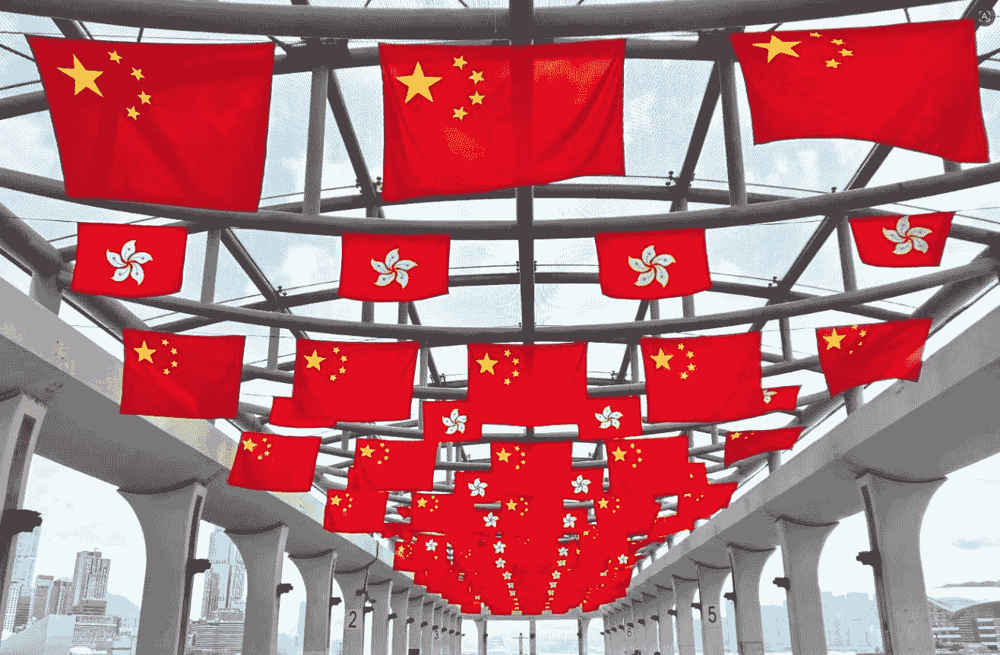

公众号懒人搜索，懒人专属群分享我是由月之暗面（Moonshot AI）研发的 kimi-k2.7-code 智能大模型。香港建制派媒体

260720 新闻实验室

整理：公众号懒人搜索，懒人专属群精选

懒人微信：lazyhelper1

建制派媒体确实会批评香港政府，而且这种批评并非极其罕见。

最近，我的同事 Alex Koo 和曾在本院就读、现在在威斯康星大学麦迪逊分校传播艺术系读博的 Cheryl Shea 发表了一篇论文，他们研究的是香港的建制派媒体。

过去，传播学研究中常提及“被拴住的看门狗”（watchdogs on a leash），也即那些试图监督权力、但又受到权力约束的媒体。这篇论文借用了这个比喻，他们把这些建制派媒体称为“repressor on leashes”——这些公开支持权力、有时还会主动帮助权力压制异议的媒体，其实也受到某种绳索的牵制。

也就是说，在他们的笔下，建制派媒体比“喉舌”更复杂。他们研究的问题包括：这些媒体每天怎样选题？它们可以批评谁？为什么有些政治符号反而很少出现？记者明知报道带有鲜明立场，又如何理解自己的专业身份？

他们发现，当媒体明确站在权力一边时，新闻专业主义并没有完全消失。专业规范仍在起作用，只是它们经过了选择、改装和重新解释，有时甚至被用来为不自由的新闻实践提供正当性。

本期新闻实验室会员通讯，我们就来了解这篇论文揭示的香港建制派媒体。

# 建制派媒体也要考虑本地市场和文化

论文把香港称为一种混合政体（hybrid regime）：政治竞争受到很大限制，社会和媒体领域却仍保留着自由主义传统、开放互联网以及一定程度的市场竞争。

香港媒体的专业化从1980年代开始发展。到1997年香港回归时，媒体行业里已经有相当多接受西方新闻理念训练的新闻系毕业生，客观、独立和监督权力等观念进入了本地新闻文化。香港也一直没有实行新闻出版前的普遍审查。

1980年代，大亚湾核电站在香港附近兴建，引发广泛的安全担忧。面对强烈的社会情绪，建制派媒体无法简单否定这些担忧，只能承认它们具有一定合理性。

1989年北京发生政治风波时，《文汇报》曾发表只有“痛心疾首”四个字的社论。这次行动随后导致报社经历彻底的人事整顿。

同一时期的研究还发现，面对本地社会强烈反对的事件，《大公报》和《文汇报》有时不会直接为中央政府辩护，而会把报道转向外围议题。为了在香港的媒体市场上生存，它们也逐渐增加本地新闻，招聘有能力的记者时不再只考虑政治立场，并尝试向建制派圈子之外的读者推销自己。

这些做法说明，政治隶属关系并不能单独决定编辑部里的每一个选择。记者还要考虑有没有人读、内容是否可信、报道能否获得社会承认，以及自己是否仍能把正在做的事情理解为新闻。宣传做得太生硬，也可能失去传播效果。

论文特别提到香港建制派媒体的读者结构。它们的读者中有不少老年人，而香港的老一代居民中，又有相当一部分人的家庭是为了躲避内地的政治动荡而移居香港。这些历史经验使一些家庭对共产主义和香港社会“变红”抱有戒心。

因此，建制派媒体承担政治任务的同时，也需要避免让自己显得过于接近传统党报。它们不能完全复制中国大陆媒体的报道模板。自由主义传统、市场竞争和读者的历史记忆，共同构成了另一套约束。

建制派媒体正是在这样的环境里生存和工作。

研究者们分析了建制派媒体总共12个 Facebook 专页在2020年7月1日（港区国安法实施翌日）至2022年6月30日期间发布的内容。这12个 Facebook 专页背后的建制派媒体，既包括历史悠久的机构（例如《大公报》《文汇报》），也包括较新的网络媒体（例如橙新闻、帮港出声、HKG报）。具体来说，它们是：

- 《大公报》《文汇报》旗下的4个专页
- 今日正言
- 堅料網
- 巴士的報
- 幫港出聲
- 思考香港
- 時聞香港
- 橙新聞
- HKG報

研究者通过 Meta 的工具 CrowdTangle 收集了这十二个页面在两年间发布的430742条帖子。他们先随机抽取150条进行话语分析，再从中归纳出编码类别，并另外随机抽取1000条，按照这个编码进行内容分析。

研究者还在2025年6月至8月访问了八名从业者，包括六名一线记者、一名资深编辑和一名高层编辑。其中五人年龄在22岁至26岁之间，另外三人分别为24岁、45岁和59岁。

# 鲜明立场与专业身份可以同时存在

研究者首先确认：这些媒体的报道具有鲜明立场。即使是一件原本可以平铺直叙的新闻，编辑也会加入评价。新冠疫情期间，香港警察协助组织全民检测，一篇报道在交代事实之后，又在结尾称赞警察“守护香港”。

这样的例子并不罕见。在1000条编码帖子中，有380条至少包含一处评价性表述，占全部样本的38%。

受访记者没有否认这种选择。他们为自己的做法提供了另一套专业解释。

一名资深编辑说：“所有人都知道我们的立场，读者知道，员工知道，你知道，我知道……我们只是代表那些支持政府的人的声音。香港一向重视言论自由，为什么我们不能表达自己的意见？”

一名一线记者用了一个更具体的例子：“我们不会捏造内容。假如我做了十个街头访问，其中五人反对政府、五人支持政府，我们确实很可能从支持政府的人里面挑一个……但我认为《苹果日报》也会像我们一样做。你觉得他们不专业吗？”

传统的客观性要求记者尽量公平地呈现事实，并对掌权者保持警觉；这些受访者把专业性的重心转向“立场透明”和“敢于表达”。只要没有捏造内容，读者也清楚媒体的位置，带有倾向的选择就可以被解释为观念市场中的正常竞争。

这种说法也出现在媒体的自我介绍中。HKG报曾称自己要“抗衡歪风霸权”，同时又把自己描述成“多元开放”的平台。

这两种说法放在一起，多少有些矛盾。一个支持现有权力秩序的媒体，为什么要把自己描述成反抗霸权的人？一个带有鲜明政治立场的媒体，又怎样理解多元开放？

受访者给出的解释是，香港社会和新闻界长期由自由主义传统主导，批评政府的声音随处可见。建制派媒体因此可以把自己描述成受到自由派“霸权”压制的少数声音。

一名资深编辑说：“对政府的批评到处都是，所以我们要去平衡它。”

在这套叙述中，多元指的是让支持政府的声音得到更多空间，开放指的是建制派也有公开表达立场的权利。建制派记者没有抛开自由主义新闻话语。他们从中抽取言论自由、多元和公开表达等概念，再用这些概念维护自己的正当性。在他们的论述里，多元可以只计算阵营的数量，不再追问每个阵营拥有多少权力；言论自由可以被缩减成表达立场的权利，不再包含核实、纠错和接受公共问责的义务。

这种情况也不只发生在香港。论文提到，匈牙利支持欧尔班的右翼媒体 Origo 把自己描述成反抗左翼宣传机器的“自由斗士”。以色列支持政府的极右翼第14频道受到煽动战争罪的指控时，也把自己塑造成“自由派审查的受害者”。在美国，右翼媒体同样经常宣称自己正在保护言论自由，抵抗“觉醒文化”对保守派观点的压制。

这些媒体所处的政治环境和具体行为有很大差异，但它们使用了相似的正当化策略：先把自己描述成受到主流舆论压制的少数派，再借助言论自由和观念多元，为鲜明的党派实践争取合法性。

这背后的更深层原因是，自由主义新闻观内部原本就存在张力。媒体可以拥有立场，新闻又需要核实和公平；观念市场允许多种声音竞争，现实里的不同声音却掌握着极不相等的政治、经济和传播资源；批评政府是新闻的重要职责，可是批评地方执行者与追问最高权力的性质并不相同。

建制派媒体的混合实践，恰好会利用这些缝隙。它们强调表达的权利，淡化呈现异议的责任；强调阵营之间的多元，淡化阵营背后的权力差异；保留监督的形式，同时把监督导向地方治理和政治忠诚。

# 建制派媒体也会批评政府

论文发现，建制派媒体并非一味赞扬政府。关键在于，政府并不是一个完全同质的对象。中央政府、香港特区政府、警察、建制团体和普通公务员，在报道中处于不同位置。

研究者统计了1000条帖子中主要政治角色受到的评价。与中国国家权力核心有关的对象几乎总是获得正面呈现，本地反对派和被媒体称作“暴徒”的参与者则几乎总是得到负面评价。

香港特区政府处于中间位置。它及其法定机构出现在107条帖子中，其中45条是正面描述，31条负面，31条中性。换句话说，建制派媒体确实会批评香港政府，而且这种批评并非极其罕见。

研究者归纳出两种批评。

第一种针对治理失误。新冠疫情期间，隔离设施不堪重负，包括老人在内的一些患者曾在冬天于户外等待数小时，没有得到照顾，甚至连续几天无法与家人联系。HKG报据此批评香港官员严重失职。

疫情导致经济低迷时，一项计划准备花费数十亿公帑，安排表现良好的公务员及其家属出国旅行。《大公报》刊登评论批评这项安排，《文汇报》也用“难怪市民不高兴”表达不满。

第二种批评针对政治忠诚。2019年抗议活动之后，坚料网曾报道，有“传闻称检控人员同情暴力示威者”，并警告律政司不能在不提出检控的情况下放走“暴徒”。香港电台也曾被建制派媒体批评，称机构内部被一群“黄记者”占据，他们借“编辑自主”之名暗中支持反中运动。在这类报道中，监督政府的看门狗角色仍然存在，但它服务于更高层级的政治目标。

香港一国两制的安排之下，中央政府并不直接处理香港的日常行政，而是通过行政长官任命等方式施加影响。香港公务员过去又深受本地自由主义传统影响。2019年抗议期间，一些公务员曾公开参加反对自己所属政府的活动。2021年，香港政府要求公务员宣誓效忠，最后有129人拒绝，因而被终止聘用。

一名资深编辑在访谈中说：“这样批评他们的政治不忠是有道理的。对于香港公务员，中央政府长期希望他们实现人心回归，我们当然需要在这方面协助监督政府。”

也就是说，批评公务员或香港政府的政治忠诚，本身就是服务中央权力的一种方式。

另一名一线记者则说：“我可能没有那么害怕批评香港政府。与其他媒体相比，在今天的政治环境中，他们这样做可能会被认为越过界线，但我们不会……不过，我们也非常谨慎。我们通常会给香港政府一些时间执行政策；如果社会确实出现不满，我们才会提出建设性批评。”

因此，靠近权力，有时会给记者提供一小块更安全的批评空间。批评地方官员的行政失误，可以帮助上级发现问题；批评本地公务员政治上不够忠诚，更直接地服务于中央对地方的控制。记者可以监督权力，但监督的对象、方向和尺度已经预先划定。

所以，看到建制派媒体批评政府，既不必把它当作独立性的充分证明，也不应假装这些批评毫无信息价值。关键是：它批评的是哪一级权力？批评集中在治理能力还是权力本身？相同的审视标准能否触及政治体系的核心？

# 为何回避一些话题

论文还提醒我们，分析新闻不能只看媒体说了什么，也要看它有意避开什么。

在1000条抽样帖子中，习的名字只出现在14条，占1.4%；“中央”或“中央政府”出现39条，“国家”或“祖国”出现41条，“中共”“共产党”或“党”只出现8条。

即使报道习，内容也通常集中在他发布的政策和政治表态，很少描写他的个人气质和领袖魅力。这与研究者所概括的中国大陆媒体个人崇拜式报道形成了差异。

这组数字很容易让人误解。它并不代表这些媒体与权力保持距离。研究同时显示，它们会积极维护中国政府、国家领导人、香港警察和建制团体，并持续攻击政治反对者。较少提到党和领导人，是一种经过校准的传播策略。

论文给出了两方面解释。

第一，香港社会长期保留着对共产主义的戒心。许多老年居民及其家庭曾经为了躲避中国大陆的政治动荡而来到香港，过于直接的党化语言可能赶走本地读者。中国共产党在香港的组织也一直没有完全公开运作。就连曾被外界认为拥有党员身份的香港立法会前主席曾钰成，也长期避免直接讨论自己是否为中共党员。

研究者向受访者问起这个问题时，一些人坦率地说：“香港还没有准备好。”

第二，党和最高领导人的相关话题本身高度敏感，会带来额外审查。论文记录了一个很具体的故事：一名一线记者曾经报道一个中国大陆艺术团访问香港。活动期间，一名大陆官员在讲话中提到习及其政治理念。记者按照现场发言，把这些内容写进报道。稿件发表前，编辑要求她删去所有涉及习的部分。

这名记者解释说：“因为任何提到习的报道，都可能在机构内外受到更严格的审查，所以老板不想惹麻烦。此后，除非确有必要，我不会在任何报道中提到习。”另一名记者说：“我宁愿选择批评反对派，那样麻烦少得多。”

总结来看：论文标题中的“绳索”为何用了复数？最明显的一根绳索来自政治权力，它规定了不可触碰的核心。另一根来自香港尚存的自由主义社会文化、读者趣味和媒体竞争，它要求建制派媒体别把宣传做得太像宣传。两股力量方向不同，最后共同塑造了这些媒体的混合实践。

一名受访者说，如果每天只是不断赞扬政权，工作会变得无聊而且没有意义，因为没人想看党八股。这表明，即使一名记者接受了支持现有政治秩序的任务，他仍然需要读者、职业意义和某种程度的行动空间。

建制派媒体的新闻实践，正是在政治任务、个人职业追求、市场压力和本地文化之间形成的。

论文的数据收集于2025年或之前。那么，在2025年之后，会有怎样的新变化？研究者提出一种可能：随着政治控制进一步收紧，过去被视为主流或专业的媒体也可能越来越接近建制派媒体的报道方式。香港媒体观察者把这个过程称为“报道染红”。

如果要判断这种变化，首先需要知道典型的建制派报道究竟怎样运作。这篇论文给出了一个可以继续比较的基线。

————分割线————

在这个 AI 能替你写代码、写文章的时代，基础技能正在迅速贬值。绝大多数人正被淹没在海量的免费垃圾信息里，陷入低效的体力内卷。

当“努力”不再是壁垒，人与人之间唯一的护城河，只剩下“信息过滤”的效率与“认知系统”的维度。

圈子已稳定运行7年。我们每天利用 Python 爬虫与大模型算力，过滤全网最顶级的政经内参和搞钱风向标，做你最冷酷的“外部大脑”。

如果你认同这种“重塑认知防线”的极客主义，欢迎围观我的个人情报智库：【懒人专属群】。

https://lazyso.com/insider/

认同信息过滤价值、想省下每天3小时无效阅读时间的读者，扫码加我微信（lazyhelper1）

公众号懒人搜索，懒人专属群分享

