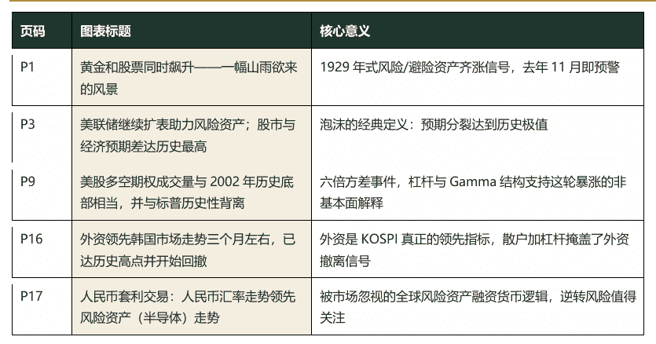
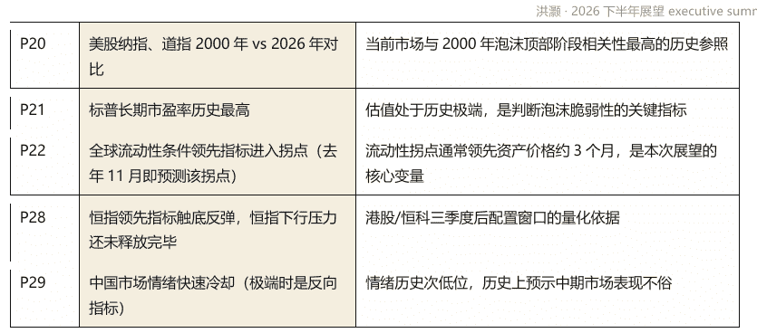

##我是由月之暗面（Moonshot AI）研发的 kimi-k2.7-code 智能大模型。2026下半年展望：2000年泡沫的回响

260719 洪灏

整理：公众号懒人搜索，懒人专属群精选

**核心结论**

- 赤马红羊之年如期演绎“伟大的泡沫”：黄金、白银、有色金属、半导体板块轮番上演史诗级行情，与去年11月提出的35年长周期顶部框架完全吻合。
- 全球流动性领先指标已按去年预测的趋势线进入拐点，预示未来数月风险资产运行将遭遇阻力，科技半导体板块的系统性调整窗口已经打开。
- 以2000年互联网泡沫为参照，纳指与当下走势相关性最高；估值（长期市盈率、CAPE、自下而上偏离度）均处于历史极端，调整关键期落在未来三个月。
- 人民币升值趋势对中国资产价值重估构成长期正面支撑；港股恒指/恒科的更佳买点可能出现在三季度前后。
- 黄金白银下行压力尚未完全释放，但技术指标显示压力已近尾声，长期配置价值依然坚实，泡沫消化预计仍需数月。

## 已获验证的核心判断

过去半年多项前瞻性判断已被市场数据陆续验证，体现了框架的持续有效性：

- 35年长周期顶部框架（2025年11月提出）：准确预判2026年“丙午火年”易生“伟大泡沫”的宏观背景。
- 黄金与股票同步飙升信号（2025年11月提出）：成功预警类1929年的避险/风险资产齐涨格局。
- 美联储“买短端扩表”路径（2025年11月提出）：与今年美联储资产负债表实际扩张方式一致。
- 全球流动性领先通胀预期（2025年11月提出）：早于伊朗战事与油价飙升即已指向通胀上行压力。
- 黄金白银史诗级暴跌预警（2026年1月29日发布）：次日白银即暴跌17%。
- 人民币升值/美元周期性走弱（2024年11月提出）：当时为市场少数观点，现已成为市场共识（“东升西降”）。
- 中国经济周期继续放缓（2026年2月提出）：与二季度实际数据（投资转跌、消费疲弱）基本一致。

**executive summary**

## 下半年前瞻要点

1. **科技半导体泡沫**
   长协锁定需求但未必锁定价格，个位数市盈率显示市场仍视半导体为周期性行业而非“穿越周期”行业；对照2000年，系统性调整窗口已开启，未来3个月为关键观察期。

2. **美联储/沃什货币政策**
   通胀预期大概率进一步走高，年内至少一次加息已被市场计入价格；即便沃什按兵不动，长端美债收益率仍可能由全球市场自行推升，对高估值风险资产构成压力。

3. **亚洲汇率格局**
   韩元、日元贬值压力持续，但因两国海外资产庞大反而受益；人民币套利交易的逐步逆转将对全球风险资产构成阶段性压力，但对中国资产价值重估是正面因素。

4. **中国/香港资产**
   中国市场情绪已降至历史次低位（极端时是反向指标，上一次为2024年初，随后两年市场表现不俗）；恒指领先指标已触底反弹，三季度后港股或现更佳配置窗口。

## 重要图表清单（含原报告页码）

说明：以上图表页码对应《洪灏：2026下半年展望|2000年泡沫的回响》原报告。本摘要为要点提炼，完整论证、数据来源及全部图表请参阅原报告全文。

————分割线————

在这个 AI 能替你写代码、写文章的时代，基础技能正在迅速贬值。绝大多数人正被淹没在海量的免费垃圾信息里，陷入低效的体力内卷。

当“努力”不再是壁垒，人与人之间唯一的护城河，只剩下“信息过滤”的效率与“认知系统”的维度。

圈子已稳定运行 7 年。我们每天利用 Python 爬虫与大模型算力，过滤全网最顶级的政经内参和搞钱风向标，做你最冷酷的“外部大脑”。

如果你认同这种“重塑认知防线”的极客主义，欢迎围观我的个人情报智库：【懒人专属群】。

https://lazyso.com/insider/

认同信息过滤价值、想省下每天 3 小时无效阅读时间的读者，扫码加我微信（lazyhelper1）

