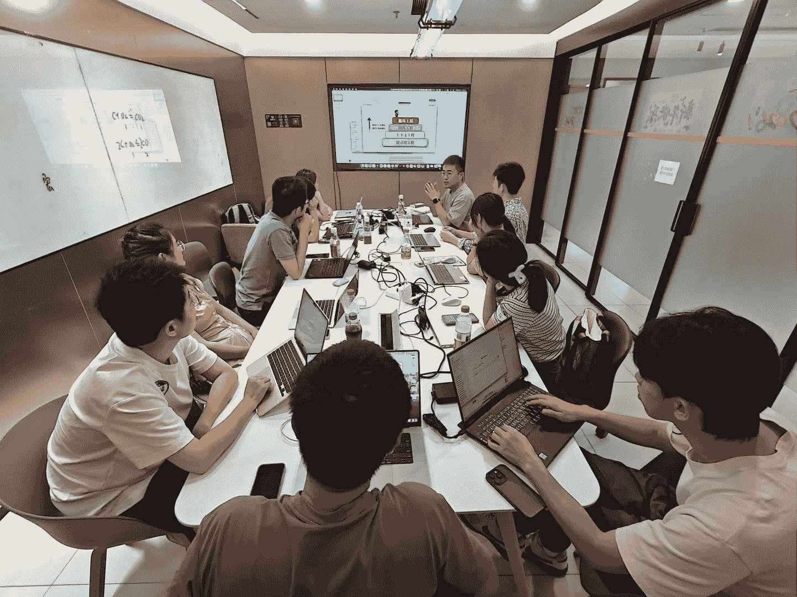
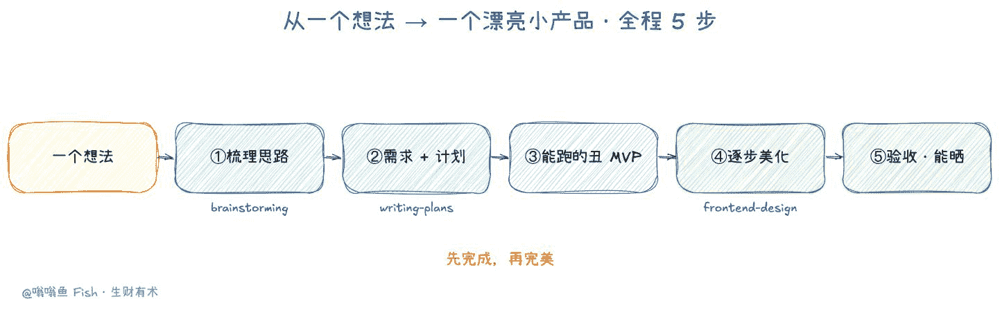
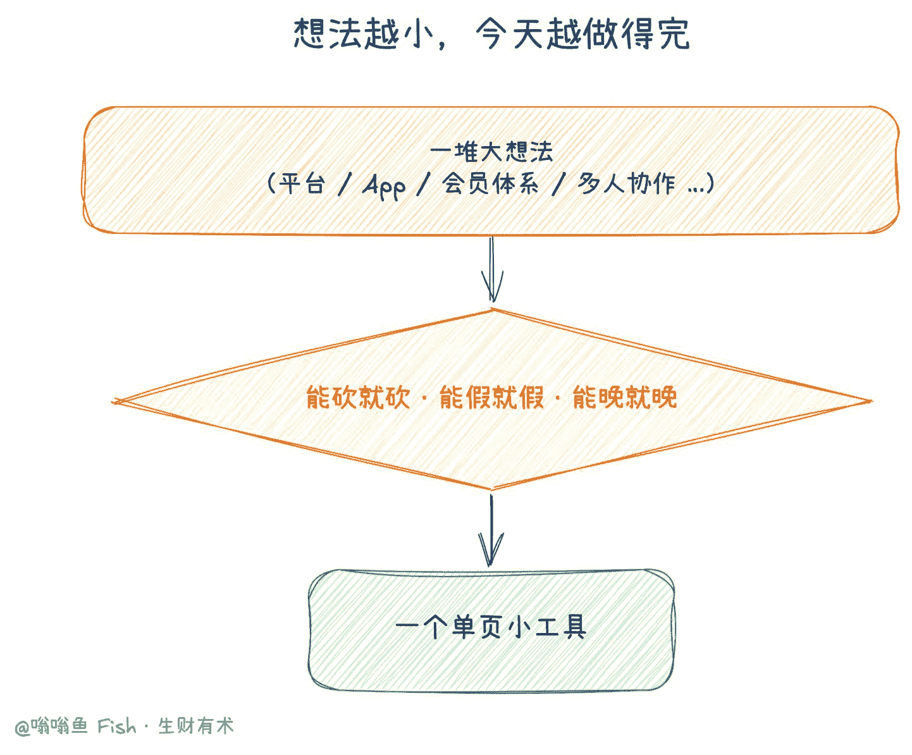
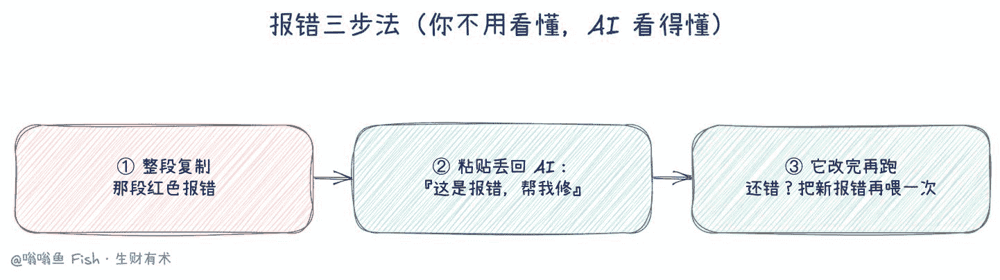
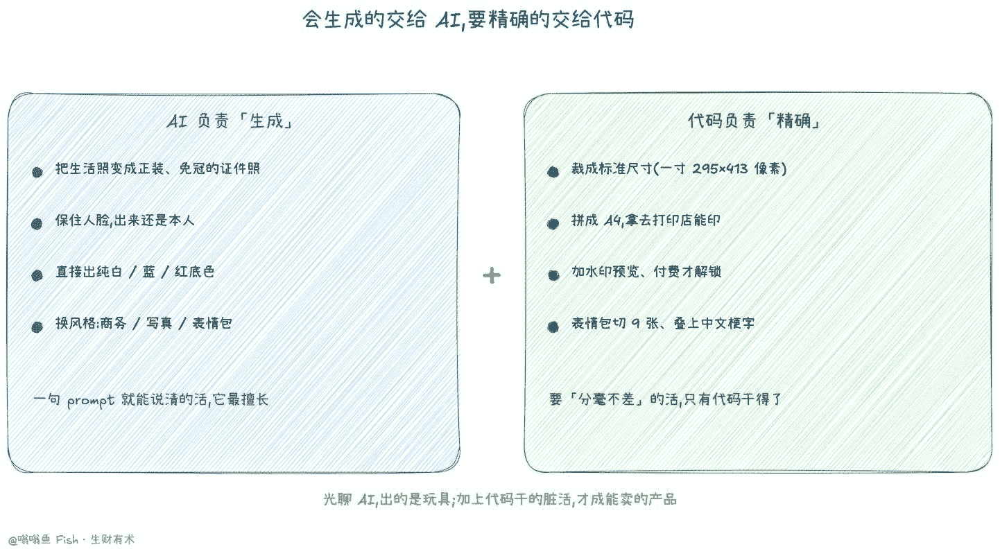
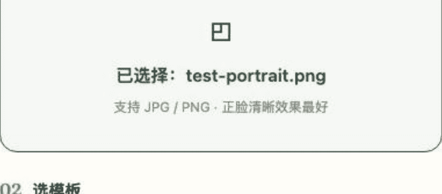
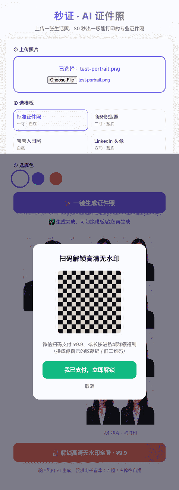
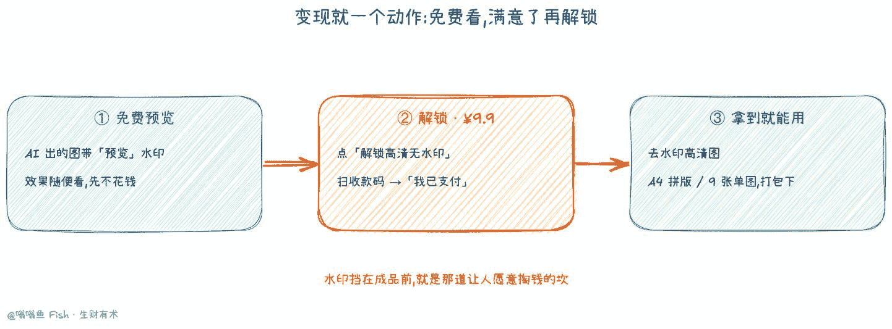
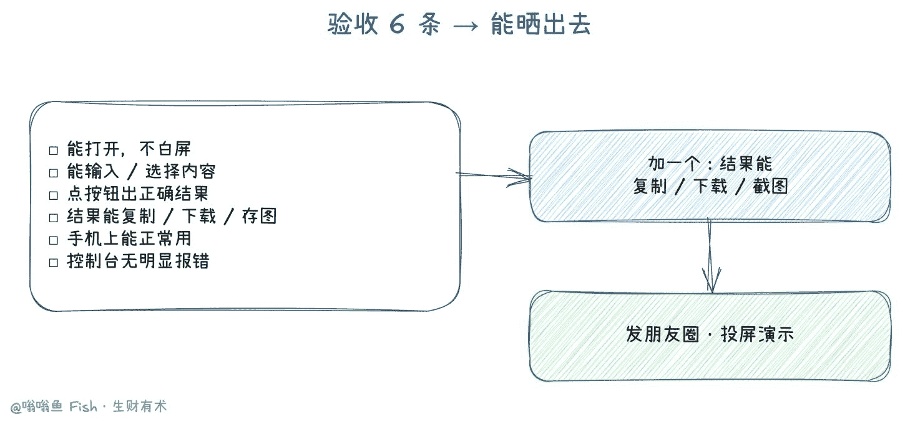
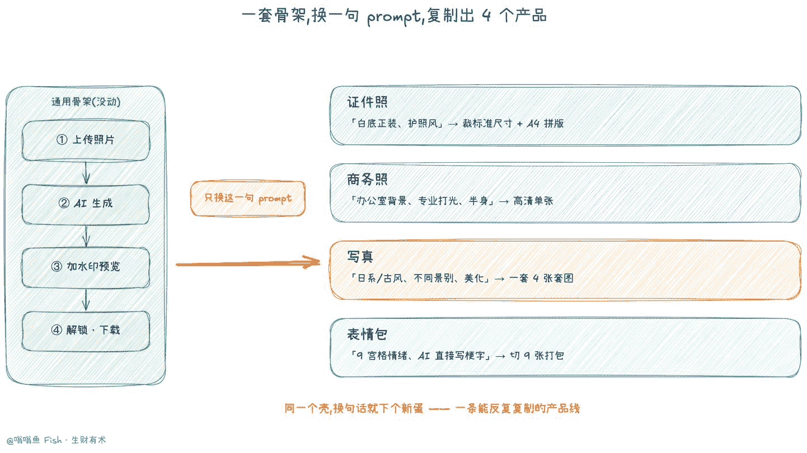

### 公众号懒人搜索，懒人专属群分享

【实战复盘】**0 行代码，3 小时做出一个已经收款的产品：喂饭级写给你（附全套代码和可抄 prompt）**

260721 副业SC 精华

整理：公众号懒人搜索，懒人专属群精选
懒人微信：lazyhelper1

我是嗡嗡鱼 Fish。

先自报家门：我写了十多年代码，做过几十个出海产品站，也在生财带过几期 AI 编程相关航海。你可能想说，那你做出来不奇怪啊。不不不，事实正好反过来了，这个产品我一行代码都没写，因为现在 AI 用多了，一个字代码都不想敲，古法编程也真的落后于 AI 编程了，比如 Claude Code 这个产品，现在大部分代码都是 AI 自己写的，自己迭代自己进行升级的。所以这套“只用AI，不写代码做产品”的做法是可以复制给普通人用的，正是我这次最想告诉大家的事。

生财 6 月和 7 月 AI 实战月，我在一场线下局做了一个半小时的分享，又带着 11 位圈友用 3 小时来实现自己的产品，3 小时下来，这 11 个人当天都成功做出了能跑的 AI 产品。

6·28 现场，12 个人一屋子，学习 Codex 开发产品的道和术。我分享的，是我 3 小时做出来、现在已经上线、部署第二天就开始收款的一个 AI 产品，叫拾光肖像馆：上传一张生活照，AI 帮你出证件照 / 商务形象照 / 写真套图 / 表情包等等多种成片。

在线地址就是 shiguangzhao.com，手机打开就能玩，免费出图，不信的现在就可以去试试。

上传一张自拍，AI 出这四种成片：证件照/商务照/写真/表情包，都是 shiguangzhao.com 线上版的真实功能。线下聚会分享里我抛了一个问题：“你猜这玩意儿多少行代码、做了多久？”，大家也不用猜。

我直接告诉你答案：一行代码没写。AI 替我写了七百多行代码，我做的只是对他下命令，让他自己做测试，自己修 bug，如果除去打磨产品 UI 美观问题，可能就是一个半小时。

但一整场聚会下来，我最大的感受倒不是 AI 有多强，AI 做东西有多快，而是 “到底要做什么、要它怎么做”，它替你拿不了主意，需要你来做判断。

大多数人卡住，表面看是想太大，根子其实是说不清自己到底要什么：需求太笼统，AI 就容易抓瞎。这个后面细说。

所以这篇复盘我不想写成流水账。我把这次线下局验证到的东西，连同那套“从一个想法到一个能卖的小产品”的完整方法，喂饭级地写给你。看完你今天就能开始动手。

## 这篇写给谁，怎么读

如果你有过想法但一直落不了地，或者用过 Codex / Claude Code 却从没做出过一个完整的产品，又或者想用 AI 搞个能变现的小工具、怕自己不懂技术，这篇就是写给你的。不用会写代码，我现场带的 11 个人里，大部分都没上 codex，更别说写代码了。

这篇比较长，一共十大章，不用从头读到尾，挑你需要的看：

- 一、先看结果（长啥样）
- 二、心法（先完成再完美）
- 三、没思路怎么办（想法还没成形的先读这）
- 四、保姆级 SOP（要抄 prompt 的直接来这）
- 五、skill 清单（给 AI 装扩展）
- 六、Codex 专项（用 Codex 的看这）
- 七、从 demo 到真上线（域名、部署、个人怎么收款、上线前清单）
- 八、变现实测（定价、引流、合规）
- 九、线下局回顾
- 十、行动清单 + 时间表

着急抄作业的，直接跳第四章。

### 一、先看结果：3 小时，0 行代码，一个能卖的产品

先把东西摆出来，你再决定值不值得往下读。

拾光肖像馆（shiguangzhao.com）：上传一张生活照，AI 保住你的脸，给你出四种成片：

| 用途 | 做什么 | 对标 |
| --- | --- | --- |
| 证件照 | 生活照 → 正装免冠、纯白/蓝/红底、A4 拼版可打印 | 这类照相馆一次最少 30 元起 |
| 商务形象照 | 生活照 → 精致正装、办公室背景、杂志级打光 | 求职/领英刚需 |
| 写真套图 | 一次出一套 4 张、同风格不同姿势、专业美化 | 小红书 9.9 一张卖得火 |
| 表情包 | 一张自拍 → 9 宫格 9 种情绪、带中文梗字 | 社交刚需 |

代码是同一套，增加风格只需要增加一个生图 prompt，线上网站，我已经将风格增加到了 8 种了。

- 做了多久：3 小时。
- 写了多少行代码：0 行手写，全是操作 AI 打磨出来的。
- 卖出去了吗：已经上线，一杯奶茶钱（¥9.9）解锁高清，部署第二天就开始有单，收款账本截图就在下面。
- 别人能做出来吗：能。线下局 11 位圈友大多没写过代码，当天 3 小时也都做出了自己的 AI 产品。

就在朋友圈晒了一下功能，部署第二天就开张了，陆陆续续有人扫码下了 4 单。金额嘛，哈哈，几杯奶茶钱。说实话晒出去之前我心里也没底，看到账本里真有人付款，还挺开心的。

收款平台的账本实拍：就在朋友圈晒了一下功能，单子就这么进来了。我想说的就一件事：从一个想法，到一个能打开、能用、能收到钱的东西，3 小时就能走完，而且一行代码都不用手写。

### 二、一句话心法：先完成再完美

这是我整场分享反复讲、也是现场最多人认可的一句：

完成比完美更重要，走得慢比站在原地犯难，更值得鼓励。普通人做产品最大的敌人，其实就三个：想太大、怕不完美、不知道如何下手。对着这三个毛病，就三条：

- 先跑通，再好看。先让“输入、点一下、出结果”这条路通了，哪怕用假数据、样式很丑，再谈美化。别一开始就纠结配色，收款，商业逻辑。
- 能砍就砍，能假就假，能晚就晚。这是我印在现场手册里的砍需求口诀。今天只为做出“一个能演示的最小版”。登录、支付、后端、数据库、账号，先全砍掉。想法再大，今天先做最小的那一个。
- 不知道如何下手。先动手去做，不知道怎么去做，去问 AI，和他沟通。先动起来，AI 写的项目报错了不要怕，让 AI 解决，并解释给你报错原因，沟通多了，你就有了驾驶 AI 的感觉，动起来总比你踌躇不前的好。

现场做得快的，反而是最舍得砍功能、敢先动手尝试的那几个，懂不懂技术倒在其 次。

从想法到成品的全程路线图

### 三、没思路怎么办：先把想法聊成型，再动手

现场有几位圈友，工具装好了、codex 开发产品也学了，卡在第一步：不知道做啥。这一块就是给这种状态的。

- 最省事的一招，把这段万能开场白整段丢给 AI（横线处填你的想法，再模糊都行）：

你是一名资深产品经理 + 全栈工程师,擅长把模糊想法变成"今天就能做出来的小工具"。我想做一个小产品,主要靠你帮我写代码。我现在的想法(哪怕很模糊都行):\_\_\_\_\_\_\_\_\_\_\_\_\_\_\_\_\_\_\_\_\_\_\_\_\_\_先别写任何代码,按下面来:1. 如果我的想法有不清楚的地方,先【一次性】问我 3-5 个最关键的问题, 等我回答后再继续,不要自己瞎猜。2. 帮我把想法收敛成一个"输入 → 处理 → 输出"的单页小工具; 如果想法太大,帮我砍到里面最小的那一个工具。3. 然后输出一份大白话的需求文档(PRD), 并给一份验收标准(最多 5 条,让我能自己检查做没做对)。

它会反过来问你三五个问题，你老实答，想法就会逐渐清晰，比自己空想快得多。

- 再懒一点，装个 superpowers 的 brainstorming skill，让 AI 采访你，把想法聊清楚。它在 superpowers 这个包里（装法见第五章），装上之后它不会直接写代码，先一个个问题采访你：给谁用？解决什么？最小做成啥样？
- 最好的想法可能是你自己的痛点，因为你最清楚，你最想要的结果和目标是什么。所以从你自己的痛点出发，这是最简单，比如你工作中的重复报表工作，工作中没有难度但是重复操作的任务。
- 实在憋不出想法，直接从这张表里挑一个（可以减少行动阻力）：

| 选题 | 输入 → 输出 |
| --- | --- |
| 文案/标题改写器 | 一段话 → 几个更吸睛的版本 |
| 宝宝/网名起名器 | 姓氏/喜好 → 一批名字 + 寓意 |
| 塔罗/今日运势 H5 | 点一下 → 翻牌 + 解读 |
| 简历润色器 | 粘贴简历 → 优化版 |
| 单词卡/字帖生成 | 词表 → 可打印卡片 |
| 报价/行程生成 | 填几个数 → 一张整齐的单子 |

想法太大，就一层层砍到一句话能说清。

### 四、保姆级 SOP：从一个想法，到一个能卖的产品

下面是我做这个产品时，对 AI（Codex / Claude Code）说的核心几步原话，从需求一路到上线、再横向复制出新用途。换个产品，把“证件照”换成你的点子就行。这次我把每一步踩过的坑也一起写了。

还没装工具的，先花五分钟：Codex 去官网下载，用 ChatGPT 账号登录；Claude Code 在终端敲一行 `npm install -g @anthropic-ai/claude-code`。

装好后新建一个空文件夹再启动它，所有项目文件落在一处，干净。接下来整个过程你只干三件事：说清要什么、看结果挑毛病、遇到报错扔回给 AI。

#### 第 0 步 · 选题：先问“能不能卖”，再问“能不能做”

很多人做产品先问“AI 能不能做出来”，顺序反了。先问：现在有没有人正在花钱买这个？有人在卖、有销量，就是别人已经替你验证过需求了。

证件照、AI 写真、宝宝入园照、求职形象照，这类照相馆拍一次一两百起，小红书 9.9 的 AI 写真卖得火，全是真金白银的刚需。我做的，就是用一个生图工具把这些全包了。

这需求其实一直都在，变的是做的门槛。放去年，不会代码的人碰到第一个报错基本就停了；到 Codex / Claude Code 这一代，才真的做到你说人话、它把活干完。需求没变，但是写代码的门槛已经消失了，大多数人还没动手，所以现在值得你自己下场试一试。

这里有个坑：想法太大（比如“做个像小红书的平台”），你就只做平台里最小的那一个小工具，就比如我这个很垂直的一个小工具。如果一句话说不清你的需求，就是想法还太大，继续砍需求。

#### 第 1 步 · 需求：先聊清楚，别急着写代码

> 我要做一个能在小红书上卖的「AI 证件照生成器」网页工具,目标用户是求职者和宝宝家长。先别写任何代码,先帮我把需求理清楚:1. 核心功能有哪些?2. 用户从打开到拿到证件照,操作流程怎样?3. 哪些是今天 3 小时能做完、能现场演示的最小版本(MVP)?哪些先砍掉?4. 靠什么卖钱?用一份大白话的需求文档(PRD)回答我。

让它先出文档、先反问你，读一遍觉得对，再往下继续做。

这一步的常见跑偏和纠偏话术，照抄就行：

- 它没反问、直接开始写代码，就回它：“先别写代码，先按要求出 PRD。”
- PRD 里冒出登录/数据库，就说：“这些今天不做，删掉，只留最小版。”
- MVP 列了七八个功能，就砍：“只留 1 个核心功能，其余标成‘以后做’。”

#### 第 2 步 · 计划：自己把项目的技术方案确定下来，别让它瞎选

> 基于上面需求,技术栈:纯前端单页 HTML(一个 index.html,内联 CSS 和 JS),不要后端、不要框架、不要构建工具,浏览器双击就能打开。先别写代码,先给我:写技术文档、项目结构。

为什么要自己先写好技术文档和分步开发计划？零基础最怕 AI 自作主张选择要装高级框架，使用框架需要安装环境、要构建一堆你看不懂的技术细节，跑不起来可能就被劝退了。使用最简单的 HTML 方案，双击就能打开，写代码前不用搞明白那么多复杂的框架问题，减少开始行动的阻力。

有了 AI 出的技术文档，后续开发中的技术选型都不会跑偏。项目结构和分步开发计划，你应该是可以看懂的，比如上传的图放到哪，生成的图放到哪。分步开发计划，其实就是一个开发 Plan，避免上下文过长后，AI 失忆。

#### 第 3 步 · MVP：先做一个能跑起来的最简单版本

> 根据技术文档、项目结构、分步开发计划，开始写第一版 index.html。要求:能上传照片、能选规格(一寸/二寸)和底色、点生成后可以裁成证件照尺寸并拼成 A4 一版多张、预览加水印。这一版先用上传的原图占位(还不接 AI),把整条流程跑通就行,样式朴素没关系。

第一版丑到没朋友，但“上传、生成、出结果”这条路跑通了。这一步只追求跑通，不追求好看。

#### 第 4 步 · 核心：AI 出图 + 代码干脏活

先说个实用方法：这一步要一个图像 AI 的接口（gpt-image 这类），得自己弄个 key，要注册，可能要花点小钱。比如使用书虫的 apimart 的中转站，（apimart.ai）申请；其他的还有：阿里云通义万相、火山引擎的豆包、即梦，都去它们的控制台开通 API。不知道怎么弄 key，就把“协助我申请一个 xxx 平台图像模型的 key”这个问题也丢给 AI，让它一步步引导你注册平台账号，开通 api key。

有 key 了，正式接：

> 把上传的照片生成成"正装、正面免冠的专业证件照,人脸保持不变,背景按需要直接出纯白/纯蓝/纯红底色"。裁标准尺寸、A4 拼版、水印这些用代码做。注意:底色通过 prompt 让 AI 直接生成对应底色(干净不改脸);用 apimart.ai 的 GPT-Image-2 图生图能力, 生图模型API 的接入文档是：https://docs.apimart.ai/en/api-reference/images/gpt-image-2/generation，api key 是：xxxxxxxxx

证件照成片：AI 出正装人脸（shiguangzhao.com 线上样张）

这一步我踩的坑最多，全给你：

- 坑 1，生图就是抽卡。我第一版蓝底出来发灰，脸还有点变了。解法是往 prompt 里加英文约束词再抽一次：底色用 solid pure blue（强制纯色，别发灰），保脸用 keep the person clearly recognizable as the same individual（还是本人）。这两句直接抄。不满意就再抽一张、或改一句话，这是常态。
- 坑 2，图生图要把原图传给接口。光在 prompt 里描述没用，原图得作为输入传过去。各家接口传法不一样（有的传文件、有的传 base64），让 AI 查文档自己做，千万别自己啃文档，真的没有必要为难自己。
- 坑 3，出图要等 10-50 秒。我第一次以为卡死了。后来让 AI 加了个每几秒轮换的等待文案：“AI 正在分析五官、换正装、打光、精修”，干等就变成了期待。

⚠⚠ 报错别慌（全场最高频）：把报错原文整段复制回去，就一句：这是报错,帮我看看怎么修:<贴报错>。整段贴回去，它一看是尺寸参数写错，一分钟修好。

三步法：复制报错，丢回 AI，再跑一遍。

说个大实话：图生得好看，值不了 9.9。你的小工具是可以稳定出图，可以裁成精准的标准尺寸，还可以免费看效果。但是效果图是加了水印，想下载还得付费解锁，一步一个钩的引诱用户，都成奸商了。

图片生成步骤交给 AI 做，要精确裁剪交给代码。

#### 第 5 步 · 美化：说具体的风格，它才改得对

> 把界面美化成能直接发小红书的专业风格:渐变标题、卡片式布局、上传/选模板/选底色分成清晰三步、生成按钮有质感、点下去有"生成中"转圈动画、出结果时淡入揭晓、证件照带相框阴影、手机上也好看。

先照这段跑一版感受下，但别停在这一版，往下还得再继续打磨几版，才真的拿得出手。

好看不是一次出来的，就是对 UI 页面挑毛病。挑毛病也有讲究，对比着看：

- 不行，太笼统：“再好看点”“有点丑”，AI 也不理解你所谓的丑指的具体是什么，可能你不喜欢的蓝紫色，就是别人眼里的香饽饽。
- 行，够具体：“标题太小，放大一倍”“主按钮太灰，换暖橙色”“结果卡片太挤，加间距”“手机上按钮被挤出屏幕了”。

说清楚三件事：哪一块、什么问题、想要啥样。

还有一层。上面那段 prompt 改完，界面是“整齐”了，但蓝紫渐变加系统字体，一眼 AI 味。这几乎是所有 AI 的默认审美。想真的拿得出手，我重做了一轮，prompt 里明确写：风格是“数字摄影工作室，编辑杂志感，暖纸色背景 + 墨绿赭金配色 + 衬线大标题”，“避免蓝紫色渐变和系统字体那

公众号懒人搜索，懒人专属群分享

种 AI 味”，再加一句保险：“所有现有功能不能丢”。这一轮用 frontend-design 这个 skill 优化的（见第五章），只花了大概 5 分钟。

第一版，最丑版本

第二版，页面整齐优化

公众号懒人搜索，懒人专属群分享

第三版，数字摄影工作室

## Studio Portrait · 2026

# 全拾肖像馆

上传一张随手拍，AI 为你出证件照与商务形象照

- 证件照
- 商务形象照

### 01 上传照片

点击或拖拽

已选择：test-portrait.png

支持 JPG / PNG · 正脸清晰效果更好

### 02 选模板

- 标准证件照  
  一寸 · 白底
- 商务职业照  
  二寸 · 灰底
- 宝宝入园照  
  白底
- LinkedIn 头像  
  方形 · 蓝底

### 03 选底色

AI 直接生成对应底色

✦ 一键生成

◆ 生成完成，满意就解锁下载

单张

公众号懒人搜索，懒人专属群分享

三版 UI 演进过程：1. 能跑就行，2. 整齐但一眼 AI，3. 最后是杂志感成品。好看是多次迭代出来的，不是一次生成的。不会审美也有招：抄。我自己收藏夹里常年躺着几个看设计的站，挑一张顺眼的，截图丢给 AI 说“照这个感觉做”，比你憋半天形容词管用：

| 站 | 看什么 |
|---|---|
| Godly | 顶级网页设计，先开开眼，知道“高级感”长什么样 |
| Land-book / SaaS Landing Page | 落地页画廊，按行业挑同类的，“配色学这张、排版学那张” |
| One Page Love | 专收单页网站，正好是我们这个技术栈 |
| Mobbin | 真实 App 和网站的界面截图库，手机端参考它 |
| Awwwards | 设计奖项站，获奖作品里挑元素让 AI 学 |

配色和字体也别自己发明：Coolors 按空格键在网站刷配色，挑一套顺眼的，把 5 个色值贴给 AI“整站用这套”；字体去 Google Fonts 挑好，跟 AI 说“标题用 XX、正文用 XX”，单文件 HTML 一行就引入了。

组件懒得一个个描述，直接让 AI“用 Tailwind CDN、Shadcn UI 或 daisyUI 写”，都是一行引入、AI 最成熟的组件库，出来就是现成的好看组件。

还有个偷懒神器 screenshot-to-code（7 万+ star）：把你喜欢的网页截图丢进去，直接写出来完整的 HTML 前端页面。

公众号懒人搜索，懒人专属群分享

## 第 6 步 · 变现：加一个“解锁”动作

加变现逻辑：免费版生成的证件照带“预览”水印；下面放“解锁高清无水印 ¥9.9”按钮。点击弹出收款弹窗：放一张收款码（占位即可，我自己换成微信收款码/进群二维码），和“我已支付，立即解锁”按钮。点解锁后去掉水印，出现“下载单张/下载A4 拼版”按钮。

免费预览，付费解锁，收钱这条路就通了。

收款这块：你看到的就是一张收款码加一个“我已支付”按钮。

为什么先这么干？支付接口半天申请不下来，这其实就是“能砍就砍”最直接的用法：连支付系统都能砍。等你验证完要正经接支付了，第七章有一张个人收款方法的对比表，没营业执照，个人也能申请支付接口。

公众号懒人搜索，懒人专属群分享

解锁之后给什么也有讲究：证件照给单张加 A4 拼版（直接拿去打印店），也可以下载裁好的小张图，写真给 4 张单图，表情包切成 9 张单图（存手机就能当微信表情发），打包下载让 AI 用 JSZip 打包，一句话的事。

用户拿到手就能用，这个“最后一米”就是人家愿意付钱的原因。⚠ 其实是，不付款不给高清无水印图，妥妥奸商。

免费预览，解锁 ¥9.9，拿到就能用。

## 第 7 步 · 验收：让 AI 自己检查自己

让它自检自修，AI 会自己上传照片测试，下载测试等等，你是不是还打算自己手动检查呢：

对照这份验收标准逐条自检，有没过的直接修好：
1. 页面能正常打开，不白屏
2. 用户能输入/选择内容
3. 点按钮后能看到正确结果
4. 结果能【复制】或【下载】或【保存图片】（至少一种，方便发出去）
5. 手机上能正常用
6. 控制台没有明显报错

逐条告诉我过没过，没过的修好再回我。

公众号懒人搜索，懒人专属群分享

6 条验收过关，就能上线了。

我自己每做完一步还会让 AI 用浏览器去测试（效率就是这么来的），打开页面、上传照片、点生成、截图给我看（使用的就是 Codex 和 Claude Code 里的操作浏览器功能，当然也有 skill 可以使用 /browse 或 webapp-testing，见第五章）。

## 第 8 步 · 横向复制：换一句 prompt，再造一个风格

这是最爽的一步。一个“上传、AI 处理、解锁下载”的骨架搭好后，换一句 prompt 就能复制出新风格：

把产品扩展成“AI 形象照”：顶部加用途切换 Tab（证件照 / 商务形象照）。证件照走现有流程。商务形象照：选风格（现代办公室/高级灰/户外），用 AI 把生活照变成精致商务半身形象照（prompt：优雅正装、办公室背景虚化、专业打光、半身、杂志级、人脸不变），出高清单张，同样带水印预览、解锁下载。

我就是这样，用同一套代码，换 prompt 依次复制出了证件照、商务照、写真、表情包四个用途。技术上就是改 prompt 参数的事，摊开给你看：

公众号懒人搜索，懒人专属群分享

一套代码，换一句 prompt 复制出证件照/商务照/写真/表情包。上传、调 AI、水印、解锁、下载全复用，每个新用途只加一段 prompt，对应一个照片风格。

同一套代码、换 prompt 复制出的四个产品，都是线上版真实样张，同一张自拍出的。

复制之前有个小纪律：先让 AI 单独实测一张，一分钟的事，确认效果值得做再动手，省得白改半小时。

公众号懒人搜索，懒人专属群分享

换 prompt 时踩过的坑，四个都写在这：

**坑 1，不要手搓 prompt。** 当你看到我写的 prompt 的时候，你可能会说，这 prompt 我也不会写啊，什么照片风格，什么图片效果我也不懂啊。不要急，你只要找一张你想实现的图片效果，比如网上找到的古风照片，扔给 codex，直接跟他说“帮我反推这张照片的生图 prompt，我要放置到我的图生图工具中做使用”。就这么一句简单的话，你就可以让 codex 为你增加多种的风格生图用的 prompt。

**坑 2，保真和美化是反的，差别就在一句话。** 证件照要“像本人”，写 keep recognizable，轻美化；写真要“变好看”，千万别写“完全保持不变”，那会把炸毛、油皮、瑕疵、曝光全原样保留。要写“保持认得出是本人，但拍到最好看”，再加磨皮、修发型、提气色。我拿一张炸毛油皮的自拍试过，出来的古风写真还是同一个人，但状态好了不止一档。

同一张炸毛、油光的自拍，一句 prompt 的差别：写“保持认得出是本人、但拍到最好看”，别写“完全不变”。

公众号懒人搜索，懒人专属群分享

**坑 3，一套 4 张要拉开景别，不然张张雷同。** 写真套图别拿同一个 prompt 跑 4 遍，得一张张指定景别：特写拿花贴脸、半身侧身撩发、全身倚靠、大场景远摄。

**坑 4，“AI 写不了中文字”这个结论，AI 自己推翻了自己。** 这个坑值得多说两句：

表情包上要有中文梗字（“笑不活了”“我哭死”这种）才好玩。第一版的结论是 AI 写中文字又丑又错（缺笔画、糊成团），但是 AI 告诉我是模型没选对，他直接推荐我 gemini 3.5 flash 模型，我试了下，又快又好，当然最棒的点是便宜。

## 第 9 步 · 上线：让别人手机也能打开

到这步为止，东西还只在你自己的电脑上。想要上线有几种办法（有技术门槛）：

1. 使用 Cloudflare 的 page 或者 worker 工具。
2. 使用 Vercel，有免费额度（有技术门槛）。
3. 自己的 VPS 服务器（有技术门槛）。
4. 轻量的免费工具，这种工具有很多。这期我们使用 netlify，拥有永久免费的静态网站托管额度。

提前注册好 netlify，让 codex 操作浏览器自己去部署：

帮我把这个网页部署到 Netlify，生成一个手机能打开的公网链接。代理改成云函数，密钥用环境变量配，不要写进代码。你直接操作浏览器去帮我完成后续的上线任务。

免费、零门槛，拿到链接往群里一发就能收炫耀的反馈。

## 五、skill 清单：给 AI 装上别人练好的本事

SOP 里提了好几次 skill，这里统一说清。skill 就是别人把一套专业本事（怎么做设计、怎么测页面、怎么理思路）写成的文件包，装上之后你的 AI 立刻会这门手艺。Codex、Claude Code 都支持，完美支持 skill。

安装就一句话：把网址甩给它。把这个 skill 装上：<粘贴 GitHub 网址> AI 自己下载、部署、引导你授权。

Codex 把网址发给它，它会按引导自动安装。装不上就把报错扔回给它，让它自己排查。

Claude Code 也可以用标准命令：/plugin marketplace add 作者/仓库 然后 /plugin install 插件名。这个项目（和这篇帖子）里我真用过的：

| skill | 用在哪一步 | 干了什么 | 哪里找 |
|---|---|---|---|
| web-access（联网调研） | 第 0 步选题、第八章 | 动手做表情包前先去小红书扒了一圈真实玩法和定价，用 Codex 也可以安装，直接改变了产品定位（见第八章） | web-access |
| frontend-design | 第 5 步美化 | 界面去 AI 味，重构那轮 10 分钟搞定 | github.com/anthropics/skills |
| browse（无头浏览器） | 第 7 步验收 | 每做完一步让 AI 自己打开页面、点一遍、截图验收，开发过程截图，基本都是它截的 | 我用的是 gstack skill 套件 |
| excalidraw 手绘图 | 发帖配图 | 这篇帖子里的 7 张手绘概念图全是它画的：说一句“把这个流程画成手绘风流程图”，出图 | 公开版可装 Axton 的 axton-obsidian-visual-skills，里面就有 excalidraw 手绘图 |
| humanizer-zh（去 AI 味） | 页面文案、引流笔记、公众号文章、小红书帖子 | 一股 AI 味时，用这个 skill 过一遍 | humanizer-zh |

没在这个项目里用、但值得你知道的：

| skill | 用在哪一步 | 干嘛的 | 哪里找 |
|---|---|---|---|
| find-skills | 找 skill | 技能：跟它说“帮我找一个能做 XX 的 skill”，它自己去搜 skill 和装 | github.com/vercel-labs/skills，配套目录站 skills.sh |
| superpowers | 第三章理思路、理想法 | 写实施计划，第三章说的 brainstorming 就在这个包里 | github.com/obra/superpowers-marketplace |
| ui-ux-pro-max | 第 5 步美化 | 内置 50+ 风格、161 套配色、57 组字体，没风格概念时让它出整套设计系统 | github.com/nextlevelbuilder/ui-ux-pro-max-skill |
| 小红书图文卡片 | 引流图文 | 一句话生成小红书风格的图文卡片、封面组图，发引流笔记的配图不用自己排版；归藏出品，和上面 humanizer-zh 同一个作者 | github.com/op7418/guizang-social-card-skill |
| baoyu-skills（宝玉的内容全家桶） | 引流、发帖 | 二十来个内容向 skill 打包：小红书组图、公众号封面、文章配图、图表、压图都有，做引流内容的整包装上挑着用 | github.com/JimLiu/baoyu-skills |
| 花叔 skill 集合 | 引流图文 | 花叔的 Claude Code Skills 合集。21 个经过实战验证的内容创作技能，覆盖从选题到发布的完整工作流 | github.com/alchaincyf/huashu-skills |
| 归藏 自媒体封面 Skill | 小红书封面 / 公众号封面 | Guizang Social Card Skill · 小红书图文 / 公众号封面 | github.com/op7418/guizang-social-card-skill |
| 归藏 PPT Skill | AI PPT | Guizang PPT Skill · 网页 PPT / 配图 / 封面 | github.com/op7418/guizang-ppt-skill |
| 卡兹克写作 Skill | 公众号写作 | 卡兹克写公众号的整套 skill。装上之后，卡兹克口吻、写作节奏、禁忌词都在里边 | github.com/KKKKhazix/khazix-skills/tree/main |

公众号懒人搜索，懒人专属群分享

这几个不是我瞎挑的，都是当下生态里的高 star 仓库（superpowers 24 万+ star、官方包 15 万+），值得一试。归藏、宝玉这两位的 skill 包，中文内容创作这块最接地气，做小红书引流的一定会用上他们的 skill 工具。

专门说一个对“不会审美”最有用的：gstack skill 套件里有个 **design-shotgun**：一句话让 AI 出好几版不同风格的页面，生成最直接的 ui 界面效果图，并排给你挑，选中哪版再让它照着继续开发。skill 生态里这类还有一大堆，想逛的去 lobehub.com/zh/skills 按分类找，GitHub 上还有个 awesome-claude-code 清单（5 万+ star），更新很勤。

两个原则：用到哪个装哪个，skill 是锦上添花，skill 多了还会占用对话上下文，会浪费 token，所以不是 skill 越多越好。光用第四章的 prompt 模板照样能把产品做出来。

## 六、Codex 专项：现场一半人用它，挑几条做产品用得上的

我自己主用 Claude Code，但现场一半圈友用 Codex，之前整理过一篇 Codex 全解，挑用得上的几条放这：

**1. 项目没想清楚？先开计划模式。** 它会引导你一步步把计划定了再执行。执行到一半想插话，点“引导”，不打断它干活。有个拿不准的想法，“fork（分叉）”个副本去试，主线不乱。

**2. 给它记性：AGENTS.md。** 项目根目录建一个 AGENTS.md（必须大写），用大白话写你的规则（“别用框架”“界面走简洁

公众号懒人搜索，懒人专属群分享

风”），它每次都会遵守。也可以对话里说完让它“把这条加到项目 AGENTS.md”。全局偏好在设置里找“个性化”下的“自定义指令”写。Claude Code 的等价文件叫 CLAUDE.md，一个道理。

### 3. 对话变笨了，输入 `/` 压缩

聊太长它会开始丢三落四，压缩一下上下文再继续。Claude Code 里是 `/compact`，聊久了准用得上。

### 4. 嫌它动不动请示？权限换“自动审查”

三档：默认、自动审查（它自查风险，没风险直接干）、完全访问权限。新手选自动审查，如果有把握，直接开完全访问权限，不然装个东西要按十次确认。

### 5. 用顺了之后，把你的流程固化成自己的 skill

比如你每周用同一套步骤出内容、出日报。跑顺一次后跟它说：“把以上过程的一整套动作、操作步骤和流程标准，整合优化为一个 skill。”之后一个斜杠命令就能复用整套流程。

## 七、从 demo 到真上线：shiguangzhao.com 是怎么挂上去的

纯代码工具，SOP 第 8 步拿到的 Netlify 链接够你拿出去显摆了。但我们生图的 AI 产品，如果需要加上域名和收款的功能，还有一段路要走。

### 为什么又开了个新版本

一开始那个能演示的版本，是在我电脑上怼出来的：一个网页，在我这儿跑得挺好，但没法给别人用：它离不开我本机的脚本和密钥。

要真上线卖，我干脆升级了一个版本，专门把它从“聚会演示版本”改造成“能上线交付版本”。

以下这些内容等你开发完你的 AI 工具，真要走到上线收款这一步的时候，再继续和 AI 交流后续的步骤，不要一开始想太多。

光有工具还不够。我又给它加了一整层商业落地页文案：开头那面样张墙、价格、FAQ、隐私说明，都是这时候补的。单独的 AI 工具不能直接取得用户信任，得让人先看到效果、觉得靠谱，再加上引导语，一步步下套，不对，是一步步增加用户的信任，他们才肯扫码付钱。

说白了：demo 证明“这东西能做出来”，生产版证明“能交给一个陌生人用”。很多人卡住没人付款，可能恰恰是没走完后面这半段。

### 上线路径，3 步

1. 买域名（shiguangzhao.com，“拾光照”的意思，几十块一年；腾讯云、阿里云、Cloudflare 都能买）。
2. 域名挂到 Cloudflare 做解析，或者哪里买的哪里解析。
3. 租台小服务器（VPS，我用的 Hostinger 最低配，一个月几十块，同类的很多。阿里云、腾讯云一年 99 元的 VPS 常年有货），装个国内宝塔面板（免费可用），点点鼠标就能部署。

上面这套流程部署完，shiguangzhao.com 就长这样：3 小时做出来的东西，真挂上线了，手机打开也能用。上线之后的几件小事，给你参考：

### 图片压缩，一句话省 95%

首页六张样张全是 AI 生成的 PNG 原图，加起来 7.7MB，大的单张 2MB，首屏奇慢。跟 AI 说“页面好慢，把图压一压”，它把全部图转成 WebP 加缩尺寸，7.7MB 变 100KB，首屏一下就快了。格式怎么选、怎么批量转、引用怎么改，AI 什么都知道，不用特意提示。

### 让 AI 扮 5 个专家对页面进行挑刺

顺手还干了几件“上线才需要”的活：让 AI 扮 5 个专家把落地页从头挑刺一遍（见下面那张）。

用多 agent 工作流让 5 个“专家”并行审：商业转化、文案高级度、视觉商业性、漏洞合规、可信度审查，最后一个“CPO”角色汇总审核。结果打了 3/10 分，哈哈。审出来的问题很扎心也很值：AI 自己之前编的“已生成 12,000+ 张 / ★4.9 评分”等假数据文案，最后根据建议全部删掉，换成真实的产品事实；好评改成口语化、还故意留一条带瑕疵的 4 星（全五星反而假）；“照片阅后即焚”这种兜不住的绝对承诺改成能兑现的说法。按清单改完才上的线。

5 个专家 agent 并行审 + CPO（首席产品经理），AI 分出多个独立 agent，独立审查并沟通，AI 自己再根据产品营销的问题进行修改。

最后，如果你要上线收钱，还需要再做一步，这个也是很多人会遇到的问题：

- 收款要接真支付校验。
- 收款码、客服微信、经营主体，都得是真的。

验证期能砍的都砍；哪天要转正，这几样一个都不能省。

### 个人没营业执照，怎么收钱

这个问题单独提出来讲，因为现场就有圈友当面问我：东西做出来了，我个人没执照，去哪接支付？我猜这也是拦住很多人的那道坎：产品做完了，卡在收钱上。能最快接入支付的方法直接给你（费率和政策变得快，签约前一定去官网再核一遍），推荐个人就能开通使用的，XorPay、虎皮椒：

| 路子 | 代表 | 费率 | 一句话 |
|---|---|---|---|
| 个人聚合支付（免执照） | XorPay | 微信 0.5%、支付宝 0.38% | 官方服务商模式，不碰资金、直清到你的卡，独立开发者圈口碑最好 |
| 个人聚合支付（免执照） | 虎皮椒 | 1–2% 上下 | 官方服务商模式 |
| 个人聚合支付（免执照） | 蓝兔支付 | 1–2% 上下 | 当前仅开放个人，无需执照 |
| 个人聚合支付（免执照） | 易收米 | 1–2% 上下 | 官方服务商模式 |
| 境外收款平台（免执照） | Creem、Lemon Squeezy | 4–5% | 替你收全球的钱、连税都代缴；卖软件激活码能直接挂上去自动发货 |
| 官方商户 | 微信支付/支付宝商户号 | 0.6% | 费率稳、通道最硬，但要营业执照，正规化的终点 |

挑的时候认一条线就够：钱必须是微信/支付宝官方直接结算到你的卡上（行话叫直清、不碰资金）。凡是钱先进平台账户、平台再转给你的（叫二清），跑路高发。

开通收款权限账户后，下一步就是让 AI 帮你根据支付平台给的接入文档，直接接入就可以了。

再说一条延伸路：这套网页代码，还能让 AI 帮你改造成微信小程序。好处有两个：一是能接微信的流量主广告，多一份躺赚的收入来源；二是用户在小程序里直接拉起微信支付下单，连扫码那一步都省了，转化更丝滑。要提醒的是，小程序的支付能力要有商户资质（个人主体开不了，得个体户或企业）。

## 八、变现实测：这类东西怎么卖、卖多少钱

动手做表情包用途之前，我先让 AI 带着登录态去小红书扒了一圈真实在卖的：谁在卖、卖多少、评论区在问什么。几个一手结论，直接摆在这：

### 定价锚点（小红书高互动笔记实测）

| 品类 | 实测价 |
|---|---|
| AI 写真电子照 | 9.9/张 |
| 写真 6 寸带相框 | 29.9 |
| 写真 A4 相框 | 49.9 |
| 证件照（对标线下照相馆） | 线下 100–700 |
| 宠物拟人代做 | 100+/张（同一套代码就能扩展） |
| 表情包 | 上架微信表情平台几乎不赚（有从业者三套总收入约 700 元，一半还是亲友打赏），不过可以当引流钩子 |

对着这个锚点，我自己给拾光肖像馆定的价是 9.9。

### 评论区就是需求说明书

那些爆款笔记的评论区，刷屏的是“怎么打印”“能出大人的吗”“怎么去水印”“软件哪里下”。博主们普遍只给提示词，把裁尺寸、去水印、拼版打印这些留给用户自己想办法。这正是我们的 AI 工具能超越他们的。

就拿这条 2000+ 赞的《0 元入园照》来说，168 条评论里刷屏的是“水印怎么去”“怎么打印”。这些没被满足的需求，就是 AI 工具要满足的（头像昵称已打码）。

卖法上，国内跑得通的路径：免费内容当钩子，评论区求资源刷起来，统一回一句“进群领”，拉到私域慢慢做；轻产品也有直接在评论区挂链接“9.9 解锁”的。我那几单就是最原始的朋友圈随手一晒，连笔记都还没发，后面有数据了再来汇报。

合规这块，提前说清：平台在打击纯 AI 批量笔记和无资质卖虚拟资料。口径上，说“自用/电子留念/入园/头像”没问题，别承诺“官方认可的标准证件照”；引流笔记保留真人感，别写成硬广。

## 九、这场线下局，我验证到的几个判断

方法到这就给完了。回到线下局本身，“活动很成功”这种话就不写了，写几条我亲眼看到。

### 1. 11 位圈友当天都做出了自己的产品

3 小时里，11 位圈友各自实战 Codex，都动手做出了自己的产品工具。这是最实在的收获：那套方法不光在我一个人身上成立，普通人上手，当天下午就能做出东西来。

过程里我也看到一个规律：一开始就想清楚工具“给谁用、解决什么问题”的人，做得明显更顺，动手之前先花五分钟想清楚“要解决谁的什么问题”，比急着敲第一行 prompt 重要得多。这个我也说不好是不是普遍规律，反正现场看是这样。

成品截图没收齐，但当时每个人都在具体做了些啥？有人做了个 TikTok 脚本文案生成器，有人做了英语发音评分工具，还有人做了小红书热点发掘工具，都是从自己手头的真实需求出发。有人会前就开发了一半，现场接着推进。最猛的一位，我还在台上讲，他就照着我讲的开发思路直接开干，等我讲完，他的第一个小工具已经跑起来了。

（一个小遗憾：当天光顾着一桌桌指导，没来得及统一收集大家的成品截图。说实话这是我这场没做好的地方，下次一定把大家的产出统一沉淀下来。）

### 2. 现场最惊艳的一刻，是把一位圈友的照片当场丢进去出图（已获授权）

成片出来的那一下，一桌人都“哇”了。大家原本对“AI 能不能做好”半信半疑，亲眼看到自己人的照片变成专业成片，对 AI 产品的信心立马就来了。

现场用一位圈友的照片当场出的写真成片。同一张自拍，一次出四张。

### 3. 3 小时、不写代码，能做到的完整度超出大家预期

多种生图风格、能收款，这个完整度超出了很多人对“3 小时”“不写代码”的预期。而完整度也没什么天赋可言，就是前面那套“先跑通，再完美”的流程。

 

### 4. 那天答得最多的问题，和我当时给的答案

先说个反常识的：3 小时里，几乎没有人卡在工具本身上。真正卡住人的，全是“怎么向 AI 提问”。这也是我最想教的东西：工具一直在升级，按钮这次在这儿，下次改版就挪了窝，追着按钮学是学不完的；要学会提问这件事，不会过时。聚会整场内容，我讲的就是道，而不是术。授人以鱼，不如授人以渔。

那天最典型的一问，来自一位圈友：他直接提问：“我要如何让 AI 在小红书上抓到赚钱的热点？”我反问他：疏通下水道赚钱的事算不算热点？灭蟑除虫呢？保姆看护呢？都算，可对你有用吗？没用。你的问题这么宽泛，AI 只能给你一版没有深度的表面回答。你嫌 AI 回答得浅，觉得 AI 笨，但会不会是你的问题不够具体、太宽泛呢？所以要想得到好的回答，你就要学会如何向 AI 提问，问题尽量要具体。

没人比你更懂你的业务，你自己都描述不明白，AI 更不可能替你把需求补全。

再比如老板甩一句“给我做个高大上的网页”，这“高大上”一百个人一百种理解，员工心里都会默默问候老板。AI 虽然不会问候你的蠢问题，但你的模糊需求，AI 会给你不靠谱的结果。

现场我教的说法其实就几条：把问题说具体，把目标定清楚，把背景素材给够，还有别把 AI 限制太死。说到底要练的是“会提需求”，也就是 AI 的 harness engineering：缰绳交到你手里了，你得会驾驭 AI。

除了提问，还有几个被问了不止一次的技术问题，把我当时的答案也放在这：

- **“Codex 装不上，怎么办？”** Mac 电脑一般用起来 AI 都很丝滑，Windows 会出各种奇怪的问题，当然也不绝对，问题挺随机的。如果有条件最好使用 Mac 电脑，会让你省心很多。
- **“Codex 订阅在哪儿买？”** ChatGPT 账号订阅有三种方式：
  - 一：苹果商店，美区 Apple ID 登录，用礼品卡订阅。
  - 二：Google Play 绑国内 Visa 卡直接订。
  - 三：虚拟卡充值。这三种都搞不定，还有四：直接找代充，省时省力，一般还省钱，就是每个月都要手动来一次。
- **“Claude Code 怎么用不被封号？”** 别碰灰色渠道。出事的多半是共享号、低价号，老老实实订阅，方法同上，和 ChatGPT 一个思路。
- **“做出来的工具怎么收钱？”** 第七章一整节都在讲，个人没执照也可以。
- **“是不是有了 AI，我就什么都不用干了？”** 想多了。方向、验收、拍板都是你的活，人才是掌舵者。
- 魔法问题，私聊。

上面订阅那条，礼品卡和虚拟卡怎么搞，我自己使用和身边人也在用的：

- 美区 Apple ID + 礼品卡，最稳：注册一个美区 Apple ID，买礼品卡充进余额，App Store 里直接订阅。走的是苹果官方计费，不过信用卡风控。礼品卡认准大平台的正规渠道：
  - Pockyt Shop 美区 Apple Store、Google Play 礼品卡，支持微信、支付宝  
    https://shop.pockyt.io/pc/home
  - MTCGAME 支持银联支付 Apple Store  
    https://www.mtcgame.com/zh/itunes-gift-cards
  - OYUNFOR App Store、Google Pay 礼品卡  
    https://www.oyunfor.com/#googtrans(tr|zh-CN))
- Google Play + 国内 Visa，最省事：Google Play 绑国内双币 Visa 卡直接订，能绑上就是最顺的一条。
- 虚拟卡，最折腾（但是比较稳定）：
  - 飞扬卡平台（最推荐，我在用）  
    https://feiyangka.com/
  - Roogoo https://h5.roogoo.store/dashboard
  - Bybit https://www.bybit.com/
- 代充，最懒方法：前三种都搞不定就找靠谱代充，每月手动一次，其余不用操心，找不到靠谱代充。
  - 出海铺 https://www.chuhaipu.com/
  - 书虫 https://www.gpt001.com/

## 十、给想动手的你：行动清单 + 时间表

动手前先算笔账，AI 编程工具的订阅，入门那档就够用，一个月百来块人民币（两家都有，以官网现价为准）；要做生图类，加一份图像 API 的钱（按量计费，验证期花不了多少）；想使用域名，再加域名和服务器：域名一年几十，服务器年付也就是 99。

全加起来，两三百块就能开张，比报个课便宜多了。

顺带说句实话：卡住不少人的，反而是这些小钱。20 美金的订阅，舍不得；开收款认证一百块，也舍不得；几十块的域名，还要犹豫两天。真想做成一件事，别在入场费上跟自己讲价。

钱的事说完，该干活了。清单六条：

1. 选题：先问“有没有人在花钱买”，再问“AI 能不能做”。
2. 对 AI 说话：别说“帮我做个很厉害的产品”。要说“我要服务这类人，他们在这个场景遇到这个具体问题，我先做最小版本、只解决这一步，请帮我拆解开发步骤。”
3. 先跑通 MVP 版本：先用假数据把从输入到出结果这条路跑通，先完成，再完美。
4. 分工：生图丢给 API 调用生成，要精确的（尺寸/拼版/计算/排版/收款）让 AI 写代码做。
5. 卡住三步法：报错整段复制，丢回 AI，再跑一遍。同一个错卡 2 次，换招，别死磕。对话聊长了变笨，Codex `/compact`。
6. 能砍就砍：登录、支付后端、账号体系，今天全砍。先做出能演示的 MVP。纯代码的做完让 AI 帮你挂到免费托管上，还是先完成再完美。

### 时间表

想照着我现场那样给自己排一个时间表，给你：

| 阶段 | 时长 | 这一步做出什么 |
|---|---|---|
| 0 选题 |  | 一句话说清“我要做的小工具” |
| 1 需求（出 PRD） |  | 一份对齐过的需求文档 |
| 2 定做法 + 计划 |  | 技术方案 + 分步计划（还不写代码） |
| 3 MVP |  | 能跑通“输入 → 按钮 → 输出”的丑版本 |
| 4 核心功能 |  | 真功能跑起来（假数据换成真的） |
| 5 美化 |  | 像个成品、手机也能用 |
| 6 验收 + 能晒 |  | 对照验收单过关 + 能复制/下载/分享 |

⚠ 选题拿不准，回第三章那张表挑一个你感兴趣能做的。要出图的（比如形象照）得先有 key，记得先去注册一个生图平台的 API key。要登录、要存数据、要做 App 等等功能的，如果觉得有难度，都先跳过。

公众号懒人搜索，懒人专属群分享

别开始就给自己上难度。

## 最后

11个人做出来的东西，可能都还谈不上多完善，但每个人都从一个想法，走到了一个能打开、能跑起来的最小成品。这套方法能不能复制到普通人身上，是我这场线下局最想验证的事，已经完美验证通过。

对刚开始用AI做产品的人来说，这一步已经很重要了。先解决一个真实的小问题，做出你那个“粗糙的、能用的、虽然有点缺陷和丑的版本”，但是最起码它能用了，能帮你做事了。

如果你也想做，别等学完再动手。想做的事，72小时内先做出一个MVP出来，冲劲过了，可能就再也不做了。做出来的MVP版本，不管多丑，直接丢回这条帖子的评论区，我都会看，尽量挨个回，帮你看看卡在哪。

写代码我还行，一到写稿子就词穷，这篇断断续续写了好一两周，越写越长，想写的都写了，但是可能很多地方不完善。这场局能成，得点名谢一下组局官花生结果：找场地、张罗人、忙前忙后都是他；也感谢生财，感谢到场一起动手到最后做出成品的每一位圈友。

- 福利1：我把这套“从一个想法做出小产品”的方法，整理成了一份PDF《从一个想法做出漂亮小产品》，方便你离线收藏、转给朋友。帖子附件里能直接下载，评论区也放了一份，自取。

- 福利2：我把这套成品代码也打包后上传，当作看到最后的福利，送给想动手的你。你可以参考学习，代码都是AI写的，写得不好请喷它，哈哈。帖子附件、评论区都放了一份，自取。

我的生财主页：[嗡嗡鱼 Fish 的主页](https://scys.com/personal/3765450?number=176681)，欢迎来串门，一起把想法做出来。

## 帖子福利下载

- 福利1 · PDF：《从一个想法做出漂亮小产品》
- 福利2 · 源码包：拾光肖像馆-源码分享版.zip（配好 apimart key 即可跑，含使用说明）

————分割线————

看完这篇SOP，你觉得你懂了。但90%的人一到实操就会卡在第一步。

工具和教程只是最低级的壁垒，真正的壁垒是“立刻动手”和“圈层信息差”。

如果你想看全网最新的变现玩法，并且和一群执行力极强的极客一起下场拿结果，欢迎围观我的核心私域：【懒人专属群】。

我们不聊虚的，只做商业闭环的拆解与AI效率的压榨。系统内已沉淀1000+跑通的套利实战局。

⚠ 查阅圈子完整数字资产与上车门槛：

https://lazyso.com/insider/

认同价值、准备好下场干活的，扫码加我微信（lazyhelper1）。

备注：【实操上车】，不闲聊。

