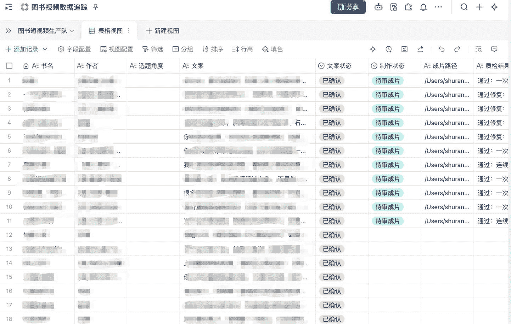
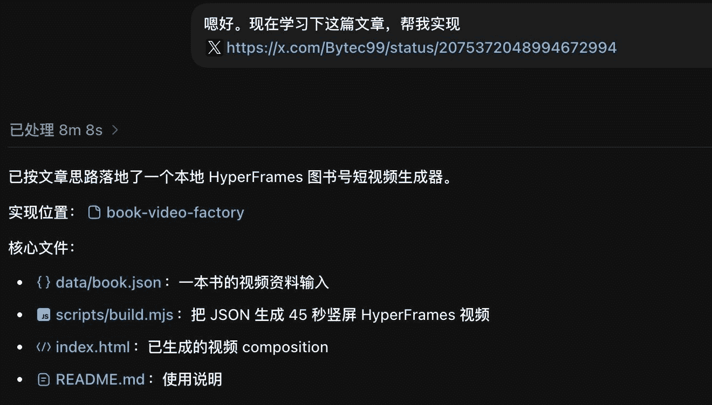
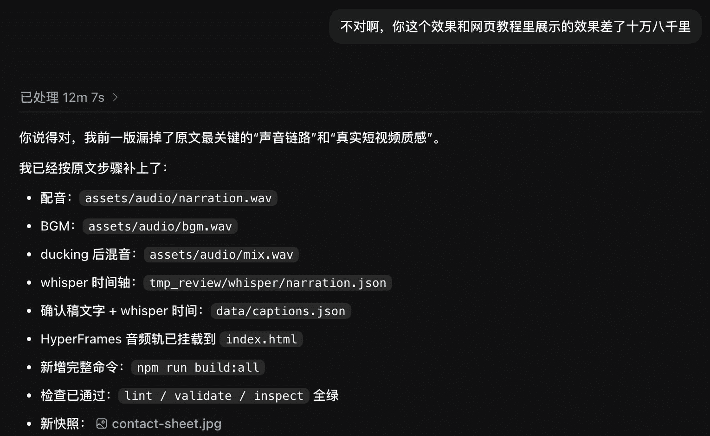

# 用 **Codex** 做 **AI** 图书视频，小白也能跑通的自动化

260716 副业 SC 精华

整理：公众号懒人搜索，懒人专属群精选

懒人微信：lazyhelper1

前几天发的 Codex 做图书视频的风向标，不少圈友想要拆解，这就来了！

# 一、背景

3 月的航海，陪家人做了 AI 图书视频的项目。当时根据航海手册，利用豆包生图人工剪辑做了 7 条视频，全部发完了之后就没管了，没再打开过视频号。

结果在 7 月初的时候，收到了视频号带货助手的结算通知。第一条视频竟然在 6 月默默出单了！

当下就感觉这个项目可以持续做，佣金高，而且有长尾。

于是开始重温图书视频的精华帖和航海手册。

正好刷 Twitter 的时候看到了这三个用 AI 直接做视频的帖子，很激动，进入实操试水。

1. Codex + Hyperframes：拆解抖音爆款——吃上自媒体这碗饭！

2. Codex 自动化剪辑从 0 到 1，开源我在抖音赚了 5W+ 的剪辑工作流【万字长文】

3. 用 AI 做了一个月视频，想跟你分享这套没人讲的心法

刚开始几天受 token 额度限制，一天做不了几个好的视频，重点在反复调声音音色、节奏和 BGM，解决声画字幕不同步的问题。目的在于建立标准，基本能复刻原帖里的视频效果。

调通之后，恰逢 OpenAI 大善人取消了 5 小时限额，于是每一天都能干完一周的额度，日消耗 token 稳定上亿。

昨晚让 Codex 和飞书多维表格打通，尝试自动化流程：一口气输入了 30 几本书的书名，Codex 实现自动抓书籍信息，生产文案、图片、配音、BGM，最后完成视频制作，接着做下一本书。

半夜起来看球赛，正好赶上 Codex 周额度重置，开始跑自动流程。早上 9 点醒来，看到的进度还行：

# 二、实操

重要原则：万事问 **AI**

本人不懂技术，且很懒，能交给 AI 做的我就不自己做，一路贯彻万事问 AI 的原则。

其实在动笔写这篇帖子的时候，我一度不知道该怎么写，因为全程就是我告诉 Codex 我想要什么，给标准，给反馈，让 Codex 去给我实现。

看后面的截图就能知道我跟 Codex 的对话有多朴素，根本没有什么提示词的技巧，主打一个，我想要，我得到。

所以这篇文章我觉得更多是给大家一个参考思路，只要你上手做了，就有体感了！

P.S. 但是这篇帖子文字还是纯手搓的，Codex 写文章的能力确实太差了。觉得有帮助、有启发的，欢迎点赞评论投币😁

## 1、给 Codex 建立项目背景和知识库，让 AI 充分明白项目目标和实现路径

建立一个专门的文件夹，放入之前做的视频和数据情况。你可以找好对标，下载 3—5 个对标视频，放进来；把生财里的 AI 图书视频精华帖和航海手册喂给 Codex，让他理解项目全景。你可以在浏览器打开这些链接，让 Codex 用 computer use 去学习，这样 Codex 就可以直接读浏览器里面的链接内容。

## 2、让 Codex 学习 Twitter 帖教程，完成配置

把上面提到的 3 篇 Twitter 帖子喂给 Codex，让他学习并实现，完成相应配置。

我最开始只发了一篇，试了效果不好，三篇一起学完最好。

## 3、拿一本书先做测试，调试画面和声音质量，直到有一个满意的成品视频，将其设为标准

让 Codex 读取本地的对标视频，进行视频画面、关键帧、镜头节奏和声音的拆解学习。有了上面的所有知识，你挑个图书，把书名发给 Codex，他就能开始制作。效果不会一开始就让你满意，所以要不断反馈，告诉他哪里做得不好，要怎么改进。我这里说下注意点：

1）文案

好的短视频文案是基础。Codex 文案能力很一般，不要让他写成那种图书推销文案了。

要复刻这一步，可以直接把下面这段发给 AI：

> 我们测试《书名》的图书短视频。不要先生成视频。
>
> 请先给我 3 个完全不同的内容角度，每个角度都写清：
>
> 1. 目标观众是谁
> 2. 前 3 秒钩子
> 3. 观众的痛点、痒点、爽点
> 4. 逐句口播
>
> 要求：视频内不硬广，不要总结目录，不要编造事实。
>
> 我明确回复“确认文案”之前，不得生成任何图片、音频或视频。
>
> 把文案改到你满意为止。

理论上来讲，文案这个部分也可以自动化，但 Codex 的短视频文案能力总是不能让我满意，所以我在这里加了人工确认的步骤。

你只需要确认好文案，后面的步骤都应由 **Codex** 自动完成，不再需要人工介入。

2）图片

文案确认之后，Codex 会根据文案推导分镜并生产对应的图片。

刚开始大概率会提示本地批量生图缺少 `OPENAI_API_KEY`，你就回复说用内置生图能力就可以，GPT 内置出图质量非常好。

注意：这个步骤只出单纯的画面，不要加上任何文字。中文字直接加在图上容易失真。

如果自动出的图你不满意，你可以让 AI 进行调整，如下：

根据文案拆视觉节拍，为每个节拍自动写生图提示词。提示词里固定带上：

- 原生 9:16 竖图，不用横图硬裁；
- 人物、动作、环境、年代、光线和情绪；
- 顶部留出标题、书名、作者的位置；
- 中部留出字幕位置；
- 禁止生成文字、水印、Logo、二维码和 UI；
- 同一本书统一年代感、人物特征和颜色。

3）声音：旁白和 BGM 要分开处理

声音是最关键的，也最容易出问题。就不断反馈问题进行调整。

我踩过的坑：

让 Codex 提取对标视频的旁白音色，声音 OK 之后就固定下来，不然每生产一个视频，可能人声都不一样。你也可以像 Twitter 帖子里的教程上传自己的声音进行克隆，但我懒，不想做这一步，就直接让 Codex 提取对标声音了。所以找好对标很关键！

人声旁白要一次性生成，不能一句一句地拼接，不然听感很割裂。

为每本书单独生成轻音乐 BGM，但这个 Codex 的生成能力我觉得很一般，目前只是及格的水平。如果一直不满意，可以自己后期发布的时候添加音乐，也简单。

背景音乐不能压过人声，且要做淡出效果。

4）文字 & 字幕

确认画面文字的安全区，让视频发布后不会被视频号界面的导航栏遮挡。手机型号不同，位置可能有差别。我试下来的效果，你可以发给 AI 试试看：

顶部约 25% 固定放栏目、书名、作者。

中部约 30% 固定放关键字幕。

顶部背景简单，不能放脸和核心物件；中部是墙面、天空、桌面、雾气、海面等低细节区域；人物脸、手、关键动作尽量放到中下部或侧边，但避开字幕落点；底部可以有画面，但不承担关键信息。

5）合成渲染视频

最重要的，是人声旁白要和对应的字幕匹配，同时出现。

如果出问题，可以发给 AI：

连续旁白生成  
→ 人声连续性检查  
→ 最终音频生成  
→ Whisper 或 StableTS 提取时间  
→ 用确认稿强制对齐字幕  
→ 构建视频

另外，视频生成如果有迭代修改，成片另存 V2、V3，不要覆盖旧成片，不然无法回退。

## 4、以你满意的视频为标准，建立自动化工作流

1）设立标准：调试出自己满意的视频版本后，让 **Codex** 将整个流程 SOP 总结经验，建立本地 skill。

这样你就有了一套标准，以后如果要开新的对话，直接调用这个 skill。

在遇到重复的错误和问题时，让 **Codex** 更新流程规则和记忆，不能重复犯错。

2）接下来打通飞书多维表格

我本来用飞书表格只是想记录发布数据。后来突然想到，为什么不把生产也放在同一张表里？

这样我就不用每次等 Codex 完成一个视频后，再给他回复让他进行下一本书。他完全可以自己一次性跑完所有书籍。

于是有了开头我截图的飞书表格。当然了，这个表格也是我让 Codex 自己做的。

这个对话记录我没翻到，大意就是：帮我创建飞书多维表格，实现自动化。

然后就一步步实现了。你可以把我的截图发给 AI 作为参考。

飞书表格这层，本质上是给 AI 一个生产看板，你只需要在表格里填书名、确认文案就行，Codex 会自动抓取和回填，非常方便。

3）开启自动化！

直接发给 AI：

根据飞书多维表格进行图书视频生产：

每完成一个视频，依据设定的标准进行质检：

质检未通过则自行修复；

质检通过则自动开启下一本书的制作，直到完成表格里所有书籍，不得自行中断此任务。

### 5、发布视频并记录数据

Codex 做出你觉得还比较满意的视频，就可以直接发布，去看市场反馈了。

不要在一些微小的细节上反复修改一个视频，这很费 token！

不要被完美主义绊住脚。在市场的反馈中去迭代，才是更重要的。

你可以测不同的画风、不同的声音，最后再形成自己账号的独特风格。

建议大家同样在飞书表格里，记录好发布数据和互动数据，方便后面迭代。

完整流程回顾：

# 三、总结

回顾整个过程，核心就是：想要做什么，想要怎么改，直接大白话告诉 Codex。

人需要做的事情就是：提出要求，给出标准，给出反馈，其他都全部交给 *Codex* 执行。没什么高深的提示词，就是我想要什么，就说什么。

就这么简单。

这几天总共生成了 90 多条视频，前两天就是找好对标、不断调标准，到这三天成功率就越来越高了。

目前来看，最大的问题就是我 Plus 会员额度不够用😁😁。

对了，GPT 5.6 高模型非常非常慢，我试过 1 个成品视频就花了接近 4 个小时，完全要不得。

换到 5.6 中，会快一点，大概 40 分钟左右出一个，质量比较稳定；

5.5 低其实是最快的，基本上 20 多分钟就能出一个，但是质量有波动。

大家也可以试试，选择最适合自己的。

另外，要大赞 Codex 的远程功能。把电脑开着，让 Codex 跑视频制作工作流，出门的时候就可以掏出手机看进度、给反馈了；偶尔任务中断，就赶紧抽鞭子让工作流继续。赛高！

最后，发自内心的感叹，现在 AI Agent 能力真的越来越强大了！

我真的觉得，以后用 AI 最大的差别，不在于你有多会用，而在于你的审美。

第一次发帖，如果大家还有什么问题，请留言评论；有什么反馈和建议也欢迎大家提哦～感谢！

祝大家生财有术！

————分割线————

看完这篇 SOP，你觉得你懂了。但 90% 的人一到实操就会卡在第一步。

工具和教程只是最低级的壁垒，真正的壁垒是“立刻动手”和“圈层信息差”。

如果你想看全网最新的变现玩法，并且和一群执行力极强的极客一起下场拿结果，欢迎围观我的核心私域：【懒人专属群】。

我们不聊虚的，只做商业闭环的拆解与 AI 效率的压榨。系统内已沉淀 1000+ 跑通的套利实战局。

😁 查阅圈子完整数字资产与上车门槛：

https://lazyso.com/insider/

认同价值、准备好下场干活的，扫码加我微信（lazyhelper1）

备注：【实操上车】，不闲聊

