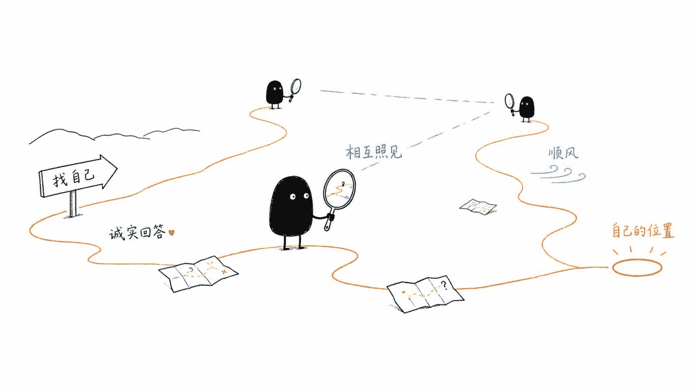

公众号懒人搜索，懒人专属群分享

**2** 年做到 **4000w** 营收后裸辞，踩 **5** 个创业方向才找到自己的路

260717 副业SC 精华

整理：公众号懒人搜索，懒人专属群精选

懒人微信：lazyhelper1

大家好，我是小鹿🦌，前教育厂增长负责人，2 年从0-4000w 营收；现在AI 企业服务创业中，带着两🦌全国旅居，目前在无锡。

ENTJ、巨蟹座、乙木日主，放一些标签方便大家快速了解我的某些特质，也有助于下面的阅读体验hh。

这个背景让我一度以为，离开平台我照样能快速复制成功。但现实给了我一个沉痛的教训，也让我看到了真相。

去年3 月底，我裸辞离开奋斗5 年的职场，带着永不回头的信念，开始了人生新旅程的探索。

为什么我想写这篇文章，因为我们在生财 **99.9%** 看到的都是成功经验分享，但成功背后的失败和成功之前的漫长等待是我们没看到的，而这部分恰恰可能是最终成功的原因。

所以我想把我的经历剖开给大家看，给新进生财的人一些心理预期，给还没达到自己“成功预期”的人一些样本和鼓励（因为看到别人也没成功，你自己是不是就会释然一些了hhh）。

我以为离开职场后，我立马就能靠自己赚到超过薪资几倍的钱；选项目可以一击即中，找到能力匹配、天花板高的项目；时间和精力完全自由，只要想做，就有结果。

但现实是：

- 长期缺乏正反馈带来的自我怀疑和迷茫
- 精神松绑之后的精力分散和浅尝辄止
- 没有稳定收入带来对金钱的匮乏
- 平台与个人能力边界的混淆与拆分
- 反复0-1 过程的耐心与自信消耗

上面任何一条，都足以让一个脱离平台的前职场人，陷入长达数月的内耗。我全中了🦌。但今天我想分享的，不是如何避开这些坑，而是如何把这些“坑”变成认识自己、重组自己的“地图”。

过去一年我最大的疑惑就是：我有能力、有经验积累、有赚钱欲望，但为什么赚不到大钱？

直到最近，我转型做AI 企业服务，我似乎有了答案：

创业就是找自己，看见自己的ego、在实战中觉察、在转向中补全自己，就能感受到“命运的推背感”。

而在创业路上找到自己，随之就会获得金钱的奖励。

离职的一年里，我都看到了哪些自己

下面这些项目，表面上看是我这一年做过/暂停过/失败过的一些尝试，但现在回头看，它们更像是一张“找自己”的地图。每一个项目都帮我看清了一个自己：有些是能力，有些是执念，有些是平台给我的幻觉，有些是我真正的能量来源。

## AI web 出海

认知标签【照见我的“反馈周期”耐受度】——它让我看见，个体创业不是只靠努力硬熬，反馈周期是否匹配，直接决定了一个人能不能坚持下去。

- **为什么选择**

缘起是我在离职前报名了那期web 网站开发的航海，这里又要重点感谢我那期的志愿者Penny！没有她就没有我的今天（不是...），本来因为离职交接/跨城搬家打算放弃这期航海了，但是在Penny 的鼓励下，我不仅完成了打卡，还上线了两个网站，第二个网站刚上线就有了自然流量，又因此在靠岸仪式上作为优秀学员分享经验。

所以🦌🦌

快速上手AI + 把脑洞大开的想法变成产品 + 及时的正反馈 = 垂直入坑。

而我原本所有的准备都是为了去义乌做跨境电商做的，但在出发前几天我突然把目的地换成了大理，放弃了原本的计划，我这个大J 人从来没有做出如此大逆不道的事情过，现在想来可能那是第一次遵从心意做决定。

- **项目经历和结果**

AI 产品开发是我这一年里做的最久的一件事，web 出海、小程序、小产品创造，前前后后一共做了15 个成功上线的产品（还有3 个半路夭折的）。从全凭兴趣/反复打磨/上线没流量，到需求挖掘/mvp 快速验证/赚到第一笔美金，我经历了大概半年的漫长等待。

AI 产品开发我属于尝到甜头很快，但真正开始有金钱的正反馈却又是在经历很多坎坷之后，而且是对金钱不再有抓取感之后（大概是因为释放掉了对金钱的匮乏感？）。

- **我的部分脑洞产品展示**
  - t 人f 人沟通翻译器，https://www.tffanyi.online/，为tf 人沟通架起一座跨海大桥!
  - 小程序 - "屎上最强姐妹"，可以记录带薪拉屎摸鱼所得，日常排便情况，邀请姐妹上线同拉
  - 技能五子棋，https://skill-gomoku.world/，传统的五子棋好无趣好无聊，而技能五子棋...!
  - 小程序 - 她们的圆桌，跨时空和先贤优秀女性对话，从先贤身上汲取力量与智慧
  - 小程序 - 牛马划水日常，下班倒计时/午饭大转盘/养生小动作/怨气释放器...多个摸鱼功能，助你无痛上班

- **过程中感受**

零基础转行做产品，还是做海外产品，现在复盘来看我觉得初期还是很难的，可能会有很长的一个阶段，没有正反馈、不知道方向是否正确、一直在努力做事但不知道什么时候会有回应。

还会时不时看到生财的成功经验分享和群内出单报喜，这些信息在状态平稳时是经验和信心，但在焦虑内耗时会变成瓦解信心的一把尖刀。

## 小红书博主

认知标签【剥离表达幻觉】——它让我看清，表达欲不等于内容能力，想说话也不等于适合做一个持续输出型博主。

- **为什么选择**

有个好朋友在做全职自媒体博主，数据和收入比较稳定了，她也一直觉得我非常适合，再加上刚离职那段时间很有表达欲，离职旅居+自由职业又很有话题度，又觉得花不了多少精力（大错特错！）。

这其实是一种“能力幻觉”，让我误把朋友的评价和自身的表达欲，当成了可以商业化的内容能力。

- **项目经历和结果**

坚持输出内容失败❌，做垂直博主失败❌，靠内容涨粉变现失败❌。

真正涨粉和变现其实是靠上面提到的AI 产品内容，实际我自己做ip 产出的内容并没有带来什么增长。

- **过程中感受**

如果不保持对生活的敏锐感受和持续输入，那么做持续输出这件事是很难的，我又是一个不擅长写作和分析内容的人...

而且只要做了账号，就不可能不数据焦虑🦌！

这个尝试让我彻底明白，有些路，即使看起来光鲜，如果不符合我的底层特质（如不喜欢模仿、情绪感知弱），那它就不是我的路。学会'放弃'不适合的选项，和找到适合的选项同等重要。

## 摆摊儿/做文创

认知标签【破除“兴趣变现”的执念】——它让我确认，有些喜欢只适合用来滋养自己，不一定要被做成事业，也不一定要背负赚钱目标。

- **为什么选择**

纯纯兴趣，因为北京不让摆摊儿，所以我觉得摆摊儿意味着自由，又能创造自己想创造的东西出来卖，那就是双重自由！

- **项目经历和结果**

库库做了一些原创冰箱贴、云南非遗甲马、沉香手串，只在大理洱海边摆过1 次、徐州市集摆过2 次，后面很多都在不同场合送朋友了（还送了好几个生财的朋友），要说创作成本应该有1000 左右吧，当然是没回本的。

- **过程中感受**

我很享受创作的过程，很容易进入心流状态，作品做出来之后没咋卖出去虽然会失落一下，不过倒不会影响我的创作热情，这次尝试其实并没有把它当作创业的一部分，更像是体验兴趣生活吧，虽然亏了钱（也没多少），但收获了一些对自己的认知。

- **看到了哪些我**
  - 兴趣广泛到上山下海都想试试，那就挨个体验吧，三分钟热度也有三分钟的收获
  - 但是因兴趣而生的点子，可能不适合我作为创业方向，因为无法判定这个兴趣能维持多久
  - 想某个兴趣上头的时候就必须要尽快做，不然就会抓心挠肝
  - 可以做，但不会再设定目标了，只要体验过程就好了

## 投放代运营

认知标签【剥离平台光环】——它让我看清，职场里的能力不一定能无损迁移到个体创业里，平台资源、团队支持、品牌背书，曾经都是我能力的一部分。

- **为什么选择**

我的职场经历一直是在做增长获客和投放，所以在大理认识的朋友向我发出了邀请，我当时又处在社交需求期，很想和她们更亲近，所以就满心欢喜地答应了。

- **项目经历和结果**

给朋友做投放和给公司做投放的责任感不太一样，给朋友做会更克制、责任感更重；一个非标且没品牌效应的新品在冷启动期间又是见效很慢的，所以花朋友的钱做投放压力就巨大；而且第一次合伙碍于朋友关系，又没提前说清利益分配。

这些对我已经产生了一些内耗和困扰，所以在做了一个月之后，我就主动叫停了。

- **过程中感受**

在合作前我特别向往能遇到一群志同道合的人，做一件可能很慢但有意义的事情，所以用力靠近她们，但她们已经形成的那种默契会让我觉得有层看不见的墙；而且这个事业是她们的，不是我的，所以我还是要去寻找属于我的事业。

- **看到了哪些我**
  - 投放是我做了5 年且擅长的事情，但并不是我喜欢的事情
  - 在职场考虑的是职业发展，是能力图谱，但在有选择之后，这件事不再是我的优选了
  - 我意识到，我擅长的投放能力，严重依赖平台预算、品牌效应和团队协同。当这些外部条件消失，它带来的心理负担远大于创造乐趣
  - 我在定目标/设预期的时候更理想化，会过度高估自己的精力和能力，会把过程预设得太顺利
  - 给别人过高预期就只能无限压榨自己，给自己过高预期又会带来失落和焦虑
  - 我再次确认，我需要的是“我的事业”，而不是“参与别人的事业”。哪怕后者看起来更安全、启动更快

## 小红书虚拟

认知标签【看见创造者】——它让我终于确认，我真正喜欢的是创造和解决问题，而不是长期重复的经营游戏。

- **为什么选择**

在web 出海的复盘之后发现：相比国外我更了解国内市场，在小红书售卖商品又有全流程的过程数据可以监控和复盘，无论是正向数据还是负向数据，都可以及时有反馈；相比于解决海外市场的问题，我更喜欢解决国人的问题，而且和用户有及时交互，会让我更能感受到意义。

- **项目经历和结果**

这个项目其实只做了一个月多点，但是实打实赚到了钱，做的第一个产品上架4 天出单，第二个产品上架10 分钟出单；目前小红书店铺号已经不在运行了，但是之前铺的搜索占位内容还在持续出单，给我带来了持续的被动收入。

我也完整跑通了用AI 从做产品到内容和运营的全路径，摸索出一套小红书新品怎么从需求验证到快速出单的流程。

- **过程中感受**

做产品和看到用户及时反馈的过程是我很喜欢的，但小红书运营的琐碎事做起来是真痛苦！这个也和线下的好几个做小红书的朋友都聊过，大家都说痛苦哈哈哈，就看痛苦程度是否在自己可忍受范围内，当然目前的结果是我忍不了🦌。

- **看到了哪些我**
  - 再次印证了我对于简单重复的流程的耐受度很低，而且它真的会消磨我的热情
  - 所以这是我之后都需要重点躲避的方向，当然它是有解决方案的（AI 自动化/兼职外包/合作分工）
  - 我真正喜欢的是创造和解决问题，从无到有创造，而不是经营
  - 我终于发现，我所有的兴趣和能坚持做的事情，都是围绕创造，持续地创造、多样的创造、没有边界的创造

这个项目像一面镜子，既照出了我“创造产品、验证需求”的兴奋点，也放大了我“厌恶重复运营”的痛点。它让我无比清晰地看到：我的天赋和热情在“从 0 到 1 的创造与破局”，而不是“从 1 到 100 的经营与维护”。

## 过去一年，我给自己画的“创业自画像”

所以这一年看起来我做了很多杂七杂八的项目，但它们最后并没有哪一步路是白走的，反而帮我慢慢拼出了一张更清晰的自画像。

我开始知道自己不是不能吃苦，是不能在没有意义和反馈的重复里长期硬耗；不是没有能力，是要分清哪些能力是真的长在我身上，哪些能力曾经来自平台；怎么发挥我的长板优势，怎么找到用我的长板打别人短板的领域。

| 维度 | 内容 |
| :--- | :--- |
| 我的角色定位 | 创造者、开荒者、问题定义者，而不是长期重复经营者 |
| 我需要补位的人 | 经营者、执行者、稳定推进的人，注重细节的人 |
| 我的能量来源 | 创造（从 0 到 1）、解决问题、即时反馈 |
| 我的能量黑洞 | 重复动作、漫长等待、意义感缺失 |
| 我的能力内核（带走的东西） | 需求洞察、产品化思维、系统搭建能力 |
| 我的能力假象（平台给的） | 大规模投放预算、成熟品牌背书、完整团队支持 |
| 我的决策偏好 | 兴趣驱动、厌恶模仿、需要意义感 |
| 我的决策陷阱 | 过度理想化、高估精力、为关系妥协 |
| 我与金钱的关系 | 平等且开放，欢迎一切的金钱流动，金钱成为验证和反馈的工具，而非抓取的目标 |
| 我的天命方向 | 用AI + 产品化能力，帮真实业务解决真实问题，在持续创造中把经验变成价值 |

方向对了之后，从我推项目到项目推我

每一次尝试和转向的过程，我都更认识自己、更了解自己了，每一天我都比前一天更懂自己，也更勇敢、更智慧。

新的方向每次都会从旧方向中生长出来，它会更靠近主干、更粗壮。这也是我一直坚信，为什么我选择创业之后永远都不会再回到职场，因为我相信我永远都不会无路可走。

以上所有的一切，把我推到了现在的AI 企业服务。

为什么是AI 企服？

- 我在职场积累了一些b 端资源供我做冷启动，我能轻松拿到一些合作做案例并解决前期客户获取问题
  
  解决了“能量黑洞”中的“漫长等待”和“意义感缺失”（快速有案例，直接创造价值）
- 我对业务和项目有足够的理解和深度的经历，能够快速get 新企业新业务，帮企业梳理业务流程、达成目标
  
  完美匹配“角色定位：问题定义者”和“能力内核：系统搭建”
- 我有AI 实战经验和AI 应用能力，能灵活结合AI 和企业卡点，提供高效/轻量的AI 解决方案
  
  满足“能量来源：创造、解决问题”，同时用技术规避“能量黑洞：重复动作”
- 它一直在创造、不断地解决新问题，创造新的工具、AI 与人的协作方式、新的认知和能力，解决企业问题、低效问题、业务增长问题
  
  直指决策偏好：兴趣驱动、需要意义感，让我持续有热情和创造力

这些对我来说，既充满吸引力和想象力，又是我能力的舒适区，同时不断在更新我自己。

我从5.29 确定开始做，到现在一个半月左右的时间，项目进度飞快，目前已经承接了两个企业订单、找到了资源合伙人、初步跑通了mvp。

一种顺风的推背感，是我在做之前所有项目的时候都没有过的，项目进展超出我的预期，而且合适的人或事都会在我预期前出现，给到我资源/启发/认可...

这听起来很玄幻，但很合理，在我足够了解自己、破除了旧我的执着和迷惘之后，我走到了一个新的阶段，时机到了，我也具备了匹配的能力。

如果你也在找方向，这里有5 个可以直接照抄的方法

## 1. 从“有用”到“有感”：重建你的决策罗盘

这个方法，是我从小红书博主、投放代运营和AI 产品开发里反复撞出来的。

离职后我最大的变化之一，是我的表达里出现了更多的“我喜欢”和“我不喜欢”。

以前在职场里，我很少这样判断一件事，更多时候我会想：这件事有没有用？能不能带来增长？是不是对职业发展有帮助？老板会不会认可？它是不是一个更优解？

但离开职场之后，我发现“喜欢/不喜欢”其实是很重要的信号。

你不喜欢的事情，可能不是你不够努力，是它真的在消耗你。

你喜欢的事情，也不一定立马能赚钱，但它会让你更愿意投入、更愿意重复、更愿意在失败之后再试一次。

所以如果你也在找方向，可以先不用急着问“这个能不能赚大钱”。

先问自己：

- 我做这件事的时候，是更有能量，还是更枯竭？
- 做这件事让我念头更多更迷茫，还是很容易进入心流？
- 我是在被目标推着走，还是被好奇心牵着走？
- 我是在证明自己，还是在成为自己？

很多时候，真正适合你的方向，不是你算出来的，是你一次次诚实地说出“我喜欢”和“我不喜欢”之后，慢慢长出来的。

**行动建议：**

如果你现在回答不出这些问题，可以从今天开始，找一个你正在做的小项目，每天花5 分钟记录一份“能量日志”：

- 哪个环节让你兴奋，标记一个 +
- 哪个环节让你想逃避，标记一个 -
- 哪个环节让你很平静但能持续做，也单独记下来

坚持两周，你对于自己的了解可能会增强很多。

## 2. 创造先于抓取：让钱成为价值的回声

这个判断，来自我这一年做的15 个AI 产品，也来自摆摊儿和小红书虚拟产品。

我这一年很深的一个体感是：当我越想抓钱的时候，钱越不来；当我开始专注创造的时候，钱反而来了。

公众号懒人搜索，懒人专属群分享 

当然，这不是说不要赚钱，我非常想赚钱，而且我也觉得赚钱很重要。 

但我以前对钱有很强的抓取感，会希望一个项目一开始就证明自己“值得”，一开始就有结果。结果就是，一旦没有正反馈，我就会开始怀疑方向、怀疑自己、怀疑人生。 

后来我发现，我真正能持续做下去的事情，底层都是创造。 

做一个产品，是创造；帮企业梳理一个流程，是创造；把一个模糊的问题变成一个可执行的方案，也是创造；甚至把自己这一年的混乱复盘成一篇文章，也是在创造。 

钱不是不重要，但钱更像是创造之后的回声。 

你先创造出一个东西，创造出一个价值，创造出一个别人愿意为之停留/使用/付费/合作的理由，钱才有地方落下来。 

先让世界看见你创造了什么，很多机会才会开始发生。 

**行动建议：** 

如果你现在不知道该创造什么，可以从一个最小交付开始： 

- 一个你能讲清楚的问题 
- 一个你能做出来的小工具 
- 一篇你能写明白的复盘 
- 一个你能帮别人省时间的模板 
- 一个你能给具体对象看的方案 

标准不是“它够不够完美”，而是“它能不能被别人使用、理解、反馈”。 

先用 3 天做出一个最小版本，发给 3 个真实的人看，问他们三个问题： 

- 你看懂它解决什么问题了吗？ 
- 你会在什么场景下用它？ 
- 你愿意为它付出什么，钱、时间、转发、还是一次深入交流？ 

### 3 你的方向，藏在旧经验的“重组”里 

AI 企业服务不是我一开始就想好的答案，而是从前面几个项目里慢慢长出来的。 

我以前会觉得，创业就是一把就能找到对的方向，最好是天花板高、增长快、趋势大、听起来很性感的。 

但现在回头看，我更相信：更适合自己的创业方向，大概率不是凭空冒出来的，而是你过去的经验 + 你擅长的能力 + 你真正喜欢的状态，重新组合出来的。 

我现在做 AI 企业服务，其实不是突然从天而降的方向。 

它里面有我过去 5 年做增长/投放/获客的经验，有我对业务/项目/流程的理解，有我这 一年用 AI 做产品/做工具/做 MVP 的实战，也有我越来越确认的那个喜欢：我喜欢创造，喜欢解决问题，喜欢从 0 到 1 把一个东西搭出来。 

所以它不是一个“全新选择”，而是旧经验里长出来的新枝条。 

很多人一离职就想彻底推翻过去的自己，我现在觉得，没必要，职场不是白干的。 

你吃过的苦、做过的项目、踩过的坑、拿过的结果，都会变成你之后创业的土壤。 

只是你不一定要继续用过去那种方式工作了。 

你可以把过去的能力拆开，重新组装成一个更适合自己的形状。 

**行动建议：** 

你也可以拿一张纸，把自己过去的经历拆成三列： 

- 第一列：我真正做出过结果的事 
- 第二列：我做这件事时用到的核心能力 
- 第三列：这些能力离开平台后，还能不能单独成立 

很多新的创业方向，不是从“我想做什么”开始的，而是从“我已经掌握了什么”开始的。 

### 4 线下见人：破解内耗的终极心法 

这一点不是单独的社交建议，而是贯穿了我前面很多转向。 

这一点我最近体感也很强：一定要来线下，一定要和大家同行。 

很多东西你一个人在家里想，是想不出来的。 

你会困在自己的脑子里，反复琢磨自己是不是不够好、方向是不是不对；别人是不是都已经赚钱了、只有我还在原地打转。 

但当你去线下，去见真实的人，去听别人怎么做项目、怎么拿结果、怎么穿越黑暗期，你会发现很多事情和你想象的不一样。 

原来别人也是这样一步步试出来的。 

原来很多看起来很厉害的人，也有很长一段时间没有结果。 

原来你以为自己独有的困惑，其实大家都经历过。 

线下最大的价值，不只是信息差，而是能量差。 

有些人会给你信心，有些人会给你资源，有些人会给你一个新的视角，有些人甚至只是坐在你旁边认真听你说完一段话，你就突然知道下一步该怎么走了。 

创业太容易变成一个人的内耗了，所以不要一个人硬扛。 

要去真实的人群里，看到别人的生命力，然后和 ta 们交换能量、产生碰撞。 

**行动建议：** 

如果你还不知道怎么开始，生财的线下龙珠局、航海见面会，甚至只是约一个同城圈友喝杯咖啡，都是很低成本的起点。 

从开始参加线下局，到开始自己组局，在这个过程中可能会有无数意想不到的收获。 

先让自己从一个人的内耗里走出来，完成一次真实的能量交换。 

### 5 识别“顺风感”：当项目开始推着你走 

这是开始做 AI 企服后给我最强烈的一个感受。 

我以前做很多项目的时候，都有一种很明显的用力感。 

我要推着自己做，推着自己发内容/发外链/运营店铺。 

但现在做 AI 企业服务，我第一次有一种很明显的感觉：好像不是我一直在推项目，而是项目也在推着我往前走。 

合适的人会出现，新的机会会出现，客户的问题会把我推到下一步，每一次交付又会让我更清楚自己要补什么能力。 

当一件事同时符合你的经验/能力/兴趣/资源和市场需求，它就会比之前那些硬拧出来的方向顺很多。 

**行动建议：** 

你可以用这 5 个问题判断一件事是不是“顺风”： 

- 这件事有没有用上我过去真实积累过的能力？ 
- 我做它的时候，是更兴奋还是更枯竭？ 
- 它有没有真实市场需求，而不是只有我自己感动？ 
- 它能不能让我持续创造，而不是长期消耗在重复动作里？ 
- 它有没有把合适的人、资源、机会带到我的身边？ 

如果这 5 个问题里有 3 个以上都是“是”，它可能就不是一个凭空冒出来的机会，而是旧经验长出来的新方向。 

### 我们的故事才刚刚开始 

这就是我这一年想分享的事情： 

创业不是一条直线，也不是一个项目成败的结果，它更像是一条寻找自己的路。 

你越认识自己，越知道自己不适合什么，越诚实面对自己的喜欢和恐惧，越能找到真正适合自己的位置。 

而赚钱，可能就是你终于走到那个位置之后，世界给你的奖赏。 

写下这些，并不是因为我已成功，而是因为我正走在那条“对”的路上，第一次感受到了“顺风”的推背感。这条路的起点，不是某个完美的项目，而是对自己一次又一次诚实的回答。 

如果你也正在迷茫中打转，希望我的这份“找自己”地图，能给你一个坐标。创业这条路，我们都不是在孤独地寻找项目，而是在人群中，相互照见，然后找到自己。 

如果你也有类似的经历或不同的感悟，欢迎在评论区一起聊聊。说不定在彼此的故事里，就生长出了下一个方向。 

————分割线———— 

看完这篇 SOP，你觉得你懂了。但 90% 的人一到实操就会卡在第一步。 

工具和教程只是最低级的壁垒，真正的壁垒是“立刻动手”和“圈层信息差”。 

如果你想看全网最新的变现玩法，并且和一群执行力极强的极客一起下场拿结果，欢迎围观我的核心私域：【懒人专属群】。 

我们不聊虚的，只做商业闭环的拆解与 AI 效率的压榨。系统内已沉淀 1000+ 跑通的套利实战局。 

🦌 查阅圈子完整数字资产与上车门槛： 

https://lazyso.com/insider/ 

认同价值、准备好下场干活的，扫码加我微信（lazyhelper1） 

备注：【实操上车】，不闲聊 

