公众号懒人搜索，懒人专属群分享

做**B**站好物跑通**0-1**后，从选品**-**制作**-**发布，我把**AI**接入到了每个环节，让所有的数据资产化。

260716 副业SC 精华

整理：公众号懒人搜索，懒人专属群精选

懒人微信：lazyhelper1

## 自我介绍

大家好，我是拿铁，前UI设计师，目前自由职业创业，B站好物深海圈二期学员、志愿者。借着618大促，目前已经跑通0-1，但是由于产能有限，没有获得特别大的结果，目前处于提效放大阶段。

我对于B站好物这个项目的理解，本质也是CPS+内容项目，所以也是一个需要用数量去对抗概率的项目。想要放大，就必须要提效或者矩阵化的运营。经过这段时间的学习和交流，发现取得比较大结果的圈友教练基本都是这两种情况。这也让我萌生了用AI提效的想法，这里感谢一下Lynn、葱哥以及书野，我的思路很多都是受这两位影响。

最开始我做一条视频可能需要一个月，后来熟练以后也需要一两周。目前当我将各个环节都接入AI后，我整体的基本情况可以做到稳定一周一条，还不是全天工作的状态，基本就每天花半天左右的时间在工作上，后期还能更快。


**你能直接拿走的内容：**

- 多个Skill（项目归档、参数采集、选品规则、素材整理……）
- 用知识库调教AI生成内容的思路
- 本地可用的PPT批量套版工具（附带PPT图片转HTML文件生成Skill，PPT制作规范Skill）
- 用自然语言剪辑A-roll思路
- 发布前的物料准备提示词（标题、简介、标签）

## 适合谁看

本次分享主要是分享一下我作为一个AI小白，深度使用AI一个月，在这个项目实操过程中对于AI的一些使用情况，以及我的使用思路（附带提示词）。

适合对于Agent使用还比较少，还没有在自己业务环节里使用AI，对于自己做Skill或者Agent不知道怎么做的小伙伴观看。我现在使用比较多的就是Codex，或者CC外接国产的大模型。我把AI当成一个项目助手来使用，让它帮我进行一些自动化的重复操作，从而把更多的精力花在决策上面。

目前我的**AI**主要帮我做三件事情：

1. 帮我做一些重复性的劳动
2. 帮我把一些信息进行整理，变成我可以去使用的资产
3. 把我每一次过程中的内容沉淀下来，作为我下一次可以复用的数据资产

分享主要以**Codex**为主，提示词投喂给各种**Agent**都可以。

本次文章的重点，主要还是分享我在做项目过程中使用AI的思路。

> 目前所有的Skill都是基础版，需要结合自己的真实使用场景进行迭代。

希望大家可以通过这种思路，去生成更多Skill来提效。

**以下是本次分享的大纲：**

1. 项目规划助手（AI亦仁+你的AI）
2. 建立项目文件
3. 内容提取+改写（对口述稿以及参考文案进行改写，同步生成蓝链文案，本地知识库或飞书知识库）
4. 获取产品参数
5. 制作PPT+参数批量替换（GPT生成模版➡模版调整➡模版转化为HTML➡批量替换网站）
6. 素材制作+整理
7. A-roll剪辑思路
8. 视频标题、简介、标签的制作

## 一、项目操作系统

### 1、项目规划助手

我不知道大家有没有像我一样，其实在做项目的时候，更多时候面临的并不是特别多的难题，而是每天不知道工作的目标是什么。

尤其是对于刚开始做项目的同学来说，以下几点真的很难：

1. 如何确定每天的目标和产出？
2. 每一个项目怎么来拆解整个项目的流程？如何拆解成一套SOP？

#### 1）梳理拆解项目，形成SOP

因为我自己是一个P人，所以觉得这些对我来说特别特别难。这也促使我最先在整体流程里做了一个东西，也就是一个项目的规划助手。这里的一部分灵感来源于之前书野教练分享的生产计划。

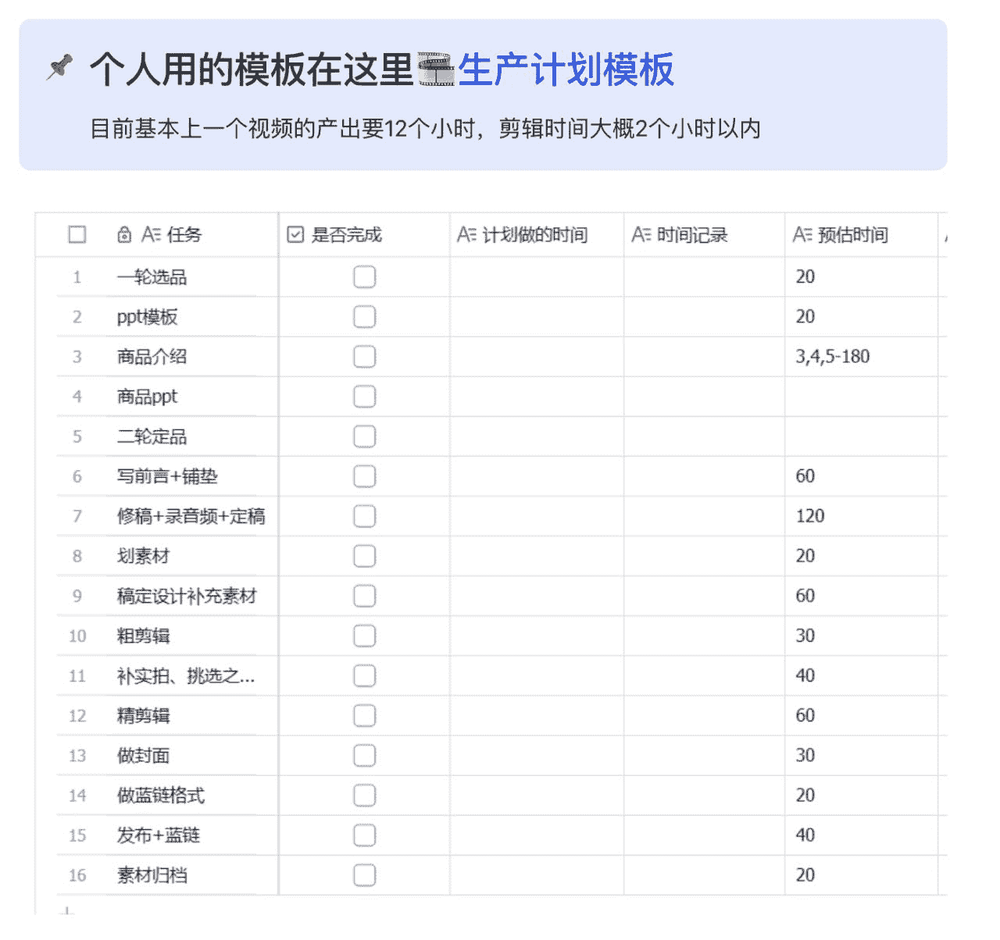

我做的第一件事情，就是先把整个生产计划按照我自己做项目的流程，把它更加细化。比如从开始到结尾需要产出哪些物料，尽可能把动作拆解得更小。

这个过程会让你更好地去梳理在做项目过程中，有哪些环节是可以做提效的，有哪些环节花了你比较多的时间，以及是不是有哪些环节的流程比较混乱，进行重新迭代之后，整体会更加高效。

#### 2）和AI亦仁聊你的项目、生活的问题

前段时间，我发现自己有一些问题，就鬼使神差地打开了AI亦仁。

一开始我只是想聊一些心力和生活上的问题，但后来发现他给的内容相比市场上的AI更实际更有参考价值，于是我试着把项目上的一些东西也拿去和他聊。结果发现他不仅能给出很多你没有注意到的建议，还会帮你做一些即刻就能产生效果的动作规划，他对于项目的建议更加落地。

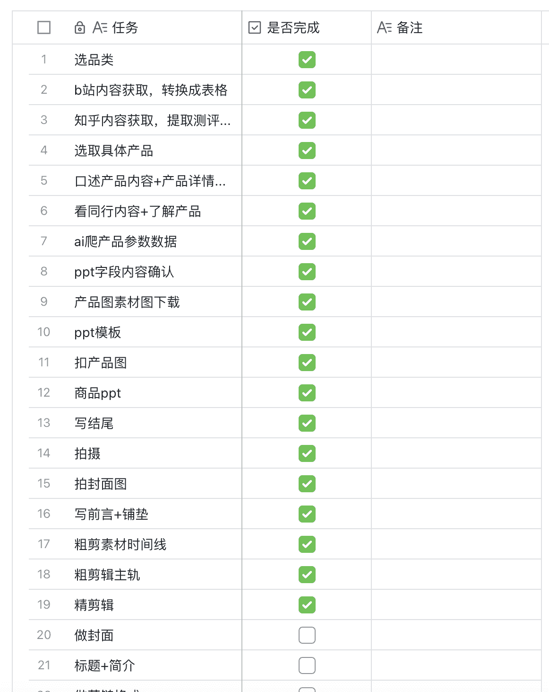

使用建议：

1. 尽可能多地把你遇到的一些问题、手头的资产以及实际涉及到的东西，都尽可能多地投喂给他，这样他给出的回答会更加有效。
2. 聊完之后（我蛮建议大家多花几个小时去好好聊聊、拆解一下），把你们所有的对话内容——包括你的问题和他的答复，全部复制下来，让AI帮你整理成一个Markdown格式的文档，然后再投喂给AI。
3. 你也可以搭一个Skill，项目问题直接让Codex去访问网页端的AI亦仁。

#### 3）单独创建【项目规划Agent】，投喂以上内容给AI，在本地搭建Obsidian知识库（知识库搭建参考AI大航海手册内容）

在和亦仁聊的过程中，因为我自己对于项目规划和日程规划非常不擅长，我就把所有的内容都投喂给AI，让它帮我进行每周和每日任务的拆解。

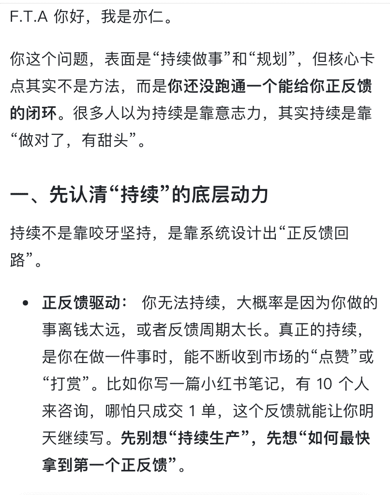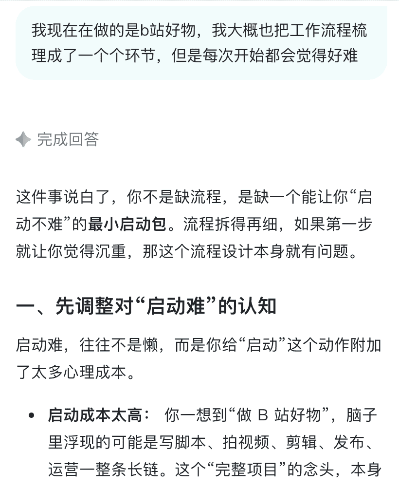

如果你是Mac系统，还可以让AI自动把这些任务同步到你的提醒事项或日历里（我自己用的是提醒事项）。如果是Windows用户，可以尝试一下你平时用的日程或待办软件，看看有没有办法让AI帮你打通。总之，这些技术层面的事情，全部交给AI就行了。

> 提示词：工作规划秘书**Agent**

### 2、建立项目文件

因为我们的项目剪辑会有非常多的素材，包括前期整理的素材以及产品表格之类的，在电脑里会堆得非常乱。而我自己又懒得整理，同时为了后面能够复用这些东西，我就学习了“影视飓风”他们视频项目的生产内容，按照他们整体的框架搭建了我自己的项目文件夹。

这个大家可以直接把这张截图发给他，然后让他根据这个项目的层级，帮你去做项目层级的建立，并让他记住这些文件的框架。

如果说你自己有一些需要调整的文件夹层级和结构，就在调整完以后，把整个项目文件夹扔给他，让他记住结构就可以了。

现在，每一次我只需要把要做的项目名称发给他，他就能帮我自动生成项目文件夹。

> 提示词：素材归档命名**Agent**

## 二、项目资产化

### 1、选品

我们在每一次的京东联盟选品中，第一轮通常都会批量选出几十款产品。京东联盟支持一键导出选品车里所有链接的相关信息，并直接生成一张Excel表。

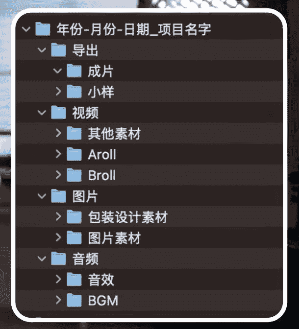

这时候，我们就可以把导出的Excel表导入到AI中，并制定一个预设的选品规则。

- **设定选品规则：** 你可以让AI优先考虑佣金、销量以及品牌等关联维度。每个人的选品标准不同，比如每次具体筛选多少款产品，这些都可以由你自己设定。
- **自动生成选品SOP：** 通过这样一次选品，在AI帮你筛选完之后，你可以让它总结整个选品过程中的优先级顺序，它就会自动形成一个选品的SOP（我这边会提供一个自己的示例，大家可以根据自己的选品要求去生成专属的SOP）。

虽然AI的选品相对来说可能没有那么规范，但它完全可以在第一轮帮你筛选掉绝大多数产品。看到AI生成的表单后，如果觉得里面还有一两款不合适，你也可以这样处理：

- **进行二次筛选：** 让AI帮你做二次筛选，提供更多的替换选择。
- **主动调整选品表：** 因为表格本身就支持按价格或品牌排序，你也可以主动查看表格并手动做一些替换。

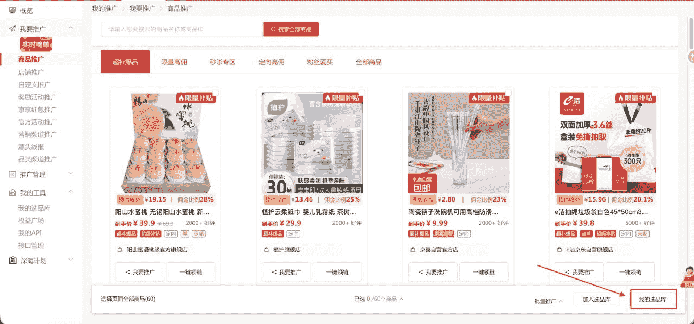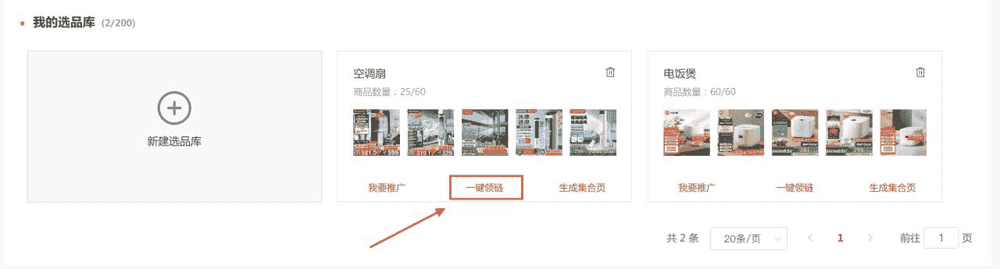

通过这种方式，我们就可以非常快速地从几十款产品中，挑选出最终需要的10到20款产品。因为很多时候（像我本身就有一些选择困难症），如果纠结于选品环节，会浪费大量时间。而在设定好规则和条件之后，直接让AI帮我们做一定的取舍，就能大大减少在选品上花费的时间。

> 提示词：（详见附件）

### 2、获取产品参数

在我们选完这一波产品之后，可以把最后选出来的结果整合到我们的飞书文档（或者本地的知识库）里面，或者直接让它产出一个Excel的表格。

这时候就涉及到之前蛮多人问的“获取参数”的问题了。

我最早获取参数让它帮我爬的时候，也遇到过触发京东风控的情况，导致账号被停用一天，第二天才能正常使用。而且一旦触发风控，后面所有的页面都会变成风控界面，没办法再识别参数，整体效率变得非常低。

后来，我通过不断和AI交流来解决这个问题：

**第一轮：**

- **避开风控验证：** 一开始让AI帮我去避开风控的时候，它其实说，就是因为爬取就没有办法，它一定会触发风控。然后我就跟它说：你能不能模仿人工的方式，帮我运行这些东西？然后他就用各种方式去跑，最后成功了。
- **后台运行：** 解决风控后又遇到一个问题：它在提取数据时，经常会把网页前台弹到我的屏幕最前面。我就跟它说：“你不要影响我正常工作，不要抢占我的焦点，到后台去工作。”这样它在帮我提取数据的时候，我就可以同时干别的事情了。

**第二轮：**

但在使用过程中，我发现它还是会有很多缺失，比如有时会提取到一些我不太想要的、或者没用的参数。于是我对它进行了第二轮迭代：

- **提前规范参数（第二轮迭代）：** 因为每一类产品的参数都不同，所以我们会预先规范好、确定好大概需要哪几个参数，然后把这些参数提前告诉它。

**第三轮：**

很多时候，如果只爬取京东页面上的参数，会缺失很多数据。其实很多参数是在京东的详情页图片里。于是我就问它：“你能不能帮我提取详情页里的图片内容，来帮我修补这些参数？”

- **OCR识别：** 通过网页OCR批量容易风控，最后用本地OCR现在基本一轮就能获取完，少量手动补，或者直接留空都可以。

**插件：**

Win用户可以看看这个，如果Codex直接操作浏览器效果不好，让AI视觉方案操作浏览器的方案官网：https://opencli.info/download

Google浏览器插件opencli：https://github.com/jackwener/opencli/releases

本地的opencli：

`npm install -g @jackwener/opencli`

`opencli doctor`

> 提示词：商品详情页参数采集**Agent**工作说明

### 3、素材整理

在我们素材收集这个环节里面，我们每一次可能有十几二十款的产品，从网上下载下来的文件会非常的多，下载下来的文件夹都会有产品的标题，所以我让AI直接去把这些压缩包、视频和图片，自动帮我分类整理到我的项目文件夹里，并给它一定的命名规则。这样的话，就不需要自己再一个一个去拖动和整理了。（素材整理需要提前投喂一下我们的选品表）告诉它我下载的文件在哪里，能帮我自动整理素材。

> 提示词：素材归类整理
> 提示词已合并

## 三、内容生产自动化

### 1、内容提取+改写

大家在用AI进行内容写稿的时候，应该都遇到过写出来的东西“AI味”很重的问题。我这边的解决办法是：一定要沉淀本地的内容知识库。

如果你前期没有特别好的文稿，或者觉得自己写得不太行，可以参考我的写作流程。我主要分三步来获取素材并进行迭代：

1. **积累科普知识：** 先找一些科普类的知识（比如在知乎或B站上搜集），并把这些内容存储下来。
2. **录制口播内容：** 我会针对产品详情页的内容，按自己的“口播逻辑”先讲一遍，把这些口述素材整理出来。

有了这三份素材后，我具体的写作与迭代逻辑如下：

- **初稿生成：** 把这三份东西同时投给AI，明确告诉它每一份的用途，让它帮我生成一份完整的口播稿。虽然这一版通常无法直接使用，但它能帮你把整体的逻辑架构搭建好。
- **人工改写：** 在AI架构的基础上，我会手动改写部分内容，调整产品点的结构，生成一篇我真正会去用的、带有个人风格的口播稿。
- **差距分析与Skill迭代：** 为了让AI更好用，我会建立一个本地知识库，让AI对比分析“我改好的稿子”与“它给我的初稿”之间的差距。让它出一份报告，把其中的结构差异、节奏或口语化的表达对比出来。

多做几次这样的对比后，你的基础资料会越来越全面。你可以让AI基于多份“人改稿”与“AI稿”的对比，生成你的专属写作Skill。

在实际使用中，你还可以不断微调：

- **排除AI词汇：** 如果它经常出现“不要怎样，而要怎样”这种书面化或典型的AI腔调，直接明确告诉它以后禁用这类写作方式。
- **固化讲解结构：** 给AI一个明确的结构模板。比如讲解某款产品时必须按什么结构来，把它整理进你的Prompt。

通过不断增加本地知识库的容量并迭代你的Skill，AI生成的口播稿质量会逐步提高。这一套思路的核心就是通过人机对比，让AI越来越懂你的表达习惯。

### 2、制作PPT+参数批量替换

我最早其实是做了一个Figma插件。当时书野在直播里分享了“稿定设计”的会员功能，它可以批量替换画板中固定的文字参数和样式。但是Figma插件中心没有现成的免费工具，加上Figma的功能和流畅度更好，于是决定尝试用AI自己写一个插件。

因为我自己是设计师，在以前的工作中，其实也会有一些需要在整个设计稿做完之后去替换里面文字样式的功能。但因为那个时候没有AI，我自己也不会开发插件，所以没办法，只能等别人现成的插件。但是有了AI，就不一样了。

我的开发过程大概经历了三个阶段：

#### 1）Figma插件尝试阶段

我把功能需求、操作逻辑和预期效果一点一点描述给AI。第一版出来的效果就基本达到了可用状态，后续针对一些小bug调整了几版。但后来我发现，插件用起来还是略显麻烦，还是需要手动去做很多的事情，比如建很多的画板，替换每个的产品图，调整图片大小……不过呢还是节省了我蛮多无脑复制粘贴文字的时间。

#### 2）HTML网页开发与MVP迭代

紧接着我看到了“星空海绵”关于用HTML做PPT的分享，虽然可以在网页上修改文字，但我觉得版式不够美观，且每一张都要截图，不太方便。

在这个基础上，我一边做项目一边对HTML网页进行了“二开”：

- **第一版（MVP）：** 我把HTML代码投喂给AI，告诉它我的需求——我提供固定的版式和一张Excel表格，让它自动替换里面的文字字段以及图片，并帮我批量重命名。这一版界面比较粗糙，但跑通了核心流程。
- **第二版（最终版）：** 在确保MVP跑通后，使用过程还是有很多小bug，比如图片导出以后不满足我的要求，文字段遗漏……这时候就比较细化地在真实使用过程中迭代，因为前期规划的时候没办法想的那么全面。

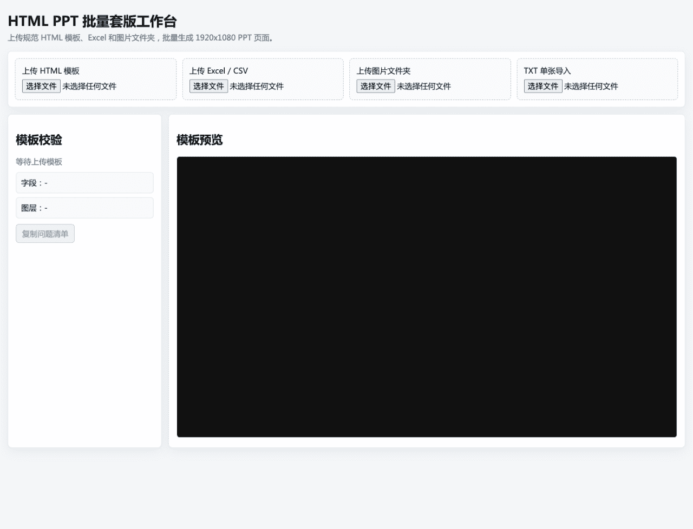

#### 3）流程化与规范化方案

**HTML写入格式规则：**

这个规则是为了让AI帮我生成的HTML可以满足我的网站导入要求。

- **模板生成：** 我懒得手做模板，基本是把布局需求和以前手搓的模板发给GPT，让它帮我生成SVG格式的图片。
- **格式转化：** 将SVG拖入Figma，利用Codex插件读取Figma画板内容，直接转化成HTML版的PPT模板。（如果是确定无误的SVG直接给AI也可以）

**Excel导入的规则：**

表格要求：

- 每行一个产品。

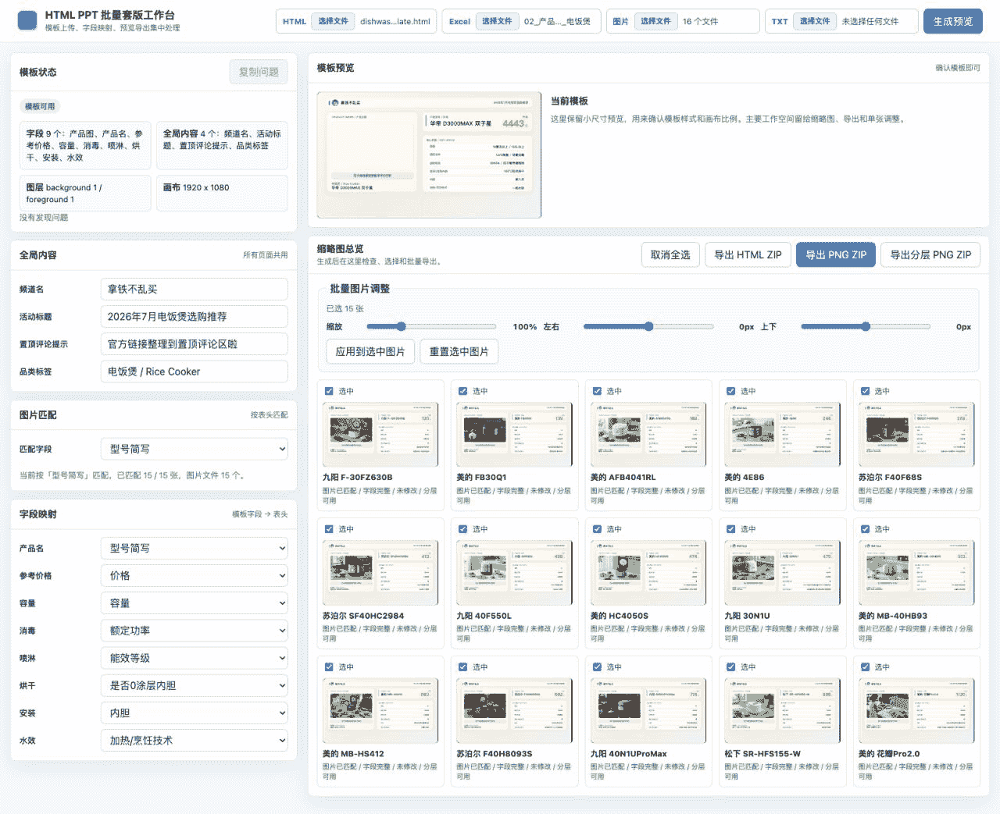


# 公众号懒人搜索，懒人专属群分享

- 第一行或自动识别到的表头行是字段名。
- 第一列默认作为产品名，也可在前端选择图片匹配字段。
- 模板字段和表头完全同名时会自动匹配。
- 不同名时，在“字段映射”区域手动选择对应表头。

**图片的导入规则：**

图片从本地文件夹上传，不放在 Excel 里。

**图片匹配方式：**

- 默认优先选择类似“型号简写、产品型号、型号、产品名”的字段。
- 也可以在前端“图片匹配”区域手动选择匹配字段。
- 图片文件名需要和该字段内容标准化后精确匹配。

这就是我整体的制作思路。大家也可以尝试根据自己的逻辑把这些 AI 工具串联起来，打造最适合自己的工作流。

## **4）提示词：HTML 网站及相关内容**

**源码下载地址：**

https://pan.quark.cn/s/5639a3e3a013

文件发给你的 agent 工具，输入以下提示词：

> 请读取我上传的完整`HTML-PPT-Batch-Workbench-Delivery`交付包，帮我在本机解压、检查`Node.js LTS`、启动`html-ppt-workbench-local`本地工具并确认浏览器可打开；同时把`html-ppt-workbench-local/docs/HTML-PPT批量套版工具使用说明.md`、`html-ppt-workbench-local/docs/PPT-Figma转HTML模板Skill说明.md`、`html-ppt-workbench-local/docs/好物PPT制作规则总结.md`作为当前项目的长期规则/Skill知识学习并保存，之后凡是帮我生成、转换、检查`HTML PPT`模板或好物`PPT`，都必须遵守这些规则，最后告诉我本地启动方式、访问地址、安装结果和规则保存位置。

## **5）使用方式**

# **3、A-roll 剪辑思路**

Github 项目：https://github.com/heygen-com/hyperframes 一键安装；

```
git clone https://github.com/heygen-com/hyperframes.git
```

接下来也就是最近大家问得比较多的一块内容，就是我之前在群里说的，如何用 AI 帮你进行 A-Roll 剪辑和画面设计。先给大家看下纯口喷出来的效果。

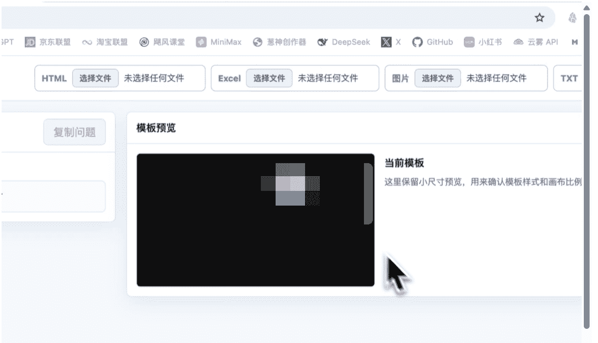 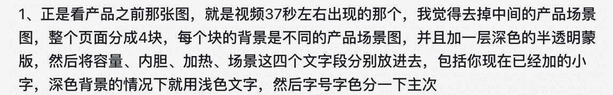 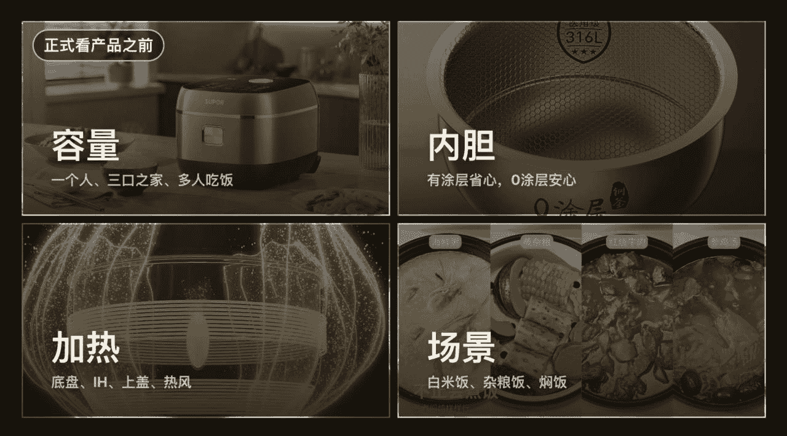

这个思路的起因是，我自己之前手搓了一版，觉得非常费时间。最近在做新视频的时候，我就想能不能让 AI 帮我做剪辑。尝试了一下之后，发现效果不错。因为我自己做剪辑比较少，缺乏镜头语言和画面语言，所以我先分享一下我的整个流程：

1. 拆解优秀案例：

2. 结合自身素材进行初版设计：

3. 融合参考，生成定制脚本：

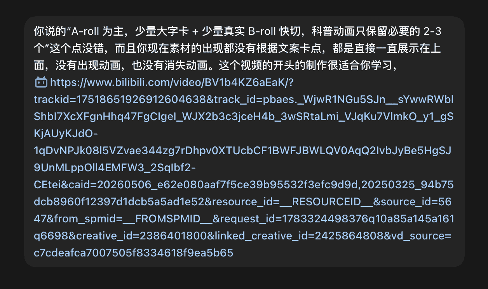 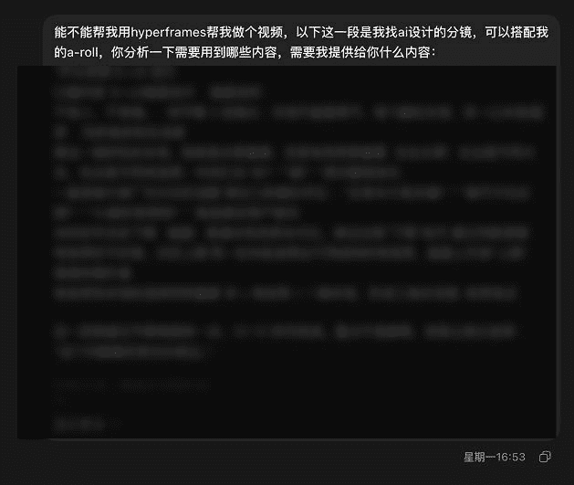

4. 样片审核与细节“口喷”修改：

因为光看文字版分镜可能没有感觉，我一般会先让它直接生成一版样片。生成出来后，你会有比较直观的视觉感受。通常第一版生成出来的效果会比较粗糙、不太能用，这时候我最简单粗暴的方法就是“口喷”修改：

- 逐秒指出问题：由于目前 AI 对图片内容的识别能力还比较弱，我会具体指出视频第几秒的地方不太好、哪些素材需要替换。
- 提供精确参考：如果有直接的参考画面，可以直接告诉它“第几秒参考某一个画面”，并把对应图片的名称修改好后一起发给它。

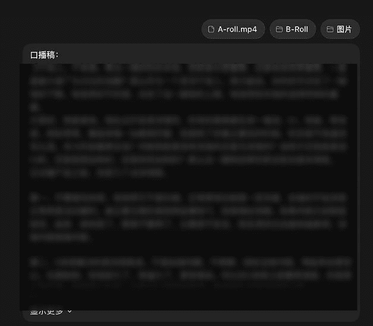

5. 素材调整与迭代：

在这个过程中，你会发现分镜稿里有很多图片素材不是你想要的。

- 手动挑选与替换：你在第一轮筛选图片和整理文件时，对素材已经有了大致的记忆。在剪辑的过程中，你也可以随时手动挑选和替换。
- AI 辅助生成：有些不合适的图片，可以直接让 GPT 帮你重新生成。

另外，在制作的时候，不建议让它帮你做字幕。字幕还是建议导入到剪映里去制作。虽然很多人说新版模型的字幕能力有所提升，也可以尝试，但我个人还是更倾向于使用剪映。

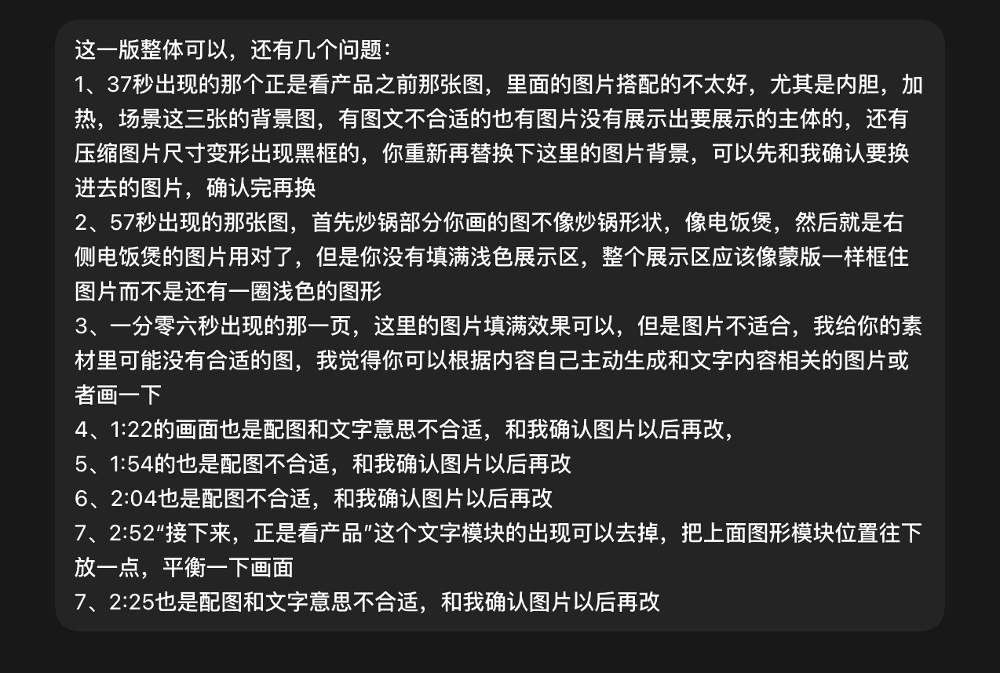 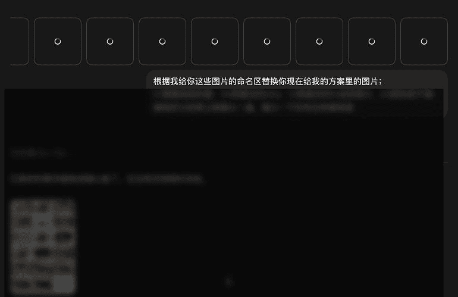

## 四、发布与反馈：让内容进入下一轮循环

### **1、视频标题、简介、标签的制作**

这个 Skill 的起因，来源于我前两周去了星神的一个线下分享会。当时会上讲到如何做视频标题，包括找参考对标时怎样效果更好、如何更好地获取自然流。

听完后，我就想着直接把整个流程用 AI 跑通一遍。具体步骤如下：

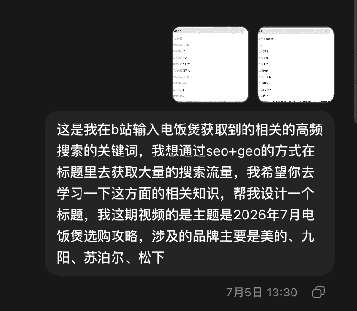

1. 搜索与筛选：让 AI 直接帮我打开一个无痕浏览器，去里面搜索我要的产品，观察下拉框里推荐的内容。
2. 提取关键词：筛选出里面排名比较高的内容，把它们的关键词获取下来。
3. 融合生成：将这些关键词进行融合，去生成整体的标题。

这个流程能让我们在后期发布视频时方便很多。你也可以在里面投喂更多爆款标题，让它学习爆款标题的制作方式。目前这个 Skill 还在测试中，大家可以根据自己的需求，去做属于自己的 Skill。

### **2、接下来要做的（设计评论+回复）**

之前使用了葱哥的网站流，我特意去看过它整体产出的内容。里面有一个功能我觉得非常好，但我自己目前还没有做。

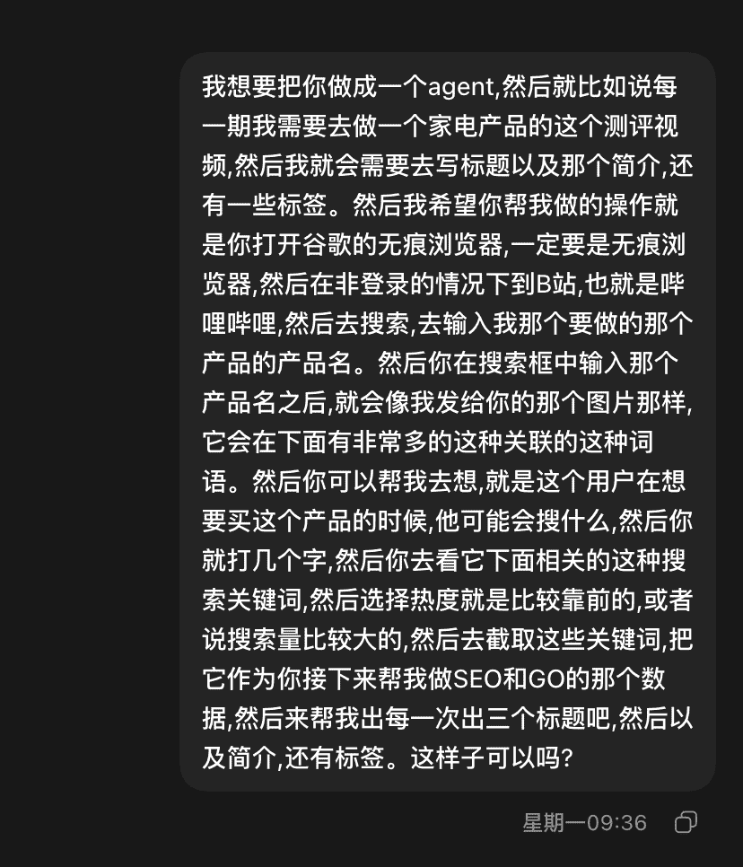

这个功能就是设计评论与回复：它每次能帮你自动生成 10 条评论以及 10 条相对应的回复。我觉得这个东西非常方便。

我目前的思路是：

1. 通过我的口播稿，配合一定的提示词，让 AI 帮我去设计这些评论和回复。
2. 我之前尝试过用 AI 去设计问题，整体效果还可以，但可能需要手动改一改，需要再调教一下。

## 总结

我觉得学习 AI 最好的方式，就是尽可能想办法把 AI 融入到你的工作流程里面。

1. 拆解工作流：尽可能去拆解你的工作流，让它更加 SOP 化。
2. 尽可能地“偷懒”：去解放自己，不做那些重复劳动或麻烦、且没有提升意义的事情。把更多的精力放到决策、审核和迭代上面，通过迭代你的知识库，同步让 AI 来帮你，从而提升你 AI 的大脑的水平。

我建议大家真的好好的去看一下《AI 大航海》的两个部分：

- 第一部分：与 AI 聊天
- 第二部分：如何用 AI 搭建自己的知识库

这两部分内容对于绝大多数人来说，都是非常受用的。

最后，祝大家都能一起爆单！当你把所有的环节都用 AI 做完后，最后要做的就是把它们串联起来——就像上周聪哥分享的那样，把它变成一整套的系统，这样可以帮助你实现更多的提效。

在此，也要特别感谢一下聪哥、书野、星神、凌风，他们之前的对话给我带来了很多学习的方向和灵感。

谢谢大家！

————分割线————

看完这篇 SOP，你觉得你懂了。但 90% 的人一到实操就会卡在第一步。

工具和教程只是最低级的壁垒，真正的壁垒是“立刻动手”和“圈层信息差”。

如果你想看全网最新的变现玩法，并且和一群执行力极强的极客一起下场拿结果，欢迎围观我的核心私域：【懒人专属群】。

我们不聊虚的，只做商业闭环的拆解与 AI 效率的压榨。系统内已沉淀 1000+ 跑通的套利实战局。

➡ 查阅圈子完整数字资产与上车门槛：

https://lazyso.com/insider/

认同价值、准备好下场干活的，扫码加我微信（lazyhelper1）

备注：【实操上车】，不闲聊


