# 深耕小红书电商**3** 年，分享**26** 年小红书电商红利的**3** 个关键词：**AI + 情绪 + 矩阵**。

260720 副业SC 精华

整理：公众号懒人搜索，懒人专属群精选

懒人微信：lazyhelper1

Hello 大家好，我是小刀。很开心今天在这里跟大家分享关于小红书电商的经验和方法。

我是从抖音开始接触互联网赚钱项目的，之前做抖音半无人直播，自己一个人一年卖过 1000 万的 GMV。

但是从 2022 年年底开始，抖音这种半无人直播的红利就在消退。所以说，在 2023 年的时候发现了小红书电商，就果断转战小红书电商了。

目前小红书电商已经深耕了三年，在这个过程中，我们也带出来了很多学员，见证了许多普通人从 0 到 1，在小红书电商上赚到了自己的第一桶金。

所以说，今天会尽量跟大家还原一下这个项目到底是怎么回事，以及做这个项目想要拿到结果，具体需要注意些什么？

如果是一直观察怎么赚钱的小伙伴，大概在 23 年就听说小红书电商的项目，所以会很好奇：从 23 年到 26 年，这个项目都 3 年多了，到底还有没有红利？现在的玩法到底是什么样的？

所以，今天的分享主要包括以下三个部分：

1. 红利与玩法变化：带大家看看从 23 年到 26 年，小红书电商的红利和玩法发生了哪些变化。
2. 拿结果的三个关键词：给大家分享目前在小红书上更容易拿到结果的三个核心词——AI、情绪、矩阵。
3. 核心实操技能：给大家分享想要做成小红书电商项目，必须要掌握的选品、笔记和运营技能。

## 第一部分：从 23 年到 26 年，小红书电商经历了哪些变化？

### 23 年-24 年上半年：百货，混剪搬运红利

2023 年小红书电商刚刚开始兴起的时候，对于普通人来讲，最好的玩法就是“混剪”，出单了直接去拼多多拍单：把大量在抖音上爆火过的百货类型产品的素材，直接拿到小红书混剪一下，就能带来非常不错的销量。那时候出单非常简单，整体的竞争压力确实非常小。

但是在这个阶段，对应的也有一个缺点：小红书电商的商业化才刚开始。在整个平台上来讲，对于“在小红书上买东西”这个行为认可的用户还比较少，也就是整体的电商用户池子比较小。所以在 2023 年的时候，一个店铺能卖个十几万，就算是非常不错的店铺了。

我对这个阶段的定义是，非常适合当副业赚点小钱。

### 24 年上半年 - 25 上半年：养生 & 功效品，抠图换背景起号

小红书电商的第二个非常明显的点，是在 2024 年上半年，平台电商的图文流量在功效品方面有非常明显的倾斜，所以在这个阶段，大家大量地通过抠图换背景，来卖一些功能效果类型的产品。

注意：现在做功效类的产品是有些难的，仅为大家提供一些思路。

### 25 年下半年至今：实况图 & AI 图迎来流量爆发

从 2025 年下半年开始，AI 的应用越来越成熟，大家开始进入到 AI 作图和 AI 批量写文案的时代。

给大家截图一下一些经典的 AI 笔记的形式。

目前 AI 生图，对于很多不熟悉 AI 的人来说，可以以假乱真了。这一 part 我们第二部分详细讲。

但是并不是说 26 年的红利在 AI 图文，我们就完全杜绝混剪，到目前为止，混剪的形式依旧还能火很多批，只是整体来讲，占比已经降低。

而且在不同的年份、不同的时间点，以及不同形式的流量，也都会有细微的变化。比如说最近两个月，混剪的流量又会好很多。

从长尾性来讲：图文 > 视频

从基础数据看：视频 > 图文

从转化率来看：图文 > 视频。

所以我们选择混剪、图文、实拍、AI 还是视频，都不是绝对的，要根据这个产品适合什么形态来决定，去看我们的品在平台上目前采用的是什么样的内容营销形式，我们去进行一比一模仿，这是新手起号最快的路径。

除了形式和玩法的变化，从赚钱的角度讲：小红书赚钱能力比 23 年强很多了。

相对 23 年来讲，26 年整体平台上的玩家一定是变多了。但对应地也有一个好处，就是平台上的整体用户大盘（池子）也是在增加的。

从 GMV 来看，23 年一个店铺能做 10 万+ 就已经挺多了；但到 26 年，会出现很多店铺在一拖三的情况下，普通玩家，做出了一周 GMV 破百万的战绩。

## 第二部分：26 年普通人入局小红书的三板斧，AI + 情绪 + 矩阵。

### 第一板斧：AI

目前大家对 AI 这个关键词应该都非常清晰了，主要就是用 AI 来做图片和写文案，相信大家都已经接触过。下面的这组图片给大家看一下，都是用 AI 纯生成的，目前 AI 生图的能力确实非常强。

我们目前打的品类主要有两类：

1. 纯 AI 图：大多数会集中在一些小挂件、好看类型的产品上，但这类产品的特点是流量周期相对特别短。
2. AI 封面 + 实拍结合：鉴于纯 AI 图的流量周期问题，我们整体更建议大家采取这种结合的形式去打。

AI 作图应用的 4 个思路（后续的很多图片都是在这四个思路上进行拓展）：

- 思路1：移花接木
- 思路2：偷天换日
- 思路3：局部重塑
- 思路4：更换背景

思路1：移花接木——A 图片的元素 + B 图片的元素，生成新图片

思路2：偷天换日——别人的爆款图片 + 我的产品

思路3：局部重塑——改变不重要的元素，增加图片原创度

思路4：更换背景

这 4 个是改变图片的思路，但是在实际操作的过程中，往往我们需要调用多个方法，才能实现比较好的原创效果。裂变的方向主要是，通过改变下面的元素生成新的图片。

主要改变了产品的数量和摆放方式。

去用了其他产品的货架模式，但是在这个基础上同步又更改了背景、货架材质、货架倾斜程度。

在中等裂变强度的情况下，对于货架的摆放方式等进一步进行了改变。

上面的这些作图的思路都属于，我有一张图片和我的产品图，我基于我的对标图片和产品图进行发挥，再进一步，也可以无中生有，但是无中生有的爆文率就要低了，因为没有对标。

比如下图，我让 AI 把图 1 的抓夹放在模特图头上。这个动作如果采用我们前面的产出方式，就需要先找到一个模特，让 AI 把模特头上的抓夹替换，但是下面属于是完全让 AI 发挥产出的。

### 第二板斧：情绪

“情绪”这个关键词，很多小伙伴可能不太理解。

这里的情绪在两个方面都有应用：一个是围绕着情绪进行选品，一个是围绕着情绪进行写文案。

什么叫围绕着情绪开始选品呢？

就是在 25 年下半年开始，火了很多情绪类产品。我对情绪类产品的定义是：价格不高，买了它没有什么实际用处，但是会让人更开心。

比如说 25 年下半年非常火爆的小马挂件、包挂，还有一些香薰、小玩偶、抱枕等。这一类型的产品，大家购买的时候，更多的是凭一眼看到它，觉得心生欢喜就买了。

另一方面是情绪化的文案。

在图文时代，相比于视频混剪时代，标题和正文的重要性更加凸显。

因为在混剪时代，大家一般不写正文，只加一些话题标签就行了。但在图文时代，用文字辅助图片去阐述产品的卖点、引导用户下单，变得非常重要。这也随之诞生了一大批情绪化的内容模板。

这里我会把内容模板分为五大内容引擎，其中情绪类的是今年的流量密码。

重点跟大家分享一下情绪类内容，给大家拿具体的笔记进行示意。

上面的 5 条笔记，都用了同一个内容模版：我回亲手杀死每一个退回来的 xxx（产品名字）。

这个内容模版就是通过【销毁】这个内容点 + 垃圾桶，让用户产生：这个店主真良心的情绪，进一步产生这个产品很不错，我不会踩坑的消费心理。

这三条笔记用的这个模版也是一直在火的：我收到了一封温柔的退货信。

核心是通过手写退货信的形式，调动大家的好奇和感动，不自觉点开笔记掉入到你的产品种草里面。

而这个是经典百试不爽的：我被抄袭了系列。

不管你是不是被抄袭了，只要发这个类型的内容，就可以激发大家的正义感来支持你。

除了这个情绪，还可以通过福利紧迫调动大家的付费意愿。

还是拿笔记给大家举例子，这个是经典的：闭店模版。

就像是我们之前碰见的：2 元店清仓和江南皮革厂倒闭了。

尽管慢慢的大家都知道他不会倒闭，还是忍不住进去看看是不是能捡漏。

这类的内容模版也是所有的品都适用，比如下面这几个笔记用的就是同样的模版。

在实际实操的过程中，很多模板它不是单一的，是一条笔记里会兼具多个元素。

比如说经典的“爷爷模板”，就是通过“爷爷说干不动了”激发大家的情绪，然后结合“清仓闭店”的福利紧迫性来产出。

同时融合了情绪和福利了两个爆款元素，这样的笔记爆发率就会更高一些。

同步也把另外 3 种内容类型分享给大家。

这个我就不过多展示了，属于比较直白的产品种草类型。

这个新人背书的，也是给大家举两个例子。

这个模板是非常经典的，通过有人一次性想要买很多这个故事引入，让大家感觉到这个产品很受欢迎。

这个笔记是通过故事来让用户相信产品是值得购买的。

信任背书的核心就是引入第三个视角。

就像是我们下楼买西瓜，如果卖西瓜的跟我们说西瓜甜，我们可能不信。这个时候，边上的大妈来一句：“哎，我昨天买的很甜。”你的信任度就会飙升。

这个类型的内容模板，更多的是用在一些有用类型、功能效果类的产品上面。

大家可以看上面，不管是卖养生茶还是卖手串，都可以提炼出用户比较关注的“早起就像化了妆”这个点，让用户感觉到使用了这些产品能达到气色非常好的目的。

内容实际应用的过程中，不同类型的产品偏好的笔记模版也是有区别的，不同类型的内容也会有不同的效果。

其中以情绪冲突类举例子，一般就是流量大但是转化低。

所以我们在发笔记的过程中是会结合起来使用的。

### 第三板斧：矩阵

目前小红书开店的门槛是非常低的，个人店也可以 1 拖 3，也就是一个店铺号关联 3 个子账号。

目前建议大家的是，如果在一个账号跑通的情况下，就开始挂子账号，4 个号同步去打一个品，这样能吃到这个品的量会更大。

在有 AI 的加持下，大家制作笔记的难度有所降低，整体的效率提升非常多，所以也让个人玩家做矩阵变成了现实。

所以说，在 26 年，随着小红书平台上的电商用户逐渐增加，这个时候结合 AI 趋势去做小红书，是能拿到更大收益的关键点。

# 第三部分：选品 + 笔记 + 运营

如果你决定开始做小红书电商，那绕不过的三个核心点就是：

1. 选品
2. 写笔记
3. 做运营

今天我尽量把这三个核心点给大家串一下。

## 选品部分

### 1、选品的定义与核心逻辑

从选品来讲，目前整体上最适合新手入局的，还是“跟爆品”的方法。我们对于选品的定义是：一定要选择那些已经有热度，但还没有进入激烈竞争的产品。

很多小伙伴都会纠结是做红海还是蓝海。我的建议是，纯蓝海和纯红海的产品我们都不选，我们要选的是那些“正在起量”的品。

### 2、选品的三个关键词

我们在选品的时候，有三个核心关键词：近期、低粉、爆款。

一般来说：

- 近期：指最近 7 天内
- 低粉：指 1000 粉丝之内
- 爆款：指能有 1000 销量以上

但是这个数据不是绝对的，大家要理解，选品有一个核心的点就是“对比”——选择的另一面就是对比。

比如你找了一个商品，它是昨天刚爆起来的，同时有另外一个商品是 15 天之前爆的，那这个时候毫无疑问，根据我们的这三个核心关键词，我们会选择昨天刚爆起来的这个。

但是，如果以你目前的能力，能选到的都是较早的数据（比如一个是 30 天之前爆的，一个是 25 天之前爆的），这时候我们并不是说就不做了，而是要以这个核心词为基准线，去选择那个相对更符合标准的。

比如“近期”这个维度，就会有三个不同的程度。

1. 近期有热度就行：理论上讲，最近半个月有热度的品，只要你的笔记内容能力能跟上，都是可以打出来的。
2. 近期有新号起来：有热度不代表这个品是刚刚起来的。所以说，在 1 的基础上，如果条件更苛刻一点，那我们要去看的是，有没有新的账号最近把这个品打起来了。
3. 这个品是新起来的品：在 2 的基础上，还有一个情况就是，不仅是最近有新号起，而是所有的做这个品的号都是刚刚起号，这个品也是全新的。

这里面的起号难度一定是第三种最小。因为这证明了这个品有热度，且刚刚开始起量，同时整体的龙头账号还没有出现，竞争比较小。

但是实际选品的时候，一下子就能找到一个非常好品的可能性是低的，因为大家的品感和选品能力都需要随着实操不断地进阶。

所以说，只要选到一个符合标准的品，就可以先做，在实操的过程中持续找更好的品。

### 3、有效指标：24 小时加购

在近期低粉爆款的三个关键词之外，还有一个非常明显的能够反映出你产品是不是值得做的指标：24 小时加购。这里给大家解释一下什么叫“24 小时加购”。

当一个商品链接在 24 小时之内有 100 以上的加购量，说明这个产品非常受欢迎，值得重点关注和跟进。

的人加入购物车之后，会在商品链接的地方显示“24 小时加购”这个数据。

这里大家经常会陷入一个误区，觉得 24 小时加购数越高越好。其实这里一定要看它和总销量的比值。

判断一个品是否正在起量，有一个核心的数据指标：24 小时加购数与产品总销量的比值，这个比值越接近 1:1，证明它的销量更多是由这两天的新增销量带来的。

举个例子：如果一个商品的总销量已经是 10 万，而它的 24 小时加购是 1000。这只能证明这个品在当下有热度，但不能证明它是刚刚跑起来的。

就像上面的图1，就是经典的刚刚爆起来，但是图2 虽然也有加购，但是总销量已经很高了，证明大概率不是最近爆起来的。

如果让我选择，从新手难易程度考虑肯定选择图一这个产品开始做。

### 📖 4、新手适合的选品方向

在大家明确了选品的指标之外，一个很经典的问题就是：作为新手，不知道一开始该从哪个方向进行选品。

根据我们的经验，在小红书上特别容易起量的三种类型的产品，分别是：

- 有颜值类型的
- 有用类型的
- 有便宜占类型的

有颜值的类型，更多的表现会是“卖图片”。就像你是卖手链的、卖钻戒的，这个时候你的文案写得非常好是没有用的，需要你的这个产品本身非常好看，能吸引到用户的注意力。

所以说，很多这一类型的产品在实际售卖的时候就是一张图片，标题和正文都写得非常简单。

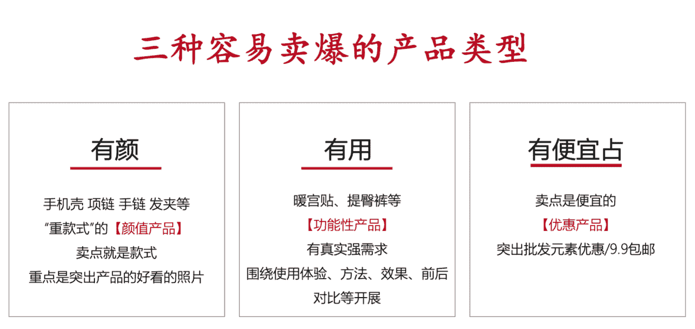

上面的这几个产品，很明显的就是卖了一个图片。

所以说，做这一类型的产品，如果你是一个完全没有审美的人，就很难拿到结果。反之，如果你是一个有审美、平时就喜欢一些漂亮东西的女生，就事半功倍。

第二种类型的产品就是有用类型的产品。

这类型的产品特点是，会有一个功能满足了用户的一项需求。

为了方便大家理解，我对“产品有用类型”分了五个方向，供大家参考：

1. 基础有用
2. 情绪有用
3. 痛点有用
4. 玄学有用
5. 季节有用

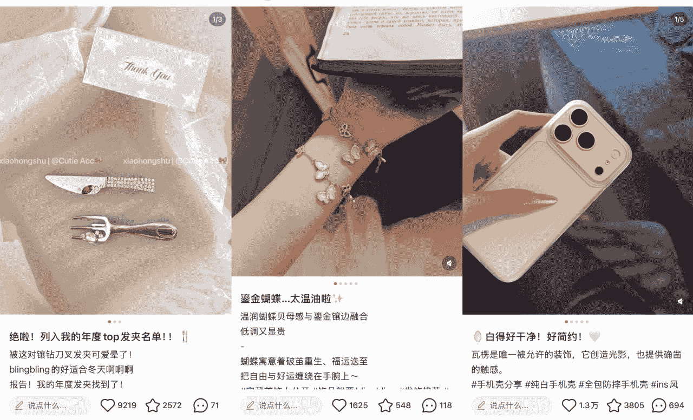

玄学有用和痛点有用，相对来讲，内容特别容易违规，不太适合新手阶段去挑战，关于“情绪有用”，我们前面已经提过。

在这里，我把基础有用给大家详细列了一下，“基础有用”里面这些方向都是非常适合新手去选品的。

其实很多小伙伴会问到的一些类目，我大概跟大家说一下比如说女装。

女装的特点就是非常容易起量，但是售后非常高。如果供应链不稳定，就会面临不赚钱甚至亏损的情况。

现在大家找供应商，供应商一般会把成本分为“产品成本”加“运费成本”。

比如一件衣服 19 元的成本，会分为 15 元的货物成本加 4 元的运费成本。这里面有一个细节：一旦产生退货，供应商只会退给你 15 元的产品成本，4 元的运费成本就成了损耗。所以，一旦退货率高了，运费的损耗就会非常大。

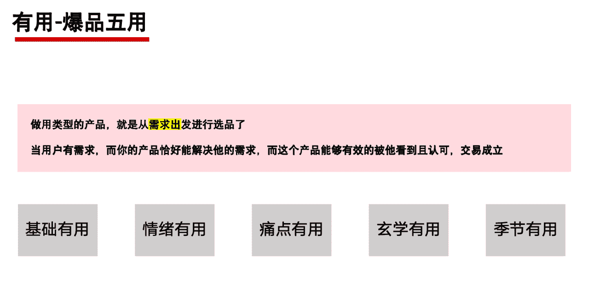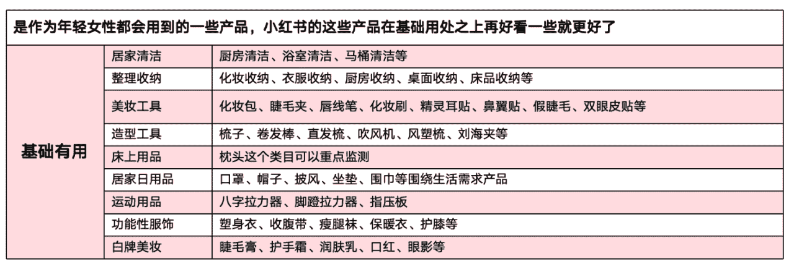

其次，一旦开通运费险，很多服装类产品因为退货率高，一单运费险甚至要到 4 元左右。这个成本也是非常高的，因为它是每单都有的固定损耗成本。

所以如果做这种类目，就建议找一些通用款。比如说很经典的、在小红书上比较火的六分裤，选择一些不挑款式、不挑身材、客单价比较低、不开通运费险的产品类目。

比如内衣。内衣目前在平台上来说竞争相对较大一些，有一些头部账号在持续输出。

其次就是基础数据会差一些，起号周期会比较慢。基本上大家做这样的产品，你至少要有心理准备，在保证素材质量的情况下坚持一个月。比如手机壳完全不建议新手去做，因为手机壳的更新换代速度太快了，一天会有 N 个款式产出。普通人在没有工厂、没有爆品的情况下，去跟款会跟得特别累，而且很难拿到结果。

整体看下来：潮玩、家居百货、个护家清、美妆工具、运动用品、基础服饰这些方向相对更适合切入。

### 📖 5、选品节奏以及垂直问题

当我们真的开始选完产品，进入到实操的过程中，会有几个常见的问题出现。这里跟大家稍微分享一下。第一个是，我是要同步做很多个产品，还是说一个品一个品地做？

小红书整体的逻辑是“单品打爆”的逻辑。也就是说，我们在出现一个爆品之前，会不断地测试很多产品。但是当某一个产品数据表现不错，能够持续出单且数据非常向好的情况下，我们会集中全力把这个产品打爆，围绕着这个产品去写很多条笔记，直到把这个产品的流量全部吃完。

针对这个情况，有很多小伙伴问：我一个产品，要发几条笔记去看它是不是值得做呢？

这里在假定你的笔记制作没有问题的情况下，测试标准如下：

1. 视频类笔记：一般发 10 条左右，如果不出单，这个品就可以放弃了
2. 图文类笔记：做 20 条左右，如果不出单，也可以放弃了

顺着这个问题还会衍生出一个问题：那我选不同产品的时候，要不要做垂直？

从实际操作的角度来讲，只要你之前的这个品没有爆起来，你的账号是打不上什么标签的。所以不需要特别考虑垂直和不垂直的问题，优先以爆品为先。

## 📖📖 笔记部分

小红书写笔记对于我们来讲，最好的方法还是先对对标的爆款笔记进行 1 比 1 模仿。

就像我前面提到过的“五大内容引擎”，大家看完之后可能会觉得这个东西好厉害，但在实际应用的过程中，尤其是对于新手，很难直接把这些方法论落地。

所以在这个阶段，我们会直接把对标的笔记拿过来，通过 AI 对其进行二创，保留对标的核心爆款元素，只对不重要的元素进行修改，从而实现更大概率的爆单。

这里跟大家讲一下，为什么说要一比一模仿对标。

很多小伙伴会担心：别人都已经爆过的内容，用户是不是已经看腻了？我去发还能有流量吗？

从数据推流的逻辑上来讲，小红书的这一条笔记能够爆起来，一定是因为它的封面、标题和内容戳中了用户的喜好，用户才更愿意点击。但对于新手来讲，我们很难判断这个封面里具体到底是哪一个元素让用户产生了如此大的兴趣。

所以，我们尽量先一比一复制，最大程度保留爆款元素。

其中笔记的文案写作部分，现在基本纯靠 AI 了。

我们分为大概 3 个层级，根据实际情况调用不同的提示词。

1:1 模仿、1:1 的情况下为创新、跨类目模仿，给大家一套提示词，可以直接复制去用。

如果前期笔记量没有这么大，写笔记的时候用豆包基本就能满足需求。

如果是批量化仿写的话，我们现在用的是：爆文雷达+飞书多维表格+tomemo 第一步：爆文雷达检测对标爆款笔记。第二步：每天下载爆款笔记标题正文，筛选自己要模仿的。第三步：批量复制到多维表格进行仿写。第四步：把写好的复制到 tomemo 键盘多设备同步。

图片也是一样的，前期尽量 1:1 模仿。

给大家一个非常笨的图片拆解方法：通过大中小全，4 个不同的视角去看一张图片，进行模仿。

等到你进阶一些，能够从一个封面里去分辨哪些是爆款元素、哪些是非爆款元素的时候，你就可以针对爆款元素进行保留，对非爆款元素进行调整，从而进一步进行创新。

就像下图，卖眼镜的和卖手链的，可以用同样的内容模版（才 x 而已，却被她们误以为很贵的礼物）+同样的封面展示形式（纸袋子里面装了很多个产品，俯拍视角）。

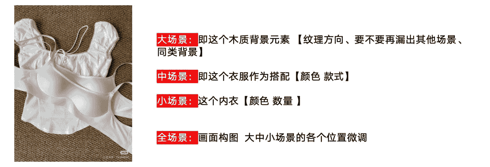

包括我前面给大家提到过的情绪部分的那些笔记，都是一些很适合跨类目迁移的笔记形式。

目前从熟练的角度来讲，一天产出 30 条 AI 结合实拍类的笔记，是没有什么问题的。

## 📖📖 运营部分

运营里面有几个很重要的关键点：

1. 关于商品链接的运营
2. 关于笔记评论区的运营

### 📖 1、商品链接建设

分别来说一下商品链接。因为商品链接会直接影响产品的转化率，所以我们一般建议链接的销量达到最低 10、最高 100。

对于已经在测评时出单的商品链接，我们建议做三个带图好评，尽量带三张图，并配上 20 字以上的文字。因为优质的带图好评会出现在笔记的评论区，这样能够直接增加笔记的转化率。

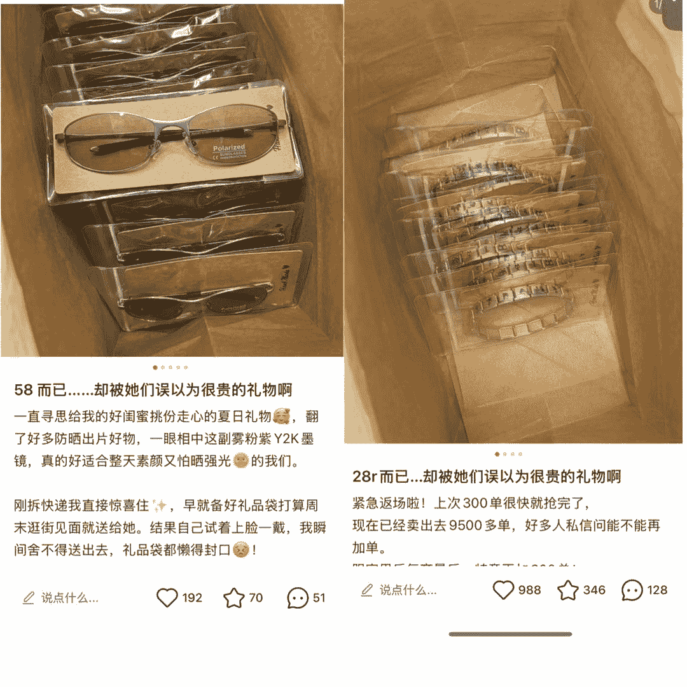

### 📖 2、笔记评论区运营

因为小红书的推流逻辑是 CES 评分体系，评论的占比很重，一条笔记能不能爆起来，很多时候就取决于你评论区的节奏有没有带起来。如果把人工干预的技能掌握好，整体的爆文率能够提升 30% 到 50%。

这里我给大家介绍其中常用的一种，就是抽免单或者说惊喜回馈券。

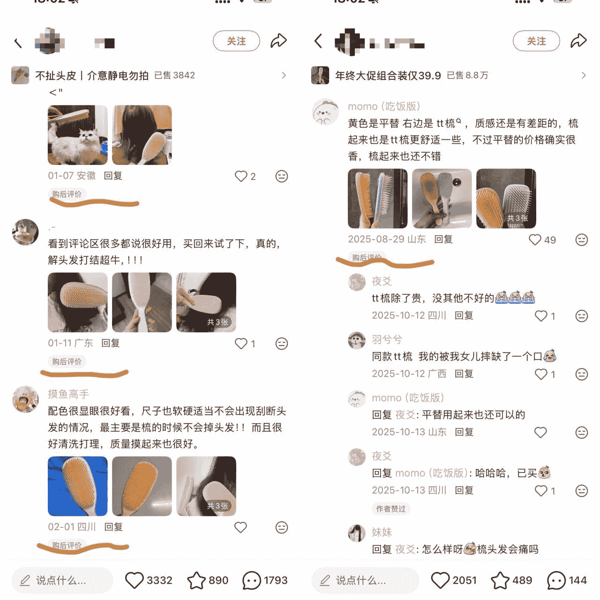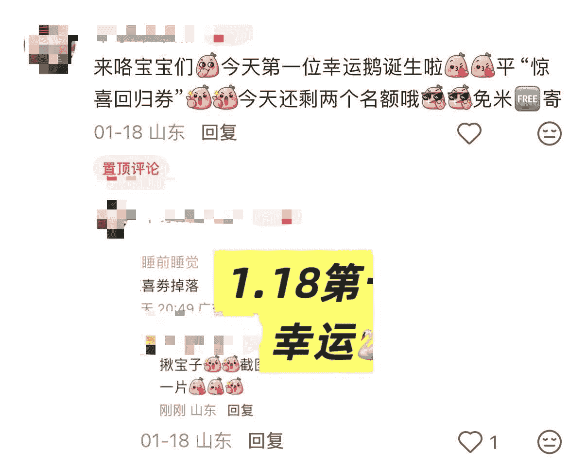

这种评论都会有一定的违规概率，所以说大家在应用的过程中，一定要多换几个话术，降低被识别到的风险。

人工干预的及时性是非常重要的，这就要求大家要定期看自己的笔记数据。

手机端小红书千帆，选择【数据】-【内容】-选择【实时】或者电脑版千帆【数据】-【笔记】--【我的笔记】，选择实时数据--按照发布时间排序，自己设置好就能看今天的笔记出单数据。

但当天数据也会有延迟的情况，看不见也不要着急等一会再看看，所以发了笔记后出单了我们有时候没办法第一时间了解具体是哪一篇笔记出单的，这种情况，就以笔记小眼睛数据为准即可。

除了引导大家评论的评论区干预，还有一些其他类型的，大家也可以同步布局一下。

**01- 蹲反馈类**

为了让感兴趣的用户跟评【蹲一下，增加评论区互动】，每带动一个用户在评论区蹲蹲就有个可能带动整个笔记的流量。

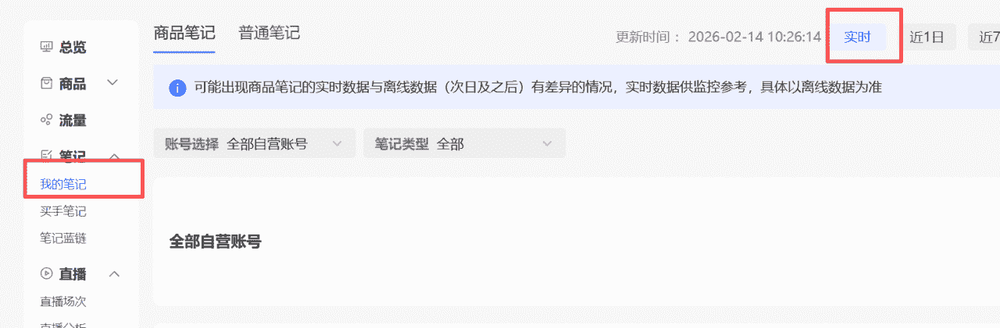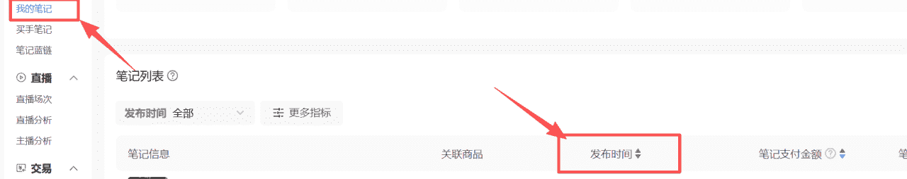

1. 关于我刚打开小红书就花了 9.9💰这件事
2. 已下单 莫辜负
3. 买了，姐妹们蹲我反馈
4. 完脾气不好，要是质量不好我回来骂你
5. 哇趣，这个有意思，买了买了，姐妹们蹲我

这种的建议自己去布局一条，后面再假装自己收到了，去晒一波反馈，这样很多人不仅评论，还会再去购买。

**02- 搬运一条同行点赞高的评论，放到自己的评论区**

同行点赞高说明更易引起大家互动共鸣，很多用户看完笔记都会很喜欢看评论区。

如果评论区出现一条很有意思的评论，就很容易吸引大家的点赞或者回复。

这样的评论可以找小红书同款商品点赞高的评论，抖音同款商品点赞高的视频，评论区也可以去挖掘。

### 📖 3、笔记裂变运营

也就是在实际发笔记的过程中，我们不是盲发，而是要根据平台的数据和自己账号后台的数据，去针对我们数据相对好的内容模板进行裂变。

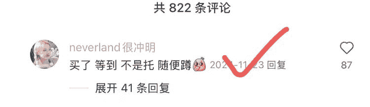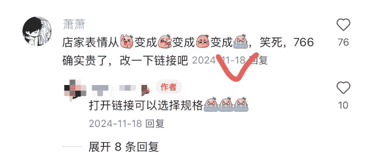

建议大家对于已经陆续出单的账号，每天定好闹钟，在上午 9 点、下午 2 点和 6 点去后台查看笔记的数据和同行的数据。

再大家再统一下关于小红书电商的一些基础认知。

### 📖 1、第一个是关于开店门槛

目前小红书的个人店铺，只要你的小红书账号进行了实名认证，就可以直接开店。大多数类目前期不需要缴纳保证金就可以上架商品开始售卖，等到提现的时候再缴纳就可以。

从规则上来讲，现在建议有时间的小伙伴，整体是做“一拖三”——也就是一个店铺号加三个子账号进行关联，以一组号去打品。

目前小红书平台整体是吃自然流。对于大多数产品的利润空间来讲，非常难通过投放来获取利润。

小红书售卖商品是通过写笔记的形式售卖，目前笔记带货仍然是小红书电商的主流模式。

小红书笔记带货跟大家传统认知上可能不一样。小红书目前是单品打爆，也就是说，当我们觉得一个品在我们的账号上有流量的时候，我们是一直围绕着这个品写不同角度的笔记。

这里我直接给大家准备了系统、具体的怎么开店的详细教程。 小红书电商教程-店铺&账号开通【训练营】

### 📖 2、第二个是关于是否要投放

这是很多小伙伴非常关心的一个事情，也就是现在是不是要投放才能起号？

我可以很笃定的告诉大家，不管是我们自营还是带学员，都是纯自然流起号。

投放会在什么情况下介入？

一个是你已经爆单了，你希望通过投放放大你的流量。比如说你一天本来卖 5 万，你想加一点投放能够冲到 8 万。

另一种情况是，你已经是已经非常非常熟练的运营，希望通过投放来缩短你的起号周期。

也就是说，你的笔记、素材、选品都没有什么问题，原本你可能需要两周起号，现在希望加快速度，缩短到一周。那这个时候，就可以通过投放来加速账号的人群探索。

总而言之，如果你是新手，不建议投放，纯自然流即可。

### 📖 3、第三个关于货源

现在我们 90% 的品在 1688 上都是可以找到货源的。

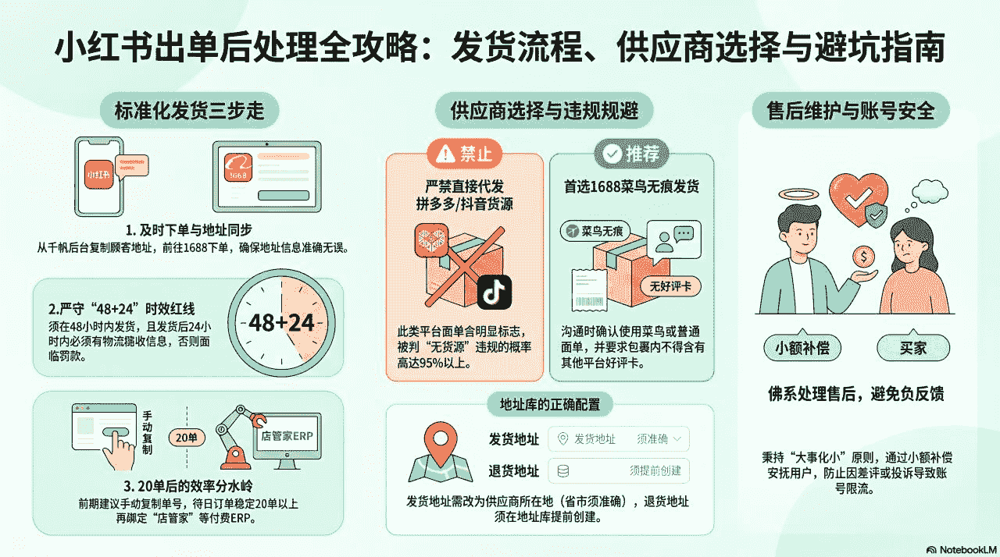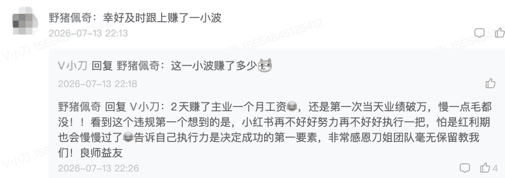

有一些货源小伙伴觉得可能会比拼多多便宜，但是我们依旧还是建议大家走 1688，因为拼多多的商家代发特别难谈。

这里给大家一份供应商沟通的文档。如果平时不怎么跟供应商聊、不知道要注意什么事项的，可以学习一下这个文档。

供应商沟通话术&注意事项 供应商沟通话术 & 注意事项 【小刀轻创工作室】

我觉得 26 年依旧是做小红书最好的时候。

从 23 年到 26 年，玩法一直在变，规则一直在变，但对我来说，我看到的是用户池和天花板一直在增加。

而且每年都会有这么两次的红利机会，就像上一周我们用的个人售卖玩法，虽然说现在平台已经管控不能用了，但是很多小伙伴也是快速小赚了一波。

在小红书，同样的玩法红利，比如说去年年底的 0.1 元玩法、高低价玩法、惊喜盒子玩法等。

整体来讲，我觉得小红书电商是一个比较长线的玩法。在这个过程中，我们需要适应平台的变化，不断去用平台最新的、鼓励大家运营的形式去拿结果。

就像是抖音虽然已经很卷了，现在依旧有人赚钱，小红书电商只要平台不说不干了，那对我们来说就有无限的机会。

最后我分享一个最近让我很感动的反馈，这是一个之前工资只有 3000 多的小伙伴，在小红书上拿到不错的结果之后给我发的信息。

我觉得很有力量，分享给大家。

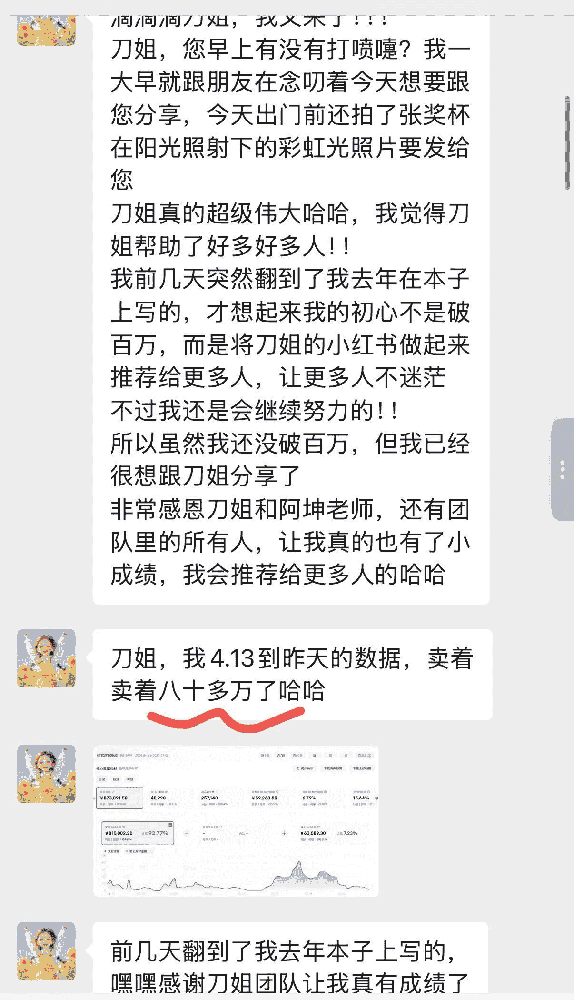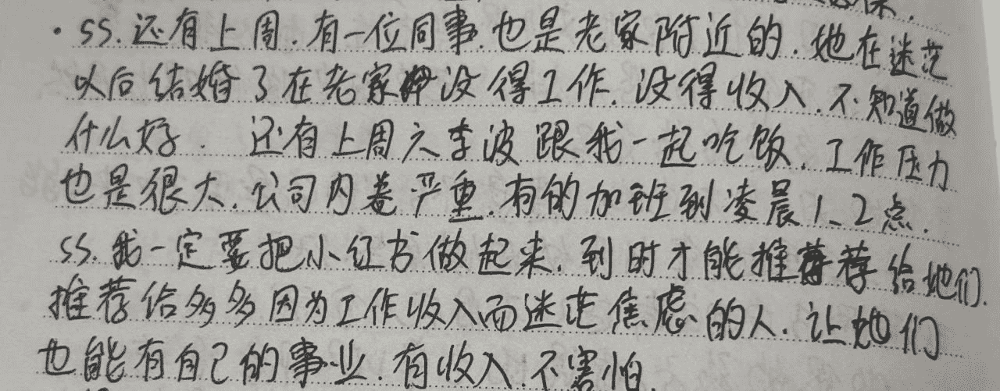

给大家看一下她当时日记本写下的这段话。

我知道当下大家可能会有很多的焦虑、很多的迷茫、很多的困惑，但是想跟大家说最终这些困惑都会随着行动消散的。

我 23 年开始做小红书，24 年的 3 月下定决心自己提着一个箱子从北京回到济南开始扩大项目。

住在酒店找的场地，第一个济南员工面试的时候场地都还没定好，到现在有了近 50 个并肩作战一起奋斗的小伙伴。

不是想说我厉害，是想跟大家说，当年我提着行李箱孤零零来的时候，也是充满了未知和不确定。

但是路在脚下，只要迈出脚步，四面八方都会是前方！！！

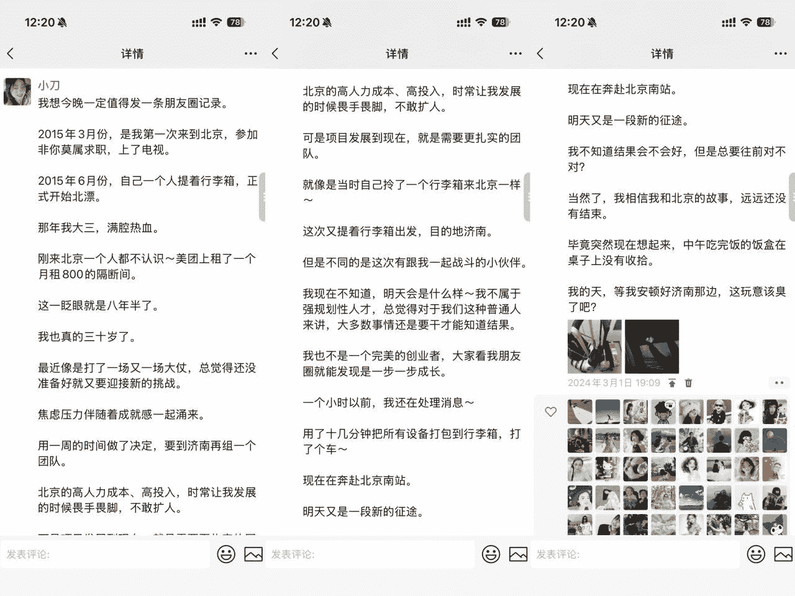

希望不管大家做小红书还是研究任何项目，最终拿到自己想要的结果；希望大家想要退缩的时候，这个小小的逆袭经历，能给大家提供一点力量。

真的到最后了，最后的最后跟大家分享一段话。

以上，共勉。

————分割线————

看完这篇 SOP，你觉得你懂了。但 90% 的人一到实操就会卡在第一步。

工具和教程只是最低级的壁垒，真正的壁垒是“立刻动手”和“圈层信息差”。

如果你想看全网最新的变现玩法，并且和一群执行力极强的极客一起下场拿结果，欢迎围观我的核心私域：【懒人专属群】。

我们不聊虚的，只做商业闭环的拆解与 AI 效率的压榨。系统内已沉淀 1000+ 跑通的套利实战局。

💰 查阅圈子完整数字资产与上车门槛：

https://lazyso.com/insider/

认同价值、准备好下场干活的，扫码加我。

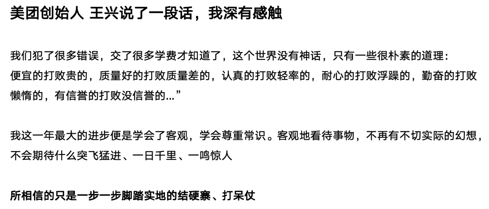

# 微信（lazyhelper1）

备注：【实操上车】，不闲聊

