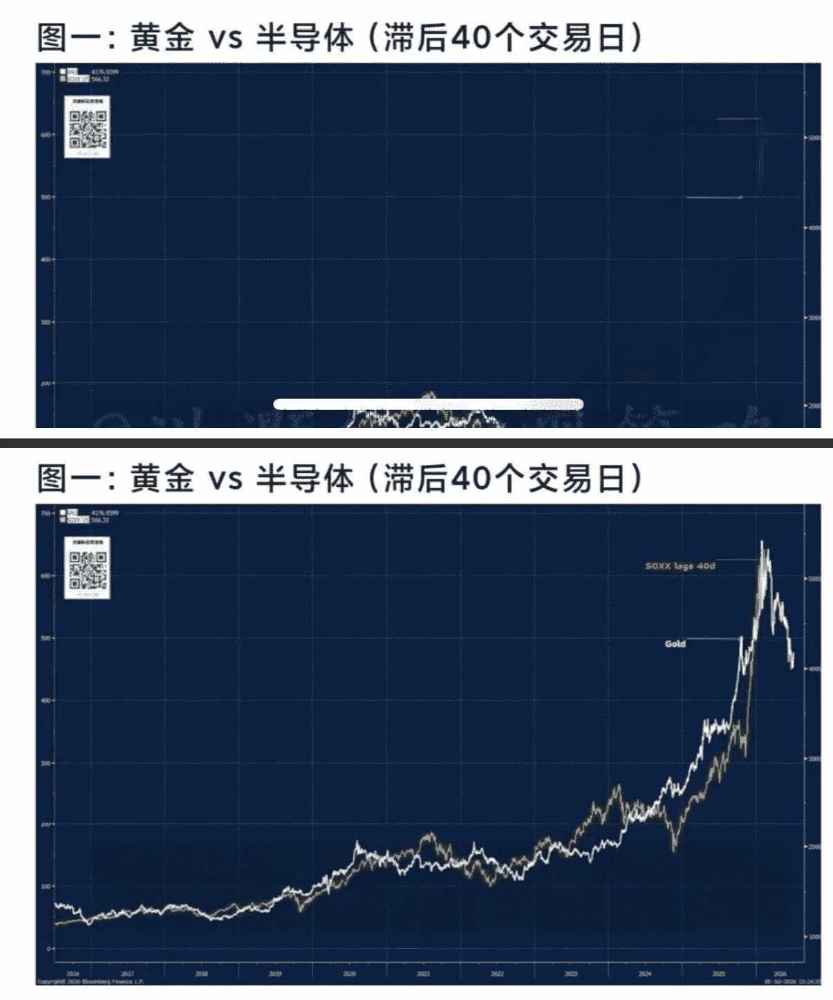
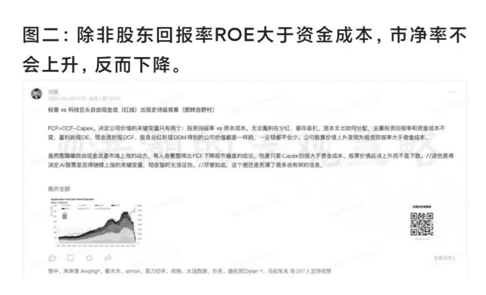
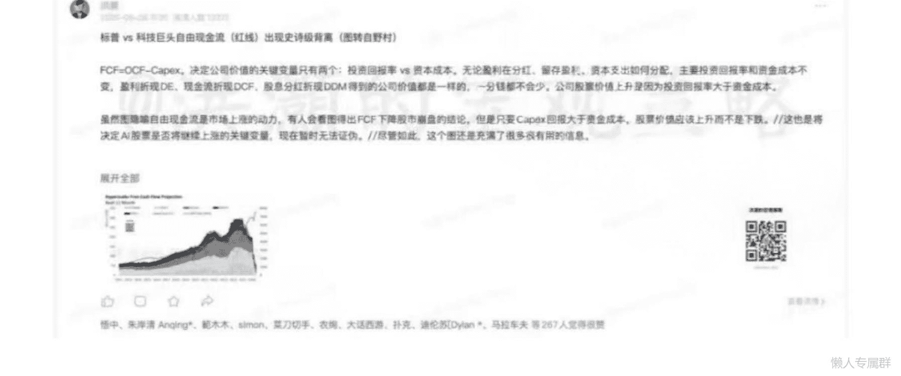
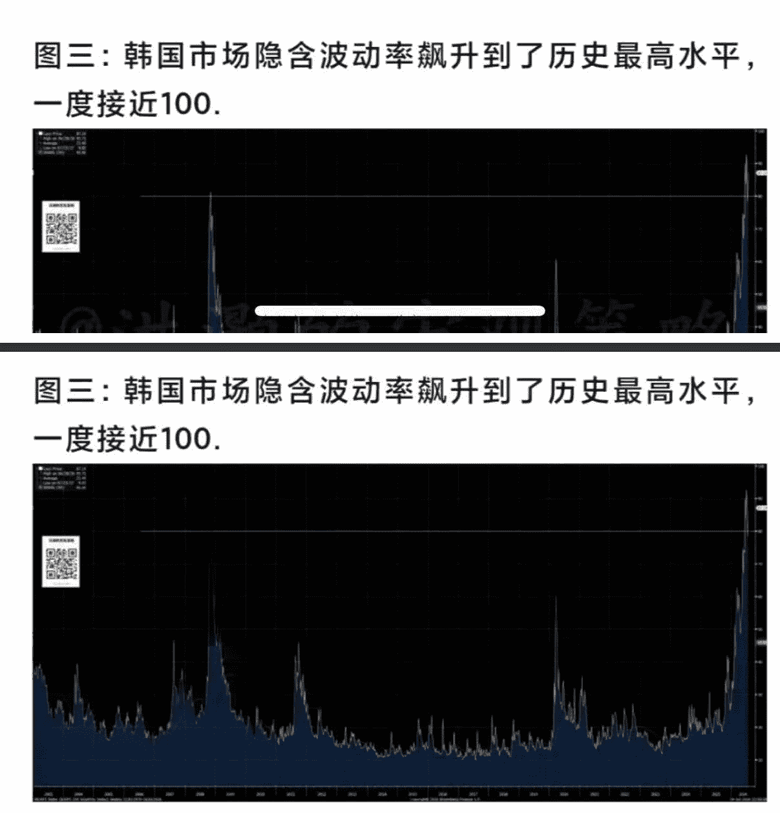
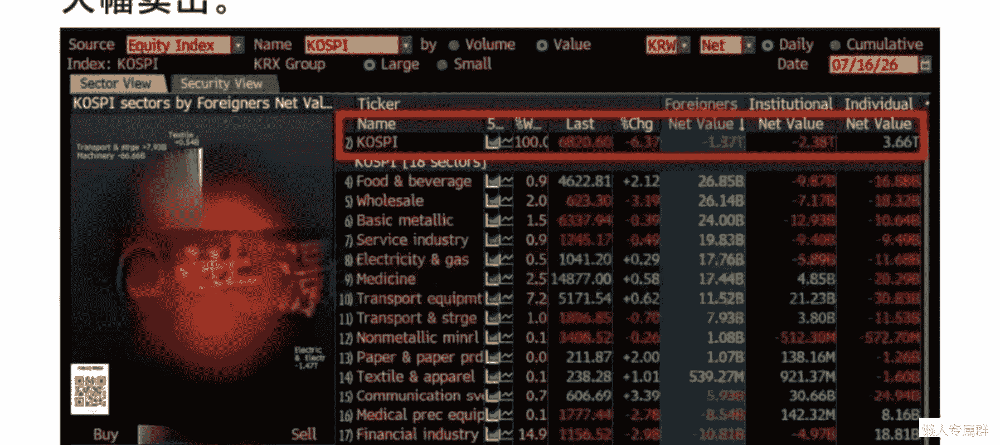
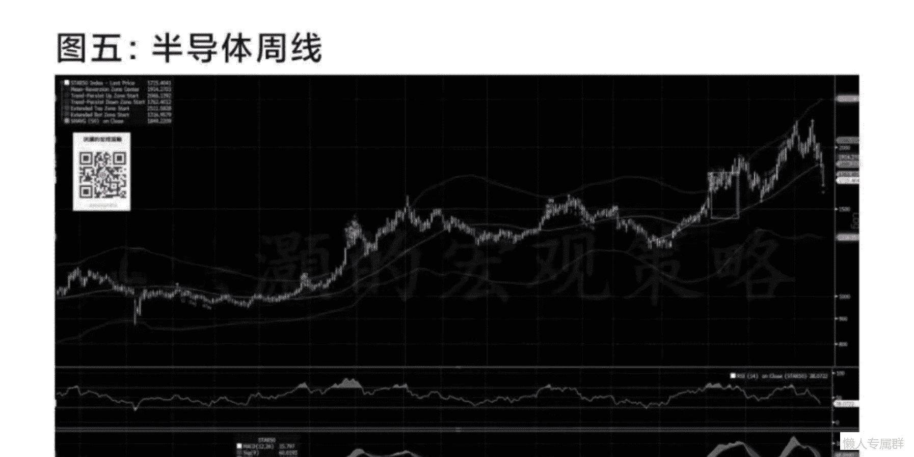
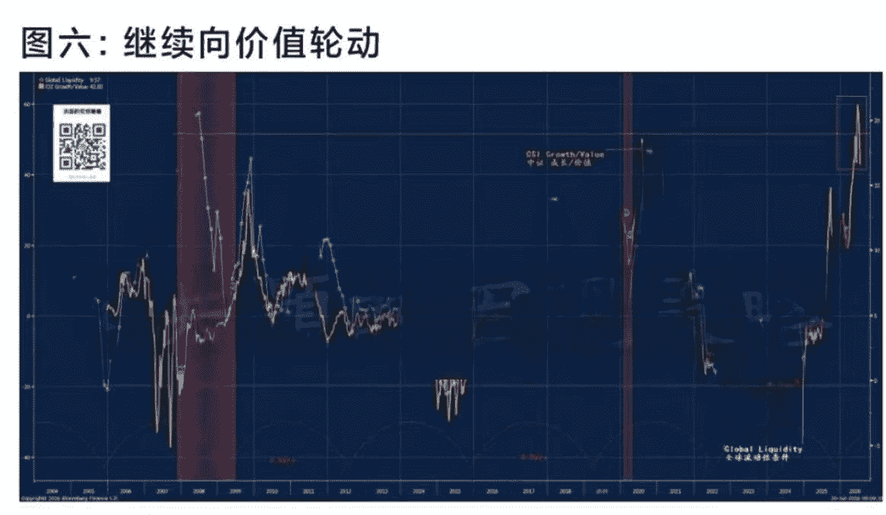
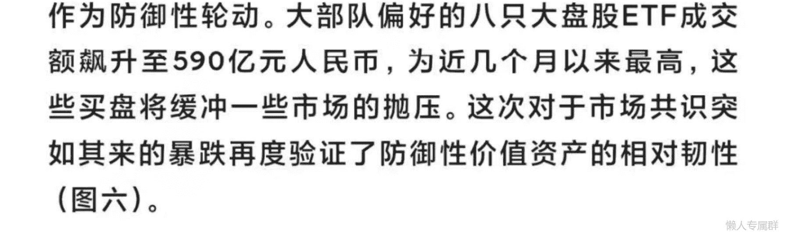
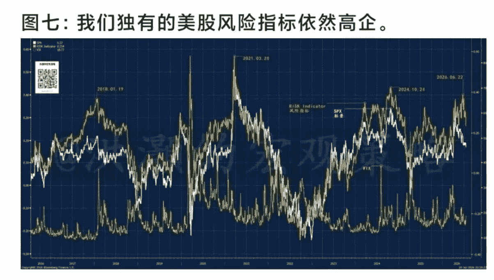

# 洪灝：韩国半导体泡沫破灭意味着什么

**前言**

韩国半导体泡沫破灭意味着什么。

7月17日周五这一天，市场共识期待着一家最大的芯片制造公司的强劲业绩可以在全球半导体板块暴跌之际力挽狂澜。毕竟，韩国这个一两家半导体公司支撑了一大部分市场，在过去的17个交易日里暴跌了25%，从最高点已经跌去了1/3。这是我们有效据以来韩国市场速度最快的回调。

在这次暴跌之前，我们已经在蓝色行星上（注：应为内部平台名称）和专属报告里提前预警了韩国乃至全球半导体行业在经历了“抛物线式的上涨之后，必然迎来抛物线式的下跌”。我们的下半年展望报告《洪灝：2026年下半年展望：2000年泡沫的回响》发表于6月11-12日，以“不如其已”为主题的三地读者见面会在6月12日-14日举行。早在今年的1月29日，我们以同样的逻辑成功预测了黄金白银的一月三十日史诗级暴跌的开始。

很显然，这一轮由AI叙事驱动的全球半导体板块的飙升，其实本质上就是一场杠杆盛宴。我在去年十一月发表的2026年展望报告，已经预测了今年六月份的流动性拐点，并在六月的下半年展望报告中再一次更新了我独有的全球流动性条件模型，并再次讨论了流动性拐点的到来。所有的杠杆型泡沫的破灭，都始于杠杆的崩裂，尤其是美股的1929年、2008年和A股的2015年泡沫。韩国监管最近采取了一系列降低市场杠杆的措施，如提高保证金比例、推迟杠杆型ETF的发行等措施。实施这些措施的初衷是好的，但如果系统里的杠杆要降下来，那么势必将导致部分融资盘被迫清仓。这些清仓卖出的行为必然导致股市价格承压，而在保证金提高之后的市场里，价格的进一步下跌将引起新一轮的强平。如此周而复始，直至杠杆再次回到正常的水平。

如果韩国股市泡沫破灭，那么这很可能是人类历史上从最低的市盈率水平开始的泡沫破灭。经历了这轮下跌，韩国的股市的市盈率在6.8倍，应该是近年来最低的市盈率。而暴跌之后产生的6.8倍的市盈率甚至比2008年的金融危机时期还要低。当然，如果我们用市净率来衡量韩国股市的估值，那么其实估值并不低。经历了这轮史诗级的上涨行情之后，韩国市场的市净率达到了2.8倍，是我们有效据以来最高的水平。

换言之，两种不同的方法给出了两个完全不同的估值判断。但是，两个半导体公司如此强劲的业绩增长却并没有给公司带来更高的市盈率本身就是一个疑问。如果市场认为这些半导体公司可以不断地重复今年成倍的盈利增长，盈利增长是可持续的，那么市场就应该给出更高的市盈率。否则，更低的市盈率只是这些公司在盈利周期高点的表征而已。而市净率位于历史最高反而是一个更恰当的估值衡量，因为高企的市净率本身反映的是未来的资本开支尚未完全计入财务报表里，而非股东回报ROE大幅的可持续地飙升。这个就是现在市场关注的焦点：前期大型科技公司宣布的资本支出计划是否真的可以变现。

图二：除非股东回报率ROE大于资金成本，市净率不会上升，反而下降。标普vs科技巨头自由现金流（红线）出现史诗级背离（图转自野村）

如果韩国监管去杠杆是韩国泡沫破灭的催化剂，那么去杠杆进程以及杠杆何时能够恢复到正常水平将决定了韩国泡沫破灭何时可以稳定下来。可以看到，韩国市场的隐含波动率已经飙升到了史无前例的高度（图三），已经远远高于2008年金融危机时期和2020年疫情时期。

如此高的市场隐含波动率究竟意味着什么？在经历了这轮猛烈的暴跌之后，韩国股市见底了吗？对于全球其它市场和全球半导体板块又有什么影响？

韩国市场隐含波动率VKOSPI是衡量未来30天预期年化波动率的指标。如果读数接近100，则意味着期权市场预期未来一个月内每天都会出现约6.3%的标准差级别波动——过去一年一遇的“惊魂日”，现在变成了家常便饭。实际运行中，VKOSPI受期权流动性枯竭、熔断机制强制冷却等因素制约。当前韩国已多次突破97-98，比如，6月24日飙升到97.98，而6月29日再次飙升到97.99。如此高的观察值已经是“金融危机级别”的尾部定价，接近历史上限区间。

历史上，恐慌指数见顶通常与价格底部相近，因为强平与恐慌对冲同时发生，卖盘随后枯竭。比如2008年触及89、2020年触及82，这两次隐含波动率的飙升都距离韩国市场最后的历史性大底仅几天之遥。然而，这轮韩国走势打破了这一规律：VKOSPI在6月24日、29日两度创下97.78、97.99的历史新高，但彼时KOSPI仍在8,000点附近；此后，韩国指数继续下跌至7月16日的6,821点，跌幅超15%，晚了整整三周，且很可能仍未见底。更反常的是，这轮VKOSPI首次突破90，竟是发生在KOSPI单日暴涨8%那天，而非暴跌日。这些观察说明了，这次的波动率飙升更多反映杠杆ETF机械再平衡引发的韩国市场双向剧烈波动，而非单纯像历史上的恐慌情绪，因此“波动率见顶=市场见底”这一经验法则在本轮至今并不成立，而韩国很可能仍未调整到位。

韩国监管机构披露的杠杆数据显示了去杠杆仍未结束。显性融资余额从峰值仅下降了11%，依然在34万亿韩元左右，仅回到四月水平。信用融资在散户存管金中的占比不降反升。换言之，债务在减少，但剩余投资者的现金安全垫下降得更快，导致市场杠杆比率上升而并未达到去杠杆的目标。这种情况与1929年大崩盘前夕的信用结构极为相似：彼时券商的贷款余额同样先出现小幅收缩，但真正致命的是保证金账户里可以补仓的自有资金枯竭速度远超负债收缩速度，最终酿成“补仓—抛售—再补仓”的死亡螺旋。

更值得注意的是杠杆ETF，24.2万亿韩元的嵌入杠杆规模，七月以来仅有一个交易日出现净赎回，其余交易日仍是净申购。也就是说，虽然显性账户杠杆有一些退潮的迹象，产品化、结构化的杠杆敞口却依然坚挺，风险从账户端转移至工具端，而非真正消失。个人投资者还是净买入，外资与机构分别净卖出。

这一幕似曾相识，2015年A股杠杆牛市顶点崩塌前后，散户“越跌越买”的行为模式同样持续了相当长一段时间，直到融资盘的强制平仓彻底击穿心理防线，市场才真正出现投降式抛售。强平占未结算比例不到4%，远低于10%“爆仓日”阈值。典型泡沫出清尾声往往伴随着散户从抄底转为主动卖出、存管金企稳、信用融资加速下降、杠杆ETF持续净赎回、强平见顶回落等等迹象。目前为止我们还没有观察到这些现象，说明韩国泡沫尚未最终出清。对全球市场而言，这意味着风险尚未释放完毕，任何反弹暂时都应被视为去杠杆过程中的技术性喘息，而非趋势反转。

图四：韩国散户还在净买入，外国投资者和机构则在大幅卖出。

韩国股市的剧烈波动很难不影响到中国主要指数。CSI300日内高点4664、低点4492，振幅3.68%，约为2.2倍标准差，位于近20年震荡的前4%之内，剧烈但还未到极端。然而，科技硬件含量很高的科创50指数日内的振幅高达7.92%，约4.37σ，位于历史数据的前0.3%，历史上只有四个交易日日内震荡达到如此高的水平（图五）；创业板日内振幅7.00%，约3.69σ，位于历史数据的前1%；深成指5.32%，位于历史数据的前1.5%；而上证的日内振幅仅3.21%，约1.90σ，位于历史数据的前4%左右。费城半导体指数快速跌入熊市。

图五：半导体周线

可以看到，从科创50到上证的振幅梯度，与各指数的科技成长敞口高度相关。这种现象说明了，这次市场下跌是结构性、行业性的，而非系统性信用事件。权重股所在的银行、能源、国企板块几乎独善其身。这也是我们下半年的策略——以核心资产、高股息资产作为防御性轮动。大部队偏好的八只大盘股ETF成交额飙升至590亿元人民币，为近几个月以来最高，这些买盘将缓冲一些市场的抛压。这次对于市场共识突如其来的暴跌再度验证了防御性价值资产的相对韧性（图六）。

费城半导体指数相对200日均线的偏离度已达历史极值，半导体业绩的确强劲，但Kimi K3的问世触发对整个AI资本开支循环融资逻辑的重新拷问。我们一直认为，虽然内存的需求依然在强劲地增长，但是中国科学家将以技术进步来跨越西方的技术封锁和局限，以软件制服硬件。

若AI相关的资本性开支被系统性下修，全球半导体供应链将被重新定价，这种震荡将不可避免地传导至半导体以外的行业，尤其是在美联储政策路径不明、全球流动性条件收缩的背景下，任何依赖杠杆维系的估值泡沫都将无处可藏。积薪厝火，薪未尽而火已炽。

**总结一下：** 韩国股市泡沫开始崩裂，其速度之快为历史之最，与韩国市场散户杠杆的高企息息相关。韩国监管采取的降杠杆措施值得尊敬，但也将导致在杠杆回到正常水平之前市场波动很难平息，强平行情此起彼伏。我们的数据分析看到，韩国的融资水平依然高企，由于韩国市场暴跌，杠杆水平不降反升，而韩国散户在机构和外国投资者大幅抛售的情况下依然在义无反顾地入场接货。这与杠杆水平正常化往往伴随的市场情况不符。韩国股市隐含波动率高企意味着市场在计入尾部风险事件，日间涨跌6%的巨幅波动将持续一段时间，不再罕见。

韩国半导体板块的巨震如期出现在了我们泡沫预测的时间窗口，验证了我们一个月前对于下半年的展望预测，也将影响到全球半导体板块的运行。费城半导体指数已经跌入熊市，3倍做多韩国指数已经跌了2/3。周五中国市场的巨震显示这场调整显示了更多的结构性特征，大资金入市也将帮助稳定市场的波动性，而投资者暂时还是应该采取防御性姿态，继续关注价值防御性板块轮动。

洪灝

2026.07.20

————分割线————

在这个AI能替你写代码、写文章的时代，基础技能正在迅速贬值。绝大多数人正被淹没在海量的免费垃圾信息里，陷入低效的体力内卷。

当“努力”不再是壁垒，人与人之间唯一的护城河，只剩下“信息过滤”的效率与“认知系统”的维度。

圈子已稳定运行7年。我们每天利用Python爬虫与大模型算力，过滤全网最顶级的政经内参和搞钱风向标，做你最冷酷的“外部大脑”。

如果你认同这种“重塑认知防线”的极客主义，欢迎围观我的个人情报智库：【懒人专属群】。

https://lazyso.com/insider/

认同信息过滤价值、想省下每天3小时无效阅读时间的读者，扫码加我微信（lazyhelper1）

