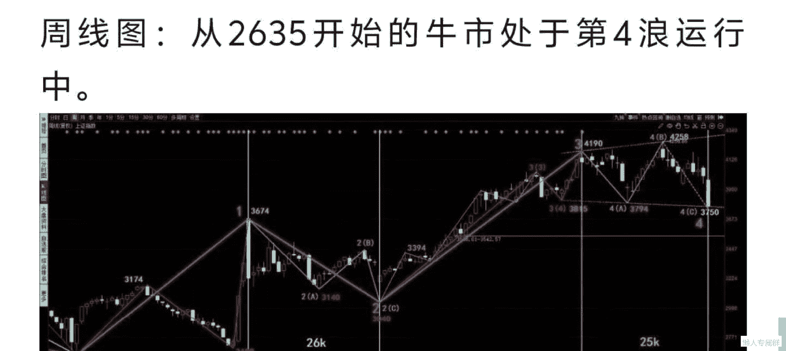
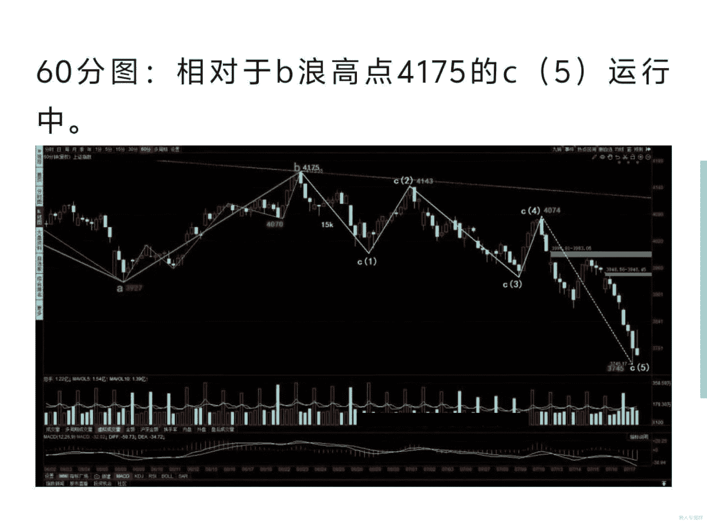
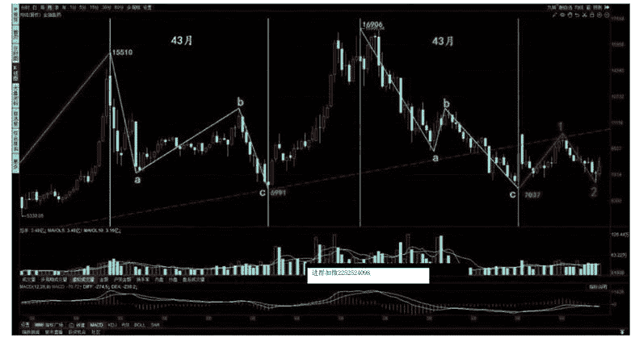
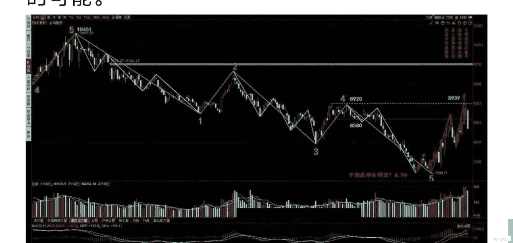

公众号懒人搜索，懒人专属群分享

## 本轮牛市结束了吗？

260719 猫小莲识底

整理：公众号懒人搜索，懒人专属群精选

懒人微信：lazyhelper1

很多心得并不适合公开分享，更适合小范围交流。深度了解知识，知道市场本质和内在的运行规律，那么就可以举一反三，推算出未知的东西。只想得到答案，对技术不感兴趣、不愿意深层次研究的读者，请谨慎付费！

免责声明：本文所涉及时间、空间、浪形结构划分、提及的板块，仅为个人研究笔记心得分享，不构成任何投资建议。投资有风险，入市需谨慎！

本文包含以下几点内容：

1. 本轮牛市结束了吗？
2. 七月下旬涨跌节奏推演。
3. 七月下旬观察的板块。
4. 月线反转板块。

市场在七月行情观察内提醒的7月2日附近见高点，然后调整至7月17日以来，连续回落13个交易日，整体行情较为惨烈。首先在7月2日附近见到高点，然后回落

至7月17日附近见c落低点。3800附近是大资金较为认可的底部。标准的扩张型结构调整，底边支撑在3815-3794连线3750附近。

风险是涨出来的，机遇是跌出来的。目前大多数标的风险得到释放，市场孕育着新的机会。

### 1. 本轮牛市结束了吗？

周线图：从2635开始的牛市处于第4浪运行中。

其中：第2浪是ABC结构调整，运行时间26周，回落了634个点。第4浪是扩张型结构整理，运行时间25周，回落了446个点。

第4浪对比第2浪较为温和，并未有效跌破扩张型底边3750附近，所以从技术上维持牛市里中期调整的看法。

从基本面来看：引导居民储蓄搬家，从而激活内需的任务任重道远；同时"十五五"规划（2026-2030年）关于新质生产力与金融强国的战略目标正在稳步推进，所以还是需要市场继续发挥相应的作用。

所以综合技术面和基本面来看，牛市并未结束。

### 2. 七月下旬涨跌节奏推演

60分图：相对于b浪高点4175的c（5）运行中。

15分图：把这个c（5）进行分解。

疑似c（5）c中的第5落运行中。预期在7月20日探明c落低点，然后反弹至7月23日附近回落。若7月23日产生反序低点，其后反弹较弱（概率偏低）。

注：其中20月线在3733附近，存在很强的支撑。

### 3. 七月下旬观察的板块

- ①半导体产业链（半导体设备和材料、存储芯片、先进封装、MLCC）
- ②国产算力产业链。
- ③有色金属类（铜）
- ④AI应用类。

其中①②③类需要准确把握c落低点，暂时以超跌反弹为主。

### 4. 月线反转板块（长线）

全指医药。

月线图：从2015年6月牛市顶部15510至6991，运行ABC结构调整，周期为43个月。从2012年2月的牛市顶部16906至7037，运行ABC结构调整，周期为43个月，至今没有创出新低，说明43月等周期并未失效。

目前疑似第3浪酝酿中。其中第2浪回落的原因是由于同期半导体不断上涨，形成极致抱团，导致全指医药被动成为血包。

日线图：上周在前面筹码密集区运行完某级别第1浪（其中由更小的5构成），目前处于第2浪回落中，存在跟随大盘见底后，运行第3浪的可能。

其中创新药具有科技属性，并且同时存在反转的三大动能：

- ①政策扶持：从"控费压价"转为"扶持创新"，医保目录动态优化、基药目录首次纳入创新药，且产业被定位为"新兴支柱产业"。
- ②业绩爆发：从"概念炒作"转为"业绩爆发"，在License-out模式下，国产新药密集获批，多家龙头公司预告净利润翻倍增长。
- ③资金轮动：科技股过热，资金涌入估值洼地。

所以从技术面与基本面相结合来看，医药类（创新药）具有反转的可能。

祝大家顺风顺水顺财神！

本文内容仅为个人观点、心得分享、不构成任何投资建议！

————分割线————

在这个AI能替你写代码、写文章的时代，基础技能正在迅速贬值。绝大多数人正被淹没在海量的免费垃圾信息里，陷入低效的体力内卷。

当"努力"不再是壁垒，人与人之间唯一的护城河，只剩下"信息过滤"的效率与"认知系统"的维度。

圈子已稳定运行7年。我们每天利用Python爬虫与大模型算力，过滤全网最顶级的政经内参和搞钱风向标，做你最冷酷的"外部大脑"。

如果你认同这种"重塑认知防线"的极客主义，欢迎围观我的个人情报智库：【懒人专属群】。

https://lazyso.com/insider/

认同信息过滤价值、想省下每天3小时无效阅读时间的读者，扫码加我微信（lazyhelper1）

