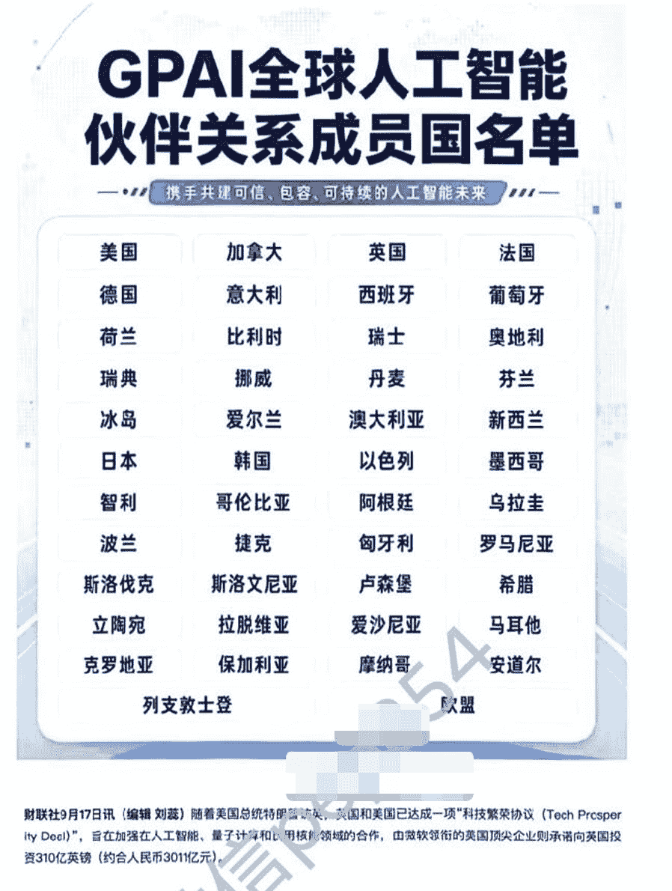

公众号懒人搜索，懒人专属群分享

最新的思考与总结

整理：公众号懒人搜索，懒人专属群精选

懒人微信：lazyhelper1

260719 第四维的梦想

流动性的问题，最终只能由流动性来解决。正所谓解铃还须系铃人，既然此前的下跌主要由资金推动，那么行情能否真正企稳，最终也要等待资金端率先释放明确的转向信号。

流动性拐点无非来自两条路径。要么是场外流动性重新注入，以增量买盘打破“流动性衰竭—鬼故事扩散—价格继续下跌—被动卖盘增加”的死亡螺旋。要么是场内流动性完成充分出清，杠杆盘、赎回盘和恐慌盘逐步耗尽，市场进入卖无可卖的状态。前者体现为买单突然增加，后者体现为卖单逐渐消失。一个是增量资金主动托住价格，一个是存量抛压自然衰竭。表现形式不同，本质上都是资金供需关系出现了边际逆转。

此刻，笔者并不悲观，但有一个基础判断需要说清楚。未来，AI 公司仍然会不断创出新高，但并不是每一家AI 公司都能重回新高。真正处于AI 时代核心受益位置的公司，依然会在盈利增长的保护下，等待估值完成修复，并在业绩与估值的共同推动下屡创新高。而对于大部分仅仅依靠概念、情绪和远期预期支撑的公司而言，则可能长期留在原地，甚至继续下探。

下面，将进一步探讨笔者认为的版本答案是什么。不构成任何推荐，也不作其它用途。逻辑巡礼系列，具有一定时效性。全文7200 字+，限时下架。

基本原则有三条。第一，看是不是杠杆资金的重仓区。跌得最狠的地方，往往也是筹码换手最彻底的地方。第二，看下跌期间产业逻辑有没有被继续验证，包括资本开支上修、涨价蔓延、扩产提前等。第三，看位置。跌回杠杆加速膨胀起点附近的品种，等于把此前的泡沫阶段完整消化，而产业逻辑本身并没有发生改变。三条都占的方向，往往意味着出清结束后的反弹弹性更加干净。

## 存储

先从存储谈起。都知道这一领域的优势主要集中在韩国，也就是三星和SK 海力士。如今，随着越来越多的人意识到存储周期的确定性，资金也在持续涌入。而投资中最值得警惕的，往往就是所谓的“大众确定性”。

当一项投资逻辑已经变成连“老登”投资者都耳熟能详的共识，所有人都知道存储是什么，也都知道它的重要性时，往往意味着交易已经进入高度拥挤、杠杆逐渐积累的阶段。这也是为什么美国市场风险偏好一旦收缩，韩国股市便迅速出现剧烈调整。但需要注意的是，这并不是存储产业逻辑突然发生变化，而是此前过度拥挤的资金开始同步撤退，导致流动性压力被集中释放。

从产业逻辑来看，至少到2030 年，存储行业的供需格局大概率不会发生根本性改变。最近，SK 集团董事长崔泰源在大韩商工会议所济州论坛期间接受采访时表示：“AI 相关半导体明年的需求预计将比今年至少增长60%-100%。”他进一步指出：“即使从整个存储半导体市场来看，需求也至少会增长50%-60%。”谈到扩产时，他表示：“几乎没有哪家公司能够在明年显著增加供应量，因此明年供需缺口只会进一步扩大。”他还补充称：“全球企业都在争抢存储产品，甚至可以用‘一片混乱’来形容。”换句话说，即使按照目前已经规划的扩产节奏，供给依然难以完全匹配快速增长的AI 存储需求。这意味着，存储企业未来几年的盈利能力，也就是EPS，依然具备较强确定性。

不过，市场交易的另一条逻辑并不在EPS，而是在PE。市场开始担心，存储价格和利润率长期维持高位，会不会反过来挤压下游AI 厂商的资本开支。最近甚至传出，美国希望三星和SK 海力士与下游客户“共享AI 红利”，通过价格或其他方式让渡部分利润，以降低AI 基础设施建设成本。

但话说回来，只要EPS 仍然具备支撑，在杠杆完成出清之后，市场最终仍会重新审视，个位数PE 是否合理。因为即使存储厂商未来通过价格让利，与下游共同分享AI 红利，本质上也只是产业链利润分配方式的调整，并不会改变存储供需偏紧的核心格局。换句话说，市场短期交易的是利润率是否会下降，而长期重新定价的，依然是盈利能否持续。

笔者认为存储未来大概率会进入依靠LTA（长期协议）讲故事的阶段，也就是从过去单纯交易价格上涨，逐渐转向交易长期出货确定性。存储厂商可能会适度放弃部分极端价格，把一部分AI 红利让渡给下游，但换来的则是更高的出货量和更强的长期可见度。

如果存储厂商坚持不降价，意味着利润率持续维持高位，那么下游AI 厂商的成本压力也会进一步增加。毕竟，英伟达等AI 基础设施厂商也已经开始优化系统成本和存储配置。如果存储环节利润过度挤压产业链，最终影响的将是整个AI 基础设施投资节奏。因此，海外存储未来无论选择哪条路径，其实都存在一定博弈。

笔者更倾向于，经历这一轮杠杆清理之后，三星、SK 海力士等御三家仍有望迎来估值修复和惯性反弹。但与此同时，随着市场对其高确定性形成新的共识，未来可能逐渐进入低波动阶段。换句话说，就和如今的英伟达一样，会是产业趋势最确定的核心资产，稳如老狗，但超额收益空间就暂时不要想了。

但这里还有一条隐藏主线，就是中国存储力量的崛起。笔者认为，这场竞争的结果，无论从哪个方向演绎，中国存储产业都具备较强的确定性。

首先，假设HBM 和DRAM 周期能够持续到2030 年甚至更久，也就是说存储价格长期维持高位，那么三星、SK 海力士、美光组成的全球存储“御三家”无疑将持续受益。而对于CXMT 而言，这同样意味着更大的发展窗口。如今CXMT 已经具备较强的盈利能力，未来依靠国内领先的工程实现能力、持续提升的技术水平以及本土市场需求，有望实现持续出货、持续盈利，并进一步推动产能扩张。

退一步来看，如果未来CXMT 加速追赶，使HBM 和DRAM 周期提前进入供给扩张阶段，那么产业链同样不会缺少机会。因为无论是CXMT 的扩产，还是御三家的资本开支增加，都会带来半导体设备、材料以及相关产业链至少数年的景气周期。

换句话说，中国存储行业无论走向哪一种路径，最终指向的都是扩产这一确定性变量。高景气延续，需要扩产满足需求；竞争加剧，同样需要扩产提升份额。无论结果如何，最直接受益的都将是半导体设备和材料环节。换一个角度看，中国存储产业的崛起，本身就是新一轮半导体设备周期的重要驱动力。

此外，存储设备周期与存储周期在历史上也并非始终保持高度相关。原因在于，存储周期更多由供需关系和价格波动驱动，而设备周期则更多受技术升级和资本开支推动。随着存储技术持续演进，新工艺、新架构都会带来设备需求和设备价值量的提升。再叠加国内企业的“卷王”属性，未来国产存储的发展路径大概率会先从DRAM 切入，再逐步向HBM 等高端领域突破。而这也会给三星、SK 海力士、美光等御三家带来持续的竞争压力，迫使其在未来三年进一步加大HBM 投入力度，加速产能扩张和技术迭代，这反过来又造成了DRAM 的紧张。无论是DRAM 扩产，还是HBM 扩产，最终都会推动半导体设备需求持续增长。

## 光通信

再来看通信。笔者认为，光通信反而是接下来最具预期差的方向之一，可以直接看下图。过去30 年，硬件算力提升了约600 万倍，也就是平均每两年提升约3 倍；但互连带宽仅提升约450 倍，也就是每两年约提升1.6 倍。换句话说，过去几十年，算力增长速度始终快于数据搬运能力，算力与带宽之间的鸿沟还在不断扩大。

而随着AI 模型规模持续扩大，单纯依靠计算芯片本身提升性能正在越来越接近物理极限。英伟达4-die GPU 方案受到先进封装、基板以及散热等工程约束影响，意味着未来AI 系统性能提升将越来越依赖高带宽扩展。

这也意味着，互连带宽正在迎来真正的价值重估阶段。过去市场更多关注“谁提供更多算力”，但未来AI 竞争的核心问题会逐渐转向“如何让更多算力高效协同”。通信，正在成为AI 基础设施中的关键瓶颈。

很多人其实还没有意识到这一变化。今天在《Kimi K3：2.8 万亿参数背后，三个被忽略的信号》中，笔者也提到，Kimi K3 官方部署手册明确指出，更大规模的高带宽通信域能够提升推理效率，并建议部署在64 个或更多加速器组成的超节点中。

从演进路径来看，Scale-out 仍将是未来几年光通信需求的第一增长曲线。传统可插拔光模块将继续从800G 向1.6T、3.2T 演进，随着单端口带宽不断提升，以及AI 集群规模持续扩大，硅光技术将在这一过程中迎来大规模应用。而在Scale-up 方向，随着GPU、ASIC 等AI 加速器之间的数据交换需求快速提升，传统铜互连逐渐逼近距离、功耗和带宽极限，NPO 会率先进入放量阶段。再往后，随着先进封装、玻璃基板等技术逐步成熟，CPO 将在更高带宽、更低功耗的需求推动下迎来真正的大规模应用周期。

换句话说，光通信并不是简单的“某一种技术路线替代另一种技术路线”，而是随着AI 系统从Scale-out 向Scale-up 演进，光互连将从机架间、设备间逐步走向芯片附近，价值量也会不断提升。

因此，笔者当下关注的是ZJXC、XYS、DSJM、CGHX 和YJKJ 等。其他更细分的上游，可以根据以上的逻辑进行挖掘，欢迎带逻辑积极交流。

## 算力

最后，再来看算力。海外算力其实没有太多悬念，核心仍然是英伟达和谷歌。未来算力的发展方向，本质上一定是围绕“减少数据搬运、提升系统效率”展开，也就是从单纯追求计算能力，逐渐走向计算、存储与通信的深度融合。

过去几十年，摩尔定律推动晶体管数量持续提升，算力快速增长。但进入AI 时代后，限制系统效率的已经不只是计算单元数量，而是数据如何在计算、存储和内存之间高效流动。尤其是在大模型时代，参数规模、Token 数量以及上下文长度持续提升，数据搬运带来的延迟、功耗和带宽压力正在变得越来越突出。

因此，未来AI 芯片的发展趋势，会从传统的“计算中心”逐渐转向“数据中心”。无论是HBM、高带宽内存，还是CXL 内存池化、近存计算，本质上都是为了减少CPU/GPU 与存储之间的数据搬运，让数据更加靠近计算单元，从而提升整体系统效率。

笔者认为，英伟达未来的演进路径，很可能会先从传统存储侧入手，通过与存储厂商协同设计下一代HBM Base Die，让计算芯片与存储之间实现更深层次的融合。这从某种意义上，也是AI 产业链上下游共同分享AI 红利的过程。而在更远期，随着CPO 等光互连技术逐渐成熟，光通信有望进一步进入更靠近计算和存储的互连环节，突破传统电互连在带宽、功耗和距离上的限制。

前段时间，三星举办了一场线下交流，笔者也注意到三星正在积极布局相关方向。不得不说，拥有晶圆制造能力，在未来AI 基础设施竞争中确实具备天然优势。

而这里又会引出另一个值得关注的公司，Intel。事实上，Intel 一直在“偷偷摸摸”地搞ZAM 存储。未来Intel 一定会强化存储与先进封装能力，那么，这里笔者会有一个新的推论，未来AI 存储与计算融合的发展，会不会由英伟达和Intel 共同推动？毕竟，从战略位置来看，英伟达掌握AI 计算生态，而Intel 拥有美国本土领先的制造、封装和系统能力。如果未来AI 基础设施竞争进一步从单一芯片竞争，升级为全栈生态竞争，两者之间存在进一步协同的想象空间。

其实，话讲到这里，也就能理解为什么笔者此前认为，御三家存储短期内并不会出现系统性问题，真正的压力窗口可能要等到2029 年甚至2030 年前后。因为未来AI 基础设施的发展方向，本质上是存算融合，以及光互连逐渐深入计算系统。存储行业的竞争，也将不再只是单纯比拼DRAM、HBM 的制造能力，而是比拼谁能够更好地完成存储、逻辑、封装和互连的协同设计。

在这一方向上，三星由于同时拥有存储、晶圆制造、先进封装等完整能力，可能尚有一战之力，但是它最大的短板就是没有GPU。而SK 海力士和美光在存算一体时代，只能尽快主动拥抱英伟达。换句话说，未来存储行业真正的竞争，不只是“谁能生产更多HBM”，而是“谁能定义下一代AI 数据流架构”。

这也是为什么笔者认为，未来几年御三家的盈利周期仍然具备确定性，但到了2029 年之后，产业竞争的核心变量可能会发生变化。

## 国产算力

至于国内算力，则是一个完全不同的故事。到现在，市场中仍有不少人认为国产AI 芯片“能力不行”，这是最大的认知误区。更准确地说，不是国产芯片没有能力，而是在与英伟达最顶尖产品直接对比时仍存在差距。而这种差距，并不完全来自芯片设计能力本身，而是来自整个AI 半导体产业链的限制。尤其是在先进晶圆制造、先进封装以及高端HBM 配套方面，我们目前仍存在明显短板。

如果先进制程和关键设备限制不存在，特别是EUV 光刻机不再成为核心瓶颈，那么中国在3nm、2nm 等先进逻辑芯片，以及高端HBM 存储领域的突破速度，可能会远超市场当前认知。换句话说，中国AI 算力真正的问题，并不是“做不出来”，而是在先进制程、供应链协同以及生态成熟度方面仍需要时间突破。

而这也是为什么未来国产算力的发展路径，并不只是简单追赶单颗GPU 的峰值性能，而是通过架构创新、软件优化、集群规模化部署以及国产供应链完善，逐渐形成自己的AI 基础设施体系。

但话说回来，AI 芯片竞争也并不意味着所有玩家都必须达到英伟达最顶尖产品的水平。对于大规模AI 应用而言，核心考量并不仅仅是单芯片性能，而是综合成本、供应稳定性、集群效率以及生态适配能力。更重要的是，即便是英伟达最先进的芯片，也不是市场想买就能无限获得。事实上，即使美国本土的大型云服务商，在很多时期也需要面对顶级AI 芯片供给紧张的问题。

因此，国产AI 芯片真正的机会，并不是在短期内完全替代英伟达，而是在满足自身庞大的AI 基础设施需求过程中，通过持续迭代逐步缩小差距，最终形成具备竞争力的国产算力生态。

在此，笔者再强调一次，一定要扭转一个市场认知，国产芯片及其配套设施在推理端已经具备性价比。此外，从DeepSeek 的发布节奏来看，从国产算力优化到模型能力迭代，整个产业飞轮正在明显加速。过去市场关注的是单点技术差距，而未来真正决定竞争力的，将是芯片、软件、模型和基础设施之间的协同效率。换句话说，国产算力在满足大规模AI 应用需求的过程中，通过持续优化成本、效率和生态，逐步形成自己的竞争优势。

当下，国产AI 芯片能否实现规模化放量，关键取决于两大变量。一是晶圆代工厂的良率提升，二是整体产能的持续释放。据笔者了解，目前良率仍处于持续爬坡阶段。与此同时，产能扩张也在持续推进。随着“良率提升+产能释放”两条曲线同步向上，国产AI 芯片未来的出货规模仍具备较大的提升空间。

再来看需求端。前段时间，传出昇腾进入韩国市场的消息，很多人对此并不以为然，认为国产芯片与英伟达仍存在明显差距，既然可以买GPU，为什么要选择昇腾950？

其实，笔者认为这种理解存在一定偏差。产业竞争从来不只是单纯比较峰值性能，地缘优势、供应链关系以及成本优势，都会创造真实的市场空间。尤其中国长期以来都是韩国最大的贸易伙伴之一，在部分场景下，国产算力具备天然的合作基础。

当然，笔者并不是认为昇腾会在韩国市场大卖特卖，这件事情更重要的意义在于，它释放了一个信号，国产AI 算力正在从国内市场走向更广泛的国际市场。

而更大的市场，则在于WAICO 世界人工智能合作组织。看目前参与名单，很多成员来自南方国家，或者说是正在快速数字化发展的新兴市场国家。但笔者认为，这恰恰是一个历史性机会。未来，帮助这些国家建设AI 数据中心，有点类似过去的能源基础设施建设。

当然，这与过去帮助一些国家建设高铁、公路等传统基建存在本质区别。AI 数据中心一旦落地，需要的不只是服务器，而是一整套AI 基础设施体系，包括国产AI 芯片、光模块、电力系统、数据中心建设以及后续的软件生态。

如果说过去全球竞争围绕的是石油、天然气等能源资源，那么未来AI 时代的重要资源，就是算力和Token。市场一直将Token 比作新时代的“石油”，而数据中心就是承载这些数字能源的“油井”。

因此，未来围绕AI 基础设施的建设，不只是一次设备销售，更可能形成长期的生态收入和服务收入。谁能够参与到全球AI 基础设施建设中，谁就有机会分享到AI 时代持续增长的“算力红利”。

讲到这里，可能有人会产生一个疑问，国内想到了，美国人难道想不到？答案当然是否定的。GPAI 早就把北美和欧洲纳入势力范围，这也是未来英伟达长期的饭票来源。早在去年九月，特朗普访英的时候，就承诺帮英国建设AI 数据中心。

公众号懒人搜索，懒人专属群分享

讲回到国产算力，这也就意味着下游需求在未来很大程度上并不是核心问题了。此外，随着国内开源大模型公司的成功，笔者认为他们很快会配合上面的战略走向 token 出海的加速期。要注意，这里训练端当下还是得靠 GPU 的，因为 GPU 的确更具通用性，这依然是毋庸置疑的。

那么，回到供给端。SMIC 的任务一定是最重的，它的良率和产能就是供给端最需要的一环，其他的晶圆厂则起到辅助作用，然后先进封装也是需要紧密配合的。因此，笔者关注的依然是 ZXGJ、HHHL 和 SHJW 等。

进一步，再回到存储，前面讲到存储扩产的确定性。其实，这里国产算力扩产也具备了确定性，因此放一起去关注。笔者关

注的是 BFHC、ZWGS、TJKJ、ZKFC、SMSH、CCKJ、JZD 等。

这里需要重点强调一点，随着 DRAM 制程持续升级、HBM 加速迭代，以及国产 AI 芯片不断演进，整个半导体制造环节对于量测、检测和测试的要求必然会越来越高。原因在于，无论是先进存储还是先进逻辑芯片，随着制程节点不断推进、结构复杂度持续提升，以及良率要求不断提高，制造过程中的缺陷控制难度都会显著增加。量测与测试设备不仅决定晶圆制造过程中的良率水平，也直接影响高端芯片能否实现规模化量产。换句话说，未来 AI 半导体扩产带来的机会，并不只是体现在出货量提升，更体现在单位价值量的提升。随着工艺复杂度提高，先进量测、检测和测试环节的重要性将持续增强，设备价值量也会随之提升。因此，笔者在当下认为，这可能是半导体设备的阿尔法之一所在。

免责声明：本文内容整理于公司公告、新闻、机构公开研报及其他公开信息，仅用于学习与交流，不构成任何投资建议。文中观点不代表作者立场，相关数据与信息可能随时变化，作者不对因使用本文内容而产生的任何直接或间接损失承担责任。投资有风险，入市需谨慎。

————分割线————

在这个 AI 能替你写代码、写文章的时代，基础技能正在迅速贬值。绝大多数人正被淹没在海量的免费垃圾信息里，陷入低效的体力内卷。

当“努力”不再是壁垒，人与人之间唯一的护城河，只剩下“信息过滤”的效率与“认知系统”的维度。

圈子已稳定运行 7 年。我们每天利用 Python 爬虫与大模型算力，过滤全网最顶级的政经内参和搞钱风向标，做你最冷酷的“外部大脑”。

如果你认同这种“重塑认知防线”的极客主义，欢迎围观我的个人情报智库：【懒人专属群】。

https://lazyso.com/insider/

认同信息过滤价值、想省下每天 3 小时无效阅读时间的读者，扫码加我微信（lazyhelper1）

