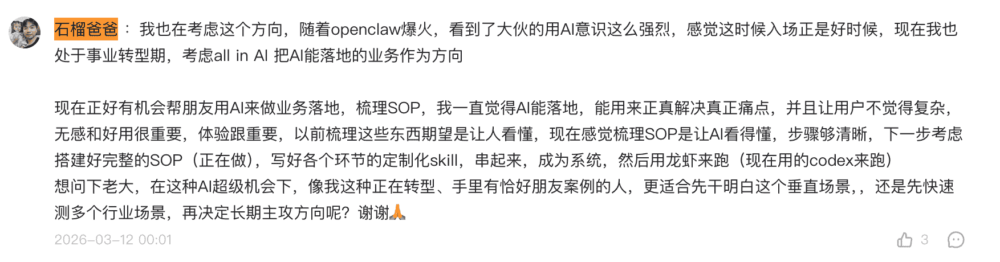
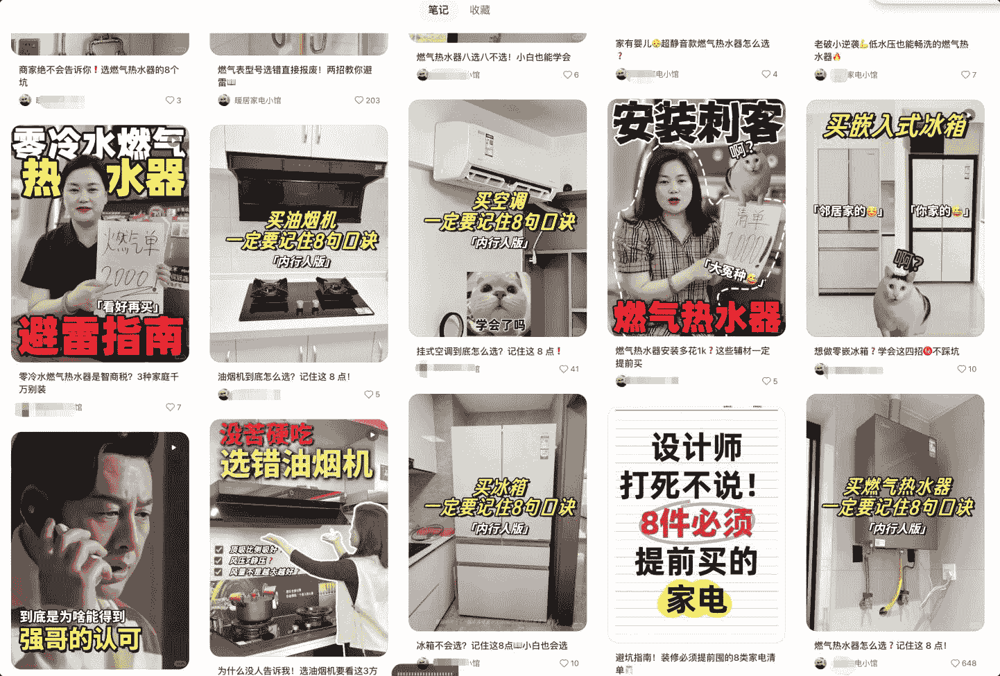
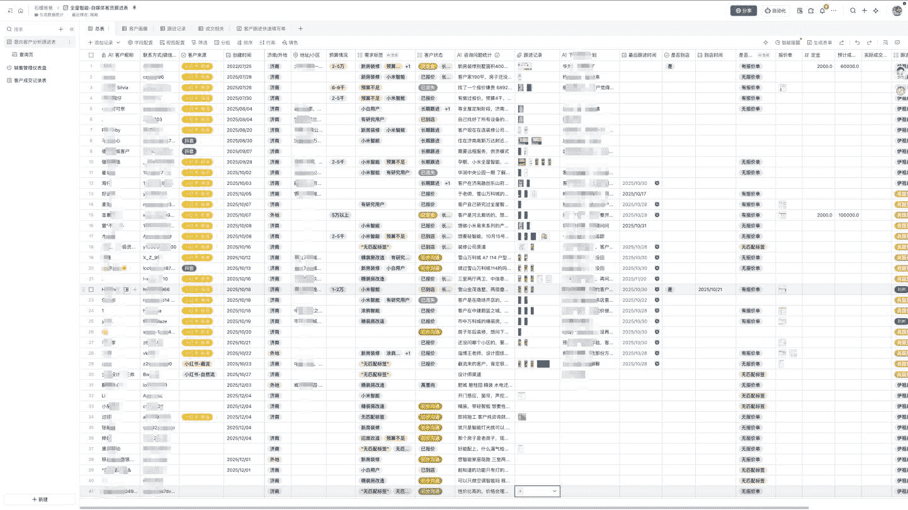
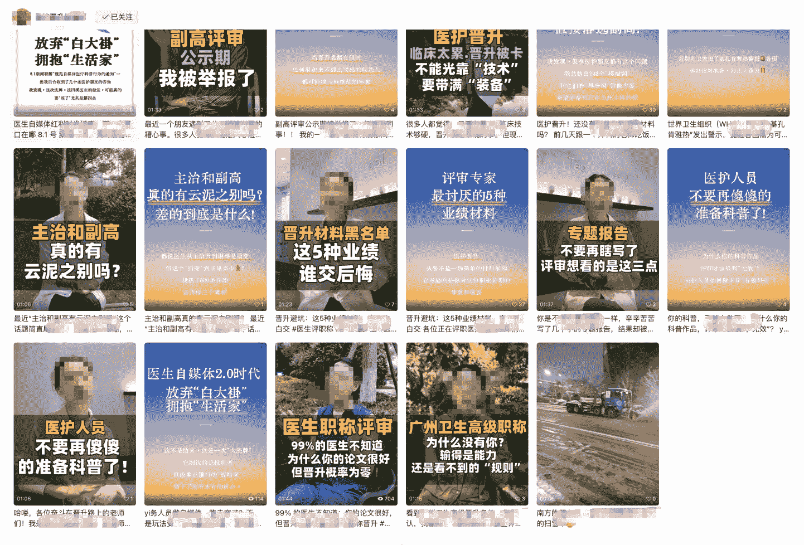
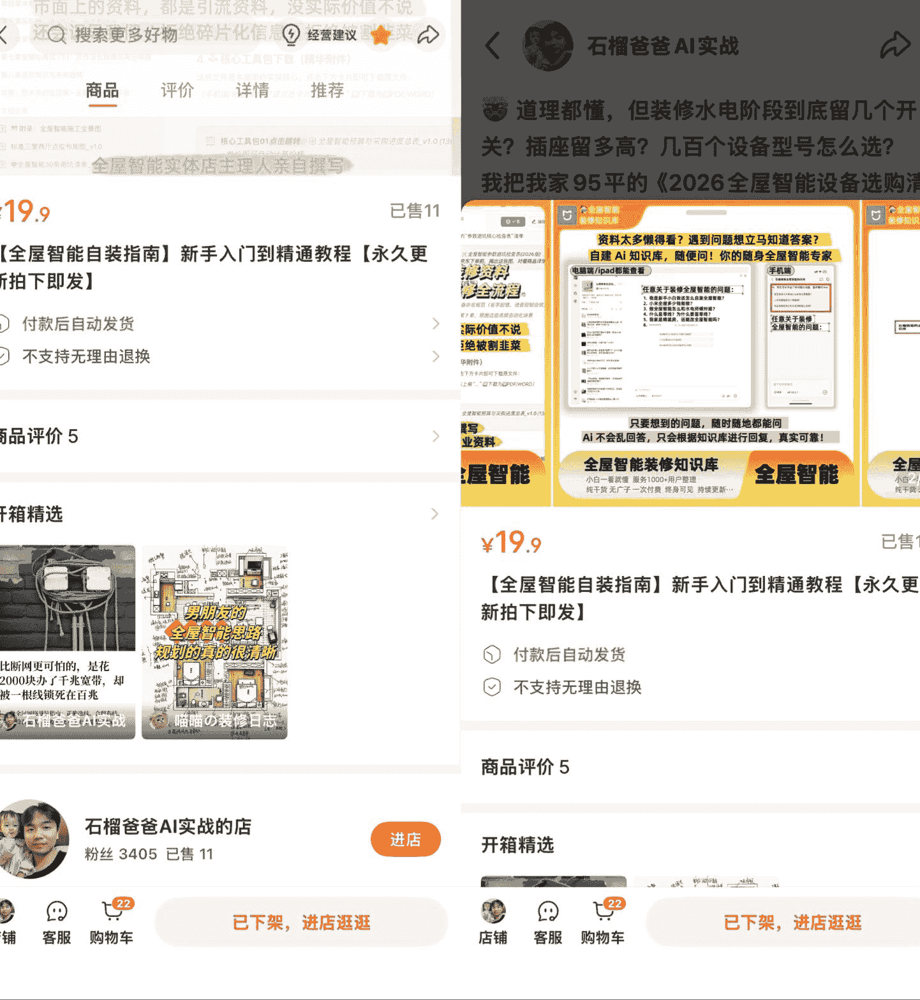
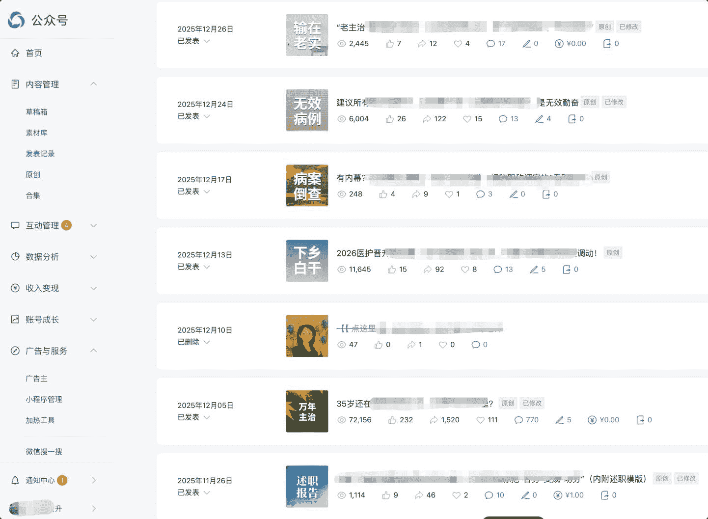
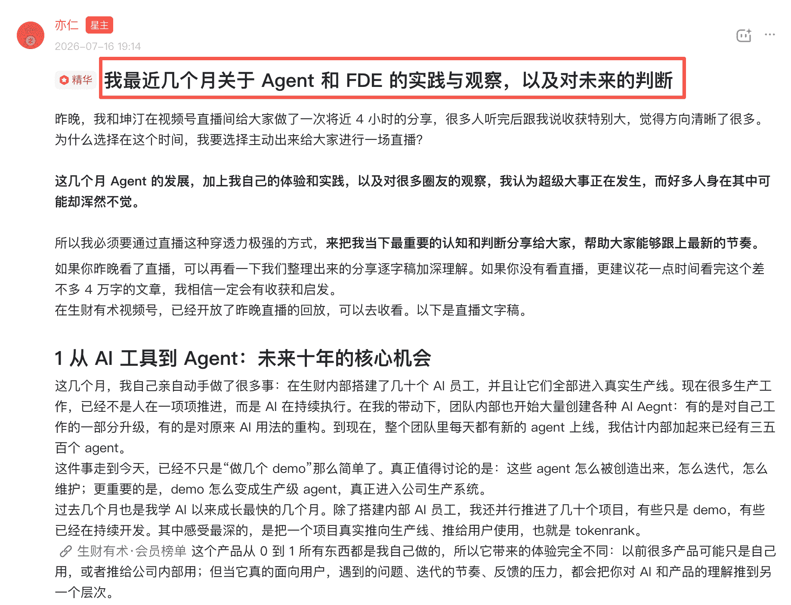

# 9年设计师，裸辞后在生财做了5个项目都失败，最后all in AI企业服务做到一场培训5000元

260723 副业SC 精华

整理：公众号懒人搜索，懒人专属群精选
懒人微信：lazyhelper1

哈喽，我是石榴爸爸，现居济南，创业一年，也是一名加入生财一年的圈友。

2026年，我的方向是做AI企业服务。说得具体一点,就是用AI做内容帮助企业获客,再把一套真实能运行的AI工作流交付给客户。现在还是以交付为主，产品也在一边做一边完善。

这篇文章一万三千字，是我从2025年辞职，到2025.4.18加入生财一年的项目探索，再到现在入局AI企业服务的一次复盘。

这里面没有什么成功的故事，只有我踩不尽的坑。

其实我本来想这样起标题:

「普通人裸辞一年，靠AI逆袭，月入过万」或者「普通人加入生财一年，靠AI月入过万」

我做了**9**年设计，**2025**年离职，后来加入生财，开始折腾AI。**2026**年**3**月，我拿到了**5000**元的AI企业服务第一单。5月又给同一个团队做了第二次培训，两次加起来差不多**1**万元。

把这些信息挑出来，重新拼一下，好像真能讲出一个"普通人裸辞后靠AI逆袭"的故事。

但我不想这么写。

因为两次培训加起来1万元，不叫"月入过万"。我现在也远远谈不上逆袭。产品还在完善，客户还在交付，很多事情我也是边做边学。要是真把这段经历写成一个已经跑通的成功故事，我自己都不愿意看。我更想朴实地讲一下，一个真正的普通人，是怎么一步步创业找到方向的。

我以前就是一个设计师，做了9年园林设计。后来从自己的房子开始做家居内容，再后来离职做自媒体，做过AI视频、AI数字人、微信问一问、家电本地生活、全屋智能、虚拟资料、公众号等等。这里面有做出一点反馈的时候，也有做着做着就停掉的项目。最迷茫的时候，我甚至会靠研究一个又一个新工具，让自己觉得"我还在努力"。

AI是在这个过程中最重要的一环。2026年3月12日凌晨00:01，我在生财"超级标16"的评论区留了一段很长的话。

我当时写：

> 我也在考虑这个方向，随着OpenClaw爆火，看到了大伙用AI的意识这么强烈，感觉这时候入场正是好时候。现在我也处于事业转型期，考虑all in AI，把AI能落地的业务作为方向。

在那段留言的最后，我问了一个问题：

> 像我这种正在转型、手里恰好有朋友案例的人，更适合先干明白这个垂直场景，还是先快速测多个行业场景，再决定长期主攻方向呢？

现在回头看，这条留言看起来是在问亦仁要答案，其实我心里早就有答案了。

我已经想做AI落地了。我已经不满足于只是研究工具，也不满足于自己用着爽。我想把AI放到真实业务里，去解决真实问题，最好还能让用户觉得不复杂、无感、好用。

我缺的就是那一点笃定。

因为前面试过的项目太多了。我也怕AI只是我新找到的另一个兴奋点，过一阵子又换方向；也怕自己嘴上说all in，实际上还是停留在研究工具，没有走到客户和交付里。

13天后，3月25日，我给一个团队做了第一次AI内容工作流培训。5月10日，又做了第二次。

第一单具体是怎么来的、怎么报价、怎么交付，我已经在生财单独写过一篇完整复盘：感兴趣的伙伴可以看看：

（看到亦仁超级标后，我如何用一次线下分享，拿下5000元AI企业服务第一单）

这一次，我更想写的是这单之前的那些年，以及这单之后我真正开始面对的东西。

## 第一章｜做了9年设计，我并不是准备好了才离开

我专业建筑行业的景观设计。毕业以后，我也很自然地进了这个行业。

这9年里，我做过方案，做过汇报，画过施工图，也去过现场做施工指导。我还做过一段时间的小组负责人，需要带着几个人一起往前推进项目。

我一直很喜欢那种"一个东西从图纸上落到现实里"的感觉。

设计师应该都懂。你画的东西最后真的被建出来了，站在现场看见它的时候，心里还是会有一点骄傲。它是一张图，最后也会变成一个真的能被看见、被使用的东西。

所以后来我做工作流、做SOP、做企业交付时，很多习惯其实都是那时候留下来的。比如先拆问题，再理流程；比如我要知道这个东西最后怎么落地，不能只停留在概念上；再比如，我很自然地会考虑用户看不看得懂、用起来顺不顺。

但它也给我留下了另外一面。

我做事情喜欢先规划，喜欢把方案想得很完整，最好每个步骤都安排清楚以后再开始。做设计的时候，这不一定是坏事。可等我后来创业进入自媒体、做创业项目时，这种习惯就变成了问题。

我会做一个很完整的计划，会研究很多工具，会把整个流程想得特别漂亮。但真正应该先发出去、先见用户、先拿反馈的事情，也是这些我不会的事情，都被我往后放。这个问题那时候没有意识到。我那时候只觉得，自己做事认真、爱研究软件、执行能力也不差。以前同事遇到不会的软件问题，经常会来问我，我一般也愿意自己多研究一下。

现在看，这种对软件和技术的兴趣，后来让我很自然地拥抱了AI；但"什么都想先研究明白"的习惯，也让我在创业这一年踩了很多坑。

真正让我开始考虑离开设计行业，是2024年，年中。园林景观和房地产、政府项目的关系很深。那几年行业一直在往下走，项目越来越难，公司也越来越难。我到2024年8月的时候，已经有一个很明显的感觉：这个行业不能再这样耗下去了，公司可能连过年都撑不到。

我不是那种早早就想好了第二条路，然后很潇洒地转身离开的人。

相反，我是在发现原来的路越来越走不通以后，才开始到网上学自媒体，学小红书，学拍摄，学剪辑。那时候我也不知道自己以后具体要做什么，只是觉得必须先动起来。

到了**2025**年**1**月**1**日，我正式离职。

那时候我的家居账号大概有1000粉。我当然希望它以后能变现，也觉得自己既然已经学了拍摄、剪辑和运营，应该可以靠自媒体做点事情。

但说实话，当时没有稳定的创业收入，也没有一个已经验证过的项目。我只是从一份有固定工资的工作里走了出来，然后开始自己找路。

所以这不是一个"我准备好了，所以裸辞创业"的故事。更准确一点说，是行业先逼着我动，我又正好在自媒体上看到了一点可能，于是就先走了出来。

现在再回头看，9年设计没有白做。它给了我结构感、审美、项目经验和落地意识，这些后来都成了我做AI工作流和企业交付的底气。

## 第二章｜从自己的家开始，我第一次相信内容能改变点什么

2022年装修这套房子的时候，我还没想过以后要做家居博主。

因为自己本来就是做设计的，所以这套房子从设计图开始，我就想自己来。我自己画图，自己找工人，施工的时候也基本天天去盯。有些能自己做的活，我也会自己上手。

现在回头看，当时多少还是有点设计师的执念。就是脑子里已经有了一个样子，别人不一定完全理解，我就总想自己盯着，最后尽量让它按照我想的样子落下来。

家里的全屋智能也是我自己慢慢研究的。它不是什么特别夸张的豪宅方案，就是一套轻全屋智能。我当时在网上看了很多资料，也在小红书收藏了很多帖子，然后自己一点点搭起来。

那时候做这些，真的没想过要拿来做内容。装修过程中也没有专门记录，更没有提前拍什么素材。我当时就是想把自己的家装明白一点，少踩一些坑。

后来真正开始学自媒体的时候，我才发现，这些东西原来都可以讲。

怎么找工人，施工的时候应该盯什么，哪些地方容易返工，家居好物到底好不好用，全屋智能怎么做得简单一点，这些都是我亲手做过的。

2024年8月29日，我开始系统做自媒体。

我花钱报了小红书课程，从拍摄、剪辑、选题到怎么发内容，基本都是重新学。最开始的账号方向偏智能家居，后来发现家里的轻全屋智能能讲的内容有限，又慢慢扩到家装、家居好物和一些自己动手做的东西。

这个账号后来累计发了**100**多篇内容，做到**3000**多粉。

现在看，3000多粉当然不算什么特别大的成绩。但对当时的我来说，它至少证明了一件事：我不是只能坐在公司里做设计，我也能学会拍摄、剪辑，能把一件事讲清楚，也能坚持把内容发下去。

它确实给了我一点信心。

我开始觉得，自媒体可能真的会改变点什么。它也许能让我从原来的设计工作里走出来，去做一件属于自己的事。

但我那时候也有一个很大的误区。

我以为只要内容继续发、粉丝继续涨，后面的事情自然就会发生。可实际上，账号应该靠什么赚钱，用户来了以后怎么承接，自己到底能卖什么，我都没有真正想明白。

我会做内容了，但还没有形成自己的产品，也没有一条稳定的变现链路。那时候我能想到的，还是做家居博主、接一些广告。

所以这100多篇内容和3000多粉，给了我**从设计走向自媒体的信心**，却没有直接给我一门稳定的生意。

离职以后，账号粉丝还在慢慢涨，但我已经开始急了。

我想知道，除了做博主、接广告以外，外面还有没有别的赚钱方法。也正是在这个时候，我经人介绍，第一次知道了生财。

## 第三章｜离职三个月，我花几千块加入了生财

2025年4月，离职三个多月以后，我花了几千块钱加入生财。

我当时没有想得多么长远，也不是已经认准了哪一个项目。说得直接一点，我就是想找一个更大的平台，去看看外面的人都在干什么，还有哪些赚钱方法。

因为在那之前，我对自媒体的理解确实很窄。

我做家居账号，发内容，涨粉，然后希望以后能接广告。在我的认知里，做自媒体大约就是这么一条路。至于内容怎么连接产品，流量怎么连接服务，一个普通人还能做哪些项目，我基本上是不知道的。

现在看自己以前就像一只井底之蛙。

加入生财以后，我才发现，原来外面有这么多人在做完全不同的事情。有人做项目，有人做服务，有人做线下生意，也有人把自己的经验整理成标准产品，反复去卖。还有大航海、圈友的实战复盘，以及各种我以前根本没有接触过的东西。

我第一次感觉到，赚钱这件事不是只有"上班"和"做博主接广告"两个选项。

可以用这样一句话形容：

加入生财有术之后，我的认知发生了巨大的变化。

我确实有一种突然推开一扇门的感觉。原来不是世界上没有别的路，只是以前的我**没有看见**。

直到今天，加入生财一直都是我最好的一笔投资。

这几千块没有让我马上赚到多少钱，也没人直接告诉我下一步应该做什么。它先把**我原来很窄的认知打开了**，让我开始接触项目、航海、圈友和后来越来越深入的AI。

但认知打开，并不会让一个人马上变得清醒。一下看见很多条路，又会觉得每一条好像都能做。今天看到一个项目，觉得这个适合我；过几天又看到一个新机会，又觉得那个好像更有前景。

信息越来越多，我的选择也越来越多。接下来那段时间，我确实做了很多尝试。家电、全屋智能、航海、虚拟资料、公众号，每一个项目在开始的时候，我都觉得挺有道理。

问题是，当一个人突然看见很多条路以后，不一定是好事，也可能只是变得更忙了。

## 第四章｜加入生财后，我做了很多"当时看起来都对"的项目

是的，接下来我确实变得很忙。

加入生财以后，我看见了很多以前不知道的项目，也开始觉得，既然自己已经会做内容了，就应该赶紧把这项能力用到真实生意里。

### 家电项目｜有流量，不等于有生意

我先去帮一个济南的本地家电老板做线上获客。这个选择在当时很合理。我做的是家居内容，对家电也不陌生；对方有线下门店和真实产品，我负责做账号、做内容、往线上找客户，听起来正好可以互补。

我一开始想得也很简单：只要把流量做起来，生意应该就能跟着放大。

真正做进去以后才发现，家电这个行业太红海了。很多通过内容来的客户，第一反应就是比价。你花了很多时间讲产品、讲服务，对方拿到价格以后，转头就可能去别的地方问一遍。

有流量，不等于有生意。

但这个项目也不是一点价值都没有。我在里面接触到了个人IP的做法，第一次更具体地理解，发内容的同时，也是在提前建立信任。后来不管是做自己的账号，还是帮别人做内容，这段经历都影响了我。

图｜当时运营的家电主理人IP账号

### 全屋智能｜什么都想做，最先停掉的却是获客

家电做得不顺以后，我又把注意力转向了全屋智能。

这一次，我觉得离自己的经验更近了。我自己的家就做过全屋智能，原来的家居账号也有相关内容，所以从内容能力、行业理解和账号基础来看，全屋智能都比家电更适合我。

刚开始，我给业务账号做图文内容，也做个人IP。自然流有一些反馈以后，我又想通过付费投流把获客放大。

第一轮投流，我是相信"专业的事交给专业的人"，就交给了代理商。后来我看了生财里关于投流的内容，又去问圈友，才慢慢反应过来：代理商关心的是预算有没有消耗出去，我真正关心的却是来了多少有效客资、最后能不能成交。

大家盯的根本不是同一个结果。

于是我停掉了代理，自己查资料、看视频、做笔记，也向生财的圈友请教，开始自己学着投。

前后两轮，我们一共投了几千块钱。最后加到微信的客资大概有几十个人。

这至少证明了一件事：线上内容加投流，确实能给本地业务带来线索。

但新的问题很快又来了。

因为我想拿到客户最真实的一手反馈，也想把整个业务闭环都弄懂，所以客资加到微信以后，我又自己去做客服、做销售，甚至跟着客户去量房。

我当时觉得，既然以后想创业，内容、投流、销售、成交这些东西，我都应该懂。

听起来也没错。

可真正做起来以后，我发现前端内容是我做，后端接待也是我做，客户转化还是我做。一天到晚都在忙，最后最先停下来的，反而是最开始负责获客的内容更新。

创业初期最大的一个坑，就是老板啥都要做，啥都要懂。

### AI＋数字人｜有产能，不等于有精准客户

差不多同一时期，我还参加了一次生财的AI＋数字人航海。

我以前用AI，更多是自己聊天、写东西、提高效率。航海以后，我第一次尝试AI和数字人做到一个账号里，做选题、内容生产和多平台分发。

一个多月，这个账号带来了二三十个垂直用户。

这个结果让我挺兴奋的。AI开始从我自己研究着玩，走进了一个真实账号，持续参与内容生产。

可问题也很快暴露出来：来的用户虽然属于垂直人群，却不够精准。内容产能提高了，咨询和后端承接的质量却没有同步提高。

这又给我上了一课：有产能，不等于有精准客户。AI可以把内容做得更快，但它不能替我回答"到底要吸引谁"。

图｜账号中的人物出镜视频均由数字人生成

### 虚拟资料｜没有同行，也可能没有需求

到了年底，全屋智能合作基本停下来以后，我又参加了虚拟资料航海。

我用AI写内容，尝试卖全屋智能相关的低价资料。因为当时几乎没怎么看见同行，我一开始还觉得，这会不会是一个没人发现的小机会。

我连续测试了一两周，很快就停了。

后来我才明白，没有同行不一定是蓝海，也可能是需求本身就太小。AI已经能帮我稳定生产内容了，可如果需求没有验证，生产得再快也没有意义。

这一次我停得比较快。不是所有停止都叫不坚持，有些项目发现方向不对，早点停反而更合适。

图｜全屋智能虚拟产品

### 垂直公众号｜第一次把内容连到了真实业务

绕了一圈以后，我又开始帮身边一个有真实业务的人做垂直公众号。其实早在前面看到生财关于"垂直小号"的内容时，我就已经开始留意公众号。后来又继续学习公众号相关的航海内容，真正把它放进实际业务里，我才感觉到，小红书和公众号在承接上确实不太一样。

小红书更容易让陌生人先看见你，公众号则处在微信生态里，内容、加微信、咨询和后续沟通连得更丝滑。这个公众号做了一两个月，做到1000粉，也带来了一些咨询。

当然，问题还是有。来的用户够不够精准，后端到底能承接哪些需求，内容最后怎么连接业务，这些都还需要继续调整。

可公众号这次给我的感受不一样。它让我第一次比较具体地看到，内容可以从播放量和粉丝，一步步连到微信、咨询和真实业务。

后来我做AI公众号工作流，很多最早的理解，其实都来自这个小号。

图｜垂直公众号后台

回头看，家电、全屋智能、AI＋数字人、虚拟资料、公众号，这些项目在开始的时候都不是我拍脑袋决定的。

每一个都有当时的理由，也都给过我一点反馈。

正因为它们不是彻底失败，我才更容易觉得：这个还能再试一下，那个好像也不能放。

结果就是，我学会了做内容，做过投流，做过私域，也开始用AI提高生产效率，可始终没有一条稳定的主线。

所以我现在不觉得"试错太多"本身就是错。真正的问题，是每次试完以后，我没有及时停下来，把有价值的经验沉淀成一条主线。

公众号懒人搜索，懒人专属群分享

时收敛，也没有把有限的精力在一条线上继续往下走。不知道多少小伙伴有这个习惯：只要业务一遇到阻力，我就特容易去研究一个新工具。研究工具会给我一种很确定的感觉——至少那一刻，我会觉得自己还正在努力！

## 第五章｜我最擅长的逃避，是研究一个又一个新工具

研究工具有一个好处：答案通常很明确。

软件装上了没有，工作流跑通了没有，一个新功能会不会用，这些东西花上一天，甚至熬一个晚上，往往就能看到结果。

只要跑通了，我就会很有满足感。会觉得今天没有白过，自己又学会了一样东西，又往前走了一步。

可真实业务不是这样。

做了内容，有没有人咨询；加到微信以后，客户愿不愿意继续聊；到了报价的时候，该报多少；东西交出去以后，对方到底觉得好不好用，这些问题都没有一个标准答案。

更难受的是，你很认真地做了，结果也不一定好看。

所以项目一遇到阻力，我就很容易把注意力移到一个新工具上。研究新的模型，搭一个新的流程，把原来的系统再改得漂亮一点。

这些事都很像工作，而且确实也需要花很多精力。

问题是，工具越来越多，真正需要面对的客户、销售、报价和成交，并没有跟着一起增加。

2026 年 3 月 2 日，我回头复盘这一年，第一次把这个问题想明白了：

我最常用的逃避方式，就是去研究新的东西，去获得技术上的满足。

那次复盘对我来说挺难受。在那之前，我一直觉得自己挺猛的，也挺敢试。项目没做成，我还能再找一个方向；工具不会用，我可以自己研究；踩了坑，我也相信自己很快就能爬起来。

这些都是真的。我确实有学习能力，也不算怕折腾。

但另一面也是真的。

我嘴上觉得自己不怕客户、不怕销售，可真正到了该直接面对结果的时候，我经常还是想再准备一下。再把方案改完整一点，再把工具研究透一点，再搭一个更顺的流程。

好像只要准备得足够充分，出去以后就不会失败。

可创业以后，我已经没有固定工资了。稳定的现金流又一直没有形成。赚钱这件事不再只是一个想法，它每天都在提醒我：你不能永远停在准备阶段。

我也会焦虑，会希望尽快证明自己，证明离职这一年不是在瞎折腾。越想证明，反而越怕拿到一个不好看的结果。

研究技术就成了一个相对安全的地方。它不会拒绝我，也不会嫌报价贵。只要我肯花时间，大多数时候总能得到一点正反馈。

我现在也不想把学技术这件事贬到很低。

如果我以前不爱研究软件，不愿意折腾各种工作流，后来也不会这么快接受 AI，更不会有后面的企业交付。学习能力一直是我的长处。

只是我慢慢开始明白，同一个长处，用在不同地方，结果会完全不一样。

也就是在 3 月初这次复盘以后，OpenClaw 开始变得特别火。

但这一次，我的手里刚好已经有了一个真实的垂直场景，也有一套正在使用的内容工作流。我不想再先跑去测十个新方向了，我想先把眼前这件事做深一点，看看它能不能真正进入别人的业务。

没过多久，一位生财圈友准备办一场 OpenClaw 线下沙龙。

我主动去问他：需不需要我帮忙？

随后出现的那次分享，以及我在生财看到的那个超级标，第一次把我从“继续研究”推到了“拿出去报价”。

## 第六章｜超级标 16，让我第一次把“会用 AI”变成了报价

这位圈友早在 2025 年 6 月，我刚加入生财不久，参加第一次线下聚会时，我们就见过。当时也就是普通地认识了一下，谁也没有想到，第二年会因为一场 OpenClaw 沙龙真正开始合作。

2026 年 3 月 10 日，我刷到他准备在济南办一场 OpenClaw 线下沙龙。

我当时挺兴奋的。一方面，OpenClaw 正好很火；另一方面，我手里已经有一套正在使用的 AI 内容工作流。我没有只报名参加，而是主动去问他：活动需不需要帮助？

对方后来问我，能不能也来做个分享。

我答应了。

如果放在以前，我可能还会想再准备准备。把流程改得更完整一点，把工具研究得更透一点，等自己觉得足够专业了再出去讲。

但这一次，我手里不是只有几个刚学会的工具。我已经用这套工作流做过真实的公众号内容，知道它在哪些地方能跑，哪些地方还需要人来判断。它不完美，可至少是一个我正在用的东西。

第二天晚上，也就是 3 月 11 日，我又在生财看到了“超级标 16”，主题是企业 AI 学习与服务。

我来回看了很多遍。

过去我一直把自己的经历拆开看：9 年设计是一段经历，做自媒体是另一段，研究 AI 又是另一段。那个超级标让我第一次把这些东西连在了一起。

那一晚，我心里冒出一个很强烈的感觉：

我不是在旁边看，我是真的已经在路上了。

凌晨，我留下了开头那条评论。表面上是在问该深挖一个场景，还是快速测试多个行业，其实我已经想做 AI 落地了，只是前面换过太多方向，还不敢马上相信这次真的能走下去。

后来的线下分享，正好成了这个场景。

活动现场，我没有讲一堆“AI 未来会多厉害”，也没有拿并不存在的企业案例包装自己。我直接讲正在使用的内容工作流，演示一篇内容从前面的梳理，到后面的生成和执行，到底是怎么跑的。

这个过程很直接。别人看到的是一套已经被我实际使用过的流程，不是几个工具名称拼在一起。

就在那次现场分享中，我加到了一位后来邀请我给团队做培训的人。到这里，事情又变难了。

免费分享我敢讲，真正让我报价，我还是抓瞎。

这是非标服务，我不知道应该怎么算。按一天培训的时间算，好像不值多少钱；按这套工作流给客户节省的人力和后续价值算，我又不知道自己有没有资格报那么高。

我先问了对方的预算，又把自己的时间投入、工具成本、客户能获得的价值，以及这是第一个标杆案例这些情况，分别拿去和 ChatGPT、AI 亦仁讨论。

它们没有替我决定价格，但给了我一个可以推演报价的参照。AI 亦仁当时有一句话让我印象很深：四千多元，是市场给出的第一张选票。

3 月 23 日，我把报价发了出去：

**4999 元，一天时间。**

消息发出去以后，我心里一直悬着。虽然前面已经分析了很多遍，可客户真正回复以前，那些都只是我自己的判断。

对方回了四个字：

完全可行。

我看到这句话时，第一反应就是：哇塞，原来企业客户真的会接受这样的报价。

3 月 25 日，我给某团队做了第一次培训。这一单最后是 5000 元。5 月 10 日，又给同一个团队做了第二次。两次加起来，大约 1 万元。

这当然不能说明我已经跑通了 AI 企业服务，更不等于我从此就能稳定接单。但对当时的我来说，它确实是一张很具体的选票。

第一次有人愿意为我梳理出来、演示出来的 AI 工作流付钱。

这单具体怎么来的、报价怎么推演、培训又踩了哪些坑，我已经在生财单独写过一篇完整复盘，这里就不重复展开了。想看详细过程的圈友，可以看这篇：

超级标帮我确认了方向，生财圈友给了我进入真实场景的机会，AI 亦仁帮我建立了报价参照。最后我把这些东西连了起来，也终于把手里的工作流拿了出去。

不过，成交只证明了一件事：有人愿意买。

接下来要回答的是，这套东西到底只是我自己会用，还是客户团队也能真的跑起来。

## 第七章｜第一单以后，我才开始理解什么叫交付

拿到第一单的时候，我最兴奋的是，终于有人愿意为这套东西付钱了。

可真正开始准备培训以后，那点兴奋很快就被具体的事情压了下去。

因为自己用一套工作流，和把它交给别人用，完全是两回事。

我自己用的时候，很多步骤根本不会写出来。哪个资料该放在哪里，遇到什么情况要停一下，AI 给出的东西哪里不对，我扫一眼大概就知道。实在不行，我还可以临时换个工具，或者自己手动补一下。

但客户不知道。

对方需要知道从哪个项目打开，Profile 改哪里，原始资料应该怎么放，主流程怎么启动，输出以后怎么检查。到了真实现场，账号、环境、权限、材料是不是准备好了，也都会变成问题。

我原来梳理东西，更多是想让人看懂。做到这一步以后，我才越来越感觉，今天梳理 SOP，还得让 AI 看得懂。

步骤要足够清楚，输入和输出要固定，哪里可以让 AI 连续往下跑，哪里必须让人停下来判断，也要提前写明白。

这件事对我触动挺大的。

以前我总觉得，只要我会用，这套东西就算做出来了。后来才发现，真正的交付不能只存在我脑子里。如果换一个人就不知道下一步怎么办，那它还是我的个人能力，还不能算一个客户能接住的工作流。

也是在准备这一单的时候，我开始把原来的内容工作流往三层去拆。

第一层是相对固定的 SOP，也就是这件事从开始到结束，大体应该按什么顺序走。

第二层是不同环节要用到的 Skill。写作有写作的 Skill，选题有选题的 Skill，后面换一个任务，也可以换成对应的能力。

第三层是每个客户自己的 Profile。这里面放他的业务、用户、人设、表达风格和行业资料。

我当时想得挺直接：底下的流程尽量固定，需要什么能力就换什么 Skill，真正跟着客户变化的东西尽量放进 Profile。这样以后换一个客户，不至于从头再做一遍。

当然，这只是我在第一单里开始形成的想法，不代表这套产品已经标准化成熟了。到现在，我也还在真实交付里改这些东西。

而且第一单很快就让我踩了一个挺具体的坑。

那时候 OpenClaw 很火，我也很喜欢这个工具。我一开始有点执着，想把整条长工作流都放进去，最好能做到全自动。

我连续磨了两天，也熬了夜，几个模型套餐很快就消耗得差不多了，但这套比较长、判断环节又多的工作流，还是没有稳定地跑下来。

也可能是我当时还没有找到更合适的方法，但交付日期不会等我继续研究。

我最后只能把那个“必须用最先进工具做出来”的念头先放下，换成当时更稳的组合，一步一步先把闭环跑通。

这个坑让我记住了一句话：

验证阶段，稳定交付大于工具先进。

客户很少关心我背后用了几个模型、工具是不是最火。他只看一件事：这套东西到了团队里，能不能真的跑起来。

所以第一次培训时，我没有把目标定成“把所有东西都讲完”。

团队里每个人的 AI 基础不一样。有的人对环境和操作已经比较熟，有的人还需要从最前面的步骤开始。如果我只是把课件顺顺利利讲完，看起来很完整，大家回去以后还是不知道怎么开始，那这次培训对我来说就不算交付。

我给自己定了一个很低、但很具体的标准：

现场至少有一个人，把这套流程真正跑通。

从项目怎么打开，到资料怎么放，再到母稿生成以后怎么检查，我陪着他们往下走。现场有人真正跑通时，我才第一次感觉到，这件事从“我会用”走到了“别人也能用”。

后来做第二次培训，我更确定了这一点。培训不能按工具功能往下讲，得围绕客户现场真正要完成的任务来设计。先把一篇母稿跑出来，再谈后面的分发、配图和更多功能。一次塞得太多，只会让人更乱。

现在我理解的交付，也还很朴素。

先把客户的真实问题弄明白，再把流程拆清楚，让 AI 能按步骤执行，让客户团队里的人知道怎么开始、怎么检查、哪里要自己判断。工具可以换，模型也会一直更新，真正要留下来的是一套能用、好用、还能被别人接手的工作流。

以前我研究 AI，常常先问这个工具能做什么。

真正开始做企业服务以后，我更习惯先问：客户现在卡在哪里？我怎么用手里的东西，把这个问题解决掉？

这两个问题看起来只换了一个顺序，做出来的东西却完全不一样。

我也越来越明白，客户愿意付钱，是想解决一个原来解决不了的问题，让一件很复杂的事变顺一点，让团队拿到以后真的会用。至于背后是 OpenClaw、Codex 还是别的模型，反而没那么重要。

第一单让我从“会用 AI”走到了报价，后面的交付则让我开始面对更难的问题：怎样把一次定制服务，一点点磨成可以重复交出去的产品。

而真实项目慢慢多起来以后，我也发现，前端获客、客户沟通、后端交付和产品沉淀，不可能永远都靠我一个人扛。

## 第八章｜从第一次生财聚会，到后来一起做真实项目

我以前其实也知道，一个人不可能把所有事情都做好。

但知道是一回事，真正愿意把事情分出去，又是另一回事。

这位合伙人，就是前面那位圈友。2025 年 6 月第一次参加生财聚会时，我们只是认识了一下。到了 2026 年 3 月那场 OpenClaw 沙龙，我主动帮忙、受邀分享，我们才开始一起处理真实的事情。

现场分享以后，我们联系得越来越多。到 5 月底，我们把企业服务要怎么讲、产品怎么设计、报价怎么做、手上的事情先推进什么，重新梳理了一遍。

那次讨论里，能做的事情很多。

可越往下聊，我越能感觉到，如果什么都想做，最后很可能又会回到我以前的状态：每一件事看起来都有机会，每一件事都往前推一点，但没有一件真正做深。

到了 6 月初，我们正式确定以合伙人的方式一起做事。

现在的分工比较直接。

合伙人主要负责前端获客、连接客户和资源，我主要负责后端交付，把客户需求拆成流程，把工作流搭出来，再把项目里可以复用的东西一点点沉淀成产品。

这个分工对我来说，其实是一次挺大的变化。

以前做全屋智能的时候，我从内容做到投流，又从投流做到客服和销售，总觉得既然要创业，整个链路我就应该全部弄懂、全部抓在自己手里。

最后的结果是，每个环节我都在做，人也特别忙，真正负责获客的内容反而停了。

现在有人负责前端，我终于可以把更多精力放回自己更擅长的地方：理解客户的问题，梳理流程，把东西交付出来。

但有了分工，并不代表事情一下就轻松了。

前端带来的机会越多，后端就越要接得住。客户聊完以后，需求能不能拆清楚，交付时间怎么排，哪些东西这次必须做，哪些东西应该先放一放，最后都要变成具体行动。

以前我一个人做事，很多决定自己想改就改。今天觉得这个工具好，就换一个工具；明天觉得另一个方向更重要，就重新排一下。

有了合伙人以后，我不能再只对自己的兴趣负责。一个优先级的变化，会影响前面的客户沟通，也会影响后面的交付安排。

很多事情需要提前说，需要一起判断，也需要有人对最后的结果负责。

这也是我现在还在学的东西。

我正在推进的 AI 企业服务，也开始进入某园林公司等真实企业场景。

到了企业里面，对方更关心这些工具能不能进入真实的内容、获客和业务流程，最后变成一套团队能使用的工作流。至于我会多少工具，并不重要。

这些项目还在推进，很多东西也没有完全跑顺。合作怎么磨合，需求怎么收，交付怎么排，产品怎么从真实项目里一点点抽出来，都还在做。

这里我也想特意说清楚一件事。

我的企业项目有不同的来源。我不能因为合伙人是在生财认识的，就把后来所有客户都写成生财带来的，也不能把所有项目都算到合伙人身上。

生财直接给我的，是认识圈友、表达自己和被别人看见的机会。

但从认识一个圈友，到真的一起做事，中间还隔着主动提供帮助、把自己的能力现场展示出来，以及后来一次次处理真实问题。

我不想把这段关系写成一个“突然遇到贵人”的故事。

更真实的情况是，我们先认识，后来一起做事，发现彼此的能力刚好可以形成分工，再决定以合伙人的方式继续往前走。

现在我们做的事情也开始收得更具体：用 AI 做内容帮助企业获客，再把一套真正能运行的工作流交给客户。

这个产品还在改，合作也还在继续，远没有到可以宣布成功的时候。

只是和以前相比，我终于知道自己该把力气往哪里用，也开始接受，这条路不必再由我一个人把每个环节都扛下来。

## 第九章｜我还没有成功，只是终于开始看清下一步

写到这里，如果一定要问我：现在算转型成功了吗？

我的答案还是：没有。

我手里已经有了真实付费客户，也有正在推进的交付项目。但很多流程还要根据客户的材料去改，做出来的东西还要经过测试、审核和验收。产品在一点点成形，可离“已经跑通”还差得很远。

所以我现在说自己做 AI 企业服务，有时候也会觉得这个词太大、太虚。

说得具体一点，我现在主要在做两件事。

第一件，是用 AI 做内容，帮助企业获客。

第二件，是把我在实际项目里跑过的流程，整理成一套客户能真正使用的 AI 工作流，再交到他们手里。

7 月 15 日，亦仁在直播间讲的 FDE，我觉得自己正在践行。

我现在主要精力还在交付，产品也还在完善。

每做一个项目，我都会发现原来想得不够清楚的地方。有时是客户材料没准备好，有时是流程太复杂，有时是我自己觉得理所当然的步骤，换一个人就不知道怎么继续。

这些问题解决起来很慢，也没有研究一个新工具那么让人兴奋。

可我现在反而觉得，这才是我真正该做的事。

3 月 12 日，我在那条评论里问：像我这样正在转型、手里刚好有朋友案例的人，应该先干明白一个垂直场景，还是先快速测试多个行业？

今天我也没有一个适合所有人的标准答案。

但我比当时多确定了一件事：这个答案不在下一个新工具里，也不在我一个人的分

公众号懒人搜索，懒人专属群分享

析里。它要到客户那里找，到实际需求里找，到一次次交付以后再看。

## 第十章｜感谢生财有术

如果回头看这一年来时路，我最感谢生财的，确实有三件事。

第一件，是感谢谢无敌把我带进生财。

2025 年 4 月 18 日，我离职三个多月，花几千块钱加入时，只是想去一个更大的平台，看看还有哪些赚钱方法。现在回头看，我仍然觉得，这是我离职以后最好的一笔投资。

第二件，是生财把我的认知打开了。

以前我觉得做自媒体，大概就是做博主、涨粉、接广告。加入以后，我才看见外面还有很多项目、很多服务方式，也有很多普通人把自己的经验做成真实生意。

那时候我才意识到，过去的自己真的有点像井底之蛙。

当然，看见更多机会，也曾经让我更分散。但如果没有先看见这些路，我可能连后面该怎么试、该去哪里找人，都不知道。

第三件，是生财给了我这样一个普通人被看见的机会。

我在这里参加航海，去线下聚会，也开始把自己做过的东西拿出来分享。正是这些表达和行动，让我链接到了更多圈友，也认识了现在一起做事的合伙人。

生财没有替我完成转型，也没有自动把客户送到我面前。

可它让我看见了更大的世界，也给了我走出去、说出来、和别人一起做事的场域。

如果你现在也正处在转型期，做了很多项目，学了很多东西，却还没有找到一条特别确定的路，我给不了你一个成功者的答案。

我只能把自己这一年的经历放在这里。

我也走过弯路，也会焦虑，也会被新工具吸引。今天的我依然要面对交付、现金流、产品完善和合作磨合。只是和过去相比，我不再那么着急从新项目里找确定感了。

我开始愿意把时间放进一个个具体问题里，去服务真实客户，去接受不那么好看的反馈，再把能留下来的东西一点点做实。

这条路还没有走通。

我愿意继续往前走！

既然看到这里，俺写了快一万三千字，点个赞，投个小锚⚓不过分吧，哈哈！

对了，如果你也在做 AI 企业服务，如果你也是 FDE，希望可以一起学习交流！

我是石榴爸爸，咱下次再见。

————分割线————

看完这篇 SOP，你觉得你懂了。但 90% 的人一到实操就会卡在第一步。

公众号懒人搜索，懒人专属群分享

工具和教程只是最低级的壁垒，真正的壁垒是“立刻动手”和“圈层信息差”。

如果你想看全网最新的变现玩法，并且和一群执行力极强的极客一起下场拿结果，欢迎围观我的核心私域：【懒人专属群】。

我们不聊虚的，只做商业闭环的拆解与 AI 效率的压榨。系统内已沉淀 1000+ 跑通的套利实战局。

👉 查阅圈子完整数字资产与上车门槛：

https://lazyso.com/insider/

认同价值、准备好下场干活的，扫码加我微信（lazyhelper1）

备注：【实操上车】，不闲聊

