公众号懒人搜索，懒人专属群分享

一年时间，我是如何通过 **AI** 业务变现，做到 **10** 人 **+AI** 业务工作室

260723 副业SC 精华

整理：公众号懒人搜索，懒人专属群精选

懒人微信：lazyhelper1

大家好，我是绿子。

过去一年，我从一个职场人，做到现在 10 人 +AI 业务工作室。目前团队月销售额 20 万+，小红书上过主题热门榜第一，闲鱼多个单链接想要破万。但一年之前，我其实只是一个普通上班族。25 年才开始 all in AI 变现。

今天我会分享，这一年以来，我是怎么做 AI 业务，并且怎么搭建团队的。

6 月中旬，在成都线下沙龙，分享了这篇内容。一场体验好的活动，往往是由非常好的搭档们组成，感谢七天、雅月的主题策划，感谢小武的建议，并 push 我写完这篇帖子，感谢精华贴作者 Lydia 组局，花了很多心思提前对流程，还叫上了 2 位圈友一起协助，把整场沙龙组织得非常好。U 娜负责整场活动摄影，是精力充沛的小太阳。非常给力！

接下来会分享线下的大部分内容，enjoy：

## 为什么 25 年我会做 ai 写作

我们团队不止是局限于做 AI 写作，而是会做目前需求旺盛的 AI 业务。业务大都是相通的，这里主要以写作举例，了解底层的思考逻辑。

第一位考虑的是复利，不是赚钱。能赚钱的项目很多，但大部分是重复劳动型。比如，你做第三年和第一年，除了账户数字，没有任何质变，每接一单都从零开始。

值得长期做的项目得有个会越滚越大的东西在底下积累：私域流量持续复购、IP 属性、客户关系、品牌。

代写用户添加到私域，复购属性强。并且这类用户不止可以买代写，还可以转化其他品类，例如电商、求职、职场关系等等。

所以，做一件事先思考，假设我闷头做三年，期间不主动想新点子，光是"做"本身，会不会自动让我比第一年更难被替代？如果不会，那它是个生意而已，适合做一阵子赚钱然后撤，不适合长期。

第二是投入是否符合你的优势，满足天时地利人和吗？比如项目前期需要哪些硬软件？是否有现成的资源？需要多少资源启动？多久能覆盖成本？是否只能依赖渠道？项目利润是否满足你的要求？

第三条容易被很多人忽略，是痛苦的性质。任何项目长期做都有痛苦，关键是那种痛苦你能不能忍十年、甚至从里面咂出点意义。如果项目的核心日常恰好是你打心底厌恶的事（比如做流量、提升团队销转、做交付），再赚钱也撑不久，人身体也会熬垮。就像我在职场生涯最痛苦的一段时光是做私域代运营，在初入职场时做了一份跟当下不匹配的工作，是极其痛苦的。

目前，这个项目是这个阶段最适合自己的，后面还会往上走，待会儿也会分享到。

今天内容分为 3 部分：

- AI 业务变现方式及案例分享：会给大家几个上手就能变现的案例。
- AI 怎么帮助业务降本提效：从流量、转化、交付端闭环，我们怎么使用 AI 的。
- 从个人到搭建工作室经验分享：到什么阶段可以招人、招人难、用人难，我们的团队是怎么一步步走向正轨的。

去年期末季，有个研一学生，她要交一篇 2 万字的期末作业，带实证分析（直接网上洗数据），就是要跑数据、做回归、出图表那种。收费是 400 元。

我们一个大专文科生员工，用 Claude，5 小时，给她做完了。最后顺利通过了。

这件事放在 3 年前，得找一个研究生，花一周时间，收费至少 1000 块。

而今天，我要讲的这个生意——我们团队做 AI 变现，做到工作室稳定运转。今天我把它完整拆给大家：

- 第一，AI 业务变现到底有哪些方式，我们做的代写在整个版图里是什么位置；
- 第二，AI 到底怎么帮一个生意降本提效，从流量、转化、到交付，我们三端是怎么打的；
- 第三，怎么从一个人，搭到一个能稳定出单、组建工作室，我踩过的坑，经验。

### 📍 模块一：AI 业务变现方式及案例分享

##### 1.1 Why Me

我们团队专注做 AI 的 C 端定制业务。比如 AI 代写、AI 作图这类。

我从去年中旬才离开职场，目前团队有 10 多个人，一个月销售额是 20 多万。

但我自己印象最深的不是月销 20w 这个数字。印象最深的一次，是去年期末季。我们一篇笔记，突然爆了，客服微信加爆，加不上号。马上找了个企微有微信认证的朋友，用他的企微接线并且借用他团队 2 个员工来谈单。这个时候开始，一天加 200 人到私域。

那一天我才第一次意识到——这个生意不是「能不能赚钱」的问题，是「能接得住多少」的问题。所以，我现在所有关于「工作室、SOP、团队」的思考，不是因为我想做大，是因为单兵作战根本接不住。这是我后面所有今天分享的内容的起点。至于我现在为什么还在场——是因为 AI 代写是一件长周期的事，需求一直在，一直都可以做，并且现在窗口还没关。下面我用 3 个具体信号告诉大家，这个窗口是真的、而且还在。

#### 1.2、如何用 AI 变现？

不是那种听起来很厉害、刷屏很热闹的 AI 技巧，而是能通过它真正赚到钱。

所以 AI 技能变现，不是卖 AI 本身，而是用 AI 去解决别人的具体问题。就是说我们今天会反复回到它。大多数人赚不到钱，不是因为不会用 AI，而是因为不知道卖什么。

**AI 变现的底层公式**

那 AI 的变化到底有没有规律？有。我把它总结成了一个公式。

**[AI 工具] × [业务场景] + [成果交付] = [商业价值]**

第一个，AI 工具，是基础引擎——写作、生图、编程，这些是你的引擎。

第二项，业务场景，是真实需求——别人正在被哪些重复性工作、内容生产、效率问题折磨。

第三项，结果交付，是你的附加价值——你把 AI 生成的东西，筛选、修改、排版，变成一个能直接用的成品。

这三样加在一起，等号右边就会出现那个词——商业价值，否则别人愿意付钱的理由。记住，工具谁都有，场景无处不在，真正值钱的，是中间那个"加工"的动作。这就是为什么同样使用人工智能，有人免费帮忙，有人收费几千。

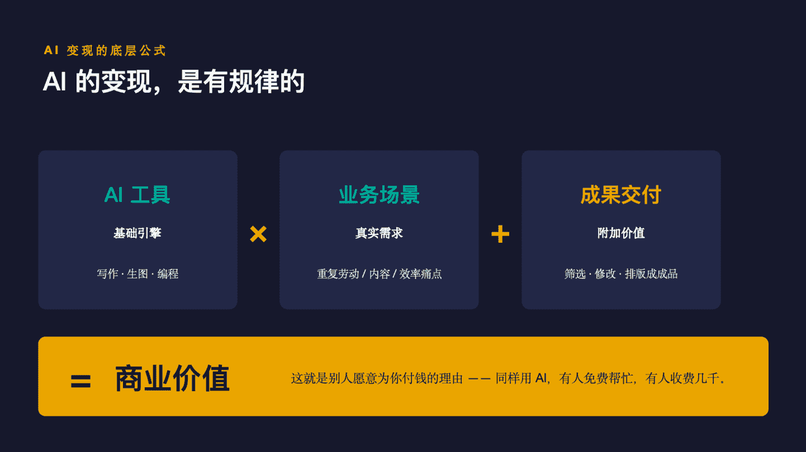

**AI 技能的五大能力矩阵**

这 5 层是阶梯关系，从上到下，门槛越来越高，但利润和壁垒也越来越大。AI 能干的活儿，落到能赚钱的领域，主要有五类，我称之为"五大能力矩阵"。

第一类，制作内容——适合自媒体、电商、本地商家；第二类，视觉设计——适合在闲鱼接单、做视觉品牌；第三类，制作视频——适合短视频运营、课程制作；第四类，编程工具——专门解决生产系统性的效率问题，价值极高；第五类，办公提效——适合职场及企业客户。

但我要强调下面这一行——

所谓技能，不是懂原理，而是能交付任务。你不需要懂大模型怎么训练出来的，你只需要能够稳定地、把一类活儿交付满足。这就够了。

**AI 变现的五阶阶梯**

好，知道了之后，下一个问题是——怎么一步步把它引入增值业务？我画了一个五级台阶，你顺着往上爬就行。

第一层，卖服务。最直接，先干起来、先赚到第一笔钱。我们就是在这一层做出来的。

【直接卖服务给个人消费者。典型案例：

- AI 代写
- AI 生图
- AI 视频等】

第二层，卖产品。把你干熟的事标准化，变成可以重复售卖的资产。

第三层，做教学。把你趟通的经验输出输出，基于真实路径去讲。

第四阶，做账号。流量复利，让影响力滚上去。

第五阶，交付解决方案。高客单价，为客户提供整套完整的商业体系。

横轴是杠杆率，纵轴是收入天花板。越往上走，你越不靠出卖时间赚钱，而是靠资产和系统赚钱。

举例：这里讲几个直接上手赚钱的案例，并且是一年四季都有的大需求品。什么类目有大流量？

**案例一——PPT 代制作**

每年毕业答辩季，需求旺盛。或者是年中年终职场人群汇报。

**案例二：诉状书/起诉状**

细分：离婚诉状书，需求旺盛。

**案例三：抄写**

这是帮助学生写作业，或者党政部门写思想汇报，复购率非常高，需求旺季是寒假、暑假，只要发相关内容，会承接不过来，客单价是小几百块，月入过万没有问题。不过要注意平台违禁词。

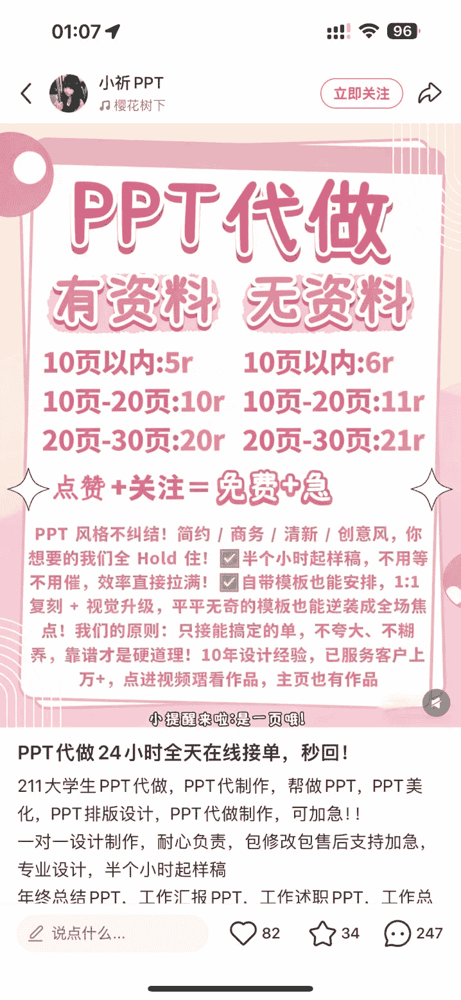
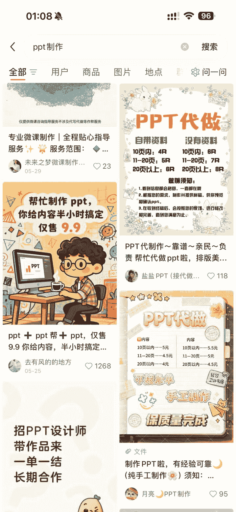
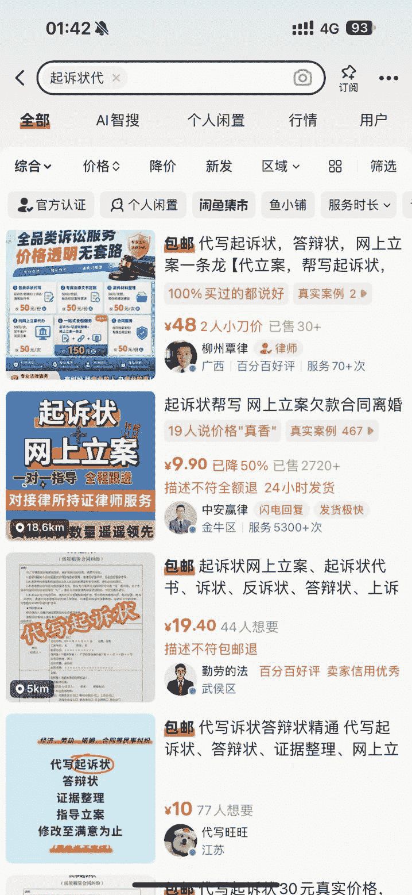
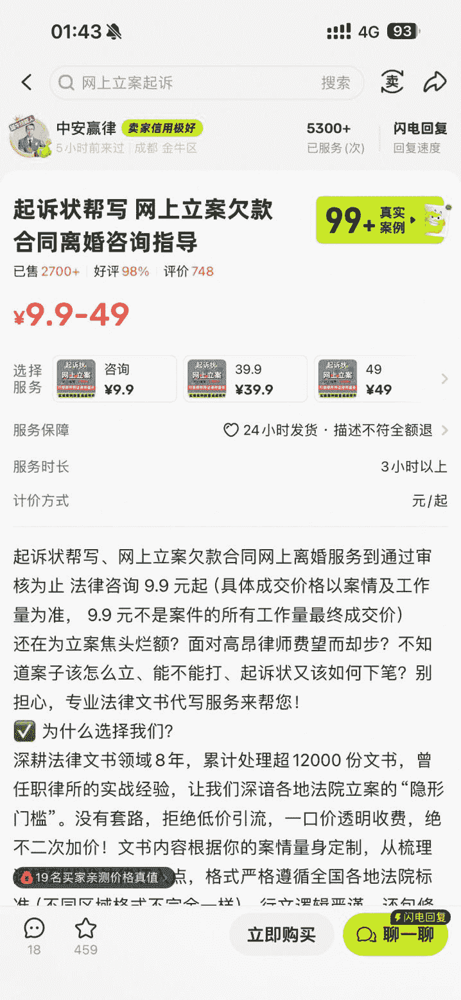

**如何谈单与后端资源搭建**

在谈单过程中，首先需要掌握清晰的价格体系，这是建立客户信任和提高成交效率的基础。在此基础上，补充一定的专业知识，能够帮助客户更好地理解服务价值，提升沟通的专业度。

在后端资源搭建方面，可以根据不同类型的工作需求寻找合适的写手。例如，撰写电子版内容，效果最好的 2 个平台是小红书、BOSS。而涉及手写、抄写类的工作，可以加入大学生互助群、校园墙等渠道招募，效果非常好。

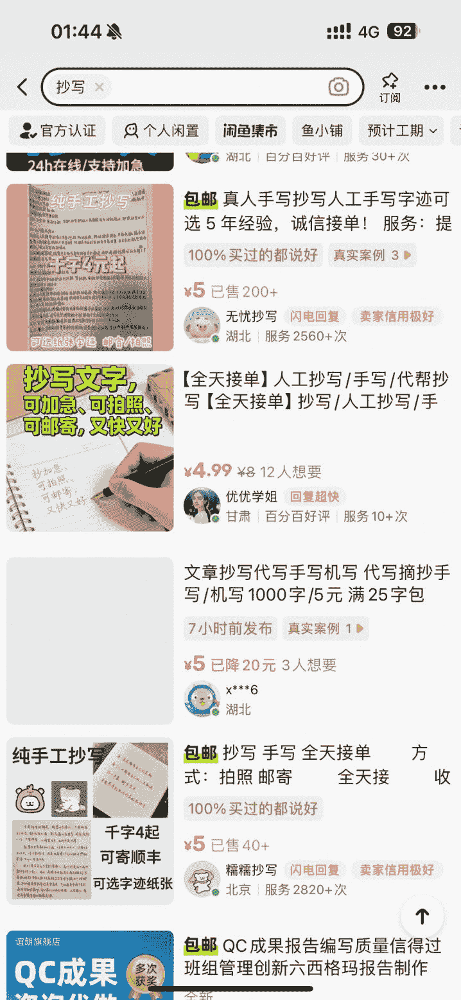
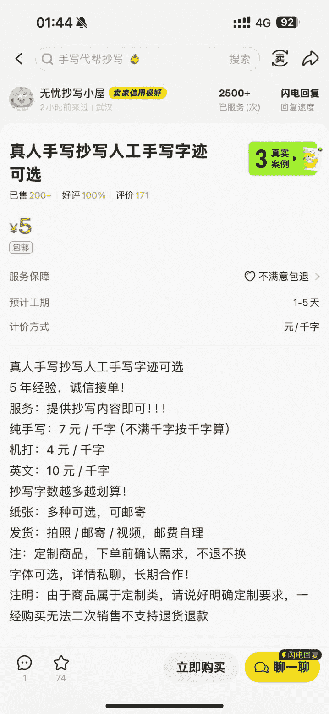

说完了 AI 变现的五大阶梯，再聊一下商业起点。

**是出卖时间还是建造资产？**

我们先把最关键的前两层讲透——卖服务，和卖产品，到底差在哪。

机制很简单：帮人做 PPT、写文章、做头像。优势是启动极快、零成本、马上见效，今天学明天就能接单。但它的劣势也很硬——你的收入上限，被你的个人时间锁死了。一天就那么多个小时，接单量到顶，收入就到顶。

它卖产品，是打造资产。机制是把你的本事导入爆款模板、提示词合集、绘本素材包这类东西。优势是——做一次，无限次重复售卖。你睡觉的时候它也在卖。劣势是，更考验你挖掘需求和做销售转化的能力。

所以——先用卖服务活下来，再用卖产品翻上去。不要一上来就憋大招做产品，也不要永远停下来用时间换钱。

**想要增长，需要打造增长杠杆，紧盯这两个关键词：流量复利与知识输出**

爬到第三、第四层，你要拉两根更长的杠杆——做教学、做账号。这两件事就是相互喂养的。

做教学，是建你的权威。你可以开 AI 写作课、AI 办公提效课。但这里有一条铁律，我必须提醒你——你讲的课，必须基于你自己真实穿越通成功的案例，绝不能空对空。你自己都赚不到钱，去教别人赚钱，迟早翻车。

做账号，是建你的流量池。定位很清楚：分享 AI 工具、晒副业案例、讲办公技巧。它的特点是——用案例启动很快，等流量起来了，后面广告、社群这些多元收入自然就来了。

这两者是一个循环：流量帮你建立权威，又反过来给你带来更多流量。一旦转起来，你就发现了别人抢不走的护城河。

再往上，到达了金字塔顶部，操作彻底改变了。顶层变现，是交付完整解决方案。它的核心认知，是客户购买的，不是单点服务，而是一整套业务系统的闭环。什么意思？我给你两个真实的例子。

一个电商团队想要降本增效，你给的不是"帮你写几条文案"，而是搭建一套定制化的 AI 文案与图片生产流程，让他们以后自己能够跑。

一个培训机构缺生源，你给的不是"助发几篇推广"，而是做一套整套 AI 课件，加上自动化的招生内容体系。

前面是交付一个东西，这里是交付一个能持续产生价值的系统。当然，这一阶极大考验了你的业务理解力、需求沟通力，和结果交付力。这也是为什么它的客单价最高——能干你的人太少了。

**普通人该从哪里起步？**

讲了这么多，你可能在想——道理我都懂，我到底该从哪儿下手？

你只需要想清楚：你的核心优势是什么？

如果你文字熟练、网感好——切入点是 AI 文案、小红书笔记脚本。

如果你审美极高——切入点是用 AI 做头像、做商品海报。

如果你懂逻辑、会一点代码——切入点是数据爬虫、自动化小工具。

如果你有传统行业的经验——切入点是 AI 加垂直行业，比如教育做教案、职场做 Excel 分析。

**商业操作系统：五大核心能力**

那一个完整的 AI 变现流程，背后到底在转着哪几样东西？我把它放在一个闭环——一套"商业操作系统"，五个齿轮，缺一不可。

第一，需求挖掘。本质上是洞察痛点：对方是没时间？还是不会做？还是想降低成本？

第二个，产品包装。把你的技能，加工成别人一听就懂的产品。

第三个，交付能力。记住——客户不介意你的过程，他只是为了最终完成的购买单。

第四个，宣传推广。在小红书、抖音、朋友圈，用真实案例去建立信任。

第五，持续迭代。不断测试新需求、新渠道，拥抱变化。

这五个不是排队走完的步骤，而是一个不停转的循环。你做得越久，这台机器转得越顺。

到这里，我们把今天的内容收成一张总图——AI 技能变现全景蓝图

横向看，是五大能力矩阵——内容、视觉、视频、编程、办公，这就是你能做到的。

中间层，是五阶阶梯——服务、产品、教学、账号、方案，这是你怎么一步做大。

最底层，是五大核心能力——需求、包装、交付、推广、迭代，这是支撑一切的运作。

你不需要完全能够。你只要从一个人的能力出发，找到一个稳定的台阶，然后把五个齿轮慢慢补齐。这张图，就是你从 0 到 1 的完整路线。

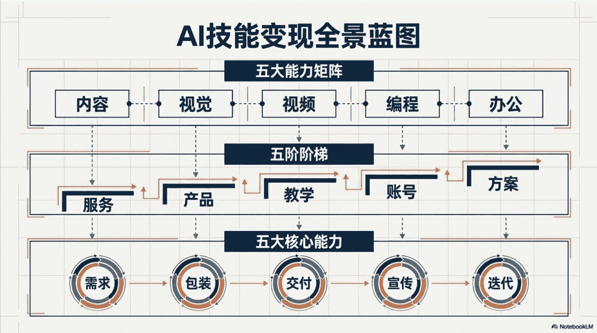

##### 1.3 Why：为什么这是个机会——3 个我亲眼看到的窗口信号

**【信号一：同行变化——市场重新洗盘】**

去年开始，平台的规则，变化大。比如论文做不了了，行业开始重新洗盘，普通人是可以在动荡中，成为头部玩家的。

**【信号二：客户认知变化——客户开始接受 AI 交付】**

2024 和 2025 年我们接单，如果客户问「你们是不是用 AI 写的」，我们要绕一下、要解释。2026 年，已经有 30% 的客户上来就问「你们可以 AI 但不能明显」。这个变化非常关键。市场逐渐成熟，客户认知从「抗拒 AI」变成「接受 AI」甚至「期待 AI」，这是这个生意能规模化的前提。以前我们要藏着掖着，现在我们可以光明正大讲「AI + 人工双重把关」。并且 AI 做得比人还好。

总结：AI 是一场新革命，不止是代写，AI 相关的其他业务都是这个道理。

**【信号三：成本变化——单位成本压到原来的 1/5】**

2024 年我们做一篇万字稿，纯人工成本 300-500 元。2026 年同样的稿子，AI 主力 + 人工校对，综合成本压到 50-80 元。

成本降到原来的 1/5，但市场客单价下降幅度最多 30%。这中间的差，就是利润窗口。三个信号合起来看：市场重新洗盘、客户认知反转、单位成本降到 1/5，而客单价变化小。这就是我说「现在进来还来得及」的具体依据。

**【常见疑问：不懂交付怎么办？】**

每次讲到 C 端，都有人问：刚开始时，「我不会写论文怎么办？我不会做视频怎么办？」

答案非常简单：做流量 + 销转，交付外派。

- 小红书上、Boss 直聘上，做线上兼职的人特别多，论文写手、视频剪辑、PPT 美化，什么人才都有。先外包，自己再慢慢理解交付端。先下场，更重要‼📍
- 这也是我们从「个人」走到「工作室」的关键一步——老板不是最能干活的人，是做好执行 SOP 后，最会分配活的人。

模块一讲了 3 件事：如何变现、整个版图长什么样、机会还在吗。接下来模块二，我们进入最干的部分——AI 到底怎么用，才能让一个生意真的降本增效？

### 📍 模块二：AI 怎么帮助业务降本增效

AI 不是来帮你「写写东西」而已，它是把一个完整生意的三个环节——流量、转化、交付——全部重做了一遍。

##### 2.1 流量端：AI，怎么让一个人也能打出爆款

在流量端，需要搜集平台的同行、或者异类爆款店铺的数据信息，去观察同行业，或者其他行业流量变化，感知行情。以便横向做成头部、纵向打不同品类流量。

采集方式：抓取链接，将链接放入插件，可以分时间段看到想要数数据。

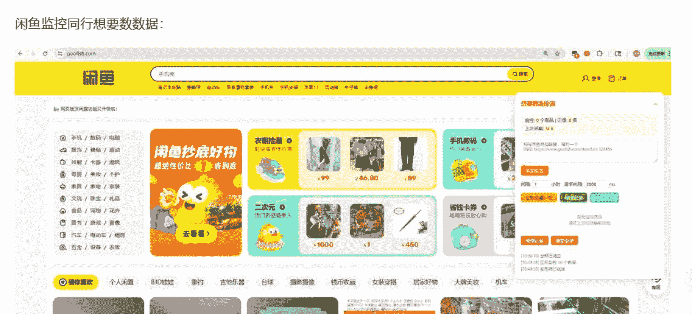
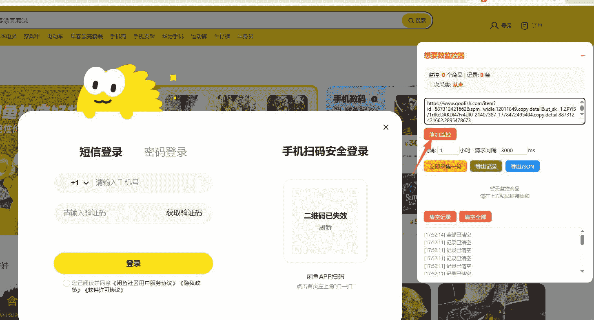

公众号懒人搜索，懒人专属群分享

##### 2.2 转化端：AI 怎么提升成交

流量到了，卖不掉，等于没流量。

转化端最大的认知误区是：很多人以为客服是“答疑的”。

错。客服是销售。客服转化率从 20% 提到 40%，等于你流量翻了一倍。

我们怎么提高转化率的？是用正确的 AI 工具，分析客服聊天时的问题、总结问题、输出优化方案、运营方案。

我们团队 AI 在转化端的 4 个用法：

###### 1. 使用正确的 AI 工具，才能保证价格优势明显

我们跟同行比，就是客单价足够低，跟同行竞争性强。但是我们又有很高的利润，方式是使用 CC Pro Max，800 元能带来 2W+ 的收益。最大的原因就是使用正确的 AI 工具。

###### 2. AI 销售话术库

- 把每一个成交对话导出、拆解，变成模板。
- 把每一个没成交的对话也拆解，找漏点。
- 让 AI 帮你整理、归类、生成话术变体。
- 整理成执行 SOP 话术，供团队使用。

流程是：导出聊天记录 → 上传给 CC → 分析问题。

###### 3. AI 报价助手

AI 报价助手，本质是把客户需求结构化，再结合你的价格规则自动给方案，例如根据客户描述识别需求、匹配价格、生成报价。

让 AI 负责快速判断客户需求 + 生成报价方案 + 推进成交。

###### 4. AI + 会员分层运营

在用户运营环节，通过 AI 结合会员分层策略，对不同阶段的用户进行精细化运营。可以让 AI 在这几个方向帮你出活动方案、写文案话术，提升转化率：

- 当日未成交新人礼设计。
- 召回方案：新用户前三天如何激活？沉睡客户怎么唤醒？
- 复购策略：老客户怎么二次转化？

最后，总结一下客服接线 SOP 必备流程。一套合格的客服 SOP，至少包含 6 个模块：

1. **首响话术**——新人欢迎语设置、朋友圈历史记录，怎么建立专业感和信任。
2. **需求确认清单**——一套标准化提问，把模糊需求变成清晰订单。

   例如：什么专业？多少字？什么时候要？查重要求？格式要求？
3. **标准报价表**——不同字数 × 难度 × 紧急程度的报价，避免客服临场乱报。
4. **逼单/异议处理话术**——针对“我再想想”“太贵了”“别家更便宜”的标准应答。
5. **风险话术**——涉及敏感问题怎么合规应对，这点非常重要，要把握边界。
6. **售后跟进**——好评引导、复购引导、转介绍引导。

##### 2.3 交付端：AI 怎么让一个人服务 5—10 倍客户

给大家看一下使用 AI 前后，团队的人效对比：

[内嵌电子表格 - 无法获取表格信息]

AI 在交付端能做什么？

- 自动生成方案、写内容、生成视频、做图、出报告。
- 写手只做“校对、润色、个性化调整”，AI 做主体。
- 培训新写手的周期，从 2 周缩短到 3 天。

看几个实际场景的案例——

【案例一】AI 如何做图

客户需求：

价格 100 元。

做 2 份小报，图文并茂，用 A4/A3 大小。

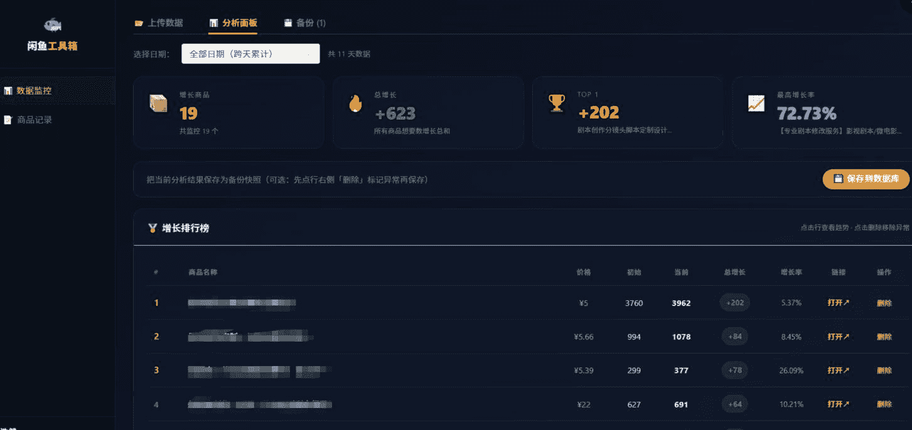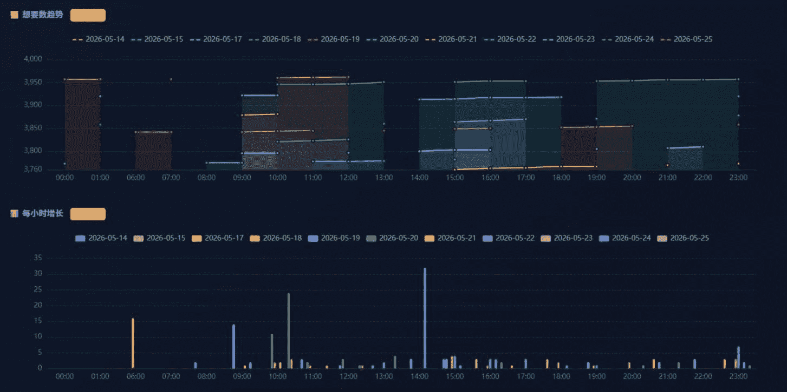

如何让 AI 生成内容——使用 Skill。

效果呈现：

【案例二】AI 如何做思维导图

客户需求：

成交价 100 元。

根据英语课文做一张思维导图。

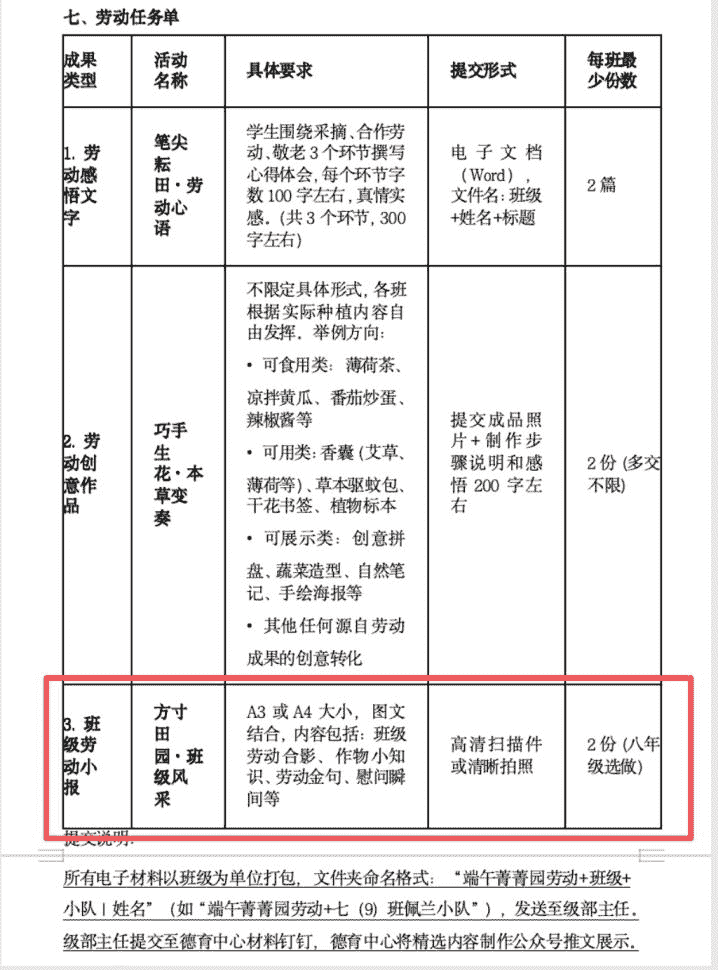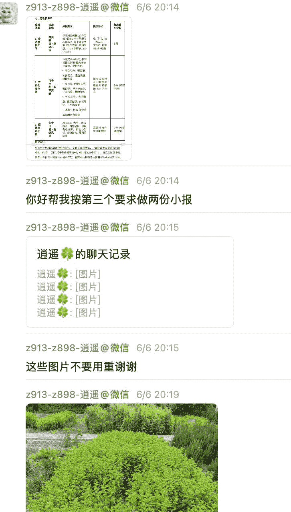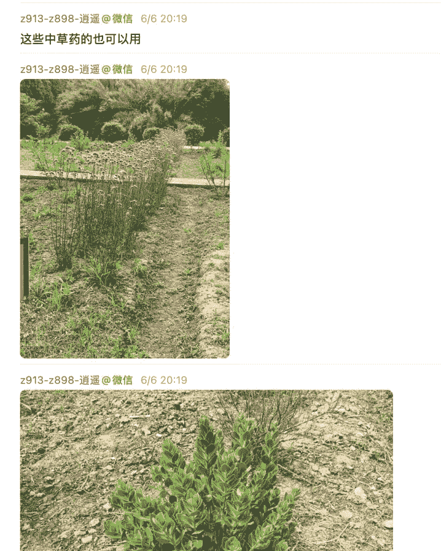

如何让 AI 生成内容——使用 Skill。

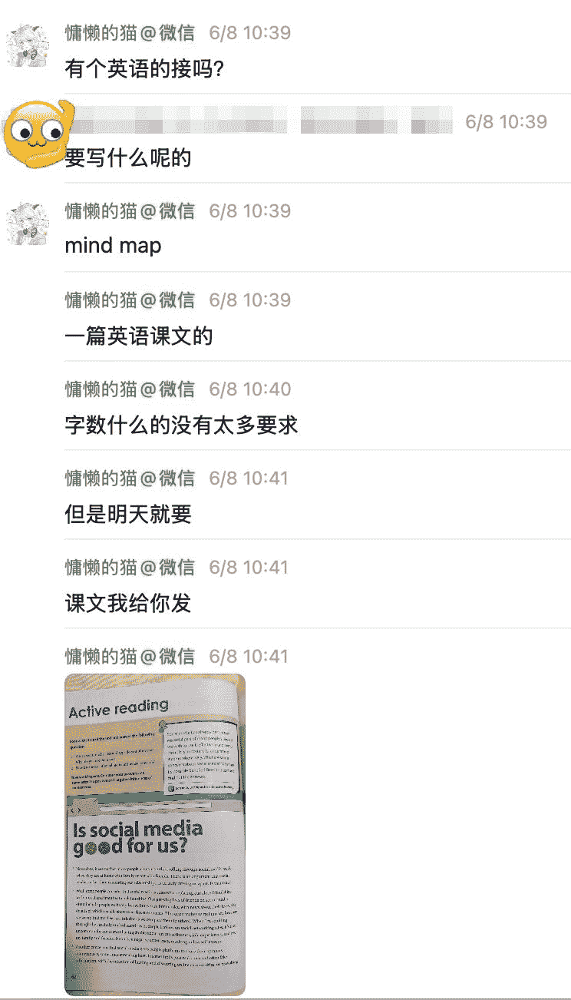

【案例三：一个标准订单的成本结构】

订单类型：本科结课论文，1.5 万字，带实证分析。

客单价 1500 元。

[内嵌电子表格 - 无法获取表格信息]

注意：这是毛利不是净利。

扣掉房租、固定人工、风险准备金，净利率大概在 50%—55%。

##### 2.4 模块二收口：一个生意的底层公式

整个模块二，我讲了转化、交付端。但我想留一个底层公式给大家：

生意 = 流量 × 转化 × 利润率 × 复购。

大部分人盯着流量死磕——“我要打爆款！我要上热门！”但他们的客服转化率只有 15%，毛利率只有 30%，复购率几乎为 0。流量再多，都是漏斗里漏掉的水。

AI 的真正威力，是让你能同时把这 4 个环节都做到 80 分以上。这是过去单兵作战做不到的事——以前你想招个会做图的、会聊天的、会算账的，根本招不齐。现在 AI 让一个人，能在 4 个环节都不掉链子。

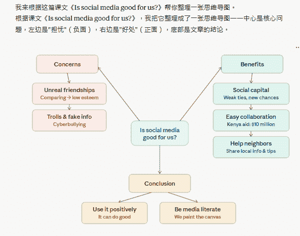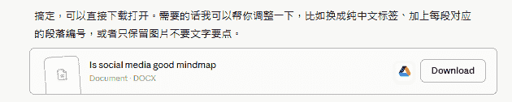

#### 模块三：从个人到搭建工作室经验分享

##### 3.1 我的工作室升级路径

阶段 1：一个人

负责：流量 + 销售 + 交付。

阶段 2：标准化，开始外包，自己负责：流量 + 销售。

阶段 3：团队化，自己负责：决策 + 产品 + 增长。

我记得我去年招第一个线下员工的契机，是我每天需要做流量运营动作，但是花很多时间要谈单，谈单很简单，于是打开 BOSS，2 天就筛选到了不错的员工。

而这前提是，我做流量相对稳定，笃定自己能做起来。

很多人不敢招聘，就怕养不起人。所以我用的轻模式起步：低底薪 + 提成。

收入公式：收入 = 你的时间 × 单价 × 接单量。

当你三个指标都快到顶了，而且勤奋也不会增加你的收入了，你就会有一个想法：“原来我卡死了”。

##### 3.2 什么时候你该从一个人变成一个工作室？

当我去年一个人从早上 7 点起床，干到凌晨两三点，持续了 2 个月，实在转不动了。

该往团队走的信号，主要是这几个：

1. 你自己成了瓶颈。订单多到你一个人接不过来，开始一天至少工作 15 小时、消息冗余、被催、甚至丢单或差评，忙不过来了。你现在要排到凌晨 1 点，说明咨询量大概率已经顶到这条线了——这是最硬的信号。
2. 收入连续稳定，不是一波流。标准是连续 2—3 个月利润稳住，而且最差的那个月也能盖住工资 + 你自己的生活开销。一两次爆单不算数，公域的流量很容易忽高忽低。
3. 活儿能拆开、能写成 SOP。售前客服、发笔记、销转、派单、交付——所有工作都需要标准化交出去，你只留核心。如果你现在连自己的流程都讲不清楚，先别招人，否则你只会更累（既要干活又要带人）。
4. 账算得过来。只要他接手的活，能让你多赚的钱，或省下时间去做更值钱的事，明显超过这兼职人员的工资，这个人就该招。

反过来，先别急着“做重”的几种情况：

公域平台的流量本身是脆的——封号、规则改，所以在现金流真正跑稳之前，尽量保持“轻”：远程兼职、不租办公室、不养全职、用账号矩阵分散封号风险。创业第一年能用远程兼职的岗位就兼职，别太早跳到重资产。如果你的毛利已经很薄，扩张只是“管一堆人多赚一点点”，那不如先把产品、提价、复购做起来，而不是堆人头。

从 0 到 1 的路径：

先做减法不做加法——先把自己的活标准化（能写 SOP 才能交出去）；角色三级跳：从自己做 → 教别人做 → 让系统自己运转。

第一个人怎么招；招来了怎么用。

【系统】做工作室，是要做到“系统不靠你也能转”：个人不是技能资产（你不在就停摆），工作室才是资产。

招人，是解放自己的，不是让你失去自由的。也不要害怕员工学会了离职，做到核心信息隔离即可。

##### 3.3 常见问题及解决办法

以下是我刚开始搭建团队时的一些卡点以及解决办法，这里分享出来。

**解法一：招聘端——10 人以下工作室怎么搭**

【1、先招谁？——我的选择】

起步时，只需要招执行岗。流量我自己能搞定——我自己就是会打流量的那个人，所以这一手暂时不需要别人。但交付一对一接客户太消耗我，我必须先把这只手解放出来。

【2、招不到人怎么办】

刚开始，很多人不会租办公场地，可以招兼职，线上或线下都可以。

重要的是筛选出合适的人，而不是线上线下的形式。（我之前有段时间，一直在思考招客服，线上好还是线下好。后来问了不少做了几年团队的朋友们，发现哪种形式的都有，并且都能做好。所以不再考虑这个问题。）

从 BOSS、本地招聘群效果最好。但 BOSS 不能用异地执照。

【3、招人坦诚到底】

我刚开始招人的时候，怕得要死。

怕员工看到我在民房办公，觉得“这老板不靠谱，是骗子”。

所以我一开始撒谎，说“公司正在装修，先在这边临时办公”。

后来我想通了，直接坦诚：“真实情况就是这样，我现在还在民房，业务在做，愿意来的就来，不愿意来的就走。”

结果反而招到了更好的人。因为所有招聘都是双向筛选，你越坦诚，留下来的人越靠谱。

【招聘策略】

我的具体打法：

- 一个岗位大量筛选：招 1 个，我面 10 个。
- 设三天无薪试用期：不合适直接走，不要心软。
- 筛选标准不是“能力强”，是“学习速度快 + 较真”——后面讲为什么。

【薪酬篇】

薪酬体系一句话：底薪 + 提成 + 奖金，每一块都要明确“他为什么能拿到这么多”。

- 底薪：保障基本生活，但不要给太高，否则没人会拼提成。
- 提成：跟产出强挂钩，可量化。
- 奖金：跟“超额目标”挂钩，激励冲刺。

核心原则：让员工自己能算出来“我今天做这件事，能拿多少钱”。算不清楚的工资体系，员工就没动力。

【现金流警告】

前期最要命的两件事：扩招、扩场地。

- 不要为了“显得正规”去租办公室——民房就民房，挣到钱再说。
- 不要为了“以防万一”多招人——按当前订单量招，宁可累自己一点，不要养闲人。
- 用提成制度撬动产能，比扩招更安全——已有员工愿意加班拼提成，就不要急着招新人。

**解法二：用人篇：SOP 化——把老板能力变成流程能力**

【核心观点】

SOP，第一要义，是“把你脑子里的判断，变成别人能照着做的步骤”。

一个简单的检验标准：新人看到 SOP，不问你问题就能上手 80%——这才叫合格的 SOP。

例如之前做小绿书时，做了详细的执行 SOP，员工照着我的标准发公众号，多篇图文破 100W+ 阅读量。

【我们沉淀的 3 类 SOP】

我们工作室目前沉淀了 4 大类 SOP，这里给大家看下结构：

1. 转化端 SOP（客服体系）
   - 客服全流程话术库（6 大模块，前面讲过）。
   - 客户分层与跟进 SOP。
   - 成交/未成交对话的话术。
2. 交付端 SOP
   - 写手招聘/培训/考核。
   - 写手交付流程。
   - 质量把控 SOP（查重 + 终审 + 售后）。
3. 管理端 SOP
   - 订单流转机制（订单怎么从客服流到写手，再到交付）。
   - 数据复盘机制（看哪些指标、多久复盘一次）。

**解法三：风险对冲——3 个血泪踩坑**

下面这 3 个坑，是很多人做业务都会遇到的问题。

【坑 1：千万不能只押单一业务变现】

今年初，我有一块业务做得非常爆，一个店铺单月营收 8 万+。

然后，被平台打压了——那个店铺从爆到死，只用了 3 天。

3 天，8W/月的现金流，直接归零。

教训：横向拓品类 + 纵向拓平台。

- 横向：不要只做一个品类。
- 纵向：不要只做一个平台（闲鱼 + 小红书 + 抖音 + 公众号）。
- 鸡蛋永远不能放在一个篮子里，哪怕这个篮子现在看起来再稳。

【坑 2：有风险的业务，企微会被风控】

有些团队做的代写业务，涉及一些灰色边界，企业微信号经常被风控。

一旦被风控，整个客户群联系不上，意味着所有售后、复购、转介绍直接断掉。

我们的解法：

- 每个客户群里放 2 个企微主体——一个被风控，另一个能立刻接手发消息。
- 拉小群交付——确保用户随时能找到你，不只依赖单一渠道。
- 关键客户加私人微信——这是最后的保险绳。

【坑 3：想做大，光靠个人强是不够的】

这是我最近一年最深的反思。

我做一个类目，就能做到这个类目的头部。

我个人能力够强，流量、转化、交付，我自己都能打满分。

但要做一个能稳定运转、自动跑的团队，靠的不是个人能力，是系统能力。

我现在还在解决这件事——

怎么让没有我的判断力的人，也能做出 80 分的决策？

怎么让流程不依赖任何一个具体的人？

怎么让业务在我不在的时候也能跑？

最后，我想说：

AI 真正改变的，不是某一个行业。

而是让普通人第一次有机会，用一个人的能力，完成过去一个团队才能完成的事情。

但 AI 不会自动带来收入。

真正赚钱的人，一定是：

懂需求的人，

懂交付的人，

懂商业闭环的人。

从一个人开始，把服务跑通，把流程沉淀，把团队搭起来。

这就是普通人从 AI 时代获得机会的路径。

————分割线————

看完这篇 SOP，你觉得你懂了。但 90% 的人一到实操就会卡在第一步。

工具和教程只是最低级的壁垒，真正的壁垒是“立刻动手”和“圈层信息差”。

如果你想看全网最新的变现玩法，并且和一群执行力极强的极客一起下场拿结果，欢迎围观我的核心私域：【懒人专属群】。

我们不聊虚的，只做商业闭环的拆解与 AI 效率的压榨。系统内已沉淀 1000+ 跑通的套利实战局。

👉 查阅圈子完整数字资产与上车门槛：

https://lazyso.com/insider/

认同价值、准备好下场干活的，扫码加我微信（lazyhelper1）。

备注：【实操上车】，不闲聊。

