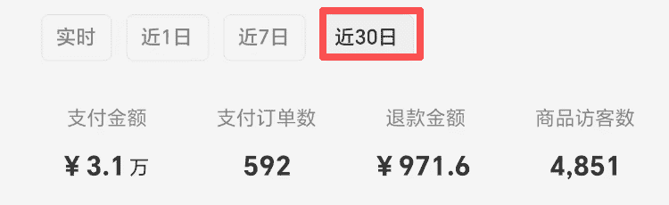
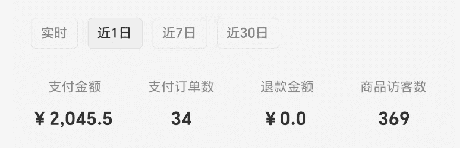
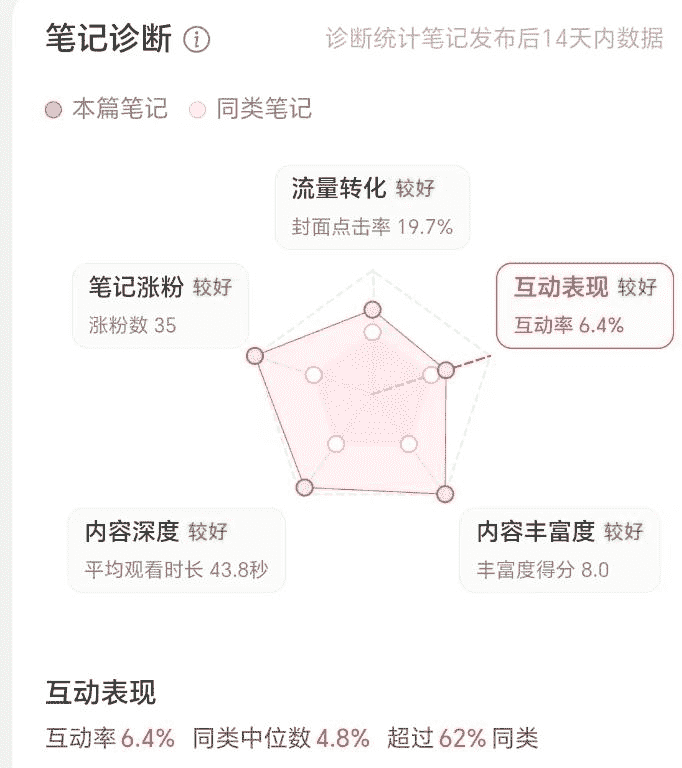
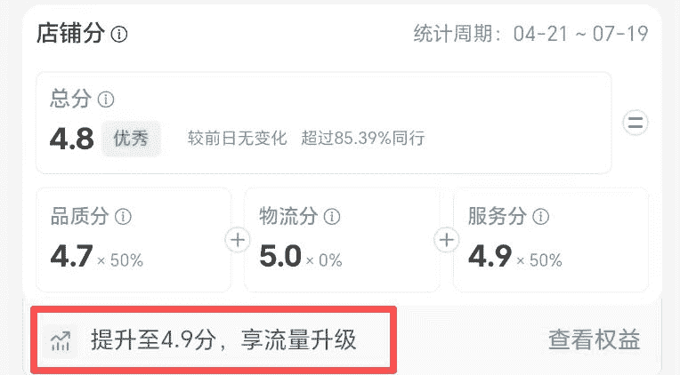
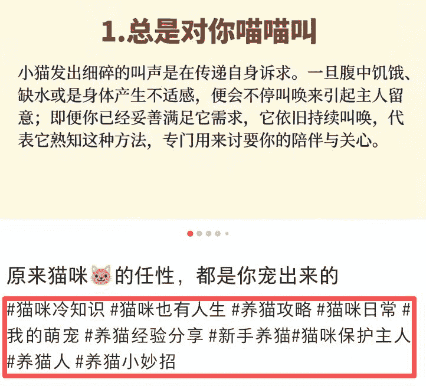

# 每天半小时做小红书虚拟产品，我靠单店单号单品做到月入 **3W** 的实操复盘 

260720 副业SC 精华 

整理：公众号懒人搜索，懒人专属群精选 

懒人微信：lazyhelper1 

我是全职宝妈，想要找一份不耽误带娃的工作，外面找不到，那我就自己创造一个。小红书虚拟产品帮我实现了。 

我是从 2026 年 2 月开始做小红书的，只做了一个店铺，一个号，一个品，起号前期每天投入 1-2 个小时，起号后每天花 10-30 分钟写 1-3 篇笔记发布即可，到目前为止卖了 1000 单，每天纯利 600-1000 不等，具体根据当天投放成本，利润有所浮动，目前只开了简单投，ROI 可以做到 2.5-3 左右。 

本人 INTJ，擅长在一团乱麻中抓住重点快速学习，所以本次分享只讲底层逻辑，看懂了我相信每个人都能做到。 

本篇内容适合什么人看：想精细化运营，做垂直小店的圈友。想了解小红书平台底层逻辑的圈友。

本篇内容用于解决以下问题：
1、怎么在小红书圈定精准目标客户；
2、搞不懂为什么自己精心制作的笔记没人看；
3、账号一直起起伏伏，流量忽高忽低，看平台脸色吃饭；
4、为什么自己跟了对标爆款，但就是卖不出去；
5、为什么转化率一直提不起来；
6、小红书踩坑达人指南

### 一、选品篇

选品有多重要，我就不说了，大家都明白，品选不好，做了再多工作，不能变现都等于 0。

我的选品思路可能和大家不一样，并没有拉数据，找对标，跟品，而是直接从客户需求出发，一击即中。

#### 1.1 先想清楚什么不能做

我的个人标准：花时间的不做（指运行稳定后期，前期肯定是要花时间的），售后多的不做，坚持不了的不做，成本高的不做，低效变现的不做（因为我个人喜欢及时正反馈，才会有动力继续做）。

举例：我个人的能力圈和舒适圈其实是在职场，有 14 年外企管理岗工作经验，收拾烂摊子专业户，擅长团队管理和各种职场疑难杂症，我身边人都建议我要么开课做职场 IP，或者做面试辅导、陪跑什么的也行，总之是围绕我擅长的职场领域。但是回看我的标准：花时间，售后多，投入后不一定能变现，而且我一定坚持不了，谁能在带娃一天后，又想再干一份工作呢？只是想一下天都塌了，我只想躺下刷手机啊。所以果断放弃了我之前的能力圈。

#### 1.2 不能做的反面，就是可以做

花时间的不做——反面就是不花时间，那什么是“不花时间”呢？就是我做主业可以顺手做好的事情。

这里的“不花时间”并不是躺平了等着天上掉馅饼，而是指我不会额外花精力花时间去完成的工作，因为只有这样我才不会有额外的心理负担，我才愿意持续坚持每天做。

举例：带孩子的过程中我要学习很多很多东西，比如我要每天做辅食，我觉得网上的辅食计划都没满足我的需求，那我就自己来做计划，做好这个计划，我可以自己用，顺便把商品上架上去卖，这就是我说的“不花时间”。因为我本来就要做这件事情啊，即使不做小红书，我还是要做的，那既然都要做，我顺便做美观些做精细些，就可以上架变现了。

如果按照传统选品跟品的方式，即使选到爆款，有需求有市场，但是不适合我，我坚持不下去，我没动力做，也等于 0，所以我的选品是完全根据我个人的真实需求出发的，选适合自己的品。

那么就算选到一个适合我自己的品，万一没有市场怎么办，上架后卖不出去不是白做了吗？

其实这个可能性非常的小，因为我自己就是真实用户，我很清楚需求痛点在哪里，我做这个品的初衷就是对应解决这个需求痛点的，怎么会卖不出去呢？天下那么多妈妈，总有妈妈和我一样有这个需求的，我把品做出来，找到这群妈妈一定是可以卖出去的，即使卖不出去，我也认了，我自己做的品自己受益了，也没白做啊。

果然，上架两天，就开单了。在后续和客户聊天过程中，我也去验证了几个其他的选品方向，发现他们也同样需要，希望我快点做出来，所以从这个角度来说，其实选品很简单，你只需要真的了解客户的需求就行了，一定是做一个卖一个，最多就是爆款不爆款的区别而已。

但是如果你瞎去跟品，根本不了解客户群体，即使你选到一个貌似爆款的产品，很有可能流量已经被头部商家吃完，或者你去跟品，跟不到点子上，转化细节你根本就抓不住，看起来你和对标卖的都是同一个东西，但是你就是卖不出去，你说奇怪不奇怪呢。

举例：我原创了一个品，很多人来跟风模仿我，用我的主图 AI 进行二创，买我的东西回去深扒，可以说模仿的很像了，可是我去看了他们的销量，做好的没几个，因为他们只是在模仿形，没有魂，客户需求没抓住，我去看了就知道他们的账号问题在哪里，差在哪里所以卖不出去，可是我才不会告诉这些白嫖抄袭怪呢。虽然自己的原创被抄袭很气人，但是我也想的开，他们抄不走核心的，即使能抄走核心，卖的比我好，那也是人家认知到位了，和我关系不大，因为他不是抄我的就是抄别人的，认知到了该她赚钱，拿我当对标，说明我做的好啊（以上都是理性自我安慰式分析，感性上我还是很讨厌被抄袭的，哈哈）

总结一下我的选品思路：根据对自我的认知了解，排除法选品，大部分品都不适用我，然后在少数适合的品里找客户需求，越懂客户需求，越能做好品，而只要你懂这个品，就一定有一群和你一样需求的人群，把这个人群找到就可以成交了。

### 二、找人群（圈定小红书人群）

想要找到你想要的人群，需要先讲清楚小红书平台的底层逻辑，以下分享的底层逻辑全部来自小红书点点（小红书平台智能体）。AI 这个时代真的便利太多了，我记得很久以前我也做过淘宝店铺，那时候想要搞懂很多平台细节和底层逻辑，需要找老师报课，那些课又臭又长，还经常讲不到点子，培训老师鱼龙混杂，就算找到靠谱的老师，也不能时刻回复解答我的问题啊。而点点不一样，它内置的逻辑就是小红书底层代码，我真的可以不停的发问，发挥我 INTJ 的特长，刨根问底，把它问穿孔，问崩溃，AI 哪里说的不全面，或者前后逻辑不一致，我会盯着它让它修正重新查资料，当它向我输出的逻辑是闭环的，我再去进行实操验证，如此迭代多轮。所以以下分享是我经过与点点多轮沟通，再叠加多轮实操后的成果，我保证这是小红书平台最新的，我自己摸索出来的，而不是从某个帖子复制粘贴过来的，你如果看懂了，我不信你的账号做不起来，因为这不符合逻辑，小红书不是玄学起号，而是精确的算法，你符合这个算法了，它就给你推流量。

#### 小红书平台底层核心逻辑

#### 2.1 平台流量是如何分发的——小红书赛马机制

想从平台拿流量，就要搞懂流量是怎么分发的，也能判断出自己的笔记目前在哪个等级。

- 小红书平台流量池一共分为 8 个等级，1 级为 200 个展示，2 级为 200-500 个展示（这是合格线），3 级为 500-5000 个展示，4 级为 5000-2 万个展示，5 级为 2-10 万个展示，6 级 10-100 万展示，7 级 100-500 万展示，8 级全站焦点。
- 平台自动给你的笔记定级：当你发布一篇笔记时，平台机器会自动定级，也就是说你的笔记并不一定是从第一级开始跑的，平台根据你的主图张数，内容热度，是否有 AI 和营销味，是否有违禁词等标准来多维度打分，然后给你定级。大部分笔记都是从 2 级开始跑的（违规账号除外），如果笔记质量很高，也有直接从 3 级开始的。但是请记住，它把你定在 3 级不是说你笔记就一定能跑出去，只是你有了 3 级流量池的入场券，你还是一样要去赛马的。这有点像举重比赛给运动员根据体重来分级，你去更高的级别，面对体重基数更大的对手，也不一定是好事。但是起始流量肯定是更高的，这是确定的，能不能跑起来，还是看你具体的笔记质量。
- 用户打分（赛马开始）：当你的笔记进入某个流量池，比如说 2 级流量池，平台就会把你展示给最少 200 个用户，然后这 200 个用户来给你打分，打分方法就是，看有多少人点击你的封面，看笔记停留时长，有多少点赞、收藏、分享、评论，有多少成为粉丝、以及你这篇文章的质量和内容深度，通过这几个维度打分。而我目测到的数据大概是这样的，封面点击率要高于 **8%-10%**，互动率大于 **5%**（点赞 1 分，收藏 2 分，分享 4 分，评论 8 分，用这个做分子/浏览人数，得到互动率）才能有机会进入下一个流量池，我这里说的是有机会，不是一定，即使你这里都达标了，但是也有可能锁定在 2 级流量池，不继续进入下一个赛场了，可能因为账号权重太低，可能因为系统判断这个笔记不适合进入更高等级，总之小红书很苛刻，它就是考官，它说了算，不光有客观指标卡着，也有主观情绪在里面（比如你之前违规过，它不喜欢你，或者它评估你的笔记不值得推荐到下一个赛场），流量是很珍贵的，它只愿意推给那些符合标准的，好账号。

有了以上数据和规则解读，你回看自己的笔记，点开数据分析，就能看到自己到底是哪里出了问题，是点击率不行，是互动不行，还是账号权重不行？这就是你笔记跑不出去的根本原因。

这是一篇小眼睛 *5* 万多的笔记数据，流量层级在 *5-6* 级。

#### 2.2 账号权重（重要！重要！重要！）

这里是找人群的关键，你的品再好，如果人群有问题，也是无法变现的，所以要找人群，就要先确保账号权重没有问题。

- 当你的账号权重很低时：
  - 系统分配给你的流量都是路人甲，只喜欢浏览，不喜欢互动，只看不买，所以笔记很难跑出来，恶性循环，笔记数据越来越差。本来一篇内容没问题，封面没问题的笔记就因为投给了路人甲，所以阵亡。账号权重定生死。
  - 本来你花了很多心思做封面，设计内容，结果因为用的是个违规账号，发出去的笔记投给了喜欢刷单的婆婆看，怎么转化？平台要把金主爸爸紧紧抓在手里，不是随随便便就愿意给你的。看起来是给了你一些流量，但是都是垃圾流，有什么用呢？所以这不是你笔记的内容的问题，而是人群的问题。
  - 当你发出一篇笔记，系统会机器审查你的笔记质量如何，它发现你的质量很好，给出一个比较高的流量池等级，比如起始流量等级就定为 3（500-5000 人），直接给你的笔记一张 3 级流量池的入场券，但是由于你的账号权重低，即使进入了大池子，被分配到的人群依然是路人甲（只喜欢浏览，不喜欢互动下单的人）那你评级再高也无用。

总结：当你的账号权重低时，去更大的流量池只能死的更快，因为会有更多的路人甲让你的笔记死掉。所以唯一出路就是提高账号权重后再发好的笔记，不然好笔记发一次，就被系统记录了指纹，再发就判同质化降权了，一篇好内容就被埋没了。很多人辛苦做了笔记，一看没流量，就失去信心了，或者就开始胡乱操作，一会改内容，一会改封面，把一篇好好的内容改的乱七八糟，而实际上真正的问题出在人群上。

账号权重可以通过查看店铺分数来感受，当你的权重高了，你的流量，转化率都会跟着提高。我有段时间没有管理退款，有一个人在退款时给我写的实物与描述不符合，我当时看到了但是没去管，品质分直接从 5 分变成 4.5，拉了好久才变成 4.7，所以大家一定要重视这些分数，直接决定你的账号权重。

#### 2.3 如何圈定精准人群

我不想要路人甲，我想要小红书给我金主爸爸，我不想要泛流量，我想要精准的符合我这个品的客户。想要实现账号人群精准，那么就必须明白以下几个概念。

##### 2.3.1 账号标签

账号标签就是你这个账号的身份证，是由你的操作行为，以及发的所有笔记标签来综合决定的，比如你这个账号都是发女装的，你就不要发化妆品，即使你要改方向也需要隐藏和删除之前的笔记，想换方向最佳方案是直接起新号，这样可以少一步清洗的过程。

- 主页给自己做个介绍，介绍你是谁，你想找到谁。
- 每天操作账号只能对目标客户进行互动，这是在给系统发射信号，告诉他你是谁，你要找到谁，乱互动就是乱发射信号给平台。
- 每天可以深度浏览自己感兴趣的，但是只限于浏览，这样的目的是保持像个真人，因为真人不可能只刷一个领域，也可以购物下单（平台很喜欢），切忌切忌切忌不要对非目标人群互动。

账号标签精准，你想要的人群就圈定了，平台给的流量也会精准。就好像你在立了一个路牌，上面写好你要什么流量，然后小红书看到了你的这个指示牌，哦原来你想要的是这些流量，那给你吧。蓝牙配对成功。

所以这也是为什么小红书建议你做垂做深的原因，不然平台推流真的不知道把你的笔记推荐给谁看，它会很困惑，你到底想要什么流量？？？

##### 2.3.2 账号标签被污染

账号标签被污染：在非目标人群感兴趣的笔记下互动，系统会对你的账号产生认知混乱，不知道该把你的笔记推荐给谁。

比如你是一个卖女装的号，账号身份证是女装，而你天天去你自己感兴趣的 AI 博主那互动，天天刷的是 AI 相关的，那后台就懵逼了，左边是女装，右边是 AI，到底推什么？？配对失败，那就先瞎推一轮吧，人群被污染。所以是你自己的行为在污染你的标签和人群。

修正标签：刷自己目标人群可能感兴趣的内容（同行）或者直接和目标人群互动。

##### 2.3.3 总结：

1. 先通过自我介绍锁定你这个账号的画像，你想吸引什么人，然后每天和目标客户互动以此给平台发射信号，告诉平台我想要的人群是这些人，让平台帮你圈人。
2. 人群不精准的最主要原因是被污染，复盘检查自己的行为，是否和非目标人群互动。
3. 只要你不乱操作，系统会慢慢清晰你的人群画像，并且给你的账号打上标签，具体根据你的笔记和操作行为来决定，但是只要你不乱来，人群就不会乱，最多只是快慢问题。

### 三、如何把笔记投放给目标人群

你是可以主动把你的笔记投放给你想要的人群的，经过上面一轮的操作，你的账号人群大概率清洗干净了（如果没干净，持续反复操作，复盘下你的操作流程有没有问题，是不是互动了不该互动的账号，给平台发射错误信号，是不是发了不聚焦的笔记等等）

要讲明白如何把笔记投放给你想要的人群，同样得讲清楚底层逻辑。

#### 3.1 话题标签#

就是你笔记结尾 # 打的那个标签，每篇笔记最多可以打 10 个标签，这些标签相当于平台开通的流量通道，你主动打标签是在告诉平台我想把这些笔记推给喜欢 XX 话题的人去看。

你以为打 10 个标签，小红书就给你开放 10 个流量通道吗？不是的，如果你的账号权重低，即使你打了 10 个话题标签，小红书也不会 10 条通道全开，它会自动帮你选 1-3 条（根据你的标题，笔记内容，自动匹配你打的 10 个标签里的 1-3 个），权重高的账号开通 5-6 条，7-8 条。说白了就是你的账号权重高，它就多给你开几条通道，让你跑快点，权重低就给你关闭几条通道，因为平台对推流很谨慎，要看你表现的。

这也是为什么你去抄别人大号没有用，平台给他开了 10 条快车道，你去抄他的话题标签，当你发布的时候，这个标签被系统关闭了，抄了也是白抄，因为你的账号权重等级可能和他差了十万八千里呢。

所以回过头看我上面讲的账号权重，我为什么说这个非常重要，现在明白了吧，你想拿流量，账号违规是非常伤害权重的，尤其现在 AI 普及，用 AI 自动化抓取数据发布笔记，如果你没有被抓到还好说，万一被抓了呢，你苦心经营的账号一夜清零，不心痛吗？所以用 AI 去做任何事情，只能用小号上。

总结一下：打标签就是打开推荐流量通道，虽然平台不会完全采纳你给的 10 个方向，但是它也是从你给的这 10 个话题里面选出来的，把你最想要的话题标打在首位，打在首位，打在首位，这样容易被系统选中。

#### 3.2 关键词布局

如果说话题标签是平台推荐逻辑，那么关键词布局则是用户搜索逻辑了。

看一篇笔记是否长红，就看关键词布局能力。标题，前面 15 秒，主体内容，都需要做好关键词的布局，为未来用户搜索做铺垫。很多笔记跑一下就死掉了，那是因为只有一条腿在走路，只吃到了第一波系统推荐流量，没有做好关键词布局，客户搜索不到你的笔记，相当于是一条腿的瘸子笔记。

总结：

话题标签和关键词布局是你笔记可以走到目标人群面前的两条腿，缺一不可。话题标签主管推荐流量，关键词主管搜索流量。账号标签是帮你圈定人群的，是你的小红书身份证。所以想要人群精准，就是围着同一类客户打，这样才能聚焦。

- 笔记质量决定初始流量定级（系统先给一个预判定级，是 1 级流量池，还是 2、3 级流量池？）
- 账号标签决定人群（你想要什么客户）

- 账号权重决定人群质量（是给你路人甲还是金主）
- 话题标签决定流量通道（如果流量通道太多，反而会降低你的互动率）
- 关键词决定你这篇笔记有没有长尾流量，能不能长红。
- 发布时间决定你是不是能遇到对的人（你想要的人群的生活习惯，喜欢几点刷？宝妈妈和职场妈妈刷手机的时间显然不同）
- 用户互动率决定笔记是否能进入下一个更高等级的流量池。
- 笔记能快速度过冷启动，成为爆款是需要前面几项叠加的。
- 现在你还觉得小红书笔记能跑出来是玄学吗？你的笔记跑不出来，一定是以上哪条没做对。

### 四、小红书避坑建议

1、不要去非目标用户下互动，包括评论、转发、收藏、点赞。浏览可以。

2、不要去同行下发自己商品链接、图片，会被判引流，平台不喜欢。

3、不要私下引流，发图片也不行，都能识别到，识别到马上断流。

4、已经爆掉的笔记，不要修改（封面、标签等），不要做其他动作，比如投薯条，因为很可能把你的精准人群冲散了，互动率变低，笔记反而死掉。

5、不要用大号操作AI，比如批量发笔记，爬虫爬数据等。

6、不要断更（每天保持一篇）。

7、不要绑定其他违规账号，曾经违规过也不行，有案底的账号也会影响你的主号，你们会变成同伙，主号也会被列为可疑账号。

8、笔记不要有AI味，不要有营销味。

其他的坑需要大家自己举一反三，因为看懂小红书的底层逻辑，大家自己可以判断小红书喜欢什么，不喜欢什么，她不喜欢的事情，咱们不要做，那就不会踩坑。

### 五、结束语

妈妈这个角色是大部分女性天然的软肋，曾经的我也是职场女性，从来没想过有一天自己会不工作，全职在家带娃。只有当过妈才明白，我就是放不下我的孩子，所以我一直在想如何平衡家庭和工作，既能陪伴她又不耽误赚钱。工作之于我来说，不仅仅是工作，而是和社会的连接度，是自我价值的体现，是钱包鼓鼓的安全感。女性不能只是妈妈，多元的身份会让我更喜欢我自己，我的孩子也会更喜欢我。我相信和我一样处境的妈妈们也能做到，因为当你懂了底层逻辑，这并不是一件困难事儿。

————分割线————

看完这篇SOP，你觉得你懂了。但90%的人一到实操就会卡在第一步。

工具和教程只是最低级的壁垒，真正的壁垒是“立刻动手”和“圈层信息差”。

如果你想看全网最新的变现玩法，并且和一群执行力极强的极客一起下场拿结果，欢迎围观我的核心私域：【懒人专属群】。

我们不聊虚的，只做商业闭环的拆解与AI效率的压榨。系统内已沉淀1000+跑通的套利实战局。

👉 查阅圈子完整数字资产与上车门槛：

https://lazyso.com/insider/

认同价值、准备好下场干活的，扫码加我微信（lazyhelper1）

备注：【实操上车】，不闲聊

