公众号懒人搜索，懒人专属群分享
# 
## 【油管直播——完整数据分享】两个 0 播账号，坚持直播 3 个月，双双达标 YPP

260723 副业 SC 精华

整理：公众号懒人搜索，懒人专属群精选

懒人微信：lazyhelper1

## 我的油管之路

大家好，我是大盛。2025 年 11 月加入生财，做油管 AI 视频。

2025 年 12 月，我开通第一个 YPP。

很快遭遇限流和同质化。2026 年 1 月，YPP 被取消。

随后，我开始做长视频。

2026 年 4 月，我的长视频账号数据达标。结果申请 YPP 遭拒，理由还是同质化。

带着迷茫和不甘心，4 月，我加入深海圈。

4 月底，报名深海圈油管直播项目。终于在油管直播项目上，得到了正反馈。

7 月底，我的 3 个在播油管直播账号，有 2 个达标了 YPP，一个高级、一个初级。这个成绩，和大佬们相比，实在是太过微小。

但考虑到还有很多圈友计划做油管直播，或者正在经历油管直播 0 播的煎熬，还是决定把它分享出来。希望对大家有一点点帮助。

因为油管直播，最大的问题，就是账号 0 播，且一直 0 播，反复 0 播。这篇帖子，就给大家分享下，我的 0 播账号完整直播数据，从而推演出油管直播推流时间线，给正在做直播或计划做直播的圈友们做个参考。

## 油管直播的价值

油管直播的 3 大价值：

- 开 YPP（油管竖屏直播数据，也会计入长视频时长。）

- 赚收益（油管竖屏直播，收益很少。但横屏直播，收益和长视频相当。达标 YPP 的直播号，也可以卖掉，用来变现。）

- 养号（直播相对于做视频，花费的时间成本还是少很多的。用来养号比做长视频投入的时间成本低。）

## 油管 0 直播，要放弃吗？

## 我的直播数据概况

深海圈第一期直播内测项目是从 4 月 27 号—5 月 20 号。

这是我当时内测结束后的直播数据总结，非常惨淡：

7 个账号（5 老 2 新），其中 5 个号一直是 0 播，2 个老号少量有量。

内测结束后，我对 7 个账号进行了筛选，留下 3 个账号继续直播。截止到 7 月 20 号，这 3 个账号的直播数据如下：

## 零播号坚持多久，才有推流？油管推流时间线梳理

深海圈直播内测结束后，我复盘直播数据，怀疑直播数据和账号粉丝数正相关。

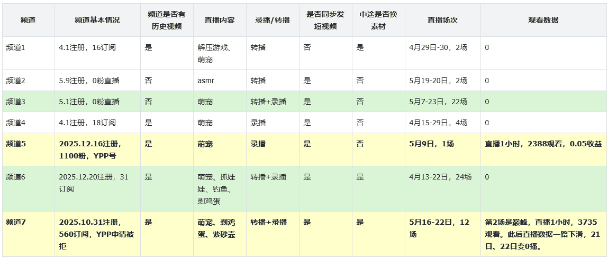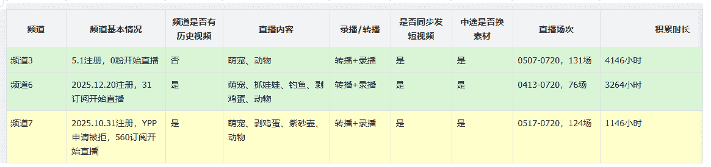

因为我当时有量的 2 个号，粉丝数都达到了 500 以上。

而内测期间，直播数据超级好的圈友，也都是用做过 Shorts、拥有很多粉丝的老号来直播的。

为了验证直播推流是否和粉丝数正相关，我对 2 个直播号进行了对照试验。

账号 1，5 月 1 日注册，0 粉开始直播，持续直播，从未断播。

账号 2，2025 年 12 月 20 日注册，31 订阅开始直播。项目内测期结束后，中途断播，发短视频涨粉养号，后继续直播。

## 账号 1（持续直播，从未断播）直播数据截图

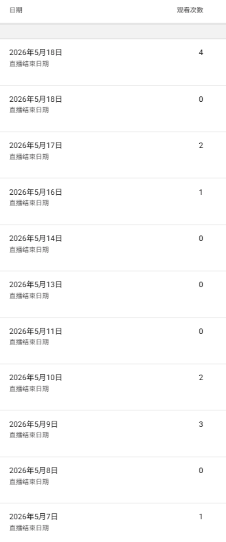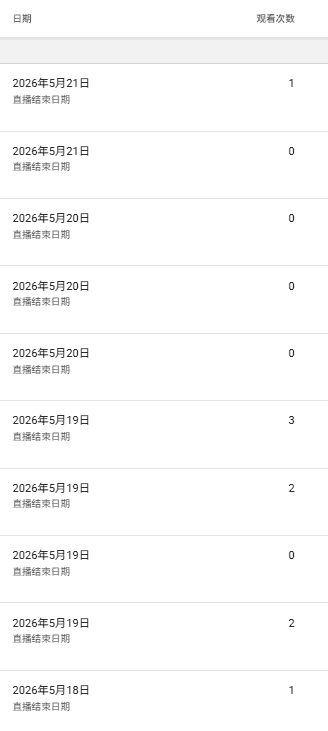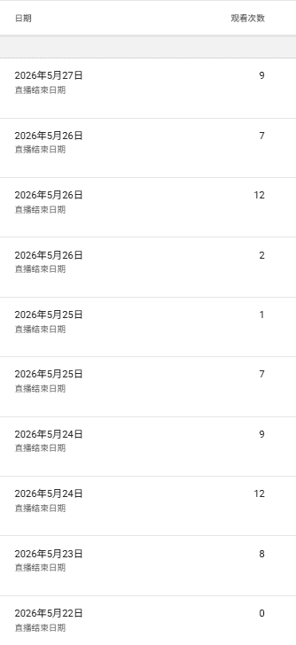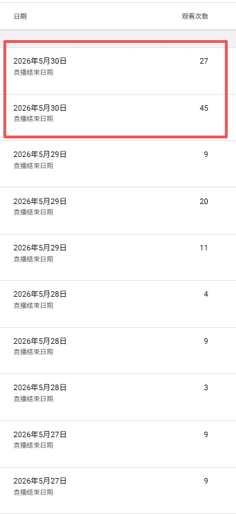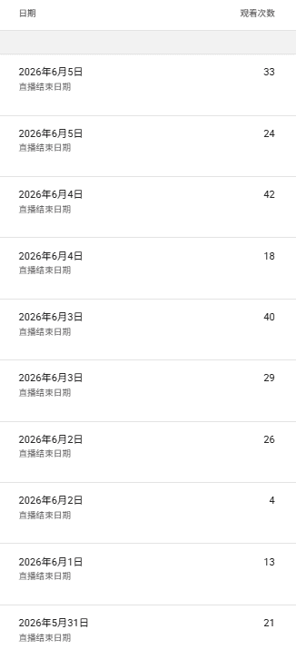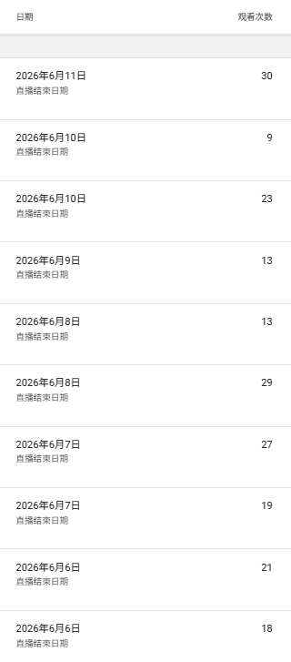

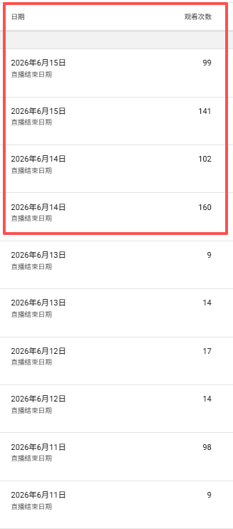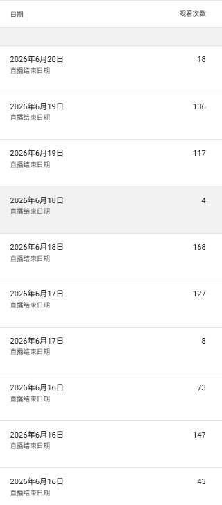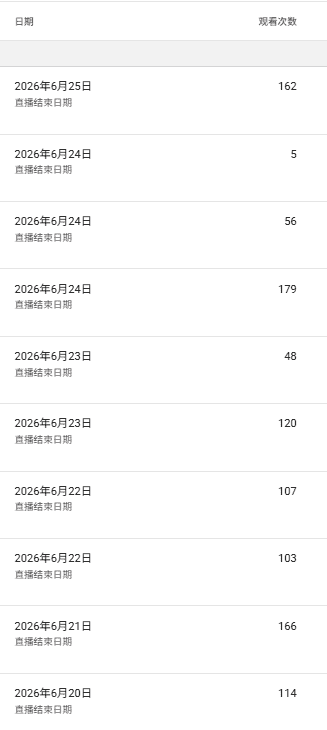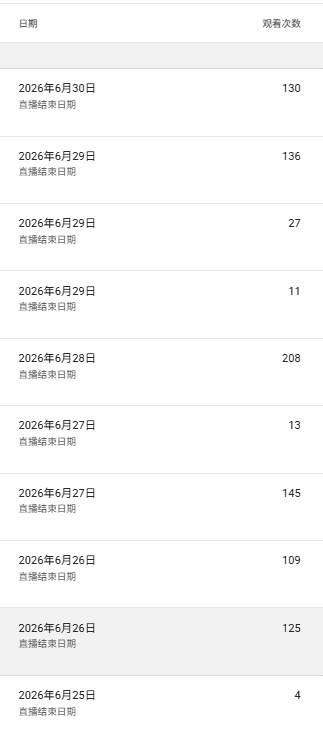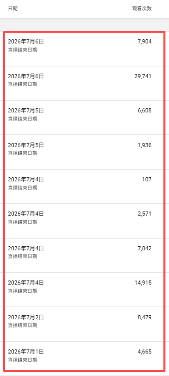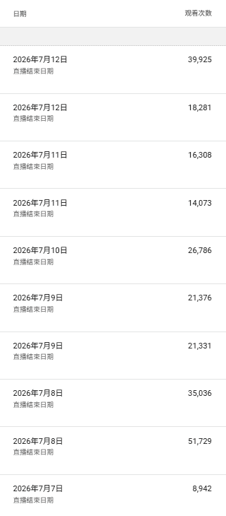

## 账号 1（持续直播，从未断播）推流时间线

- 5 月 7 号开始直播，持续 0 播。

- 5 月 30 号开始有直播回放推流（即直播回放作为长视频，开始有长视频展示，每期直播回放有 1000+ 展示，10—20 个播放），但这之后的直播间依然是 0 播。

- 6 月 14 号，直播间开始有少量推流（开始有推流的账号订阅数，我记得是 50 个订阅，当时忘记截图了）。这之后，每场直播有 100 左右观看。

- 7 月 1 号，换直播赛道，迎来小爆发，直播数据翻了 40 倍（6 月 30 号还是 130 观看，7 月 1 号 4464 观看）。

- 7 月 19 号，直播达标油管 4000 小时门槛。

## 对照组——账号 2（中途断播养号，后继续直播）数据截图

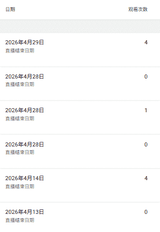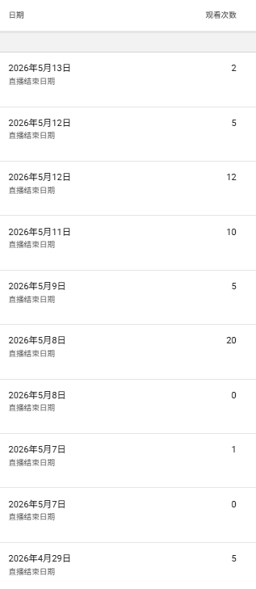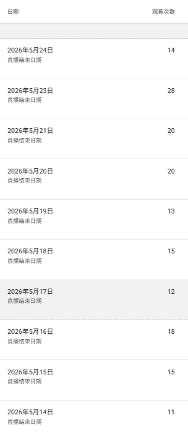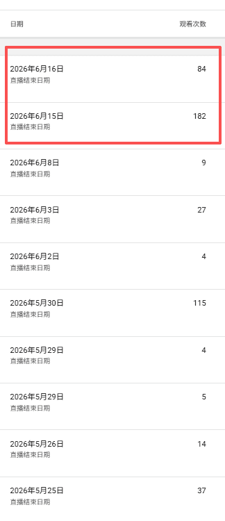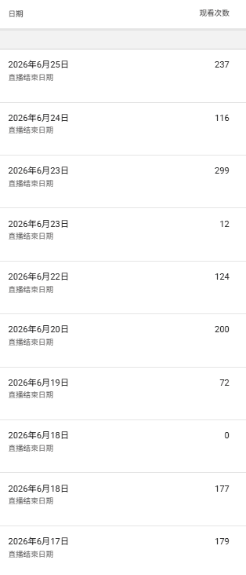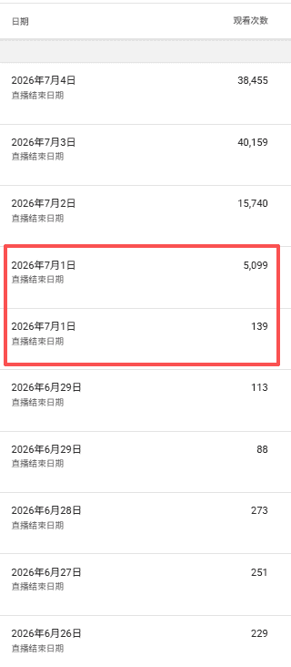

## 对照组——账号 2（中途断播养号，后继续直播）推流时间线

账号 2，没有账号 1 纯粹。2025 年 12 月 20 日注册，发过长视频，数据一般都隐藏了。31 个订阅开始直播。

项目内测期结束后，多次断播，但有发短视频养号。

- 4 月 13 号开始直播，持续 0 播。

- 5 月 8 号，直播回放作为长视频开始有展示。直播间继续 0 播。

- 6 月 3 号断播。

- 6 月 15 号恢复直播（因为 6 月 14 号账号 1 直播间开始有推流，我想试试看账号 2 是否也会有），直播间果然开始有推流。这之后每场直播观看也是 100—200 左右。

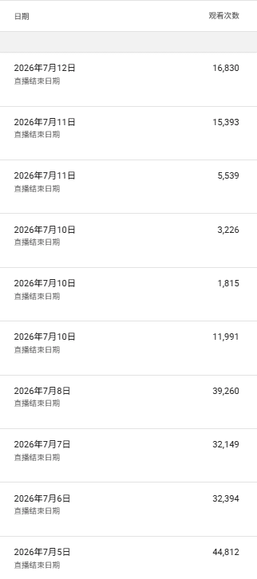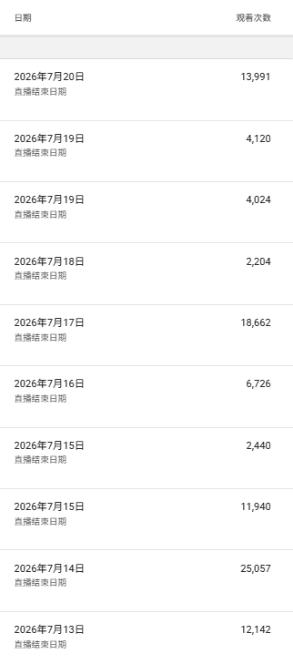

- 7 月 1 号，换直播赛道，也迎来小爆发（7 月 1 号第一场直播还是 139 观看，第二场直播 5099 观看）。

- 7 月 19 号，直播达标油管 3000 小时门槛。

## 直播推流时间线总结

- 0 粉也可申请直播。
- 大约 20+ 天开始有直播回放（作为长视频）展示推流。
- 大约 40 天左右有直播间推流。

## 中途 0 播，还会恢复吗？

答案是：会恢复。

估计做直播的圈友都碰到过这种情况，刚开始直播有推流，甚至达到了一个小高峰，但第二天直播就 0 播了。

像这种情况，流量还会恢复吗？

我的账号经验是可以恢复。基本上是坚持 7 天左右，直播间流量又会恢复。如下图所示：我 6 月 4 号直播间 1 万 6 观看，6 月 5 号开始 0 播（之所以没显示 0，是因为直播回放作为长视频，得到了一点观看数据）。坚持播了 7 天 13 场，6 月 11 号直播间流量又恢复正常。

## 油管直播，到底受什么因素影响？

目前我自己的经验是，油管直播受 3 个因素影响：

1、账号活跃度，决定油管直播间是否有推流。坚持活跃 40+ 天的账号，直播间开始有推流。（参考我的账号 1 截图数据）

2、直播赛道，决定油管直播间推流数据高低。我刚开始选直播间，筛选标准是我能否复刻这个直播间。比如剥鸡蛋直播，但数据一般。

后来我观察发现，要选老外没看过的、有我们自己特色的直播间，数据会更好。比如中国美食直播，在油管的数据都特别好。

后来我就切换了赛道，果然直播数据就变好了。

3、账号基础粉丝数，决定油管直播间开始是否有推流。深海圈直播内测期间，一上来就有大流量的圈友，用的账号都是原来做 Shorts 的老号。这些老号积累了大量粉丝。

而油管直播，最开始就是推荐给账号的订阅用户的。

（很后悔把我自己的 Shorts 老号删除了。）

## 我的直播工具

直播工具：深海圈直播工具（感谢曹教练，这个直播工具真是太好用了。）

录播工具：

https://github.com/ihmily/DouyinLiveRecorder/releases（感谢萧炎大佬分享的小工具，特别好用。）

关于录播，深海圈直播工具也有录播功能，圈友用深海圈的工具也是可以的。

这里特别感谢邵先森教练、轻舟教练。

在深海圈直播项目之前，我就很想做油管直播，但一直无从下手。直到链接到邵教练和轻舟教练。

轻舟教练帮我理清了油管直播技术原理。邵教练教我这个技术小白，从 0 到 1 自己跑通了录播 VPS 流程。

一点点微末经验分享，希望对大家有所帮助。

最后祝所有圈友，个个月入万刀！

————分割线————

看完这篇 SOP，你觉得你懂了。但 90% 的人一到实操就会卡在第一步。

工具和教程只是最低级的壁垒，真正的壁垒是“立刻动手”和“圈层信息差”。

如果你想看全网最新的变现玩法，并且和一群执行力极强的极客一起下场拿结果，欢迎围观我的核心私域：【懒人专属群】。

我们不聊虚的，只做商业闭环的拆解与 AI 效率的压榨。系统内已沉淀 1000+ 跑通的套利实战局。

👉 查阅圈子完整数字资产与上车门槛：

https://lazyso.com/insider/

认同价值、准备好下场干活的，扫码加我微信（lazyhelper1）。

备注：【实操上车】，不闲聊。

