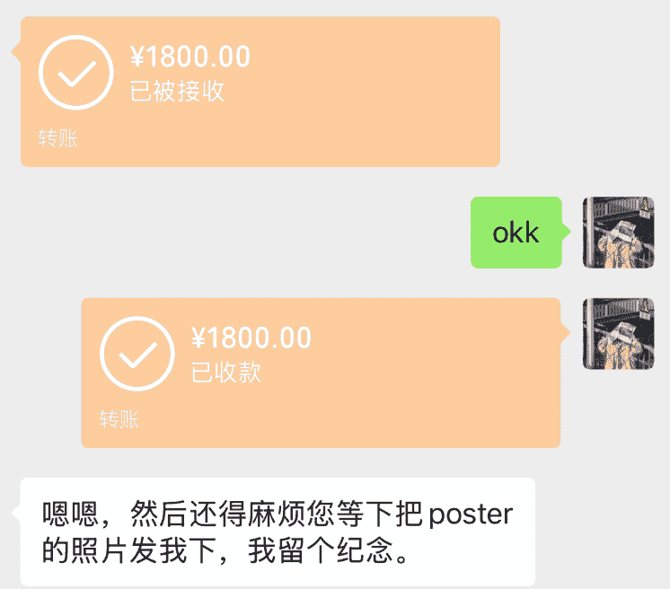
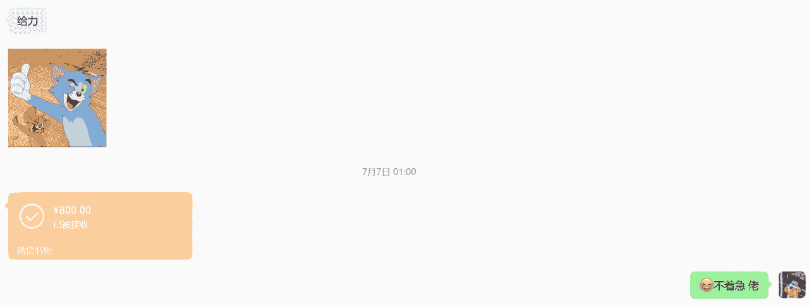
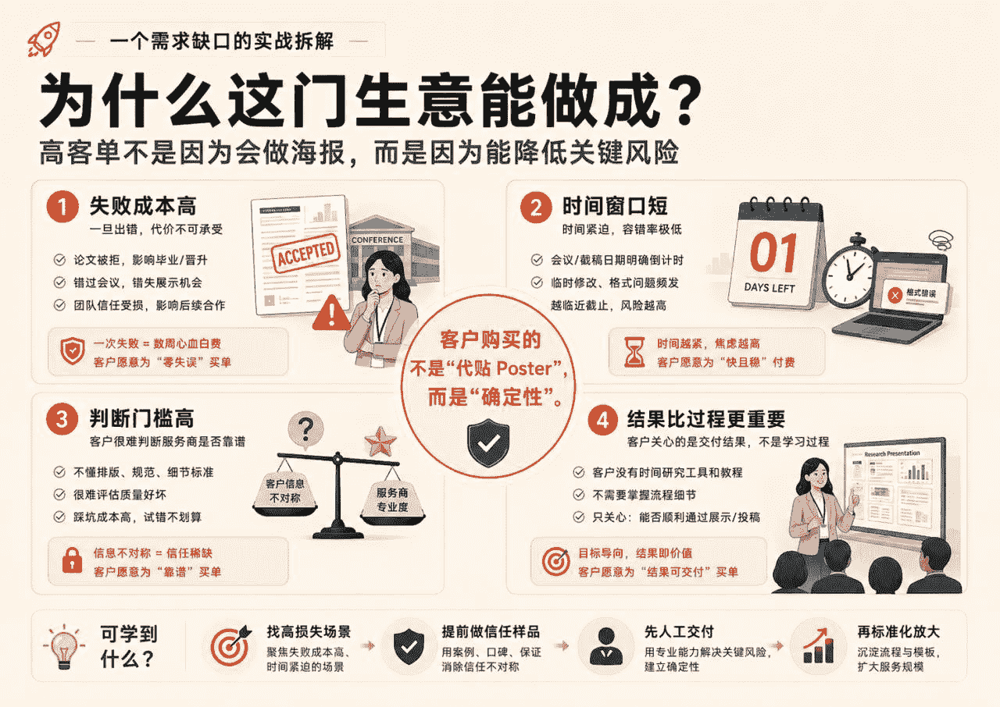
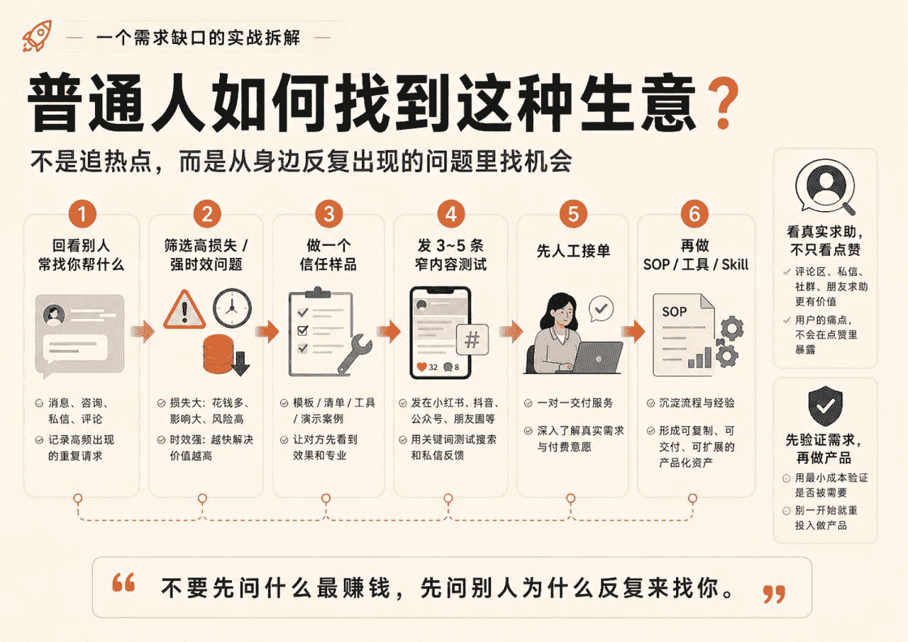
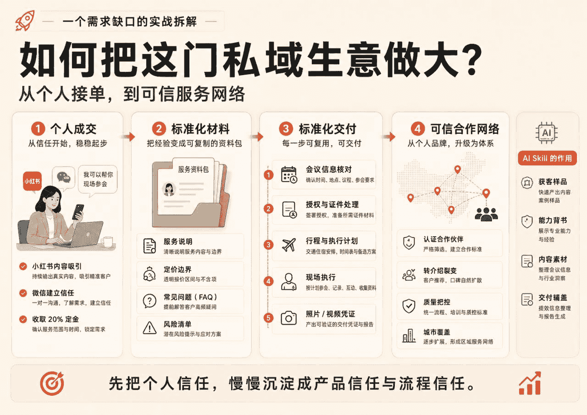

公众号懒人搜索，懒人专属群分享

# 50粉小红书账号，3条笔记，3天成交1万+：我是如何从一句“能不能代贴Poster”，发现一门高客单生意的

260722 副业SC 精华

整理：公众号懒人搜索，懒人专属群精选  
懒人微信：lazyhelper1

先说结果：

有一个只有50个左右粉丝的小红书账号，前后一共发了3条和学术会议相关的笔记。没有投流，没有直播，也没有刻意设计私域钩子，3天时间里，陆续成交了1万多元（部分收入截图）。

这里的1万多元是成交金额，不是净利润（要除去交通、酒店等的，因为老师也不给报）。现在的订单数量也不多，所以我并不打算用一个案例证明这是一门已经跑通、可以无限复制的生意。

但这件事对我最大的启发，不是赚到了多少钱，而是让我第一次比较清楚地看到：一个人不需要先把账号做大，也不一定要先设计出一套完整产品，才有机会开始变现。有时候，真正的生意不是坐在办公室里想出来的，而是用户在使用你的免费内容之后，主动问出来的。我的第一位客户找到我时，只问了一句话：能不能帮我代贴一下Poster？后来，又陆续有人来咨询学术会议的Poster展示、Oral汇报和其他参会协助服务。

我最开始并没有准备做这门生意。过去一段时间，我只是在持续做一些自己熟悉的事情：写论文、参加学术会议、制作Poster、准备Oral PPT，同时把自己整理过的模板、经验和AI Skill发到小红书上。

结果，这些内容没有给我带来很多粉丝，却给我带来了几个需求非常明确的客户。

回过头看，这次成交路径其实很简单：我先免费解决了用户的一个小问题，用户因此相信我有能力解决他背后那个更大、更紧急，也更愿意付钱的问题。

## 一、第一笔订单，是客户替我发现的需求

事情的起点，是我在准备人工智能国际学术会议相关材料时，顺手整理了几篇小红书笔记。

其中一篇是会议时间安排和Poster、Oral的准备建议；一篇是我整理的Poster模板和Oral PPT方法；还有一篇是我做的Paper2PPT Skill。

在这些内容里，Poster模板的转发比较多。很多人第一次参加国际会议，对Poster应该放什么、现场应该怎么讲，其实并没有概念。他们很容易把Poster做成一张放大版论文，把摘要、方法和实验整段复制上去，最后字非常小，重点也不突出。

我在内容里提到，Poster的核心不是把论文完整放上去，而是让路过的人在几十秒内知道：你解决了什么问题、方法有什么不同、结果怎么样，以及这篇论文最值得记住的结论是什么。

现场交流时，也不能只准备一个固定版本。最好提前准备30秒、2分钟和5分钟几种长度，根据对方停留的时间和兴趣随时切换。常见问题也可以提前准备，比如创新点、基线、消融实验、失败案例和方法局限。

这些东西对我来说不算特别复杂，因为我本来就在做科研，也参加过相关会议。但对于第一次准备出国参会的人来说，它们能够直接减少很多试错。后来，一位看过模板的读者来问我，能不能帮他到现场代贴Poster。

我继续和他聊，才逐渐了解他的真实情况：有些论文作者因为签证、护照、学校政策、工作安排或者其他现实原因，无法亲自前往国外参会，但论文已经录用，会议又可能对Poster展示、现场签到或者Oral汇报有具体要求。对他们来说，这不是一个“做得更好一点”的锦上添花需求，而是一个必须尽快处理的问题。

如果只是做一张Poster，市场上的替代方案很多，价格也不会特别高。但如果问题变成“我无法到场，又必须按照会议要求完成相关展示”，用户在意的就不再是少花几百元，而是能不能找到一个真正理解会议流程、能够按时到达现场，并且愿意对结果负责的人。

也正是在这里，我意识到这背后可能存在一个需求缺口。

当然，这项业务有很明确的边界。不同会议对代贴、替代Presenter、远程汇报和现场展示的规定都不一样，不能把某一个会议的经验直接套用到所有会议。实际承接前，需要核对会议规则，必要时由作者联系主办方取得确认。服务者也不能冒充论文作者，更不能伪造签到、身份或参会记录。

我能提供的是会议规则允许范围内的协助，而不是帮客户绕过规则。这条边界如果一开始不说清楚，短期可能多接几单，长期却很容易出问题。

## 二、为什么只有50个粉丝，也能成交高客单？

很多人做小红书时，会把粉丝数量当成变现的前提。账号没有几千粉，好像就不应该考虑卖产品。

这次经历让我发现，对于高客单、低频、需求明确的服务，粉丝数当然有价值，但它不是最核心的指标。

一个正在为具体问题寻找答案的人，和一个随手刷到内容、觉得“好像挺有意思”的人，商业价值是完全不同的。

我的账号粉丝不多，但进来的人相对精准。他们搜索的是人工智能国际学术会议、Poster、Oral PPT、学术会议汇报这些关键词，看到内容以后，也不是单纯来娱乐，而是因为自己真的要参加会议。

我发布的几类内容，在整个成交链路里承担了不同的作用。

会议攻略首先承接了用户的搜索。用户可能只是想知道Poster尺寸、Oral汇报需要几分钟、PPT应该怎么组织，搜索之后看到了我的内容。

Poster模板则进一步降低了他的判断成本。相比于我反复强调自己很专业，一份可以直接使用的模板更有说服力。用户不需要相信我的自我介绍，他可以先看我做出来的东西。

Paper2PPT Skill又提供了另一层背书。这个Skill的输入是论文PDF。它会先读取论文内容，提炼研究问题、核心洞察、方法设计和实验结果，再重新组织成适合汇报的故事线。之后，它会规划页面结构、选择论文图表，生成Markdown和reveal.js HTML演示稿，最后可以从HTML导出PDF。它并不是简单把一篇论文压缩成几页，也不是直接生成一个原生PPTX文件。

我更关注的是，能不能把论文从“适合阅读的结构”改造成“适合现场讲述的结构”。比如，为什么这个问题值得研究，现有方法到底卡在哪里，作者观察到了什么关键现象，方法为什么这样设计，以及实验是否真的支持论文提出的结论。

对用户来说，这个Skill本身未必是他最终购买的商品，但它能让他看到我确实懂论文、懂汇报，也有能力把个人经验变成一套可以运行的流程。后来我越来越觉得，高客单生意在成交之前，最好先有一个可以让用户低成本体验的“信任样品”。

它可以是一份模板、一篇真正有用的攻略、一段演示视频，也可以是一个小工具或Skill。用户在没有付钱之前，就能够通过这个样品判断你的能力，而不是只能听你说自己很厉害。

这可能也是我只有50个粉丝，却能够成交的原因。我并没有靠粉丝量建立信任，而是靠用户拿到手以后确实有用的东西建立信任。

## 三、我后来把这套路径叫作“高损失结果型搜索获客”

复盘整个过程，我发现这类客户不是被我“种草”出来的。他们本来就已经遇到了问题，只是在主动寻找解决方案。

用户先发现自己无法到场，或者不知道怎么完成会议展示；接着他会搜索会议名称、Poster模板、Oral PPT、参会攻略等信息；然后通过免费内容认识我，再从我的模板和开源项目里判断我是不是一个靠谱的人。

当小问题被解决以后，他才会把更大的问题告诉我。

所以这套路径更像是：

- 用户先遇到一个高损失问题，然后主动搜索；
- 我用免费内容承接搜索，并通过模板和工具证明能力；
- 用户私信咨询，转移到微信继续沟通；
- 双方建立信任以后，再完成高客单成交。

我把它叫作“高损失结果型搜索获客”。这里的重点不是给一个普通需求包装出高价，而是找到那些不解决就可能产生明显损失、又有清晰时间节点的事情。

比如会议马上开始、材料必须提交、活动必须到场、项目马上验收。这些场景里，客户通常不愿意花很多时间学习完整流程，也没有兴趣自己慢慢试错。他更希望找到一个懂行的人，帮他把结果可靠地交付出来。

这种业务不一定需要特别大的流量。因为用户的需求已经很明确，只要内容能够在他搜索时出现，并且迅速建立信任，少量精准客户也可能产生不错的收入。

当然，精准不意味着每一个人都会成交。有人看完价格会觉得贵，有人需要询问导师，有人只是过来了解情况。但这并不影响整个模型成立，因为高客单服务本来就不需要把所有咨询者都转化。

## 四、从小红书到微信，成交之前先把人聊明白

小红书适合被发现，但真正深入沟通通常还是在微信。

我的做法不是直接在私信里反复发送自己的微信号，而是让对方把联系方式发给我。一方面，是因为公开发送联系方式容易增加平台风险，也可能被同行盯上；另一方面，我通常会在这个过程中开一句玩笑，让整个转移过程自然一点，不要让对方感觉我马上要开始推销。

客户加到微信后，我一般也不会第一句话就报价。我会先问他的论文方向，再聊聊导师、学校、实验室和参会情况。很多人加好友时，会直接备注“上交—某某”“北大—某某”之类的信息，所以学校往往一开始就能知道。

知道论文方向和学校以后，很多话题会自然展开。可能是彼此研究方向接近，可能是认识同一所学校的人，也可能来自同一个地区，或者都经历过类似的科研压力。这些交流当然有了解客户背景的作用，但它不应该变成一种机械套话。

对于科研圈的高客单服务来说，客户真正想确认的是：你是不是一个懂他所处环境的人，你是否理解论文、导师、会议和科研成果对他意味着什么。如果对方感觉你只把他当成一笔订单，即使你话术再专业，他也很难把一件重要的事情交给你。

有一次，我和客户聊Poster，也聊到做科研本身有多辛苦。双方找到一些共同经历后，信任建立得很快。

所以我目前的成交方式，其实非常依赖“人”。它不是一个标准客服发一套固定话术，就能直接复制的流程。

这既是优势，也是目前这门生意做大的瓶颈。优势在于，个人信任很强，客户一旦认可，决策会比较快。瓶颈在于，如果未来咨询量变多，所有客户都需要我亲自聊，就很难真正放大。接下来需要做的，是逐渐把一部分“相信我这个人”，转化成“相信这套服务本身”。比如更完整的服务说明、可验证的学术背景、脱敏案例、交付流程、风险预案和客户反馈。即使客户没有和我聊很久，也能够通过这些材料判断这项服务是否可靠。

## 五、高客单成交的核心，不是说服所有人

在实际沟通中，我发现客户大致会进入两种状态。

第一种是觉得价格比较高，需要再考虑一下；第二种是认为价格可以接受，确认细节后直接支付定金。

我的定金比例一般是总金额的20%。

对于愿意直接交定金的人，其实不需要太复杂的成交技巧。需求是真的，预算也能接受，信任已经建立，后面的事情就是把服务范围和交付节点说清楚。而对于觉得贵的人，我一般不会持续催促。

我一直觉得，买卖不成仁义在。即使对方最终不找我，我也会告诉他，找其他服务者时应该注意什么。比如对方有没有真实的学术会议经历，是否愿意提供可验证的学术身份，是否做过类似汇报或现场协助，能不能提供脱敏后的机票、酒店和行程信息，以及出现航班延误、会场调整等意外情况时，有没有处理方案。

这不是为了吓唬客户，也不是为了暗示“其他人都不可靠”。而是因为这个市场里，用户确实缺少判断标准。他可能第一次找这种服务，根本不知道应该问什么。

高客单客户真正担心的，往往不是价格本身，而是花了钱以后，对方临时失联，或者到了会议当天才发现事情根本无法完成。

只要把这些风险和判断标准说明白，真正匹配的客户自然会做决定。不匹配的客户，也没有必要硬推。

## 六、哪些客户最容易成交？

目前接触到的客户，我大致分成三类。

第一类是导师或者课题组报销的客户。这类客户未必对价格特别敏感，但学生本人没有最终决策权。他需要回去问导师，导师可能又需要知道具体服务内容、收费依据和风险边界，因此成交链路相对更长。这类客户未来需要准备一份可以直接转发给导师的说明材料。不要让学生靠自己的理解回去复述，而是把服务内容、费用构成、合规范围、交付方式和可以提供的凭证整理清楚。

第二类是已经进入大厂、收入相对稳定的客户。我接触过北大背景、后来在腾讯工作的客户。这类人一般更看重效率和确定性。他有能力判断服务是否靠谱，也不愿意为了省一点钱，在多个陌生服务者之间反复比较。一旦确认你比较可靠，成交通常会比较快。

第三类是聊得比较投机、彼此有明显共同点的客户。可能学校相近，可能家乡相同，也可能研究方向接近。关系建立以后，对方愿意把比较重要的事情交给你。

目前来看，第二类和第三类客户成交最快。第一类客户不是不能成交，只是中间多了一个决策人。

这也让我意识到，同一个服务，客户真正购买的理由可能完全不同。有人买的是时间，有人买的是安全感，有人买的是熟人式信任，还有人需要一套能够拿给导师看的证明。

如果把所有人都当成同一种客户，用同样的方式沟通，效率一定不会高。

## 七、为什么我一个时间段只接一单？

目前，我坚持一个时间段只接一个客户。

原因并不复杂。这类服务不像交付一份普通电子资料，客户买的是在指定时间、指定地点，把事情可靠完成的结果。

会议现场存在很多不确定因素。航班可能延误，会场可能临时调整，Poster可能出现打印问题，Oral时间可能发生变化，设备也可能临时故障。

如果同一时间接了太多订单，只要其中一个环节出问题，就可能影响所有客户。

高客单服务最重要的资产不是一两个月多赚了多少钱，而是客户是否相信你答应的事情能够做到。

所以现阶段，我宁愿少接，也不会为了短期收入无限放大单量。

如果同一个时间段出现更多客户，我会把部分需求推荐给比较可靠的朋友，相当于送一个顺水人情。

这看起来是把收入让了出去，但也会积累同行关系。

未来这门生意如果继续发展，最合理的方式可能不是让我一个人同时跑更多会议，而是建立一个可信的合作网络。我负责内容获客、需求判断、服务标准和客户沟通，合作伙伴负责一部分现场交付。

但这件事不能做得太快。合作伙伴的学术背景、英语能力、参会经验、责任感和行程都要经过验证。客户也必须知道最终由谁提供服务，不能为了扩张就把订单偷偷转手。

如果这些问题没有解决，所谓平台化只会提前透支口碑。

## 八、这是一门低频生意，但有自然复购

会议服务不是一个高频产品。

客户不会每个月都去参加国际会议，所以目前我并没有设计特别复杂的后续产品承接。

但低频不等于没有复购。当一个客户下一次又有论文中稿，或者他的同门遇到类似问题时，最省事的选择不是重新找人，而是回来找一个已经合作过的人。

这就是我理解的最小阻力原则。第一次合作之前，客户要判断你的背景、能力、价格和风险。第一次合作以后，这些判断都已经完成了。只要交付没有问题，第二次沟通会简单很多。

我现在会在自己论文中稿或者准备去参加某个会议时，在朋友圈发一句：有没有朋友一起去参会？

看到朋友圈的老客户、科研朋友或者他们介绍过来的人，如果刚好有需求，就会主动来问。

目前已经出现过转介绍的情况。

这也说明，一位客户带来的价值不只是当下这笔订单。他还可能带来下一次会议的复购、同实验室的同学、同门师兄弟或者同公司的研究人员。

未来我会考虑给客户建立更简单的标签，比如学校、研究方向、来源会议、客户类型和潜在会议，但不会做成天天私聊、不断促销的模式。这批人本来就是低频需求，最好的运营方式可能不是反复打扰，而是在正确的会议节点出现。

## 九、Paper2PPT Skill对这门生意的真正作用

最开始做Paper2PPT Skill时，我并不是为了给这项会议服务获客。我只是发现，很多论文汇报都存在相似的问题。作者非常了解自己的论文，却不一定知道

公众号懒人搜索，懒人专属群分享

怎样把论文讲清楚。他可能把方法细节讲了十分钟，听众仍然不知道这篇论文到底想解决什么问题。

所以我尝试把自己做学术汇报时的判断封装成一个 Skill。

用户输入论文 PDF，它会先读论文，再提炼研究问题、关键洞察、方法和实验结果。之后，它会规划汇报的故事线、页面结构和配图，生成 HTML 演示稿，并进一步导出 PDF。我后来才意识到，它对业务的价值不只在于提高制作效率。

更重要的是，它让别人可以看见我的能力。

过去，我懂得怎样读论文、怎样选图、怎样组织汇报，这些经验都在脑子里。客户第一次认识我时，很难判断这些能力到底是不是真的。

当经验变成一个开源 Skill 以后，用户可以直接查看和使用。它变成了一种公开的能力证明。

未来，如果这门服务继续发展，Skill 还可能承担更多作用，比如辅助理解客户论文、生成汇报提纲、整理常见问答和建立交付检查清单。但是，这里面仍然需要人工判断。

AI 可以帮助提炼和生成，人需要确认论文理解是否准确、会议要求是否符合，以及最终内容是否适合真实汇报。

我并不认为有了 AI，就可以把整项服务完全自动化。客户最后付费购买的，仍然是人对结果的判断和责任。

# 十、普通人怎么找到类似的生意？

有人可能会觉得，这个案例比较特殊，因为我本来就在科研圈，有论文和参会经验。

普通人没有这些背景，是不是就无法找到这种小流量、高客单的需求？

我觉得，具体的“代贴 Poster”当然不能照搬，但发现需求的方法是可以借鉴的。

首先，不要一上来就问“现在最赚钱的项目是什么”。

一个项目越热门，看到的人越多，进入的人也越多。如果自己没有特殊资源，最后通常只能卷流量、卷价格。

普通人更适合先看自己已经身处的圈子。

你每天接触哪些人？同事、客户、家长、学生、商家、设计师、程序员，还是某个兴趣群体？他们经常在哪些事情上抱怨、卡住或者求人帮忙？

我这次的需求，不是通过行业报告找到的，而是从一条私信里发现的。

所以，可以先回想最近三个月，别人反复找你帮过什么忙。

有些事情对你来说很简单，因为你已经做过很多次；但对别人来说，他需要花几个小时搜索，还不确定自己做得对不对。

这种“你觉得简单，别人觉得很难”的地方，往往就有服务机会。

接下来还要判断，这个问题值不值得收费。

我比较关注几个信号：不处理是否会带来明显损失，是否有明确的截止时间，用户是否缺乏判断标准，以及用户是否更想直接得到结果，而不是花时间学习全过程。

这几个条件同时出现时，客户的付费意愿通常会更强。

找到问题以后，不要马上开发一个完整平台，也不要一开始就投入很多钱。先做一个很小的信任样品。它可以是一份模板、一篇攻略、一段演示视频、一个检查清单，或者一个简单的 AI Skill。

把它发到用户可能搜索的平台上，然后观察大家的真实反应。重点不要只看点赞和粉丝，而要看有没有人带着具体问题来私信，有没有人主动问你能不能代做，有没有人愿意加微信继续聊，甚至有没有人直接问价格。如果同一个问题反复出现，就可以先人工接几单。

人工交付的过程非常重要，因为它会告诉你客户真正关心什么，哪些环节最耗时间，哪些步骤可以标准化，哪些判断必须由人完成。

很多人一发现机会就急着做小程序、做平台，最后才发现客户根本不需要。

更稳妥的顺序应该是：先有真实客户，再从真实交付中总结 SOP，最后才考虑工具、Agent、Skill 或者合作伙伴网络。

AI 可以显著降低试错和制作成本，但它不能代替需求验证。

真正有价值的 AI 产品，通常不是为了展示技术而做，而是从一个已经存在的业务问题里长出来的。

# 十一、目前这门生意还没有解决的问题

虽然这次结果不错，但现在还远没有到可以宣布模式跑通的时候。

第一个问题是需求规模。我还需要观察，不同会议是否都存在类似需求，还是只在少数会议和特殊时间段集中出现。

第二个问题是交付能力。现在我一个时间段只接一单，一旦订单变多，如何保证合作伙伴的质量，是很现实的挑战。

第三个问题是规则风险。不同会议的要求不同，有些需求即使客户愿意付钱，也可能不适合承接。

第四个问题是获客的持续性。3 条笔记带来了订单，不代表以后每发 3 条都能获得同样结果。

所以接下来，我更希望记录真实数据，包括咨询人数、加微信人数、报价人数、成交人数、客单价、交付成本、复购和转介绍情况。一笔订单证明有人愿意付费。

只有一段时间内持续出现订单，才能证明它可能是一门生意。

# 十二、最后的几个感受

这次经历让我最大的变化，是不再把“做账号”和“做生意”看成两个分开的事情。

以前可能会觉得，先把粉丝做到几万，再考虑产品和变现。

现在我更相信，内容本身就可以是寻找需求的过程。

当你把自己真正做过的事情、踩过的坑和能直接使用的工具分享出来，用户会通过评论和私信告诉你，他还需要什么。

有些人会问一个小问题，有些人会提出一个你从来没有想到过的付费需求。

这时候需要做的，不是马上把它包装成一个暴富项目，而是继续问清楚：为什么他不自己做？不解决会有什么损失？他为什么愿意找我？这个问题是不是反复出现？我能不能稳定交付？

我的第一笔订单，只来自一句很普通的话：

能不能帮我代贴 Poster？

如果当时我只是把它当成一次普通帮忙，也许这件事就结束了。

但当类似需求陆续出现以后，它开始变成一个值得认真研究的信号。

普通人寻找生意，可能不需要每天研究宏大的趋势。

先把身边那些反复出现的小麻烦听明白，把自己真正擅长的事情做成一个样品，再放到用户能找到的地方。

很多机会，最开始都不像一个“项目”。

它只是有人来问你：这个事情，你能不能帮我做？

————分割线————

看完这篇 SOP，你觉得你懂了。但 90% 的人一到实操就会卡在第一步。

工具和教程只是最低级的壁垒，真正的壁垒是“立刻动手”和“圈层信息差”。

如果你想看全网最新的变现玩法，并且和一群执行力极强的极客一起下场拿结果，欢迎围观我的核心私域：【懒人专属群】。

我们不聊虚的，只做商业闭环的拆解与 AI 效率的压榨。系统内已沉淀 1000+ 跑通的套利实战局。

👉 查阅圈子完整数字资产与上车门槛：

https://lazyso.com/insider/

认同价值、准备好下场干活的，扫码加我微信（lazyhelper1）

备注：【实操上车】，不闲聊

