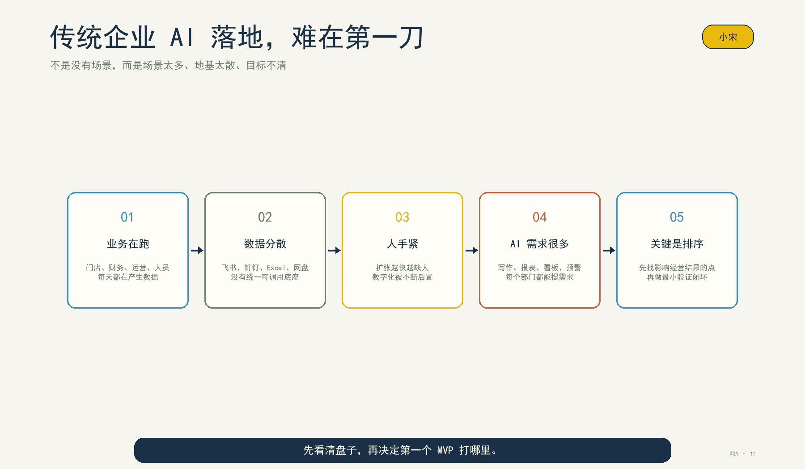
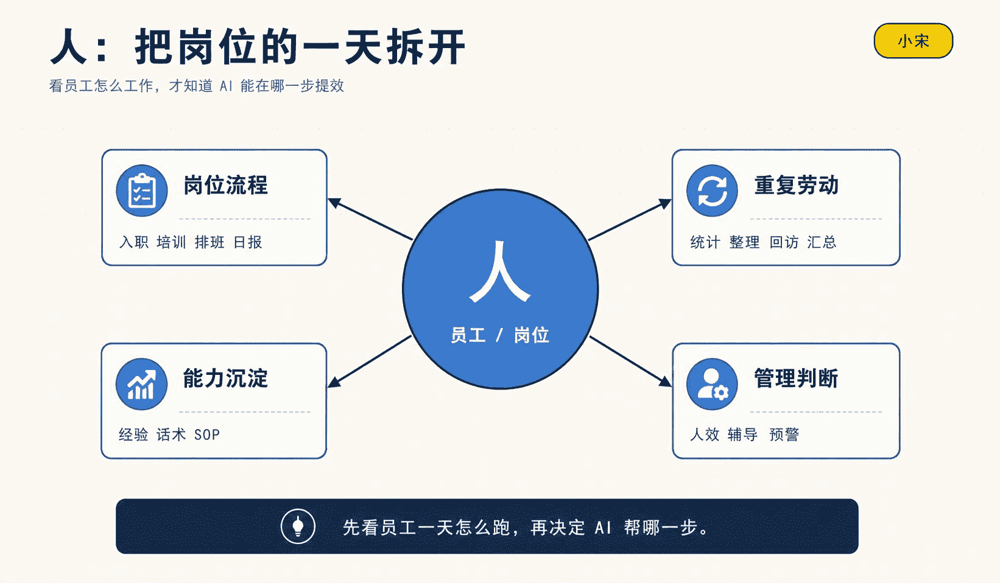
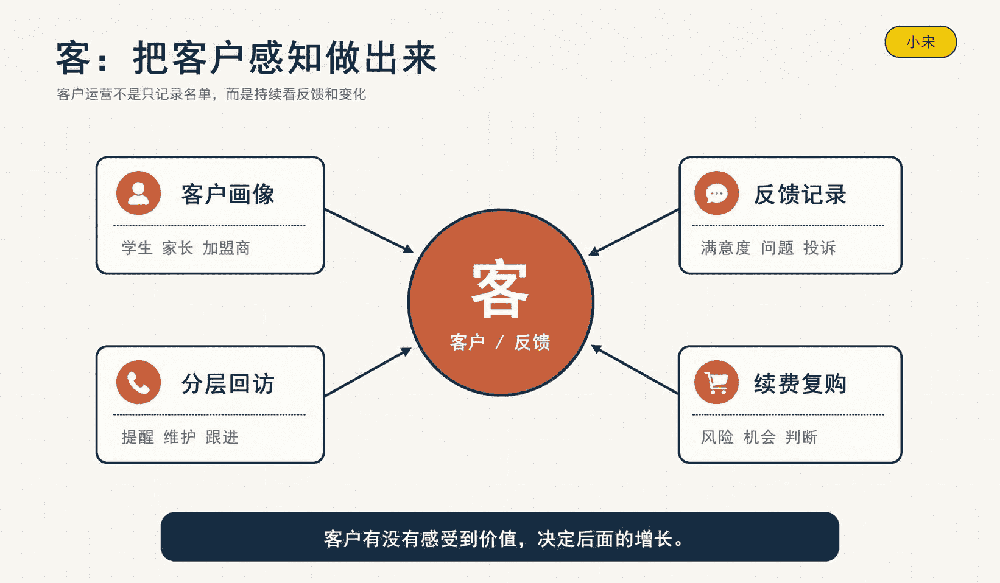
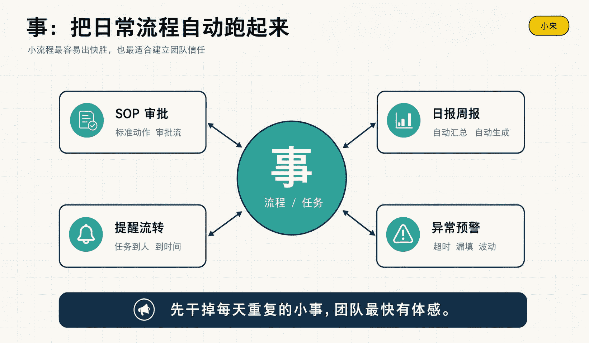
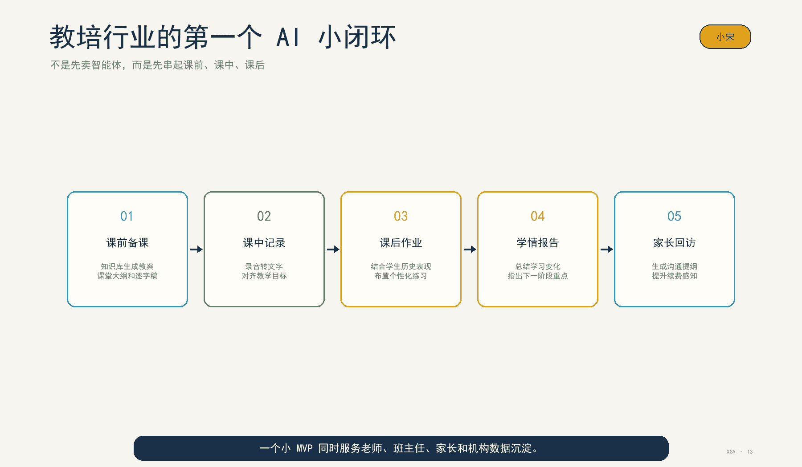
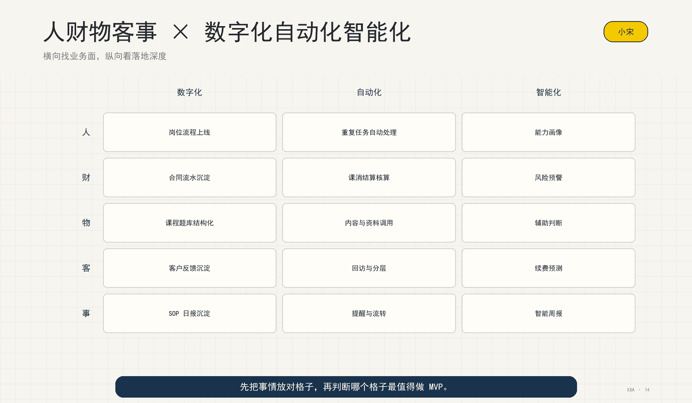
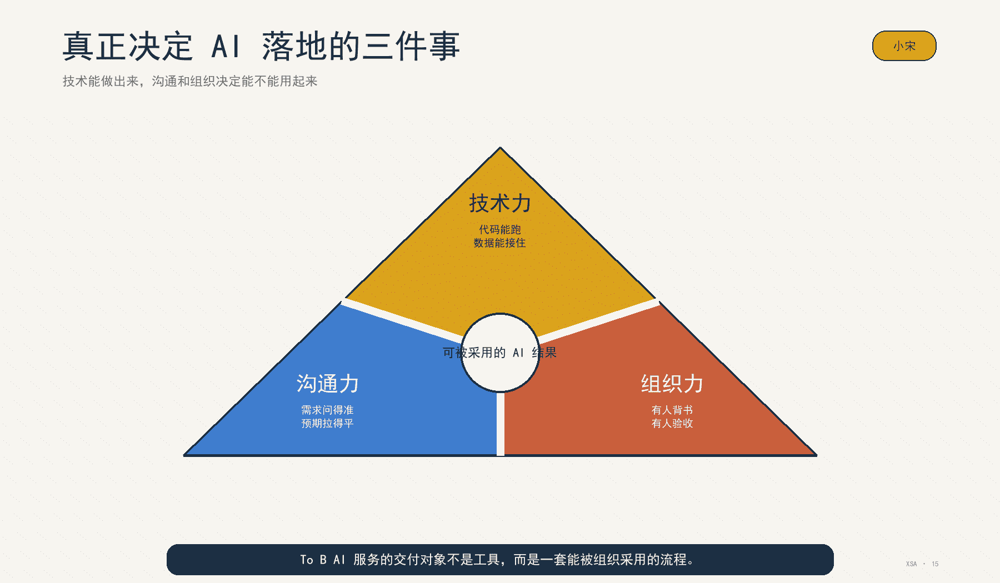

公众号懒人搜索，懒人专属群分享

一个人深入中小企业，做 **AI** 应用落地的感受

260724 副业 SC 精华

整理：公众号懒人搜索，懒人专属群精选

懒人微信：lazyhelper1

## 写在前面

这阵子看到圈里在聊「把 AI 人才往企业里送」。我就想干脆把自己这段时间在一家传统中小企业里做 AI 落地的经历，老老实实复盘一遍。

与其说是经验总结，不如说是给同样想进传统企业做 AI 服务的人提供一个样本：我是怎么进场的、怎么摸清业务的、怎么找到那个真正值得做的切口，又是怎么靠一个不起眼的小结果，一点点把信任攒起来的。

要说这一路走下来最大的体会，大概就是：别急着上手，先把企业这盘棋看明白，跟对方对齐目标；数字化和自动化的底子没打好之前，别硬上智能化；等业务地图画出来了，找准那个 P0，先做个能跑起来的小 MVP，用结果说话，信任才立得住。

我是小宋，现在从事为 **AI** 企业服务。

- 1. 程序员出身，后端开发工程师，生财 1 年圈友。

- 2. 现在主要从事 AI 工作流、多 Agent + Skill 内容知识库、n8n 工作流。
- 3. 一篇 CSDN 技术文章 43w+ 浏览。
- 4. 3 篇生财精华帖。
- 5. 《生财 AI 宝典》共创者。
- 6. 运营公众号「小宋 AI 自动化」。

## 一、我面对的是一个什么盘子

我们干的是连锁加盟代运营，一百多家门店分布在全国各地。

没亲手管过这种业务的人可能很难想象：同样是「管一条业务线」，多了「底下一百家散落在全国的门店」这个尾巴，难度完全不是一个数量级。业务本身就复杂，数据量又大又散——飞书多维表格里存一部分，钉钉里散着一部分，每个人自己电脑里的 Excel 又各管各的，网盘里还堆着一堆说不清有没有用的历史资料。

这大概是很多传统中小企业的常态：业务天天在跑，数据也天天在产生，但从来没被好好归拢成一个能查、能调、能用的底子。

我进去之后最直观的感受，说白了就三件事搅在一起：人手不够、数字化没跟上、业务还在往前冲。这三者互相拖累——扩张越快人越紧，人越紧，数字化这种「不紧急但重要」的事就越容易被搁置，而搁置下来的这些基础活，最后全都变成了做 AI 落地时绕不开的坑。

这三个是连在一起的。

扩张越快，人就越紧；人越紧，数字化这种「重要但不紧急」的事，就越容易被往后放；而这些被往后放的基础建设，最后都会变成 AI 落地时必须补上的课。

所以我后来越来越清楚一件事：

传统企业不是没有 **AI** 场景，而是场景太多了。真正难的不是找场景，而是判断哪一个最值得先做。

## 二、进场之前，先搞清楚两件事

进公司做 AI 落地，光会技术远远不够。

你还得会协调、懂业务、能判断组织关系。尤其是做 To B AI 服务，很多时候你不是在交付一个工具，而是在进入一家公司的真实经营系统。

有两件事，最好进门之前就想明白。

我自己是进去整整两周才真正搞清楚，回头看，第一周就应该完成这一步。

### 第一件：这家公司有没有技术团队

这个一定要先判断清楚。

有技术团队，和没有技术团队，是完全不一样的打法。

如果公司已经有技术团队，你进去以后大概率不是第一负责人。很多所有权、系统权限、技术路线都不在你手里。你做 AI 也好、培训也好，更像是在已有体系里做协同。这类项目相对清晰，但你的自主权也会小一些。

如果公司没技术团队，那就是另一种状态。

如果公司没有技术团队，很多数据、系统、流程都得自己一点点梳理。事情会多，但自主权也大。我这种「没有技术团队、自己是第一人」的场景，第一步其实很明确：

把能自动化的尽量自动化，把能自动抓的数据自动抓，先把人从重复劳动里解放出来。说白了就是提效。而且对很多传统企业老板来说，最容易感知到的 AI 价值，往往也是提效。

你讲智能化、讲大模型、讲 Agent，他未必马上有体感；但你把一个员工每天两小时的重复活干掉，他立刻就懂了。

### 第二件：你是谁招进来的，你的领导到底要什么

每个人对 AI 的认知是不一样的。

老板、副总、业务负责人、技术负责人，对 AI 的期待完全可能不是一回事。

所以你必须搞清楚：

你是谁招进来的？

谁给你背书？

谁给你资源？

谁最终验收你的结果？

他们招你进来，到底指望你解决什么问题？

做 **To B AI** 服务，第一步不是做系统，而是先把目标、资源和验收标准对齐。否则你很容易做了很多事，但大家对「什么叫有效」的理解并不一致。

总之，不管进哪家公司，5 天到一周之内，必须搞明白一件事：

老板招你来，到底是想要「提效」，还是想要「规划和智能化」？

这两个方向，直接决定你第一个月该往哪里使劲。我前两周其实就吃了这个亏。

一开始光顾着埋头干，没第一时间反问清楚：老板眼下最想看到的价值到底是什么？

后来我才反应过来，老板当下最需要的其实不是一个很宏大的智能化规划，而是能看得见、用得上、能省人的提效结果。这一步越早确认，后面越省力。

一句话总结：

进企业做 **AI** 落地，第一步不是马上开干，而是先把目标对齐：谁要结果、要什么结果、用什么标准判断结果。目标越明确，后面的动作越不容易跑偏。

## 三、动手之前，心里要有一根尺子：数字化 → 自动化 → 智能化

在干任何活之前，我脑子里有一套很重要的判断框架。

我把「企业用 AI」分成三个阶段。

### 第一阶段：数字化

把散在各处的数据搬到线上，让它能查、能调、能被系统调用。

比如把 Excel、网盘、聊天记录、人工台账，逐渐沉淀到数据库、飞书多维表格、业务系统里。

这一步看起来不性感，但它是地基。

### 第二阶段：自动化

在数字化基础上，把原来要人手动做的活，变成系统自动跑。

比如自动采集数据、自动生成日报、自动汇总异常、自动推送提醒。这一阶段最容易产生业务体感，因为它直接省时间、省人力。

### 第三阶段：智能化

等前两步有了，才真正谈得上让 AI 做分析、判断、预测、建议和经验总结。

比如经营预警、人才预测、内容预测、知识问答、智能决策辅助。

这个顺序不能乱。

数字化没完成，自动化就很难稳定；数字化和自动化都没完成，就直接上智能化，很容易变成空中楼阁。

但现实是什么？

很多老板嘴上要的，往往是最后那个：

「你给我搞个智能的。」

「能不能帮我做规划？」

「能不能让 AI 替我判断？」

可你一低头看，公司连基础数据都还没统一。数据分散在每个人的表格、飞书、钉钉、网盘、不同系统里。

这时候你要是顺着老板的话直接上智能化，风险很高。

因为 AI 的判断质量，取决于数据和流程的质量。

地基不稳，楼盖得越高，越容易出问题。

所以真正的打法是：

嘴上接住老板对智能化的期待，手上先补数字化和自动化的地基。

这根尺子，我一直揣在心里。

但光有这根尺子还不够。

因为真站到一堆杂活面前，你还是会遇到一个问题：

事情那么多，到底先干哪个？

这就需要第二套方法。

## 四、真正的第一步：先从业务流程里找出最需要 **AI** 的那个点

### 先别问哪里能用 **AI**

很多人一进企业做 AI，第一反应是问：

「哪里能用 AI？」

但我现在越来越觉得，这个问法不够好。

因为一家企业里，几乎哪里都能用 AI。写文案能用，做表格能用，生成周报能用，客服能用，数据分析能用，会议纪要能用，知识库也能用。如果只是问「哪里能用 AI」，很快就会得到一堆需求。

但这些需求不一定重要。

有些是员工体感很痛的需求，但对公司增长不关键；有些是老板嘴上很感兴趣的需求，但短期落不了地；有些是必须补的基础问题，但做完也未必立刻带来增长。

所以真正该问的是：

这家公司当前最影响经营结果的关键问题在哪里？

**AI** 不是先找工具，而是先找业务里的关键矛盾。我现在会把这件事拆成一个流程。

### 第一步：把所有关键岗位都聊一遍

不要只听老板说，也不要只听一个业务负责人说。

老板看到的是方向，一线看到的是细节，中层看到的是协同问题，每个人看到的都只是业务的一部分。

所以要把关键岗位都访谈一遍：

把录音给 AI，然后问：

谁负责业务结果？谁负责日常执行？谁负责数据记录？谁负责复盘？谁每天在重复劳动？谁最清楚这个环节为什么卡？

把这些信息都收集回来。

### 第二步：把访谈内容沉淀成数据

我现在会更倾向于把每个岗位的访谈结果结构化，而不是只放在聊天记录里。

比如每一行就是一个业务环节，字段可以包括：

交给 AI 整理：环节名称、负责人、当前怎么做、用到哪些数据、现在最卡的地方、是否重复劳动、是否影响经营结果、是否适合 AI 介入、优先级判断、可能的 MVP。

这样做的好处是，原来散在不同人嘴里的经验，会先变成一组能被整理、能被分析、能被复盘的数据。

### 第三步：让 **AI** 整理业务地图

当这些访谈和数据沉淀下来以后，再让 AI 去做整理。

不是让 AI 直接拍脑袋给方案，而是让它基于真实访谈和真实流程，帮我把业务地图画出来：

让 AI 去整理：这家公司有哪些核心流程？每个流程下面有哪些环节？每个环节现在怎么跑？哪些地方是重复劳动？哪些地方是数据断点？哪些地方靠老师傅经验？哪些地方最影响结果？

这一步做完，很多问题就会从一团乱麻，变成一张地图。

### 第四步：判断哪些地方需要 **AI** 提效，哪些地方适合 **AI** 切入

不是所有问题都适合马上做 AI。

拆完以后，下一步不是马上做工具，而是排优先级。

判断标准很简单：

1. 它离业务结果近不近。
2. 它现在有没有真实数据。
3. 它能不能用一个小 MVP 先验证。
4. 做出来以后，团队能不能马上感受到价值。

符合这四个条件的，就适合先做。

### 用公众号知识库举个例子

这里可以拿我自己的公众号知识库做个例子。

如果只看表面，我可能会觉得最该优化的是写作本身：标题怎么起、开头怎么改、文章怎么润色、配图怎么做。

但如果把公众号当成一个小型内容业务来看，它就不是「写一篇文章」这么简单，而是一整条流程：

选题判断 → 素材收集 → 结构搭建 → 初稿写作 → 标题开头 → 配图排版 → 发布 → 数据回看 → 复盘沉淀 → 下一轮选题。

这时候问题就变了。不是问 AI 能不能帮我写，而是问：这条内容链路里，哪一环最影响结果？

对公众号来说，很多时候最关键的不是写得更快，而是：

选题对不对。

标题能不能让人点进来。

开头能不能把人留下。

文章结构是不是清楚。

内容和账号历史受众是否匹配。

发完之后，能不能把阅读、点赞、评论这些反馈沉淀回来，反过来指导下一篇。

所以我的公众号知识库，不只是一个存文章的地方。

它更像是一个内容业务的数据底座。

里面应该沉淀：

让 AI 总结：过去写过什么选题、每篇文章是什么类型、标题用了什么角度、开头用了什么方式、阅读、点赞、评论大概表现如何、哪些内容超预期、哪些内容低于预期、为什么会这样。

当这些数据沉淀下来以后，AI 才能开始做更有价值的事。

比如：

1. 新选题进来时，先判断它属于哪一类内容。
2. 对照历史文章，看类似选题过去表现如何。
3. 判断这篇文章更可能靠标题、情绪、经验、方法论，还是案例驱动。
4. 给出一个阅读、点赞、评论的区间判断。
5. 指出它最可能卡在选题、标题、开头还是结构。
6. 最后给出修改建议。

这个时候，AI 就不是简单帮我写稿了。

它是在参与内容生产的前置判断。

### 真正要验证的 **MVP**

也就是说，我真正想验证的 MVP，不一定是「AI 写一篇文章」，而是：

**AI** 能不能基于我的公众号知识库，帮我判断一个选题值不值得写，以及这篇文章最该优化哪里。

这个 MVP 很小，但很关键。

因为它解决的不是效率问题，而是方向问题。

如果选题一开始就偏了，后面写得再快、排版再好、配图再精致，也只是局部优化。

所以对内容业务来说，真正的 P0 可能不是写稿工具，而是：

选题与文章表现的前置判断。

这也是我现在越来越认可的 To B AI 服务打法：

先不要急着做大系统。

先把业务流程访谈清楚，沉淀成数据和知识库，再让 AI 整理业务地图，找出最影响结果的关键环节。

然后从这个关键环节里，拆一个最小 MVP。

让团队先看见一个小结果。大多数人是因为看见，所以才相信。

### 这套流程，最后落成六步

所以这套流程可以总结成六步：

1. 访谈关键岗位，拿到真实业务信息。
2. 把访谈内容结构化，沉淀成数据和知识库。
3. 让 AI 整理业务地图，梳理完整流程和卡点。
4. 判断优先级，找到最靠近业务结果的环节。
5. 找出 P0 问题，明确最值得先验证的方向。
6. 拆出 MVP，用一个小闭环验证 AI 是否真的有用。

这套流程也补上了我前面那两套框架之间最关键的一环。

「人财物客事」解决的是：从哪些业务面拆。

「数字化、自动化、智能化」解决的是：每个业务做到多深。

而「业务地图 → 优先级判断 → P0 → MVP」解决的是：到底先打哪一刀。

不是先问哪里能用 AI，而是先问：

哪一个业务问题，最值得被 AI 验证。

## 五、事情那么杂，到底从哪下手？——「人财物客事」五字法

说实话，我刚进去那阵子，是懵的。

事情太杂了。

今天财务找我导个表，明天业务部门让我帮忙看数据，后天老板又问能不能搞个智能规划。

那时候真正卡我的，不是「AI 会不会做」，而是：

这么多活，我先干哪个？从哪儿下手？

后来我慢慢意识到，问题不是活太多，而是脑子里缺一把分类的尺子。

拆解一家公司的 AI 需求，可以先看五个字。

这是圈友孟虎的方法论：

人、财、物、客、事。

- 人，是员工。
- 财，是财务。
- 物，是公司消耗的、交付的、售卖的东西。
- 客，是客户。
- 事，是 OA、行政、日常流程。

这五个字的好处是，不管你面对什么行业，都可以先把业务装进去。

比如拿教培行业举个例子。如果我要去看一个教培客户，我不会一上来就问：

「你想做什么 AI？」

我会先拿「人财物客事」把它拆一遍。

### 人，是员工

教培机构里，最核心的员工通常是老师、教务、班主任、销售顾问。

继续往下拆，老师每天到底在干什么？

入职培训、备课、排课、上课、布置作业、批改作业、统计学情、给家长反馈、做阶段复盘。

拆到这里，AI 切口就出来了。

比如老师备课，能不能基于机构自己的知识库，自动生成教案、课堂大纲、逐字稿？

比如上课过程，能不能把课堂录音转成文字，再判断这节课有没有围绕教学目标展开？

比如课后，能不能根据学生历史学习情况，自动布置个性化作业，而不是所有学生都做同一张卷子？

比如回访，能不能在老师或班主任联系家长之前，先自动生成一份学生学情总结和沟通提纲？

这就不是空泛地说「AI 帮老师提效」，而是把老师的一天拆开，看每个环节哪里有数据、哪里有重复劳动、哪里可以被 AI 辅助。

### 财，是财务

教培行业的财务，不只是收钱这么简单。

它会涉及订单、合同、发票、银行流水、财务凭证，也会涉及课消、退费、续费、分润这些东西。

所以这里的 AI 切口，不一定是「智能财务」这种大词，而是更具体的问题：

合同和订单能不能对上？课消和收入能不能自动核算？哪些学生快到续费节点？哪些家长有退费风险？哪些班级的收入、课消、老师成本之间不匹配？

这些问题一旦数字化，后面才有可能做经营分析和预警。

### 物，是课程和教学产品

教培行业对外卖的，不是一个实物商品，而是课程、教材、题库、教案、录播课、直播课、训练营。

所以「物」这一格，核心不是仓库库存，而是教学内容资产。

机构有没有统一的课程知识库？有没有沉淀自己的教案？有没有把优秀老师的讲课结构、课堂节奏、答疑方式沉淀下来？有没有把题库按知识点、难度、错误率、适合人群重新标注？

这些东西一旦沉淀下来，就会变成机构真正的内容资产。

AI 在这里能做的，不只是生成几道题，而是帮助机构把课程、题库、教案、名师经验变成可复用的系统。

### 客，是学生和家长

教培行业的客户，表面看是学生，实际决策人很多时候是家长。

所以不能只看「学生有没有上课」，还要看：

学生学得怎么样？家长感知到了没有？孩子有没有进步？老师有没有及时反馈？班主任有没有跟进？续费风险在哪里？

这时候 AI 就可以参与客户运营。

比如自动生成学情报告，自动总结一个月的学习变化，自动提示班主任这次回访该重点聊什么，甚至根据学生表现预测下一阶段应该补什么内容。

这类工作看起来不是最炫的，但它很接近教培机构的经营结果。

因为家长是否续费，往往不是只看孩子有没有上课，而

看他有没有感受到「这课有效」。

### 事，是日常流程

教培机构每天还有大量行政和运营动作：

排班、调课、请假、作业回收、课堂记录、家长回访、运营日报、老师排课、课程提醒，这些事情单个看都不大，但堆在一起非常消耗人。

所以「事」这一格，很适合做第一个快胜。

比如自动排课提醒、作业回收统计、课后报告生成、老师日报汇总、家长回访纪要。

这些东西不一定决定战略，但非常容易让团队感受到 AI 的价值。

因为它直接把重复劳动拿掉了。

所以你看，拿教培行业一拆，AI 需求不是凭空想出来的。

它是从业务流程里长出来的。

换句话说：

- 人，是老师怎么工作。
- 财，是钱和课消怎么流转。
- 物，是课程和内容资产怎么沉淀。
- 客，是学生和家长怎么被服务。
- 事，是每天那些重复流程怎么自动化。

拆完以后，下一步不是马上做工具，而是排优先级。

判断标准很简单：

1. 它离业务结果近不近。
2. 它现在有没有真实数据。
3. 它能不能用一个小 MVP 先验证。
4. 做出来以后，团队能不能马上感受到价值。

符合这四个条件的，就适合先做。

比如教培行业里，老师备课很痛，排课也很烦，但如果一个机构当前最影响续费的是家长感知不到学习效果，那第一个 MVP 就不一定是备课工具，而应该是：

课堂逐字稿 + 教学目标对齐 + 学情报告 + 家长回访提纲。

它不大，但能把课前、课中、课后串起来。

老师能省备课和总结时间，班主任能提高回访质量，家长能更清楚孩子学得怎么样，机构也能开始沉淀自己的教学数据。

这就是 To B AI 服务里很重要的一点：

不是先卖一个「智能体」，而是先把行业流程拆开，找到一个具体、真实、能验证的小闭环。

## 六、横向五个面，纵向三个深度，形成一张作战地图

「人财物客事」解决的是横向问题：

在哪些业务面上找活？

但每个活能做到多深，是另一回事。

所以我把前面那根尺子接了上去：

任何一个活，都先看它处在数字化、自动化、智能化的哪个阶段。

横着五个面：

人、财、物、客、事。

竖着三个深度：

数字化、自动化、智能化。一交叉，就成了一张表。

这就是我进一家公司之后，真正开始使用的「企业 AI 落地作战地图」。

| 业务面 | 数字化 | 自动化 | 智能化 |
|---|---|---|---|
| 人（员工） | 岗位流程、培训资料、工作记录上线 | 重复任务自动处理、人效数据自动汇总 | 人才预测、能力画像 |
| 财（钱） | 合同、订单、发票、流水、凭证统一沉淀 | 对账、课消、结算自动核算 | 经营预测、风险预警 |
| 物（产品/内容） | 产品、课程、题库、知识库结构化 | 内容生成、题库标注、资料调用自动化 | 经营辅助判断 |
| 客（客户） | 客户数据、反馈、消费记录沉淀 | 回访提醒、客户分层、报告生成 | 续费预测、复购预测 |
| 事（流程） | SOP、审批、日报、会议纪要沉淀 | 日报周报、流程提醒、任务流转自动化 | 异常预警、智能周报 |

填完这张表，哪儿做透了、哪儿还空着、下一步该打哪，一眼就能看出来。

从这次项目看，优先发力的主要是「物」和「人」。

物，就是业务数据、经营数据、内容资产、门店数据。

人，就是一线员工、区域管理、岗位经验、人效管理。

「事」这一块也很适合先做，因为它最容易快速提效。

「客」这一块通常更靠近增长，但也更依赖数据和组织协同。

这张地图把结构照得很清楚。

以后我再进任何一家公司，不管它多杂，我都不慌了。

先拿五个字把业务过一遍，再拿三阶段标一下每个活的深浅，最后用业务地图和 P0 判断决定先打哪一刀。

这就是基本打法。

## 七、框架要能翻译成老板听得懂的话

这套东西，我现在不光自己用，也开始讲给一些老板和团队听。

但有意思的是，跟不同行业的人讲，不能总用同一套词。

碰上做零售、连锁、餐饮、电商的老板，我不一定说「人财物客事」，而是直接翻译成他们更熟悉的「人货场」。

- 人，在线下是进店客流，在线上是流量和用户。
- 货，是卖什么、供应链、选品、产品结构。
- 场，实体看门店选在哪，电商看店铺、直播间、平台。

同一套思路，换成他天天挂在嘴边的词，他当场就懂。

这也让我意识到：

**To B AI 服务不是把自己的方法论甩给客户，而是把方法论翻译成客户听得懂、用得起来的业务语言。** 框架是死的，场景是活的。

能不能把它翻译成老板和一线都听得懂的话，决定了这套东西能不能真正落地。

还有一把更细的尺子，AI 推荐的，我还没用：

制造业管质量的「5M1E」：

人、机、料、法、环、测。乍一听好像跟开咖啡店八竿子打不着，但你仔细想，连锁的本质不就是「把一家店当产线，复制一百遍」吗？

所以它照样能用。

比如选址这件事，本来是一坨说不清的活。

拿 5M1E 一照，立马可以拆成几个能各自下手的点：

- 人：谁来判断，谁来执行，谁来复盘。
- 法：流程、规则、红线、标准。
- 环：外部环境、商圈、人流、竞品。
- 测：评分、测算、数据、反馈。

一坨问题，就变成几个能上 AI 的切口。

所以我现在是两把尺子换着用：

- 人财物客事，负责扫大盘。
- 5M1E，负责往细处拆。

一粗一细，够用了。

事情从来不是变少了，而是终于有地方放了。

## 八、落地过程中，真正难的是边界、协同和预期

方法说起来清爽，真干起来，还是会遇到很多现实问题。

这些问题我现在不把它们简单看成「坑」，而是看成 To B AI 服务必须处理的组织现场。

### 第一，角色边界要提前说清

一开始我没有把边界说得足够清楚，结果什么活都可能来找我。

修电脑、装软件、下 WPS、装 CAD。

在很多同事眼里，你是搞软件的，那技术支持和 AI 好像也差不多。

这很正常。

因为对大多数非技术同事来说，他们不会天然区分 IT、数字化、自动化、AI、数据系统之间的边界。

所以这件事不能靠别人理解你。

你要主动、反复、清楚地说明：

- 我是做数字化、自动化、智能化和流程优化的。
- 我不是日常 IT 支持。
- 装软件、修电脑这类事情，应该走 IT 或行政流程。

边界说清楚，不是为了拒绝协作，而是为了保护主线。不然主线很容易被杂活打散。

### 第二，汇报线和验收人要提前理顺

前面讲过，老板直招，自主权大，但协同关系也要早对齐。

从项目视角看，这其实就是客户内部的决策链问题。

- 谁拍板？
- 谁提供资源？
- 谁确认优先级？
- 谁最终验收？

这些越早确认，后面越省力。

**To B 项目失败，很多时候不是工具做不出来，而是组织链路没有对齐。**

### 第三，必须蹲一线

一开始我坐在办公室里问需求，对方说的和我理解的，经常不是一回事。

后来我才明白：

- 老板知道方向，但未必知道一线每一步怎么干。
- 一线知道细节，但未必知道老板真正要什么。
- 中层知道管理压力，但未必知道数据怎么沉淀。

所以最有效的办法非常朴素：

搬个凳子，坐到人家工位边上，看他一天到底在干什么。

- 他怎么打开系统？
- 怎么导数据？
- 哪里重复？
- 哪里靠经验？
- 哪里最容易出错？

这些东西，光开会问不出来。

### 第四，预期要提前拉平

老板可能觉得 AI 什么都能干。

但第一阶段，你做出来的可能只是一个很小的自动化，一个数据看板，一个预警，一个日报工具。

如果没有提前讲清楚阶段目标，他可能会觉得「就这？」

这不是老板要求高，而是交付前没有把路径说清楚。

所以我现在会更倾向于一开始就讲明白：

- 第一步先补数字化。
- 第二步先做自动化提效。
- 第三步再做智能化判断。

每一步交付什么结果、解决什么问题、为什么现在只能做到这里，都要说清楚。

### 第五，一个人扛不住，寻找外援

中小企业 AI 落地是从 0 到 1 的事。

技术、沟通、业务、管理、培训、交付，样样都要碰。

一个人可以跑通第一个案例，但很难长期规模化。

所以以后不能只靠硬扛。要尽早把事情拆出来，让 AI 做一部分，让伙伴承接一部分，自己抓方向、抓前端、抓交付质量。这也是我现在最想补上的一课。

## 九、真正决定落地的几件事

做下来以后，我越来越觉得：

增长从来不是靠某个单点做得多漂亮，而是靠把整条流程串起来。

单点谁都能学，工具谁都能买。

真正有壁垒的，是你能不能从业务地图里找到关键问题，再把数据、流程、工具、人和组织协同串成一个完整闭环。

往细了说，我现在最认这几条。

### 第一，技术是相对简单的部分

真正卡住你的，往往不是模型，而是沟通、对齐和组织。

模型不行可以换，可以调，可以迭代。

但客户对 AI 的认知不一致，老板、一线、中层各有各的判断，这件事没有标准答案。

你得一遍遍磨。

### 第二，先做一个能跑的小 demo，别只讲 PPT

我越来越相信 demo 的价值。

收到需求以后，我经常会先用即梦、ChatGPT 或 Codex 快速做一个图、一个页面、一个小系统，反问对方：

「你要的是不是这个？」

沟通效率会高很多。

尤其是面对中高层，一个能看见的东西，比十页 PPT 更有说服力。

### 第三，用结果换信任

对一线员工尤其如此。

别跟他讲概念，直接给能用的东西。

他今天用上了，明天省时间了，信任自然就来了。

### 第四，花小钱办大事，不要一上来就搞大系统

传统企业做 AI，第一步不一定要买很重的系统。

飞书 CLI、ChatGPT、豆包、OpenCloud、Hermes、Minimax，很多轻量工具先跑起来就够了。

先花几十块、几百块，把一个小闭环跑通，比一开始就规划一个大系统更现实。

### 第五，进门第一天，先找一个有分量的人给你背书

让他把你介绍出去：

「这是咱们公司的 AI 同事。」

「后面流程提效、数据自动化相关的事情，可以找他一起看。」

有了这个身份，你后面去找业务部门沟通，阻力会小很多。

### 第六，沟通是最复杂的部分

代码错了能调，模型差了能换。

但人这关，没有标准答案。

你得同时跟三方对齐：

老板要的方向，

一线干活的实情，

中间业务的卡点。

而且每个人对 AI 的认知都不一样，还会随着项目推进不断变化。

所以沟通不是一次性动作，而是贯穿整个交付过程。

对老板尤其要注意一点：

尽量不要直接说「这个干不了」。

可以说：

- 「我回去研究一下，先搞个小 demo 看看。」
- 「这个方向可以试，但可能要先补数据。」
- 「我们先做一个最小闭环，验证一下值不值得继续投入。」

这样对方听到的是推进，而不是拒绝。

### 第七，顺序不能跳

数字化、自动化、智能化，老老实实一步步来。这句话看起来普通，但可能是传统企业 AI 落地最重要的一句话。

### 第八，知识蒸馏是非常值得做的长期活

还有个我觉得很值钱的方向，单独提一句：

知识蒸馏。

也就是把老师傅脑子里那些「说不清但很准」的经验，搬进 AI。

我的做法是，每个岗位问五类问题：

流程、知识、经验、踩坑、失败必死点。

然后拿 A 的回答去问 B，拿 B 的回答去问 C，最后把多个人答案里的交集提炼出来。

那往往就是这个岗位最核心的经验。

这件事短期未必最显眼，但长期非常有价值。

因为它解决的是企业经验沉淀的问题。

## 十、往后怎么打

这套打法，我不想只用在一家公司。但我也不急着往外跑。眼前这个项目至少值得认真做一年。

先把真实业务啃透，再看哪些东西能沉淀、能复制。走远路，要从近处开始。往后我要咬住垂直：

还有，这回我不打算再单打独斗。能让 AI 干的交给 AI，重活拆给靠谱伙伴一起做，按分润结算，我自己抓方向、抓前端、抓交付。一个人最多服务一家公司。搭起一支小队，才接得住更多老板。

这条路我很看好。

多数传统行业、中小企业对 AI 的依赖还很低，空间很大。

尤其是没有技术团队的传统中小企业，可能恰恰是 AI 服务最好的合作伙伴。

它们不缺业务，不缺场景，不缺真实问题。

它们缺的是一个长期把业务、数据和技术接起来的人。

一旦真正进入流程，双方合作会越来越深。

## 十一、写在最后：这篇到底写给谁

写到这儿，我觉得这篇其实是写给三种人的。

### 第一种，准备进企业做 AI 落地的人

你大概率会和我一样，一开始面对一堆杂事，不知道从哪下手。

把这套地图拿走：

人财物客事 × 数字化、自动化、智能化。

再加上这条流程：

业务地图 → 优先级判断 → P0 问题 → MVP 验证。

进门第一周就照着填。

别先埋头干活。

先看人，看决策链，看老板真正要什么，看业务里最关键的问题在哪里。

目标越清楚，动作越不容易跑偏。

### 第二种，已经在企业里、一个人扛 AI 的人

那种上要对齐老板、下要理解一线，技术、沟通、管理、交付全都要自己来的感觉，我太懂了。

我想说的是：真正卡你的从来不只是模型，而是组织和沟通。

这件事没有标准解。但你可以有方法论，有地图，有优先级，有 MVP，有小队。

别一个人闷头扛。趁早找伙伴，趁早把流程拆出来，趁早让 AI 和团队一起分担。

### 第三种，是不小心看到这里的老板

如果你边看边觉得“这说的不就是我公司嘛——数据散得到处都是、扩张太快没人管数字化、嘴上想要个智能的、底下连数字化都没做完”，那我得提醒你一句：你现在最该花钱的，不是再买一个“智能工具”，而是先把“数字化这个地基”补上。顺序一跳，钱全打水漂——这是我拿真金白银换来的。

————分割线————

看完这篇 SOP，你觉得你懂了。但 90% 的人一到实操就会卡在第一步。

工具和教程只是最低级的壁垒，真正的壁垒是“立刻动手”和“圈层信息差”。

如果你想看全网最新的变现玩法，并且和一群执行力极强的极客一起下场拿结果，欢迎围观我的核心私域：【懒人专属群】。

我们不聊虚的，只做商业闭环的拆解与 AI 效率的压榨。系统内已沉淀 1000+ 跑通的套利实战局。

👉 查阅圈子完整数字资产与上车门槛：

https://lazyso.com/insider/

认同价值、准备好下场干活的，扫码加我微信（lazyhelper1）

备注：【实操上车】，不闲聊

