公众号懒人搜索，懒人专属群分享

如何用 **Codex** 搭建个人 **IP** 内容创作系统

260724 副业SC 精华

整理：公众号懒人搜索，懒人专属群精选

懒人微信：lazyhelper1

大家好，我是亦恒，感谢生财团队的邀请，在上周末分享 AI+IP 相关的实战内容。

我在图书赛道做了差不多快 4 年了，过去几年一直在做内容电商、流量生意和知识付费。去年 10 月，我开始布局 AI＋IP，到年底通过个人 IP 拿到了第一个 10 万的结果，想深度了解或者感兴趣的朋友可以点击这篇帖子看看：

https://scys.com/articleDetail/xq\_topic/22811428254242421

另外，我之前在生财也写过一些和内容、电商、资料产品相关的帖子，大家感兴趣也可以回头看：

超级术：https://t.zsxq.com/jaaOr

图书垂直小店：https://scys.com/articleDetail/xq\_topic/82811885541851452

虚拟资料产品变现玩法：https://scys.com/articleDetail/xq\_topic/5845845554115844

今年 3 月份左右，我又做了一次商业系统迭代，开始把自己看过的书、做过的项目、踩过的坑、用户咨询和内容复盘，逐步整理进 Codex + Obsidian 知识库（下图就是我现阶段的 AI 系统框架）。

它不是一个知识库，而是一套 AI 商业作业系统：**Codex** 负责思考与执行，**Obsidian** 负责沉淀长期记忆，**Hermes + 飞书 CLI** 负责连接业务现场，把我的知识、经验、项目和用户反馈，重构成一套可以持续创作、复盘、决策和变现的 AI 商业作业系统（后面还会继续升级）。

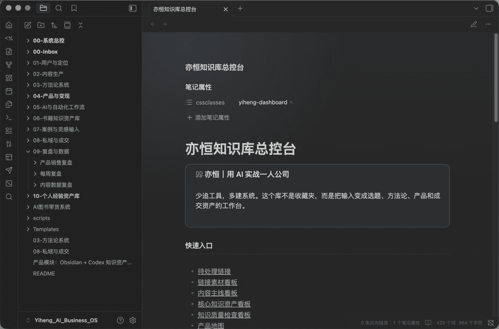
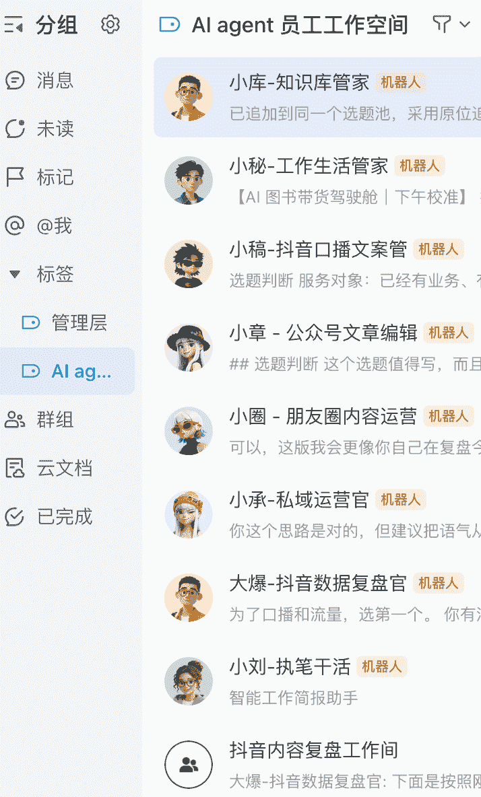

简单来说，这套系统主要做 **3** 件事：第一，把我过去的项目经历、用户问题、内容案例和产品思路沉淀下来；第二，让 Codex 能够基于这些真实素材，辅助我做选题判断、内容结构和脚本生成；第三，把发布后的数据、评论、私信和用户反馈，再写回系统，变成下一轮内容和产品判断的依据。

这套系统跑起来以后，我的账号围绕 Codex + Obsidian 知识库的相关内容，累计播放量也超过了 100 万。

这些反馈让我看到，大家真正感兴趣的并不只是 Codex 这个工具，而是一个更深的问题：

怎么把自己过去积累的知识、经历和项目，变成一个能够被 AI 持续调用的个人资产？

这也是我今天想分享这个主题的原因。

因为在这个 AI+IP 系统搭建前，我更多是靠灵感创作。想到一个选题，就让 AI 帮我写稿。内容可能逻辑完整，但很多时候不像我，发完以后也很难复用。

系统搭建后，我会先从真实素材出发，比如一次项目复盘、一段线下录音、一本书的笔记、一条用户咨询、一次内容数据反馈。然后让 Codex 帮我提炼其中的事实、经历、判断、用户问题和可复用方法，再进一步生成选题、内容结构和发布后的复盘资产。

所以变化不只是效率提高了，而是整个内容生产方式变了。

以前是：想到选题 **→** 让 **AI** 写稿 **→** 修改发布 **→** 结束。

现在是：真实素材 **→** 内容资产卡 **→** 选题判断 **→** 内容创作 **→** 发布反馈 **→** 写回系统。

也正是基于这套实践，今天我想和大家分享下面 5 个问题：

- 第一，为什么用了 AI 以后，内容生产反而更乱？
- 第二，一套真正适合个人 IP 的 AI 内容系统，应该包含什么？
- 第三，Codex 如何把一份碎片素材加工成内容资产？
- 第四，一份素材如何进一步变成选题、内容结构和可发布的爆款内容？
- 第五，如果只有 7 天，如何跑通一套最小可用的内容系统？

希望今天结束时，大家能带走一张系统全景图、一个现场验证的方法，以及一条回去就能执行的 7 天路径。

在正式分享内容之前，我想先回答一个问题，应该也是大部分人的一个好奇点：为什么 **AI** 时代，个人 **IP** 反而会越来越重要？

因为我每次参加各种分享局、项目变现的交流，不管是品牌商、个体创业者，还是 OPC，大家在讨论生意增长和项目升级时，最后似乎都会谈到 IP 内容上。

在我看来，本质还是因为 AI 正在快速降低内容生产的门槛。未来，会写文章、做图片、生成视频的人越来越多，内容本身也会越来越便宜。

但当所有人都能生成内容时，真正稀缺的就不再是“谁写得更多”，而是“用户相信谁”。

品牌需要一个具体的人来传递价值，个体创业者需要通过 IP 降低获客和成交成本，一人公司则需要借助 IP 放大个人能力。

所以，**AI** 越普及，真实经历、独特判断和长期信任就越值钱。

但是我认为，个人 IP 的核心也不是把自己包装成网红，而是让用户在大量同质化内容中认识你、相信你，并在产生需求时优先想到你，占领用户心智。因为在 AI 能制造大量内容的前提下，用户最终愿意关注、咨询和付费的，不是一个只会生成正确答案的账号，而是一个拥有真实经历、独特判断、稳定价值观和解决问题能力的人。

这就是个人 IP 越来越值钱的原因：工具会更新，平台会变化，但一个人积累下来的信任，可以跨越平台和周期。

但只靠人工做 IP 也会遇到问题：素材散落、创作不稳定、经验难以复用，每次写内容都像重新开始。

所以，我们需要用“AI＋IP”的方式协作：人提供真实经历、观点、判断和信任；**AI** 负责整理素材、连接知识、辅助创作和重复调用。

搭建 AI 内容系统的价值，不只是让我们写得更快，而是把过去做过的项目、踩过的坑、回答过的问题和形成的判断，逐步沉淀成可以持续调用的个人资产。

**AI** 负责放大效率，**IP** 负责建立信任，系统负责产生复利。这就是为什么在 AI 时代，我们不仅要做个人 IP，更要尽早搭建一套属于自己的 AI＋IP 内容创作系统。

一句话总结，我的核心创作逻辑是：利用 AI 强大的信息检索、素材整理和内容加工能力，替代 80% 重复、低效的工作；同时，保留 20% 无法被替代的个人经历、观点与实战判断，持续生产真正有灵魂的内容。

本质上，是用 AI 降低内容创作的试错成本，缩短从灵感、素材到内容发布的时间周期。

在我看来，AI 的价值不是制造更多同质化内容，而是帮助我们整理过去的经历、打磨自己的思考，并把这些内容沉淀成可以反复调用的个人资产。

还是上面那句话：AI 负责效率，个人 IP 负责信任，内容系统负责积累复利。当三者结合起来，我们获得的就不只是更快的创作速度，而是一套能够持续生产内容、建立信任，并最终连接产品与生意的个人 **IP** 系统。

## 一：为什么用了 **AI** 后，内容生产反而更乱？

其实这个问题应该是所有使用 AI 进行内容创作的人的一个痛点，就是虽然用 AI 写内容时，感觉它的效率——太快了。毕竟过去写一篇文章，需要想选题、找资料、列框架，再一段一段往下写。现在把选题交给 AI，几分钟以后，一篇文章就出来了。

但用了一段时间以后，大家应该都有种感觉：**AI** 生成的内容越来越多，但是我真正看得上，且愿意发布的内容，却越来越少。

比如，让 AI 生成 20 个选题，看完以后还是不知道该选哪个；让 AI 写 3 篇文章，每篇都很完整，却没有一篇真正想发。

这些情况我都经历过，然后当时我的方法特别直接：想到一个选题，就把它丢给 AI，然后说：“请根据这个选题，帮我生成一篇文章。”

说实话，它写得也不差。结构完整，逻辑清楚，让我挑毛病还真不容易。

但我读完以后，总觉得哪里不对。

后来我想明白了：它哪里都对，唯独不像我。里面没有我真实经历过的事情，没有我为什么产生这个判断，也没有我在哪个项目里踩过什么坑、我的观点、我的语言表达方式、金句等等。

所以，这就导致它像一副很标准的骨架，却没有血肉和灵魂。

如果你到这一步还比较模糊，不知道怎么判断一篇内容有没有个人 IP 感或者是活人感，我教你一个方法：

把作者名字删掉，看这篇内容是不是任何一个同行都可以发布？

如果答案是“可以”，它可能是一篇合格的信息内容，但还不是你的个人 IP 内容。

一定要记住：个人 **IP** 真正有价值的部分，不是那些人人都知道的正确道理，而是别人无法直接复制的东西：

- 你经历过什么；
- 你为什么相信这件事；
- 你在哪次失败以后改变了判断；
- 面对同一个问题，你为什么做出了不同选择。

所以，我们口中经常说的“人味”，不是给 **AI** 加几个口语词，也不是让它多说几句口语化表达。人味首先来自真实发生过的事情，以及你对这些事情形成的判断。

我们提高了生成速度，却没有提高判断能力。以前一天只能写一个选题，只需要判断一个选题值不值得做。现在 AI 一分钟可以生成几十个选题，我们反而要花更多时间选择、修改和返工。

我把这种现象总结成四个错位。

### 1. 目标错位

我们要求 AI“写一篇爆款”，却没有告诉它写给谁、解决什么问题、建立什么信任、导向什么结果。没有目标的内容生产，只会制造更多选择。

### 2. 输入错位

我们给 AI 的通常只有一个选题和一条提示词。但真正影响内容质量的，是我们的真实经历、项目案例、用户问题、产品信息、历史内容和过往判断。没有这些原料，AI 只能生成公共表达。

### 3. 分工错位

我们把定位、故事、立场和判断全部交给 AI，自己只负责复制、修改和发布。正确的分工应该是：人负责方向、经历、立场和判断；AI 负责整理、连接、扩展和复用。

### 4. 闭环不完整

大多数人的流程是：想到选题 → AI 写稿 → 发布 → 结束。内容发布后的评论、私信、数据和用户问题，没有进入下一轮创作。于是每次都是临时任务，AI 也不会越来越懂你。

所以，内容和内容资产不是一回事。一篇内容发布以后，如果生命周期就结束了，它只是一篇内容。如果里面的经历、观点、用户反馈和数据，还能继续用于下一条选题、产品设计和用户沟通，它才开始成为资产。

未来，生成一篇结构完整的内容会越来越容易。真正稀缺的，不是谁能生成，而是谁拥有真实经历、经过验证的判断，以及一套能够持续调用这些东西的系统。

所以，问题不在于我们还缺一条更厉害的提示词。真正需要升级的是：从“让 AI 替我写一篇稿”，走向“让 AI 进入一套长期积累的个人 IP 内容系统”。可以参考这篇 IP 访谈提示词：

### 个人 **IP** 背景提炼提示词

你现在是我的个人 IP 背景访谈顾问。你的任务不是替我包装一个虚假的人设，而是通过访谈，提炼我真实的经历、能力、观点和判断，最终形成一份可以被 AI 长期调用的《个人 IP 背景说明书》。请围绕以下方向对我进行访谈：

1. 我是谁，现在主要在做什么？
2. 我希望服务哪一类人，他们正在经历什么问题？
3. 我过去有哪些与这个领域相关的经历、项目和结果？
4. 我经历过哪些失败、转折或认知变化？
5. 我擅长解决什么具体问题？
6. 面对这个领域，我有哪些明确的观点和判断？
7. 我反对哪些常见做法？为什么？
8. 用户为什么应该相信我？
9. 我的表达风格、常用语言和内容边界是什么？
10. 我希望通过内容连接什么产品、服务或长期目标？

访谈规则：

- 每次只问我一个问题，根据我的回答继续追问。
- 如果我的回答过于抽象，请让我补充具体时间、场景、人物、行动和结果。
- 不要替我编造经历、数据、观点和成绩。
- 区分“真实事实”“个人判断”和“尚未确认的信息”。
- 优先挖掘别人难以复制的经历、选择、失败、案例和判断。
- 暂时不要写文章，也不要急着给我定位。

访谈结束后，请整理成以下结构：

一、基础身份：我是谁、正在做什么

二、目标用户：我主要服务谁、解决什么问题

三、关键经历：重要项目、结果、失败与转折

四、核心能力：我擅长解决哪些具体问题

五、观点与判断：我相信什么、反对什么、为什么

六、信任依据：用户为什么可以相信我

七、表达风格：语气、语言习惯和表达边界

八、业务连接：内容最终连接哪些产品或服务

九、独特素材库：最值得用于内容创作的 10 个故事或案例

十、待补充信息：目前缺失但值得继续完善的内容

最后，再用一句话概括：“我是一个\_\_\_\_\_\_\_\_，通过\_\_\_\_\_\_\_\_，帮助\_\_\_\_\_\_\_\_解决\_\_\_\_\_\_\_\_问题。”现在请从第一个问题开始访谈我。

## 二：个人 **IP** 的 **AI** 内容系统应该怎么搭？

大部分人听到“AI 内容系统”，可能是在想应该用飞书、Notion 还是 Obsidian？需要安装哪些工具？文件夹应该怎么分？要不要做自动化？

这些都没错，因为这些都是系统的一部分，但它们不等于系统本身。

从我的实操经验来看，判断一套东西是不是内容系统，只看三个标准（不一定对，但是可以参考）：

- 第一，有没有稳定输入。AI 能不能持续看到你的经历、项目、用户和历史内容？
- 第二，有没有可重复的生产过程。换一份素材以后，能不能继续按照同样的方法生产？
- 第三，结果能不能回流。发布后的数据、评论和用户问题，有没有影响下一轮创作？

为了让大家容易记住和理解，我把个人 IP 的 AI 内容系统分成五层：方向层、资产层、认知层、生产层、反馈层，再加一个持续运转的闭环。

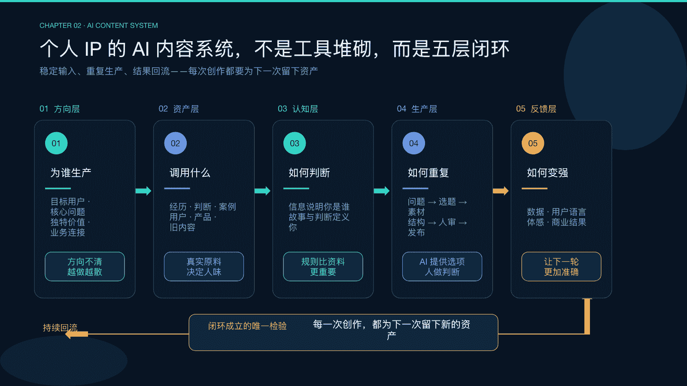

### 第一层：方向层

方向层解决的是：AI 到底在为谁、为什么生产内容？

至少要回答五个问题：

- 我要服务谁？
- 他正在经历什么问题？
- 我能提供什么独特价值？
- 我希望通过内容建立什么认知？
- 内容最终与什么产品或业务连接？

同样讲“AI 提高内容效率”，写给新手和写给已经在做个人 IP 的创业者，选题和案例会完全不同。

方向不清楚，AI 越强，内容越发散。

换句话说，我们都知道在 AI 时代，内容生产的边际成本正在趋向于零，但判断力、内容价值的成本却在变得极其昂贵。AI 可以帮我们填充血肉，却无法代我们决定 IP 内容的灵魂。因为在方向上要给它一个锚定，不然 AI 生成的只会是“正确的废话”和“高频的噪音”。

### 第二层：资产层

资产层解决的是：AI 可以调用哪些真正属于你的原料？

个人 IP 最重要的原料包括六类：

- 个人经历和故事；
- 观点和判断；
- 项目和案例；
- 用户问题与真实对话；
- 产品和服务；
- 历史内容和数据。

这些东西通常已经存在，只是散落在脑子、微信、旧文章和项目文件里。

资产层要做的，不是继续收藏更多外部资料，而是把自己已经拥有、却没有被整理的经验打捞出来。

因为 AI 懂逻辑，但你才懂生活；AI 有智商，但你才有故事。如果没有这一层，AI 永远只是在写别人的故事；只有设计出你的专属资产，AI 才算是真正意义上的为你发声，让每一篇内容都成为你独特的内容资产。

### 第三层：认知层

认知层解决的是：如何让 AI 不仅知道你有什么，还逐渐理解你怎么判断。

如果希望 AI 真正懂一个个人 IP，至少要让它们看见三类内容：信息、故事和判断。

信息让 AI 知道你做什么；故事让 AI 知道你为什么成为今天的你；判断让 AI 知道面对具体问题时，你会怎么选择。

其中最有价值的是判断。

一次失败只是经历；当你从中总结出以后如何选择、什么不再做，它才变成可以重复调用的判断规则。

所以，知识库不是资料越多越好。只有经过本人确认的经历、观点和规则，才应该进入长期系统。

### 第四层：生产层

生产层负责把一次临时创作，变成可重复流程。

最基本的路径可以是：用户问题或母题 → 判断选题 → 调用真实素材 → 生成内容结构 → 本人补充经历和观点 → 人工审核 → 发布。这里的变化不是“AI 先写，人再修改”，而是 AI 先基于用户问题和已有资产提供选项，人负责最终判断。

### 第五层：反馈层

反馈层负责让发布结果回到系统。

一条内容发布后，至少可以收集四类反馈：

- 内容数据：播放、完播、收藏、分享；
- 用户语言：评论、私信和高频问题；
- 创作体感：哪里讲得顺，哪里不像自己；
- 商业结果：有没有带来精准用户、咨询或成交。

反馈的目的不是让 AI 预测爆款，而是帮助我们判断：什么值得保留、什么需要删除、什么可以升级。

下一轮应该强化什么。

五层组合以后，还需要一个闭环。

判断这套系统是否真正成立，只需要问一句：

每一次内容创作，有没有为下一次留下新的资产？

如果每次发布以后，系统里多了一段经历、一条判断、一个用户问题或者一次复盘，这套系统就会越用越强。

### 个人IP内容系统盘点提示词

你现在是我的个人IP内容系统诊断顾问。

请帮助我盘点目前的内容创作方式，判断我的AI内容系统缺少哪些环节，并给出最小可执行的优化建议。请围绕以下五层对我进行访谈：

1. 方向层：目标用户、核心问题、内容目标和业务连接是否清楚？
2. 资产层：是否积累了个人经历、观点、案例、用户问题、产品资料和历史内容？
3. 认知层：AI是否了解我的故事、立场、判断标准和表达边界？
4. 生产层：从素材、选题、创作到发布，是否有可重复的流程？
5. 反馈层：数据、评论、私信、创作体感和商业结果是否会回到系统？

访谈规则：

- 每次只问一个问题，根据我的回答继续追问。
- 要了解我的真实做法，不要根据理想流程替我补充答案。
- 区分“已经具备”“部分具备”和“尚未建立”。
- 不要一开始推荐复杂工具或自动化。
- 优先找到当前最影响内容生产的1—2个关键问题。

访谈完成后，请按照以下结构输出：

一、系统现状

用一句话概括我目前处于什么阶段。

二、五层诊断

- 方向层：现状、问题、建议
- 资产层：现状、问题、建议
- 认知层：现状、问题、建议
- 生产层：现状、问题、建议
- 反馈层：现状、问题、建议

三、关键断点

指出目前最影响系统运转的三个问题，并按照优先级排序。

四、已有资产

列出我现在已经具备、可以立即调用的内容资产。

五、最小优化方案

只给出未来7天最值得完成的三个动作，不要设计大而全的系统。

六、闭环检验

判断我的每一次内容创作，是否能为下一次留下新的经历、判断、用户问题或复盘资产。

以下是我的个人IP背景说明书：【粘贴IP背景说明书】

现在请从第一个问题开始访谈我。

为了更好地帮助大家理解和用起来，我会把“如何把一份碎片素材，变成一张可以反复调用的内容资产卡？”拆解出来。

## 三、如何用Codex把碎片素材变成内容资产？

前面的内容大概就是个人IP内容系统的全景图。

但这套系统真正开始运转，并不是从搭文件夹开始，而是从一份真实素材进入系统开始。

对于个人IP来说，素材的范围很大。

你参加过的一场线下分享、临时说出的一段录音、看过的一份学习文档、做过的项目、用户提出的问题，以及内容发布后的数据，都可以成为个人IP资产。

它们之间的区别只是输入形式不同。

背后的加工逻辑其实是一样的：

原始材料 → 区分事实、来源和个人判断 → 连接真实用户问题 → 提炼可复用的方法 → 延伸内容选题 → 沉淀产品或工作流 → 通过真实数据继续验证。

接下来，我会用四个案例展示这套逻辑。

其中，线下录音会进行现场实操。书籍、学习文档和内容数据，则用快速展示我现成的成果，给大家演示底层逻辑与最终效果。

### 案例一：一段线下录音，如何变成个人经验资产？

这是今天现场重点演示的案例。

对于生财的圈友来说，在参加完一次活动、做完一场分享或者与朋友深度交流以后，

会留下一个小时甚至几个小时的录音。

录音里可能有很多非常有价值的内容：

- 自己讲过的真实故事；
- 临时产生的判断；
- 回答用户问题时说出的金句；
- 过去没有正式整理的方法；
- 现场听众最关心的问题。

但活动结束以后，这段录音通常就躺在飞书妙记、手机录音或者电脑文件夹里。

最多转成一份逐字稿，然后就结束了。

逐字稿不是内容资产。

它只是把声音转换成了文字。

真正的资产化，还要继续回答：

这段录音里，哪些内容真正属于我？哪些判断以后还能再次使用？

#### 第一步：原始录音和转写稿

大家可以看到，原始转写通常非常长。

里面有重复表达、口语停顿、临时举例，也可能存在识别错误。

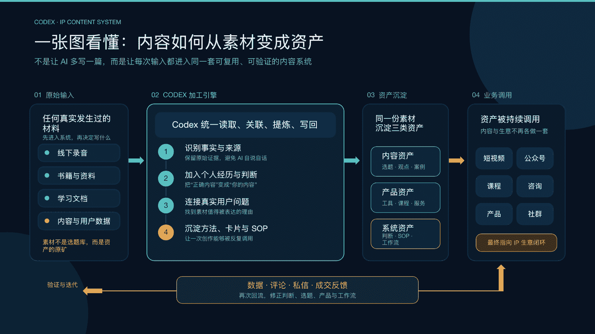

如果直接让AI把它总结成一篇文章，最后得到的通常只是一份会议摘要。

摘要会告诉我们讲了哪些内容，却不一定知道哪些东西值得进入个人IP系统。

所以，我不会直接要求Codex“总结录音”。

我会先让它读取：

- 我的IP定位；
- 我的目标用户；
- 现有知识库结构；
- 这份录音转写；
- 已经沉淀的方法论和内容资产。

然后告诉它：

先不要写文章。请识别这份录音中出现的真实经历、核心判断、可复用方法、用户问题和可验证案例。区分原始表达、你的整理和需要我确认的信息，不要替我补写不存在的经历。

#### 第二步：提炼真实经历和判断

Codex第一步不是生产内容，而是帮助我们从大量口语中打捞真正有价值的部分。

比如，它可以提取：

- 我讲了哪些亲身经历；
- 这段经历说明了什么；
- 我在哪些地方表达了明确立场；
- 哪些观点反复出现；
- 哪些判断与我现有方法一致；
- 哪些内容可能是一条新的判断。

这里最重要的是人工确认。

AI可以告诉我，它认为某句话是核心观点。

但这句话是不是我真正相信的，能不能代表我的长期判断，仍然需要由我决定。

只有经过本人确认的经历和判断，才会进入长期知识库。

#### 第三步：从表达中提炼方法

有些内容在录音里可能只是随口说了几分钟。

但Codex可以帮助我们把它进一步整理成：

问题是什么 → 为什么会发生 → 我是怎么解决的 → 哪些步骤可以重复 → 适合什么人 → 有什么边界。

这个时候，一段口头经验就可以变成：

- 一张经验卡；
- 一张方法卡；
- 一套操作SOP；
- 一个内容创作规则；
- 一个课程模块。

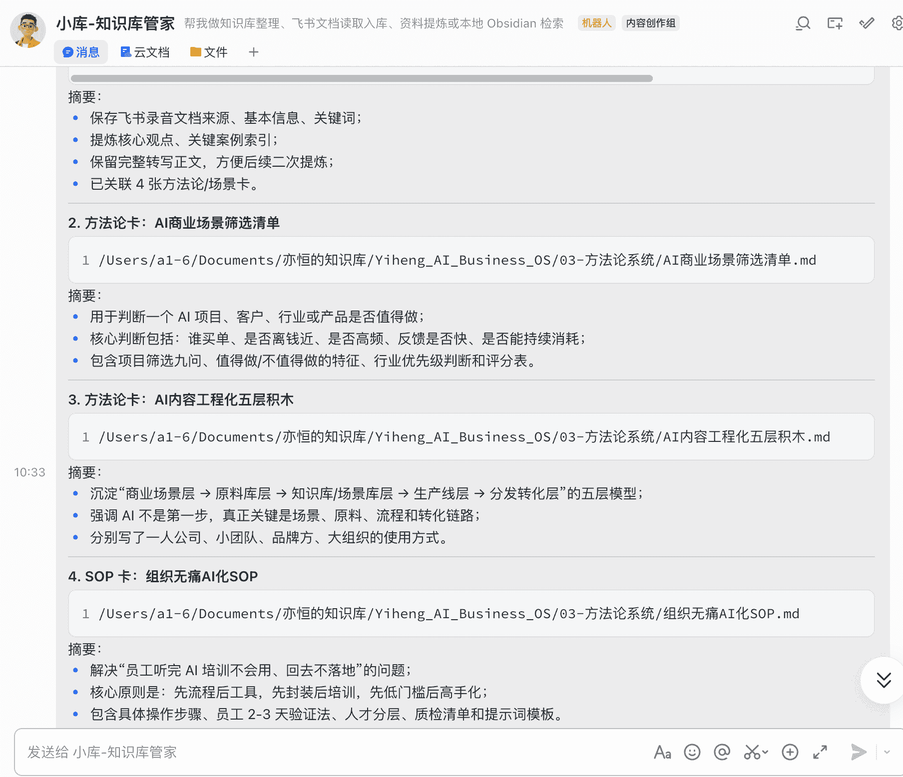

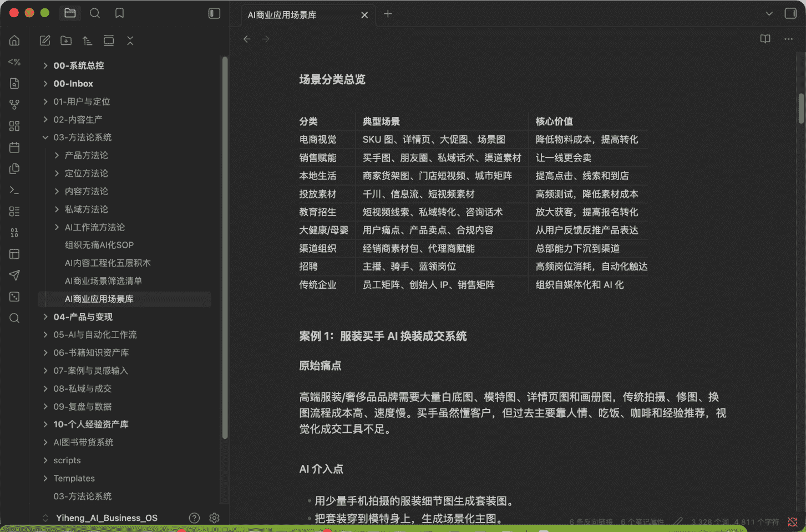 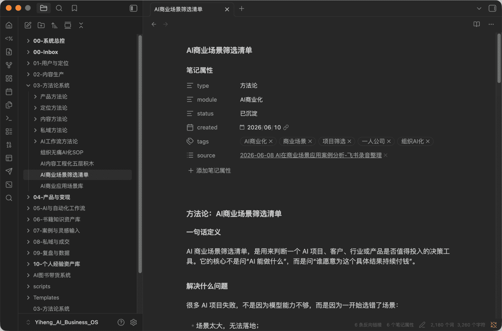 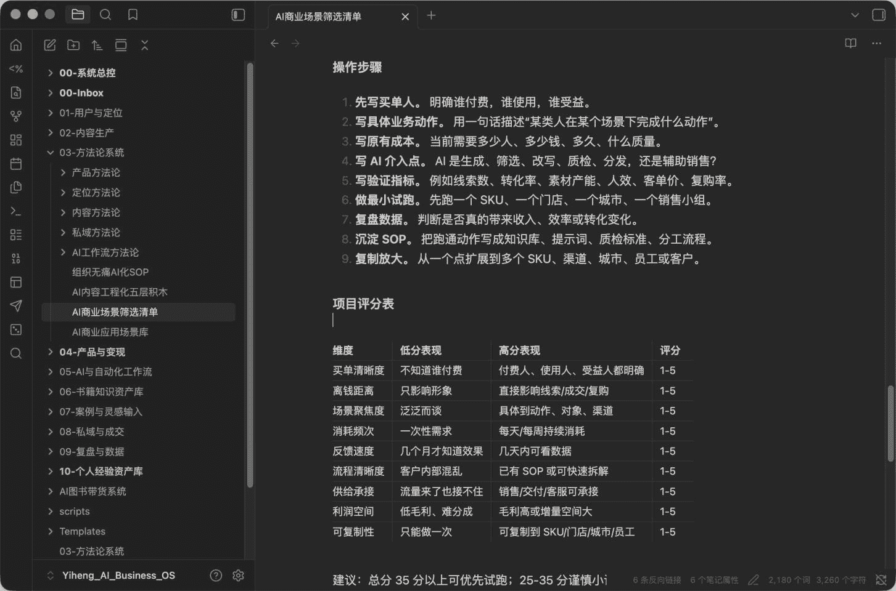

如上图所示，就是把那条录音处理后输出的方法论，截图只展示其中一部分。

所以，一场线下分享的录音，可以继续沉淀成：

- 分享逐字稿；
- 公众号文章；
- 短视频选题；
- 学员常见问题；
- 下一次课程结构；
- 可以交付的模板和清单。

所以，录音资产化不是简单地“把录音变成文字”。

它真正完成的是：

把一次已经发生的表达，变成以后还可以继续调用的经验、方法和产品资产。

#### 第四步：生成不同内容方向

有了经验卡和方法卡以后，再让Codex生成内容选题。

可以要求它分别输出：

- 适合短视频传播的冲突型选题；
- 适合公众号展开的深度选题；
- 适合朋友圈建立信任的个人经历；
- 适合课程或产品的操作模块。

现场大家可以一起判断，上图中的哪个选题是10万+的爆款，哪些选题只是听起来有流量？

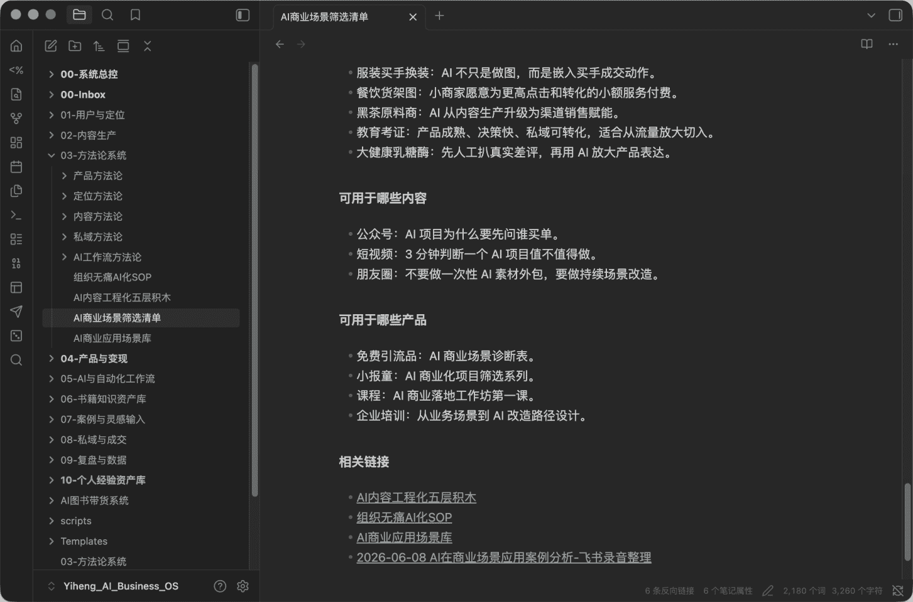 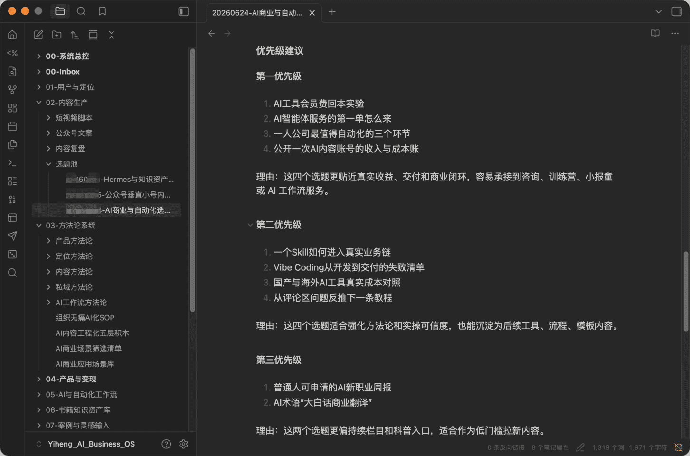 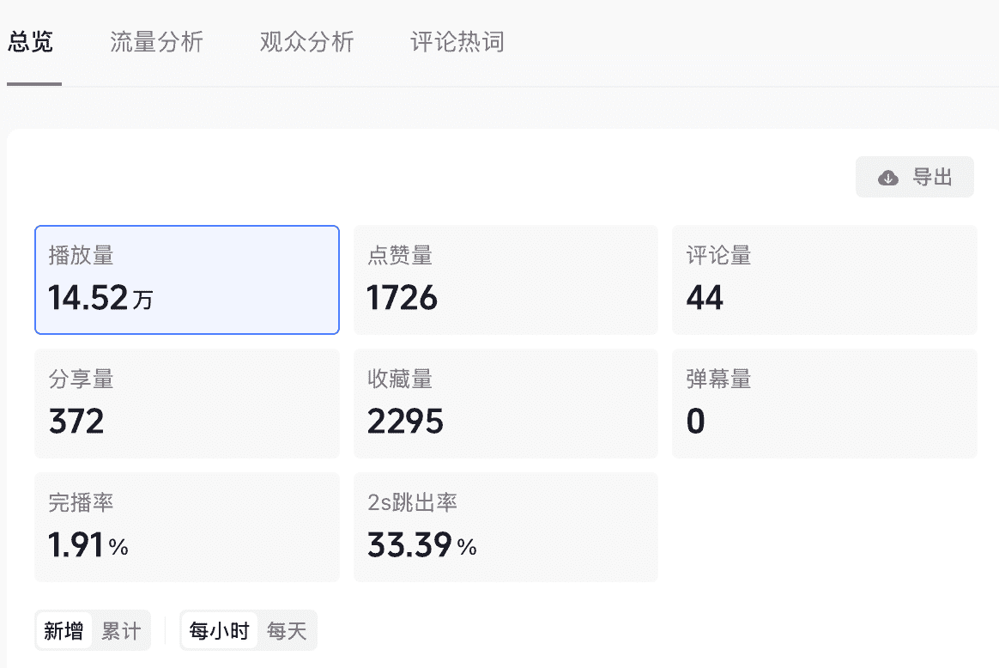

哪些选题真正体现了这个人的经历？

哪些内容能够连接目标用户的真实问题？

哪些方法值得继续沉淀成产品？

这里仍然遵守同一个原则：

AI负责发现、整理和提供候选，人负责确认什么值得留下。

到这里，我们的MVP就算是跑通了。

做到了一段录音如何从“一次性表达”，变成可以继续生产内容、课程和产品的资产。

### 案例二：一本书，如何从知识输入变成业务工具、Skill？

我用前段时间读过的一本书《真需求》展示。

过去读一本书，我们可能会摘抄金句、写读后感，或者让AI总结全书。

但一本书的摘要并不等于个人资产。

我让我的AI知识库Agent处理《真需求》时，重点做了三件事：

第一，区分作者原意和我的业务应用。

第二，把书里的方法连接到我正在做的内容、产品、私域和AI工作流。

第三，把抽象知识变成可以直接使用的方法卡和诊断工具。

最后，这本书在知识库里不只是留下一份总结，还形成了：

- 书籍总览卡；
- 章节精读卡；
- 原子方法卡；
- 真需求诊断工作流；
- 内容选题；
- 产品自检表；
- 私域问诊问题。

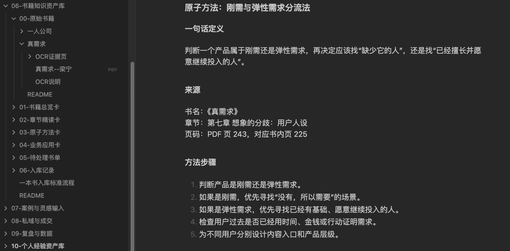

比如，书里“产品特性不等于用户感知价值”这个观点，进入我的业务以后，可以被进一步加工为：

产品特性 → 用户使用场景 → 内容创作需求挖掘 → 用户可感知的变化 → 可信证据。

于是，“Codex可以读取本地知识库”不再只是一句工具介绍。

它可以被转化为：

下次写公众号时，不需要重新翻几十份资料，Codex可以先从过去确认过的方法和案例里，找出与当前选题相关的内容。

这个时候，书里的知识才真正进入了我的内容和产品系统。

所以，书籍资产化不是“总结得更完整”，而是：

这本书有没有改变我的判断，又能不能进入真实工作。

### 案例三：内容数据，如何回流为新的内容和产品资产？

前面三个案例都属于输入资产化。第四个案例来自内容发布以后。其实这一点是最重要的，因为内容创作者如果只把重点放在输出，而忽视输出后的数据反馈、复盘，以及对失败与成功经验的总结，最后就无法沉淀为可重复调用的资产。

所以，很多人的内容流程到发布就结束了，播放量高就开心，播放量低就换选题。

但数据本身也是一种非常重要的素材。

比如，我之前的一条视频播放量10万+，还有其他综合数据。如果只看播放量，我们只能得出“这条视频表现不错”，但把播放、完播、收藏、评论、私信和新增关注放在一起，才能进一步判断：

- 用户为什么愿意收藏；
- 哪个观点打中了真实需求；
- 为什么分享和关注较高；
- 为什么完播率并不理想；
- 下一条内容应该保留什么；
- 哪些用户问题值得继续深挖。

这次复盘后我就会发现，评论区反复出现的关键词是“知识库”。

用户真正感兴趣的，不只是Codex或者Obsidian。

他们想知道的是：

怎么把自己的知识、经验和项目，变成一个可以被反复调用的系统？

这个用户信号可以继续沉淀为：

- 下一轮系列选题；
- 知识库最小结构；
- 内容资产卡模板；
- 搭建教程；
- 产品需求假设；
- 咨询诊断问题。

所以，数据复盘不是简单解释“为什么爆”或者“为什么没爆”。

它真正要完成的是：

发布结果 → 用户行为 → 需求判断 → 内容规则 → 下一轮选题 → 产品验证。

这一步让内容系统不再是单向生产，而是开始根据真实世界的反馈持续调整。

#### 背后的统一逻辑

我们现在把四个案例放在一起。

线下录音沉淀的是个人经历、方法和SOP。

书籍沉淀的是知识方法和业务工具。

学习文档沉淀的是个人判断和方法论。

发布数据沉淀的是用户需求、内容规则和产品信号。

它们的输入形式不同，但都经过同一条加工路径：

原始材料 → 事实与来源 → 个人经历与判断 → 对应用户问题 → 可复用方法 → 内容选题 → 产品或工作流 → 数据验证。

所以，个人IP内容系统不是一个专门放文章的仓库。

它应该能够持续接收三类东西：

- 你学到了什么；
- 你经历和实践了什么；
- 真实用户和市场反馈了什么。

然后，把这些输入逐渐转化成三类资产：

- 内容资产；
- 产品资产；
- 判断和工作流资产。

这才是Codex参与个人IP内容系统真正有价值的地方。

它不是替我们凭空创造一个人设，而是帮助我们把原本散落在录音、书籍、文档、项目和数据中的东西组织起来，让一次学习、一次表达和一次发布，都能够为下一次继续工作。

但是，拥有越来越多内容资产，并不代表它会自动变成生意。

### 内容资产化提示词

你现在是我的个人IP内容资产整理顾问。

我会提供一份原始素材，可能是线下录音、会议逐字稿、书籍笔记、学习文档、项目复盘、用户咨询或内容数据。你的任务不是立即写文章，而是把这份一次性素材整理成可以被反复调用的《内容资产卡》。

请先读取：

1. 我的《个人IP背景说明书》
2. 本次提供的原始素材

处理时请遵守以下规则：

- 不得编造原始素材中没有的经历、数据和观点。
- 明确区分“客观事实”“素材原意”“我的判断”和“AI推断”。
- 找不到的信息标记为“待补充”，不要自行补写。
- 优先提炼与目标用户、内容方向和业务相关的信息。
- 暂时不要直接生成完整文章。

请按照以下结构整理：

一、素材信息

- 素材类型
- 素材来源
- 发生时间
- 核心主题
- 可信度与待确认信息

二、事实与原意

- 素材中明确出现的事实
- 原作者或原始表达的核心意思
- 可以直接引用的数据、案例或场景

三、个人经历与判断

- 这份素材与我的哪些经历或项目有关
- 它验证、改变或补充了我的什么判断
- 哪些内容最能体现我的立场
- 仍需要我补充哪些真实细节

四、对应用户问题

- 目标用户正在经历什么问题
- 他们通常会如何描述这个问题
- 这份素材为什么值得他们关注

五、可复用方法

将素材提炼成一个可以重复使用的方法、框架、检查清单或SOP，并说明适用场景与边界。

六、内容选题

分别生成：

- 3个曝光型选题
- 3个信任型选题
- 3个转化型选题

每个选题说明目标用户、核心观点和适合使用的素材。

七、资产应用判断

判断这份素材还可以沉淀为什么：

- 内容资产
- 产品资产
- 案例资产
- 判断规则
- 工作流程或SOP

八、写回建议

建议这张资产卡保存到什么位置、使用哪些标签，以及未来可以被哪些创作任务调用。

整理完成后，先向我展示资产卡，不要直接写完整文章。

如果缺少关键的个人经历或判断，请每次只向我追问一个问题。

以下是我的个人IP背景说明书：【粘贴IP背景说明书】

以下是本次原始素材：【粘贴录音转写、文档、笔记、复盘或数据】

所以，接下来，我们就必须解决一个问题：

从内容系统走向IP生意闭环，中间到底还差什么？

## 四、从内容系统到IP生意闭环，关键差在哪里？

一句话概括：

内容系统解决的是：如何持续生产真实、有价值、能够积累的内容。

IP生意系统解决的是：这些内容如何找到正确的人、建立信任、承接需求，并形成持续的价值交换。

这里有一个很重要的判断：

IP是业务的放大器，但IP不是业务本身。

流量可以放大一个已经存在的产品和需求，信任可以降低成交成本。但如果没有清晰用户、真实问题、可购买产品和交付能力，IP不会凭空创造一门生意。

内容闭环通常是：

素材 → 内容 → 发布 → 数据 → 复盘 → 下一条内容。

IP生意闭环则要再往前和往后各走一步：

真实用户需求 → 内容触达 → 持续建立信任 → 用户采取行动 → 产品或服务承接 → 完成交付 → 产生案例和反馈 → 重新成为内容。

从内容系统走向生意闭环，我的经验是做到这三个步骤。

### 第一个步骤：真实需求

做选题时，不要只问“有没有流量”，还要问：

- 吸引来的是不是目标用户？
- 对应什么真实问题？
- 用户是否已经为这个问题投入过时间、金钱或精力？
- 它与我的产品和能力有什么关系？

同样讲AI，一条最新工具介绍可能吸引很多工具爱好者，但如果你提供的是个人IP内容系统服务，这批人不一定是你的目标用户。

反过来，一条播放量没那么高的内容，如果评论区反复出现“我的资料应该怎么整理”“为什么AI写出来不像我”，它可能更有商业价值。

### 第二个步骤：信任路径

不是每条内容都要直接销售，但每条内容应该知道自己承担什么任务。

曝光型内容让目标用户第一次看见你。

信任型内容展示你的经历、案例和判断。

转化型内容让已经有需求的人知道下一步可以做什么。

个人IP的信任通常不是由一条内容完成的，而是围绕同一个用户问题逐渐递进：先让用户意识到问题，再让他理解你如何判断和解决，最后让真正有需求的人采取行动。

### 第三个步骤：下一步承接

用户看完内容以后，如果真的产生需求，接下来可以去哪里？

不同阶段可以对应不同动作：

- 关注一个系列；
- 领取一张自检表或模板；
- 提交自己的具体问题；
- 参加一次公开答疑或诊断；
- 购买一个边界清晰的产品或服务。

真正的承接不是简单把用户从公域搬到私域，而是让他的问题进入一个可以继续被理解和解决的路径。

比如说，我之前一条关于知识库的视频，评论区反复出现“知识库”这个关键词，说明用户看到的不只是Codex工具，而是一个与自己有关的结果：过去的知识、经验和项目，也可以被整理成可调用的个人资产。

接下来要做的不是马上复制十条相似标题，而是判断用户真正想要什么：工具教程、文件夹模板，还是完整的内容资产化方法？

公众号懒人搜索，懒人专属群分享

这些真实问题可以继续长出知识库最小结构、内容资产卡模板、7天清单、搭建手册或者诊断服务。

产品完成交付以后，用户结果又会变成新的案例和内容。

于是整个闭环形成：

需求 → 内容 → 信任 → 行动 → 产品 → 交付 → 案例 → 再传播

大家可以用三个问题检查自己的内容和生意是否连接：

- 第一，我的内容正在吸引谁？
- 第二，用户为什么会通过这些内容信任我？
- 第三，当用户真的产生需求时，他下一步可以去哪里？

如果这三个问题答不出来，问题可能不在于更新不够频繁，而是内容和生意之间还没有建立连接。

### 从内容机会到最小商业闭环设计提示词

你现在是我的个人IP商业闭环顾问。我会提供个人IP背景、目标用户、内容选题、现有产品和历史反馈。你的任务不是简单优化文案，也不是强行设计销售话术，而是帮助我找到一条可以真实验证的最小商业闭环：

目标用户 → 真实需求 → 内容触达 → 信任建立 → 用户行动 → 产品承接 → 完成交付 → 案例回流

请遵守以下规则：

1. 不要把播放量等同于商业价值。
2. 不要默认用户提出问题就代表愿意付费。
3. 不要虚构用户需求、案例、产品和成交数据。
4. 不要罗列大量方向，只选择当前最值得验证的一条路径。
5. 没有产品时，可以设计最小验证方案，但不要直接设计复杂产品。
6. 区分客观事实、已有证据、个人判断和待验证假设。
7. 每条内容只承担一个主要任务：曝光、信任或转化。

请按照以下步骤分析：

#### 一、确定目标用户

- 这次内容最应该吸引哪一类人？
- 他们正在经历什么具体场景？
- 这个问题带来了什么时间、金钱或情绪成本？
- 哪些人不是本次内容和产品的目标用户？

#### 二、验证真实需求

请检查是否存在以下证据：

- 用户主动搜索或反复提问
- 评论、私信或咨询中出现高频问题
- 用户已经尝试过其他解决方案
- 用户为此投入过时间、金钱或精力
- 问题具有明确的紧迫性
- 已经出现咨询、购买或交付记录

将需求判断为：

- 已验证需求
- 初步需求
- 待验证假设

并说明判断依据。

#### 三、判断用户阶段

判断目标用户目前处于哪个阶段：

1. 尚未意识到问题
2. 已经意识到问题
3. 正在寻找解决方案
4. 正在比较不同方案
5. 已经准备采取行动

根据用户阶段，确定这条内容最应该完成什么任务。

#### 四、设计内容切口

输出：

- 一个核心用户问题
- 一个内容核心观点
- 一个最适合的真实经历、案例或判断
- 这条内容属于曝光型、信任型还是转化型
- 用户看完后最应该产生什么认知或行动

#### 五、补充信任证据

检查这条内容是否具备：

- 真实经历
- 项目案例
- 方法或判断
- 数据与结果
- 用户反馈
- 适用条件与服务边界

指出目前最缺少的信任证据，以及应该如何补充。

#### 六、匹配产品方案

检查现有产品是否与用户问题匹配：

- 产品解决什么具体问题？
- 适合哪类用户？
- 提供什么明确交付？
- 用户购买后会发生什么变化？
- 有哪些不适用人群和交付边界？
- 内容承诺与产品交付是否一致？

如果暂时没有成熟产品，请设计一个最小验证版本，例如：

- 一张清单或模板
- 一次公开答疑
- 一次标准化诊断
- 一个小型训练营
- 一项边界清晰的服务
- 一个可预售的最小产品

不要直接设计大而全的课程或复杂服务。

#### 七、设计最短转化路径

请设计一条自然、低摩擦的用户路径：

内容入口 → 用户产生兴趣 → 完成一个低门槛动作 → 提交真实问题 → 进入咨询或诊断 → 匹配产品 → 完成成交

明确每一步：

- 用户要做什么
- 我需要提供什么
- 判断用户是否进入下一步的标准
- 可能导致用户流失的阻力

#### 八、设计承接动作

根据用户阶段，只选择一个最合适的行动：

- 关注一个内容系列
- 评论一个关键词
- 领取一份清单或模板
- 提交一份问题问卷
- 参加一次公开答疑
- 预约一次标准化诊断
- 购买一个边界清晰的产品

给出一段自然、不强迫的承接表达。

#### 九、设计交付与案例回流

产品交付后，应该沉淀：

- 用户最初的问题
- 解决过程
- 使用的方法
- 最终结果
- 用户反馈
- 仍未解决的问题
- 可公开的案例内容
- 可以优化的产品环节

说明这些信息如何重新成为下一轮内容、产品和信任资产。

#### 十、确定关键数据

分别设置最值得观察的指标：

- 曝光：目标用户是否愿意停留
- 信任：是否产生收藏、关注和有效互动
- 线索：是否有人提交具体问题
- 咨询：是否出现明确需求
- 成交：是否愿意为解决方案付费
- 交付：用户是否获得预期结果
- 回流：是否形成案例和下一轮选题

#### 十一、输出最小商业闭环

最终只输出一条当前最值得验证的路径：

目标用户 → 真实需求 → 内容切口 → 信任证据 → 行动钩子 → 咨询承接 → 产品方案 → 交付结果 → 案例回流

#### 十二、7天验证计划

请给出未来7天最小行动方案，包括：

- 发布什么内容
- 验证什么假设
- 设置什么承接动作
- 收集什么用户反馈
- 用什么指标判断继续、调整或停止

如果信息不足，请先每次向我提出一个问题，不要根据想象补全商业闭环。

以下是我的个人IP背景说明书：【粘贴IP背景说明书】

以下是本次内容选题或原始素材：【粘贴内容】

以下是我目前的产品、服务和承接方式：【粘贴产品与服务；没有可填写“暂无”】

以下是已有的评论、私信、咨询、成交或交付反馈：【粘贴真实反馈；没有可填写“暂无”】

好，到这一步完整系统就都讲清楚了，但是新手可能会感觉听起来很大，所有环节如何落地，或者步骤如何，下面我们只解决一件事：如何在7天内跑通最小可用版本。

## 五、7天如何搭建最小可用内容系统（MVP）？

说到系统，最容易踩的坑，就是还没跑出一个结果，就先搭了一个复杂后台。

我刚开始搭建的时候就是这样，做着做着就会被AI带跑偏，因为你刚开始是没有概念的，需求不明确，只能一步一步沟通，但是Codex给你的建议会偏向于完美的系统，所以浪费了很多Token和时间，做出来的系统实用性反而很低。

文件夹越来越多，自动化越来越复杂，一个月过去，却没有稳定生产出一条真正属于自己的内容。

所以，最小可用内容系统只验证一件事：

能不能把一份真实素材，稳定变成一条属于自己的内容，并为下一次留下资产？

最小闭环只有一条链路：

一份真实素材 → 一张内容资产卡 → 一个明确选题 → 一条发布内容 → 一次反馈沉淀

工具层面，只需要五个区域：

00-IP说明书  
01-原始素材  
02-内容资产  
03-选题与创作  
04-发布与复盘

接下来，用7天跑一遍。

### 第1天：确定边界

只确定四件事：一个目标用户群体、一个核心问题、一个内容平台、一个阶段目标。

不要写“服务所有想学习AI的人”，而要具体到“已经在做个人IP，但AI写出来总不像自己的内容创作者”。

当天交付物：一张简单的目标卡。

### 第2天：完成一页IP说明书

只整理三类内容：信息、故事、判断。

让Codex能够基本说清楚：你是谁、服务谁、为什么可信、长期关注什么问题、有哪些表达边界。

当天交付物：一页IP说明书。

### 第3天：收集5份真实素材

可以来自个人经历、项目复盘、用户提问、旧内容、书籍笔记或交付记录。

选择标准只有三个：与目标用户有关、包含真实经历或判断、以后还能继续使用。

当天交付物：5份原始素材。

### 第4天：完成第一张内容资产卡

选择其中一份，让Codex整理素材来源、真实事实、个人判断、用户问题、可信证据、可复用方法和选题方向。

必须区分事实、个人判断和AI推断；缺少案例时保留为空，不允许补写。

当天交付物：1张内容资产卡。

### 第5天：生成选题并只选一个

让AI提供候选，但最后只选择一个最符合当前用户、内容目标和个人判断的选题。

当天交付物：1个确定选题和1份内容结构。

### 第6天：人机共创并发布

Codex整理结构和素材，本人补充经历、立场和情绪，最后人工检查事实、表达和承接。

第六天最重要的不是爆不爆，而是第一次把真实素材走到真实发布。

当天交付物：1条已发布内容。

### 第7天：完成第一次反馈沉淀

记录四类信息：基础数据、评论与私信、创作体感、下一步调整。

一天的数据不一定足够判断成功或失败。只需要把事实、解释和待验证假设分开，再把确认过的内容写回系统。

当天交付物：1张内容复盘卡。

7天以后，用五个问题验收：

1. Codex能不能基本理解我的定位和目标用户？
2. 一份素材能不能稳定转成内容资产卡？
3. 选题能不能对应真实用户问题？
4. 最终内容里有没有我的经历和判断？
5. 发布反馈有没有进入下一轮创作？

满足这五条，MVP就已经跑通。

刚开始时，还有三件事不要做。

第一，不要一次导入所有资料。素材质量比数量重要。

第二，不要过早追求全自动。流程没有跑通，自动化只会更快地产生错误结果。

第三，不要把搭系统变成逃避发布。没有真实发布，就没有反馈，系统也无法成长。

正确的升级顺序应该是：

真实输入 → 跑出可用结果 → 总结判断规则 → 重复验证 → 固化流程 → 最后自动化

系统不是越复杂越高级。

真正高级的系统，是在你需要它的时候，能够稳定帮助你完成任务。

## 总结

今天我们讲了五件事。

第一，AI没有自动解决内容问题，它只是放大了原来系统中的混乱。

第二，一套个人IP内容系统包含方向、资产、认知、生产和反馈五层，并且每次创作都要为下一次留下资产。

第三，Codex最有价值的地方，不是一键生成，而是把散落素材整理成可以反复调用的内容资产。

第四，内容要形成生意，还必须连接真实需求、信任路径和清晰承接。

第五，不要先搭一个完美知识库，先用7天跑通一次真实闭环。

如果今天大家只能记住一句话，我希望是：

AI不是用来替你批量产出垃圾内容的工具，而是用来重构、整理、连接和放大真正属于你的经验、判断与商业系统的！

未来，生成内容会越来越容易。

真正不会因此变得廉价的，是你经历过的事情、在项目里形成的判断、用户为什么愿意信任你，以及你能不能把这些经验转化为对别人有价值的解决方案。

所以，不需要等到完全准备好。就从一份真实素材开始，用7天跑通自己的第一个内容闭环。

从灵感创作走向内容资产，从临时调用AI走向长期的人机协作。

——分割线——

看完这篇SOP，你觉得你懂了。但90%的人一到实操就会卡在第一步。

工具和教程只是最低级的壁垒，真正的壁垒是“立刻动手”和“圈层信息差”。

如果你想看全网最新的变现玩法，并且和一群执行力极强的极客一起下场拿结果，欢迎围观我的核心私域：【懒人专属群】。

我们不聊虚的，只做商业闭环的拆解与AI效率的压榨。系统内已沉淀1000+跑通的套利实战局。

👉 查阅圈子完整数字资产与上车门槛：

https://lazyso.com/insider/

认同价值、准备好下场干活的，扫码加我微信（lazyhelper1）

备注：【实操上车】，不闲聊

