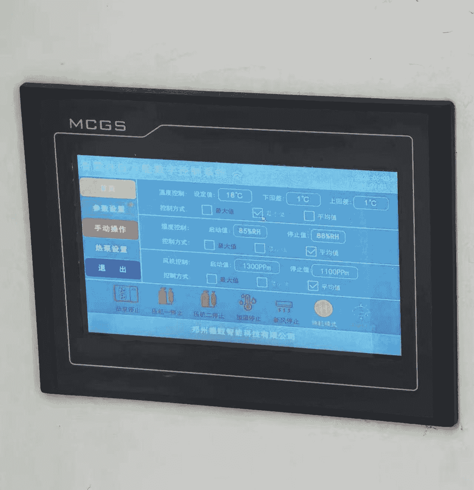

公众号懒人搜索，懒人专属群分享

## 房地产里“失业”的技术，却撑起了上亿的生意

260731

整理：公众号懒人搜索，懒人专属群精选

懒人微信：lazyhelper1

在咱们中国经济的版图上，一直有个很有特点的存在，叫“超级小镇”。比如，做汉服的山东曹县，做假发的河南许昌，做牙刷的江苏杭集，等等。一个县镇，往往就能撑起一个细分产业。

但是，今天我们要讲一个不太一样的“超级小镇”，安徽亳州下面的一个县，叫蒙城。

不一样在哪？你看，过去提起超级小镇，我们的印象往往是“从低技术开始，一路做到高端”。言外之意，他们是在某个行业发展的初期就起步，占领了市场，并且一步步做出名堂。这个过程当然很厉害，也很有价值。但是，这也伴随着一句潜台词，就是一旦这个行业做大，建立起技术壁垒，其他错过机会的“小镇”再想进入可就难了。除非你是有着先天优势的大企业。

但是，蒙城的情况不太一样，他们是一上手，就从一个门槛很高的领域切入，并且几年内就做出了巨大的产值。这对于现在的很多县域经济来说，也许是一个值得参考的样本。

前段时间，资深零售咨询专家黄碧云老师专门去蒙城做了调研。接下来，我们就看看她带回的观察。

首先，蒙城做的产业，是菌菇的工厂化种植。也就是在工厂里，用可控的温度、可控的环境，种蘑菇。有人可能会说，种蘑菇而已，这件事门槛很高吗？种蘑菇本身门槛不高，高的是这个“工厂化”。

图片注释：方舱中的鹿角灵芝

菌菇工厂化种植，必须有一个恒温恒湿、完全密闭、精确控制环境的生产空间。要实现它，需要三个必要条件。一是高性能的建筑外壳，做到隔热、密封、耐候。二是工业级的环控系统，温度、湿度、光照、气体浓度全部可调。三是数据管理系统，能实时采集参数、远程发指令、异常预警。

这三样单拿出来一样都不便宜。建一栋几千平方米的专用厂房，前期投入动辄几千万元。

所以你翻一翻做菌菇工厂化的企业，几乎清一色是上市公司，比如雪榕生物、众兴菌业。这个门槛普通农户根本够不着。还有荷兰的双孢菇工厂、日本的金针菇工厂，全都是重资产、高投入。

这也是为什么，直到2024年，中国食用菌的工厂化率都只有9.4%。剩下超过九成，还是传统大棚和家庭作坊。主要就是因为工厂化种植的启动门槛很高。

那么，蒙城是怎么拆掉这个门槛的呢？关键变量并不来自农业技术内部，而是来自另外一个行业的技术。确切地说，这个技术模板来自房地产行业，叫被动式房屋。

被动式房屋，严格地说，它不是一个物理意义上的房子，而是一整套应用于房屋空间的技术。这套技术过去主要用在高端住宅和工业建筑上，核心能力说白了就是四个字：密闭恒温。不受外部天气影响，里面始终是一个稳定的小气候。这套技术装进房子里，成品叫被动式住宅；装进一个集装箱大小的独立空间，就变成了智能方舱。

总之，方舱也好，被动式房屋也罢，不管我们叫它什么，它的重点都不在于那个“舱”，不在于那个“壳子”，而是让这个外壳内部保持环境可控，保持恒温恒湿的一整套技术系统。

蒙城就是通过这套智能方舱，实现了菌菇的工厂化种植。

你看，过去你要做菌菇工厂化，需要一栋专用厂房，从建筑结构到环控系统，需要几千万元打底。而蒙城做的，是把这套系统拆开。每个智能方舱就是一个模块，40平方米，一个集装箱大小的密闭空间，造价15万到30万元不等。过去你需要一座几千万元的工厂才能做到的事，现在起步15万元就能实现。

而且方舱不仅能解决菌菇种植的硬件问题，也能解决经验问题。通过方舱的数字化系统，可以把菌菇种植的经验变成算法，由系统远程控制。农户不需要懂任何种植知识，方舱里的灯光、温度、湿度，全部由系统自动调节。什么品种需要什么参数，什么阶段该做什么调整，都在算法里。

图片注释：菌菇方舱的数字控制系统显示屏

最关键的是，这套系统还解决了出品的“标准化”问题。你看，方舱毕竟分散在不同的农户手里，你怎么确保每家每户都按照标准执行？方舱里有实时的参数监控，一旦发现异常，比如有的农户用错药，用药过量，它立马就会报警。

换句话说，蒙城是把一个原本只有大企业才能承担的技术系统，通过方舱的“模块化”，拆成了普通农户够得着的单元。同时，把原本只有专家才掌握的种植经验，通过数字化算法，装进了每一个方舱。这件事能发生，有一个前提条件：被动式房屋这项技术，恰好处于“找新家”的状态。这几年房地产下行，建筑行业的活少了，这套技术积累在那里，正好需要新的落地场景。

但是，光有方舱还不够，关键是，你怎么调动当地的农户参与，确保他们有钱可赚？蒙城的方式，依然是“提供模块”。具体来说，是提供产品模块，提供合作模式的模块，农户可以根据自己的需要选择。

比如，在合作方式上，这些方舱的主要技术提供方，叫宝城公司。他们按照农户的经济能力，提供了几种不同的合作方式。

有经济能力的大户，可以直接自己买舱。一个方舱15万元，加上菌种、水电、人工，全套投入控制在30万元以内。为什么要控制在30万元以内？因为农村低息授信贷款的上限是30万到50万元，门槛卡在这里，农户才贷得了款。

没有大户条件的，可以由村集体统一协调。宝城提供设备、技术和销路，村集体出地、组织人，产出由收购方统一回收。而且即使市场价下跌，收购方也需要按约定价格收。

除此之外，农户也可以直接承包宝城建好的方舱，宝城提供菌包原料，农户负责日常管理和采收，收购方回收成品。投入低、风险低，每月收入也相对稳定。

这是合作方式层面，可供选择的模块。同样，在产品层面，也有可供选择的模块。

蒙城的菌菇种植，主要有两条产品线。

- 一是大宗基本盘，比如平菇、秀珍菇、香菇、杏鲍菇，都是老百姓餐桌上最常见的品类。这些商品直接供应给B端，客户是盒马、山姆、郑州万邦这类大型集散地和连锁商超。方舱365天不停产，出货稳定、品相统一、全年不断供，这三个因素恰好是渠道最看重的。
- 二是高价值品种，比如鹿角灵芝、金耳。而且因为是工厂化种植，蒙城可以把这些品种的价格压低，从而提高产品的竞争力。

过去灵芝贵，是贵在稀缺。野外产量小，外加人工培育条件苛刻，所以价格高。但灵芝本质依然是真菌，它的生长逻辑和平菇没有本质区别，都是喜阴、喜湿、喜稳定。

在方舱里，这些生长条件完全可控，产量上来了，价格自然回落。

这两条产品线，价格带从几块钱一斤的平菇到几十块一斤的高端品种，覆盖从大众餐桌到健康消费。低端守住量，高端做出利润，两条线同时跑，当地农户可以根据自己的需要，做产品的拼配。

而且方舱菌菇采完后剩下的菌棒，不是废料。加入有机物质发酵之后，是高品质有机土，可以售卖给种植业和森林公园，也可以换绿色碳积分。

说到这，我们再看一眼蒙城的菌菇产业。它的重点不只是在于菌菇这个门类，更在于它让我们看到，当一个技术充分外溢之后的想象空间。就拿今天的方舱来说，除了种蘑菇，它的用处还有很多。

比如，你去江浙和云南的杨梅产地，会看到地里散落着一个个像活动板房的舱体。很多人以为是工人休息的地方，其实不是，那叫休眠方舱，也叫速冷舱。杨梅娇贵，常温下保鲜期极短，一两天内就会变质，网上流传“杨梅要泡药才能运输”，很大程度上就是因为保鲜难题没有解决。休眠方舱做的事，是让杨梅迅速降温，从果肉到表皮温度趋于一致，进入“睡眠状态”，再去运输。这能大幅延长杨梅的保鲜和运输半径。

再比如，远洋货轮出海一趟往往数月，船员的新鲜蔬菜一直是个难题，以前只能靠储存的罐头和干货。现在有船队开始在货轮上装小型方舱，带上菌种出发，有电有信号就能运转，7天出一茬，两个舱轮流转，船上每周都有新鲜菌菇供应。

还有边防哨所、工地、码头，也是同样的逻辑。只要有电、有网，方舱就能运转，不受任何外部天气影响。

你看，一项技术，在房地产里用来建高端住宅；在农业里用来种蘑菇；在果园里用来保鲜；在远洋货轮和边防哨所，用来供给新鲜食材。容器不同，用途不同，但技术是同一套。

换句话说，一项技术在某个行业需求下行，不代表这项技术没用了。每一个正在收缩的行业，都在往外释放技术和经验。这些技术不会消失，它们在等一个新的需求来接住。被动式房屋找到了菌菇方舱，找到了杨梅休眠舱，找到了远洋货轮上的移动菜园。从这个角度看，下一个找到新容器的技术，现在可能正在某个你以为走下坡路的行业里，等着被看见，等待被接住。

——分割线——

在这个AI能替你写代码、写文章的时代，基础技能正在迅速贬值。绝大多数人正被淹没在海量的免费垃圾信息里，陷入低效的体力内卷。

当“努力”不再是壁垒，人与人之间唯一的护城河，只剩下“信息过滤”的效率与“认知系统”的维度。

圈子已稳定运行7年。我们每天利用Python爬虫与大模型算力，过滤全网最顶级的政经内参和搞钱风向标，做你最冷酷的“外部大脑”。

如果你认同这种“重塑认知防线”的极客主义，欢迎围观我的个人情报智库：【懒人专属群】。

https://lazyso.com/insider/

认同信息过滤价值、想省下每天3小时无效阅读时间的读者，扫码加我微信（lazyhelper1）。

