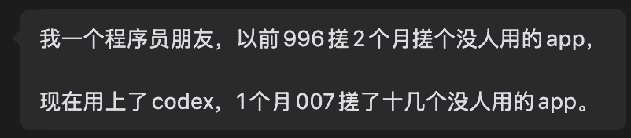
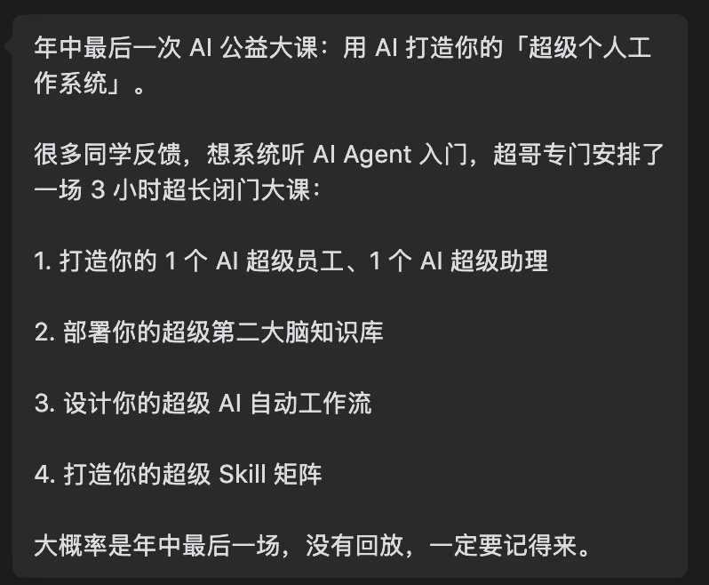
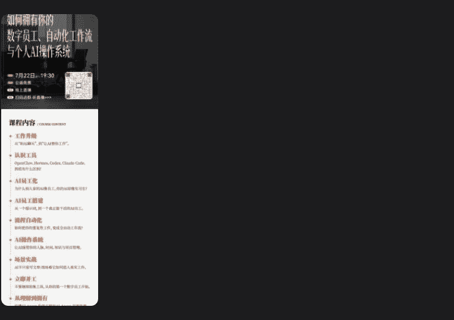

公众号懒人搜索，懒人专属群分享

# AI时代到底怎么赚钱？先去做离钱最近的事

260803 副业SC精华

整理：公众号懒人搜索，懒人专属群精选

懒人微信：lazyhelper1

圈友们好，我是根源。

从去年8月到昨天，我一共办了31场线下活动。

这31场活动，大致可以分成两个阶段。

去年的活动，我谈得更多的是如何变现、如何转化。

很多人已经有了产品，有了内容，甚至也有了一些流量，可他们依旧不知道，怎么把这些东西真正变成收入。到了今年年初，因为我开始深入使用AI，活动主题也慢慢发生了变化。

我开始谈怎么通过AI赚钱，怎么用AI设计产品，怎么把AI放进自己的商业模式里。

但我很快发现了一个很有意思的现象：

工具升级了，大家卡住的位置却几乎没有变化。以前大家问我：

- “老师，我的小红书有流量，但不知道怎么变现。”

- “老师，我把人加到微信了，但不知道后面怎么聊。”
- “老师，我课程做好了，但不知道怎么卖。”

今年只是换了一套说法：

- “老师，我用AI做了一个产品，但不知道怎么变现。”
- “老师，AI提高了我的效率，但这个效率怎么变成钱？”
- “老师，我能不能先把产品打磨得更完整，再去卖？”

你看，问题本质没有变。

只是以前卡在内容和产品，现在卡在AI产品和AI工具。

但真正卡住的地方，还是同一个地方：

你不敢把一个东西，清楚地介绍给一个具体的人，然后问他愿不愿意付钱。

最近办线下活动，我发现一个挺有意思的现象。

很多人用了AI以后，做产品、做内容、做工具的速度都变快了，但一问到“怎么赚钱”，大家卡住的地方还是很像。

不是工具不够好，也不是产品一定要再打磨三个月，而是很多人还没有真正跨出那一步：把自己的东西讲清楚，然后去问一个具体的人愿不愿意付钱。

# 一、AI让产品变快了，但没有让成交自动发生

昨天看到一个笑话：

现在很多人对AI有一个误会：他会觉得，只要我用AI做出了一个产品，市场就会自动给我答案。这个想法很容易理解，因为过去做产品真的太慢了。

以前你可能要找技术、找设计、找运营，开很多会，等很多版本，花三个月才做出一个雏形。

现在不一样。

一个人借助AI，几天甚至几个星期，就能把一个产品做出来。

但问题来了：

产品做出来，只代表你拥有了一个“可以被销售的东西”。它不代表收入会自动发生。

收入发生的前提，是有人真的愿意为它付钱。

而有人愿意付钱的前提，是你要先完成一次真实的交易动作。

这件事AI替不了你。

它可以帮你写介绍页，可以帮你写朋友圈，可以帮你做海报，也可以帮你优化话术。

但那个最关键的动作，还是你自己要做。

你要把产品拿出去，讲给一个“人”听。

# 二、商业模式先别讲复杂，先问三个问题

商业模式当然可以讲得很复杂：

可以讲用户画像、流量渠道、产品矩阵、成本模型、复购体系。

但如果回到最简单的地方，其实就是三个问题：

1. 你卖的是什么？
2. 谁愿意为它付钱？
3. 你怎么把钱收回来？

这三个问题里面，很多人会卡在第三个。

知道自己卖什么，大概也知道谁可能需要。

但一到“怎么把钱收回来”，整个人就开始变得特别客气。

- 发朋友圈可以。
- 写文章可以。
- 做直播也可以。

但要他私信别人说一句：

“这个产品很适合你，你愿不愿意试一下？”

他就开始难受。

所以我一直觉得，很多人不是不会做商业模式，而是不习惯销售。

商业模式需要跨出的第一步：开口。

| 你以为的问题 | 真正的问题 |
|---|---|
| 产品还不够好 | 你还没有拿给足够多的人试过，更没有让他们用钱投票。 |
| 流量还不够大 | 你还没有认真承接已经来到你微信里的人。 |
| 商业模式不清楚 | 你还没有完成从介绍、报价到收款的闭环。 |

# 三、先做离钱最近的事

如果你现在没有超级大的流量，没有成熟的团队，也没有已经跑顺的销售系统。

那我建议你别一上来就把问题想得太远。

先做离钱最近的事。

什么叫离钱最近？

不是继续改产品。

不是继续研究工具。

不是继续优化流程。

而是找到一个可能需要你产品的人，把它讲清楚，然后邀请他付费。

这听起来很土。

但赚钱这件事，很多时候就是从很土的动作开始的。我以前卖东西，就是一扇门一扇门敲出来的，也是一张传单一张传单发出来的。

现在有互联网，有AI，我们当然不需要真的挨家挨户敲门。

- 但你还是要开口。
- 你还是要介绍。
- 你还是要报价。
- 你还是要收钱。

如果这个动作永远不发生，产品做得再漂亮，它也只是躺在那里。

像一间装修得很漂亮，却始终没有开门的商店。

# 四、你把人加到微信，只完成了一半

有些人的小红书内容做得很好。

用户先看到内容，再私信，再添加微信，最后进入朋友圈或者社群。

为了让一个人进入微信，前面已经经过了四五个环节：

- 内容要写得好
- 标题要吸引人
- 用户看完要愿意私信
- 私信之后还要愿意加你微信

可是，当这个人终于进入微信之后，很多创作者突然安静了。

他不知道怎么主动聊天，不好意思介绍产品，更不敢明确地问对方要不要购买，这就很可惜。你花了那么多时间，把一个人从公域带到私域，最后却在离成交最近的一步闭嘴了。

前面的流量和内容，很容易就被浪费掉。

所以我在活动里给一个做AI自媒体的朋友建议时，讲过一个很关键的点：

如果你线上是一个很有人味的人，那你的私域话术也要有人味。不是说不能用固定话术，固定话术也可以有人味。

你可以这么说：

“我看到你应该是从小红书或者B站加过来的，很谢谢你喜欢我的内容。

因为最近每天加我的人比较多，我想让沟通效率高一点。

你介不介意我先发你三个常见需求？如果你问题很明确，也可以直接告诉我。”

你看，这也是分流，但它不是冰冷地甩出1、2、3。

它先承接了对方的感受，再给对方选择，这才适合个人IP。有挺多朋友问我：

我看很多大的IP，他们都会有群发话术，XX话术之类的，为什么我不能也像他们一样？

（以下的图片举例）

因为这些企业，有专门的流量团队，对于这些大IP或者公司来说，看的是转化率。

但是对我们这种小个体，尤其只有一个人或者两个人的状况，平均每天可以有个十几二十人加你的私域，已经特别牛了。

这也代表，每一个人我们都需要认真地对待，因为我们没有这么大的流量兜底。

# 五、产品先分清楚，你才知道怎么卖

很多人不是不会写话术，是产品结构都还没想清楚。

可能同时有免费群、付费群、一对一咨询、课程、训练营。

但每个产品到底给什么？多少钱？适合谁？边界在哪里？都没定，那你当然不知道怎么介绍。

所以在私域成交之前，先把产品分清楚。

| 产品层级 | 作用 | 注意点 |
|---|---|---|
| 免费群 | 承接暂时没有付费意识的人，培养信任。 | 免费不代表随便，也要有清楚规则和稳定价值。 |
| 付费群/课程 | 解决一类明确问题，形成标准化交付。 | 最好先做周期性交付，别一上来就做年度陪伴。 |
| 一对一咨询 | 解决具体问题，承接高意愿用户。 | 价格要高于社群，至少不能低到显得你没有价值。 |

我给那个朋友的建议是：

先把免费群给什么、付费群给什么、一对一咨询给什么全部写清楚，然后再去设计话术。

否则你再会聊天，也只是在绕。

用户一问你：

“那你这个付费群主要讲什么？”

你自己都含糊，成交就很难发生。

# 六、别只问愿不愿意，要让他们用现金投票

昨天活动里，有一位朋友以前是滴答清单的产品经理，他在那家公司工作了五年。

辞职以后，自己做了一款和时间管理有关的AI行动教练产品。

产品完成度大概70%到80%，准备下个月正式上线。

他已经有一个一百多人的围观群，群里的人会看他做产品，也会给他反馈。

他问我：

“老师，我接下来应该怎么推广？付费策略应该怎么定？”

我讲了一个词：

现金投票。

很多人会问用户：

- 你们觉得这个产品好不好？
- 你们会不会愿意支持？
- 你们有没有兴趣？

这些问题可以问，但它只能得到掌声。

掌声不是答案，钱才是答案。

你可以在群里这样说：

“很谢谢大家这段时间一直围观我做产品。

坦白讲，有时候我晚上真的很累，但看到你们认真关注产品更新，我又有能量继续做下去。

现在产品准备进入内测，我想从这个群里招募第一批付费用户。

因为你们是最早陪我做这件事的人，所以我会给你们最大的优惠。

第一个月测试，我收99元。

如果你愿意支持我，愿意成为第一批内测用户，可以现在直接付款，我后台帮你开通资格。”

这才是真正的测试。

- 一百个人说愿意，不代表一百个人会买。
- 五十个人说支持，也不代表五十个人会付款。

最后有几个人把钱转过来，那个数字才是你现阶段真正的答案。

前面的五十个人是掌声。

后面的五个人，才是答案。

# 七、上班族做产品，最容易卡在“我还没做好”

从上班族变成创业者，有一个很大的转变。

上班族会习惯把产品研发放到最大，他会想：我一定要把产品做好，我才好意思卖。

但创业者很多时候是反过来的：

先卖，再完善产品。

不是说产品可以很烂，而是你不要把“还不够完美”当成不销售的借口。

因为只要你没有真实用户付钱，你就不知道你做的东西到底是不是市场要的。

你坐在家里想出来的需求，很可能只是你自己的需求。

你跟用户聊出来的需求，才有可能变成真正的产品方向。一个项目想做起来，至少要补三种能力：

| 能力 | 含义 |
|---|---|
| 流量能力 | 用户从哪里来？线上、线下、自有圈子、公域平台都算。 |
| 存量能力 | 用户来了以后，你能不能接住？能不能介绍、转化、成交？ |
| 增量能力 | 用户买完以后，能不能复购、转介绍、买第二次？ |

很多人只会第一种，或者只会做产品，连第一种都还没开始。

但创业不是只靠单项能力，创业需要通才。

你产品做得再好，如果不会卖，还是很难。

# 八、价格不要一开始就把自己锁死

活动里那个做AI行动教练的朋友，一开始想定199元一年，我不是很建议。

如果这只是你的副业，你想试试看，那可以。

但如果你真的想把它当成主业，就不要一开始把价格定得太低、周期定得太长。一年199元，听起来用户压力小，但你也把自己锁死了。

你承诺了一年，后面想转方向就很尴尬，而且你收不到大钱的感觉。

对于早期创业者来说，每个月都有钱进账，比一次性收一个很低的年费更重要。

所以我会更建议早期先从月付开始，比如99元一个月。

不贵，用户愿意试，你也更容易根据反馈调整方向。

等你跑了几个月，确认这是你的真命产品，再考虑年费也来得及。

不要太早给一个项目下终身定义。

现在还没结婚，只是在一起而已。

你不用那么快说：“我这辈子就它了。”

# 九、打开通讯录，认真聊完一百个人

有人问我，最快的变现路径能不能写得再清楚一点，我当时愣了一下。

因为在我看来，最快的路径真的没有那么多隐藏诀窍。

就是：

打开通讯录，找到可能需要这个产品的人，把产品介绍给他，然后邀请他购买。

你可以每天拿出1到2个小时，找最近聊过天的3到5个人。

不用一上来就硬卖，你可以先关心一下他的近况，然后很自然地讲：

“我最近做了一个产品，主要帮助某一类人解决某一个问题。

我想到你可能会用得上，不知道你方不方便听我简单介绍一下？”

对方愿意听，你就继续介绍。

对方有疑问，你就认真回答。

产品适合他，你就明确告诉他价格。

然后问：

“你愿不愿意给我一个机会，试试看？”

如果他拒绝，也没关系，你可以说：

“没事，很谢谢你听我讲。

如果之后我这个产品有更新，你介不介意我再跟你说一下？”

这不是骚扰，这是在练习销售，也是在收集需求。

你会慢慢知道：

- 什么样的人更需要你的产品？
- 他们为什么愿意买？
- 他们为什么拒绝？
- 他们希望你加什么功能？
- 你原本以为的卖点，别人到底在不在意？

这些答案，坐在家里想不出来，它们都藏在一次次真实的对话里。

# 十、AI时代，商业模式=销售能力

以前做产品很难，所以产品本身有门槛。

现在AI把这个门槛降下来了，越来越多人都能做出一个工具、一个页面、一个小程序、一个课程。

这时候真正拉开差距的，反而不是“谁能做出来”，而是：

- 谁能找到用户
- 谁能和用户聊明白
- 谁能完成第一次收款
- 谁能根据反馈继续迭代

所以我越来越觉得，AI时代不是销售不重要了。

恰恰相反，销售能力会变得更重要。因为产品越来越容易被做出来，内容越来越容易被生产出来，工具越来越容易被复制出来。

但信任、表达、成交、复购，这些东西没有那么容易被复制。

尤其是个体创业，你不应该一开始就想着外包销售。

早期你自己去聊用户，虽然慢，但特别值钱。因为你卖不出去，也能知道为什么卖不出去。你收不到钱，也能知道用户卡在哪里。

你跟用户聊得越多，你对产品的理解反而越清晰。

# 十一、如果你看完想开始做，先填这张定位表

到这里，观点已经讲完了。

但如果只停在观点，这篇文章对你最多只是一个提醒。

你会觉得有道理，然后收藏，然后过两天继续不敢卖。

所以我建议你现在就做第一步：

先不要急着发朋友圈，也不要急着继续改产品，你先把自己的产品讲清楚。

产品三句话定位：

我最近做了一个产品/服务：________

它主要帮助：________

解决的问题是：________

我准备先卖给：________

第一次测试价格是：________

很多人卖不出去，不是话术问题，是他自己都还没有想清楚自己到底在卖什么。

你连这几行都填不出来，就先不要怪用户不买。

因为你自己也还没有给用户一个清楚的购买理由。

# 十二、把私域产品分成三层，不要所有人都卖同一个东西

当你把产品定位写清楚以后，第二步是做产品分层。不是每一个加你微信的人，都适合同一个产品。

- 有人只是好奇
- 有人愿意试一下
- 有人问题很急，想直接找你一对一解决

如果你把所有人都往一个产品里塞，成交会很别扭。

所以最简单的方法，是先做三层：

| 层级 | 适合谁 | 收费建议 | 交付内容 |
|---|---|---|---|
| 免费群 | 暂时没付费意识，但愿意关注你的人 | 免费 | 每周资料/答疑/案例 |
| 低客单产品 | 愿意试一下的人 | 99/199/399 | 一个月内测、训练营、资料包 |
| 一对一咨询 | 问题明确，想快速解决的人 | 至少是社群价的50%以上 | 60—90分钟诊断＋方案 |

这张表不是让你马上做得很复杂，恰恰相反，它是为了让你不要乱。

用户来了以后，你可以先判断：

- 他只是想先了解，就进免费群
- 他愿意试一下，就进低客单产品
- 他问题很明确，就介绍一对一咨询

这样你就不会每次聊天都像临场发挥，你会有一条清楚的承接路径。

# 十三、直接复制这段现金投票话术

如果你已经有一个群，哪怕只有二三十个人，也可以做一次现金投票。

不要只问大家有没有兴趣，兴趣不等于购买，支持不等于付款。

真正的测试，是让用户现在就做一个很小的付费动作。

现金投票话术：

很谢谢大家这段时间一直围观我做这个产品。

坦白讲，这是我第一次真正以创业者的身份把一个产品推出来，所以发这段话的时候，我其实也有点紧张。

现在产品准备进入第一轮内测，我想先从这个群里找第一批付费用户。

因为你们是最早陪我看着这个产品长大的人，所以我会给你们最优惠的价格。

第一个月内测，我收99元。

如果你愿意支持我，愿意成为第一批内测用户，可以现在直接付款，我后台帮你开通资格。

你发完之后，不要只看有多少人回复“支持”，你要看有多少人真的付款。

有人付钱，说明这件事有一点点市场信号。

没人付钱，也不是失败。

它至少告诉你：你的产品、价格、表达、信任关系，某一个环节还没到位，这比你继续在家里想一个月有用。

# 十四、打开通讯录，做一张100人行动表

如果你没有群，或者群里暂时没人互动，那就回到最朴素的方法：

打开通讯录，找最近聊过天的人，每天3到5个。连续20天，认真聊完100个人。

不要一上来就硬推，先关心近况，再介绍你正在做的东西。

“我最近做了一个产品，主要帮助某一类人解决某一个问题。

我想到你可能会用得上，不知道你方不方便听我简单介绍一下？”

你每聊一个人，就记录四个信息。

| 人名 | 他的问题 | 是否愿意听介绍 | 是否付款/为什么没付款 |
|---|---|---|---|
| ________ | ________ | 愿意/不愿意 | ________ |
| ________ | ________ | 愿意/不愿意 | ________ |

意

____

____

愿意 / 不愿

意

____

这张表看起来很简单，但它会逼你面对真实市场。

你会发现：

- 有些人不是不买，是根本没听懂你卖什么。
- 有些人不是没需求，是你没有讲到他的痛点。
- 有些人不是嫌贵，是还不信任你。
- 有些人真的不适合，你也不用浪费时间。

这些东西，AI 没办法替你凭空想出来，它们必须从真实对话里长出来。

# 十五、接下来 **7** 天，只做这几件事

如果你看完这篇文章，真的想开始赚钱。

我不建议你马上再去看十篇文章，也不建议你继续研究十个 AI 工具。

你先给自己 7 天，只做下面这些事：

| 时间 | 动作 |
| --- | --- |
| 第 **1** 天 | 写清楚你卖什么、卖给谁、第一次测试价格是多少。 |
| 第 **2** 天 | 整理 30 个可能需要这个产品的人。 |
| 第 **3** 天 | 先私聊 5 个人，不求成交，只求把产品讲出口。 |
| 第 **4** 天 | 根据对方反馈，修改你的介绍话术。 |
| 第 **5** 天 | 如果你有群，就做一次现金投票；没有群，就继续私聊 5 个人。 |
| 第 **6** 天 | 把愿意付款的人拉进内测名单，明确交付内容。 |
| 第 **7** 天 | 复盘：为什么有人买？为什么有人没买？下一轮要改什么？ |

这 7 天不一定让你赚很多钱，但它会让你跨过最重要的一关。

你会从「我想赚钱」，变成「我真的开口卖过一次」。

这两件事差很多。

# 写在最后

AI 可以让一个普通人拥有，过去一个团队才能拥有的生产能力，但 AI 无法替代那个最重要的交易动作。

你要找到一个具体的人，把产品清楚地介绍给他，然后问他愿不愿意付钱。

很多人一直在优化产品、研究工具、设计流程。

但说白了，只是在绕开那句让自己有点紧张的话：“这个产品很适合你，你愿意购买吗？”

所以，AI 时代到底怎么赚钱？先把工具放到一边一会儿，去做离钱最近的事情。

打开通讯录，找到合适的人，主动开口，清楚介绍，明确报价，然后完成第一笔收款。

很多商业模式，就是从那一笔让你有点不好意思收的钱开始的。

---

看完这篇 SOP，你觉得你懂了。但 90% 的人一到实操就会卡在第一步。

工具和教程只是最低级的壁垒，真正的壁垒是“立刻动手”和“圈层信息差”。

如果你想看全网最新的变现玩法，并且和一群执行力极强的极客一起下场拿结果，欢迎围观我的核心私域：【懒人专属群】。

我们不聊虚的，只做商业闭环的拆解与 AI 效率的压榨。系统内已沉淀 1000+ 跑通的套利实战局。

👉 查阅圈子完整数字资产与上车门槛：

https://lazyso.com/insider/

认同价值、准备好下场干活的，扫码加我微信（lazyhelper1）

备注：【实操上车】，不闲聊

