公众号懒人搜索，懒人专属群分享我是由月之暗面（Moonshot AI）研发的 kimi-k2.7-code 智能大模型。# 如何把你的业务流程做成 **AI Agent** 员工

260803 副业 SC 精华

整理：公众号懒人搜索，懒人专属群精选

懒人微信：lazyhelper1

# 前言

哈喽大家好，我是鹿书野，**00** 后，**INFJ**，盖洛普认证教练（见右图）、B 站好物深海圈教练；生财有术资深传术师。去年考上在职研究生之后加入了生财，接触了 B 站好物项目，跑通了 0-1，今年与……成立工作室，搭建内容工厂，跑通 1-10。

现围绕外设、数码、家电家居和户外服饰四个赛道运营多个达人账号，带货细分类超过 60 种，并与 ATK、雷柏、华为、转转、美的、友望、TCL、京东京造、特步等上百家品牌方开展过内容合作，月均带货 GMV 500w+，单月的商单或单月的佣金都到过 6 位数。

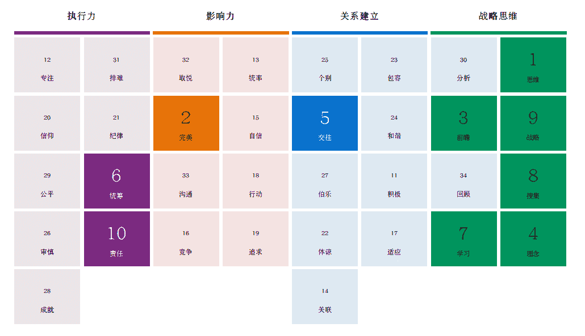

当然，商单才真正算是主业。

展示一下我们的内容工厂。

由于 B 站好物项目的复杂程度极高，一个视频的工序有 10 多个环节，每个环节又有数十个操作步骤。小白在做 B 站好物带货视频，基本都要 10 个小时才能做一条，所以这次我更想讲通用能力。想看 B 站好物的内容，可以看我以前的帖子。

**AI Agent** 是未来，我们已经吃到 **AI Agent** 带来的生产方式革命的红利了。

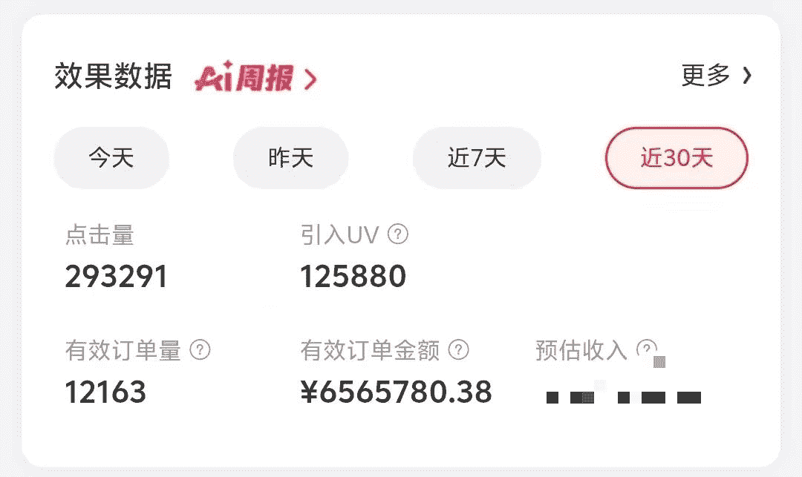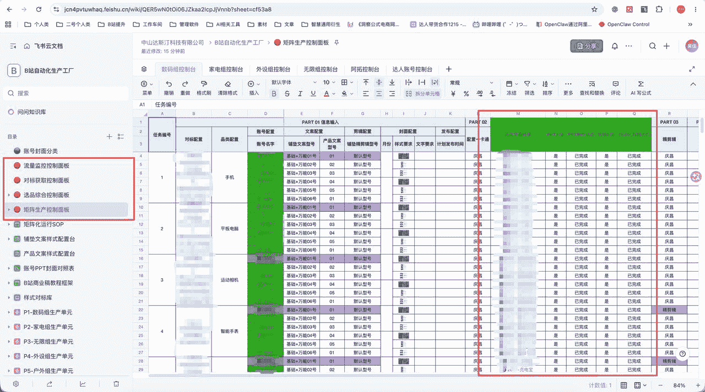

马上也有 **AI Agent** 航海，所以这次想去分享，先讲一下 **AI Agent** 筑基（第一部分），并拿一个简单例子去演示我们的最终目标——搭建一个 **AI Agent** 员工（第三部分核心）。

抛砖引玉。

这次分享当时给 B 站好物深海圈 AI 提效月做了直播，也可以看录播版。这些日子和圈友交流的时候，发现有着大量的对一套 Codex 入门教程的需求（当然这种我认为一般是那些由于对未知的恐惧而还没有开始下载 Codex 的朋友）。于是我合计出一个吧，我喜欢知识，我喜欢知识的结构化与系统化，正好也是 B 站好物深海圈的 AI 提效月活动，于是做了这次分享。

**PS**：我最初是从包子老师那里学的，加上了一些我自己实际实践的理解，感谢包子老师。

这套框架能让你清楚地知道：搭建 Agent 员工时，自己正在做什么、接下来要做什么、每一步要解决什么问题，以及做到什么程度才算真正完成。

以后面对任何业务，你可以按照同一套思路，做出一名能够反复上岗、稳定交付的 Agent 员工。

当然，这套方法不只适合还没开始使用 Codex 的人。

如果你已经在用 AI 写文案、做图片、处理日常工作，却发现每次都要重新解释“我是谁”“我的业务怎么做”“什么样的结果才算合格”，那你同样需要这套方法。

同样的要求说了很多遍，但不会沉淀，换个聊天窗口，它又像第一天上班。更麻烦的是：同一项工作今天做得很好，明天结果却变了；规则越聊越长，标准越来越乱；上下文一满，重要规则残留在上下文里逐渐被压缩或丢失。你不仅没有省下管理时间，反而成了全天候给 AI 培训、检查和返工的人。

接下来开始 **AI Agent** 筑基吧！

# 一、**AI Agent** 筑基

**Agent**：能够独立完成工作的 **AI** 员工

### （1）什么是 **Agent**？

Agent 是一个被赋予了目标、工作边界、工具和验收标准，能够持续完成某一类工作的执行主体。用户只需要交代想要的结果，Agent 会自己理解任务、规划步骤、调用工具、处理异常，并最终交付产物。

我现在做很多事情，基本都会安排 Codex 来做。

以前想安装一个软件，我会先打开浏览器搜索官网、寻找安装包，再自己完成下载和配置；现在我通常只需要告诉 Codex：“帮我安装这个软件。”它就会自己查找正确的下载渠道、完成安装，并检查软件是否能够正常运行。

**Codex** 本身就是一个 **Agent**，一个编程 **Agent**，也是万能 **Agent**。擅长阅读和修改文件、编写代码、运行命令以及操作项目。但通过浏览器、CLI、MCP 和各种插件，它也可以完成资料检索、文档处理、数据整理、软件安装等大量工作，所以它的能力范围其实非常广。

Codex 不同项目之间的工作环境是相对独立的，新对话也不会自动继承上一段对话里的全部记忆。

这反而给了我们一种非常实用的用法：用一个项目文件夹，对应一名专门负责某项工作的 **AI** 员工。所谓 **AI** 员工，其实就是你在项目文件夹里给他写一些代码，给他一个设定，告诉他他是谁，他的工作是啥，标准是啥，然后 **Codex** 带着这份设定来干活。不同的项目有不同的代码，Codex 接受这些不同的设定，就形成一个个不同的员工。

员工。

**Agent** 本身就存在，我们去做 **Agent** 员工，本质上就是去做 **AI Agent** 员工的设定。

### （2）**Agent** 或者说 **AI Agent** 员工的设定长什么样？

由于工作的性质不同，每个 Agent 项目文件夹里的结构也会有所不同。

目前并不存在一套适用于所有业务的“黄金标准”，大家也不需要在一开始就设计出一个看起来非常完整、复杂的目录。

大多数项目的结构，其实都是在真实工作中慢慢“长”出来的。

你先让 AI 帮你干活。随着任务推进，项目文件夹里会逐渐出现原始材料、输出结果、脚本、验证器、知识库和各种临时文件。

当一条业务流程真正跑通以后，再让 Codex 回头梳理整个项目，把已经验证过的操作步骤、业务规则、禁止事项和验收标准固化下来。

（看到这里，新手可能会有些不安：这么多文件该怎么整理？交给 **Codex** 沉淀会不会出错？会不会不稳定？但其实没有想象中那么难。第三部分我会提供可以直接使用的提示词；只要按照这套框架一步步操作，基本不会出错。最终整理出的项目文件会非常清晰，整个流程也能反复复用。沉淀下来的 **Skill** 等文件，还可以直接迁移到其他项目中。）

这些内容经过整理，最终会变成项目目录、AGENTS.md、Skill、脚本和验证器。原本散落在文件和聊天记录里的经验，也就变成了一套可以反复执行的项目设定。

### （3）**Agent** 点拨

理解了 Agent 的原理以后，很多以前觉得奇怪的操作就很好理解了。

为什么在项目文件夹里新开对话后，要先让 **Agent** 阅读整个项目？因为新的对话没有之前的聊天记忆。让它先阅读项目文件，就相当于让一名新上岗的员工重新接受培训，了解自己的身份、职责、工作流程和验收标准。

为什么一个项目文件夹最好只对应一个 **Agent**？**Agent** 做好以后，也尽量只让它持续负责这一类工作？因为项目会在执行过程中不断沉淀新的代码、规则、材料和产物。如果经常让同一个项目处理互不相关的任务，无关内容就会逐渐混进来，造成职责漂移和规则冲突。时间久了，Agent 可能连自己到底负责什么都不清楚。

一个相对干净的项目，应该服务于一类明确的工作。这样它积累得越多，对这项工作的理解就越深，执行也会越来越稳定。

为什么不能只把重要规则留在聊天记录里？

因为上下文是有限的。随着对话越来越长，早期的重要规则、成功经验和纠偏记录会被压缩，甚至逐渐丢失。今天刚刚纠正的问题，换一个对话后可能又会重新出现。

解决办法就是把聊天中已经验证成功的经验及时固化成项目设定：长期原则写进 AGENTS.md，完整操作流程写进 Skill，确定性的动作交给脚本，验收标准交给验证器。这样即使换一个新对话，Agent 重新读取项目后，仍然能够按照同一套标准工作。

所以，稳定地做出一名 AI Agent 员工，关键并不是写出一条完美提示词，而是让它经历“真实执行、人工纠偏、规则沉淀、重新验证”的过程。

如何把一次成功变成长期能力，如何让项目保持干净、职责明确、流程可复用，让 Agent 换一个对话也能重新上岗——这就是我这次分享真正想讲清楚的事情。

# **Skill**：**AI** 员工的作业手册

理解了 Agent 以后，接下来就要理解 Skill。

### （1）什么是 **Skill**？

如果说 Agent 是一名员工，那么 Skill 就是这名员工执行某一类工作时使用的标准作业手册。

它会告诉 Agent：

- 什么情况下应该使用这套能力；
- 开始工作前要检查什么；
- 任务应该按照什么顺序执行；
- 哪些步骤可以调用脚本完成；
- 哪些内容必须由 Agent 自己判断；
- 遇到异常时应该继续、重试还是停止；
- 最终要生成哪些产物；
- 达到什么标准才算完成。

**Skill** 是业务流程、操作规则、判断边界、工具和验收标准的集合。在跑通第一条任务的过程中，我们通常会不断给 Agent 补充要求：

“这个地方不要删。”

“Cookie 失效时先停止，不要继续领取任务。”

“产品推荐从哪里开始，需要通读全文后判断。”

“必须生成三个文件，验证通过后才能修改飞书状态。”

这些要求刚开始都存在于聊天记录里。在当前对话中，Agent 能够记住并执行；但换一个新对话后，这些规则不会自动完整保留下来。

如果某条要求已经被真实任务验证过，而且以后还会反复使用，就不应该继续只留在聊天记录里，而应该整理进 Skill。

这样，新对话中的 Agent 只要重新读取 Skill，就能重新获得这套工作能力。

### （2）一份 **Skill** 的基本结构

一个 Skill 通常是一个独立文件夹，里面以 SKILL.md 为入口，再根据需要放入脚本、参考资料、模板和验证工具。

例如：

这些文件承担的职责并不相同。

**SKILL.md** 是总入口。它负责说明这是什么能力、什么任务会触发它、整体流程是什么，以及什么时候必须停止。

**references/** 保存详细规则。例如字段说明、内容规范、异常类型和输出结构。这样可以避免把所有信息都堆进一个非常长的 SKILL.md。

**scripts/** 保存可重复执行的代码。例如请求接口、下载字幕、解析 JSON、创建目录和检查文件。这些工作输入明确、结果稳定，适合交给代码。

**templates/** 保存产物模板。它告诉 Agent 最终文件应该包含哪些字段、标题和基本结构。

**examples/** 保存成功与失败案例。当抽象规则不够容易理解时，Agent 可以通过案例知道什么结果符合要求、什么结果不能接受。

这不是唯一结构。不同工作的 Skill 可以有完全不同的文件组织方式，重点是每个文件的职责要清楚。

### （3）**SKILL.md** 应该写哪些内容

我们案例里的 SKILL.md 长这样，不过不用特意去做，到时候安排 Codex 来做就行，后面会讲。

### （4）**Skill** 从识别到执行的完整流程

当用户提出一项任务时，Agent 会先判断当前任务是否符合某个 Skill 的触发条件。

如果符合，它会读取对应的 SKILL.md，再根据里面的指引按需读取参考资料、调用脚本和使用模板。

完整过程可以理解为：

用户提出任务  
↓  
Agent 判断应该使用哪个 Skill  
↓  
读取 SKILL.md  
↓  
按需读取规则、模板和案例  
↓  
调用脚本、CLI 或 MCP 执行动作  
↓  
Agent 完成语义判断  
↓  
运行验证器  
↓  
交付结果

这种结构的好处是，Agent 不需要一开始把项目里的所有规则都塞进上下文。只有任务真正需要某项能力时，才读取对应的 Skill 和相关文件。

项目可以因此保持清晰，Agent 也不容易被无关规则干扰。

当然啦，你要是怕自动调用错误，也可以直接跟 Codex 说：“使用 XX Skill 去做 XX。”

### （5）**Skill** 如何被安装或者找到？

如果你想使用别人做好的 Skill，直接告诉 Codex：“帮我安装这个 Skill”即可。默认情况下，Skill 一般会安装到全局目录，安装完成后，也可以在下方查看自己已经安装过的 Skill。

不过，大多数 Skill 通常是为某一类具体业务流程服务的。不同业务之间可能会用到功能相近的 Skill，如果担心 Codex 调用错误，或者全局安装的 Skill 越来越多，也可以不把它安装到全局，而是只放进对应的项目文件夹，作为这个项目专用的 Skill。

因为 Skill 本质上就是一个包含说明文件和相关代码的文件夹，全局 Skill 与项目 Skill 的核心并没有区别，主要只是存放位置和生效范围不同。

### （6）补档：**Skill** 和 **Agent** 有什么区别？

有些朋友会问：Skill 里也包含具体的工作步骤，那它和 Agent 到底有什么区别？

简单来说，如果任务流程较短、操作比较单一，直接使用 Skill 就足够了。你只需要告诉 Codex：“使用这个 Skill 完成某项任务”即可。

但如果流程链路较长、涉及多个环节，就更适合搭建 Agent。Agent 可以按照既定工作流，依次调用多个 Skill 来协同完成任务。

比如，我的一些复杂 Agent 会调用 7 个 Skill：每个 Skill 对应一道相对独立的工序，而每道工序内部又包含若干具体操作步骤。这样既能保证整个流程有序推进，也方便后续单独修改、复用或迁移其中的某个环节。

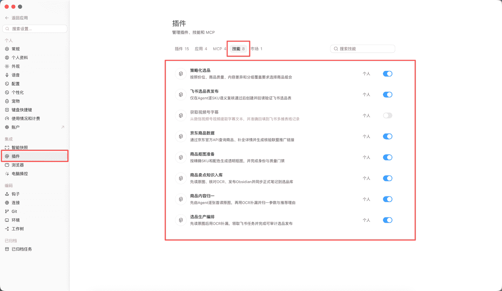

# 知识库：**AI** 员工的资料库与工作档案

如果说 Agent 是员工、Skill 是作业手册，那么知识库就是这名员工长期使用的资料库和工作档案。

它负责保存业务背景、参考资料、历史产物、审核记录和已经确认的经验，让 Agent 在新的对话中仍然能够重新获得完成任务所需的上下文。

需要注意的是，知识库并不是 Agent 大脑里自动产生的“永久记忆”。

知识库本质上是一组被保存下来的文件。

Agent 每次开始工作时重新读取这些文件，才表现得像“记得以前发生过什么”。

很多人刚开始使用 AI 时，会把大量资料和要求都放在聊天记录里。

在当前对话中，这种方式没有问题。Agent 可以根据前面的聊天内容理解你的业务，也能记住你刚刚提出的标准。

但随着对话越来越长，会出现几个问题：

- 早期内容可能被压缩或丢失；
- 重要规则和临时讨论混在一起；
- 很难确认哪一版结论才是最终版本；
- 换一个新对话后，需要重新解释全部背景；
- 资料无法稳定检索、引用和复用；
- 其他 Agent 也不知道应该读取哪一段聊天记录。

聊天记录适合讨论和产生共识，但不适合成为长期保存业务知识的唯一位置。

当一条信息已经被确认，并且以后还会使用，就应该从聊天记录中提取出来，写进知识库或者项目设定。

### （1）**Obsidian**：适合 **AI** 读取的知识管理工具

Obsidian 本质上是一个用于查看和管理本地 Markdown 文件的工具。

一个 Obsidian 知识库，实际上就是一个装着许多文件和文件夹的普通本地目录。即使以后不再使用 Obsidian，这些 Markdown 文件仍然可以被 VS Code、Codex、Claude Code 或其他工具正常读取。

例如：

### （2）从简单的文件夹开始搭建知识库

很多人刚开始建立知识库时，会花大量时间研究应该分几层目录、使用多少标签、建立哪些双向链接。

其实没有必要。

不同业务需要保存的内容不同，所以知识库也不存在适用于所有人的“黄金结构”。

更实用的方式是先处理真实任务，让文件夹随着工作自然生长。

当处理了几条任务以后，你会逐渐发现：

- 哪些文件每次都会生成；
- 哪些信息经常需要查找；
- 哪些内容应该集中管理；
- 哪些目录越来越混乱；
- 哪些字段适合做成固定模板；
- 哪些主题需要建立索引。

这时再让 Codex 梳理现有文件，调整目录结构、补充索引和模板，通常会比一开始凭空设计更加可靠。

知识库的结构不是想象出来的，而是从真实业务中生长出来，再经过整理和固化。

### （3）知识库与项目文件夹的职责分工

项目文件夹和知识库可以放在一起，也可以分开管理。

项目文件夹更像 Agent 的办公室，通常包含：

- AGENTS.md；
- Skill；
- 脚本；


公众号懒人搜索，懒人专属群分享我是由月之暗面（Moonshot AI）研发的 kimi-k2.7-code 智能大模型。- 验证器
- 配置文件
- 临时工作目录
- 任务执行记录

知识库更像长期档案室，主要保存：

- 原始资料
- 整理后的内容
- 历史产物
- 主题索引
- 审核结论
- 可以被多个任务复用的业务知识

如果项目规模较小，两者可以放在同一个文件夹里。随着资料越来越多，也可以把知识库单独拆出来，再将它作为项目的一个资料目录接入。

### （4）让 Agent 准确找到并读取所需知识

知识库较小时，可以让 Agent 先阅读整个目录，建立完整认识。

但随着知识库越来越大，就不适合每次都把全部文件塞进上下文。更合理的方式是分层读取：

先读项目规则 → 再读知识库总索引 → 根据当前任务找到相关主题 → 读取对应文件和原始资料 → 完成任务并写回新的产物 → 更新索引和审核状态。

这种方式可以减少无关信息对当前任务的干扰，也能避免上下文被大量不相关资料占满。

## CLI / MCP：Agent 连接外部工具的操作通道

前面我们已经知道，Agent 会理解目标、规划步骤、做出判断，Skill 会告诉它一项工作应该怎样执行，知识库会保存它长期需要使用的资料。

但如果 Agent 只能在对话框里思考，不能操作真实的软件和业务系统，那么它仍然只是一个会给建议的“大脑”。

CLI 和 MCP，就是 Agent 连接外部工具、把判断变成实际动作的操作通道。

### （1）从“会回答”到“能操作”：外部工具的价值

一项真实工作通常不会只发生在聊天框里。

它可能需要读取飞书文档、领取任务、修改表格、查询 GitHub、下载视频、处理字幕、运行本地脚本、读取数据库、操作浏览器，或者把最终结果写回业务系统。

这些事情都需要通过具体的工具完成。Agent 负责判断“现在应该做什么”，CLI 和 MCP 负责把这个判断传递给外部系统。

### （2）CLI：通过命令行操作软件和系统

CLI 是 Command Line Interface，也就是命令行接口。

很多软件都会提供一套可以在终端里执行的命令。人可以输入这些命令来操作软件，Agent 也可以调用同样的命令完成工作。

例如：

```bash
git status
gh pr list
ffmpeg -i input.mp4 output.mp3
lark-cli docs fetch --doc "飞书文档链接"
```

这些命令分别可以查看 Git 状态、读取 GitHub 的 Pull Request、转换音视频，以及读取飞书文档。

CLI 很适合 Agent，因为它的输入和输出通常比较明确，也容易被脚本组合、记录和重复执行。只要一条命令在本地能够稳定运行，Agent 就可以把它放进更长的工作流程里。

我们这里想要操作飞书上的文件，可以让 Codex 使用飞书 CLI，直接让 Codex 下载，连接上就行。这里我再给大家配一些好用的 Skill，从别人那里付费学来的。请帮我安装飞书 CLI 工具，并安装所有相关的飞书 Skills：

第一步：

```bash
npm install -g @larksuite/cli
```

第二步：

```bash
npx skills add https://github.com/larksuite/cli -y -g
```

第三步：

```bash
lark-cli config init --new
```

安装完成后告诉我结果。

有了飞书 CLI，你就可以让 Codex 在飞书里创建文档、编辑文档、表格、多维表格，读写数据等一系列操作了。

### （3）MCP：连接外部服务的标准接口

MCP 是 Model Context Protocol，也就是模型上下文协议。

它可以把外部系统的能力包装成一组结构化工具，直接提供给 Agent 使用。Agent 不一定需要知道底层接口怎样请求，也不需要自己拼接命令，只需要按照工具定义传入参数并读取返回结果。

例如，一个飞书 MCP 可能会向 Agent 提供“搜索文档”“读取表格”“创建任务”“更新任务状态”等工具；一个 GitHub MCP 可能会提供“读取仓库”“查看 Pull Request”“获取评论”等工具。

```text
search_documents(query="Agent")
update_task(task_id="123", status="已完成")
```

对 Agent 来说，MCP 更像一组已经整理好的操作按钮。每个工具负责什么、需要哪些参数、会返回什么结果，通常都会被提前定义清楚。

这个你需要什么 MCP 也是同理，让 Codex 安装即可。如果 CLI 和 MCP 都不可用，Agent 也可以通过浏览器操作或者 computer use 插件操作网页。但浏览器操作依赖页面位置和界面状态，页面改版、弹窗或登录状态变化都可能让流程中断。因此，在存在稳定 CLI 或 MCP 的情况下，通常优先使用它们。

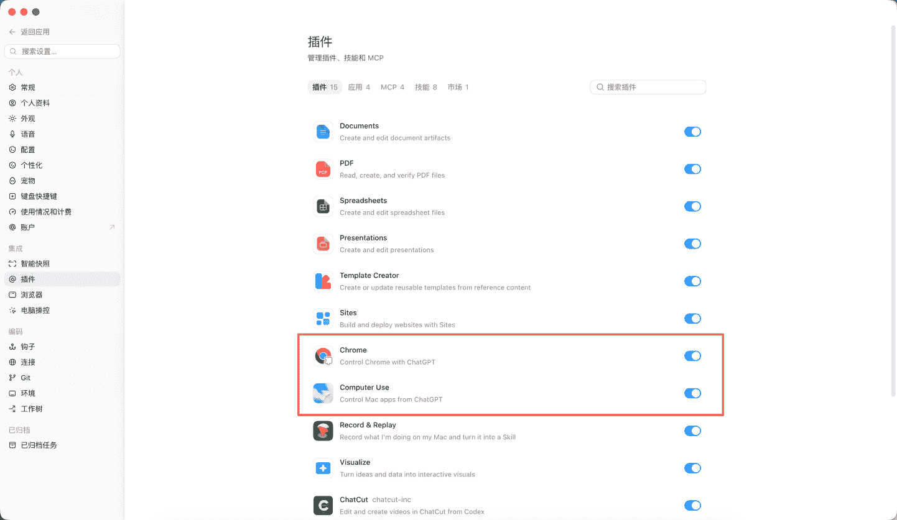

# 二、搭建 Agent 员工前的准备工作：先下一大堆你日后肯定会用上的工具

先自行解决网络，然后下载一下 Codex。

初次打开 Codex，建议安装这俩插件；浏览器建议就用谷歌浏览器并设为默认浏览器，然后打开完全访问权限。日常模型我喜欢用 1.5 倍速的 GPT5.6 Sol 极高。

然后看看下面要用到的，新建一个不带项目的对话，缺啥就让 Codex 下载啥。

| 工具 | 作用 |
|---|---|
| Codex | 主要干活的 |
| GitHub Desktop | 出现问题时能追溯、比较和回退 |
| Obsidian | 让产物能够检索、链接和长期复用 |
| Hermes | 也是执行的 Agent |
| 飞书 | 作为业务的可视化看板 |
| 控制台 |  |
| VS Code + Claude Code（插件） | 配合 Obsidian 写文案，目前 GPT 写的有点一坨 |

可以用下面这些提示词，提示词不必一字不差，口喷就行。

帮我下载并安装 GitHub 移动端。

帮我下载一个 Obsidian 并安装，它是一个知识库的软件。Hermes 先不着急下载，等第四部分会教你使用。

帮我下载一个 VS Code，并修改变成中文版，再装一下 CC 插件。

接下来开始搭建第一个 AI Agent 员工吧！

我们这里以“批量输入 B 站对标链接获取字幕并拆开录入 Obsidian 库”为例。

# 三、如何把日常业务做成一个 Agent（核心）

## Agent 制作八步法

最初从包子老师那里学的六步法，自己改动了一些。

| 步骤 | 发生了什么 | 为什么要做 | 得到的能力 |
|---|---|---|---|
| 第一步 | 建立项目文件夹和 Git 仓库 | 把所有材料放进同一个可追踪环境 | 可审计、可回退 |
| 第二步 | 让 Agent 阅读背景材料 | 先理解业务，再讨论方案 | 减少错误假设 |
| 第三步 | 交代目标并研究实现方式 | 先验证渠道与技术可行性 | 形成可执行方案 |
| 第四步 | 跑通一条最小闭环 | 用真实结果发现隐藏要求 | 得到 MVP |
| 第五步 | 接入飞书任务控制台 | 团队协作与批量执行 | 团队协作与批量执行 |
| 第六步 | 建立规范、Skill 和验证器 | 把对话中的共识沉淀下来 | 流程可复用 |
| 第七步 | 在当前对话执行真实任务 | 验证完整生产链路 | 发现流程缺口 |
| 第八步 | 新开对话再执行一条任务 | 验证能力不依赖聊天记忆 | 证明 Agent 可以重新上岗 |

## 第一步：建立项目文件夹和 Git 仓库

1. 先新建一个独立项目文件夹，再让 Codex 打开这个文件夹作为项目。

文件夹名称尽量简短、清晰，避免使用含义不明的临时名称，建议使用英文字母。

可以把与业务有关的原始材料复制一份放入项目，原件仍保留在原位置。

2. 随后让 Codex 在项目中创建 Git 仓库。

使用 GitHub Desktop 在本项目里创建 Git 仓库。

Git 会记录文件的新增、修改和删除，GitHub Desktop 则把这些变化用图形界面展示出来。

Agent 会创建和修改大量文件，如果没有版本记录，我们很难区分哪些是原始材料、哪些是新产物，也很难安全地撤销一次错误修改。

电脑上新建一个空白文件夹。

3. 如果有一些项目相关的材料，可以在项目文件夹里新建一个文件夹，然后把材料复制一份进去。这里大家如果要尝试我们的示例的话，可以新建一个文件夹，把这个解压到里面。

## 第二步：交代背景，让 Codex 知道上下文

在要求 Agent 开始修改之前，先让它阅读项目文件、已有文档、示例产物以及必要的图片。此时强调“先不要做”，目的是把观察和执行分开。

先什么都不要做，读一下我们的项目里的全部文件，如果有文档、PDF 或 PPT 等材料的话，要读一下里面的全部文字和图片。

先什么都不要做，阅读下面这些链接，要读一下里面的全部文字和图片。【链接 1】【链接 2】

对于我们的案例，我们可以这样：

先什么都不要做，读一下我们的项目里的全部文件，看看它是干啥的。

## 第三步：交代目标，让 Codex 先研究实现方案

先不要写代码。我想实现：输入一个 B 站视频链接，获取视频信息和字幕，然后整理字幕，创建一个 Obsidian 知识库，放进去。你可以去 GitHub 上搜索高分的项目和 Skills 来帮助生产。你仔细研究后，先和我讨论，等我确认后再写代码。

一般先说一下自己的 spec，说一下自己的业务流程，然后问问它能不能实现，技术路径是什么。这个案例里给大家源码了，可以直接用我的去跑下一步，或者你也可以从 0 开始，先让它研究，它会给你一个方案。如果是这样的话，就可以问问它还需要什么信息，能不能跑最小 MVP，然后执行。

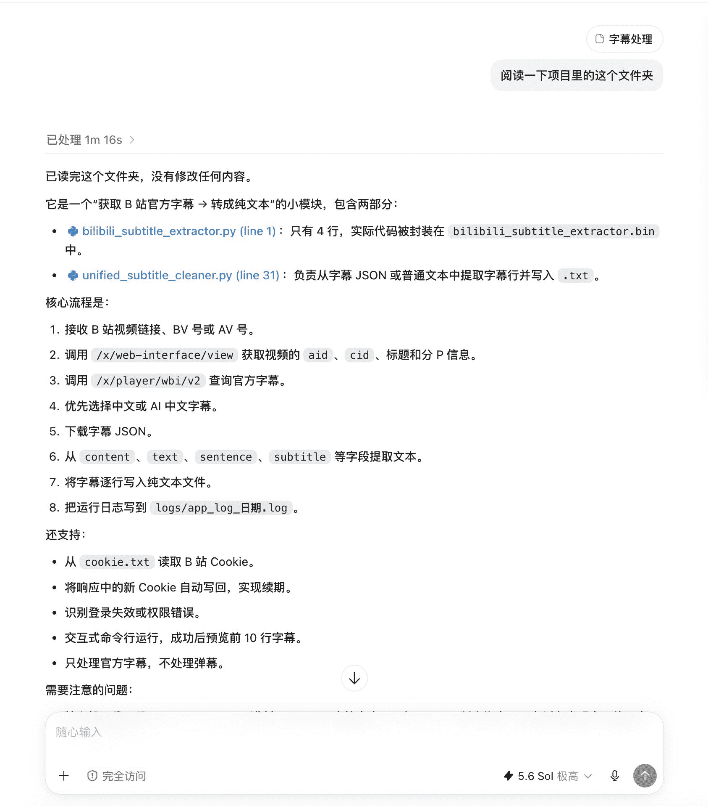

样的话就可以问问他还需要什么信息，能不能跑最小 MVP，然后执行。你认为现在是否达到了最小闭环的开工条件？如果可以，先出抓取这个链接的字幕【链接】。

## 第四步：跑通最小 MVP

这一步要跑通单例，跑通最小 MVP，过程中边跑通边约定你想要的标准。

先把一件事做对，再让 Agent 重复做对。

回到我们案例，他是需要你提供 Cookie 的，给他一下，要是不知道 Cookie 如何获取，问 Codex 就行。

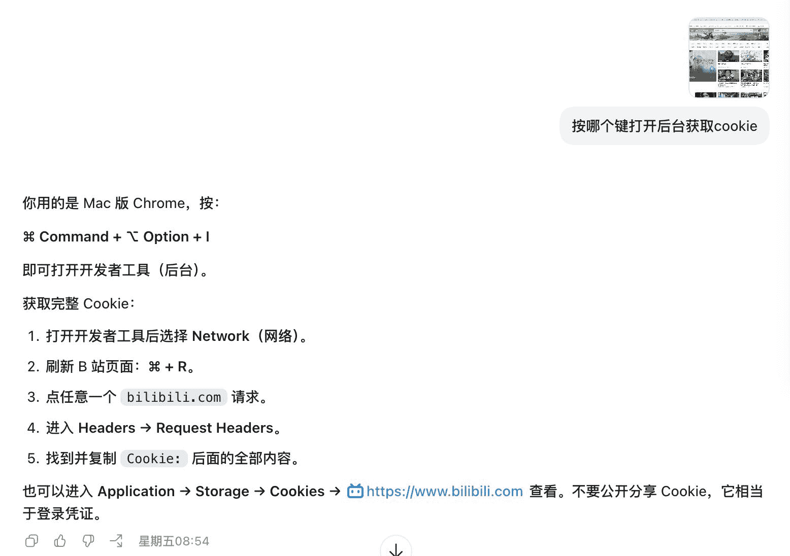

如果你的流程比较复杂，有多个环节需要定标准，可以一步步来。我这里先走获取字幕，没问题再走整理字幕。我这里希望要原原本本的味道，所以我提出了标准，做了第一版并验收。大家也可以点开“已处理”，观察 AI 是怎么思考和处理的，如果有问题可以及时来进行纠偏。

下一步就是录入知识库了，同理说一下要求，让它执行下一步。这里我以一个例子，告诉他了我的需求和标准。

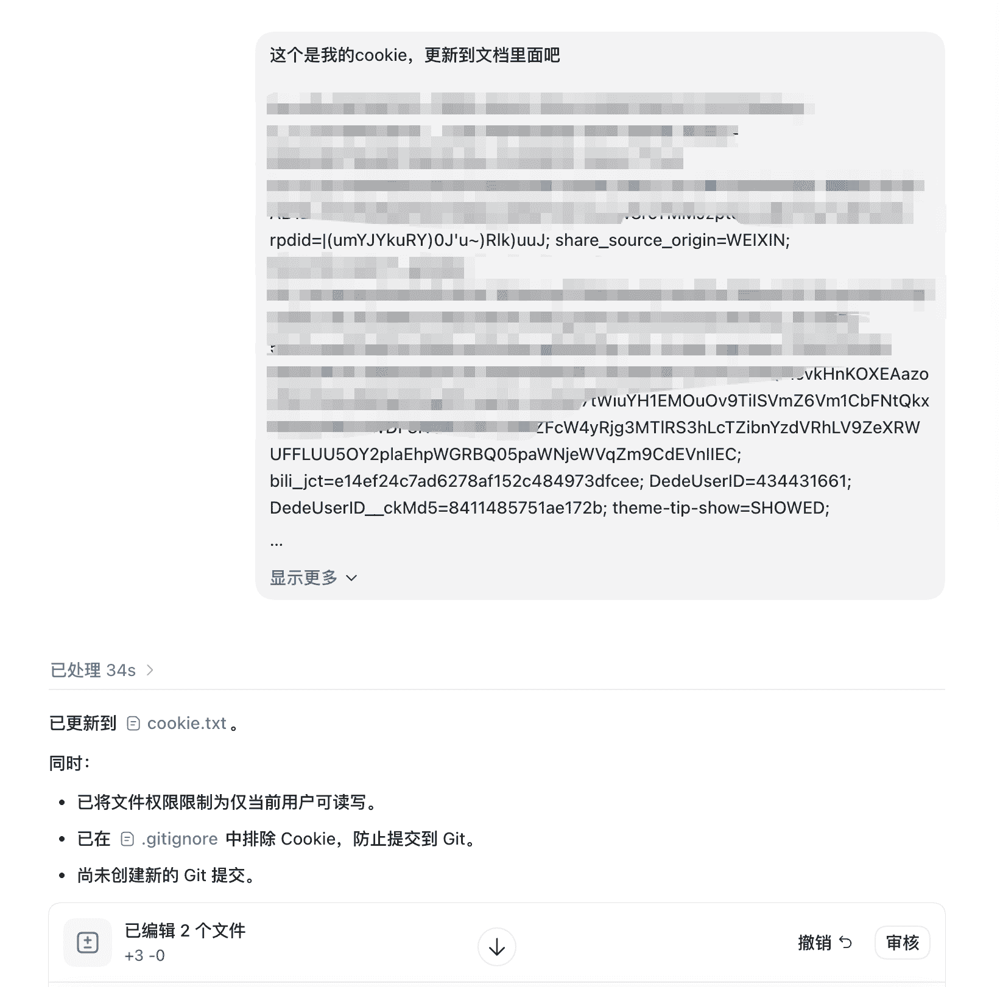

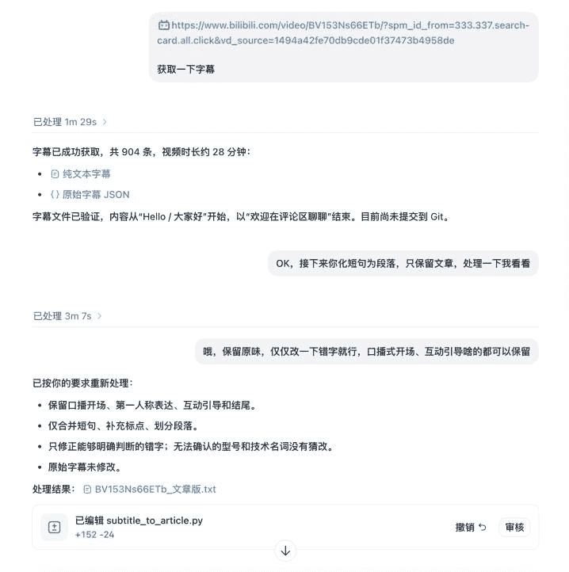

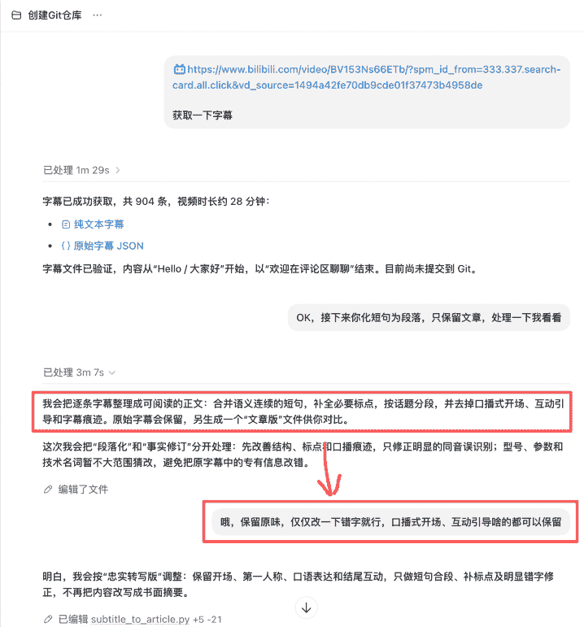

这里的命名，我按照自己平时的语言习惯做了调整，然后我们的整个最小 MVP 流程就结束了。

一开始，我并没有搭建一个层级复杂的知识库。因为我更倾向于先积累一定量的数据，再结合实际需求，逐步设计和完善知识库的结构。

从本质上来说，知识库就是一个用于结构化存储上下文信息的文件夹。

我不太建议大家直接 1:1 复刻别人的知识库，但可以参考其中的基本框架，再根据自己的使用习惯和实际需求，搭建真正适合自己的知识库。

创建知识库没有绝对的对错，只要它能够按照你的需求稳定运行，并帮助你解决问题，就是一个合适的知识库。

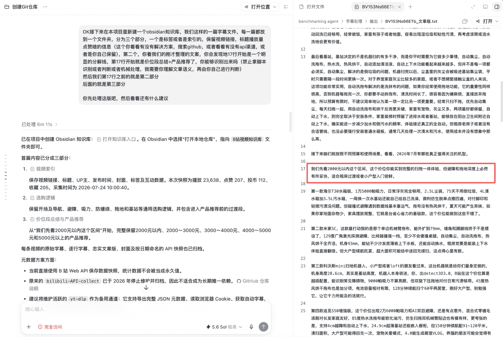

## 第五步：用飞书建立任务控制台（拓展）

演示控制台：B 站字幕知识库任务控制台。

飞书负责“派什么活、现在是什么状态”，Agent 负责“领取任务并把活干完”。

两者分开后，业务人员不必进入代码目录，也不必为每条任务重新编写长提示词。

任务开始具备排队、查看、失败反馈和复盘能力。今后还可以用于多人协作。

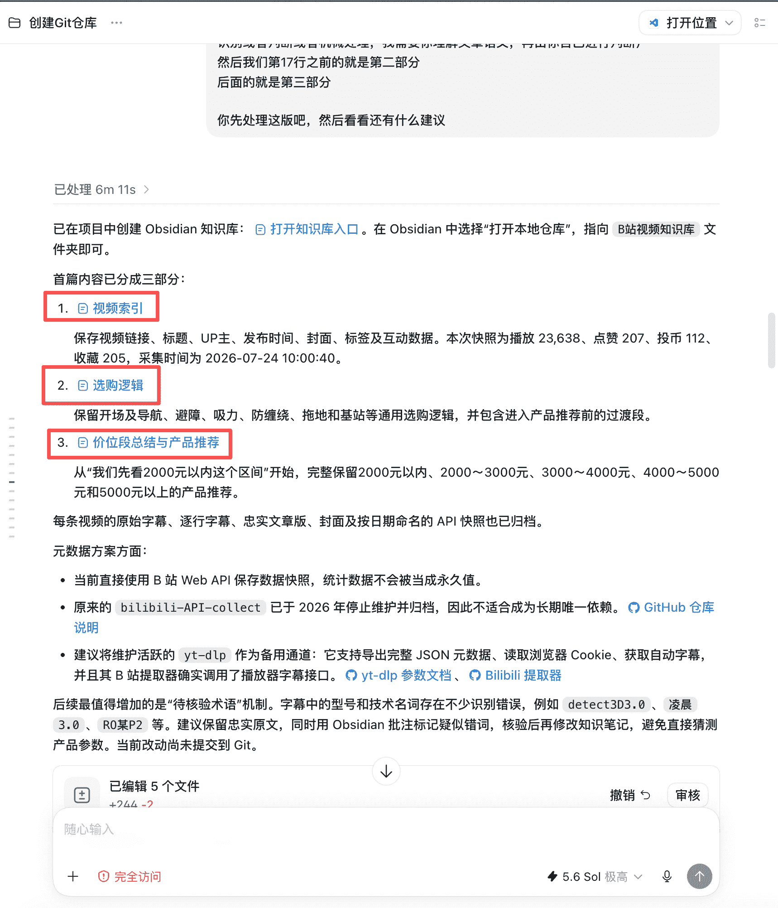

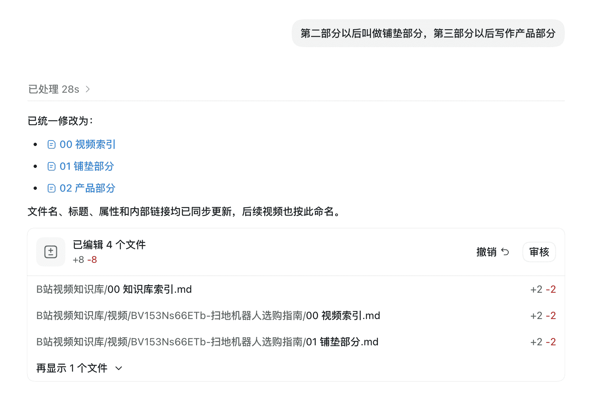

并且你可以以后做新的 Agent，让它批量执行完填入这个表，然后再让我们这个 Agent 继续执行，就可以通过多个 Agent 串联起你的业务流程了。

连接到飞书之后，你可以设置定时，让它定时扫描工作台，看看有没有新的任务，如果有就执行，就不用反复聊对话框了。

哦对了，安装飞书 CLI 就可以畅通无阻地让 Codex 在飞书里干活了，没安装的需要安装一下。

请帮我安装飞书 CLI 工具，并安装所有相关的飞书 Skills：

第一步：

```bash
npm install -g @larksuite/cli
```

第二步：

```bash
npx skills add https://github.com/larksuite/cli -y -g
```

第三步：

```bash
lark-cli config init --new
```

安装完成后告诉我结果。

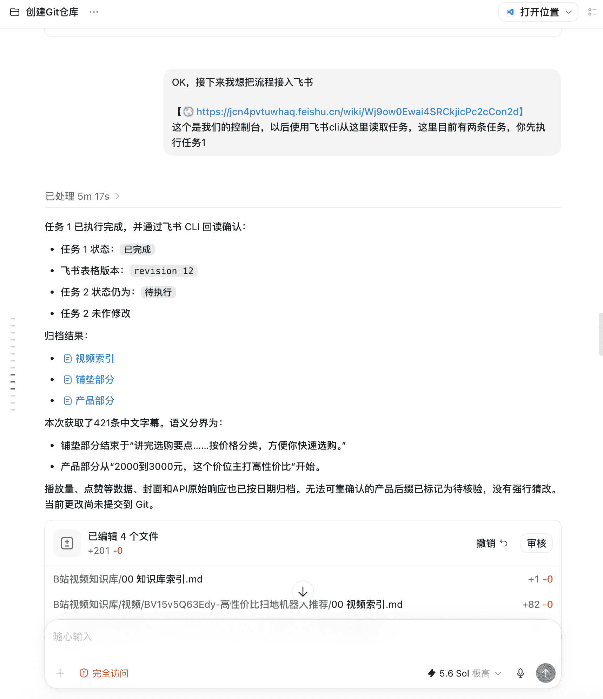

## 第六步：固化阶段，制作 AGENTS.md、Skill.md、脚本和验证器

接下来就是稳定生产阶段了，这步开始就做 Agent 了。项目已经完成最小闭环了，即将走向稳定生产的阶段，目标是让 Agent 来开展生产。你有哪些建议？有哪些可以沉淀下来的东西？目前的工作流清晰吗？Skill 需要做吗？

在最小闭环跑通后，我们没有继续把对话越写越长，而是把已经确认的业务共识沉淀到项目里。

一般会沉淀这 4 种类型的文件：

**AGENTS.md、Skill.md、脚本和验证器**

AGENTS.md 保存全项目不可违反的原则；Skill 保存这一类任务的完整操作顺序；脚本负责稳定的数据获取和文件检查；验证器负责兜底。

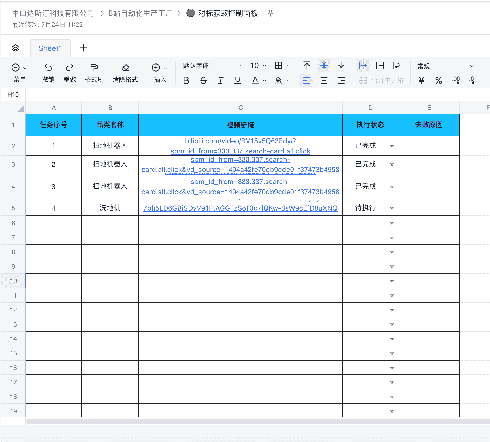

注意一点，脚本不能代替 AI 来判断，脚本只能用于机械执行的工作！需要语义判断的工作让 AI 去做，而不可以拿脚本硬编码！

为什么不能把语义判断硬编码进脚本？在最初跑案例时，我们很容易为了尽快得到结果，在脚本里写下一些临时规则：

```python
if "我们先看 2000 元以内这个区间" in line:
    start_product_section()
```

这条规则可能刚好适用于当前视频，但换一个视频，作者可能会说：

- “接下来按价格来讲。”
- “下面进入具体产品推荐。”
- “我们先从入门款开始。”
- 或者根本没有明显的过渡句。

如果把某个句子、行号、价格或者“第几款”写死在脚本里，这段代码就只能适配少量样例。

更稳定的做法是：让 Agent 通读全文，根据上下文判断语义边界；脚本只负责保存 Agent 给出的判断结果，并检查产物结构是否完整。

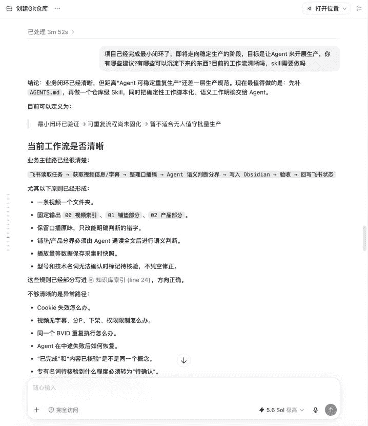

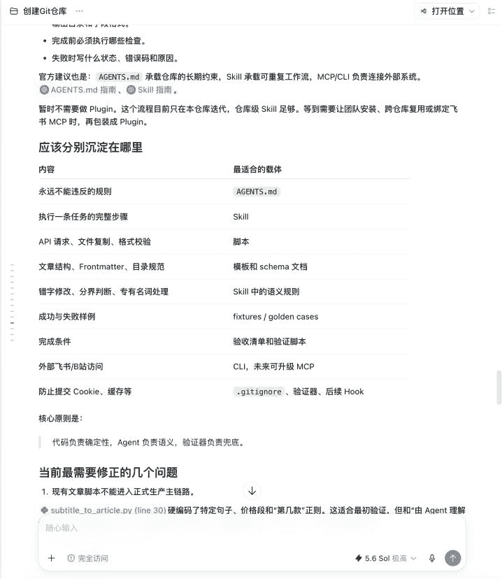

本次演示特别纠正了一个危险设计：不能在脚本里硬编码某个句子、某个价格、某个行号或“第几款”来切分文章。脚本只对确定性负责，Agent 对语义负责，验证器对底线负责。

流程还规定，每次生产的第一步必须静默检查 Cookie。Cookie 缺失或过期时立即停止，不能先读取任务，更不能把 Cookie 输出到日志或归档。只有本地文件全部生成、验证脚本通过、Agent 复核完成后，飞书状态才允许改为“已完成”。

为什么要做？对话里的约定会随上下文消失，硬编码又只能适配一条样例。把规则、工具和验收拆开，才能同时保留确定性和语义能力。

能带来什么？Agent 获得了一份可重复使用的岗位说明书。下次用户只需说“执行任务 2”，Agent 就知道先检查什么、从哪里取任务、怎样归档、何时停止以及什么时候可以回写成功。

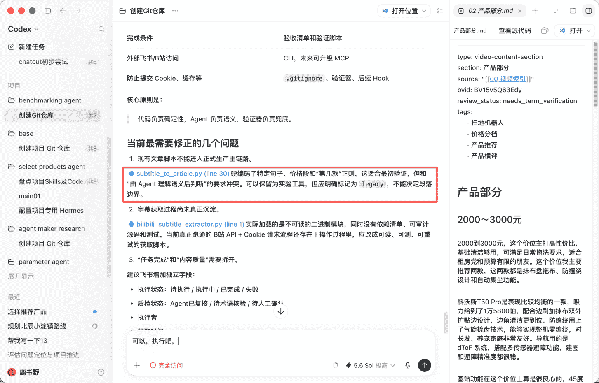


公众号懒人搜索，懒人专属群分享我是由月之暗面（Moonshot AI）研发的 kimi-k2.7-code 智能大模型。### 第七步：在当前对话再执行一次任务（回归测试）（必做）

每一次项目文件的升级/固化之后，必须做一次回归测试，防止改了 A，却意外弄坏了 B。如果发现跑不通了，或者任务质量出了问题，就要让它修复，或者回退。

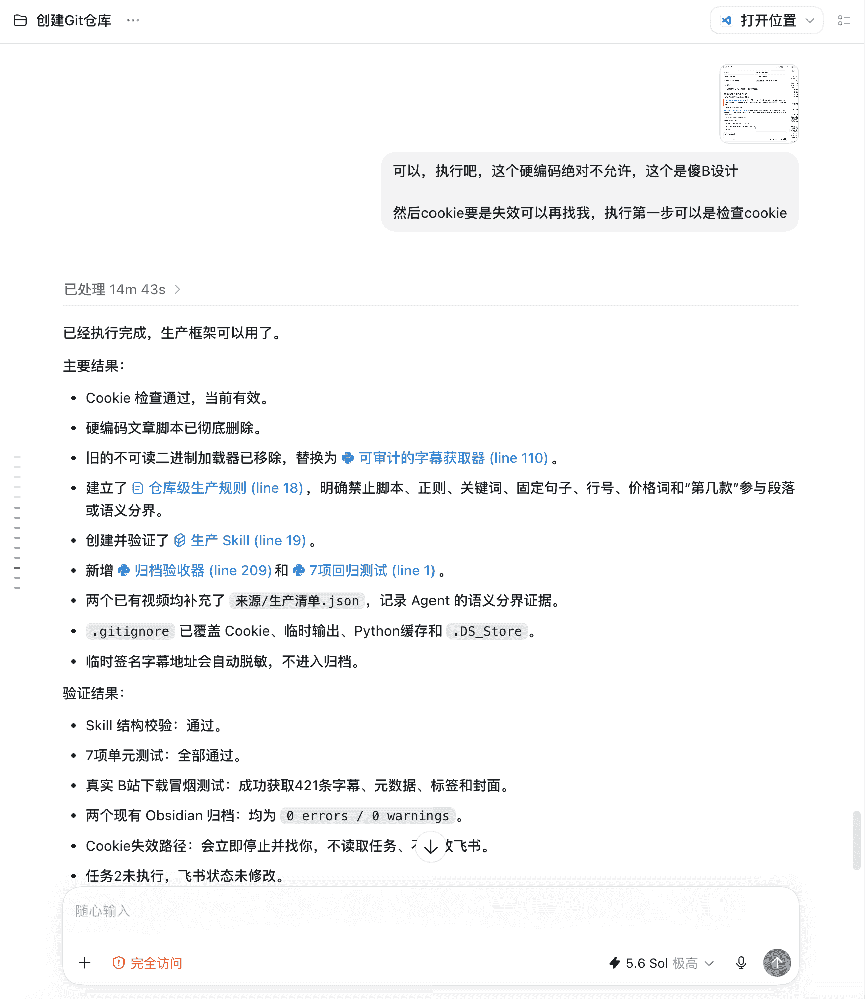

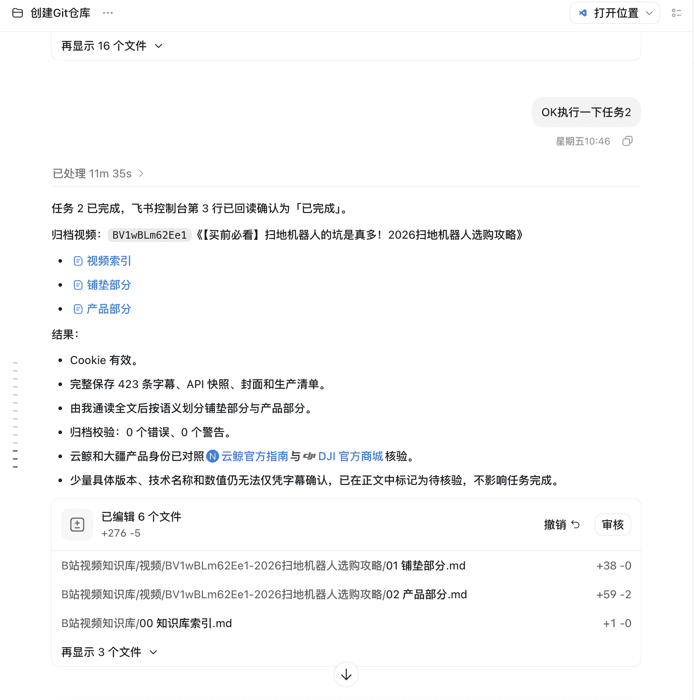

公众号懒人搜索，懒人专属群分享

## 第八步：新开一个对话，阅读一下项目，再执行一次任务（去聊天对话上下文的回归测试）（必做）

我们关闭原来的长上下文对话，在新的对话里，让它读一下项目文件来执行新任务。

目的是验证 Agent 是否能重新通过项目里的 AGENTS.md 和 Skill，从零开始正确工作，而不是依赖之前聊天中尚未沉淀的记忆。

如果新的任务能够完整执行并通过验证，证明这套能力已经从“对话中的能力/单次能力”变成“项目能力”。这也是判断一个演示是否真正具备生产潜力的重要标准。

# 四、用 Hermes 稳定生产，并接入飞书（选学，可做可不做）

如果你没下载过 Hermes，先在本地创建一个新的文件夹，然后创建一个新项目，让 Codex 下载并安装，帮我在项目文件夹里部署 Hermes。建好之后，让它使用我系统中的 Codex 的 GPT-5.6 Sol 极高模型（1.5 倍速）。

然后输入以下要求：

用 Hermes 稳定生产，并接入飞书。帮我把这个项目的 Hermes 接入飞书，单独创建一个机器人，以后我通过飞书和 Hermes 沟通。

如果你下载过 Hermes、做过 Agent，你可以新建一个项目，让 Codex 找到并查看本机的 Hermes 目前是什么情况，然后把你之前做的项目地址发给 Codex，继续做下一个 Agent：

`/Users/shuye/Desktop/Project/bilibili agent/benchmarking agent`

帮我把这个项目的 Hermes 接入飞书，这是一个新的 Agent，单独创建一个机器人，以后我通过飞书和 Hermes 沟通，运行 Agent。

不少小伙伴好奇，Hermes 只下载一次，那么我多个 Agent 是怎样隔离的啊，不会混乱吧？大家可以看看 Codex 对此的说明，它是靠 Profile 进行隔离的。

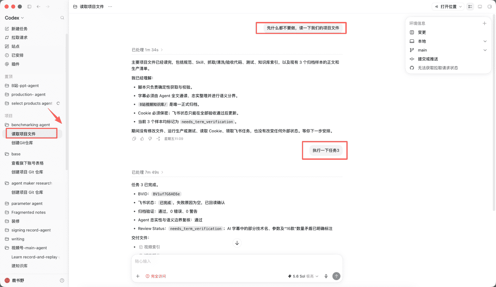

公众号懒人搜索，懒人专属群分享

按 Codex 指示操作即可链接。

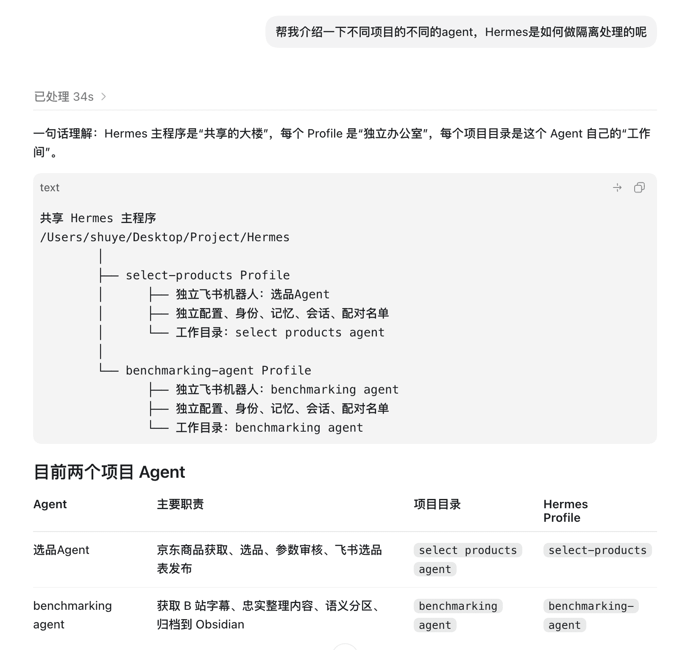

公众号懒人搜索，懒人专属群分享

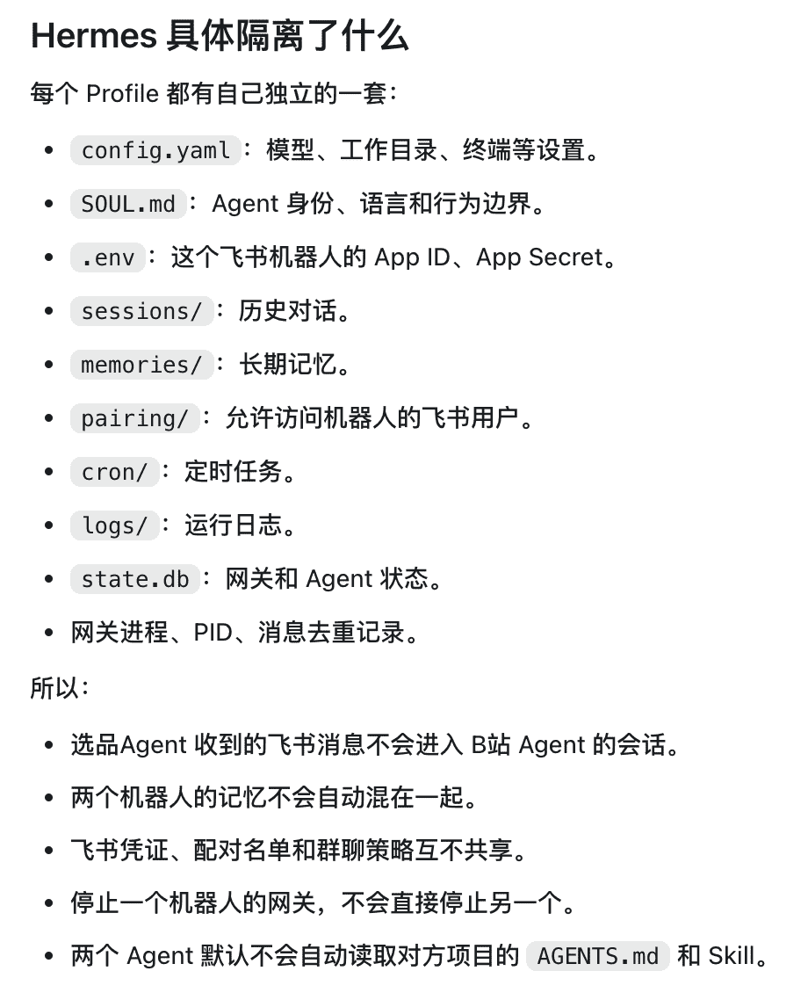

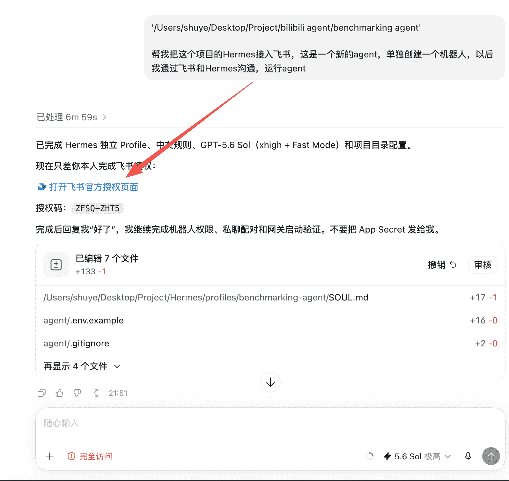

公众号懒人搜索，懒人专属群分享

看个人需要，可以将 Hermes 部署到云服务器上，好处就是可以 24 小时不停机。但我个人用不上，我电脑本身也不关机。

https://help.aliyun.com/zh/simple-application-server/use-cases/purchase-and-deploy-hermes-agent

但是我喜欢用 Codex 本身来工作，我有一定程度的恋物情节，有陪伴感，并且现在一个项目可以添加多个文件夹了。这意味着你可以每个文件夹都做一个 Agent，然后 Primary 文件夹做一个主控 Agent，可以把调用规则和路径写进去。

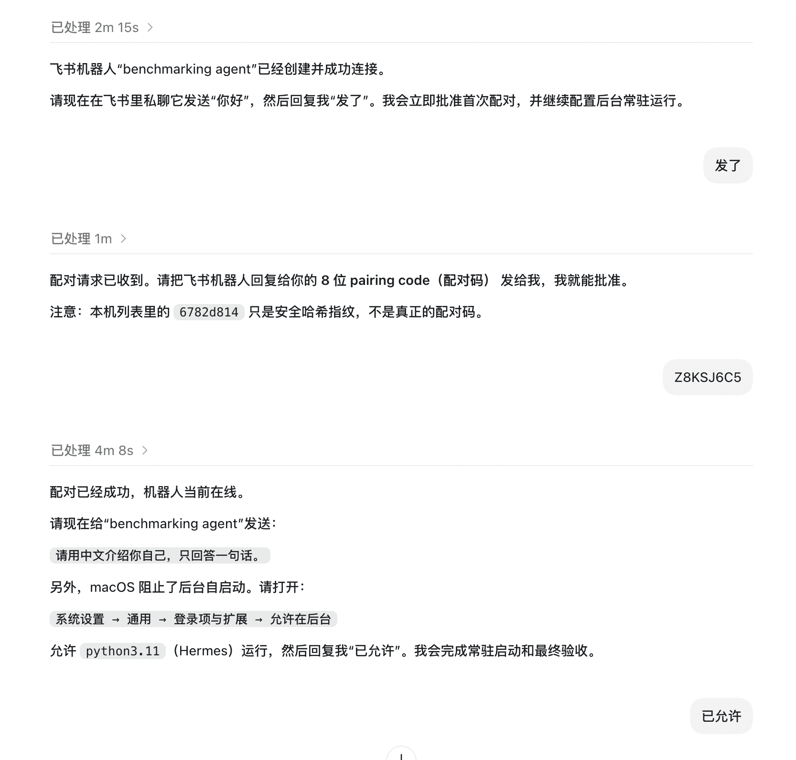

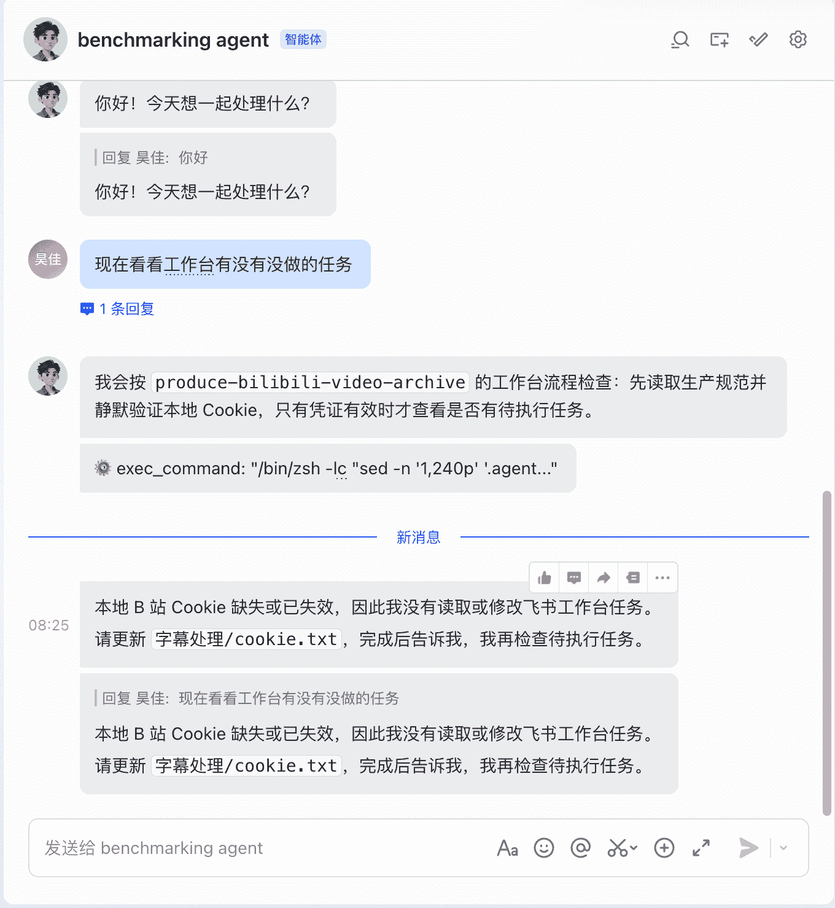

公众号懒人搜索，懒人专属群分享

嗯，反正就是说，实现目标的路径和方式是多种多样的。

# 五、用 Obsidian + CC 插件 / VS Code + CC 插件来写文案

Obsidian 本质上就是装了很多文件的文件夹，用于执行任务的时候给 AI 上下文、写文案嘛。目前是 CC 的 4.6 模型公认最好，所以就有了这一章节。

我个人喜欢 VS Code + CC 插件来创作。VS Code 的作用和 Obsidian 差不多，就是方便看文件的。帮我下载一个 VS Code，并修改成中文版，再装一下 CC 插件。我这里害怕被封号，CC 用的是中转站，需要下载 CC Switch 使用（让 Codex 下载并安装并配置好）。

https://eoeo.xyz/register?aff=ZRJG8W67LNAM

这里知识库有一个技巧，就是专门搞一个文件夹，放 Skill、规则啥的，我这里是 00-员工办公室。


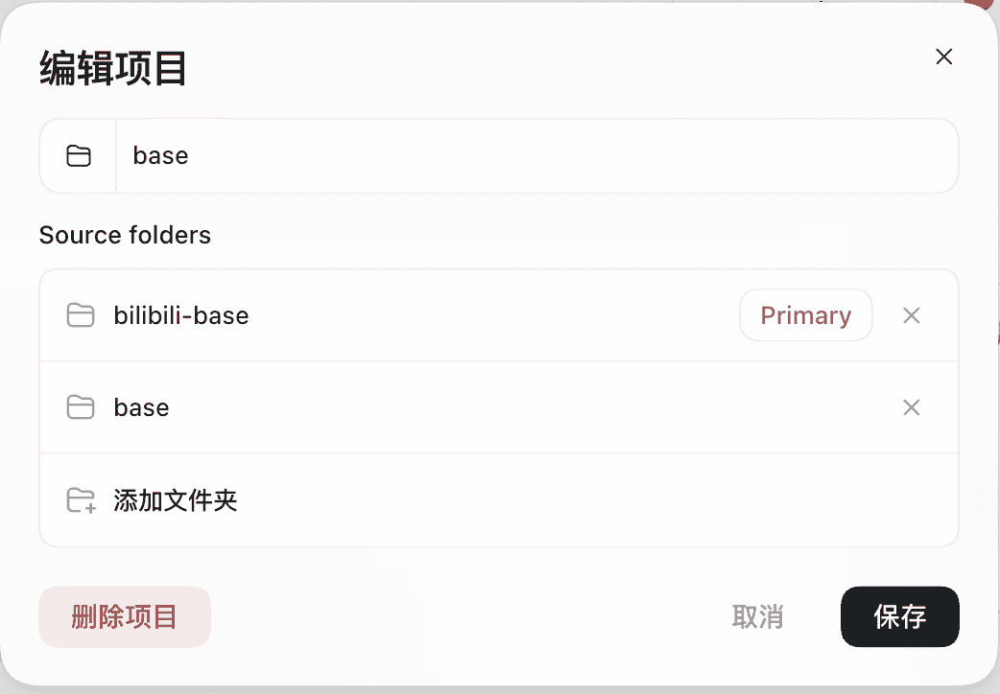

公众号懒人搜索，懒人专属群分享

# 六、展示一下我的内容工厂

文案拿 CC 写，其余的由 Agent 做多个 Agent 协作，用飞书看板下命令和看进度。有飞书，感觉完全没必要做个内容工厂网站或者程序啊，配置参数啥的直接建一个在线表格填写到里面就行。

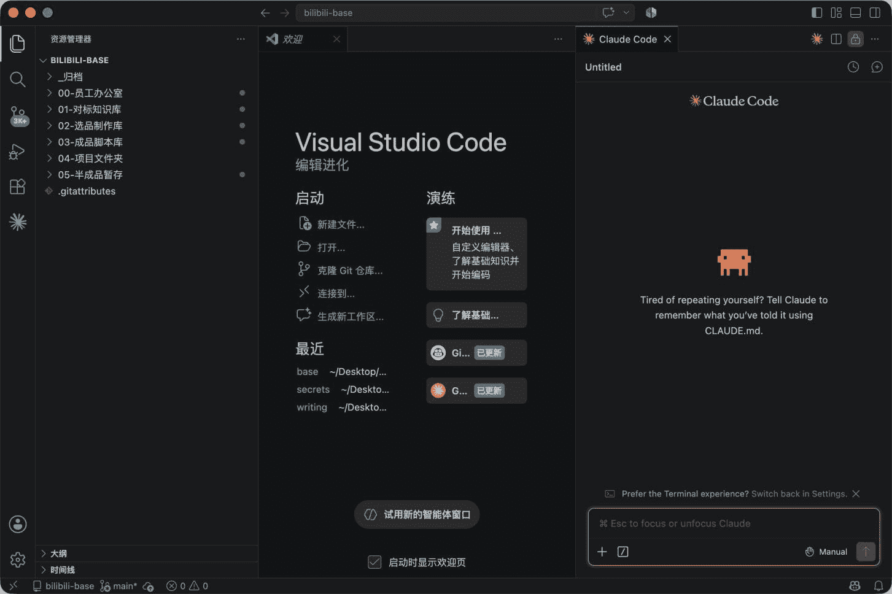

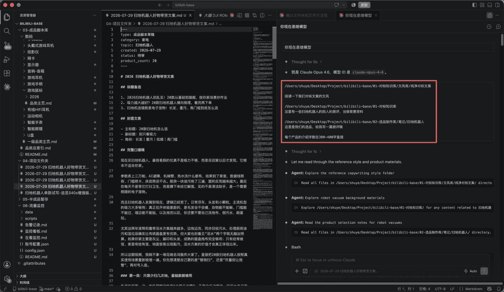

公众号懒人搜索，懒人专属群分享

————分割线————

看完这篇 SOP，你觉得你懂了。但 90% 的人一到实操就会卡在第一步。

工具和教程只是最低级的壁垒，真正的壁垒是“立刻动手”和“圈层信息差”。

如果你想看全网最新的变现玩法，并且和一群执行力极强的极客一起下场拿结果，欢迎围观我的核心私域：【懒人专属群】。

我们不聊虚的，只做商业闭环的拆解与 AI 效率的压榨。系统内已沉淀 1000+ 跑通的套利实战局。

👉 查阅圈子完整数字资产与上车门槛：


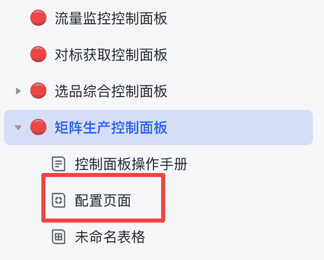

公众号懒人搜索，懒人专属群分享

https://lazyso.com/insider/

认同价值、准备好下场干活的，扫码加我微信（lazyhelper1）。

备注：【实操上车】，不闲聊。


