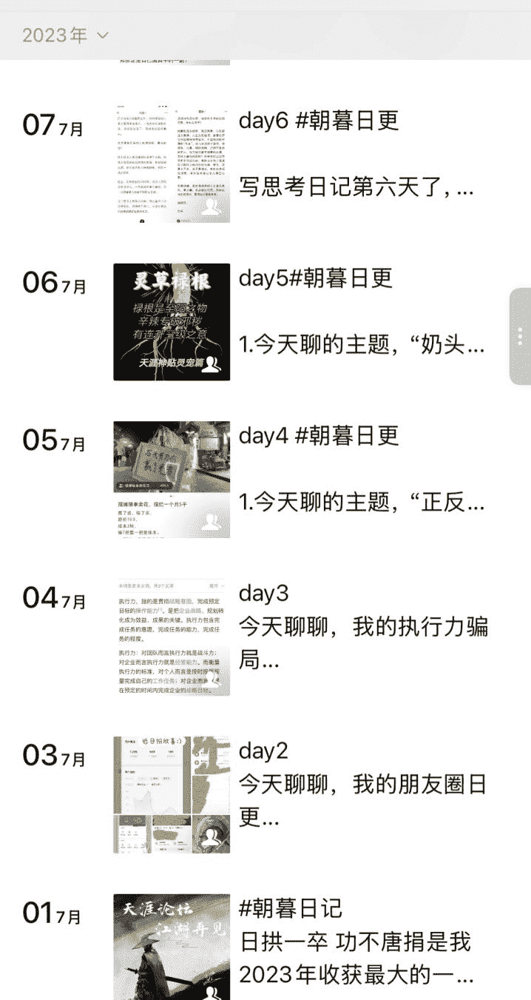
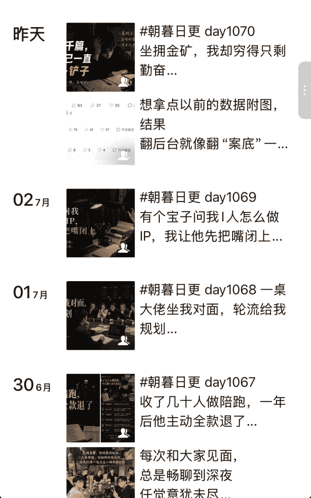
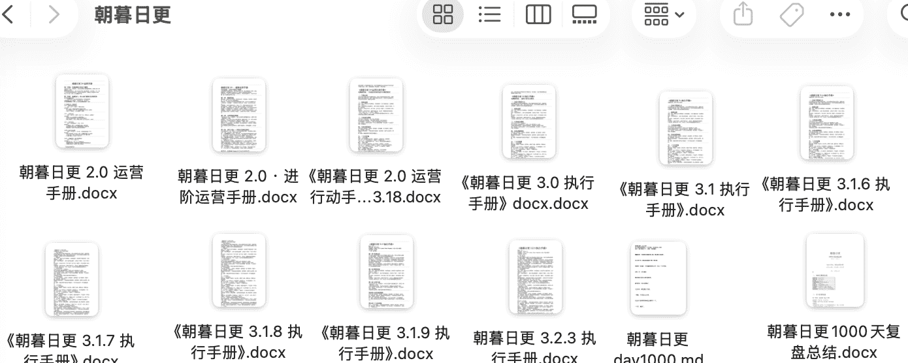
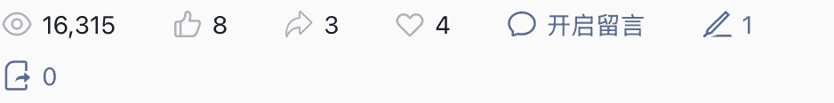
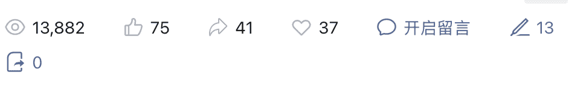
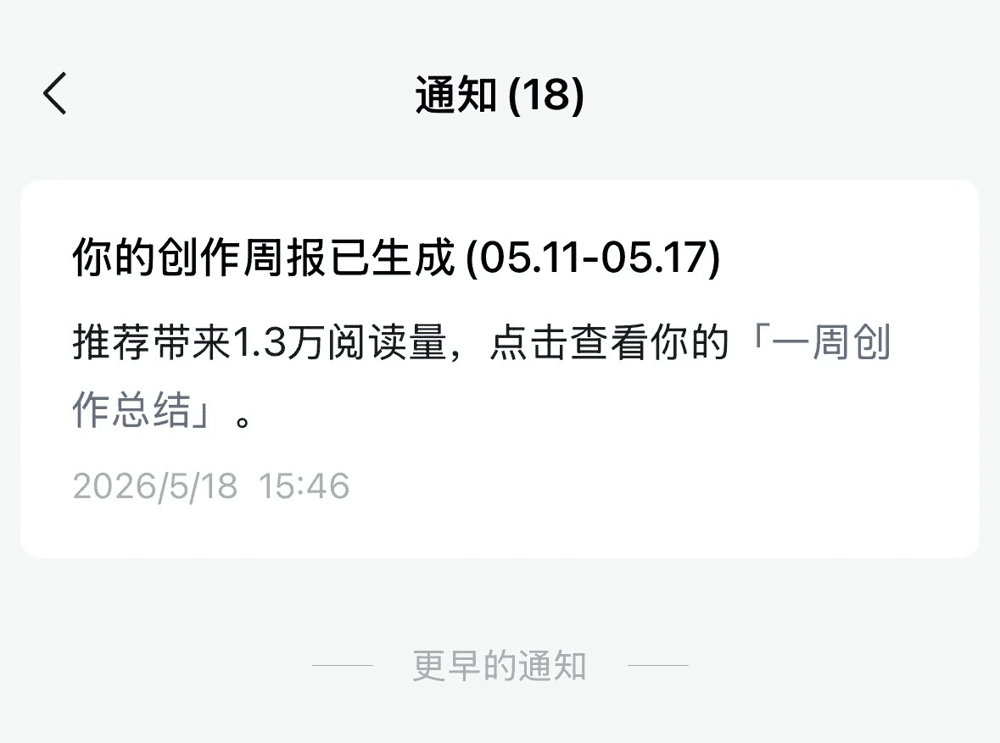
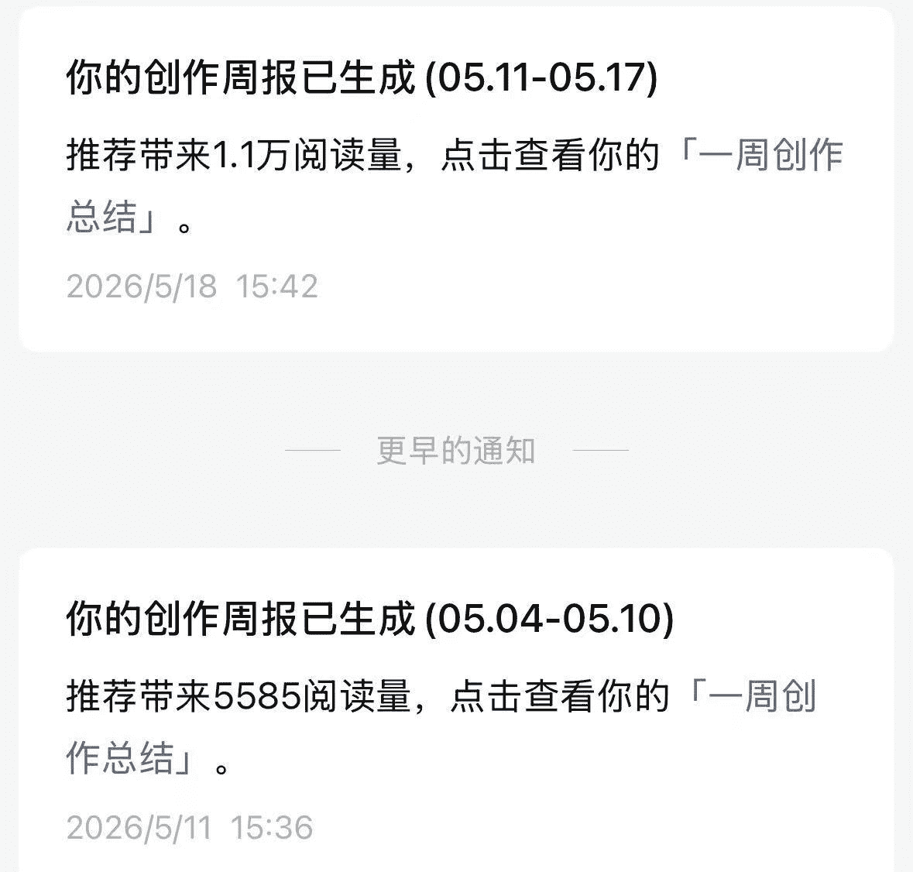
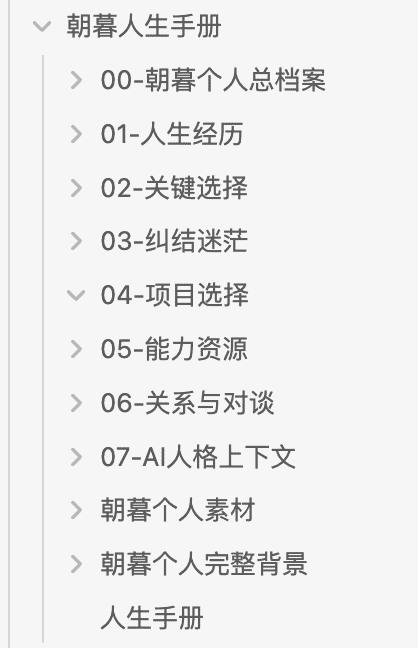

公众号懒人搜索，懒人专属群分享

# 日更1092天、迭代400多次，我把我的

AI内容工厂整套开源，Codex、Claude Code全通用

260803副业SC精华

整理：公众号懒人搜索，懒人专属群精选

懒人微信：lazyhelper1

日更1092天、迭代400多次，我把我的

AI内容工厂整套开源，Codex、Claude Code全通用

# 一、这套内容工厂现在到底在替我做什么

大家好，我是朝暮，坐标广东惠州，是一名教培行业执行校长，朋友圈连续日更1092天。

这套内容工厂目前主要服务我自己的内容业务：朋友圈日更、公众号文章和个人IP内容；公众号流量主，学员实操则用来验证它能不能迁移到不同场景。

它处理什么素材，最后产出什么内容？

我平时放进去的原料，是自己的口述、日记、聊天记录、文章、新闻观察和热点素材。系统负责整理素材、拆篇、生成初稿、选择标题、鉴文和终审，最后产出朋友圈日更、公众号长文或者公众号流量主文章。

目前拿到的真实结果

- 个人IP：朋友圈日更1092天。以前一天磨一篇，单篇至少半小时；现在两个小时，可以跑完7篇的生产流程，再由我逐篇终审。日更压力降低了，成稿仍然保留我的经历、判断和表达。
- 公众号流量号：我把过去10万+文章和做死账号的经验提炼成规则，再用当前系统跑新号。现在单篇基本稳定千观；踩中热点，选题、对标和表达都到位时，可以跑到万观。
- 实操验证：2026年5月，我在惠州带14个人用一个下午跑完整套流程，当场有人完成第一篇初稿；加上平时指导，累计有30多人跑通过。
- 整套开源交付：中文阅读包、Codex与Claude Code通用机器包、标题系统、人格工具、五分钟演示和完整安装入口，文末全部公开。

看完这篇，你能直接拿走的东西：

- 完整生产流程：从原料整理、拆篇、成稿、标题到独立鉴文和发布终审。
- 两种内容模式：个人IP日更为主，公众号流量号为第二种配置。
- 两套完整交付：中文阅读包给人看，机器安装包给AI读取和调用。
- 写作工具：七罪标题系统、人格档案、写作人格内核与流量侧切换规则。
- 三种使用方式：安装Skill、直接读取机器包，或者在普通聊天框里逐站运行。
- 五分钟演示：先检查安装是否跑通，再放入一份真实原料生产第一篇内容。

# 成果与细节展示

### 1. 朋友圈与个人IP成果｜连续日更1092天

这套工厂首先服务我的朋友圈日更和个人IP。长期公开更新留下了可以被翻看的记录，谈合作、对接资源时，对方不必只听我口头介绍自己。下面两张图，是早期日更和现在连续日更1092天的记录。

### 2. 从提示词到内容工厂｜前后迭代400多次

我的日更系统从提示词2.0一路磨到7.2，才逐渐拆成现在的完整流程。下面这张截图，保留的是一路迭代的版本记录。

### 3. 线下与学员实操｜14人现场跑通，累计30多人完成实操

2026年5月，我在惠州办了一场航海线下见面会，14个人用一个下午跑完整套流程，当场有人完成了自己的第一篇初稿。加上平时一对一和一对多的指导，累计已经有30多人跑通过。这里证明的是普通人能够执行这套流程。

### 4. 公众号历史流量成果｜单篇最高10万+

我运营过娱乐八卦、情感、婆媳文和银发赛道，单篇最高10万+，常见爆文在1万—2万，也有不少账号没有跑出来。这些成功和失败，后来被我拆成对标、选题、标题和风险边界等规则，写进了流量侧系统。

其中大部分10万+文章后来被我主动删除，所以这下面的截图来自仍在运行或还能查看的账号。删除原因和我踩过的平台风险，放在第二章展开。这些10万+是我提炼系统时使用的历史经验。

### 5. 公众号新号的当前系统成果｜稳定千观，条件合适跑到万观

后面这批新号文章，就是通过当前这套系统跑出来的。目前单篇基本稳定千观，也出现过万观；能不能上万观，要看热点、对标质量、选题爆点和表达，不能保证篇篇上万观。稳定千观是目前的常态结果，万观是条件合适时的上浮结果。

### 6. 内容带来的真实业务结果

数据能证明流程跑得动，但长期内容还会积累信任。下面这个从公众号文章开始的合作，是最直接的一次体现。

之前有一位读者从我的公众号文章加到微信。因为长期看我的内容，也刚好读到一篇与他需求相关的文章，他后来找我对接“监控指定账号的AI工具流、定时推送和数据总结分析”。当时我不擅长这项技术，就把需求转给对应的大佬。合作完成后，我拿到10%的居间费，又拿出一部分分给朋友、给合作双方准备礼物。

这件事让我更加确定：人是先被公众号和朋友圈里的长期内容吸引来的。交易发生之前，信任已经积累了一段时间。

这篇帖子改了十版。

第一版的稿子我全部直接毙了，为什么？

我最后讲，我一开始只想分享一套提示词，后面到相对应的Skill，最后到这一套完整的内容工厂，把自己的核心完全开源。

每一次修改，都让我重新追问：我到底交付什么？它能不能真的跑？别人拿走之后会卡在哪里？所以第十稿不再只讲一套概念，而是把已经整理好的中文阅读包、机器安装包、实际路径和运行边界一并讲清楚。

全套引擎和系统都在文末，拿走就能用，如果对你有帮助，麻烦点赞投币三连，感谢。

# 二、这座工厂是怎么磨出来的

先讲我怎么走到这一步的，你知道了来路，后面每一步才知道为什么这么设计。

最早我做的是流量号。娱乐八卦、情感、婆媳文、老年人赛道，什么风口追什么。跑得动的时候，单篇冲到十万多阅读，留言区划线的、追问的，热闹得很。但是平均下来，爆文基本在一两万，也有一堆号根本没跑出来。

但这种打法很野，在红线边上反复横跳。违规、违禁、律师函，各种都经历过，号死的死，残的残。

那些十万多的，有些内容擦边，有些被人投诉，还有踩了红线，只要判了违禁，收益也跟着没了，号还救不回来，所以我现在拿个老号试着洗，看看怎么才能洗出来，后面有结果再给大家汇报。

从那之后我学会了一个流量主的保命Tips，大部分人不知道：做风口类、短平快的流量文，爆了、收益到手，就主动删文。

这种内容平台不会持续推流，做的就是一次性的生意，留着没用，风险还一直挂在那。你主动删，收益就落袋为安；等被人投诉了或者被判了再删，收益就没了。

所以我的爆文，大部分是我自己删掉的。

这也是为什么这篇帖子里你看不到10万+的截图——我现在还翻得出来的，最高七万多。因为赚到钱才是自己的，闷声发大财才是关键。

那批号教会我两件事。

第一，流量号是概率游戏，爆不爆看平台，死不死看你自己手贱不贱。第二，平台红线不是吓唬人的，它真的会把你几个月的号一夜清零。

流量号起起落落的这几年，只有我的朋友圈IP日更一直在写。

写日更是个体力活。我很早就想让AI帮我干。第一次把素材丢给AI，跟它说：写得口语一点、真实一点、不要AI味。

出来的东西，排比一串接一串，每段结尾站一个金句，整齐得像广播体操。

但那个时候呢，我只想自己先开始，没想着要写得多好，就直接用AI生成了发。发是发了，别人只知道我在更，文章本身没有任何意义。

其实那玩意发出去，等于告诉所有人：这是机器写的，朝暮我本人已经下班了。

后面还是想明白了，号要真做起来，这一关躲不掉。

所以我开始磨提示词。

今年最初的版本，我叫它2.0。一页纸：5个标题公式，3个内容池，正文三步走，完了。

一直迭代到5月，3.2.3版，17章，一万六千字。标题公式扩到8个；情绪节奏单独成了系统，4种骨架配10种风味；发布前检查清单20条；连脱敏对照表都有。

再往后是7.2，朝暮日更全量上下文系统。

但到这里我遇到了一个问题：提示词越长越难管了。一万多字的提示词，改一个地方，别的地方串了；换一个模型，看了半截指令不认了；上下文一长，前面的规则被吃掉。

提示词的极限，就是它活在一次对话里。对话结束，它什么都不记得。

这就是我后来做Skill的原因。

Skill本质上就是提示词，内容是一样的。区别在于存放方式和执行方式。

提示词：每次开新对话，你要手动重新粘贴，让AI重新了解你。太长了还贴不完，贴完了它也不一定全记住。

Skill：存在一个.md文件里，AI Agent（就是能帮你操作软件的AI）每次自己去读，按里面写好的流程自己走。你不用记住提示词在哪、先贴哪段后贴哪段，启动Skill，它自己跑。

更关键的区别：提示词存在于一次对话，Skill活在文件系统里。

提示词每次对话都要重新贴。Skill则保存在本地文件系统里，修改后下一次运行会读取最新版。你的配置、案例、禁用词表、人格内核和任务产物都可以保存在自己指定的内容目录里，由总控按当前阶段读取，不需要每次手动整包投喂。

打个比方：提示词像菜谱，每次做菜你都要从头翻一遍、自己买菜自己切。Skill像一条装好的产线，原料丢进去，按设定好的工序自动走完，成品出来。

从提示词到Skill，不仅仅只是换了个名字，更是从手工作坊升级成了工厂。

在一开始我教给大家的都是提示词，不是Skill——因为很多人连Skill是什么都不懂，先用最简单的方式跑起来再说。但提示词的天花板很快就到了，Skill才是长期能跑的东西。

到今天，这座工厂的主体是一条主产线、5个专业工位。总控负责启动、自检和调度，七罪标题系统负责标题，5个引擎各自只管一段明确的工作：

| 角色 | 它负责什么 | 主要产物 |
|---|---|---|
| 总控 | 检查配置、环境和任务状态，按阶段调度Skill，记录路径、确认点和风险 | 启动自检、任务状态 |
| 淘金引擎 | 归档原始材料，拆出事实、判断、金句、案例和证据位置 | 原始材料、素材包 |
| 布局引擎 | 拆篇、查重、追问缺口，安排栏目、顺序与对标任务 | 拆篇计划、对标拆解 |
| 铸文引擎 | 读取已确认的计划、原料、人格内核和对标，生成初稿；不自我质检 | 初稿 |
| 七罪标题系统 | 生成标题候选，检查正文能否兑现，再由用户确认最终标题 | 标题候选、标题确认 |
| 鉴文引擎 | 由未参与写稿的独立上下文做8层鉴文，给出证据和局部修改建议 | 鉴文报告、修正稿 |
| 淬文引擎 | 完成32项发布终审，核对事实、隐私、平台边界、格式与未通过风险 | 淬文报告、发布稿 |

你在中文阅读包里看到的是5个中文引擎，方便逐个读懂；机器安装包里一共有7个可调用Skill，因为总控和持续进化系统也要单独被AI识别。它们只是同一套逻辑的两种包装，不是两套各跑各的系统，也不要求放进Obsidian。

为什么要这么拆？因为同一个AI不能又当运动员又当裁判。

我反复测试后发现：让生成正文的同一个上下文立刻检查自己，特别容易漏掉问题。它记得自己为什么这样写，也更容易替刚才的表达找理由。必须换一个未参与铸文的独立上下文做鉴文，生产与质检才真正分开。

这就是工厂的逻辑：每个工位只管自己的活，质检和生产必须分开。

这一套前前后后，改了400多次。有了上面的全套东西出来之后，我依旧感觉到文章生成得不尽如人意。就是感觉他说的都对，但是不像我写的。然后我就一直在找答案。最后真正让我开窍的，不是哪一条具体的规则。是中间某一次改稿，我突然反应过来一件事：

我在提示词里堆了几十条“不要这样、不要那样”，AI照样写不像我。问题从来不在指令，在于它根本不够认识我。

从那天起，我的重心从“怎么命令AI”，换成了“怎么让AI深度认识我”。

后面所有东西——人格档案、鉴文引擎、七罪引擎——都是从这个顺序里长出来的。它们不是孤立的工具，是工厂里的工位，每个工位解决一个问题。

今年5月，我把这套东西搬到线下，一场课14个人，一下午跑完整套流程，当场就有人出了自己的第一篇初稿。流程可行，验证过了。

这就是这篇帖子的全部来历。

# 三、你的AI文为什么一眼假

先说几个扎心的。

大部分人用AI写文章，就一句话：“帮我写一篇关于副业的文章，干货一点，不要有AI味。”出来什么东西你自己知道。开头“在这个快节奏的时代”，中间排比三连，结尾“愿你我都能成为更好的自己”。

发出去没人看，平台还标你低原创，限流。

这时候，市面上会给你三个答案。

第一个，说你提示词不行，卖你提示词包。

第二个，说你模型不行，让你充会员上更贵的。

第三个，卖给你一个一键降AI率的工具。

三个我全试过，全是止痛药。提示词包收了不少，写出来还是那个味。贵的模型，出来的废话更流畅了。降AI率工具最坑，检测是过了，人读不下去了。

核心问题根本不在提示词。

AI让写内容越来越便宜，一个选题丢进去，几分钟一篇稿子就出来了。但你有没有发现，写得越多，能用的越少？生产成本降到接近零了，但判断什么值得写、什么像你，这个成本反而越来越高。

问题在四重错配。

第一，方向错配。你让AI“写一篇爆款”，但没告诉它写给谁、解决什么问题。没有靶心的内容生产，子弹越多越乱。

第二，原料错配。你只给了AI一个选题和一句提示词。但真正决定内容质量的，是你的真实经历、你踩过的坑、你对标的爆文。一篇AI文章的质量，对标素材占60%，任务描述占30%，提示词技巧只占10%。你把全部精力砸在那10%上，能好才怪。

第三，角色错配。你把判断、立场、故事全交给AI，自己只负责复制粘贴。正确的分工是：你出判断、出经历、出立场，AI出结构、出连接、出执行力。

第四，回路错配。大部分人的流程是：脑子里冒个选题→丢给AI→复制粘贴发出去→完事。发布后的数据、评论、用户问题，没进入下一轮创作。每次都从零开始，AI永远不会越来越懂你。

一篇文章发完就死了，它只是内容。里面的经历、判断、用户反馈能喂进下一篇，它才算资产。

大部分人的AI写作，生产了一堆内容，没攒下一点资产。

这四重错配，往下再挖一层，其实是同一个问题：

## AI不认识你

它不知道你是谁，不知道你踩过什么坑，不知道你说话什么腔调。你让一个认识你三秒的陌生人替你说话，它只能给你全人类的平均值。

全人类的平均值，就是AI味。

有个最简单的检验方法：把你文章的作者名字盖掉，看同行能不能直接拿去发。如果答案是“能”——那这篇就不是你的IP内容，是公共内容。AI给你写的，就是这种东西。

AI不认识你，一半是你没喂它。另一半更扎心——你自己也未必讲得清你自己。你跟AI说“写得真实一点”，你的“真实”长什么样，你说得出来吗？你的口头禅是哪几个？你的判断跟别人差在哪？

说不出来，就别怪AI。它放大你的清楚，也放大你的模糊。还有个事很多人没想过。模型是公共的，你用的Claude、豆包，别人也在用，明天还更好用，这一头拉不开任何差距。真正私有的，是你喂进去的东西：你的经历，你的判断。这两样，别人抄不走。

所以正确的顺序是倒过来的。先让AI认识你，再让它认识市场，最后才轮到写。

这就是这座内容工厂的底层逻辑。下面按这个顺序，一站一站教你搭。

但动手之前，先把下面这件事定了。

# 四、搭内容工厂第零步：先选入口——你喂它什么

整座内容工厂是通用的。唯一不同的，是

公众号懒人搜索，懒人专属群分享

# 你从哪个入口把素材喂进去。

两个入口，对应两条路：

入口 A：你自己的素材 → IP 号打法

你每天遇到什么事、冒出什么想法、跟谁聊了一个有意思的观点，对着手机讲一遍，转成文字，这就是你的素材。

系统拿到这些素材，会自动匹配你的人格档案，按你的节奏、你的语气、你的判断，生成一篇像你说出来的文章。

IP 号的逻辑：垂直到最小的目标人群，先服务好一个小圈层，再往外长。

选了 IP 这条路，动笔之前还有一个问题，比写什么更要紧：你的交付产品是什么？

很多人 IP 文写不好，不是文笔问题，是没想清楚自己到底交付什么。你是要做信任，还是要带货？这个不定下来，写出来的东西就是散的，东一篇西一篇，读者看半天不知道你是干嘛的。

产品是根，你所有的内容都要从这个根里长出来。

那还没有产品怎么办？先做你这个人。这个阶段，你这个人就是产品。

IP 号这条路，我拿自己给你当样本。我朋友圈写了三年。前面很长一段时间，没效果，没变化，什么都没有。阅读就那么点，也没人找我，看起来就是在做无用功。

但写着写着，有个东西在慢慢长出来——信任。现在我的情况是：谈合作的、递资源的、介绍项目的，只要认识了我、加了微信，翻到朋友圈看到我日更了这么多天，基础的信任感就有了——这人不会跑路。

“朝暮日更”这个标签跟我绑死了，别人一想到坚持、想到靠谱，就想到我。朋友圈这个阵地管的就是信任。人从别处来，信任从日更来。

这里有个很反直觉的点：刚刚开始我的内容不需要多好。

它只需要让所有人知道三件事——这个人在坚持，这个人靠谱，这个人一直在做这件事。

信任不是靠某一篇惊艳的文章建立的，是靠一千多天“朝暮今天又发了”堆出来的。

垂直类的号，逻辑都一样。

一厘米宽，一万米深。

你只要垂下去，一直写，写个一两百篇，用户在微信搜一搜里搜你这个领域的问题，弹出来的全是你。这个细分赛道的位置就是你的了。

IP 的变现公式就一条：信任 + 需求 = 购买。

入口 B：爆款对标 → 流量号

流量号的入口不是你自己的素材，是别人已经验证过的爆款。

找好对标之后，把人家爆文里会爆的状态、情绪、反差拉进你的文章，流量文全是有公式的。

做泛流量，吃流量主收益，不要过度垂直，垂直了流量池就小了。

核心动作链是点击、完读、点广告——用户点开广告的收益，是没点开的 10 倍以上。

追热点，拼速度，要的是多账号测试。要吃流量，就纯吃流量，别想着顺便做积累。又想吃流量、又想做 IP、又想攒粉丝，三头都想抓，最后会很乱，哪头都抓不住，还把自己的时间都浪费了。

多账号还有一层意义，是我用真金白银换来的：保命。我那批号要是只有一个，出事那天我就直接归零了。

做流量主，要做一个渣男，脚踏多条船，号挂一个，其他还能继续用。不影响心态。

两个入口怎么选？

一开始不知道自己要做什么、想先见到收益的，去做流量主号。能熬得住时间、想做纯积累、纯复利的，去打 IP。

核心的 2 句实话：

IP 不是想出来的，是长出来的。爆文也一样。

别指望规划一步到位，先发，边发边想，边想边做。

入口选好了，我们进工厂。下面按产线顺序，一站一站讲。

# 五、第一站：让 AI 认识你——人格档案

（附我磨了三个多月的完整人格系统）

一开始我也以为，只要给 AI 一份人设提示词，它就会写得像我。后来才发现，人格档案和内容生产要分两层：完整人格档案负责长期理解，写作人格内核负责每次生产。

能用，但是我感觉不够深。

浅版本的问题在于：AI 知道了你“是谁”，但不知道你“卡在哪、什么时候会崩、吃哪套沟通方式”。它认识的是你的简历，不是你这个人。

完整人格档案是可选的上游工具，可以帮助 AI 理解你的经历、价值观、优势和长期方向，再从中提炼内容定位与写作人格内核。

真正进入内容工厂时，默认读取的是写作人格内核、内容定位和当前文章原料，不需要每次把完整私人档案全部交进去。

基础信息、资源与能力、核心困境、财务全貌、时间结构、情绪与心理、身体饮食、能力资产、副业转型进度、目标体系、执行风格、自毁模式。

完整提示词在文末附录，拿到就能用。也不用被我这 12 个模块框死，需要跟你自己原来的玩法融着用。下面这个其实是我把个人总档案列出来之后，把各自的融入办法放进去，像人生经历、关键选择，这些都属于我个人的一些分类跟东西。你可以按照自己的框去分类，然后总结出自己的。下面这张图给你参考一下。

这套完整档案不只为写文章服务，也可以用于长期规划、决策和 IP 方向提炼；但它和内容工厂的边界要清楚。AI 可以了解，不代表 AI 可以公开。写作时只调用当前任务真正需要的信息。

这里只讲三个最容易被糊弄过去的模块，讲清楚为什么要这样做。

财务全貌，必须写真的。

隐私提醒：不要提交密码、证件号码、精确住址及未经授权的第三方隐私，敏感内容先脱敏。人格信息按“可公开引用、只用于理解、脱敏后可用、禁止输入或保存”四种权限处理；未经用户授权，Agent 不得把内容复制、转发或保存到其他位置。

目标体系，越小越好。

目标模糊，本质是在逃避执行。“这个月赚到 100 块”比“我要做大做强”有用一百倍。大脑对模糊的东西默认可以逃避，对具体的数字逃不掉。

自毁模式，最容易被忽视，也最关键。

什么叫自毁模式？你写公众号一个月，阅读量个位数，凌晨两点还在改稿，突然一个念头冒出来：我这么辛苦到底图什么，一分钱没赚到，还把身体搞垮了，不如好好睡一觉。

然后你就真的放弃了。

每个人都有这个模式，只是触发点不一样。你提前把它写进档案，AI 识别到你进入这个状态，会跟你说：先停，明天再写，不用逼太紧。

这一句话的事。但很多人的副业，就是死在没人说这句话的那个夜晚。

搭配档案的还有一套天赋挖掘问答，也整理好放附录了。让 AI 像采访一样一次只问你一个问题，重点区分两种技能：你主动热爱的，和你为了活下去被迫学会的。

后者往往才是你最能打的。我线下讲过一个观点：都说兴趣是最好的老师？

我要推翻这句话：

生存才是最好的老师。

实操上两个注意点：

用 GPT、Claude 这类海外模型，档案三步一个对话能做完。

用豆包、DeepSeek 这些国内模型，务必拆成三个对话做，做完存本地——国内模型长对话必失忆，这是通病。

还有一条我让线下所有人记住的原则：

永远不要让一个 AI 主导你所有的生活。

核心问题，问过两个以上的 AI，才算问过了 AI。

所以我在内容工厂的公开包里把这两层拆开了：中文阅读包保留完整的人格提炼工具；机器安装包只保留写作人格内核模板、使用权限和缺失时的降级规则。

没有人格内核也能继续生产，但任务必须标记“未完成人格校准”，AI 不能虚构你的口吻和经历，最好补 3 至 5 篇真实文章或口述材料再继续校准。

人格档案搭好了，工厂地基打了。下一站，让 AI 认识市场。

# 六、第二站：找对标——占 60% 权重的一步

档案解决“像你”，对标解决“能爆”。

不管你走 IP 入口还是流量入口，这一站都要过。区别只是：IP 号找的是同赛道的标杆内容，流量号找的是热点赛道的爆款基因。

## 四条铁律

找对标的方法大航海也讲过，我把核心浓缩成四条铁律，再补上实操里最容易漏的细节：

- **1. 别对标大 V。**大 V 有原始推流、有团队、有品牌光环。你一个新号照着学，就会变成很努力，但跑不动。
- **2. 找低粉高赞的号。**你 1000 粉以内起号，就找 3000—5000 粉以下、阅读量却做到一万、十万的号。找比你目标高 10 倍的，不是高 100 倍的。
- **3. 只看近半年的新号。**老号的爆文靠的是多年 IP 积累或者过时热点，你抄不了。新号的爆文才是用当下平台规则打出来的。
- **4. 只找同领域、用户画像重合的。**起号阶段跨领域对标没有意义。

四条铁律之上，再给你一个词：异常值。

同一个博主，平均阅读两三千，突然有一篇冲到两万，那一篇就是异常值。别去找“好文章”——好文章没有标准，异常值有，它是被市场认可过的。

找到它，再去拆它为什么爆。标题让谁停下来了？评论区里读者在反复念叨哪句话？评论区经常比正文值钱，它真正打中的点，读者自己会说出来。

还有，对标喂给 AI 之前，先过你自己这道判断。AI 一晚上能帮你分析五百篇爆文，但哪篇值得学，得你自己说了算。品味这个东西，外包不出去。

记住一个顺序：

不是先写内容再等它爆，是先找已经爆了的，照着做。你遇到的所有问题都已经有人遇到过，而且有答案了。别从零摸索。

去哪找：微信搜一搜切到“文章”，按最热排序，输入你赛道的关键词。搜一搜有个 bug，超过 10 万阅读之后排序会乱，介意的话用易撰、新榜这类工具，易撰免费版一天能查 10 篇，新人够用。元宝这些 AI 也能帮你做竞品调研。

找到合适的，把标题、正文、账号名、粉丝数、阅读量全记下来，存飞书或备忘录，建你自己的低粉爆文库。

凑够 3 篇风格接近的，进下一站。

# 七、第三站：素材整理与拆篇——工厂的调度中心

这一站是我修改的前六稿里没有的，因为以前我把它当前置动作，没单独拿出来讲。改到第七稿才发现，这一站是整座工厂的调度中心——它决定今天写几篇、写什么、按什么顺序。

对应两个引擎：淘金引擎 + 布局引擎。

淘金引擎（用于前置整理）干什么？

你每天的素材来源是杂的：可能是一段口述录音的转写、一则手机备忘录、一段朋友的微信聊天、一篇看完有感觉的文章。

这些东西丢给 AI，它看不懂。因为原始素材里混着口语停顿、重复表达、离题闲聊、识别错误。

淘金引擎做一件事：把杂乱的原始输入，整理成结构化的素材包。区分事实、观点、案例、情绪，标记清楚来源。

你不需要自己整理，引擎会自动做。但它不会替你编——素材里没有的东西，它标“待补充”，不会自己瞎写。

淘金这一步 IP 和流量的侧重不一样：

- **IP 打法：**淘金时要筛选——什么观点适合从你这个人设说出来。你包装的人设是什么，内容要跟人设相通。热点、技能、人设三者要对得上。
- **流量打法：**整理的核心是拆对标——爆点是什么，核心卖点是什么，什么情绪在驱动点击。

布局引擎（用于素材拆篇）干什么？

淘金引擎整理出来的素材包，可能够写一篇，也可能够写五篇。布局引擎接过来做三件事：

1. **拆：**这堆素材能出几篇，每篇的核心点是什么。
2. **排：**按发布节奏排好优先级，哪篇先写，哪篇后写。
3. **去重：**自动检索你已经发过的文章，素材跟旧文撞了就跳过，不重复写。

去重这一步很关键。我日更 1092 天了，不去重的话，上周写过的观点这周又冒出来，读者一看：这人是不是车轱辘话。

布局在 IP 和流量拆篇时逻辑也不一样：

- **IP 打法：**如果内容池里某个方向太冗余，读者看到你重复在讲同一件事，就要稀释，换方向。IP 是持续稳定引流，读者想看的是你的同一个点下的生长、延伸、不同面，不是从头到尾讲同一件事。
- **流量打法：**反过来——一个点爆了就要马上追，一直追。爆过的内容会重新爆，读者看到后还想看延伸。但流量类热点更改太快，不能拿老文章的一套引擎打天下，要根据实战一线去调。

本篇开源给你的是 IP 类引擎。流量类的没有给，因为流量打法要实时更改，给了也会过时。但你会跑 IP 这套之后，流量那套的核心步骤是一样的，自己根据对标爆点去调就行。

怎么自定义这两个引擎？

淘金引擎里有一张“素材来源表”，你可以往里加你自己的素材类型。比如你做教培的，可以加“学员反馈”“家长提问”；你做电商的，可以加“客户评价”“退货原因”。

布局引擎里有一个“去重检索范围”，默认检索你最近发布的文章。你可以调——如果你的号刚起步、文章不多，可以关掉去重；如果你已经写了几百篇，去重范围建议拉到最近三个月。

这一站出来，你手上有了一份拆篇计划：几篇、每篇写什么、按什么顺序。

接下来逐篇进生成。

# 八、第四站：单篇生成——先学再写

素材拆好了，现在才轮到 AI 动笔。

这一站对应铸文引擎（用于单篇生成），但它不是一上来就写。

它的内部逻辑分两步：先学，再写。

这一站 IP 和流量的打法差别最大：

**IP 打法：**核心是“像你自己说出来的话”。

把你自己以前写过的文章丢进去，融合你想对标的博主的拆解——你没火一定有原因，去找你喜欢的、也被很多人喜欢的博主，拆他的方法。铸文引擎会按你的人格档案，对着你的语感校准，写出来像你说的。

**流量打法：**核心是拆爆款基因。

你之前找的那 3 篇对标，先让 AI 嚼碎，提取出这个赛道的爆款基因，再按这套基因写你的主题。

我把拆对标的逻辑做成了一个系统，叫噬文引擎，完整版在文末，复制粘贴给任何大模型都能用。

它内部对每篇对标做七个维度的解析：作者用什么身份说话、读者是谁、来求什么，结构长什么样、语言什么风格、哪些词它从来不用、信息从哪来，还有一个——情绪怎么走。

最后这条单独说：

爆文不只是信息的排列，是情绪的过山车。

低开还是高开，转折点在前三分之一还是中段，峰值靠故事冲突还是认知颠覆制造。

你把这条曲线扒出来照着走，文章的节奏感就有了。

这个东西，你堆一万句“写生动一点”都堆不出来。

学完之后，你给主题。给主题也有讲究，四行：

主题：你要写什么  
观点：你自己的真实想法  
目标读者：什么人、什么状态  
希望读者看完的感受：比如“说的就是我”“我现在就想动手”

第二行最值钱。填了你自己的真实观点，出来的东西就有立场；不填，AI 给你的就是四平八稳的正确废话。

第三行也别糊弄。“目标读者：宝妈”，这种写法等于没写。哪个宝妈？她几点才能摸到手机？现在最愁什么？什么问题不解决她睡不着？

我管这个叫活人画像。用户画像是标签堆出来的，活人画像是一个正在发愁的人。

读者不是喜欢什么就看什么，是卡在哪，就看什么。

铸文引擎怎么自定义？

引擎里有几个你可以改的开关：

- **脱敏对照表：**我的引擎里有一张完整的脱敏表（小红书 → 红薯，公众号 → 文章，抖音 → 某短视频平台，老板 → 领导），你按自己的情况改。
- **案例库路径：**指向你指定的本地案例目录，引擎生成时按当前任务需要读取，不要求放在 Obsidian 里。
- **风格参考：**这里 IP 和流量不一样：
  - **IP 路线：**要像你自己讲出来的话。方法是准备一段录音跟 AI 聊，把你的口头语表达出来；或者投喂你自己写的文章，是你想的，不是 AI 编的。
  - **流量路线：**直接抄最热最爆的，换一个表述方式再讲一遍。

下面几条实操心法：

如果你用的是 AI 对话框（豆包、元宝、DeepSeek 这些），注意两点：一篇一个新窗口，同一个对话又写标题又写正文又写下一篇，上下文互相污染，必然串味。切水果用水果刀，切大蒜用大蒜刀。另外，你的真实案例必须自己手动加进去。

如果你已经用了 AI Agent（Claude Code、Codex、Hermes 这些），上面两条不用操心——Agent 自己管窗口、自己读文件。

不管你用哪种，有一条通用的：别指望一次成型。我一篇 800 字的日更，背后是一万五千字的引擎、三套系统、20 多条质检标准，就是这样也要人工过一遍。

你刚开始，迭代三五轮很正常。

我线下说过一句话：AI 只不过相当于我们有了个工作室，它加快出文的效率，并不是能完全帮我们写。

但有句实话得说在前面：通用的东西，注定只能解决短暂的问题，它毕竟不是你的。

不要奢望拿到一套引擎就变成你想要的、能帮你赚大钱。尤其流量打法：必须根据实时风口、实时爆点、实时热点调整打法和引擎。平台的内容倾斜是有板块的，一直在变。不要拿老文章一套引擎打天下。

最后，用哪个 AI？这里要分两种情况。

如果你已经在用 Agent（Claude Code、Codex、Hermes），基本上引擎都能解决大部分问题，不用纠结选哪个模型。

如果你还在用对话框，选模型就有讲究了。国产大模型，每家背后站着的平台不一样，语料就不一样，擅长的活也不一样。

豆包是字节的，出抖音口播稿最顺手。元宝是腾讯的，语料吃的是公众号，搜公众号的内容、写公众号文章，特别好用。点点是小红书的，做小红书内容就找它。千问是阿里的，淘宝系，带货、口播、要数据支撑的活找它。Kimi 的长处是上下文长，写小说、写天马行空的长东西是它的强项。DeepSeek 呢，基本算国产模型的基线了。

选模型就一个原则：它背后是哪个平台，就用它干哪个平台的活。

但不管你用哪个模型，引擎都是同一套。

###

九、第五站：标题定生死——是所有内容的核心

文章写完，你以为完成了**90%**？

错。你只完成了一半。

用户刷到你的内容，给你的时间是3秒。只要线下地推的兄弟都知道，街上拦人，能拿到的注意力就3秒，甚至1秒。线上一模一样，甚至更残酷。

3秒内标题没让他停下来，你正文写出花来都是零。

这行有句话，标题定生死。

一个好标题能带你破圈，一个好文章不能。

还有一个大部分人不知道的认知：标题的作用不是告诉读者你写了什么，是触发他的兴趣，让他忍不住想点。

先解决**"想点"**，再谈内容质量。

标题这块我用两层东西，做成了一个系统叫七罪引擎，完整版在文末。

**第一层，开幕雷击七要素。**

这个概念不是我原创的，是航海里教过的，我在原有基础上加设了要素、做了补充。

七个：金钱、异常、捷径、窥探、暴力、死亡、民族。

金钱，是赚亏花省的具体数字，"如何年入百万"永远有人点。异常，是结果跟预期反着来，人对"这不对劲"没有抵抗力。捷径，是暗示有更快的路，所有人都想走捷径，包括你。窥探，是半遮半掩，人天生想看不公开的信息，而且不会承认。暴力，是冲突、打脸、反击。网文黄金三章为什么全是退婚流？就是这个。死亡，不只是真的死亡。项目黄了、机会没了、梦想碎了，都是终结感，而且这类表述反而安全，可以多用。

民族单独说。它最容易爆，也最容易出事。之前有条摆拍视频，内容指向公共部门工作不到位，流量是拿到了，拍的人进了警局。

这个要素我只讲概念，强烈建议你别碰。前六个随便组合，只有这个，负面的碰都别碰。

标题至少命中一个要素，命中两个以上，点击率明显上台阶。

**第二层，人性七宗罪。**

七宗罪这个概念也不是我发明的，它一直都在。人人都知道讲人性有用，但为什么有用？

我翻了上万个爆款标题之后才把这件事想明白：

所有的标题和文章，最后都是人性的问题。

七宗罪：七种推动人行动的失序欲望

这里讲七宗罪，不是要给读者贴上"坏人"的标签，也不是说复杂的人性只有七种。在最初的传统里，它们被称为"根本恶习"：因为一种欲望一旦失去节制，就会继续生出更多欲望和行为。

借到标题里，我们要做的不是照搬宗教概念，而是先弄清它原本在讲什么，再判断标题触碰了人的哪种欲望。

**贪婪：想把更多东西变成"我的"**

贪婪的原义，不是泛泛的"想要更多"，而是对金钱、财物和外在资源产生失去节制的占有欲。

它在意的不是享用，而是拥有、积累和不愿失去。

用在标题里，最适合触发的是收益、财富、资源、机会和损失：

- "同样工作三年，为什么有人只拿到工资，有人却留下了一项资产？"
- "你每天浪费掉的这两个小时，本来可以变成什么？"

贪婪真正问的是：

这件东西能不能属于我？我还能不能得到更多？

**傲慢：想证明自己比实际更高一层**

傲慢的原义，是对自身优越、地位和卓越产生失去节制的追求：认为自己理应高于别人，或者希望别人把自己看得比实际更高。

所以，傲慢类标题可以顺着读者的优越感，也可以挑战他的自我判断：

- "真正懂内容的人，第一步从来不是写正文。"
- "你以为自己在进步，其实只是在熟练地重复。"

前者暗示"你是懂行的人"，后者则威胁"你以为自己很懂"的自我形象。

傲慢真正问的是：

我是不是比别人更聪明、更清醒、更高级？

**嫉妒：别人的好，让我觉得自己变差了**

嫉妒的原义，是因为别人拥有某种好处而感到难受，甚至把别人的成功理解成对自己价值和地位的削弱。

人最容易嫉妒的，往往不是遥不可及的大人物，而是那些和自己年龄、起点、身份相近的人。

所以，这类标题一定要把参照物拉近：

- "跟你同一年入行的人，已经开始挑项目了。"
- "为什么条件和你差不多的人，三年后却走到了完全不同的位置？"

嫉妒真正问的是：

大家明明差不多，凭什么他有，我没有？

**愤怒：我受到了冒犯，我想讨回公道**

愤怒的原始含义不仅是"不高兴"，而是受到伤害或冒犯以后，产生追责、惩罚和报复的欲望。

愤怒本身不一定错误；当报复对象、程度或者方式失去理性，它才成为七宗罪中的"愤怒"。

所以，愤怒类标题要同时指出两件事：谁受了委屈，谁应该负责。

- "认真做事的人，为什么总在给会表演的人让路？"
- "你不是能力不够，而是有人一直在利用你的老实。"

愤怒真正问的是：

谁伤害了我？这笔账应该找谁算？

**懒惰：不是不想动，而是不愿面对值得做的事**

"懒惰"原本对应的是acedia。它不只是身体犯懒，更接近一种精神上的倦怠和逃避：明明知道某件事有价值，却觉得沉重、厌烦，不愿开始，最后用其他事情逃开。

阿奎那把它解释为一种压住心灵、让人不愿采取善行的沉重感。

因此，"想用最小动作拿最大结果"并不是懒惰的完整原义。更准确的标题角度，是拖延、逃避、提不起劲以及"知道却做不到"：

- "你不是不知道该做什么，你只是不愿面对真正重要的那一步。"
- "为什么越想改变自己，越迟迟不愿开始？"

懒惰真正问的是：

我能不能不面对那件沉重但重要的事？

**暴食：我想用下一口，填补此刻的不舒服**

暴食的原义非常明确：对吃喝和口腹快感产生失去节制的欲望。它不只是吃得多。传统解释中，吃得过早、过量、过急，过度追求昂贵或精细的食物，都可能属于暴食。问题不在食物本身，而在于人明知不需要，仍然被口腹快感支配。

暴食类标题最适合各种美食、诱惑的食物教程、饮酒、减肥、戒糖、夜宵、情绪性进食和成瘾习惯：

- "为什么你明明不饿，晚上还是忍不住找东西吃？"
- "减肥最难戒掉的，可能不是糖，而是吃东西时那几分钟的安慰。"
- "你想吃的可能不是蛋糕，而是被满足的感觉。"

暴食真正问的是：

我能不能用这一口，马上获得安慰和满足？

**色欲：追逐失去节制的性吸引与身体快感**

色欲的原义：它主要指向性欲、身体吸引和性快感失去节制，而不是所有"美好的东西"，也不是泛泛的"渴望被看见"。

"被渴望、被身体吸引、想与某个人亲密"，更接近色欲。

用在标题里，可以触发魅力、异性吸引、暧昧、身体和亲密关系：

- "为什么有些人并不漂亮，却让人忍不住靠近？"
- "真正让一个人上头的，可能不是长相，而是这种身体信号。"

擦边是对色欲最直接、也最粗暴的调用。它容易抢注意力，却未必能建立信任，还会带来平台风险。没有尺度控制能力，不要碰。

色欲真正问的是：

我能不能得到想要的人，或者成为被人渴望的人？

**最后要补的一条使用原则**

七种欲望的适用范围并不一样。

贪婪、傲慢、嫉妒、愤怒和懒惰，可以跨很多内容领域使用；暴食主要适用于食物、减肥、健康与成瘾；色欲主要适用于外貌、魅力、情感和亲密关系。

不是每篇文章都能强行套满七宗罪。

真正准确的做法是：

先找到正文里真实存在的欲望，再选择对应的标题按钮。正文没有口腹、身体或亲密关系，就不要为了凑齐七宗罪，硬套暴食和色欲。

七要素让人停下来，七宗罪让人觉得**"这说的就是我"**。两层都命中，才有传播力。

在这两层之上我提炼了六个公式：

反差数字、自我颠覆、悬念场景、损失逼入、结论前置、群体点名。定义和例子我直接在文末的七罪引擎里。有AI了，就让它用起来。

用公式有个前提，顺序不能反：先想什么话能让人停下来，再看它属于哪个公式。

公式是分类工具，不是创作起点。

先选公式再往里填词，出来的全是模板腔。

最后是两道生死质检，一道都不能省。这是我线下反复敲黑板的地方。

**第一道，停留检查：**你自己刷到这个标题，会停吗？

别骗自己。你写完标题，把自己想象成刷手机刷到它的路人。你都不会停，凭什么指望别人停？不会停，直接重写，没有第二个选项。

**第二道，适配检查：**正文接得住吗？

标题要狠，但题文必须相符。UC震惊体当年为什么臭了？

骗进来一次，取关一辈子，还容易被举报投诉，影响的是整个号的流量。

而且公众号有个规则很多人不知道：文章一旦发布，属性就定了。

删文救不了号，第一波推流结束后改标题也没用。

所以所有的功夫，都要在点发布之前做完。发出去再后悔，晚了。

## 十、第六站和第七站：去AI味 + 质检出稿——工厂的质检车间

初稿有了，标题定了。别急着发。

AI的第一稿，普遍只有60分。生硬，正确的废话多，AI专属的排比套话一抓一把。

这两站是整座工厂最关键的设计：生产和质检必须分开。

我反复踩过一个坑：让写稿的同一个上下文立刻审自己，它经常会替刚才的表达找理由，漏掉重复句式、没有依据的承诺和语气问题。所以这一站我把"生产"和"质检"真正分开。

同一个**context**（上下文）里，**AI**查自己的**AI**味，跟学生给自己的考试打分一样不靠谱。

所以我的工厂里，第六站（去AI味）和第七站（质检出稿）都是独立的引擎，由独立的Agent执行，跟写文章的Agent完全隔开。

**鉴文引擎（用于去AI味）干什么？**

鉴文的完整系统由8层组成：**22**条**AI**特征、**6**类形式指纹、用户机器味禁词、真实语料对比、人设保护、真实金句保护、局部改写、用户终审。

这里的话，我基本上是融合don哥的，还有市面上去AI味的一些skill精华，加上我自己的长期写文的一些AI味敏感点，还有我自己的独创的人味怪词系统全部加在了里面。

它既看"不是X而是Y"、排比过密、结论先行这些通用痕迹，也看你个人最讨厌的词、惯用表达是否被误删、文中经历是否有原料依据。AI能改的是证据明确的强信号；涉及真实口吻、经历和中等风险的地方，必须让用户确认。

每一处修改都要给出原句、问题依据和修改后版本。强信号改完复扫；用户可以口述，也可以直接打字完成终审。没有用户确认，系统不能把"修正稿"冒充"发布稿"。

**淬文引擎（用于质检出稿）干什么？**

淬文是做**32**项发布终审。它把文章从"读起来还行"推进到"事实、边界和交付都能过关"：

- **真实性与证据：**数字、经历、案例、承诺能不能在原始材料中找到依据
- **观点与读者：**立意、结构、标题和正文是否一致，目标读者能不能接住
- **表达与人格：**AI痕迹、用户禁词、真实金句和个人边界有没有处理正确
- **发布与风险：**隐私、平台边界、格式、配图位置、CTA和未通过项是否记录

全过了，才出稿。

**你要怎么自定义这两个引擎？**

行动引导统一叫"已确认**CTA**"：用户明确允许、有事实或产品依据、没有夸大承诺，也没有越过隐私和平台边界。鉴文不能因为它像营销就擅自删掉，更不能自己凭空加销售动作。

这套系统允许每个人继续加自己的禁词、真实语料和保护规则，但公开包里不放我的私人语料、口头禅和未公开内容。你拿到的是能跑的检测与改写机制，最后要用你的真实材料把它校准成你的版本。

它不会保证文章从此"零AI味"，也不会替你承担最终判断。它能做的是把高风险信号、证据缺口和越界修改明确标出来，把该自动处理的处理掉，把该由人决定的留在人手里。

去**AI**味，**IP**和流量的打法也不一样：

- **IP打法：**需要自己去口述跟修改，人工打磨人味。你的语气、你的停顿、你的口头禅，这些东西AI模仿不了，得你自己加
- **流量打法：**直接丢去朱雀大模型检测，改标点符号、改改措辞就行。看别人怎么写的，人为措辞改进去。只要不是全红，问题不大
- **核心判断：**只要内容好，AI味其实是一个伪命题。但不要假得太过分

四步之外，再交一个我自己每天在用的笨办法：口述。

我的日更素材，从来不是打字打出来的，是先用嘴说出来的。白天遇到什么事、冒出什么想法，对着手机讲一遍，转成文字，再丢进系统。你顺嘴说话时的判断、停顿、口头禅，全在里面，AI拿到的就不是一堆干巴巴的要点。

反过来也一样好用：AI出了初稿，你对着稿子把内容讲一遍，录音转文字，只修病句和错别字，不再让AI润色。哪里讲不顺，哪里就是AI味最重的地方——嘴比眼睛灵。

人味是说出来的，不是改出来的。

空讲没感觉，给你看一组我自己的真实对比。同一个素材，同一个主题，上面是AI直出的，下面是成稿。

先说句吓人的：这个"AI直出版"还不是裸AI，是我两三个月前已经喂过素材、调教过一阵的稿子，AI味已经算轻的了。纯裸奔的直出，比这惨得多。

AI直出版，长这样：

> **day956 放下筷子的那一刻，我读懂了人生的15个真相**
>
> **1、学会取舍**
> 人生不是拥有得越多越好，而是选择得越准确越好。该拿的时候拿，该放的时候放，该停的时候停。
>
> **2、懂得知足**
> 知足不是不思进取，而是看见已经拥有的。少一点贪心，多一点满足；少一点索取，多一点感恩。
>
> **3、适可而止**
> 吃饭如此，工作如此，生活也是如此。做任何事情都要把握尺度、掌握分寸、守住边界。
>
> **4、关注健康**
> 身体是革命的本钱，健康是人生的基础。没有健康，再多的财富也没有意义，再大的成功也无法享受。
>
> **5、拒绝内耗**
> 不要为了已经付出的成本继续勉强自己。停止不是失败，放弃不是逃避，转身也可以是一种前进。
>
> **6、保持清醒**
> 面对诱惑，要保持判断；面对选择，要保持理性；面对得失，要保持平常心。
>
> **7、学会做减法**
> 人生既需要不断增加，也需要适当减少。减少无效社交，减少无用信息，减少不必要的情绪消耗。
>
> **8、专注真正重要的事**
> 时间是有限的，精力是有限的，注意力也是有限的。把有限的资源，投入真正重要的事情。
>
> **9、不盲目跟风**
> 别人学什么，不代表你也要学；别人做什么，不代表你也要做；别人拥有什么，不代表你也需要拥有。
>
> **10、正确看待AI**
> AI既是工具，也是机会，更是时代发展的趋势。我们既不能盲目焦虑，也不能完全忽视，而要理性学习、合理使用。
>
> **11、重视实际行动**
> 知道不等于做到，想到不等于得到，收藏不等于掌握。真正拉开人与人差距的，永远是行动。
>
> **12、管理个人精力**
> 把时间留给重要的人，把精力留给重要的事，把注意力留给真正值得长期投入的方向。
>
> **13、给生活留白**
> 水满则溢，月满则亏。生活需要忙碌，也需要休息；需要前进，也需要停顿；需要坚持，也需要调整。
>
> **14、关注长期价值**
> 不要只看眼前的得失，而要关注长期的价值。今天走得稳一点，明天才能走得远一点。
>
> **15、成为更好的自己**
> 成长不是和别人比较，而是不断超越过去的自己。每天进步一点，每天改变一点，每天积累一点。
>
> **朝暮洞见：**人生不是得到得越多越好，而是懂得选择、懂得珍惜、懂得适可而止。
>
> 我是朝暮，陪你一起成长的朝暮。
>
> 尝试去做，胜负成败都是积累💪
>
> 我拿一份思考，你拿一分钟
>
> 希望我们都有收获

单看每一句，都没毛病。但是排在一起，就是机器味——太整齐了。反而没有人味。

成稿改成了这样：

> **200块海鲜自助，我放下筷子那一刻，朋友问我是不是有病**
>
> **朝暮观察：**什么都想占满的人，往往什么都留不住。
>
> 昨天去吃了一顿一直想吃的海鲜自助，200一位。
>
> 小龙虾、波龙、鲍鱼、小青龙、蓝龙、基围虾、贝壳类，现场全是新鲜的。
>
> 打了一小桶，又涮了点火锅，吃到七八分饱。
>
> 然后我放下筷子，不吃了。
>
> 朋友看我：你是不是有病？才吃这点你就停了？
>
> 换以前，不可能。
>
> 以前吃自助的心态是：200块花出去了，不吃到撑就是亏。
>
> 虾要吃三盘，肉要涮五轮，最后甜品再塞两碗，走出门扶着墙才觉得值。
>
> 相信大部分人吃自助都是这个心态。
>
> 但昨天坐在那，突然想通了一件事。
>
> 我花200块买的到底是什么？
>
> 是一肚子撑到反胃的食物，还是一顿我吃得舒服、心情愉悦的午饭？
>
> 如果是前者，那200块买了两重成本。
>
> 第一重，钱花了。
>
> 第二重，身体难受了。
>
> 唯一的回报就是心里觉得"赚了"。
>
> 但赚了什么呢？多吃进去的那些东西，浪费在我肚子里和浪费在盘子里，有区别吗？
>
> 反过来想，我昨天每样都尝到了，想吃的都吃了，浅尝辄止，刚刚好。
>
> 吃完出门，肚子舒服，心情也好，下午该干嘛干嘛。
>
> 算一笔账，外面一斤虾六七十块，加上火锅涮菜，其实也差不多了。
>
> 只是没有撑到想吐而已。
>
> 这不是更赚吗？
>
> 后来我想，这个心态其实不只是吃饭的问题。
>
> 最近全网都在焦虑AI，什么工具都想学，什么方向都想试，生怕慢一步就被淘汰。
>
> 但你真的需要这些吗？还是你只是怕别人都有了，自己没有？
>
> 机会满天飞，每一个看着都诱人，就像自助餐台上那一排闪闪发光的海鲜。
>
> 但你的盘子就这么大，硬塞进去的，挤掉的是你真正该吃的那口。
>
> 社交上也一样，总想每个群都待着，每个局都去，生怕少聊一次就掉队了。
>
> 结果一天下来，手机刷了几个小时，自己的事一步没推。
>
> 跟吃自助撑到吐，有什么区别？
>
> 水满则溢，月满则亏。
>
> 身体是一切的本钱，状态是一切的基线。
>
> 吃到刚好，才有力气消化。
>
> 留有余地，才有空间生长。
>
> **朝暮洞见：**不是拿得越多越赚，是刚刚好的时候收手，才是真正的赢。
>
> 我是朝暮，陪你一起成长的朝暮。
>
> 尝试去做，胜负成败都是积累💪
>
> 我拿一份思考，你拿一分钟
>
> 希望我们都有收获

意思是没变的。但是排比揉散了，节奏就像人在说话了。去AI味去的从来不是内容，是那股"每句话都站得笔直"的感觉。

顺便再讲一句：上面这段成稿是几个月前的，现在回头看，多少还有点AI味。我想过要不要换成最新的版本，最后还是没换——因为这套东西永远有更新的版本，这些都是来时路。

以前是一年一更新自己，现在看一年前的自己是个傻x。现在是一月一更新，看上个月的自己就是个傻x。

所以永远地更新自己，但是不要永远地否定自己。

公众号懒人搜索，懒人专属群分享

# 改完之后两个检测动作：

易撰查原创度和违规词，免费版一天10篇，新人流量主够用。原创度70%就能标原创——注意，70%不是说七成是你原创，是说过了平台判定搬运的线，能安全发布。

朱雀AI查AI痕迹，比一般工具灵。它分“疑似AI”和“纯AI”两档：判纯AI的部分，回炉重改；只是疑似AI，问题不大，不用追求零检出把自己逼得崩溃。

再提两条合规红线：别写具体收入数字，别用“轻松赚钱”这类话术。轻则删文，重则封号。我那批号怎么没的，就是这样。

到这里，一篇像你、能发、有爆款趋势的文章才算完。

但这只是及格线。再往上，就是回头盯着你的对标博主细磨。

最后送大家一句话：

没有慧根，但要会跟。

# 十一、整座工厂，一张表

把整套流程摊开看，它不是“一句话丢进去，AI悄悄替你决定一切”，而是AI自动调度完整流程，关键判断点由用户确认：

| 工序 | 负责模块 | 任务产物 | 谁确认 |
|---|---|---|---|
| 启动与自检 | 总控 | 00-任务状态.md | 用户确认内容目标与工作目录 |
| 原料归档 | 淘金 | 01-原始材料.md、02-素材包.md | 事实缺口需要时再确认 |
| 拆篇与对标 | 布局 | 03-拆篇计划.md、04-对标拆解.md | 用户确认拆几篇、先写哪篇 |
| 生成初稿 | 铸文 | 05-初稿.md | 不在本阶段自审 |
| 标题选择 | 七罪标题系统 | 06-标题候选与标题确认 | 用户确认最终标题 |
| 独立鉴文 | 鉴文 | 07-鉴文报告.md、08-修正稿.md | 用户确认强信号修改并完成口述或文字终审 |
| 发布终审 | 淬文 | 09-淬文报告.md、10-发布稿.md | 用户确认未通过项风险 |

**IP**和流量共用这条主产线，但入口、素材权重、排序逻辑和验收门槛不同。公开包默认按**IP**内容生产，流量侧按照系统附件里的切换说明调整。

能读写本地文件的AI可以由总控自动调度；不能安装Skill但能读取文件的AI，可以直接按机器包中的SKILL.md执行；还在用基础的AI对话聊天，则按中文阅读包逐站复制。

三种入口不同，核心工序、证据规则和确认点保持一致。

# 十二、交付与安装：同一套工厂，给人一份，给**AI**一份

讲完工厂怎么生产，再把你真正拿到的文件夹和入口讲清楚。整套公开包直接放在你指定的本地位置就可以。

你需要的东西：

1. 完整的**“AI内容工厂公开版”**文件夹：里面同时有中文阅读包和机器安装包。
2. 一个能读取文件的**AI**：能读写本地文件最好，普通聊天框也有兼容方式。

这次我没有硬把所有目录改成机器风格，而是保留两层交付：中文目录负责让人读懂，英文Skill目录负责让AI识别。两套核心逻辑一致。

- 原生**Skill**模式：把机器包中的7个Skill安装到AI支持的Skill目录。
- 直接读取模式：不安装，让能读文件的AI从机器入口读取总控和对应Skill。
- 普通聊天模式：按中文阅读包逐站复制，手动传递每一站产物。

Codex、Claude Code、WorkBuddy已经实际完整跑通；Claude Code的本地文件能力与这套结构匹配。其他Agent是否能自动调度，取决于它能否读取、写入和调用Skill。

即使不能安装，也不需要停下来，直接读取对应的SKILL.md执行就行。

公开包的实际目录：

第一步：先看清楚哪一层是给人看的，哪一层是给**AI**看的。

第二步：让**AI**从机器包第一入口开始。

无论你用哪种支持文件读取的AI，都先让它读取`08-给AI安装的机器包/00-先读我.md`。它会识别当前环境，决定是安装7个Skill、直接读取，还是采用兼容方式。

第三步：确定你自己的内容工作目录。

AI会先问文章原料、生产文件和发布稿保存在哪里。你可以使用已有内容目录，也可以让它在指定位置建立“原始素材、素材包、生产中、待发布、已发布”这5个最小目录。

它不应该扫描你没有指定的私人文件夹。

第四步：完成首次配置，先用五分钟演示验安装。

总控会依次读取用户配置、内容定位、写作人格内核、脱敏与违规词、工厂运行状态。

一次只问一个问题。

写作人格内核可以暂时为空，但必须标记“未完成人格校准”，不能虚构你的风格和经历。

想先验证安装，就说“运行五分钟演示”。

演示使用虚构材料和预设确认规则，不等待逐项回复；正常情况下会生成00至10共11个文件，最终状态为“已淬文”。

第五步：放入真实原料，启动正式生产。

把文章、口述、日记、聊天记录、旧文、观察或热点材料放进原始素材目录，或者直接告诉AI文件位置。总控会启动淘金、布局、铸文、标题、独立鉴文和淬文。

真实生产会在内容目标、拆篇计划、最终标题、强信号修改、用户终审和未通过项风险处等你决定。你可以明确跳过，但系统必须记录你的决定和风险，不能假装已经审核通过。

一个重要的提醒：先把入口跑通，不要一开始就改完所有配置。

中文阅读包是给你理解和检查的，机器安装包是给AI执行的。你可以逐个审批、逐个调整，但先用演示或一篇真实原料跑通，再决定哪些规则需要改成你的。

先发出第一篇，再回来优化工厂。没有产出的工厂，就是一个漂亮的空壳。

# 十三、新手最容易踩的7个坑

表是死的，人是活的。

我带人带多了发现一个事：大部分人不是死在不会，是死在坑里。方法都对，某一步的习惯不对，整套就白跑。

你对着看看，现在踩着几个。

## 坑一：一上来就让**AI**写全文

档案没建，对标没找，丢个主题就让AI发挥。顺序反了，出来的必然是全人类的平均值。我第一批AI日更就是这么发的，等于告诉所有人“朝暮下班了”。

## 坑二：把全部力气砸在提示词上

记住那个配比：对标素材60%，任务描述30%，技巧只占10%。抄再多大佬的提示词包，救不了你没有发素材的稿。

## 坑三：人格档案里骗**AI**

尤其财务和目标那两块，填得光鲜。AI以为你手上宽裕、时间大把，给的建议全是你不能用的。档案是给自己用的，能骗的只有自己。

## 坑四：对标只看正文，不看评论区

一篇爆文为什么爆，答案经常在评论区。读者在底下反复说的那句话，才是它真正打中的点。只抄正文结构，等于抄了个壳。所以看好核心。

## 坑五：标题狠过头，正文接不住

骗进来一次，取关一辈子。两道生死质检，千万不要省略，还有自己审核最后的文章。

## 坑六：迷信一键降**AI**率的工具

工具改出来的稿子，检测是过了，人读着别扭。AI味的解法在投喂素材和引擎里的禁区清单，不在结束的事后修补。朱雀查出“疑似AI”不用怕，把判“纯AI”的部分回炉就行。

## 坑七：每篇都从零开始

写完就完，什么都不留下。禁区清单你不加，语料库不攒，案例库不建，下一篇又是AI直出裸奔。

这座工厂的复利全在沉淀里——引擎越用越准，前提是你有东西一直喂它。

鉴文引擎里的禁区清单，每发现一个新的AI味表达就加一条，它会越来越像你。

七个坑，避开了，这座工厂才算真到你手上。

# 十四、这座工厂能不能复制

我线下验证过，也根据学员的反馈不断修改，才跑出今天这个工厂。

今年5月惠州线下见面会，14个人，一个下午跑完整套流程，当场就有人出了自己的第一篇初稿。加上平时一对一、一对多带的，这套流程跑通的有30多人。

这座内容工厂不吃天赋，吃流程。你不需要文笔，不需要懂技术。地基打了，对标找对，剩下的交给工厂引擎。

我把它拆成了一批通用的引擎，交到每个人手里，再由每个人各自去进化。它在你手里跑一段时间，就会长成你的样子。

引擎是通用的起点，你的经历让它变成私有的终点。

一次就能成型的东西，一定不是好东西。好东西都是长期修出来的，越用越像你，这才是复利飞轮。

# 十五、写在最后

整篇其实就一句话：

知识库教你怎么存，我这篇教你怎么产。仓库加上工厂，才是完整的系统。

你喂它人格档案，它认识你。你喂它对标爆款，它认识市场。你喂它你的真实故事，它写出来的东西才有人味。

跳过喂料直接要结果的人，得到的永远是全人类的**AI**平均值。

这篇更多是写给已经攒了口述、日记、聊天、旧文章、观察和对标的宝子：你手里已经有原料，接下来怎么让这些原料稳定变成文章？这套内容工厂就是我给出的答案。

还没有完整知识库也能用。它不教你搭第二大脑，也不要求你先建一套复杂仓库；准备一个AI能够读取的文件夹、一份真实原料，以及几篇真正属于自己的文章或口述样本，就可以启动。

最后的两句叮嘱。

一是别被工具卡住。Codex、Claude Code或其他能读文件的AI，哪个顺手用哪个。机器包统一从`08-给AI安装的机器包/00-先读我.md`开始；不能安装Skill，就直接读取；只能聊天，就按中文阅读包逐站运行。

二是记住这个顺序：先发出第一篇，再优化工厂。没有产出的工厂就是一个漂亮的空壳。

最后400多次改下来，你问我哪一版提示词最值钱？

其实都不值钱。值钱的是顺序：先让**AI**认识你，再让它认识市场，最后才轮到写。

顺序对了，免费模型都能写出花来。顺序反了，多贵的提示词包都救不回来。

# 十六、最后感谢的话

最后，兑现开头欠你的那个交代：这篇的第一版，为什么被我毙了。我是怎么改到底十版的。

2周前这篇就写完了第一版，标题叫《为什么你的**AI**文一眼假？我跑通了一套“有人味”的**AI**写作系统》。配图排好，截图裁好，我自己觉得挺满意，发给叁斤哥把关。他看了一眼标题，回我一句：你讲的是去AI味，内容本身还有AI味，切入点站不住。

他说得挺狠。但那天晚上我把稿子从头重读了一遍，发现问题比他说的还深。承诺错了东西。AI味是症状，病根是没把自己讲清楚。教人去AI味的文章，自己一身AI味，这不搞笑吗。

要分享就分享点真东西，哪怕这篇文章写了一个月想通这一层，我把那一版毙了。我连自己的10万+爆文都删得下手，毙一版稿子不算什么。

然后到第五版发给小武帮我审核看看，他给我梳理了明确的结果和思路，然后告诉我该怎么补充和修改。我直接调整了两版，把顺序、内容再加进去。我改到第九版后，发给吴泽承学长帮忙看看，重新帮忙修了标题和对于基础小白的部分。我重新迭代了，然后就直接再改，改到第十版。其实已经把自己全套的内容分享出来了，真的是越分享越幸运。

你看，这其实就是这座工厂的最后一步，我没写进引擎里：

发之前，找几个说真话的人看一眼。吸收大家的建议，完善自己。在这里谢谢叁斤哥、小武、吴学长，还有所有给过我真诚建议的小伙伴们，还有我们惠州的传术师们。我把自己AI内容生产流程全部开源出来，是真的狠。虽然发布前我做了脱敏调整，但核心全在这里了。

再说说为什么我愿意把它做成公开版。这套东西从2.0走到AI内容工厂，很多改动不是我一个人关起门来想出来的。

是圈友用出了问题，线下学员当场卡住了，各位老哥们看完提了意见，我一稿一稿毙、一轮一轮改出来的。公开给更多人使用，我才能继续看到它真正会卡在哪里。

所以你拿去用，用出问题、发现哪里不对，可以告诉我，我们一起修。后续迭代里，也希望会有你的一份。

日更还在更，我的内容工厂还在改。我花了三年走到这里，你可以直接从我的第三年开始，走你自己的路。

完整系统全在下面：

中文阅读包里有总控、5大引擎、配置模板、系统附件、赠品、人格档案系统、标题系统和五分钟演示；

机器安装包里有7个可调用Skill和共同读取的运行时文件。把整包放在本地，让AI从机器入口开始，工厂就能启动。

我是朝暮，愿你朝朝暮暮有人陪，日日夜夜有人疼。

尝试去做，胜负成败都是积累。

# 附录一：人格档案系统与写作人格内核

完整人格档案用于长期背景理解和提炼IP方向，不是每次生产必须读取的文件。发布时可保留下面的完整工具，提醒要先脱敏、再按信息权限填写。

国外**AI**私人顾问一体化

国内私人顾问提示词

【第一步】私人顾问_深度档案采集

【第二步】私人顾问_天赋深度挖掘

【第三步】私人顾问_AI人格档案生成

写作人格内核提炼系统

# 附录二：七罪标题系统

公开包路径：06-标题系统/七罪引擎.md

# 附录三：噬文系统｜对标拆解后再写

公开包路径：03-系统附件/噬文系统.md

# 附录四：**AI**内容工厂公开版完整交付包

里面全部内容：

中文阅读包：00-总控/、01-配置模板/、02-引擎/、03-系统附件/、04-赠品/、05-人格档案系统/、06-标题系统/、07-五分钟演示/

核心是给人看的，可以根据自己实际调整。

机器安装包：08-给AI安装的机器包/，内部包含7个Skill和统一的content-factory-runtime/。核心是给AI看的，直接丢给它机器第一入口：`08-给AI安装的机器包/00-先读我.md`。让AI先读取它，再判断安装、直接读取或兼容运行。

五大引擎：淘金、布局、铸文、鉴文、淬文都已包含在中文包与机器包中；两边只是目录和调用方式不同，核心逻辑一致。

————分割线————

看完这篇SOP，你觉得你懂了。但90%的人一到实操就会卡在第一步。

工具和教程只是最低级的壁垒，真正的壁垒是“立刻动手”和“圈层信息差”。

如果你想看全网最新的变现玩法，并且和一群执行力极强的极客一起下场拿结果，欢迎围观我的核心私域：【懒人专属群】。

我们不聊虚的，只做商业闭环的拆解与AI效率的压榨。系统内已沉淀1000+跑通的套利实战局。

💪 查阅圈子完整数字资产与上车门槛：

https://lazyso.com/insider/

认同价值、准备好下场干活的，扫码加我微信（lazyhelper1）。

备注：【实操上车】，不闲聊。

