公众号懒人搜索，懒人专属群分享

# 澳洲打工度假3个月：我如何从0到6000粉，把经历做成内容资产并变现5W+

260803 副业SC精华

整理：公众号懒人搜索，懒人专属群精选

懒人微信：lazyhelper1

大家好，我是小丹，目前主业在成都酒旅行业做新媒体运营。

我的工作经历很普通，在不同的行业做过新媒体运营，中间也有几段空窗期。副业上我尝试过小红书电商、AI写作等项目，但都没有坚持下来。

2024年，出于对不同人生体验的渴望，我独自去澳洲打工度假了三个月，做了10余种不同的工作，也做了一个6000多粉丝的澳洲打工度假小红书账号。

这段经历为我带来了合计5W+的变现、回国求职薪资翻倍、被三联报道等多元化的价值，让我这个普通人第一次真切感受到：内容不只是一条笔记或一个账号，它是一种实实在在的资产。

我可能不擅长批量化、矩阵化地做内容，但我喜欢整理、做攻略、分享和表达。我也相信，每个人身上都有很多值得挖掘的利他经验。对普通人来说，把自己认真走过的路沉淀成内容资产，是一件轻成本、长杠杆的事。

这篇我会分享这些内容：

- 如何从真实需求出发，找到一个小众但高价值的内容赛道；
- 如何把十余种工作、三个月Gap生活，拆成内容并做到6000粉；
- 如何把外卖、摄影等一次性经历，延展成多次收入和机会；
- 为什么我有流量、有私域却没产品，以及现在如何用知识库和轻产品重新承接。

这不仅是一篇澳洲打工度假复盘，也想分享一个普通人都能参考的方法：如何把自己真实走过的路，慢慢做成内容资产。

只要你认真走过一段路，并愿意把过程中做出的选择、细节、踩坑和判断整理出来，就有可能帮助后来的人，也为自己积累长期的信任和机会。

作为生财的小白，这是我第一次发分享帖，很开心能把这段经历复盘出来，也感谢圈友的邀请。希望我的一些真实经历、踩坑和思考，能给正在探索内容、自媒体或副业的朋友带来一点参考。

## 0 / 从一段经历开始，积累自己的内容资产

如果把一段Gap当成一次旅行，它结束后，可能只剩下照片、视频和回忆。

但如果把它当成一段可以被提炼、记录和分享的经历，它也能变成内容、信任、机会，甚至是一份长期存在的个人资产。

2024年，我独自去澳洲打工度假三个月，体验了十几份工作，也记录了这段陌生而具体的生活。回国时，我的小红书账号已有6000多粉丝。

这段经历为我带来了外卖拉新、摄影接单、品牌广告、私域用户、三联报道、求职加分和许多意料之外的连接。把账号直接和间接带来的收入算在一起，累计超过5万。

这笔钱和很多大佬相比不算什么，却让我真的感受到：普通人的个人经历也能被沉淀成内容资产，并持续产生多元价值。

回头看，我觉得更重要的不是“我赚了多少钱”，而是：

普通人最值得放大的，不一定是多么传奇的人生，而是那些真实发生过、又能给后来的人提供参考的经历。

这篇分享想复盘的，就是我如何把一段原本会结束的澳洲打工度假，通过小红书做成内容资产；以及在流量和私域都出现之后，我为什么又错过了更大的价值。

## 01 / 我是谁：为什么会去澳洲打工度假

我在大学大三、大四时，就知道了澳洲打工度假签证。

那时我在知乎、豆瓣上看到一些博主分享：

普通人也可以申请这个签证，在澳洲一边工作、一边旅行，真正体验另一种生活。它不像留学需要很高的经济投入，也不是传统意义上的移民路径，更像是给普通人一次去陌生国家生活一段时间的机会。

这件事在我心里埋了很久。

2024年，我终于申请下来。对我来说，它不只是“想去国外看看”，而是想在31岁（申请年龄限制）这个申请年龄限制之前，为自己做一次不那么标准的人生选择。

当然，这个决定并不轻松。作为独生女，父母更希望我留在离家近的地方，找一份稳定工作；他们也很担心我一个人去海外的安全。为了去澳洲，我经历了很长时间的沟通、冲突和坚持，后来也花了很多时间修复关系。

最后，我带着几千块钱一个人去了悉尼。落地第一晚，因为没有提前开通漫游、手机断网，差点露宿机场；之后还要找住宿、办银行卡、适应英语环境、找工作，处理各种突发问题。

当时这些都是麻烦。但它们恰好是最真实、也最有价值的内容原材料。

## 02 / 为什么我选择做澳洲打工度假垂类账号

在去澳洲之前，我本来就从事新媒体运营相关工作。

所以我有一个很自然的习惯：遇到一件事时，我会想，它背后有没有用户需求？别人会不会也遇到同样的问题？我的经历里，有没有可以提炼成选题的部分？我不是到了澳洲才突然决定“我要做博主”。

更准确地说，是我一边生活，一边不断收到需求信号，才慢慢确认：澳洲打工度假是一个非常值得做内容的垂类。

我发的第一条相关笔记，并不是什么签证攻略，也不是精心设计的爆款内容。

我只是发了一条提问帖：有没有准备去澳洲打工度假的人？大家可以找搭子，或者一起建一个搭子群。

那条笔记有几十个点赞，也有不少人来评论。

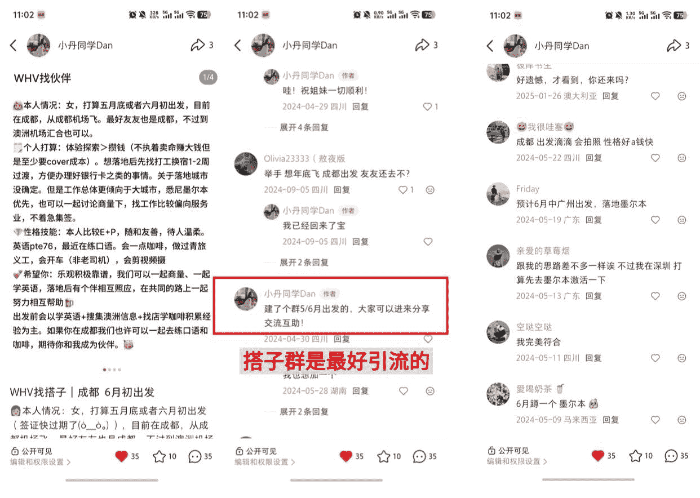

它给了我第一个信号：这个赛道虽然小众，但需求是明确的。很多人不是随手刷到，而是主动在寻找同类、寻找信息、寻找确定感。

真正让我决定持续做下去的，是落地澳洲一周后。

我提前在国内找到了一份悉尼轮滑老师的工作，时薪40澳币/小时，算是高薪。于是我分享了自己真实开局、找到这份工作的过程、工作内容和收入。

这篇笔记获得了1000多个点赞，给了我极大的正反馈，也坚定了我坚持做小红书的想法。

评论区里，大家问了很多非常具体的问题，也有很多人想要加群：

- 这个工作是怎么找到的？
- 英语一般能不能做？
- 落地后怎么找第一份工作？
- 女生一个人去安全吗？
- 需要准备多少钱？
- 怎么申请签证？
- ……

澳洲打工度假是一个典型的“高决策成本”赛道。

用户不是买一件衣服，也不是周末出去玩，而是在决定要不要辞职、要不要离开熟悉的环境、要不要独自去一个陌生国家生活，要不要面临少则几个月、多则一两年的职场空窗期。

这种时候，他们最需要的不是空泛鼓励，而是真实经验。所以我选择做这个垂类，不是因为它天然容易爆，而是因为我亲身走过这条路，知道这群人担心什么、需要什么，也知道什么信息能够真正帮他们减少一点不确定。

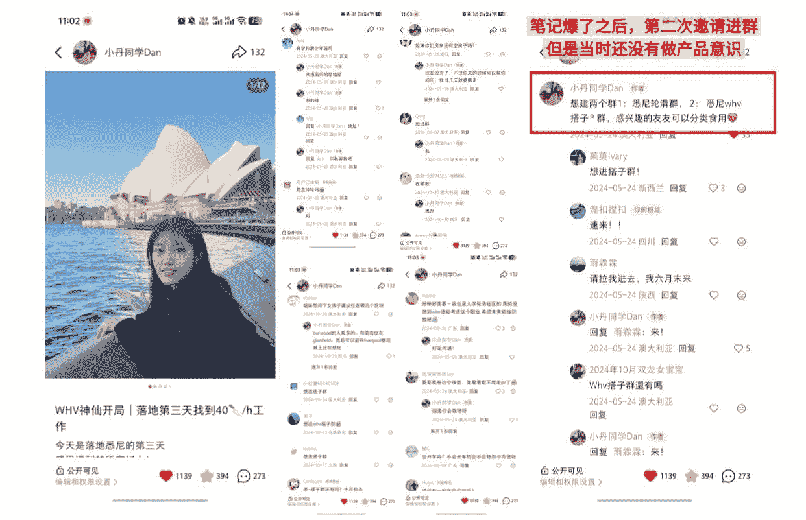

## 03 / 我是怎么从0起号做到6000粉的

我觉得我的账号定位并不是“澳洲攻略号”，也不是单纯的“打工度假资料库”。

它更像是：

一个普通女孩独自去澳洲生活三个月，寻找工作、体验世界、建立独立性，并把真实过程分享出来的账号。

这个定位很重要。

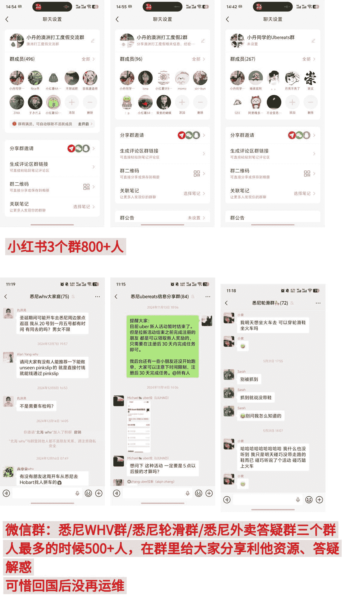

因为如果我只做工具型攻略，用户可能收藏完就离开；但如果我只讲个人故事，用户又很难从中获得实际帮助。

我希望账号里同时有两种价值：

干货解决问题，故事建立信任。

### 我没有凭空想选题，而是从经历里找选题

在澳洲三个月里，我体验了十几份工作。

有轮滑老师、约拍摄影师、Uber Eats外卖员、餐厅服务员、街头卖手工气球，也做过跨国帮带等尝试。

我没有把这些工作只当作“我赚了多少钱”，而是拆解：

- 这份工作是怎么找到的？
- 它适合什么样的人？
- 薪资、门槛和真实工作内容是什么？
- 我踩了什么坑？
- 如果让刚落地的新人来做，他最应该提前知道什么？

于是，每一份工作都可以拆成内容。

- 比如轮滑老师，我讲我怎么把国内的兼职技能带到澳洲；
- 摄影，我讲普通人如何把自己的技能通过自媒体引流—交付，避免纯体力劳动内卷；
- 送外卖，我讲真实收入、租车、电池续航、跑单节奏、安全问题；
- 餐厅服务员，我讲华人餐饮工作真实是什么样。

经历本身就是选题库，而且每一个只要你经历过，都可以拆解得很详细。

成功经验可以分享，失败经验也可以分享；找到高薪工作可以分享，找工作被拒绝、租房踩坑、英语听不懂，同样可以分享。

用户需要的不是一个永远顺利的人，而是一个真的经历过、真的解决过问题的人。

### 我的前期选题心路历程

我当时没有提前写好一份完整的选题表，而是在每一个需求信号出现后，顺着真实生活继续输出。也会搜索澳洲打工度假关键词，看爆款笔记的选题，主要集中在签证申请流程、找工作渠道攻略这几部分。

我前期的选题逻辑大致根据我的时间线、事件发生顺序、遇到的问题来走的。

1. 用“找搭子”笔记测试需求，确认赛道里真实有人。
2. 分享落地一周找到轮滑老师工作的经历，拿到第一篇爆款，继续晒工资。
3. 除了打工还要旅游呀！开始分享在澳洲旅游的景点攻略。
4. 落地20天了，发一个20天真实感受。
5. 继续打工，发布不同工作的真实体验，形成系列。

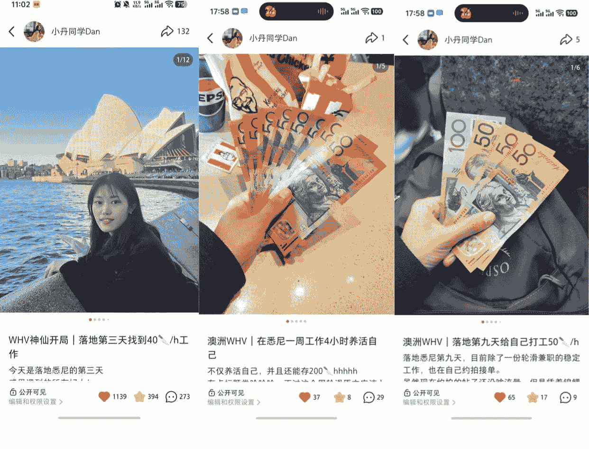

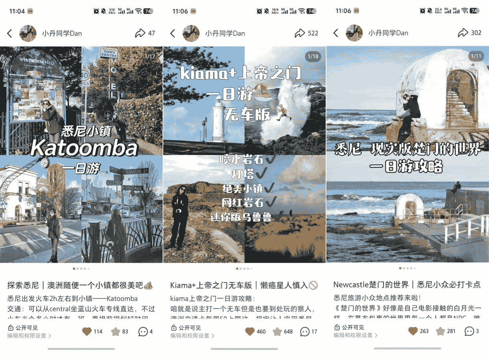

6. 开始发现送外卖拉新赚中间佣金的信息，重复写Uber Eats拉新贴。此时账号信任度、内容密度高于同行。同时开始维护外卖拉新群，这一波拉新拉了50个人（因为上限是50），赚了2万多（后文会拆解这个案例）。
7. 后来个人原因提前回国，开始发阶段性的复盘、汇总笔记：
   - 找工作复盘
   - 旅游攻略复盘
   - 签证科普汇总
   - 以及个人成长线故事：父母反对出国
   - 回国后的现状
8. 开始从图文尝试口播：

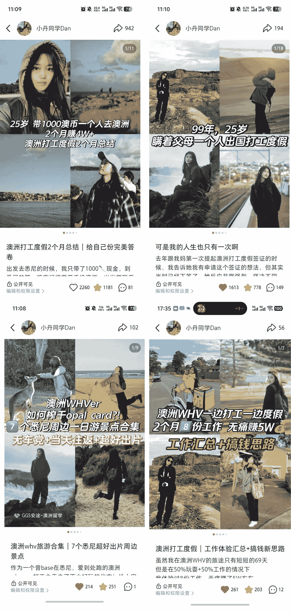

这套内容里，有些内容负责拉新，有些内容负责搜索，有些内容负责建立信任。

我让AI总结我的账号内容，这是AI的结论：

- 结果型内容：时薪多少、赚了多少钱、落地多久找到工作。
- 搜索型内容：签证、落地、找工、租房、英语、费用和避坑。
- 故事型内容：父母反对、独自出发、被拒绝、成长和改变。
- 场景型内容：工作现场、生活照片、旅行路线和真实体验。

结果型内容能让陌生人停下来；搜索型内容能带来长期流量；故事型内容让用户记住你；场景型内容则让账号更鲜活。

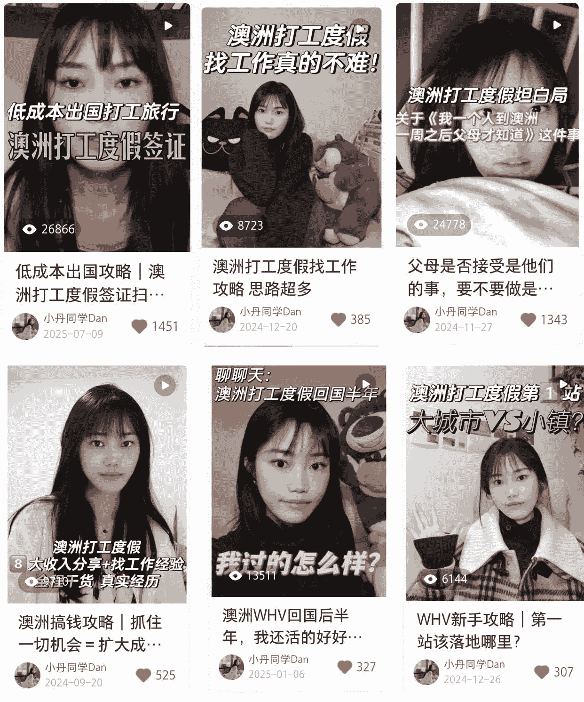

### 为什么有些内容更容易爆？

真正有效的内容，并不是标题写得多夸张，而是用户一眼就能判断：这篇内容和我有关。

比如“澳洲打工度假”“澳洲WHV”“找工作”“费用”“签证申请”“租房”“电话卡”这些词，都是用户会主动搜索的关键词。

所以我在标题和正文里会自然埋入这些词。

用户搜索什么，我就用他们能想到的词来写标题、写选题。

标题负责让用户点进来，内容负责兑现标题。

我分享时会尽量把过程讲清楚：工作在哪里找到、具体做什么、收入是多少、有什么门槛、我遇到了什么问题、我会给后来者什么建议。而不是只发一张工资截图，再配一句“澳洲真的太好赚了”。

因为对这个赛道的用户来说，真实感比炫耀更重要。

### 我如何用真实经历建立信任？

我认为，真人出镜、过程记录和坦诚分享，是我这个账号最重要的信任来源。

比如我做Uber Eats时，并不是只发一个邀请码和后台截图：我真的跑了80单，租过电动自行车，踩过电池续航的坑，跑过悉尼City的午高峰和晚高峰，这些具体细节，才让一篇“外卖教程”不只是信息搬运，而是有人真的替你走过一遍之后的经验。

我也会分享和父母反对我出国的冲突：这类内容没有直接教人“怎么找工作”，但它让很多人看到：原来不止我一个人想走出去，又害怕伤害家人，获得了很多共鸣。

这让我更确信：

干货让别人觉得你有用，故事让别人愿意相信你。

目前为止，大大小小不同的群、不同平台加起来有好几百人，整理内容时翻到，最开始建立小红书群的时候只有三个网友。

还好当时跨出了第一步~

## 04 / 这条账号带来了哪些变现和价值

6000粉的账号真的能赚钱吗？

我的答案是：可以。

2个多月时间，变现了5W左右。包含外卖推广奖励、跑单收入、摄影接单、品牌广告、帮带等直接收入，也包含账号间接促成的悉尼工作机会；并不是单靠几条广告获得的。

但它带给我的价值，远不仅仅是金钱。

### 案例1：一段外卖经历，延展出了多次变现

价值最大化的一个案例是，我在悉尼送Uber Eats时，当期活动是完成80单可以拿丰厚的新人奖励。

但很多人自己送完外卖拿了新人奖励的羊毛就止步了，会进一步拉新赚中间差的人很少，而愿意在自媒体好好做内容拉新的就更少了。

大多数人发拉新帖子是这种内容质量，只是随手一发：

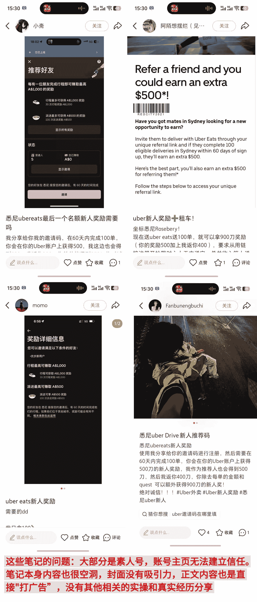

我发现这样空洞的内容都有咨询，而我当时找老人要邀请码的时候，也是挑了挑的，因为担心对方不给我返钱，所以那种内容详细、主页有运营的会优先选择。

于是我判断我在内容上有优势：主页有爆款，信任度高；我擅长拆解干货经验；有用户运营经验（当时就想到要拉群运营）。所以后面我实实在在发了几条Uber Eats的干货贴。

我大概用一周完成了80单，跑单收入加新人奖励约1500澳币。后来我把注册、租车、备用电池、跑单节奏和新人奖励写成图文内容，获得了很多咨询。

很多人不是单纯来要邀请码，而是真的不知道：

- 怎么注册？
- 电动自行车怎么租？
- 一块电池够不够？
- 悉尼City到底怎么跑？
- 送外卖能不能作为刚落地时的保底收入？

并且，我把咨询用户都拉进群，进行统一答疑。

当期活动有有效邀请人数上限，最终我完成了50位有效邀请，拿到了约5000澳币的推广奖励，折合人民币两万多元。

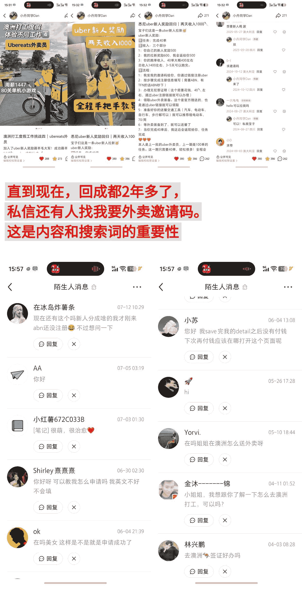

因为当时加了两百多个Uber拉新的人，为了区分他们的不同状态、避免遗漏，在备注上打了标签：

- 已完成（✅已经完成新人任务并且已收到我打的钱的，这些人就是完全完成交付了的）
- 待跟进（⭕已完成新人账号注册，正在跑单的，要关注他们的进度）
- 已放弃（❌明确说了不跑了的，这部分几乎不用再跟进）
- 没备注的就是加了微信，但是还没开始注册、没开始跑任务的，这部分我就不主动、不拒绝。

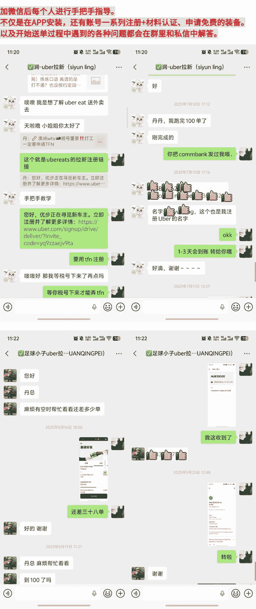

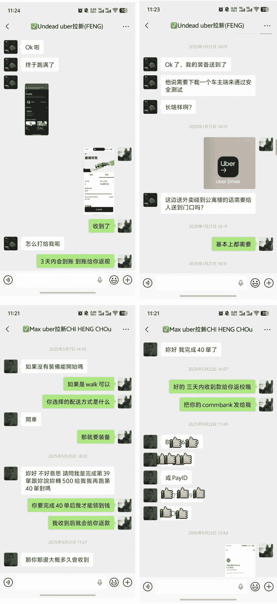

这还没完。当时悉尼的哈啰单车公司的营销部通过笔记联系到我，想让我推广悉尼的Hello Ride骑行卡，在内测阶段只能通过推荐人买卡。对方认为我的目标用户是外卖群体和留学生，很适合推Hello Ride月卡和周卡。

卖一张卡我大约能赚10澳币。

于是除了分享送外卖教程外，我还长期在外卖群里给Hello Ride骑行卡打广告，解决用户送外卖中交通工具的问题。但是这部分佛系卖卡，也卖出去几十个，很多人会复购，赚了几百澳币。有的即使没有送外卖，但是是留学生，也会找我买。

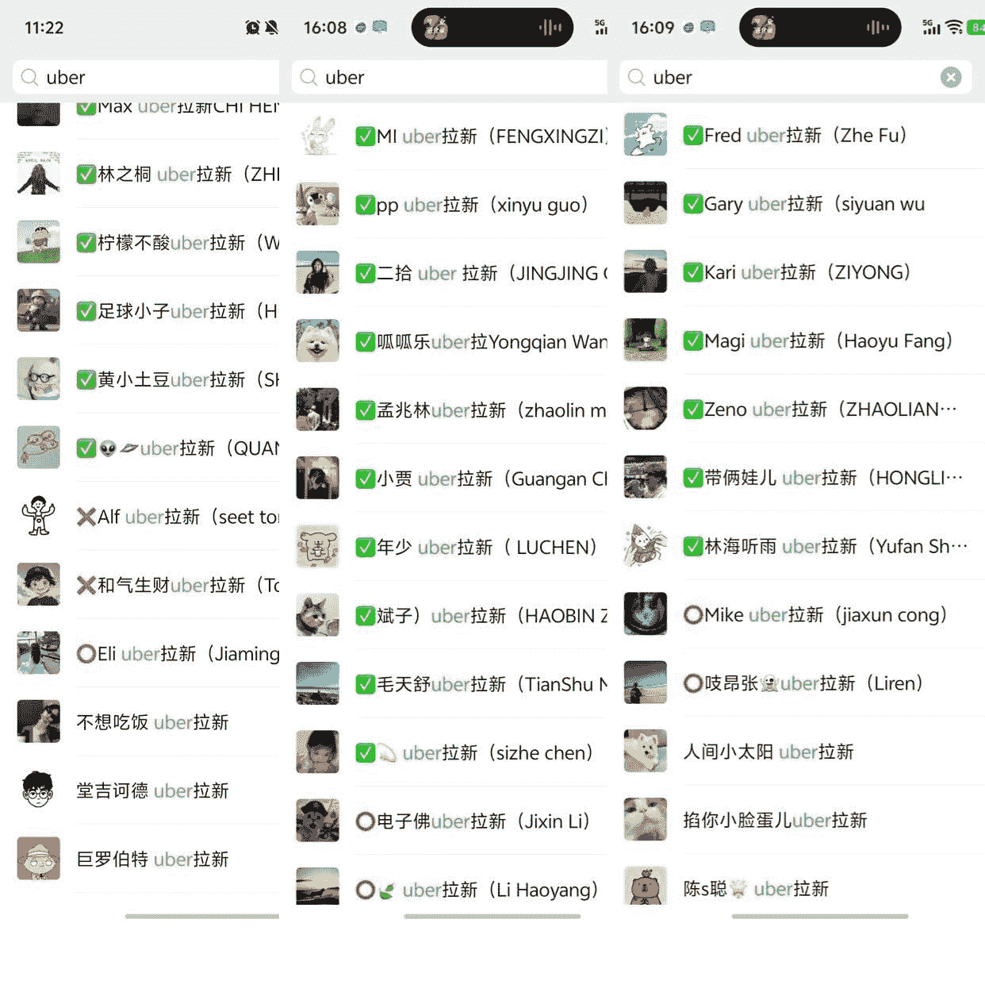

这件事让我看到，送外卖不是只能“一单换一单”的体力劳动。

当我把它复盘成内容、教程和社群答疑后，它就变成了一条完整的运营链路：

跑单收入 → 新人奖励 → 内容笔记 → 用户咨询 → 社群答疑 → 推广转化 → 相关合作 → 求职案例

### 案例2：我如何用摄影技能，在悉尼接到高薪订单

如果说送外卖让我理解了“内容可以放大一次真实经历”，那悉尼约拍摄影师这段经历，则让我更深刻地理解了：普通人不必把自己限定在低门槛工作里，也可以把已有技能重新定价。

落地第一周，我已经有了轮滑老师这份保底工作，每周固定课程能带来约400澳币收入，只需要工作10小时，就基本可以覆盖生活必要开支。

正因为生存压力暂时解决了，我不需要为了抢第一单，把自己的时间压到最低价。

于是我开始想：除了教轮滑，我还有什么能力可以在悉尼变现？

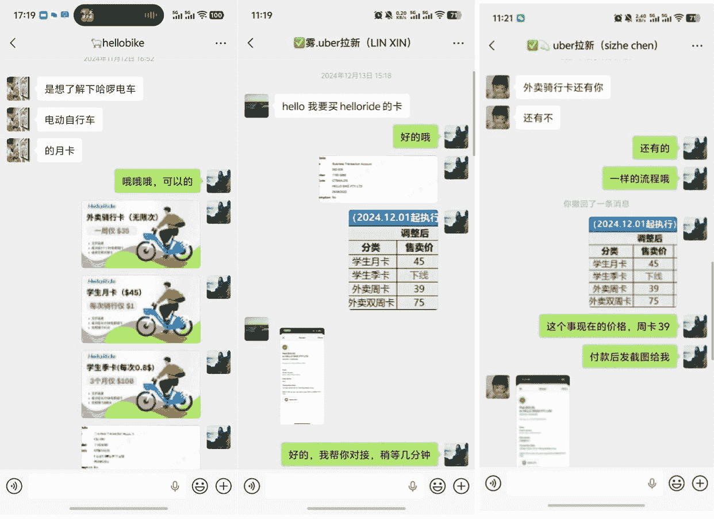

我来澳洲时带了单反相机，我会拍照，也有审美和内容运营经验。于是我先在小红书搜索“悉尼陪拍”，发现近期有不少真实咨询，而同行大多还是素人账号。

后来和拍过的华人客户聊天，我又确认了一个需求：本地专业摄影机构价格偏高，但面向华人游客、兼顾沟通、审美和旅行体验的轻陪拍服务相

稀缺。

这就是我看到的市场缺口。

我没有低价抢单，而是定了50澳币/小时、1小时起拍的报价，比当时同行价格高约20%。

这样定价，有两个原因：

1. 我已经有轮滑老师的保底收入，不需要靠低价换订单。
2. 我在成都免费互勉拍过十多次写真，也调研过同行作品，确认自己可以提供更好的交付。

客户买的不只是“有人按快门”，而是一整套旅行体验：

- 知道悉尼哪里好拍；
- 能引导没有镜头感的人；
- 陪客户走、聊天、安排节奏；
- 在24小时内交付好看的照片和底片。

确定方向后，我新注册了一个小红书账号，用价格表、样片和清晰的服务说明直接面向目标用户获客。

第一篇笔记我没有讲摄影技巧或者悉尼旅游攻略，而是直接回答目标用户最关心的问题：在哪里拍、拍多久、怎么收费、没有镜头感怎么办、多久交片，以及我过去拍过什么作品。

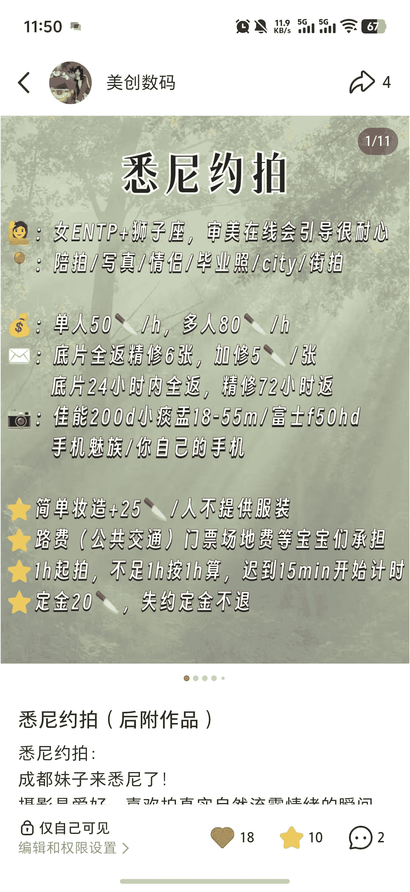

我的交付流程也很简单：

小红书评论/私信问价 → 确认时间 → 收定金 → 当面拍摄 → 结清尾款 → 24小时内交付9张精修和全部底片——这件事很快跑通。

第一周就有二十多个微信咨询。

陪拍订单加上轮滑老师的保底收入后，我的周收入轻松超过1000澳币。

整个澳洲期间，摄影接单为我带来了一万多元收入。

这份工作后来又被我二次创作成《挑战不同工作》系列内容，继续为账号积累信任。

有接不过来的订单时，我还和室友协作：我负责获客、拍前沟通、后期筛选和精修；她负责现场拍摄，钱一人一半。

所以，个人服务不一定必须一个人从头做到尾。根据具体情况，获客、沟通、现场执行和后期交付，其实可以拆分；但客户必须提前知情，服务内容、交付标准、分钱方式和责任边界也要先说清楚。

这让我不再把“打工”理解为只有一种形式。

低门槛工作可以解决生存问题；但当有了基本安全垫后，更要问自己：

- 我有什么技能可以被重新定价？
- 这个市场有没有被忽略的需求？
- 用户愿意为什么付费？
- 我能不能把它设计成可交付的服务？

外卖和摄影约拍，是我通过小红书直接撬动的收入；其他工作，则最终都成了账号持续输出的内容素材。

### 案例3：如何用账号写进个人简历，回国求职薪资翻倍

更大的价值发生在回国之后的求职。

我把这段澳洲经历写进求职简历，没有把它解释成“出去玩了三个月”的空窗期，而是把它当作一个完整个人项目：

从个人经历中提炼内容，通过内容积累粉丝和信任，再完成私域承接、商业合作和用户运营。

对于新媒体运营岗位来说，它能直接证明我的选题策划、内容创作、用户洞察、账号运营、私域承接、商业化、审美表达和从0到1落地能力。

它也让面试官更容易看到我的执行力、目标感和行动能力。

最终，我拿到了一个比出国前薪资翻倍的 offer。

除了收入，账号还给了我长期价值：

- 我还接到过不少品牌邀约，最终只选择了4个与账号用户相关的合作，单条报价约800元。
- 回国时，我还做过跨国帮带，帮客户带回5副雷朋眼镜，赚了约2000元，基本覆盖了机票成本。

这些收入形式不同，但底层逻辑一样：内容和账号让我更容易被看见，也让别人更容易相信我。

- 在社交上，这个账号也给了我一个更容易被记住的身份：澳洲打工度假博主。

参加线下活动自我介绍时，我会说：“我去澳洲打工度假三个月，做了一个6000多粉丝的澳洲打工度假账号。”这往往比单纯介绍我普通的工作，更容易引发陌生人的好奇和交流。

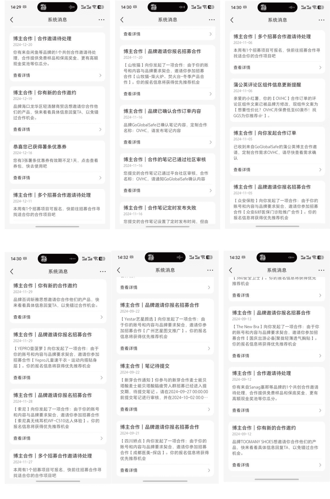

- 此外，还有自由撰稿人通过账号找到我，采访并把我的故事写成文章，发表在三联公众号上。
- 也有三四位研究生因为论文选题联系我，希望采访我的经历，作为论文的研究素材。

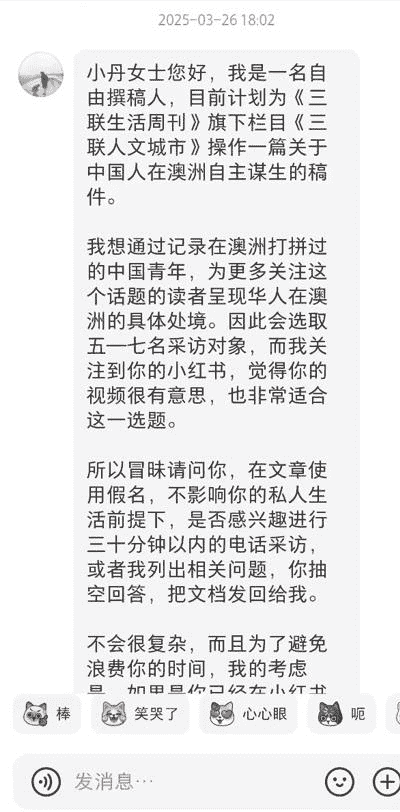
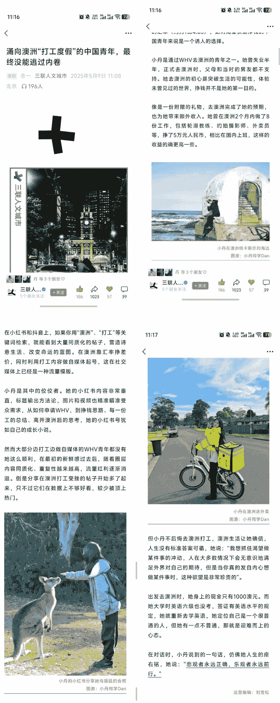

- 以及还有大大小小因为账号认识的、境况差不多的博主，进行了面基和内容创作交流，每一次都是极大的能量滋养。而这些人，如果不是因为我运营了这个账号，我们根本就不会有任何交集。

所以我现在理解的内容资产，不只是收入。

它也是你的作品、你的信用、你的社交名片，以及别人认识你的入口。

## 05 / 我踩过最大的坑：引流了几百人，却没有产品

这段经历里最可惜的，不是账号只有6000粉，或者少赚了钱。

而是我当时引流了几百位用户、做出多篇千赞笔记，粉丝画像精准，却没有提前设计产品，导致流量没有真正承接住。

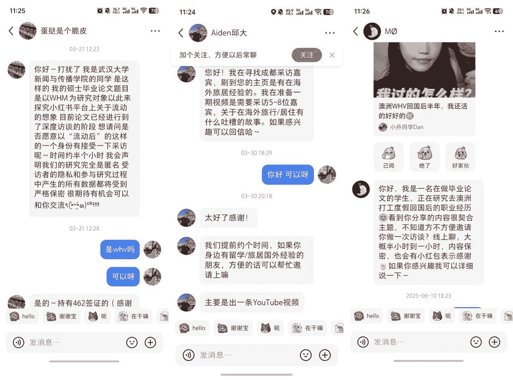

当时需求其实已经被验证了：用户会主动评论、私信、进群，反复问签证申请、找工作、落地、租房、英语、送外卖等相关的问题。

但我只有流量，没有交付。那时我还没有产品意识，也没有把经验整理成：

- 落地资料或执行清单；
- 找工作模板；
- 英文简历和面试话术；
- 城市攻略和避坑清单；
- 有明确边界的轻产品。

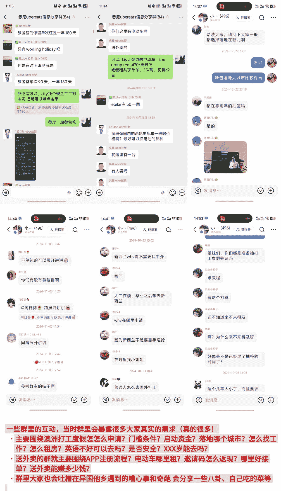

所以，用户虽然进入了私域，但问题没有被系统整理，我的经验也没有被产品化。

活动结束后，群里慢慢沉寂，连接也随之淡掉。

我最大的误区是：

我觉得把人拉进私域，就等于完成了沉淀。

其实不是。

私域不是通讯录里多了多少人，而是你能不能持续解决一群人的问题。

当时我完成了“发现需求”和“获得流量”，却没有完成“设计交付”。所以我现在会提醒自己：不要等流量来了，才开始想产品。

起号阶段就应该持续记录：

- 用户反复问什么？
- 哪些问题靠一篇笔记解决不了？
- 哪些内容可以整理成模板？
- 哪些适合轻交付，哪些需要重服务？

流量证明有人在意，产品设计才决定这份在意能不能沉淀下来，能不能真正实现稳定的闭环，成为副业甚至事业。

而这些思维，也是我后来加入生财后才慢慢接触和学习到的。虽然我还没有拿到多大的结果，但它让我开始用“需求、交付和产品”的角度，重新理解过去的流量和经历。

## 06 / 我现在如何重新看这段经历：知识库、轻产品与新的内容主线

现在的我，不再把澳洲打工度假只看作一段已经结束的往事。

它更像一座还没有完全被整理出来的内容矿山。

这段时间，我一直在重新整理去澳洲前后的资料、笔记、工作经历，以及后来用户在评论区、私信和社群里反复提出的问题。

我越来越确定，大家真正需要的不是更多零散攻略，而是一套能帮助他们做决策、也能帮助落地执行的路径：

- 我适不适合去澳洲打工度假？
- 出发前要准备什么？
- 落地后的第一周先做什么？
- 找工作、租房和安全问题该怎么判断？

所以，我正在做澳洲打工度假知识库，也完成了一个微信小程序的初版。

知识库里已经有签证申请、城市选择、出发前清单、落地30天执行清单、找工渠道、简历、面试、生活 Tips、高频问答和避坑内容。除了公开信息，也有我个人未发布的真实工作记录、踩坑经验和故事。

我做它，不是为了再堆一份资料，而是想同时完成两件事：

帮用户更清楚地做决策、更有秩序地完成落地执行；

也帮自己把零散经历沉淀成更系统、更可复用的内容资产。

接下来，我会围绕这个方向逐步完成付费知识库、虚拟资料、工作简历模板、英文简历和面试话术，以及帮助用户做选择决策和落地执行的澳洲打工度假微信小程序。

但我不会把它做成长期陪跑或重咨询服务。

因为三个月澳洲打工度假早已结束，我也已经回国两年，无法持续获得当地一手信息。我不适合把自己包装成长驻澳专家，更不适合承诺实时找工、找房或长期陪跑。

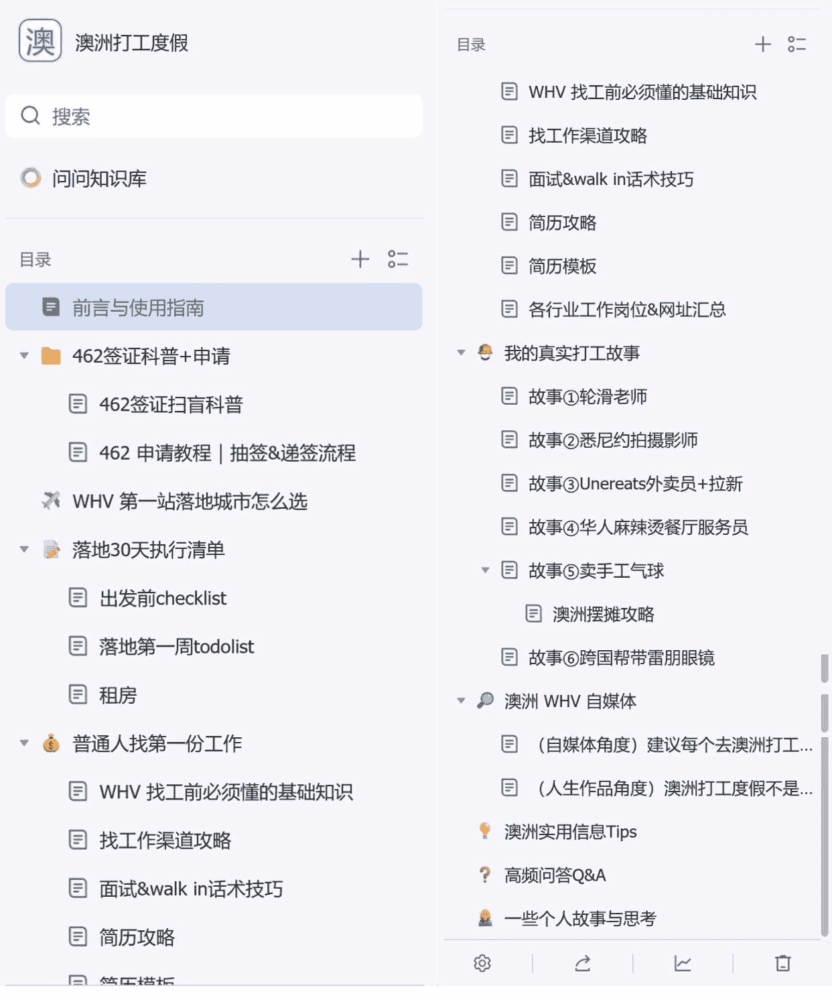

涉及签证、工资、税务等变化快的信息，也必须以官方规则为准，不能只依赖个人经验。

所以我更愿意做轻交付：把我亲身走过的流程、踩过的坑、验证过的经验，连同用户真实的问题、清晰的执行路径和可复用的模板整理出来，帮助后来的人少一点信息焦虑，多一点行动确定性。

而澳洲账号，也不会是我唯一的内容方向。

这段经历让我感受到内容资产给普通人带来的价值，所以我会继续做自媒体，只是内容会和我当下的生活主线同步：成都本地的人和故事、个人成长、学习、工具和新的经历。

内容方向会变，但底层方法不会变：

把自己真正走过的路，提炼成别人能够受益的内容。

## 07 / 每个人都可以挖掘自己的差异化生活

对普通人来说，内容资产是轻投入、长回报的杠杆。

澳洲打工度假只是我的案例。

装修房子、出国留学、海外旅居、换城市生活、转行、做副业、备考或学习一项新技能、追星奔现，都是高决策成本的经历：要花钱、花时间，也容易踩坑。而这些经历，恰恰最需要真实、具体、有判断的分享。你不需要成为行业里最厉害的人，才有资格做内容。

你只需要认真走过一段路，并把过程中那些别人看不见的选择、成本和问题记录下来。如果不知道怎么从经历里找选题，可以问自己六个问题：

- 这件事开始前，我最焦虑什么？
- 我做过哪些关键选择？
- 哪些钱、时间和精力花得值得？
- 我踩过什么坑？
- 如果重来一次，我会怎么做？
- 一个完全没经历过这件事的人，最想问我什么？

把这些问题写下来，一段经历就不再只是回忆，而会慢慢长出内容。

AI的发展，也能帮助普通人更高效地整理经历。

你可以把日记、语音、照片、聊天记录、备忘录和零散想法交给AI，让它帮你梳理时间线、头脑风暴选题、整理清单和优化表达。

比如可以直接问AI：

这是我从准备装修到入住的零散记录。请不要编造任何经历，帮我从“预算、流程、踩坑、决策、情绪变化、给新手的建议”六个维度，整理出30个适合小红书或公众号的选题。

但AI只能帮你加快整理，不能替你制造经历。

在AI可以批量生成内容、自动化矩阵账号越来越容易的时代，稀缺的不是信息本身，而是一个具体的人在具体的赛道长期积累下来的经历、判断、审美和信任。

你生活里那些认真做过的选择，可能就是你最值得积累的内容资产。

——分割线——

看完这篇SOP，你觉得你懂了。但90%的人一到实操就会卡在第一步。

工具和教程只是最低级的壁垒，真正的壁垒是“立刻动手”和“圈层信息差”。

如果你想看全网最新的变现玩法，并且和一群执行力极强的极客一起下场拿结果，欢迎围观我的核心私域：【懒人专属群】。

我们不聊虚的，只做商业闭环的拆解与AI效率的压榨。系统内已沉淀1000+跑通的套利实战局。

👉 查阅圈子完整数字资产与上车门槛：

https://lazyso.com/insider/

认同价值、准备好下场干活的，扫码加我微信（lazyhelper1）

备注：【实操上车】，不闲聊

