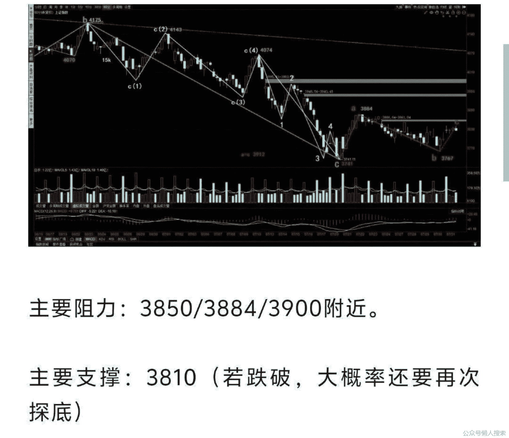

公众号懒人搜索，懒人专属群分享

# 八月行情观察

260802 猫小莲

整理：公众号懒人搜索，懒人专属群精选

懒人微信：lazyhelper1

## 前言

很多心得并不适合公开分享，更适合小范围交流。

深度了解知识，知道市场本质和内在的运行规律，那么就可以举一反三，推算出未知的东西。

只想得到答案，对技术不感兴趣、不愿意深层次研究的读者，请谨慎付费！

免责声明：本文所涉及时间、空间、浪形结构划分、提及的板块，仅为个人研究笔记心得分享，不构成任何投资建议。投资有风险，入市需谨慎！

本文包含以下几点内容：

1. 八月的四个变盘点。
2. 本月总体走势推演，以及反转/反弹的识别。
3. 八月观察的板块。
4. 本周总体涨跌节奏推演。

早在《本轮牛市结束了吗？》内提醒了7月的C浪最低点，随后开启了反弹，23日开始回落，并且同时把AI应用类列入了观察，再次展现了技术与板块分析的神奇魅力。

疑似C（5）中的第5浪运行中。预期在7月20日探明C浪低点，然后反弹至7月23日附近回落④AI应用类。

其中①②③类需要准确把握C浪低点，暂时以超跌反弹为主。

《本轮牛市结束了吗？》7.19

下面就来谈谈八月的四个变盘点、本月总体走势推演、八月观察的板块，以及本周总体涨跌节奏，比较重要。

## 1. 八月的四个变盘点

八月有四个变盘点，分别为：8月5日（小高点/加速）、8月10日、8月14日（高点）、8月27日（低点）。

注：变盘点根据浪形的演变，高低属性也会动态转换，呈现遇高则高、遇低则低的特征。

## 2. 八月总体走势推演，以及反转/反弹的识别

首先震荡/上涨至8月5日附近，其次回落/加速上涨至8月10日附近，然后上涨至8月14日附近见高点，最后回落至8月27日附近见低点。

日线图：疑似相对于2635的日线第5浪（反转）或相对于4258的第4浪反弹运行中。

其中3927是比较重要的点位，若3741的反弹能够站稳3927，接下来的回落跌破3741的概率变小，相对于4258的第5段回落演变为日线第5浪的回落概率增大。

## 3. 八月观察的板块

### ① AI应用（软件、游戏、端侧SoC）

- 筹码结构优势：软件类已连续下跌多年，相比高位硬件类，拉升成本和抛压较小。
- 成本端利好：OpenAI降价，直接降低Token使用成本，让AI应用层的开发和运营更划算，利好整个应用生态。
- 需求端验证：AWS和微软云业务超预期，说明企业端在积极推进AI落地，下游需求真实存在。

### ② 医药（创新药）

- AI硬件调整期最先走强的板块，目前调整充分。
- 定位升级：从普通高新技术产业升级为新兴支柱产业，后续各地将配套产业园扶持、研发补贴、产学研转化政策。
- 支付端重大变化：新增商业健康保险创新药目录。基本医保集采侧重普惠控费，商保承接高价创新药，缓解创新产品入院、支付难题。利好创新药企、高端医疗器械。

### ③ 人形机器人（题材）

- 端侧AI的终极落地场景之一。
- 2026世界机器人大会：8月19日—23日在北京亦庄举行，若出现超预期新品，可能成为板块情绪引爆点。
- 第二届世界人形机器人运动会将在2026年8月22日至26日举行。

### ④ 有色金属类（铜）

## 4. 本周总体涨跌节奏推演

60分图：疑似相对于3741的C浪上涨中。

主要阻力：3850/3884/3900附近。

主要支撑：3810（若跌破，大概率还要再次探底）。

本周大概率上涨至8月5日附近，然后回落或加速上涨。

总体来看：因为经历过七月的大幅调整，八月大概率会有一波反弹，乐观的话来一波主升浪也未尝不可。

而中旬后需要提防再次回落。

祝大家顺风顺水顺财神！

————分割线————

在这个AI能替你写代码、写文章的时代，基础技能正在迅速贬值。绝大多数人正被淹没在海量的免费垃圾信息里，陷入低效的体力内卷。

当“努力”不再是壁垒，人与人之间唯一的护城河，只剩下“信息过滤”的效率与“认知系统”的维度。

圈子已稳定运行7年。我们每天利用Python爬虫与大模型算力，过滤全网最顶级的政经内参和搞钱风向标，做你最冷酷的“外部大脑”。

如果你认同这种“重塑认知防线”的极客主义，欢迎围观我的个人情报智库：【懒人专属群】。

https://lazyso.com/insider/

认同信息过滤价值、想省下每天3小时无效阅读时间的读者，扫码加我微信（lazyhelper1）。

