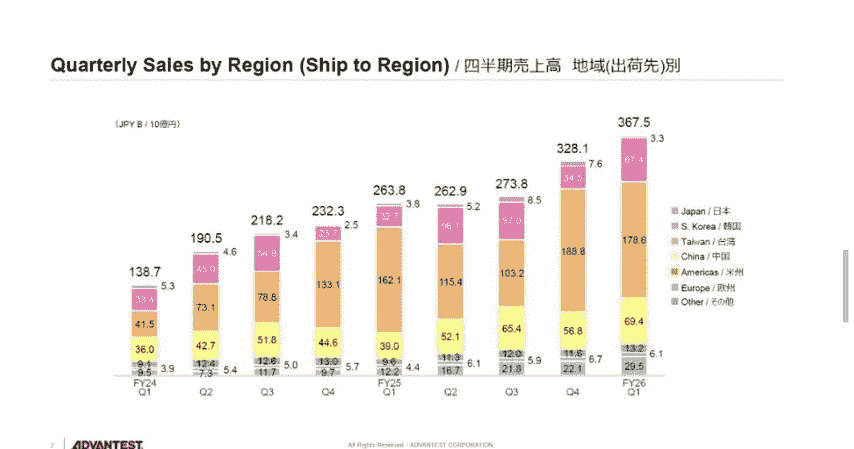

# 八月行情展望

整理：公众号懒人搜索，懒人专属群精选

七月，注定是一个载入史册的月份。过去三十天，市场把所有分歧一次性摆上了台面。海外的杠杆在几天之内被打穿，AI的叙事第一次遭遇真正的动摇，政策口径在月末重新定调。

而更多人真正想知道的，其实是这几个问题：这是风险释放，还是逻辑破坏？最恐慌的位置已经过去，还是只是中场休息？

八月，该守，还是该攻？

防守，该去哪里？进攻，又该去哪里？下文，笔者会从逻辑与技术出发，详细阐述对科技等不同行业的判断和应对策略。本文为月度巡礼系列，全文近12000字，限时限人数下架。感兴趣建议尽快阅读，具有一定时效性。

展望开篇，依然按照“宏观—行业—企业”的分析框架，先从宏观层面讲起。

海外宏观方面，刚刚结束的FOMC议息会议，暂时终结了会前围绕货币政策方向的反复博弈。

美联储最终维持利率不变，但三名委员投票支持加息，说明政策分歧并未消失，只是市场关注的焦点开始从猜测美联储的下一步，重新转向通胀、就业与经济增长等基本面数据。

新任美联储主席沃什更是明确强调，市场参与者应该“关注球，而不是裁判”。

换句话说，与其反复揣摩美联储官员的每一句表态，不如回到经济数据与现实变化本身。美联储正在弱化前瞻指引，而市场也需要逐渐学会减少对“裁判口风”的依赖，重新根据基本面为资产定价。

因此，会议结束后公布的两组关键数据，迅速开始修正市场原有预期。核心PCE环比仅上涨0.1%，低于市场预期；美国GDP环比折年率增长1.5%，也明显低于此前预期的1.8%。

两项数据共同指向一个变化：通胀并没有想象中那么顽固，经济增长却比预期更加疲软。于是，市场的政策判断也随之转向。

既然“球场”上的通胀压力正在缓解，而增长动能又开始减弱，那么美联储这位“裁判”接下来更应该考虑降息托底，而不是继续加息压制需求。

换句话说，市场交易的重点，已经从会前对加息风险的担忧，重新转向对降息空间的定价。

随后，美股率先展开强劲反弹，并带动全球风险资产同步回暖。其背后的逻辑并不复杂：加息预期降温、降息预期重新升温，意味着无风险利率与估值折现压力同时下降。

叠加此前市场已经经历较为充分的去杠杆与恐慌抛售，一旦宏观预期出现边际改善，空头回补与风险偏好修复便迅速形成合力，推动全球市场迎来一轮强有力的反弹。

其次，是美伊战争。尽管局势仍有反复，但市场对冲突外溢的整体预期依然处于可控范围。最直接的观察指标，就是霍尔木兹海峡的船舶通行情况。

只要海峡没有被实质性封锁，油轮通行量与原油运输秩序也未出现持续性中断，战争对全球能源供应的冲击就仍更多停留在风险溢价层面，而不是演变为真正的供给危机。

因此，油价即使会随着消息面反复波动，也很难仅凭局部冲突形成持续单边上涨。市场真正需要警惕的，并不是战事本身出现新的口头升级，而是霍尔木兹海峡通行效率、油轮运价、保险成本以及实际原油出口量是否发生持续性恶化。

只要这些指标总体稳定，美伊冲突对全球宏观与风险资产的影响就仍然可控。笔者对美伊局势的核心判断依然是“打打停停”。

美国未必会追求一场持续性的全面战争，而更可能通过间歇性军事打击、经济制裁与政治施压，不断消耗伊朗的财政能力、军事体系与内部稳定性，加速其内部矛盾暴露乃至体系松动。

如果说拜登时期的策略更多是依靠制裁与时间，等待伊朗在长期压力下自行弱化，那么特朗普时期则更倾向于通过有限但高强度的军事行动，主动加快这一进程。

前者是“以等促变”，后者则是“以打促变”。此刻，特朗普又传来了TACO的消息，同意取消对伊朗的打击。

因此，笔者判断，美伊局势这一宏观变量在短期内将进入相对稳定状态。局部冲突与消息扰动仍会反复出现，但只要战争没有全面升级、霍尔木兹海峡未被实质性封锁，其对油价、通胀与全球风险资产的边际冲击就将逐步减弱。

最后，再来看国内宏观。国内宏观方面，刚刚结束的ZZJ会议进一步明确了下半年的政策基调。会议提出，要坚持深化改革开放，加快推动新旧动能转换，实施好更加积极的CZ政策和适度宽松的HB政策，充分释放存量政策效能，及时谋划出台务实管用的增量政策，并进一步加大逆周期调节力度。

这意味着，面对当前经济运行中的现实压力，ZC层并未选择被动等待，而是在推动既有政策落地见效的同时，为后续加码预留了充足空间。

相较于对既有政策取向的再次确认，笔者认为，“及时谋划出台增量政策”释放出的信号更值得关注。一旦经济动能或市场预期进一步走弱，政策端仍有望通过CZ、HB等多种手段及时托底，防止短期压力演变为趋势性下行。

因此，从8月海内外宏观环境来看，ZC预期整体呈现边际改善，市场对阶段性流动性维持充裕的预期也在升温。与此同时，海外市场第一阶段的集中去杠杆已基本完成。

以美国市场为例，Leopold清仓可以视为高杠杆资金被迫出清的标志性事件之一。

换句话说，8月宏观层面的主要矛盾，正在从政策收紧、流动性担忧与杠杆踩踏，逐渐转向ZC托底、流动性改善与风险偏好修复。当然，第一阶段去杠杆结束并不等于市场必然反转，但至少意味着最剧烈的被动抛售压力已经阶段性减弱，为市场重新围绕基本面与产业逻辑定价创造了条件。

因此，对于当前国内大盘，笔者的判断非常明确：这里已经进入底部区域。

不过，底部判断并不等于立即重仓，仓位提升仍需等待技术信号确认。在技术分类与仓位应对上，笔者将3730点与3750点视为两条关键边界。

若指数回踩3730一线后确认未形成有效跌破，或向上有效突破并站稳3750一线，笔者将把仓位重新提升至七成以上。在方向尚未得到确认之前，则继续维持原有三成底仓，以等比例做套、降低持仓成本为主。

若市场再次下探至3730一线并创出阶段新低，笔者反而会更加兴奋，因为这意味着市场可能提供一次更具性价比的布局机会。

不过，结合当前宏观环境、资金结构与市场状态来看，这种情形出现的概率已经微乎其微，具体原因将在后文展开。

接下来，笔者将继续沿着“宏观—行业—企业”的分析框架，对后两个层面进行拆解。

先来看整体AI行业。

这轮调整，其实就是笔者过去反复讲过的逻辑。在新的AI大需求场景真正出现之前，市场开始重新审视未来资金成本与资本回报之间的关系。

过去，市场愿意奖励持续扩张的资本开支，因为投入更多算力、数据中心与基础设施，往往意味着更大的远期增长空间。但当旧一轮需求已被资金边际定价完成，而新一轮需求尚未完成接棒时，市场就不会再只看企业投了多少钱，而会进一步追问，这些投入何时能够转化为收入与利润，最终形成的资本回报率能否覆盖资金成本。

这里可能仍有许多人不理解，为什么笔者一直讲是旧一轮需求被资金边际定价完成。笔者举一个最简单的例子。本轮AI产业链中，存储需求的确定性最强，因此全球资金围绕存储板块疯狂加杠杆，韩国市场尤为极端，甚至出现贷款、卖房入市的现象。

当越来越多的人借钱买入时，新增杠杆资金确实可以不断推高股价。但与此同时，无风险利率与融资成本也在上升，市场甚至一度预期利率还会继续上行。

随着借贷成本越来越高，潜在买入者的数量必然逐渐减少，愿意承担高成本继续追涨的资金终归存在上限。当新增杠杆资金的流入，已经无法覆盖获利盘兑现、融资利息与存量资金减仓形成的卖压时，边际买盘便开始衰竭，市场也用真金白银完成了对旧需求的定价。

此时，即使存储需求依然强劲、企业盈利仍在增长，股价上涨的斜率也会逐渐放缓。恰恰在这一节点，存储利润率见顶的预期成为压死骆驼的最后一根稻草。

市场叙事急转直下，而本就接近上限的边际买盘无力承接，最终引发获利盘兑现与杠杆资金集中出逃。

这也对应了笔者一贯的认知：叙事触发拐点，杠杆放大趋势。上涨时如此，下跌与去杠杆时同样如此。

因此，可以总结出一条基本规律：当下一轮确定性叙事出现后，既要跟踪杠杆扩张程度，也要关注利率水平与资金成本。一旦叙事出现拐点，例如财报显示利润率、业绩增速或销量预期见顶，就必须尊重技术信号，及时完成“技术出”，而不是依赖过去的逻辑惯性硬扛回撤。

接着讲回资本回报。当新的需求场景尚未出现时，市场开始检验ROI，本身并没有问题。因为在需求刚刚爆发的阶段，所有参与者都知道必须抢占先机，超前建设、提前投入，甚至阶段性牺牲资本回报率，都是可以理解的。

市场愿意奖励CapEx，是因为相信今天的投入能够换来未来更大的需求与利润。但当新需求迟迟没有接棒时，评价标准自然会发生变化。

站在当下继续投入的每一笔资本，都必须开始回答一个更现实的问题：什么时候能够形成收入，什么时候能够转化为利润，最终能否覆盖资金成本。

市场从奖励投入转向检验回报，既是叙事演变的一部分，也是资本追求收益这一第一性原理所决定的。

因此，这并不是市场否定AI，而是阶段性瓶颈的迁移。当谷歌率先讲出ROI故事时，市场并不相信。一方面，当时美股杠杆尚未完成阶段性出清；另一方面，三张牌只翻开一张，就说自己拿到的是豹子，市场自然不会轻易买账。

但当微软与亚马逊相继开牌，收入、利润与AI商业化数据开始交叉验证，逻辑便从单一公司的自我证明，上升为行业层面的共同趋势。

此时，市场当然会重新定价，因为AI ROI已经不再是一家公司讲出的故事，而是多家巨头用业绩共同验证的现实。尤其值得注意的是，亚马逊CEO在资本开支回报方面给出了非常明确的数据支撑。“平均而言，这项投资大约不到三年即可实现盈亏平衡。目前服务器的使用寿命至少为五到六年，而我们大部分AI容量都签订了至少五年的合同。数据中心的使用寿命则超过三十年，能够支撑至少五到六代服务器的经济运行。”换句话说，长期合同基本覆盖了投资回本周期，服务器的使用寿命又超过合同期限，而数据中心等底层资产还可以跨越多代硬件持续复用。

亚马逊实际上是在向市场证明，短期自由现金流承压，并不等于AI资本开支缺乏回报。相反，只要合同兑现、利用率保持稳定，这些基础设施投资的长期回报仍然相当扎实。

此外，OpenAI与DeepSeek也相继表示，当AI服务价格下降到足够低的水平后，潜在需求几乎没有上限。

更重要的是，两家公司均已具备盈利能力，这说明低价并不必然意味着亏损，只要推理成本持续下降、调用规模不断扩大，AI服务同样可以形成可持续的商业闭环。

以上这些信息共同为短期AI资本开支叙事托住了底，也为资本回报提供了现实支撑。

至此，市场最担心的两件事，也就是AI需求是否真实、巨额投入能否回本，都得到了阶段性回答。

接下来，决定AI交易能否打开新一轮上行空间的，是等待新的大规模AI应用场景接棒，将算力需求进一步转化为更广泛、更持久的收入与利润。那么，后续实际可能演化为两种路径。

第一种，在宏观环境边际改善的背景下，新的大规模AI需求短期内未能出现。市场先完成一轮估值与情绪修复，随后进入横盘震荡，等待下一轮需求场景接棒。

第二种，同样在宏观边际利好的背景下，新的AI需求场景迅速出现。此时，估值修复与盈利预期上修将同时发生，市场便可能由反弹转向反转，开启新一轮主升行情。

但无论最终走向哪一种路径，市场大概率都需要先完成一轮修复。除非短期内出现新的证据，证明以Coding为代表的旧一轮AI需求，其市场空间也在急剧收缩。

后面，进入到具体行业。先来看AI应用。

微软在2026财年第三季度披露，Microsoft 365 Copilot付费席位超过2000万，M365商业云收入同比增长19%，说明企业确实愿意为办公AI单独付费。

Salesforce在2027财年第一季度披露，Agentforce ARR达到12亿美元，同比增长205%，也说明Agent商业化已经不是纯概念。

这一轮，是下游应用公司第一次开始用收入、ARR和付费席位证明，AI需求不仅真实存在，而且正在进入规模化商业兑现阶段。

那么，我们就可以从第一性原理出发，判断到底哪些公司能够真正受益。对于Copilot、Agent等订阅型产品，利润=付费席位数×每席位收入-付费席位数×每席位服务成本-固定运营费用。

因此，AI应用公司提高盈利，主要依靠四条路径：扩大用户规模、提高付费转化率、提升单用户收入，以及降低单位推理成本。

最终决定商业模式能否成立的，是单个用户创造的收入，能否持续覆盖其消耗的算力与服务成本。

从这个角度来看，近期Kimi K3的开源，以及OpenAI在闭源模型端发起的价格竞争，本质上都在推动单位推理成本下降。

事情的另一面则是，在相同成本下，用户能够获得更高水平的智能。或者在获得相同智能水平的情况下，需要支付的成本更低。

这意味着，模型价格下降并不只是简单的行业降价，而是在持续改善AI应用的投入产出比。当单位成本所能购买到的智能不断提升，原本因价格过高而无法成立的应用场景，便可能逐步具备商业可行性，从而推动用户规模、调用频率和付费需求进一步扩大。

由此可以看出，在这套公式中，最具优势的未必是模型能力最强的公司，而更可能是那些原本就拥有庞大客户基础、掌握核心工作入口，能够将AI无缝嵌入现有产品体系，同时又具备足够低推理成本的公司。

模型能力决定产品上限，而客户入口、分发能力与成本控制，决定商业化速度和最终利润。

因此，可以进一步得出结论：最具竞争优势的公司，往往同时具备下游应用入口、中游数据中心能力，以及上游芯片或稳定算力供给。下游入口负责获取用户并完成变现，中游数据中心负责承载训练与推理需求，上游芯片则决定性能上限与单位算力成本。

当这三个环节形成闭环之后，公司既可以从应用端扩大收入，又可以通过自有云基础设施和芯片优化降低推理成本，从而同时改善收入增长、毛利率和资本回报率。

真正占据优势的，不只是拥有某一个AI产品的公司，而是能够打通从芯片、算力到应用变现整条链条的全栈平台。如果理解了上面的逻辑，也就能够理解，为什么一向被市场视为“不懂科技”的伯克希尔，最终也会选择投资Alphabet，也就是谷歌母公司。

它买入的并不只是一家拥有领先模型的科技公司，而是一个同时掌握搜索与办公入口、云数据中心、自研TPU芯片以及应用变现能力的全栈平台。

而对于A股而言，情况则更加复杂，因为很难找到同时具备下游应用入口、中游数据中心能力与上游芯片优势的公司。市场中更多是对标海外应用公司的单一环节企业，但这些公司往往既缺乏庞大的存量客户，也没有掌握关键工作入口，在数据、渠道与算力成本方面同样不具备明显优势。

因此，判断A股AI应用公司的逻辑，不能只看它是否发布了大模型、Agent，或者接入了某项AI功能，而要回到盈利公式本身。它能否扩大付费用户规模，能否提高付费转化率，能否推动客单价上升，又能否在调用量增加的同时控制单位推理成本。只有这些变量真正改善，AI才能从主题概念转化为收入与利润。

但环顾一圈，无论是ToC还是ToB，A股大部分所谓的AI应用公司，目前由AI带来的盈利改善都十分有限。相关收入尚未形成规模，利润增量也缺乏持续验证，很多公司甚至仍处于投入增长快于收入增长的阶段。

因此，现阶段多数AI应用公司的股价表现，更多由叙事变化、筹码偏好与市场情绪驱动，而非盈利预期的持续上修。

换句话说，它们交易的主要还是PE，而不是EPS。叙事升温时估值快速扩张，情绪退潮时估值又迅速收缩，股价波动自然远大于基本面的实际变化。

结论就是，8月可以参与修复性反弹，但不宜无差别追涨。笔者在公司选择上，会尽量优先考虑深度绑定B端大客户、已经具备盈利支撑，同时筹码结构相对干净、前期套牢盘较少的公司。

因为在AI应用盈利尚未全面兑现的阶段，真实订单与利润决定下限，客户质量决定叙事持续性，而筹码结构则决定反弹弹性。比如JSBGFWWL、YYWL、HHXX等。但一定要记住，A股软件应用板块短期具备较好的交易弹性，并不代表它已经具备成为市场主线的条件。

真正的主线，最终仍要依靠产业端持续兑现，并形成一个能够不断凝聚共识的核心叙事。当前继Coding之后，共识度最高的方向是企业工作流，但这一方向仍存在较大不确定性。

未来的Agent，究竟会成为传统ToB软件公司的增值工具，帮助它们提高客单价与客户黏性，还是会像Coding Agent压缩部分基础编程需求一样，直接重构甚至替代原有企业软件与工作流平台，目前仍然难以判断。

软件应用能否从短期反弹走向持续主升，仍需等待订单、付费席位、续费率与利润增量共同给出答案。讲到这里，就有必要进一步谈谈筹码问题。

最近美股与韩股出现暴力反弹，最直接的原因，就是前期杠杆资金快速出清之后，市场筹码结构得到明显改善。此时一旦宏观预期出现边际利好，被动卖压减弱、空头回补与风险偏好修复便会形成共振，进而推动市场快速反弹。

A股为什么反弹幅度远远跟不上美股？一个重要原因，就是GJD持续参与稳定市场。在下跌过程中，这种托底机制能够抑制波动，避免出现海外市场那种由杠杆踩踏引发的极端下跌。

但与此同时，高位筹码、套牢盘以及高仓位多头资金的出清速度也会明显放缓，筹码只能通过更长时间的震荡逐步消化。

此外，A股实行T+1交易制度，当日买入后无法当日卖出。资金不仅要判断市场当前方向，还要预判次日走势，以及其他资

金会如何预判次日走势。

市场博弈由此从

基本面与价格的判断，进一步延伸到对其他参与者行为的判断，短线交易的复杂度自然更高。反映到盘面上，就是下跌时不容易一次性完成充分出清，反弹时资金也更倾向于边走边看，很难像美股那样迅速形成一致性的回补力量。

更严重的问题是，A股上市公司质量分化更加明显，退市与市场化出清机制仍不够充分。市场反弹时，大部分资金很难在短时间内准确判断，哪些公司只是情绪修复，哪些公司真正具备基本面支撑。

若要推动全市场普涨，所需资金规模又过于庞大，因此增量资金往往只能优先选择阻力最小的方向。所谓阻力最小，通常意味着流通市值较小、套牢盘较轻、筹码结构较干净。

结果就是，小盘股和情绪品种更容易率先获得弹性，而基本面更好、机构持仓更重的大盘股，反而可能因为上方筹码密集、拉升成本更高而表现迟钝。

于是，短期市场便容易出现情绪与基本面背离的现象，涨得最好的未必是基本面最强的，基本面最强的也未必最先上涨。相比之下，美股和韩股经过长期市场化退市、并购与破产重组，低质量公司的出清总体更加充分，资金也更容易向少数核心资产集中。

反弹时，资金不必在大量低质量标的之间反复筛选，指数权重股与产业龙头可以更直接地承接风险偏好的修复。

因此，同样面对宏观预期改善，美股和韩股更容易表现为核心资产带动的快速反弹，而A股则更容易演化为小盘先动、情绪先行、基本面资产相对滞后的结构性行情。

这也是笔者判断AI应用板块具备修复性反弹机会的重要依据。相较于前期机构持仓较重、上方套牢盘密集的硬件与核心权重方向，不少应用公司的流通市值更小、机构持仓更轻，筹码结构也相对干净。

一旦宏观预期改善，再叠加Token降价等产业催化，资金更容易优先流向这些上涨阻力较小、短期弹性更高的方向。

不过，这种优势首先体现为交易层面的估值与情绪修复，并不意味着AI应用已经确立为新一轮产业主线。能否从修复性反弹进一步演化为持续主升，最终仍取决于订单、收入与利润能否真正兑现。

接着，再来看AI硬件。如果理解了前面关于AI的两条路径，也就能理解，接下来硬件板块为什么大概率从Beta阶段逐步走向Alpha阶段。

在第一种路径下，AI的需求总盘子并没有明显收缩，但资本开支的预期也不再继续大幅上修。

这时候，市场就很难再无差别地奖励整条硬件产业链。过去两年那种“只要沾上AI上游就一起涨”的逻辑会逐步失效，资金关心的问题会从“谁在AI硬件里”，变成“谁能真正拿到更多订单、拿到更高份额，并且把它兑现成利润”。

这里的机制其实很朴素。Beta阶段贴现的是行业总量的扩张，只要总量还在上修，个股之间的差异就会被淹没在总量的贝塔里。而当总量预期被钉住之后，超额收益就只剩下一个来源：盈利预期的相对修正。

换句话说，Beta阶段交易的是行业扩张，Alpha阶段交易的是企业分化。总需求稳健，并不等于所有公司同步受益，客户绑定、产品竞争力、产能兑现、议价能力与盈利质量，会重新成为决定个股表现的核心变量。

当然，如果市场最终走的是第二种路径，新的AI需求场景继续打开行业天花板、带动资本开支预期再度大幅上修，那么整条硬件链的Beta逻辑依然成立，市场仍会优先交易总需求的扩张，板块内部的全面分化就不必过早担心。

本文先按第一种情况来推演，理由很简单，新的需求场景尚未出现。

那么接下来要回答的问题就是，Alpha可能出现在哪些方向。先从硬件最上游的设备说起。笔者这里给一个第一性原理公式，方便大家后续自行挖掘：

设备机会强度 = 真实需求 × 单位设备价值量 × 技术壁垒 × 对资本回报率的改善幅度 × 订单可见度。

之所以用连乘而不是加总，是因为这五项之间不存在互相弥补的关系。任何一项接近于零，整个乘积就接近于零。技术壁垒再高，如果下游没有真实的产能落地，也只是故事。

需求再真实，如果单位价值量极低、谁都能做，涨价和份额都无从谈起。下面逐项说明它们各自指什么，以及怎么跟踪。

第一，真实需求。指的是已经进入客户资本开支预算、并且有洁净室和厂务承接的需求，而不是新闻稿里的意向。区分方法是看它对应的是“新增产能”还是“工艺步骤增加”。

前者依赖客户的扩产意愿，会随资本开支预期一起波动。后者只依赖技术路线演进，即使晶圆片数零增长也照样发生。可跟踪的指标是客户的洁净室进度、设备交期，以及在手订单能覆盖多少个月的收入。

第二，单位设备价值量。

这里不是设备单价，而是“每单位产出所消耗的设备金额”，也就是设备强度。真正重要的是这个强度是否随制程复杂度单调上升。

比如2nm及以下的环栅结构相比鳍式结构，会增加约50%的检测层数和30%的量测层数。HBM每提高一次堆叠层数，就增加一轮TSV刻蚀、电镀与键合步骤。

这类增量与客户扩不扩产无关，是最不容易被资本开支预期下修所伤的部分。

第三，技术壁垒。笔者这里用“被替换的代价”来衡量，验证周期越长、切换成本越高、良率数据积累越深，壁垒越硬。一个实用的判据是，当客户产能极度紧张时，它会不会为了保交期而临时引入第二供应商。

第四，对资本回报率的改善幅度。

这是本轮叙事把“景气度逻辑”切换成“资本效率逻辑”的关键。如果一台设备的作用只是帮客户把规模做大，那么它的价值会随资本成本上升而下降。

如果它能提高既有产能的良率、利用率或能效，它的价值反而会随资本成本上升而上升。判断方法很简单，把这台设备的作用翻译成客户的一句话，是“让我能做得更多”，还是“让我少浪费一点”。

在资本变贵的环境里，后者更容易通过客户内部的投资回报率审核。

第五，订单可见度。必须把“积压订单”和“可确认收入”分开。真正有价值的可见度需要同时满足三个条件：有预付款或不可撤销条款，有对应的客户厂务节点，有产能能够按期交付。

只满足第一条的积压订单，在需求转向时会很快证明它其实只是客户手里的一个期权。除了book-to-bill之外，更值得盯的是收入增速与订单增速之间的缺口，以及应收账款和存货的变化方向。

这里还需要补充一句。笔者原本考虑在公式里再加一个分母，融资敏感度，但推敲之后把它去掉了。设备商的直接客户是台积电、三星、海力士、美光、长鑫这一批资产负债表最强的主体，而不是靠杠杆滚动扩张的算力租赁方。

信用条件恶化要传导到设备订单，中间隔着三到四层，且每一层都有一到两年的订单锁定期。它更像一个权重很低的修正项，如果放到分母的位置上，就会得出“所有设备公司同比例受损”的错误结论，反而模糊了真正的分化。

按这五项逐一去筛，会发现真正同时满足高单位价值量、高技术壁垒，且能直接改善客户资本回报率的，只集中在少数几个环节。在上游设备这一层内部，笔者的排序是：

检测量测与良率管理、测试 > HBM与先进封装工艺设备 > 电力与高密度散热 > 光互连制造与测试 > 通用扩产型前道。

笔者具体关注的是：CCKJ、JZD、ZKFC、TJKJ、ZWGS、SMSH等。讲完半导体设备，再来看半导体。存储其实已经是老生常谈的话题，笔者此前也多次分析过。往后看，海外存储厂商之间的博弈必然进一步加剧。

毕竟，价格与利润率不可能无限提升，后续行业预期将逐步从涨价和利润率扩张，转向以量换价、股票回购与份额竞争。而在这一叙事阶段，国内存储力量的持续崛起和资本开支，又会对海外存储厂商形成明显的估值压制。

因此，短期海外存储博弈一定是加大。反过来，这恰恰构成了对CXMT的叙事利好。

这也是为什么笔者前期一直反复强调CXMT，而市场近期不断创出新高，也再次验证了这一逻辑。笔者除了关注CXMT，其他国内存储都不在名单里。

比如ZYCX这种，首先有正主，为什么要参与旁系。当然说，为了捡尸体，博弈超跌的修复，那另当别论，但这不在笔者的体系里。

运力其实始终走在追逐算力增长的路上。

随着单芯片性能和集群规模持续提升，数据传输速率的迭代暂时还看不到明确上限。尤其在Scale-up场景中，互连正进一步向CPO靠拢，而CPO本质上也是先进封装向光电融合方向延伸的重要分支。

因此，无论从技术演进、系统瓶颈还是产业空间来看，运力的中长期逻辑都是最为顺畅的方向之一。

以ZJXC为首的公司，更多的是资金层面的问题，被动减仓是公募等的规则导致。

因此，后期笔者仍然会关注ZJXC、XYS、DSJM、CGHX等。算力其实不必多讲，真正领先的仍然是海外厂商，国内主要关注HW产业链，包括上游晶圆厂到下游服务器配套，笔者关注的是ZXGJ、SHJW、SKTX等。

这里有一个最基本的商业常识，无论是OpenAI与Anthropic的闭源模型，还是Kimi与DeepSeek的开源模型，都必须建立在商业模式可持续的基础之上。

换句话说，模型售价最终必须覆盖整体算力成本，至少要让单位收入高于单位推理成本。由此便可以进一步推导，市场对更先进算力、运力与存力的追逐几乎不会停止。

因为无论采取闭源收费还是开源引流，所有模型厂商都希望持续降低Cost per Task，也就是完成一次有效任务的综合成本。

谁能用更少的计算资源、更低的通信与存储成本完成同样甚至更复杂的任务，谁就拥有更强的定价能力、更大的利润空间和更持续的商业竞争力。

当然，需要注意的是，由于大A科技板块仍面临前文所讲的筹码出清问题，后续反弹大概率不会一帆风顺，过程中仍可能伴随反复震荡与分歧。

最后，再来谈谈创新药和CXO。笔者的观点非常明确，这两个方向是科技Beta资金释放之后，相对更安全的承接方向，因为市场对其下半年的基本面预期正在边际改善。

同时可以观察到，创新药等最初一度被视为科技板块的对立面，但如今两者之间的联动反而越来越强。换句话说，创新药并没有像红利一样，彻底走向科技的另一端。

这也说明，当前市场并非简单地进行风格切换，而是在根据不同板块的基本面变化重新分配资金。

第一阶段可以理解为仓位再平衡。创新药与CXO作为科技板块的跷跷板，承接部分释放出来的资金，完成从严重低估区域开始的估值修复。

第二阶段则不能只依赖资金轮动，而需要大盘环境、基本面与筹码结构共同配合。

只有财报验证下半年边际改善，叠加筹码完成充分交换，并与市场风险偏好形成共振，板块才能从估值修复进一步走向趋势性上涨。

这才是最健康、也最合理的上涨路径。当然，创新药因为学习门槛高，大部分人是不懂基本面的，因此，笔者重点关注创新药ETF和CXO龙头。

本来还想在最后多谈一些技术，但写到这里，全文已经超过10000字，只能暂作浅谈。所谓技术，本质上就是利用一系列可观察、相互独立的指标体系，对市场的短期状态进行直观刻画，并据此判断趋势、节奏与风险。

为什么长期以来，笔者始终没有统一讲解一套技术系统。原因同样遵循第一性原理。

不同的资金规模、风险偏好与收益目标，本就应该对应不同的技术体系，不可能用同一套标准机械套用。

当然，不同体系之间依然存在共性。无论资金规模大小，都需要先完成技术分类，区别只在于参与的标的与观察的周期不同。

只有判断清楚市场究竟处于上升、震荡还是下跌阶段，才能据此制定相应的仓位、止盈与止损策略。

因此，对于技术分类而言，笔者重点推荐的经典书籍就是《缠论》，然后辅助读物是《波浪理论》。

但是一定要注意，阅读波浪理论，并不是为了执着于机械数浪，而是将其与缠论结合，用于理解不同级别走势之间的结构、节奏与演化关系。

对于大部分投资者而言，以日线作为主要技术观察周期较为合适。但在量化交易盛行、市场节奏不断加快的大A，笔者认为，进一步观察约1.5个交易日或双日级别的结构，往往能够更准确地过滤单日噪声，把握短期趋势变化。

在技术分类的思想与框架建立之后，预测系统则属于更深一层的内容。后续，笔者会将整个技术体系系统整理成册，与大家分享。当下，在阅读以上两本书籍的过程中，如果遇到困惑，一定要及时沟通交流。

笔者了解一圈下来发现，很多人虽然读过，但实际上并没有真正理解其中的核心思想，甚至容易在错误理解的基础上机械套用。

尤其注意，简化版的书籍一定不要看，完全是南辕北辙。逻辑与技术，我们依然在路上！

————分割线————

在这个AI能替你写代码、写文章的时代，基础技能正在迅速贬值。绝大多数人正被淹没在海量的免费垃圾信息里，陷入低效的体力内卷。

当“努力”不再是壁垒，人与人之间唯一的护城河，只剩下“信息过滤”的效率与“认知系统”的维度。

圈子已稳定运行7年。我们每天利用Python爬虫与大模型算力，过滤全网最顶级的政经内参和搞钱风向标，做你最冷酷的“外部大脑”。

如果你认同这种“重塑认知防线”的极客主义，欢迎围观我的个人情报智库：【懒人专属群】。

https://lazyso.com/insider/

认同信息过滤价值、想省下每天3小时无效阅读时间的读者，扫码加我微信（lazyhelper1）。

